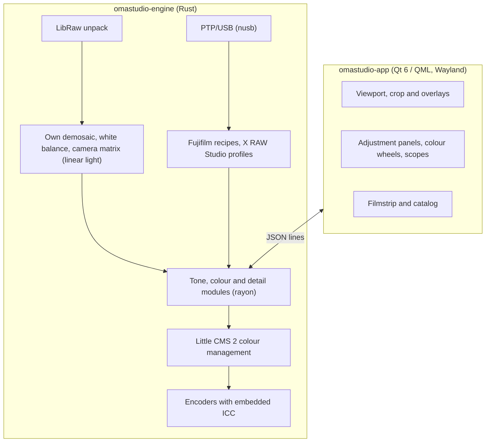
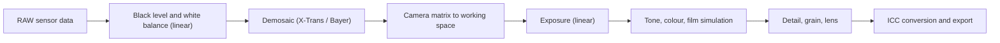

# OmaStudio

**OmaStudio: The Complete Medium Format RAW Editor for Omarchy**

OmaStudio is a non-destructive RAW editor built for Omarchy Linux. It develops RAW files with its own engine, written in Rust, and runs natively on Wayland and Hyprland. Fujifilm X and GFX, and Hasselblad medium format cameras get first-class support.

[English](README.md) • [Türkçe](README.tr.md)

[](LICENSE)
[](https://omarchy.org)
[](Cargo.toml)
[](app/)


---

## Overview

| Area | What OmaStudio provides |
| :--- | :--- |
| **RAW development** | The engine's own demosaicing for X-Trans and Bayer sensors on linear light, with camera colour matrices and black levels taken from the file. Demosaicing runs on the GPU through Vulkan (NVIDIA, AMD, Intel, Qualcomm Adreno) with an identical CPU fallback. LibRaw only unpacks the sensor data. |
| **Medium format** | Fujifilm GFX and Hasselblad RAW files with a 16-bit pipeline from sensor to export. |
| **Fujifilm** | Photos open with the recipe they were shot with: film simulation, tone, colour, grain, Color Chrome, white balance shift and dynamic range. X RAW Studio profiles (.FP1/.FP2/.FP3) and recipes shared as text can be imported and exported. The Fujifilm panel keeps a recipe library, reads and writes a connected camera's custom settings C1-C7, converts RAFs in camera and merges GFX Pixel Shift sequences. |
| **Colour management** | Little CMS 2 with built-in sRGB, Display P3, Adobe RGB, ProPhoto RGB and Rec. 2020 profiles, plus custom ICC profiles with a choice of rendering intent. ICC profiles are embedded in every export. |
| **Editing** | Exposure, tone, presence, HSL, tone curve, three-way colour wheels, 3D LUTs, RGB mixer, skin tone uniformity, film grain, local masks, crop and lens corrections. |
| **Library** | Local catalog with star ratings, pick/reject flags and colour labels; adjustments are stored in sidecar files and the original RAW is never modified. |
| **Cameras over USB** | A PTP/USB layer in pure Rust for tethering and Fujifilm in-camera RAW conversion. |
| **Export** | JPEG, PNG, TIFF (8/16-bit), WebP, JPEG XL and AVIF, with watermarking. |

---

## Architecture

OmaStudio is a native Qt 6 application, `omastudio-app` (Rust with cxx-qt, QML interface compiled into the binary). It runs as a Wayland client with Qt's fractional scaling, so the interface is drawn at the monitor's real pixel density under Hyprland. All image processing happens in a separate Rust engine process, `omastudio-engine`, which the window drives through a JSON-lines daemon over stdin/stdout. The same engine also offers a command line interface for scripts and Omarchy agents. A small Quickshell widget (`Panel.qml`) puts an OmaStudio button in the Omarchy bar.

The running window listens on a control socket (`$XDG_RUNTIME_DIR/omastudio/ipc.sock`, current user only). `omastudio ipc <method> [args]` calls it, for example `omastudio ipc openPhoto ~/Pictures/DSCF0001.RAF` or `omastudio ipc getStatus`; launching `omastudio photo.RAF` while a window is open hands the photo to that window.



### Processing order



---

## Supported cameras

OmaStudio opens every RAW format LibRaw 0.22 supports. The engine develops Bayer and X-Trans sensors with its own pipeline. Foveon, linear DNG, Fujifilm SuperCCD and four-colour sensors fall back to LibRaw automatically.

| Manufacturer | Additional support |
| :--- | :--- |
| Fujifilm X and GFX | In-camera recipe, film simulations, Color Chrome, X RAW Studio profiles, camera lens corrections, GFX Pixel Shift, PTP/USB |
| Hasselblad | 3FR/FFF files, HNCS-style rendering (in development) |
| Other manufacturers | Full development pipeline through the generic path |

---

## Requirements

* Omarchy (Arch Linux) with Wayland and Hyprland
* `libraw` 0.22 or newer, `lcms2`, `qt6-base`, `qt6-declarative` and `qt6-wayland` 6.12 or newer
* `quickshell` only for the button in the Omarchy bar
* `zenity` for file dialogs
* To build: Rust 1.99.1 or newer (pinned in `rust-toolchain.toml`), `clang`, `pkgconf`

Optional:
* `perl-image-exiftool` keeps EXIF metadata in exported files.
* `ffmpeg` is used for AVIF export if the built-in encoder fails.

---

## Installation

### Package

```bash
makepkg -si
```

The package installs the application, the engine, the ICC profiles and a udev rule (`70-omastudio-cameras.rules`) that gives the logged-in user USB access to Fujifilm cameras in PTP mode.

### Local build

```bash
cargo build --release --locked --workspace

install -Dm755 target/release/omastudio-engine ~/.local/bin/omastudio-engine
install -Dm755 target/release/omastudio-app ~/.local/bin/omastudio-app
install -Dm755 omastudio ~/.local/bin/omastudio
install -d ~/.local/share/omastudio/icc
install -m644 assets/icc/*.icc ~/.local/share/omastudio/icc/

omastudio
```

### Files

| Path | Contents |
| :--- | :--- |
| `~/.local/share/omastudio/catalog.json` | Catalog: ratings, flags, colour labels |
| `~/.local/share/omastudio/fuji-recipes/` | Saved Fujifilm recipes (.FP1) |
| `~/.local/share/omastudio/icc/` | Custom ICC profiles |
| `~/.config/omastudio/` | Settings |
| `~/.cache/omastudio/` | Thumbnails and previews |
| `<photo>.omastudio` | Adjustments for a photo (sidecar) |

---

## Command line

```bash
omastudio-engine inspect <raw>                     # metadata, histogram, scene analysis
omastudio-engine export <raw> --recipe '<json>' --options '<json>'
omastudio-engine fuji-recipe <raf|jpg|fp1|txt>     # read a Fujifilm recipe
omastudio-engine fuji-recipe list                  # saved recipes
omastudio-engine fuji-recipe save <file> --label "Name"
omastudio-engine fuji-recipe export <file> out.FP1 --device X-T30
omastudio-engine fuji-pixel-shift DSCF*.RAF --out merged.dng   # GFX Pixel Shift to DNG
omastudio-engine fuji-camera info | presets      # camera on USB, custom settings C1-C7
omastudio-engine fuji-camera write-preset C3 recipe.FP1
omastudio-engine fuji-camera convert DSCF0001.RAF --recipe recipe.FP1
omastudio-engine xmp export <raw>                  # Lightroom / Capture One / darktable sidecar
omastudio-engine xmp import <raw> [--save]
omastudio-engine gpu                               # GPU in use (OMASTUDIO_GPU=off for CPU only)
omastudio-engine icc list
omastudio-engine help
```

All commands print JSON, so Omarchy agents and scripts can use them directly.

---

## AI agents

`omastudio mcp` is a Model Context Protocol server (stdio), so any MCP client on Omarchy can inspect, render, cull and export photos, read and apply Fujifilm recipes, use a camera on USB, and control the open window (open a photo, apply a recipe, adjust, zoom, take a screenshot). Rendered previews and window screenshots are returned as images.

```bash
claude mcp add omastudio -- omastudio mcp    # Claude Code
omastudio skill                              # installs the agent skill into ~/.claude/skills
```

Other clients (opencode, Codex, Gemini CLI, ...) take the same command, `omastudio mcp`, in their MCP server settings. The skill (`skill/omastudio/SKILL.md`, installed to `/usr/share/omastudio/skill`) describes the tools, the command line and the recipe format for agents that read skills.

### Edit assistant

The AI edit assistant in the editor turns a request in plain words into adjustments, using Claude, OpenAI, OpenRouter, Gemini, or a local Ollama or LM Studio model. Keys go to the desktop keyring:

```bash
omastudio ai key anthropic          # paste the key, then Enter (stored with secret-tool)
omastudio ai use ollama llava       # or: anthropic, openai <model>, openrouter <model>, gemini <model>, lmstudio
omastudio ai edit DSCF0001.RAF --prompt "warmer, recover the sky"
```


---

## Keyboard shortcuts

| Key | Action |
| :--- | :--- |
| `Ctrl + O` | Open a photo |
| `Ctrl + S` | Save adjustments |
| `Alt + 1..4` | Switch between grade versions A–D |
| `1`–`5`, `0` | Set or clear the star rating |
| `P`, `X`, `U` | Pick, reject, clear flag |
| `C` | Crop and composition guides |
| `Y` | Before/after split view |
| `Ctrl + Shift + C` / `V` | Copy / paste adjustments |
| `Ctrl + R` | Reset adjustments |
| Double click | Toggle fit and 1:1 view |

---

## Security

* RAW files are opened read-only and never modified.
* Catalog, settings and sidecars are written atomically with mode `0600`; symbolic links are rejected.
* Every file the engine reads has a size limit, and every external program it runs has a time limit and its own process group.
* API keys are never passed on the command line.
* The interface renders all dynamic text as plain text and never evaluates code.

Details are in [SECURITY.md](SECURITY.md) and [CONTRIBUTING.md](CONTRIBUTING.md).

---

## Roadmap

Planned next:
* The full editing pipeline on the GPU (demosaicing already runs there)
* Local AI features accelerated by NPUs

---

## Support

OmaStudio is independent open source software. You can support its development at [Buy Me a Coffee](https://buymeacoffee.com/ozdil).

## License

MIT License © 2026 Ozan Özdil
