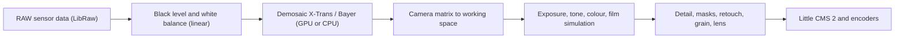

# OmaStudio

**OmaStudio: The Complete Medium Format RAW Editor for Omarchy**

OmaStudio is a non-destructive RAW editor for Omarchy Linux. It develops RAW files with its own engine, written in Rust, and runs natively on Wayland and Hyprland. Fujifilm GFX and X, Hasselblad, Phase One, Leaf, Mamiya and Pentax 645 files get dedicated support.

[English](README.md) • [Türkçe](README.tr.md) • [User guide and technologies in 30 languages](docs/README.md)

[](LICENSE)
[](https://omarchy.org)
[](Cargo.toml)
[](app/)


---

## Documentation

| | |
| :--- | :--- |
| [User guide](docs/guide/en.md) | Installation, the window, every panel and tool, export, cloud accounts, AI, shortcuts, command line |
| [Technologies](docs/technology/en.md) | What OmaStudio is built on, why each part was chosen, licences, architecture diagram |
| [All languages](docs/README.md) | The guide and the technologies page in all 30 interface languages |
| [Changelog](CHANGELOG.md) · [Security](SECURITY.md) · [Contributing](CONTRIBUTING.md) | |

---

## Features

| Area | What OmaStudio provides |
| :--- | :--- |
| **RAW development** | Own demosaicing for X-Trans and Bayer sensors on linear light, with the camera's colour matrix and black levels from the file. Demosaicing runs on the GPU through Vulkan (NVIDIA, AMD, Intel, Qualcomm Adreno) or OpenGL ES, with a matching CPU path. LibRaw 0.22 unpacks the sensor data. |
| **Medium format** | 16-bit pipeline from sensor to export. Hasselblad 3FR/FFF default crop, Phase One and Leaf IIQ/MOS sensor calibration, Mamiya MEF and Pentax 645 PEF, flat-field (LCC) correction and 4-shot multi-shot merge. |
| **Fujifilm** | Photos open with the recipe they were shot with (film simulation, tone, colour, grain, Color Chrome, white balance shift, dynamic range including D-Range Priority) and at the brightness of the camera's JPEG. Camera lens corrections for XF, XC and GF lenses. Recipe library with X RAW Studio profiles (.FP1/.FP2/.FP3) and text recipes. Custom settings C1–C7 read and written over USB, in-camera RAW conversion, GFX Pixel Shift merged to DNG. |
| **Editing** | White balance, tone, presence, point and RGB tone curves, colour mixer, three-way colour grading, channel mixer, 3D LUTs, detail and optics, perspective, film grain, crop and straighten. |
| **Local work** | Linear, radial, luminance, colour and brush masks, AI subject and sky masks, add/subtract/intersect parts; heal and clone spots. |
| **Colour management** | Little CMS 2 with sRGB, Display P3, Adobe RGB, ProPhoto RGB, Rec. 2020, ACEScg and your own ICC profiles; gamut compression, ACES tone curve, soft proofing with gamut warning. |
| **Viewing** | Zoom to 100% at any display scale, loupe, focus peaking, compare, before/after, histogram, waveform, RGB parade and vectorscope with clipping warnings. |
| **History** | Named history steps, snapshots, versions A–D per photo, copy/paste of edits, XMP sidecars for Lightroom, Capture One, darktable and digiKam. |
| **Library** | Folders and a catalog with star ratings, pick/reject flags and colour labels. Edits live in a sidecar next to the photo; the original is never modified. |
| **Export** | JPEG, PNG, TIFF, WebP, AVIF, HEIF, JPEG XL and OpenEXR with an embedded ICC profile, resizing, output sharpening for social media, watermarks, batch export and upload to a cloud account. |
| **Cloud** | Google Drive, OneDrive, Dropbox, Box, pCloud and Yandex Disk through rclone, GitHub through the GitHub CLI; secrets stay in the keyring. |
| **AI** | Edit assistant and AI chat through Omarchy's default agent (Claude Code or Codex), Ollama, LM Studio or a cloud provider. AI masks run on the computer with ONNX Runtime on an NPU, GPU or CPU. |
| **Automation** | JSON command line, a control socket for the open window and a Model Context Protocol server for AI agents. |
| **Omarchy** | Follows the active Omarchy theme, font and Hyprland rounding live, and the system language (30 languages, right to left for Arabic, Hebrew and Persian). |

---

## Screenshots

| Pro mode and tone curve | Colour grading | Masks |
| :---: | :---: | :---: |
|  |  |  |
| **Heal and clone** | **Soft proof** | **Export** |
|  |  |  |
| **Focus peaking** | **Compare** | **Hasselblad CFV-50c** |
|  |  |  |
| **Catppuccin Latte** | **Gruvbox** | **Rosé Pine** |
|  |  |  |

The screenshots use Fujifilm GFX 50R and Hasselblad CFV-50c sample files from [raw.pixls.us](https://raw.pixls.us) (CC0).

---

## Architecture

The window, `omastudio-app` (Qt 6 / QML with a Rust host through cxx-qt), and the engine, `omastudio-engine` (Rust), are separate processes that talk JSON lines over stdin/stdout. The window never decodes a photo itself, so a crash or hang in decoding cannot take the interface with it, and the same engine serves the command line, scripts and AI agents. See [Technologies](docs/technology/en.md) for the full diagram and the reasons behind each choice.



---

## Installation

Requirements: Omarchy (Arch Linux) with Wayland and Hyprland; `libraw` 0.22 or newer, `lcms2`, `qt6-base`, `qt6-declarative`, `qt6-wayland` and `qt6-svg` 6.12 or newer, and `zenity`. Optional packages are listed in the [user guide](docs/guide/en.md#1-installation).

### Package

```bash
makepkg -si
```

This installs the application, the engine, the ICC profiles, the desktop entry and a udev rule (`70-omastudio-cameras.rules`) that gives the logged-in user USB access to Fujifilm cameras in PTP mode.

### Release archive

Download `omastudio-<version>-x86_64-linux.tar.gz` from the [releases page](https://github.com/ozdil/omarchy-omastudio/releases), check it against `checksums.txt`, then copy `bin/*` to `~/.local/bin` and `share/omastudio` to `~/.local/share/omastudio`.

### Build from source

Building needs Rust 1.99.1 or newer (pinned in `rust-toolchain.toml`), `clang`, `pkgconf` and `qt6-tools`.

```bash
cargo build --release --locked --workspace

install -Dm755 target/release/omastudio-engine ~/.local/bin/omastudio-engine
install -Dm755 target/release/omastudio-app ~/.local/bin/omastudio-app
install -Dm755 omastudio ~/.local/bin/omastudio
install -d ~/.local/share/omastudio/icc
install -m644 assets/icc/*.icc ~/.local/share/omastudio/icc/

omastudio
```

Start OmaStudio from the Omarchy app menu or run `omastudio [photo]`. If a window is already open, the photo opens in it.

---

## Keyboard shortcuts

| Key | Action |
| :--- | :--- |
| `Ctrl+O` | Open a photo |
| `Ctrl+S` | Save the edit now |
| `Ctrl+Z` / `Ctrl+Shift+Z` or `Ctrl+Y` | Undo / redo |
| `Ctrl+Shift+C` / `Ctrl+Shift+V` | Copy / paste the edit |
| `Ctrl+R` | Reset the edit |
| `Ctrl+←` / `Ctrl+→` | Previous / next photo |
| `Ctrl+0` / `Ctrl+1` | Fit / 100% |
| `1`–`5`, `0` | Star rating, clear rating |
| `P`, `X`, `U` | Pick, reject, clear flag |
| `C` | Crop |
| `Y` | Before and after |
| `S` | Soft proof |
| `L` | Loupe |
| `Shift+F` | Focus peaking |
| `Shift+C` | Compare |
| `Alt+1` … `Alt+4` | Versions A–D |
| `E` | Export window |
| `Tab` | Hide or show the panels |
| `Esc` | Close the open window |

Mouse: wheel zooms at the pointer, `Shift`+wheel pans sideways, `Alt`+wheel rotates, double-click toggles fit and 200%, `Ctrl`+click on a section header keeps only that section open.

---

## Command line, control socket and MCP

Every engine command prints one JSON object.

```bash
omastudio inspect DSCF0001.RAF                     # camera, lens, exposure, histogram, scene
omastudio export DSCF0001.RAF --recipe '{"exposure":0.5}' --options '{"format":"jpeg"}'
omastudio fuji-recipe DSCF0001.RAF                 # the camera's recipe
omastudio fuji-camera info | presets               # camera on USB, custom settings C1–C7
omastudio fuji-pixel-shift DSCF*.RAF --out merged.dng
omastudio medium-format lcc-create white.IIQ       # flat-field correction
omastudio xmp export DSCF0001.RAF                  # Lightroom / Capture One / darktable sidecar
omastudio cameras GFX                              # cameras the RAW decoder supports
omastudio gpu                                      # GPU in use (OMASTUDIO_GPU=off for CPU only)
omastudio npu                                      # ONNX Runtime, accelerators, local models
omastudio cloud status
omastudio --cli help                               # every command
```

**Control socket.** The open window listens on `$XDG_RUNTIME_DIR/omastudio/ipc.sock` and only answers the same user. `omastudio ipc <method> [arguments]` calls it:

| Method | Does |
| :--- | :--- |
| `openPhoto <file>`, `openFolder <dir>` | Open a photo or a folder |
| `applyRecipe <json>`, `applyPreset <name>` | Apply an edit or a look |
| `setExposure <ev>`, `setWarmth <value>` | Change single adjustments |
| `setMode essentials\|pro` | Switch the tool set |
| `setRightTab <tab>`, `showSection <section>` | Show a tab or open one panel section |
| `setView peaking\|compare\|softProof\|split [on\|off]` | Toggle viewing aids |
| `setZoom fit\|<scale>` | Fit, or zoom to a pixel scale (1 = 100%) |
| `showExport`, `showCloud`, `showAbout` | Open a window |
| `getStatus`, `screenshot <file.png>` | Read the state, capture the window |

**MCP.** `omastudio mcp` is a Model Context Protocol server (stdio): agents can inspect, render, cull and export photos, read and apply Fujifilm recipes, use a camera on USB and control the open window.

```bash
claude mcp add omastudio -- omastudio mcp    # Claude Code
omastudio skill                              # installs the agent skill into ~/.claude/skills
```

Other MCP clients (opencode, Codex, Gemini CLI and others) take the same command.

---

## Files

| Path | Contents |
| :--- | :--- |
| `<photo>.omastudio` | The edit of a photo (sidecar) |
| `~/.local/share/omastudio/catalog.json` | Catalog: ratings, flags, colour labels |
| `~/.local/share/omastudio/fuji-recipes/` | Saved Fujifilm recipes |
| `~/.local/share/omastudio/icc/` | Your own ICC profiles |
| `~/.local/share/omastudio/models/` | Local AI models (`subject.onnx`, `sky.onnx`) |
| `~/.config/omastudio/` | Settings, interface state, language, cloud accounts |
| `~/.cache/omastudio/` | Thumbnails, previews, downloaded cloud photos |

---

## Languages

The interface is available in 30 languages: Arabic, Chinese (Simplified and Traditional), Czech, Danish, Dutch, English, Finnish, French, German, Greek, Hebrew, Hindi, Hungarian, Indonesian, Italian, Japanese, Korean, Norwegian Bokmål, Persian, Polish, Portuguese (Brazil), Romanian, Russian, Spanish, Swedish, Thai, Turkish, Ukrainian and Vietnamese. It follows the system language; the language menu in the top bar switches at once.

Translations live in `app/i18n/qml_<code>.ts`. `tools/i18n/update.sh` refreshes them from the QML, and `tools/i18n/check.py`, run in CI, fails when a string is missing, left in English, in the wrong script or has mismatched placeholders. Engine messages are still in English.

---

## Security

* RAW files are opened read-only and never modified.
* Catalog, settings and sidecars are written atomically with mode `0600`; symbolic links are rejected.
* Every file the engine reads has a size limit, and every external program it runs has a time limit and its own process group.
* API keys and cloud tokens stay in the keyring and are never passed on a command line.
* The interface renders all dynamic text as plain text.

Details are in [SECURITY.md](SECURITY.md).

---

## Contributing

See [CONTRIBUTING.md](CONTRIBUTING.md). CI builds and tests every change in an `archlinux` container, runs `clippy -D warnings` and the translation check.

## Support

OmaStudio is independent open source software. You can support its development at [Buy Me a Coffee](https://buymeacoffee.com/ozdil).

## Trademarks

Fujifilm, GFX, X-Trans, Hasselblad, Phase One, Leica, Pentax, Mamiya and other camera names are trademarks of their owners and are used only to describe compatibility.

## License

MIT License © 2026 Ozan Özdil
