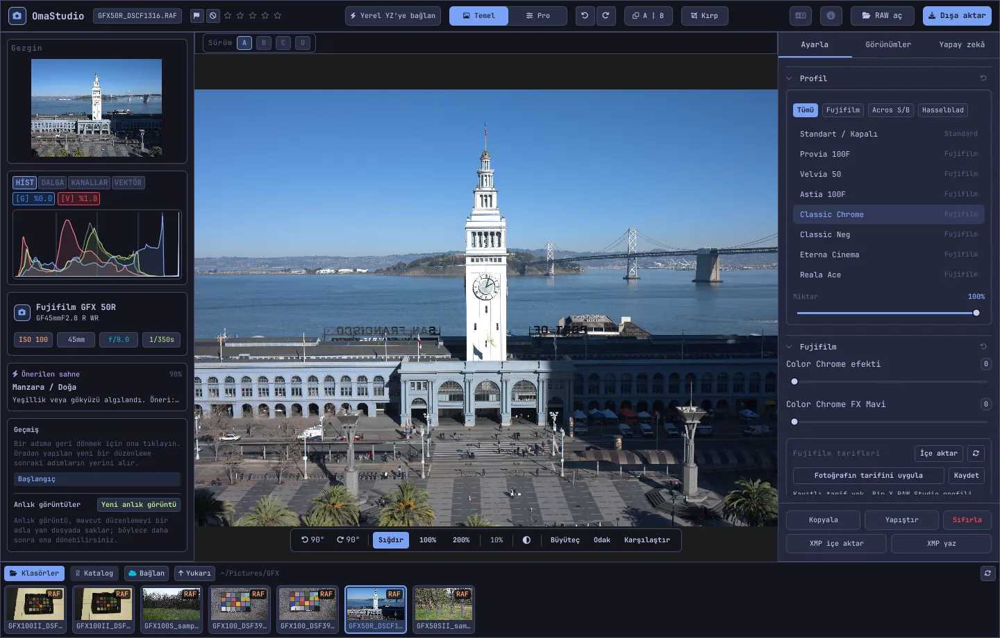
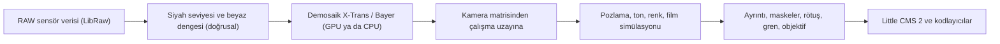

# OmaStudio

**OmaStudio: The Complete Medium Format RAW Editor for Omarchy**

*Omarchy için eksiksiz orta format RAW düzenleyicisi.*

OmaStudio, Omarchy Linux için orijinal dosyaya dokunmayan bir RAW düzenleyicisidir. RAW dosyalarını Rust ile yazılmış kendi motoruyla geliştirir ve Wayland ile Hyprland üzerinde yerel olarak çalışır. Fujifilm GFX ve X, Hasselblad, Phase One, Leaf, Mamiya ve Pentax 645 dosyalarına özel destek verir.

[English](README.md) • [Türkçe](README.tr.md) • [30 dilde kullanım kılavuzu ve teknolojiler](docs/README.md)

[](LICENSE)
[](https://omarchy.org)
[](Cargo.toml)
[](app/)



---

## Belgeler

| | |
| :--- | :--- |
| [Kullanım kılavuzu](docs/guide/tr.md) | Kurulum, pencere, her panel ve araç, dışa aktarma, bulut hesapları, yapay zekâ, kısayollar, komut satırı |
| [Teknolojiler](docs/technology/tr.md) | OmaStudio'nun neyle yapıldığı, her parçanın neden seçildiği, lisanslar, mimari şeması |
| [Tüm diller](docs/README.md) | Kılavuz ve teknolojiler sayfası, arayüzün 30 dilinin hepsinde |
| [Değişiklik günlüğü](CHANGELOG.md) · [Güvenlik](SECURITY.md) · [Katkı](CONTRIBUTING.md) | |

---

## Özellikler

| Alan | OmaStudio'nun sundukları |
| :--- | :--- |
| **RAW geliştirme** | X-Trans ve Bayer sensörler için doğrusal ışıkta kendi demosaik işlemi; kameranın renk matrisi ve siyah seviyeleri dosyadan alınır. Demosaik GPU'da Vulkan (NVIDIA, AMD, Intel, Qualcomm Adreno) ya da OpenGL ES ile çalışır, aynı sonucu veren bir CPU yolu vardır. Sensör verisini LibRaw 0.22 açar. |
| **Orta format** | Sensörden dışa aktarmaya kadar 16 bit işlem hattı. Hasselblad 3FR/FFF varsayılan kırpması, Phase One ve Leaf IIQ/MOS sensör kalibrasyonu, Mamiya MEF ve Pentax 645 PEF, düz alan (LCC) düzeltmesi ve 4 çekimlik multi-shot birleştirme. |
| **Fujifilm** | Fotoğraflar çekildikleri reçeteyle (film simülasyonu, ton, renk, gren, Color Chrome, beyaz dengesi kayması, D-Range Priority dahil dinamik aralık) ve kameranın JPEG parlaklığıyla açılır. XF, XC ve GF objektifler için kamera objektif düzeltmeleri. X RAW Studio profilleri (.FP1/.FP2/.FP3) ve metin reçetelerle reçete kitaplığı. USB üzerinden C1–C7 özel ayarlarını okuma ve yazma, kamera içinde RAW dönüştürme, GFX Pixel Shift'i DNG'ye birleştirme. |
| **Düzenleme** | Beyaz dengesi, ton, varlık, nokta ve RGB ton eğrileri, renk karıştırıcı, üç yollu renk derecelendirme, kanal karıştırıcı, 3D LUT, ayrıntı ve optik, perspektif, film greni, kırpma ve düzeltme. |
| **Yerel çalışma** | Doğrusal, dairesel, parlaklık, renk ve fırça maskeleri, yapay zekâ konu ve gökyüzü maskeleri, parça ekleme/çıkarma/kesiştirme; leke onarma ve klonlama. |
| **Renk yönetimi** | sRGB, Display P3, Adobe RGB, ProPhoto RGB, Rec. 2020, ACEScg ve kendi ICC profillerinizle Little CMS 2; gamut sıkıştırma, ACES ton eğrisi, gamut uyarılı ekran provası. |
| **Görüntüleme** | Her ekran ölçeğinde gerçek %100 yakınlaştırma, büyüteç, odak vurgusu, karşılaştırma, önce/sonra, kırpılma uyarılı histogram, dalga formu, RGB parade ve vektörskop. |
| **Geçmiş** | Adlandırılmış geçmiş adımları, anlık görüntüler, fotoğraf başına A–D sürümleri, düzenleme kopyala/yapıştır, Lightroom, Capture One, darktable ve digiKam için XMP dosyaları. |
| **Kitaplık** | Klasörler ve yıldız puanı, seç/reddet bayrağı ve renk etiketli katalog. Düzenlemeler fotoğrafın yanındaki yan dosyada tutulur; orijinal dosya hiç değişmez. |
| **Dışa aktarma** | Gömülü ICC profiliyle JPEG, PNG, TIFF, WebP, AVIF, HEIF, JPEG XL ve OpenEXR; yeniden boyutlandırma, sosyal medya için çıktı keskinleştirme, filigran, toplu dışa aktarma ve bulut hesabına yükleme. |
| **Bulut** | rclone ile Google Drive, OneDrive, Dropbox, Box, pCloud ve Yandex Disk, GitHub CLI ile GitHub; gizli bilgiler anahtarlıkta kalır. |
| **Yapay zekâ** | Omarchy'nin varsayılan ajanı (Claude Code ya da Codex), Ollama, LM Studio veya bir bulut sağlayıcısıyla düzenleme asistanı ve yapay zekâ sohbeti. Yapay zekâ maskeleri bilgisayarda ONNX Runtime ile NPU, GPU ya da CPU'da çalışır. |
| **Otomasyon** | JSON çıktılı komut satırı, açık pencere için kontrol soketi ve yapay zekâ ajanları için Model Context Protocol sunucusu. |
| **Omarchy** | Etkin Omarchy temasını, yazı tipini ve Hyprland köşe yuvarlamasını canlı izler; sistem dilini izler (30 dil, Arapça, İbranice ve Farsça sağdan sola). |

---

## Ekran görüntüleri

| Pro modu ve ton eğrisi | Renk derecelendirme | Maskeler |
| :---: | :---: | :---: |
|  |  |  |
| **Onarma ve klonlama** | **Ekran provası** | **Dışa aktarma** |
|  |  |  |
| **Odak vurgusu** | **Karşılaştırma** | **Hasselblad CFV-50c** |
|  |  |  |
| **Catppuccin Latte** | **Gruvbox** | **Rosé Pine** |
|  |  |  |

Ekran görüntülerinde [raw.pixls.us](https://raw.pixls.us) sitesindeki Fujifilm GFX 50R ve Hasselblad CFV-50c örnek dosyaları (CC0) kullanılmıştır.

---

## Mimari

Pencere `omastudio-app` (cxx-qt ile Rust ana süreçli Qt 6 / QML) ve motor `omastudio-engine` (Rust) ayrı süreçlerdir; stdin/stdout üzerinden JSON satırlarıyla konuşur. Pencere hiçbir fotoğrafı kendisi çözmez; bu yüzden çözme sırasında bir çökme ya da takılma arayüzü düşürmez ve aynı motor komut satırına, betiklere ve yapay zekâ ajanlarına hizmet eder. Tam şema ve her seçimin gerekçesi [Teknolojiler](docs/technology/tr.md) sayfasındadır.



---

## Kurulum

Gereksinimler: Wayland ve Hyprland ile Omarchy (Arch Linux); `libraw` 0.22 veya üstü, `lcms2`, `qt6-base`, `qt6-declarative`, `qt6-wayland` ve `qt6-svg` 6.12 veya üstü ve `zenity`. İsteğe bağlı paketler [kullanım kılavuzunda](docs/guide/tr.md#1-kurulum) listelenir.

### Paket

```bash
makepkg -si
```

Bu komut uygulamayı, motoru, ICC profillerini, masaüstü girdisini ve oturum açan kullanıcıya PTP modundaki Fujifilm kameralara USB erişimi veren bir udev kuralını (`70-omastudio-cameras.rules`) kurar.

### Sürüm arşivi

[Sürümler sayfasından](https://github.com/ozdil/omarchy-omastudio/releases) `omastudio-<sürüm>-x86_64-linux.tar.gz` dosyasını indirin, `checksums.txt` ile doğrulayın, sonra `bin/*` içeriğini `~/.local/bin` klasörüne, `share/omastudio` klasörünü `~/.local/share/omastudio` konumuna kopyalayın.

### Kaynaktan derleme

Derlemek için Rust 1.99.1 veya üstü (`rust-toolchain.toml` içinde sabitlenmiştir), `clang`, `pkgconf` ve `qt6-tools` gerekir.

```bash
cargo build --release --locked --workspace

install -Dm755 target/release/omastudio-engine ~/.local/bin/omastudio-engine
install -Dm755 target/release/omastudio-app ~/.local/bin/omastudio-app
install -Dm755 omastudio ~/.local/bin/omastudio
install -d ~/.local/share/omastudio/icc
install -m644 assets/icc/*.icc ~/.local/share/omastudio/icc/

omastudio
```

OmaStudio'yu Omarchy uygulama menüsünden başlatın ya da `omastudio [fotoğraf]` çalıştırın. Açık bir pencere varsa fotoğraf o pencerede açılır.

---

## Klavye kısayolları

| Tuş | İşlem |
| :--- | :--- |
| `Ctrl+O` | Fotoğraf aç |
| `Ctrl+S` | Düzenlemeyi hemen kaydet |
| `Ctrl+Z` / `Ctrl+Shift+Z` ya da `Ctrl+Y` | Geri al / yinele |
| `Ctrl+Shift+C` / `Ctrl+Shift+V` | Düzenlemeyi kopyala / yapıştır |
| `Ctrl+R` | Düzenlemeyi sıfırla |
| `Ctrl+←` / `Ctrl+→` | Önceki / sonraki fotoğraf |
| `Ctrl+0` / `Ctrl+1` | Sığdır / %100 |
| `1`–`5`, `0` | Yıldız puanı, puanı temizle |
| `P`, `X`, `U` | Seç, reddet, bayrağı temizle |
| `C` | Kırp |
| `Y` | Önce ve sonra |
| `S` | Ekran provası |
| `L` | Büyüteç |
| `Shift+F` | Odak vurgusu |
| `Shift+C` | Karşılaştır |
| `Alt+1` … `Alt+4` | A–D sürümleri |
| `E` | Dışa aktarma penceresi |
| `Tab` | Panelleri gizle ya da göster |
| `Esc` | Açık pencereyi kapat |

Fare: tekerlek imlecin olduğu yerde yakınlaştırır, `Shift`+tekerlek yana kaydırır, `Alt`+tekerlek döndürür, çift tıklama sığdır ile %200 arasında geçiş yapar, bir bölüm başlığına `Ctrl`+tıklama yalnızca o bölümü açık bırakır.

---

## Komut satırı, kontrol soketi ve MCP

Her motor komutu tek bir JSON nesnesi yazdırır.

```bash
omastudio inspect DSCF0001.RAF                     # kamera, objektif, pozlama, histogram, sahne
omastudio export DSCF0001.RAF --recipe '{"exposure":0.5}' --options '{"format":"jpeg"}'
omastudio fuji-recipe DSCF0001.RAF                 # kameranın reçetesi
omastudio fuji-camera info | presets               # USB'deki kamera, C1–C7 özel ayarları
omastudio fuji-pixel-shift DSCF*.RAF --out merged.dng
omastudio medium-format lcc-create white.IIQ       # düz alan düzeltmesi
omastudio xmp export DSCF0001.RAF                  # Lightroom / Capture One / darktable yan dosyası
omastudio cameras GFX                              # RAW çözücünün desteklediği kameralar
omastudio gpu                                      # kullanılan GPU (yalnızca CPU için OMASTUDIO_GPU=off)
omastudio npu                                      # ONNX Runtime, hızlandırıcılar, yerel modeller
omastudio cloud status
omastudio --cli help                               # tüm komutlar
```

**Kontrol soketi.** Açık pencere `$XDG_RUNTIME_DIR/omastudio/ipc.sock` üzerinde dinler ve yalnızca aynı kullanıcıya yanıt verir. `omastudio ipc <yöntem> [argümanlar]` onu çağırır:

| Yöntem | Ne yapar |
| :--- | :--- |
| `openPhoto <dosya>`, `openFolder <klasör>` | Fotoğraf ya da klasör açar |
| `applyRecipe <json>`, `applyPreset <ad>` | Düzenleme ya da görünüm uygular |
| `setExposure <ev>`, `setWarmth <değer>` | Tek bir ayarı değiştirir |
| `setMode essentials\|pro` | Araç setini değiştirir |
| `setRightTab <sekme>`, `showSection <bölüm>` | Bir sekmeyi gösterir ya da tek bir panel bölümünü açar |
| `setView peaking\|compare\|softProof\|split [on\|off]` | Görüntüleme yardımcılarını açar/kapatır |
| `setZoom fit\|<ölçek>` | Sığdırır ya da piksel ölçeğine yakınlaştırır (1 = %100) |
| `showExport`, `showCloud`, `showAbout` | Bir pencere açar |
| `getStatus`, `screenshot <dosya.png>` | Durumu okur, pencerenin görüntüsünü alır |

**MCP.** `omastudio mcp` bir Model Context Protocol sunucusudur (stdio): ajanlar fotoğrafları inceleyebilir, işleyebilir, eleyebilir ve dışa aktarabilir, Fujifilm reçetelerini okuyup uygulayabilir, USB'deki kamerayı kullanabilir ve açık pencereyi yönetebilir.

```bash
claude mcp add omastudio -- omastudio mcp    # Claude Code
omastudio skill                              # ajan becerisini ~/.claude/skills içine kurar
```

Diğer MCP istemcileri (opencode, Codex, Gemini CLI ve başkaları) aynı komutu kullanır.

---

## Dosyalar

| Yol | İçerik |
| :--- | :--- |
| `<fotoğraf>.omastudio` | Fotoğrafın düzenlemesi (yan dosya) |
| `~/.local/share/omastudio/catalog.json` | Katalog: puanlar, bayraklar, renk etiketleri |
| `~/.local/share/omastudio/fuji-recipes/` | Kaydedilmiş Fujifilm reçeteleri |
| `~/.local/share/omastudio/icc/` | Kendi ICC profilleriniz |
| `~/.local/share/omastudio/models/` | Yerel yapay zekâ modelleri (`subject.onnx`, `sky.onnx`) |
| `~/.config/omastudio/` | Ayarlar, arayüz durumu, dil, bulut hesapları |
| `~/.cache/omastudio/` | Küçük resimler, önizlemeler, buluttan indirilen fotoğraflar |

---

## Diller

Arayüz 30 dilde kullanılabilir: Almanca, Arapça, Çekçe, Çince (Basitleştirilmiş ve Geleneksel), Danca, Endonezce, Farsça, Felemenkçe, Fince, Fransızca, Hintçe, İbranice, İngilizce, İspanyolca, İsveççe, İtalyanca, Japonca, Korece, Lehçe, Macarca, Norveççe (Bokmål), Portekizce (Brezilya), Romence, Rusça, Tayca, Türkçe, Ukraynaca, Vietnamca ve Yunanca. Arayüz sistem dilini izler; üst çubuktaki dil menüsü dili hemen değiştirir.

Çeviriler `app/i18n/qml_<kod>.ts` dosyalarındadır. `tools/i18n/update.sh` bunları QML'den yeniler; CI'da çalışan `tools/i18n/check.py`, eksik, İngilizce bırakılmış, yanlış alfabeyle yazılmış ya da yer tutucuları uyuşmayan bir metin olduğunda derlemeyi durdurur. Motor iletileri hâlâ İngilizcedir.

---

## Güvenlik

* RAW dosyaları salt okunur açılır ve hiç değiştirilmez.
* Katalog, ayarlar ve yan dosyalar `0600` kipiyle atomik olarak yazılır; sembolik bağlantılar reddedilir.
* Motorun okuduğu her dosyanın bir boyut sınırı, çalıştırdığı her dış programın bir süre sınırı ve kendi süreç grubu vardır.
* API anahtarları ve bulut belirteçleri anahtarlıkta kalır, hiçbir zaman komut satırına konmaz.
* Arayüz tüm dinamik metinleri düz metin olarak gösterir.

Ayrıntılar [SECURITY.md](SECURITY.md) dosyasındadır.

---

## Katkı

[CONTRIBUTING.md](CONTRIBUTING.md) dosyasına bakın. CI her değişikliği bir `archlinux` kapsayıcısında derler ve test eder, `clippy -D warnings` ve çeviri denetimini çalıştırır.

## Destek

OmaStudio bağımsız bir açık kaynak yazılımdır. Geliştirilmesine [GitHub Sponsors](https://github.com/sponsors/ozdil) ya da [Buy Me a Coffee](https://buymeacoffee.com/ozdil) üzerinden destek olabilirsiniz.

## Ticari markalar

Fujifilm, GFX, X-Trans, Hasselblad, Phase One, Leica, Pentax, Mamiya ve diğer kamera adları sahiplerinin ticari markalarıdır ve yalnızca uyumluluğu belirtmek için kullanılır.

## Lisans

MIT Lisansı © 2026 Ozan Özdil
