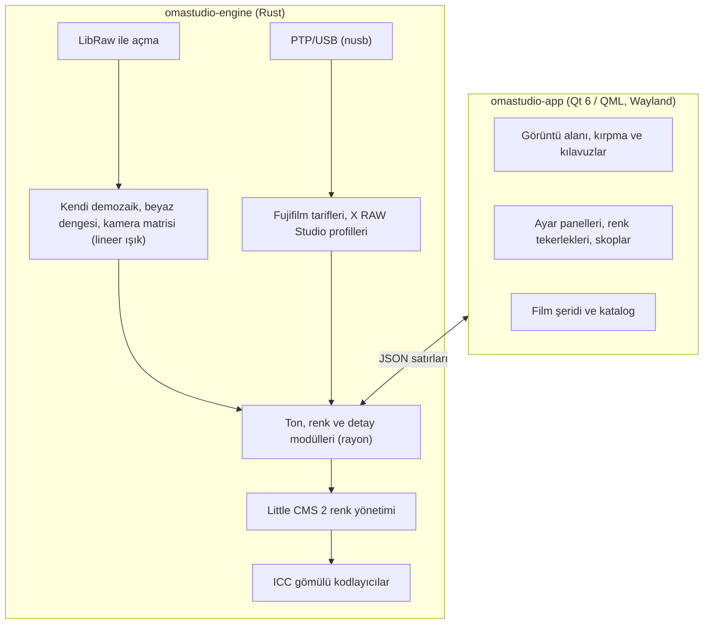

# OmaStudio

**OmaStudio: The Complete Medium Format RAW Editor for Omarchy**

*Omarchy için eksiksiz orta format RAW düzenleyicisi.*

OmaStudio, Omarchy Linux için geliştirilmiş, orijinal dosyaya dokunmayan bir RAW düzenleyicisidir. RAW dosyalarını Rust ile yazılmış kendi motoruyla geliştirir ve Wayland ile Hyprland üzerinde yerel olarak çalışır. Fujifilm X ve GFX ile Hasselblad orta format kameralar birinci sınıf destek alır.

[English](README.md) • [Türkçe](README.tr.md)

[](LICENSE)
[](https://omarchy.org)
[](Cargo.toml)
[](app/)


---

## Genel bakış

| Alan | OmaStudio'nun sunduğu |
| :--- | :--- |
| **RAW geliştirme** | X-Trans ve Bayer sensörler için motorun kendi demozaik işlemi, lineer ışık üzerinde. Kamera renk matrisi ve siyah seviyeleri dosyadan okunur. Demozaik Vulkan üzerinden GPU'da çalışır (NVIDIA, AMD, Intel, Qualcomm Adreno); GPU yoksa aynı sonucu veren CPU yolu kullanılır. LibRaw yalnızca sensör verisini açar. |
| **Orta format** | Fujifilm GFX ve Hasselblad RAW dosyaları. Sensörden dışa aktarıma kadar 16-bit işlenir. |
| **Fujifilm** | Fotoğraflar çekildikleri tarifle açılır: film simülasyonu, ton, renk, gren, Color Chrome, beyaz dengesi kaydırması ve dinamik aralık. X RAW Studio profilleri (.FP1/.FP2/.FP3) ve metin olarak paylaşılan tarifler içe ve dışa aktarılabilir. Fujifilm panelinde tarif kütüphanesi bulunur; bağlı kameranın C1-C7 özel ayarları okunup yazılabilir, RAF dosyaları kamera içinde dönüştürülebilir ve GFX Pixel Shift serileri birleştirilebilir. |
| **Renk yönetimi** | Little CMS 2 kullanılır. sRGB, Display P3, Adobe RGB, ProPhoto RGB ve Rec. 2020 profilleri yerleşik gelir. Özel ICC profilleri de seçilebilir bir işleme amacıyla (rendering intent) desteklenir. Her dışa aktarıma ICC profili gömülür. |
| **Düzenleme** | Pozlama, ton, varlık, HSL, ton eğrisi, üç yollu renk tekerlekleri, 3D LUT, RGB karıştırıcı, cilt tonu eşitleme, film greni, yerel maskeler, kırpma ve lens düzeltmeleri. |
| **Kütüphane** | Yerel katalogda yıldız puanı, seç/ele bayrakları ve renk etiketleri tutulur. Ayarlar yan dosyalarda saklanır, orijinal RAW hiçbir zaman değiştirilmez. |
| **USB ile kamera** | Kabloyla bağlı çekim ve Fujifilm kamera içi RAW dönüştürme için saf Rust ile yazılmış bir PTP/USB katmanı. |
| **Dışa aktarma** | JPEG, PNG, TIFF (8/16-bit), WebP, JPEG XL ve AVIF. Filigran desteği vardır. |

---

## Mimari

OmaStudio yerel bir Qt 6 uygulamasıdır: `omastudio-app` (cxx-qt ile Rust; QML arayüzü ikili dosyanın içine derlenir). Qt'nin kesirli ölçekleme desteğiyle Wayland istemcisi olarak çalışır; arayüz Hyprland altında monitörün gerçek piksel yoğunluğunda çizilir. Tüm görüntü işleme `omastudio-engine` adlı ayrı bir Rust sürecinde yapılır; pencere motoru stdin/stdout üzerinden JSON satırlarıyla konuşan bir daemon aracılığıyla yönetir. Aynı motor, betikler ve Omarchy ajanları için bir komut satırı arayüzü de sunar. Küçük bir Quickshell bileşeni (`Panel.qml`) Omarchy çubuğuna OmaStudio düğmesi ekler.

Çalışan pencere bir kontrol soketini dinler (`$XDG_RUNTIME_DIR/omastudio/ipc.sock`, yalnızca aynı kullanıcı). `omastudio ipc <yöntem> [argümanlar]` bu soketi çağırır, örneğin `omastudio ipc openPhoto ~/Pictures/DSCF0001.RAF` veya `omastudio ipc getStatus`. Bir pencere açıkken `omastudio foto.RAF` çalıştırılırsa fotoğraf o pencerede açılır.



---

## Desteklenen kameralar

OmaStudio, LibRaw 0.22'nin desteklediği tüm RAW biçimlerini açar. Bayer ve X-Trans sensörler motorun kendi boru hattından geçer. Foveon, lineer DNG, Fujifilm SuperCCD ve dört renkli sensörler otomatik olarak LibRaw'a devredilir.

| Üretici | Ek destek |
| :--- | :--- |
| Fujifilm X ve GFX | Kamera tarifi, film simülasyonları, Color Chrome, X RAW Studio profilleri, kameranın lens düzeltmeleri, GFX Pixel Shift, PTP/USB |
| Hasselblad | 3FR/FFF dosyaları, HNCS benzeri işleme (geliştiriliyor) |
| Diğer üreticiler | Genel yol üzerinden tam geliştirme |

---

## Gereksinimler

* Wayland ve Hyprland ile Omarchy (Arch Linux)
* `libraw` 0.22 veya üstü, `lcms2`, `qt6-base`, `qt6-declarative` ve `qt6-wayland` 6.12 veya üstü
* `quickshell` yalnızca Omarchy çubuğundaki düğme için
* Dosya pencereleri için `zenity`
* Derlemek için: Rust 1.99.1 veya üstü (`rust-toolchain.toml` içinde sabit), `clang`, `pkgconf`

İsteğe bağlı:
* `perl-image-exiftool`: dışa aktarılan dosyalarda EXIF bilgilerini korur.
* `ffmpeg`: yerleşik kodlayıcı başarısız olursa AVIF dışa aktarımı için kullanılır.

---

## Kurulum

### Paket

```bash
makepkg -si
```

Paket şunları kurar: uygulama, motor, ICC profilleri ve bir udev kuralı (`70-omastudio-cameras.rules`). Bu kural, oturum açmış kullanıcıya PTP modundaki Fujifilm kameralara USB erişimi verir.

### Yerel derleme

```bash
cargo build --release --locked --workspace

install -Dm755 target/release/omastudio-engine ~/.local/bin/omastudio-engine
install -Dm755 target/release/omastudio-app ~/.local/bin/omastudio-app
install -Dm755 omastudio ~/.local/bin/omastudio
install -d ~/.local/share/omastudio/icc
install -m644 assets/icc/*.icc ~/.local/share/omastudio/icc/

omastudio
```

### Dosyalar

| Yol | İçerik |
| :--- | :--- |
| `~/.local/share/omastudio/catalog.json` | Katalog: puanlar, bayraklar, renk etiketleri |
| `~/.local/share/omastudio/fuji-recipes/` | Kaydedilmiş Fujifilm tarifleri (.FP1) |
| `~/.local/share/omastudio/icc/` | Özel ICC profilleri |
| `~/.config/omastudio/` | Ayarlar |
| `~/.cache/omastudio/` | Küçük resimler ve önizlemeler |
| `<fotoğraf>.omastudio` | Fotoğrafın ayarları (yan dosya) |

---

## Komut satırı

```bash
omastudio-engine inspect <raw>                     # meta veri, histogram, sahne analizi
omastudio-engine export <raw> --recipe '<json>' --options '<json>'
omastudio-engine fuji-recipe <raf|jpg|fp1|txt>     # Fujifilm tarifini oku
omastudio-engine fuji-recipe list                  # kaydedilmiş tarifler
omastudio-engine fuji-recipe save <dosya> --label "Ad"
omastudio-engine fuji-recipe export <dosya> cikti.FP1 --device X-T30
omastudio-engine fuji-pixel-shift DSCF*.RAF --out birlesik.dng # GFX Pixel Shift → DNG
omastudio-engine fuji-camera info | presets      # USB'deki kamera, C1-C7 özel ayarları
omastudio-engine fuji-camera write-preset C3 tarif.FP1
omastudio-engine fuji-camera convert DSCF0001.RAF --recipe tarif.FP1
omastudio-engine gpu                               # kullanılan GPU (yalnızca CPU için OMASTUDIO_GPU=off)
omastudio-engine icc list
omastudio-engine help
```

Tüm komutlar JSON çıktı verir. Bu sayede Omarchy ajanları ve betikler onları doğrudan kullanabilir.

---

## Klavye kısayolları

| Tuş | İşlem |
| :--- | :--- |
| `Ctrl + O` | Fotoğraf aç |
| `Ctrl + S` | Ayarları kaydet |
| `Alt + 1..4` | A–D sürümleri arasında geçiş |
| `1`–`5`, `0` | Yıldız puanı ver veya temizle |
| `P`, `X`, `U` | Seç, ele, bayrağı kaldır |
| `C` | Kırpma ve kompozisyon kılavuzları |
| `Y` | Önce/sonra bölünmüş görünüm |
| `Ctrl + Shift + C` / `V` | Ayarları kopyala / yapıştır |
| `Ctrl + R` | Ayarları sıfırla |
| Çift tıklama | Sığdır ve 1:1 görünüm arasında geçiş |

---

## Güvenlik

* RAW dosyaları salt okunur açılır ve asla değiştirilmez.
* Katalog, ayarlar ve yan dosyalar `0600` izniyle atomik olarak yazılır. Sembolik bağlantılar reddedilir.
* Motorun okuduğu her dosyanın bir boyut sınırı vardır. Çalıştırdığı her harici programın bir süre sınırı ve kendi süreç grubu vardır.
* API anahtarları komut satırında asla geçirilmez.
* Arayüz tüm dinamik metni düz metin olarak gösterir ve hiçbir zaman kod çalıştırmaz.

Ayrıntılar [SECURITY.md](SECURITY.md) ve [CONTRIBUTING.md](CONTRIBUTING.md) dosyalarındadır.

---

## Yol haritası

Sıradaki planlar:
* Tüm düzenleme hattının GPU'ya taşınması (demozaik zaten GPU'da)
* NPU ile hızlandırılan yerel yapay zekâ özellikleri

---

## Destek

OmaStudio bağımsız bir açık kaynak yazılımdır. Geliştirmeyi [Buy Me a Coffee](https://buymeacoffee.com/ozdil) üzerinden destekleyebilirsiniz.

## Lisans

MIT Lisansı © 2026 Ozan Özdil
