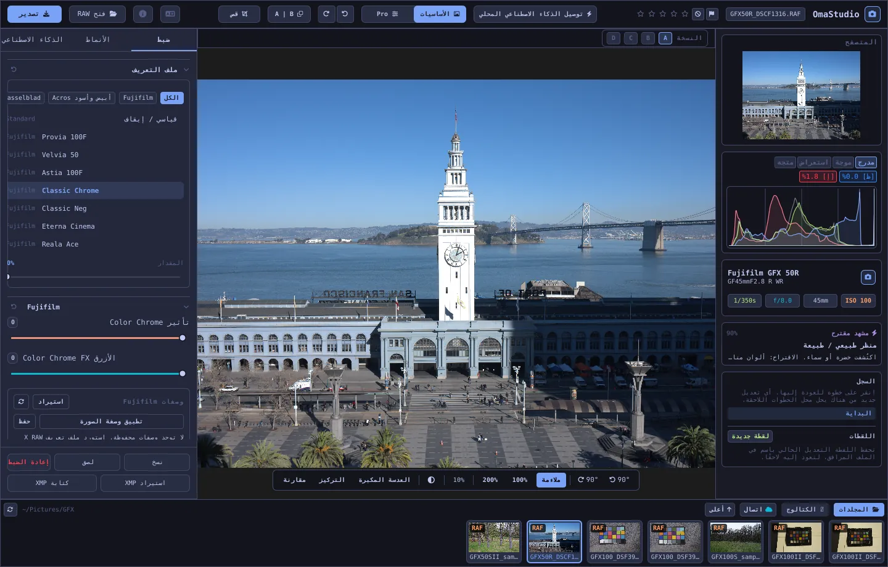

# دليل استخدام OmaStudio

**OmaStudio: The Complete Medium Format RAW Editor for Omarchy**

[كل اللغات](../README.md) · [التقنيات](../technology/ar.md) · [README](../../README.md)

يغطي هذا الدليل OmaStudio 3.1. يشرح كيفية تثبيت التطبيق، والتنقل في النافذة، واستخدام كل لوحة وأداة. تعرض لقطات الشاشة ملفات نموذجية من Fujifilm GFX 50R وHasselblad CFV-50c مأخوذة من [raw.pixls.us](https://raw.pixls.us) (CC0).



## المحتويات

1. [التثبيت](#1-التثبيت)
2. [النافذة](#2-النافذة)
3. [فتح الصور والمكتبة](#3-فتح-الصور-والمكتبة)
4. [الأساسيات وPro](#4-الأساسيات-وpro)
5. [تبويب ضبط](#5-تبويب-ضبط)
6. [تبويب الأقنعة](#6-تبويب-الأقنعة)
7. [تبويب الأنماط](#7-تبويب-الأنماط)
8. [تبويب الذكاء الاصطناعي ومحادثة الذكاء الاصطناعي](#8-تبويب-الذكاء-الاصطناعي-ومحادثة-الذكاء-الاصطناعي)
9. [أدوات العرض](#9-أدوات-العرض)
10. [السجل واللقطات والنسخ](#10-السجل-واللقطات-والنسخ)
11. [Fujifilm](#11-fujifilm)
12. [التنسيق المتوسط](#12-التنسيق-المتوسط)
13. [التصدير](#13-التصدير)
14. [الحسابات السحابية](#14-الحسابات-السحابية)
15. [لوحة المفاتيح والفأرة](#15-لوحة-المفاتيح-والفأرة)
16. [سطر الأوامر ومقبس التحكم وMCP](#16-سطر-الأوامر-ومقبس-التحكم-وmcp)
17. [الملفات والمجلدات](#17-الملفات-والمجلدات)
18. [حل المشكلات](#18-حل-المشكلات)

## 1. التثبيت

يعمل OmaStudio على Omarchy (Arch Linux) تحت Wayland وHyprland.

**من الحزمة.** داخل نسخة مستنسخة من المستودع:

```bash
makepkg -si
```

يثبّت هذا `omastudio` و`omastudio-app` و`omastudio-engine` وملفات تعريف ICC ومدخل سطح المكتب والأيقونات وقاعدة udev لكاميرات Fujifilm الموصولة عبر USB.

**من أرشيف إصدار.** نزّل `omastudio-<version>-x86_64-linux.tar.gz` من [صفحة الإصدارات](https://github.com/ozdil/omarchy-omastudio/releases)، وتحقق منه مقابل `checksums.txt`، ثم فك ضغطه وانسخ `bin/*` إلى `~/.local/bin` و`share/omastudio` إلى `~/.local/share/omastudio`.

**الحزم المطلوبة:** `libraw` 0.22 أو أحدث، و`lcms2`، و`qt6-base` و`qt6-declarative` و`qt6-wayland` و`qt6-svg` 6.12 أو أحدث، و`zenity` لنوافذ اختيار الملفات.

**الحزم الاختيارية:**

| الحزمة | الاستخدام |
| :--- | :--- |
| `vulkan-icd-loader` وتعريف Vulkan لبطاقة الرسوميات | إزالة الفسيفساء على GPU |
| `perl-image-exiftool` | الاحتفاظ ببيانات EXIF الوصفية في الملفات المصدّرة |
| `libwebp-utils`، `libheif`، `ffmpeg` | WebP المضغوط مع فقد، وHEIF، والبديل الاحتياطي لـ AVIF |
| `onnxruntime` | أقنعة ذكاء اصطناعي محلية على NPU أو GPU أو CPU |
| `rclone`، `libsecret`، `gnome-keyring` | Google Drive وOneDrive وDropbox وBox وpCloud وYandex Disk |
| `github-cli` | حساب GitHub |
| `ollama` | نماذج ذكاء اصطناعي محلية لمساعد التحرير |
| `quickshell` | زر OmaStudio في شريط Omarchy |

شغّل OmaStudio من قائمة تطبيقات Omarchy، أو نفّذ `omastudio` (ويمكن إضافة صورة: `omastudio DSCF0001.RAF`). إذا كانت هناك نافذة مفتوحة، تُفتح الصورة فيها.

## 2. النافذة

| المنطقة | ما تحتويه |
| :--- | :--- |
| الشريط العلوي | اسم الملف، والأعلام وتقييم النجوم، و**توصيل الذكاء الاصطناعي المحلي**، ومفتاح **الأساسيات** و**Pro**، والتراجع والإعادة، وقبل وبعد (**A \| B**)، و**قص**، وقائمة اللغة، وحول، و**فتح RAW** و**تصدير** |
| اللوحة اليسرى | المتصفح، والمخططات (المدرج التكراري، والشكل الموجي، وRGB parade، ومخطط المتجهات) مع مؤشرات القطع، وتفاصيل الكاميرا والعدسة، والمشهد المقترح، والسجل واللقطات |
| الوسط | الصورة، وشريط النسخ (A–D) فوقها، وشريط العرض تحتها: التدوير، و**ملاءمة**، و100%، و200%، والتكبير الحالي، ولون المحيط، و**العدسة المكبرة**، و**التركيز**، و**مقارنة** |
| اللوحة اليمنى | تبويبات **ضبط** و**الأقنعة** (Pro) و**الأنماط** و**الذكاء الاصطناعي**، وصف ثابت فيه **نسخ** و**لصق** و**إعادة الضبط** و**استيراد XMP** و**كتابة XMP** |
| شريط الصور | **المجلدات**، و**الكتالوج**، وتبويب لكل حساب سحابي، و**اتصال**، و**أعلى**، وصور المجلد الحالي |

يخفي **Tab** اللوحتين الجانبيتين وشريط الصور معًا ويُظهرها. يُطوى كل قسم من أقسام اللوحة ويُفتح من عنوانه؛ و**Ctrl+نقرة** على عنوان تُبقي ذلك القسم وحده مفتوحًا. يُحفظ التبويب المفتوح والأقسام المطوية واللوحات الظاهرة بين الجلسات.

تتبع الألوان والخط واستدارة الزوايا سمة Omarchy النشطة مباشرة. المنطقة المحيطة بالصورة رمادية داكنة محايدة افتراضيًا حتى لا تغيّر السمة طريقة رؤية الألوان؛ ويبدّلها زر المحيط في شريط العرض إلى رمادي متوسط أو إلى لون السمة.

| Tokyo Night | Catppuccin Latte | Gruvbox | Rosé Pine |
| :---: | :---: | :---: | :---: |
|  |  |  |  |

الواجهة متاحة بثلاثين لغة. تتبع لغة النظام، وتختار قائمة اللغة في الشريط العلوي لغة أخرى وتطبّقها فورًا. في العربية والعبرية والفارسية تُعرض الواجهة من اليمين إلى اليسار.

## 3. فتح الصور والمكتبة

- **فتح RAW** (Ctrl+O) يفتح نافذة اختيار الملفات، مع تصفية حسب الصور أو RAW أو الصور العادية.
- اسحب صورة أو مجلدًا من مدير الملفات إلى النافذة.
- في شريط الصور، تعرض **المجلدات** محتوى المجلد الحالي؛ انقر مجلدًا لدخوله و**أعلى** للرجوع. انقر صورة لفتحها. ينتقل Ctrl+← وCtrl+→ إلى الصورة السابقة والتالية.
- يعرض **الكتالوج** كل صورة رآها OmaStudio، مع تقييمها وعلمها وتسمية لونها.

يفتح OmaStudio كل صيغ RAW التي تقرؤها LibRaw 0.22 (Fujifilm وHasselblad وPhase One وLeica وPentax وMamiya/Leaf وCanon وNikon وSony وPanasonic وOlympus وSigma وDNG وغيرها)، إضافة إلى JPEG وPNG وWebP وTIFF وHEIF/HEIC وAVIF وJPEG XL وOpenEXR وRadiance HDR وPNM.

**التقييم والأعلام.** تضبط المفاتيح من 1 إلى 5 تقييم النجوم ويمسحه 0. يضع P علامة اختيار، وX علامة رفض، ويمسح U العلم. يُحفظ التقييم والأعلام في الكتالوج والملف الجانبي فورًا.

**التحديد.** تحدد Shift+نقرة نطاقًا في شريط الصور، وتضيف Ctrl+نقرة صورة أو تزيلها. عند تحديد أكثر من صورة، تصدّرها نافذة التصدير كلها (**دفعة**).

لا تُغيَّر ملفاتك الأصلية أبدًا. تُحفظ التعديلات بجوار الصورة في ملف جانبي `<photo>.omastudio` أثناء العمل (Ctrl+S يحفظ فورًا).

## 4. الأساسيات وPro

يحدد المفتاح في الشريط العلوي عدد الأدوات المعروضة.

- **الأساسيات:** ملف التعريف، وFujifilm، وتوازن البياض، والدرجات اللونية، والحضور، والإعدادات المسبقة، وجداول 3D LUT.
- يضيف **Pro** منحنى الدرجات، وخلاط الألوان، وتدريج الألوان، والتفاصيل والبصريات، والتحويل، والحبيبات، وإدارة الألوان، وتبويب **الأقنعة**. تحمل أقسام Pro وسم "Pro".

يُخفي الرجوع إلى الأساسيات أقسام Pro، لكن إعداداتها تبقى مطبّقة.


## 5. تبويب ضبط

يُعاد ضبط أي منزلق بالنقر المزدوج عليه. يعيد زر إعادة الضبط في عنوان القسم ضبط القسم كله.

### ملف التعريف

المظهر الأساسي: **قياسي / إيقاف**، ومحاكاة الأفلام من Fujifilm (Provia وVelvia وAstia وClassic Chrome وClassic Neg وEterna وEterna Bleach Bypass وReala Ace وNostalgic Neg وPRO Neg Std وHi، وAcros وMonochrome مع مرشحات أصفر وأحمر وأخضر، وSepia)، وملف ألوان طبيعية بأسلوب Hasselblad. تصفّي التبويبات القائمة. يمزج **المقدار** ملف التعريف مع العرض المحايد.

### Fujifilm

يعمّق **تأثير Color Chrome** و**Color Chrome FX الأزرق** (ضعيف = 50، قوي = 100) الألوان المشبعة، والزرقاء في حالة FX الأزرق، مع الحفاظ على صبغتها. مكتبة الوصفات والكاميرا عبر USB وإزاحة البكسل موصوفة في [Fujifilm](#11-fujifilm).

### توازن البياض

**درجة الحرارة** (2000–12000 K) و**الصبغة**، نسبةً إلى توازن البياض الذي سجّلته الكاميرا. تُفتح الصورة على "كما التُقطت".

### الدرجات اللونية

**التعريض** (−5 إلى +5 EV، على الضوء الخطي: +1 EV يضاعف الضوء)، و**التباين**، و**الإضاءات**، و**الظلال**، و**البيضاء**، و**السوداء**.

### الحضور

**الملمس**، و**الوضوح** (تباين الدرجات المتوسطة)، و**إزالة الضباب**، و**الحيوية**، و**التشبع**.

### منحنى الدرجات (Pro)

منحنى نقاط فوق المدرج التكراري، لـ RGB وللأحمر والأخضر والأزرق كلٌّ على حدة. انقر لإضافة نقطة، واسحب لتحريكها، وانقر نقرًا مزدوجًا لحذفها. لا يتجاوز المنحنى نقاطه أبدًا. تشكّل منزلقات المناطق الأربع في الأسفل (الإضاءات، الفاتحة، الداكنة، الظلال) المنحنى حسب المنطقة.

### خلاط الألوان (Pro)

الصبغة والتشبع والسطوع لثمانية ألوان: الأحمر والبرتقالي والأصفر والأخضر والمائي والأزرق والبنفسجي والأرجواني.


### تدريج الألوان (Pro)

عجلات ألوان ثلاثية للظلال (lift) والدرجات المتوسطة (gamma) والإضاءات (gain)، مع إزاحة عامة، على شكل أربع عجلات أو تبويبات. تحت العجلات **تعزيز اللون** و**تفاصيل الدرجات المتوسطة** و**محور التباين**. ويمزج خلاط القنوات تحتها الأحمر والأخضر والأزرق في كل قناة خرج، أو في مزج أحادي اللون.


### التفاصيل والبصريات (Pro)

**زيادة الحدة**، و**تقليل التشويش** (السطوع واللون)، و**تظليل الحواف**، و**إزالة الهالات** (الزيغ اللوني)، و**تصحيح تشوه العدسة**. تُطبَّق تصحيحات العدسة المسجّلة في ملفات Fujifilm وDNG تلقائيًا، وتعمل هذه المنزلقات فوقها.

### تحويل (Pro)

يقوّم **عمودي** الخطوط المتقاربة، مثل مبنى مصوَّر من الأسفل؛ ويفعل **أفقي** الشيء نفسه جانبيًا؛ ويكبّر **المقياس** النتيجة. قصّ الصورة بعد ذلك لإزالة الحواف الفارغة.

### الحبيبات (Pro)

**المقدار** و**الحجم** و**الخشونة** لحبيبات الفيلم.

### إدارة الألوان (Pro)

- يعيد **ضغط النطاق اللوني** الألوان المدفوعة خارج النطاق إلى داخله بسلاسة بدل قطعها.
- **منحنى درجات ACES** انحدار سينمائي للإضاءات، وهو تقريب مُوائَم لتحويل الخرج في ACES.
- يعرض **التدقيق على الشاشة (S)** الصورة كما ستبدو بملف تعريف خرج، مثل ملف طابعة وورق. اختر ملف التعريف وهدف العرض. يلوّن **تحذير النطاق اللوني** بالأرجواني الألوان التي لا يستطيع الملف إنتاجها. لا يتغير التحرير ولا التصدير.

أما فضاء ألوان الخرج نفسه فيُختار في نافذة التصدير.


## 6. تبويب الأقنعة

يظهر تبويب الأقنعة في وضع Pro.

### المعالجة والاستنساخ

فعّل **تحرير النقاط** وانقر بقعة على الصورة لإزالتها. تُستبدل البقعة من مصدر بجوارها. اسحب الدائرة الممتلئة لتحريك البقعة والدائرة المتقطعة لاختيار مصدر آخر. تطابق **معالجة** المنطقة المنسوخة مع الضوء واللون حول البقعة؛ وينسخها **استنساخ** كما هي. يُطبَّق **الحجم** و**تنعيم الحافة** و**العتامة** على البقعة المحددة وعلى البقع الجديدة.


### التعديلات الموضعية

تطبّق كل طبقة التعريض والتباين والإضاءات والظلال والبيضاء والسوداء والتشبع عبر قناع، مع عتامة.

| القناع | كيف يُنشأ |
| :--- | :--- |
| **خطي** | تدرج بين مقبضين على الصورة |
| **شعاعي** | قطع ناقص له مركز ومقابض على الحافة وتنعيم |
| **السطوع** | نطاق سطوع (الأغمق، الأفتح، التلاشي) |
| **لون** | ألوان قريبة من لون يُلتقط من الصورة (النطاق والتنعيم) |
| **فرشاة** | يُرسم على الصورة، مع الحجم والتنعيم والتدفق ووضع المسح؛ زر الفأرة الأوسط للتحريك |
| **الموضوع (ذكاء اصطناعي)**، **السماء (ذكاء اصطناعي)** | نموذج تجزئة على حاسوبك (انظر [الذكاء الاصطناعي](#8-تبويب-الذكاء-الاصطناعي-ومحادثة-الذكاء-الاصطناعي)) |

تحت **الدمج مع:** يمكن إضافة أجزاء أخرى إلى قناع الطبقة أو طرحها منه أو تقاطعها معه، ويمكن عكس كل جزء.


## 7. تبويب الأنماط

- **الإعدادات المسبقة:** يحلل **تلقائي** الصورة ويضبط التعريض وتوازن البياض والدرجات اللونية. تستبدل الأنماط هادئ وزاهٍ وبورتريه دافئ وأبيض وأسود وأزرق مخضر وبرتقالي النمط السابق بدل الإضافة إليه؛ ويبقى توازن البياض والتعريض والقص ومحاكاة الفيلم.
- **LUT:** يطبّق **تحميل ملف ‎.cube…** جدول 3D LUT خاصًا بك، مع مقدار.


## 8. تبويب الذكاء الاصطناعي ومحادثة الذكاء الاصطناعي

يستخدم **توصيل الذكاء الاصطناعي المحلي** في الشريط العلوي الذكاء الاصطناعي المُعدّ على هذا الحاسوب: الوكيل الافتراضي في Omarchy (Claude Code أو Codex، بتسجيل دخولهما الخاص)، وإلا فـ Ollama، وإلا فـ LM Studio. بعد الاتصال، يفتح الزر **محادثة الذكاء الاصطناعي** فوق الصورة: اكتب ما تريد تغييره ("أدفأ، واستعد السماء") فيضبط الذكاء الاصطناعي التعديلات. يتراجع Ctrl+Z عن كل تعديل.

يفعل **مساعد التحرير** في تبويب الذكاء الاصطناعي الشيء نفسه من اللوحة، ويمكنه استخدام مزوّد سحابي بدلًا من ذلك: Anthropic Claude أو OpenAI أو OpenRouter أو Google Gemini. تُخزَّن مفاتيح API الخاصة بها في حلقة مفاتيح النظام، ولا تُكتب على القرص ولا توضع في سطر أوامر. مع مزوّد سحابي أو مع Claude Code أو Codex تُرسل معاينة الصورة إلى تلك الخدمة؛ ومع Ollama أو LM Studio تبقى على حاسوبك.


**أقنعة الذكاء الاصطناعي.** يشغّل **الموضوع (ذكاء اصطناعي)** و**السماء (ذكاء اصطناعي)** في تبويب الأقنعة نموذج تجزئة ONNX على هذا الحاسوب: على NPU أولًا (Intel Core Ultra عبر OpenVINO، وSnapdragon X عبر QNN، وAMD Ryzen AI عبر Vitis AI)، ثم GPU، ثم CPU. لا يُضمَّن أي نموذج ولا يُنزَّل. ضع نموذجًا في `~/.local/share/omastudio/models` باسم `subject.onnx` أو `sky.onnx`؛ ويعرض `omastudio npu` ما هو مثبّت.

## 9. أدوات العرض

| الأداة | طريقة الاستخدام |
| :--- | :--- |
| التكبير | عجلة الفأرة عند المؤشر؛ **ملاءمة** (Ctrl+0)، و**100%** (Ctrl+1)، و**200%**؛ النقر المزدوج يبدّل بين الملاءمة و200%. يعرض 100% بكسل صورة واحدًا لكل بكسل شاشة بأي مقياس عرض. |
| التحريك | السحب بزر الفأرة الأيسر أو الأوسط؛ Shift+العجلة للتحريك جانبيًا |
| التدوير | أزرار التدوير في شريط العرض؛ Alt+العجلة يدير بخطوات 1.5° |
| قص (C) | نسب جاهزة (الأصلية، 1:1، 4:5، 9:16، 16:9، حرة) وشبكات (الأثلاث، النسبة الذهبية، الحلزون الذهبي) |
| قبل وبعد (Y، أو A \| B) | الصورة مقسومة بين الأصل والتعديل |
| مقارنة (Shift+C) | التعديل بجوار حالة أخرى: قبل، أو نسخة، أو لقطة |
| العدسة المكبرة (L) | مربع تحت المؤشر يعرض الصورة بدقتها الكاملة بنسبة 1:1 |
| إبراز التركيز (Shift+F) | تُلوَّن أحدّ الحواف بالأخضر؛ أداة عرض فقط |
| القطع | انقر **[S]** أو **[H]** فوق المدرج التكراري لإظهار الظلال المقطوعة بالأزرق والإضاءات المقطوعة بالأحمر |

| إبراز التركيز | مقارنة |
| :---: | :---: |
|  |  |

| قص | قبل وبعد |
| :---: | :---: |
|  |  |

عندما تُعرض الصورة أكبر من المعاينة، يرسم المحرك المنطقة الظاهرة من الملف بدقته الكاملة، فتطابق التفاصيل التي تراها ما سيُصدَّر.

## 10. السجل واللقطات والنسخ

- يسرد **السجل** في اللوحة اليسرى كل خطوة من التعديل باسمها ("Exposure +0.70"، "Tone curve"). انقر خطوة للعودة إليها؛ ويستبدل أي تعديل جديد من هناك الخطوات اللاحقة، كما مع Ctrl+Z.
- تحفظ **اللقطات** التعديل الحالي باسم. تعيد **استعادة** لقطة كخطوة جديدة يمكن التراجع عنها بـ Ctrl+Z. تُحفظ اللقطات في الملف الجانبي.
- تحمل **النسخ A–D** فوق الصورة حتى أربعة تعديلات منفصلة للصورة نفسها. انقر حرفًا للتبديل (Alt+1 إلى Alt+4)؛ والنقر بالزر الأيمن ينسخ التعديل الحالي إلى تلك النسخة.
- ينقل **نسخ** و**لصق** (Ctrl+Shift+C، Ctrl+Shift+V) تعديلًا إلى صورة أخرى. يعيد **إعادة الضبط** (Ctrl+R) القيم الافتراضية.
- يحفظ **كتابة XMP** التعديل والتقييم والتسمية في ملف جانبي `.xmp` يقرؤه Lightroom وCapture One وdarktable وdigiKam؛ ويقرأ **استيراد XMP** ملفًا كتبته تلك البرامج.

## 11. Fujifilm

- **وصفة الكاميرا.** يُفتح ملف RAF أو JPEG من Fujifilm بالإعدادات التي التُقط بها: محاكاة الفيلم، والدرجات، واللون، والحدة، وتقليل التشويش، والوضوح، والحبيبات، وColor Chrome، وإزاحة توازن البياض، والنطاق الديناميكي (بما في ذلك D-Range Priority). للملف الجانبي المحفوظ الأولوية.
- **السطوع.** تُفتح ملفات RAF بسطوع ملف JPEG الذي تنتجه الكاميرا نفسها.
- **تصحيحات العدسة.** يُطبَّق التشوه والزيغ اللوني الجانبي وتظليل الحواف التي سجّلتها الكاميرا لعدسات XF وXC وGF.
- **مكتبة الوصفات.** يأخذ **استيراد** ملف تعريف X RAW Studio (‎.FP1، ‎.FP2، ‎.FP3)، أو نص وصفة ("Film Simulation: Classic Chrome / Grain Effect: Strong, Small …")، أو صورة من Fujifilm. يطبّق **تطبيق الوصفة** وصفة محفوظة؛ ويعود **تطبيق وصفة الصورة** إلى الوصفة الموجودة في الملف؛ ويخزّن **حفظ** الوصفة الحالية.
- **الكاميرا عبر USB.** اضبط وضع USB في الكاميرا على USB RAW CONV./BACKUP RESTORE ثم صِلها. يعرض **قراءة C1–C7** إعداداتها المخصصة، ويخزّن **كتابة الوصفة في C…** وصفة في خانة (ويستبدل ما فيها)، ويُظهِّر **التحويل في الكاميرا** ملف RAF المفتوح داخل الكاميرا، مع الوصفة المحددة اختياريًا.
- **إزاحة البكسل.** حدد إطارات RAF لتسلسل Pixel Shift واحد من GFX في شريط الصور وانقر **دمج الإطارات في DNG**. تعطي أربعة إطارات لونًا كاملًا في كل بكسل؛ وتضاعف ستة عشر إطارًا الدقة.

## 12. التنسيق المتوسط

- **Fujifilm GFX** (GFX 50S و50R و50S II و100 و100S و100 II وغيرها): مسار معالجة 16 بت من المستشعر حتى التصدير، ومحاكاة الأفلام، وتصحيحات العدسة، وإزاحة البكسل.
- تُقص ملفات 3FR وFFF من **Hasselblad** وفق القص الافتراضي للكاميرا.
- تحصل ملفات IIQ وMOS من **Phase One وLeaf** على معايرة المستشعر الخاصة بالظهر الرقمي نفسه.
- ملفات MEF من **Mamiya** وPEF من **Pentax 645** مدعومة.
- **المجال المسطح (LCC):** ينشئ `omastudio-engine medium-format lcc-create <raw>` تصحيحًا من لقطة لهدف أبيض مضاء بالتساوي؛ ويُطبَّق على صور ذلك المجلد.
- **اللقطات المتعددة:** يدمج `medium-format multishot f1 f2 f3 f4 --out merged.tif` تسلسلًا من أربع لقطات.


## 13. التصدير

يفتح **تصدير** (E) نافذة التصدير. يصدّر Enter ويغلق Esc.


| الإعداد | الخيارات |
| :--- | :--- |
| صيغة الملف | JPEG وPNG (8/16 بت) وTIFF (8/16 بت، بلا ضغط أو بضغط LZW أو ZIP) وWebP وAVIF (8/10/12 بت) وHEIF (8/10/12 بت) وJPEG XL (8/16 بت) وOpenEXR (half أو full float، scene-linear) |
| الجودة | 1–100؛ القيمة 100 بلا فقد في WebP وAVIF وJPEG XL |
| الحجم | كامل، أو 75%، أو 50%، أو ضلع طويل بطول 3840 أو 2048 px |
| ملف تعريف الألوان | sRGB أو Display P3 أو Adobe RGB أو ProPhoto RGB أو Rec. 2020 أو ACEScg أو ملف ICC خاص بك |
| هدف العرض | إدراكية، نسبية (افتراضي)، التشبع، مطلقة |
| البيانات الوصفية | الاحتفاظ ببيانات الكاميرا الوصفية (EXIF)، إزالة الموقع (GPS) |
| التجهيز لـ | القص وزيادة حدة الخرج لـ Instagram وStories وReels وX وFacebook والمربع والصور المصغرة على YouTube |
| علامة مائية | نص مع وسوم EXIF ({camera}، {lens}، {iso}، {aperture}، {shutter}، {focal}) أو شعار PNG، مع الموضع والعتامة والحجم والظل |
| المجلد واسم الملف | الافتراضي `~/Pictures/OmaStudio_Exports`؛ ويمكن إضافة وسم إلى اسم الملف |
| الرفع إلى | حساب سحابي متصل |

تحمل كل الصيغ عدا OpenEXR ملف تعريف ICC لفضاء ألوانها. تصدّر الدفعة الصور المحددة واحدة تلو الأخرى.

## 14. الحسابات السحابية

يضيف **اتصال** في شريط الصور Google Drive أو OneDrive أو Dropbox أو Box أو pCloud أو Yandex Disk أو GitHub. تسجّل الدخول على صفحة الخدمة نفسها في متصفحك؛ ولا يرى OmaStudio كلمة مرورك أبدًا.


- يحصل كل حساب على تبويب في شريط الصور. تصفح مجلداته وانقر صورة لتنزيلها (مرة واحدة) وفتحها.
- يُنشأ في كل حساب مجلد باسم `OmaStudio` (وعلى GitHub مستودع خاص `OmaStudio`) يستقبل ما يُرفع من نافذة التصدير.
- تمر خدمات التخزين عبر rclone بإعدادات OmaStudio الخاصة، المشفّرة بمفتاح محفوظ في حلقة مفاتيح النظام. ويمر GitHub عبر GitHub CLI.
- في Google Drive يمكن إدخال معرّف عميل خاص بك من Google Cloud Console في **معرّف عميل Google خاص بك**.
- يزيل **قطع الاتصال** مفاتيح الحساب ونسخه المنزّلة من هذا الحاسوب؛ وتبقى الملفات في الحساب.

## 15. لوحة المفاتيح والفأرة

| المفتاح | الإجراء |
| :--- | :--- |
| Ctrl+O | فتح صورة |
| Ctrl+S | حفظ التعديل الآن |
| Ctrl+Z / Ctrl+Shift+Z أو Ctrl+Y | تراجع / إعادة |
| Ctrl+Shift+C / Ctrl+Shift+V | نسخ / لصق التعديل |
| Ctrl+R | إعادة ضبط التعديل |
| Ctrl+← / Ctrl+→ | الصورة السابقة / التالية |
| Ctrl+0 / Ctrl+1 | ملاءمة / 100% |
| 1–5، 0 | تقييم النجوم، مسح التقييم |
| P، X، U | اختيار، رفض، مسح العلم |
| C | قص |
| Y | قبل وبعد |
| S | التدقيق على الشاشة |
| L | العدسة المكبرة |
| Shift+F | إبراز التركيز |
| Shift+C | مقارنة |
| Alt+1 … Alt+4 | النسخ A–D |
| E | نافذة التصدير |
| Tab | إخفاء اللوحات أو إظهارها |
| Esc | إغلاق النافذة المفتوحة |

| الفأرة | الإجراء |
| :--- | :--- |
| العجلة | التكبير عند المؤشر |
| Shift+العجلة | التحريك جانبيًا |
| Alt+العجلة | التدوير |
| السحب (الزر الأيسر أو الأوسط) | التحريك |
| نقر مزدوج على الصورة | ملاءمة أو 200% |
| Ctrl+نقرة على عنوان قسم | إبقاء ذلك القسم وحده مفتوحًا |
| نقرة يمنى على حرف نسخة | نسخ التعديل الحالي إلى تلك النسخة |

## 16. سطر الأوامر ومقبس التحكم وMCP

**أوامر المحرك.** يطبع كل أمر كائن JSON واحدًا، لتتمكن السكربتات والوكلاء من استخدامه.

```bash
omastudio inspect DSCF0001.RAF                      # camera, lens, exposure, histogram, scene
omastudio export DSCF0001.RAF --recipe '{"exposure":0.5}' --options '{"format":"jpeg"}'
omastudio fuji-recipe DSCF0001.RAF                  # the camera's recipe
omastudio fuji-pixel-shift DSCF*.RAF --out merged.dng
omastudio xmp export DSCF0001.RAF
omastudio cameras GFX                               # cameras the RAW decoder supports
omastudio gpu                                       # GPU used for demosaicing
omastudio npu                                       # ONNX Runtime and accelerators
omastudio cloud status
omastudio --cli help                                # every command
```

**مقبس التحكم.** يتواصل `omastudio ipc <method> [arguments]` مع النافذة المفتوحة، مثل `openPhoto` و`openFolder` و`applyRecipe` و`applyPreset` و`setExposure` و`setWarmth` و`setMode essentials|pro` و`setRightTab` و`showSection` و`setView peaking|compare|softProof|split on|off` و`setZoom` و`showExport` و`showCloud` و`getStatus` و`screenshot <file.png>`. لا يجيب المقبس إلا المستخدم نفسه.

**MCP.** ‏`omastudio mcp` خادم Model Context Protocol، يتيح لوكلاء الذكاء الاصطناعي فحص الصور وعرضها وفرزها وتصديرها، وقراءة وصفات Fujifilm، والتحكم في النافذة المفتوحة. في Claude Code: `claude mcp add omastudio -- omastudio mcp`. ويثبّت `omastudio skill` مهارة الوكيل في `~/.claude/skills`.

## 17. الملفات والمجلدات

| المسار | المحتوى |
| :--- | :--- |
| `<photo>.omastudio` | تعديل الصورة (ملف جانبي) |
| `~/.local/share/omastudio/catalog.json` | الكتالوج: التقييمات والأعلام وتسميات الألوان |
| `~/.local/share/omastudio/fuji-recipes/` | وصفات Fujifilm المحفوظة |
| `~/.local/share/omastudio/icc/` | ملفات تعريف ICC الخاصة بك |
| `~/.local/share/omastudio/models/` | نماذج الذكاء الاصطناعي المحلية |
| `~/.local/share/omastudio/film-luts/` | جداول LUT لمحاكاة الأفلام مقيسة من صورك (`fuji-calibrate`) |
| `~/.config/omastudio/` | الإعدادات وحالة الواجهة واللغة والحسابات السحابية |
| `~/.cache/omastudio/` | الصور المصغرة والمعاينات والصور المنزّلة من السحابة |

## 18. حل المشكلات

- **لا تُفتح النافذة.** نفّذ `omastudio` في الطرفية واقرأ الرسالة. يعرض `omastudio --version` و`omastudio status` ما هو مثبّت.
- **لا يُستخدم GPU.** يعرض `omastudio gpu` الجهاز. ثبّت `vulkan-icd-loader` وتعريف Vulkan لبطاقة الرسوميات. يفرض `OMASTUDIO_GPU=off` استخدام CPU.
- **لا تُكتشف الكاميرا عبر USB.** اضبط وضع USB فيها على USB RAW CONV./BACKUP RESTORE، وأعد وصلها، وتحقق من تثبيت قاعدة udev الخاصة بالحزمة.
- **خدمة سحابية تقول إنها تحتاج برنامجًا.** ثبّت الحزمة التي تذكرها النافذة، مثل `sudo pacman -S rclone libsecret`.
- ينسخ **نسخ معلومات النظام** في نافذة "حول" الإصدار وGPU وتفاصيل Omarchy لتقرير الخطأ. أبلغ عن المشكلات في [github.com/ozdil/omarchy-omastudio/issues](https://github.com/ozdil/omarchy-omastudio/issues).
