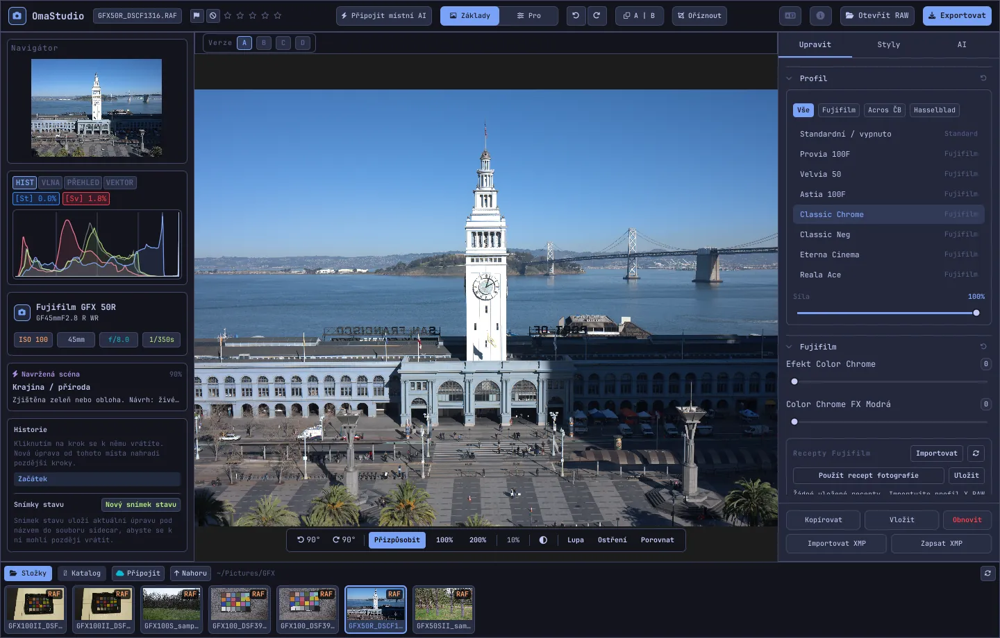

# Uživatelská příručka OmaStudio

**OmaStudio: The Complete Medium Format RAW Editor for Omarchy**

[Všechny jazyky](../README.md) · [Technologie](../technology/cs.md) · [README](../../README.md)

Tato příručka popisuje OmaStudio 3.1. Vysvětluje, jak aplikaci nainstalovat, jak je okno uspořádané a jak používat jednotlivé panely a nástroje. Snímky obrazovky ukazují ukázkové soubory z fotoaparátů Fujifilm GFX 50R a Hasselblad CFV-50c ze serveru [raw.pixls.us](https://raw.pixls.us) (CC0).



## Obsah

1. [Instalace](#1-instalace)
2. [Okno](#2-okno)
3. [Otevírání fotografií a knihovna](#3-otevírání-fotografií-a-knihovna)
4. [Základy a Pro](#4-základy-a-pro)
5. [Karta Upravit](#5-karta-upravit)
6. [Karta Masky](#6-karta-masky)
7. [Karta Styly](#7-karta-styly)
8. [Karta AI a konverzace s AI](#8-karta-ai-a-konverzace-s-ai)
9. [Pomůcky zobrazení](#9-pomůcky-zobrazení)
10. [Historie, snímky stavu a verze](#10-historie-snímky-stavu-a-verze)
11. [Fujifilm](#11-fujifilm)
12. [Střední formát](#12-střední-formát)
13. [Export](#13-export)
14. [Cloudové účty](#14-cloudové-účty)
15. [Klávesnice a myš](#15-klávesnice-a-myš)
16. [Příkazový řádek, řídicí soket a MCP](#16-příkazový-řádek-řídicí-soket-a-mcp)
17. [Soubory a složky](#17-soubory-a-složky)
18. [Řešení potíží](#18-řešení-potíží)

## 1. Instalace

OmaStudio běží v Omarchy (Arch Linux) pod Waylandem a Hyprlandem.

**Z balíčku.** V kopii repozitáře:

```bash
makepkg -si
```

Nainstaluje se `omastudio`, `omastudio-app`, `omastudio-engine`, profily ICC, položka nabídky, ikony a pravidlo udev pro fotoaparáty Fujifilm připojené přes USB.

**Z archivu vydání.** Stáhněte `omastudio-<verze>-x86_64-linux.tar.gz` ze [stránky vydání](https://github.com/ozdil/omarchy-omastudio/releases), ověřte jej pomocí `checksums.txt`, rozbalte a zkopírujte `bin/*` do `~/.local/bin` a `share/omastudio` do `~/.local/share/omastudio`.

**Povinné balíčky:** `libraw` 0.22 nebo novější, `lcms2`, `qt6-base`, `qt6-declarative`, `qt6-wayland` a `qt6-svg` 6.12 nebo novější a `zenity` pro dialogy výběru souborů.

**Volitelné balíčky:**

| Balíček | K čemu slouží |
| :--- | :--- |
| `vulkan-icd-loader` a ovladač Vulkan vaší grafické karty | Demozaikování na GPU |
| `perl-image-exiftool` | Zachování metadat EXIF v exportovaných souborech |
| `libwebp-utils`, `libheif`, `ffmpeg` | Ztrátový WebP, HEIF a záložní cesta pro AVIF |
| `onnxruntime` | Místní masky AI na NPU, GPU nebo CPU |
| `rclone`, `libsecret`, `gnome-keyring` | Google Drive, OneDrive, Dropbox, Box, pCloud a Yandex Disk |
| `github-cli` | Účet GitHub |
| `ollama` | Místní modely AI pro asistenta úprav |
| `quickshell` | Tlačítko OmaStudio na liště Omarchy |

Spusťte OmaStudio z nabídky aplikací Omarchy nebo příkazem `omastudio` (případně s fotografií: `omastudio DSCF0001.RAF`). Pokud je okno už otevřené, fotografie se otevře v něm.

## 2. Okno

| Oblast | Obsah |
| :--- | :--- |
| Horní lišta | Název souboru, značky a hodnocení hvězdičkami, **Připojit místní AI**, přepínač **Základy** / **Pro**, zpět a znovu, před a po (**A \| B**), **Oříznout**, nabídka jazyka, O aplikaci, **Otevřít RAW** a **Exportovat** |
| Levý panel | Navigátor, měřicí nástroje (histogram, průběh, RGB přehlídka, vektorskop) s indikátory přepalů, údaje o fotoaparátu a objektivu, navržená scéna, historie a snímky stavu |
| Střed | Fotografie, nad ní lišta verzí (A–D), pod ní lišta zobrazení: otočení, **Přizpůsobit**, 100 %, 200 %, aktuální zvětšení, barva okolí, **Lupa**, **Ostření**, **Porovnat** |
| Pravý panel | Karty **Upravit**, **Masky** (Pro), **Styly** a **AI** a pevný řádek s tlačítky **Kopírovat**, **Vložit**, **Obnovit**, **Importovat XMP** a **Zapsat XMP** |
| Filmový pás | **Složky**, **Katalog**, karta pro každý cloudový účet, **Připojit**, **Nahoru** a fotografie aktuální složky |

**Tab** skryje a zobrazí oba boční panely a filmový pás najednou. Každá sekce se sbaluje a rozbaluje kliknutím na záhlaví; **Ctrl+kliknutí** na záhlaví ponechá otevřenou jen tuto sekci. Otevřená karta, sbalené sekce a zobrazené panely se pamatují mezi relacemi.

Barvy, písmo a zaoblení rohů průběžně sledují aktivní motiv Omarchy. Plocha kolem fotografie je ve výchozím stavu neutrálně tmavě šedá, aby motiv neovlivňoval vnímání barev; tlačítko okolí na liště zobrazení přepne na střední šedou nebo na barvu motivu.

| Tokyo Night | Catppuccin Latte | Gruvbox | Rosé Pine |
| :---: | :---: | :---: | :---: |
|  |  |  |  |

Rozhraní je k dispozici ve 30 jazycích. Řídí se jazykem systému; nabídka jazyka na horní liště vybere jiný jazyk a hned jej použije.

## 3. Otevírání fotografií a knihovna

- **Otevřít RAW** (Ctrl+O) otevře dialog výběru souboru. Filtruje podle Fotografií, RAW nebo Obrázků.
- Přetáhněte fotografii nebo složku ze správce souborů do okna.
- Na filmovém pásu **Složky** ukazuje aktuální složku; kliknutím na složku do ní vstoupíte a tlačítkem **Nahoru** se vrátíte. Kliknutím na fotografii ji otevřete. Ctrl+← a Ctrl+→ přejdou na předchozí a další fotografii.
- **Katalog** ukazuje každou fotografii, kterou OmaStudio vidělo, s hodnocením, značkou a barevným štítkem.

OmaStudio otevře každý formát RAW, který čte LibRaw 0.22 (Fujifilm, Hasselblad, Phase One, Leica, Pentax, Mamiya/Leaf, Canon, Nikon, Sony, Panasonic, Olympus, Sigma, DNG a další), a také JPEG, PNG, WebP, TIFF, HEIF/HEIC, AVIF, JPEG XL, OpenEXR, Radiance HDR a PNM.

**Hodnocení a značky.** Klávesy 1–5 nastaví hodnocení hvězdičkami, 0 je smaže. P označí snímek jako vybraný, X jako zamítnutý a U značku odstraní. Hodnocení a značky se ihned uloží do katalogu a do doprovodného souboru.

**Výběr.** Shift+kliknutí vybere na filmovém pásu rozsah a Ctrl+kliknutí fotografii přidá nebo odebere. Je-li vybráno více fotografií, okno exportu exportuje všechny (**Dávka**).

Původní soubory se nikdy nemění. Úpravy se během práce ukládají do doprovodného souboru vedle fotografie, `<fotografie>.omastudio` (Ctrl+S uloží ihned).

## 4. Základy a Pro

Přepínač na horní liště určuje, kolik nástrojů je vidět.

- **Základy:** profil, Fujifilm, vyvážení bílé, tóny, výraznost, předvolby a 3D LUT.
- **Pro** přidává tónovou křivku, míchání barev, barevné korekce, detaily a optiku, transformaci, zrno, správu barev a kartu **Masky**. Sekce Pro nesou štítek „Pro“.

Po návratu do Základů se sekce Pro skryjí; jejich nastavení zůstanou použitá.


## 5. Karta Upravit

Každý posuvník se obnoví dvojitým kliknutím. Tlačítko obnovení v záhlaví sekce obnoví celou sekci.

### Profil

Základní vzhled: **Standardní / vypnuto**, filmové simulace Fujifilm (Provia, Velvia, Astia, Classic Chrome, Classic Neg, Eterna, Eterna Bleach Bypass, Reala Ace, Nostalgic Neg, PRO Neg Std a Hi, Acros a Monochrome se žlutým, červeným a zeleným filtrem, Sepia) a přirozený barevný profil ve stylu Hasselblad. Karty seznam filtrují. **Síla** mísí profil s neutrálním podáním.

### Fujifilm

**Efekt Color Chrome** a **Color Chrome FX Modrá** (Slabý = 50, Silný = 100) prohlubují syté barvy, u FX Modrá modré tóny, a zachovávají jejich odstín. Knihovna receptů, fotoaparát přes USB a Pixel Shift jsou popsány v kapitole [Fujifilm](#11-fujifilm).

### Vyvážení bílé

**Teplota** (2000–12000 K) a **Odstín** vzhledem k vyvážení bílé, které zaznamenal fotoaparát. Fotografie se otevře „jak byla pořízena“.

### Tóny

**Expozice** (−5 až +5 EV na lineárním světle: +1 EV zdvojnásobí světlo), **Kontrast**, **Světla**, **Stíny**, **Bílé** a **Černé**.

### Výraznost

**Textura**, **Zřetelnost** (kontrast středních tónů), **Odstranění závoje**, **Živost** a **Sytost**.

### Tónová křivka (Pro)

Bodová křivka nad histogramem, pro RGB a zvlášť pro červenou, zelenou a modrou. Kliknutím přidáte bod, tažením jej posunete, dvojitým kliknutím jej odstraníte. Křivka nikdy nepřekmitne své body. Čtyři posuvníky oblastí pod ní (světla, jasné tóny, tmavé tóny, stíny) tvarují křivku podle oblastí.

### Míchání barev (Pro)

Odstín, sytost a jas pro osm barev: červenou, oranžovou, žlutou, zelenou, akvamarínovou, modrou, fialovou a purpurovou.


### Barevné korekce (Pro)

Trojcestná barevná kola pro stíny (lift), střední tóny (gamma) a světla (gain) a globální posun, jako čtyři kola nebo jako karty. **Zesílení barev**, **Detail středních tónů** a **Střed kontrastu** jsou pod koly. Míchání kanálů pod nimi mísí červenou, zelenou a modrou do každého výstupního kanálu nebo do monochromatického míchání.


### Detaily a optika (Pro)

**Doostření**, **Redukce šumu** (jas a barva), **Vinětace**, **Odstranění lemování** (chromatická vada) a **Korekce zkreslení objektivu**. Korekce objektivu Fujifilm a DNG ze souboru se použijí automaticky; tyto posuvníky působí navíc.

### Transformace (Pro)

**Svisle** narovná sbíhavé linie, například u budovy fotografované zdola; **Vodorovně** udělá totéž do stran; **Měřítko** výsledek zvětší. Poté ořízněte prázdné okraje.

### Zrno (Pro)

**Množství**, **Velikost** a **Drsnost** filmového zrna.

### Správa barev (Pro)

- **Komprese gamutu** jemně vrací barvy vytlačené mimo gamut, místo aby je ořízla.
- **Tónová křivka ACES** je filmový náběh ve světlech, přizpůsobená aproximace výstupní transformace ACES.
- **Softproof** (S) ukáže fotografii tak, jak bude vypadat s výstupním profilem, například profilem tiskárny a papíru. Vyberte profil a způsob vykreslení. **Varování gamutu** obarví purpurově barvy, které profil nedokáže reprodukovat. Úprava ani export se nemění.

Samotný výstupní barevný prostor se volí v okně exportu.


## 6. Karta Masky

Karta Masky se zobrazuje v režimu Pro.

### Retuš a klonování

Zapněte **Upravit body** a klikněte na skvrnu ve fotografii, abyste ji odstranili. Nahradí se zdrojem vedle ní. Tažením plného kruhu bod posunete, tažením čárkovaného zvolíte jiný zdroj. **Retušovat** přizpůsobí zkopírovanou oblast světlu a barvě kolem bodu; **Klonovat** ji zkopíruje tak, jak je. **Velikost**, **Prolnutí** a **Krytí** platí pro vybraný bod a pro nové body.


### Místní úpravy

Každá vrstva použije expozici, kontrast, světla, stíny, bílé, černé a sytost přes masku, s určitým krytím.

| Maska | Jak vzniká |
| :--- | :--- |
| **Lineární** | Přechod mezi dvěma úchyty na fotografii |
| **Radiální** | Elipsa s úchyty středu a okraje a prolnutím |
| **Jas** | Rozsah jasu (nejtmavší, nejjasnější, přechod) |
| **Barva** | Barvy blízké barvě vybrané z fotografie (rozsah a prolnutí) |
| **Štětec** | Malovaná na fotografii, s velikostí, prolnutím, tokem a režimem gumy; prostřední tlačítko myši posouvá obraz |
| **Objekt (AI)**, **Obloha (AI)** | Segmentační model ve vašem počítači (viz [AI](#8-karta-ai-a-konverzace-s-ai)) |

V části **Kombinovat s:** lze k masce vrstvy přidat další části, odečíst je nebo vytvořit průnik; každou část lze invertovat.


## 7. Karta Styly

- **Předvolby:** **Automaticky** fotografii rozebere a nastaví expozici, vyvážení bílé a tóny. Styly Tlumené, Živé, Teplý portrét, Černobílé a Modrozelená a oranžová nahradí předchozí styl, místo aby se k němu přičetly; vyvážení bílé, expozice, ořez a filmová simulace zůstanou.
- **LUT:** **Načíst soubor .cube…** použije vlastní 3D LUT se zvolenou silou.


## 8. Karta AI a konverzace s AI

**Připojit místní AI** na horní liště použije AI nastavenou v tomto počítači: výchozího agenta Omarchy (Claude Code nebo Codex s jejich vlastním přihlášením), jinak Ollamu, jinak LM Studio. Po připojení tlačítko otevře **Konverzaci s AI** nad fotografií: napište, co chcete změnit („tepleji, zachraň oblohu“), a AI nastaví posuvníky. Ctrl+Z vrátí každou úpravu.

**Asistent úprav** na kartě AI dělá totéž z panelu a místo toho může použít poskytovatele v cloudu: Anthropic Claude, OpenAI, OpenRouter nebo Google Gemini. Jejich klíče API jsou uloženy v systémové klíčence a nikdy se nezapisují na disk ani nepředávají na příkazovém řádku. S poskytovatelem v cloudu, nebo s Claude Code či Codexem, se náhled fotografie odešle této službě; s Ollamou nebo LM Studiem zůstane ve vašem počítači.


**Masky AI.** **Objekt (AI)** a **Obloha (AI)** na kartě Masky spouštějí segmentační model ONNX v tomto počítači: nejprve na NPU (Intel Core Ultra přes OpenVINO, Snapdragon X přes QNN, AMD Ryzen AI přes Vitis AI), pak na GPU a nakonec na CPU. Žádný model se nedodává ani nestahuje. Vložte model do `~/.local/share/omastudio/models` jako `subject.onnx` nebo `sky.onnx`; `omastudio npu` ukáže, co je nainstalováno.

## 9. Pomůcky zobrazení

| Pomůcka | Jak ji použít |
| :--- | :--- |
| Zvětšení | Kolečko myši v místě ukazatele; **Přizpůsobit** (Ctrl+0), **100 %** (Ctrl+1), **200 %**; dvojité kliknutí přepíná přizpůsobení a 200 %. 100 % zobrazuje jeden pixel fotografie na pixel obrazovky při jakémkoli škálování. |
| Posun | Tažení levým nebo prostředním tlačítkem; Shift+kolečko posouvá vodorovně |
| Otočení | Tlačítka otočení na liště zobrazení; Alt+kolečko otáčí po 1,5° |
| Oříznout (C) | Poměry stran (původní, 1:1, 4:5, 9:16, 16:9, volný) a mřížky (třetiny, zlatý řez, zlatá spirála) |
| Před a po (Y nebo A \| B) | Fotografie rozdělená na originál a úpravu |
| Porovnat (Shift+C) | Úprava vedle jiného stavu: Před, verze nebo snímku stavu |
| Lupa (L) | Čtverec pod ukazatelem s fotografií v plném rozlišení 1:1 |
| Focus peaking (Shift+F) | Nejostřejší hrany zvýrazněné zeleně; jen pomůcka zobrazení |
| Přepaly | Klikněte na **[S]** nebo **[H]** nad histogramem pro zobrazení oříznutých stínů modře a světel červeně |

| Focus peaking | Porovnat |
| :---: | :---: |
|  |  |

| Oříznout | Před a po |
| :---: | :---: |
|  |  |

Když je fotografie zobrazena větší než náhled, jádro vypočítá viditelnou oblast ze souboru v plném rozlišení, takže viditelné detaily odpovídají exportu.

## 10. Historie, snímky stavu a verze

- **Historie** v levém panelu ukazuje každý krok úpravy podle názvu („Exposure +0.70“, „Tone curve“). Kliknutím na krok se k němu vrátíte; nová úprava od tohoto místa nahradí pozdější kroky, stejně jako u Ctrl+Z.
- **Snímky stavu** uloží aktuální úpravu pod názvem. **Obnovit** vrátí snímek jako nový krok, který lze vrátit pomocí Ctrl+Z. Snímky stavu se ukládají do doprovodného souboru.
- **Verze A–D** nad fotografií uchovávají až čtyři samostatné úpravy téže fotografie. Kliknutím na písmeno přepnete (Alt+1 až Alt+4); pravé tlačítko zkopíruje aktuální úpravu do této verze.
- **Kopírovat** a **Vložit** (Ctrl+Shift+C, Ctrl+Shift+V) přenesou úpravu na jinou fotografii. **Obnovit** (Ctrl+R) vrátí výchozí hodnoty.
- **Zapsat XMP** uloží úpravu, hodnocení a štítek do souboru `.xmp`, který čtou Lightroom, Capture One, darktable a digiKam; **Importovat XMP** načte soubor zapsaný těmito programy.

## 11. Fujifilm

- **Recept fotoaparátu.** Soubor RAF nebo JPEG z Fujifilmu se otevře s nastavením snímku: filmovou simulací, tóny, barvou, ostrostí, redukcí šumu, zřetelností, zrnem, Color Chrome, posunem vyvážení bílé a dynamickým rozsahem (včetně D-Range Priority). Uložený doprovodný soubor má přednost.
- **Jas.** Soubory RAF se otevírají s jasem vlastního JPEG fotoaparátu.
- **Korekce objektivu.** Zkreslení, příčná chromatická vada a vinětace zaznamenané fotoaparátem se použijí pro objektivy XF, XC a GF.
- **Knihovna receptů.** **Importovat** přijme profil X RAW Studio (.FP1, .FP2, .FP3), text receptu („Film Simulation: Classic Chrome / Grain Effect: Strong, Small …“) nebo fotografii z Fujifilmu. **Použít recept** použije uložený recept; **Použít recept fotografie** se vrátí k receptu ze souboru; **Uložit** uloží aktuální.
- **Fotoaparát přes USB.** Nastavte režim USB fotoaparátu na USB RAW CONV./BACKUP RESTORE a připojte jej. **Načíst C1–C7** zobrazí jeho vlastní nastavení, **Zapsat recept do C…** uloží recept do pozice (a nahradí její obsah) a **Převést ve fotoaparátu** vyvolá otevřený RAF přímo ve fotoaparátu, volitelně s vybraným receptem.
- **Pixel Shift.** Vyberte na filmovém pásu snímky RAF jedné série Pixel Shift z GFX a klikněte na **Sloučit snímky do DNG**. Čtyři snímky dají plnou barvu v každém pixelu; šestnáct snímků zdvojnásobí rozlišení.

## 12. Střední formát

- **Fujifilm GFX** (GFX 50S, 50R, 50S II, 100, 100S, 100 II a další): 16bitové zpracování od snímače po export, filmové simulace, korekce objektivu a Pixel Shift.
- Soubory **Hasselblad** 3FR a FFF se oříznou na výchozí ořez fotoaparátu.
- Soubory **Phase One a Leaf** IIQ a MOS dostanou vlastní kalibraci snímače digitální stěny.
- Podporovány jsou soubory **Mamiya** MEF a **Pentax 645** PEF.
- **Flat field (LCC):** `omastudio-engine medium-format lcc-create <raw>` vytvoří korekci ze snímku rovnoměrně osvětleného bílého terče; použije se na fotografie dané složky.
- **Multi-shot:** `medium-format multishot f1 f2 f3 f4 --out merged.tif` sloučí sérii 4 snímků.


## 13. Export

**Exportovat** (E) otevře okno exportu. Enter exportuje, Esc zavře.


| Nastavení | Možnosti |
| :--- | :--- |
| Formát | JPEG, PNG (8/16 bitů), TIFF (8/16 bitů, bez komprese, LZW nebo ZIP), WebP, AVIF (8/10/12 bitů), HEIF (8/10/12 bitů), JPEG XL (8/16 bitů) a OpenEXR (poloviční nebo plná přesnost s plovoucí čárkou, lineární scéna) |
| Kvalita | 1–100; 100 je bezeztrátové pro WebP, AVIF a JPEG XL |
| Velikost | Plná, 75 %, 50 % nebo delší strana 3840 či 2048 px |
| Barevný profil | sRGB, Display P3, Adobe RGB, ProPhoto RGB, Rec. 2020, ACEScg nebo vlastní profil ICC |
| Způsob vykreslení | Perceptuální, Relativní (výchozí), Sytost, Absolutní |
| Metadata | Zachovat metadata fotoaparátu (EXIF), odstranit polohu (GPS) |
| Připravit pro | Ořez a výstupní doostření pro Instagram, Stories a Reels, X, Facebook, čtverec a náhledy YouTube |
| Vodoznak | Text se značkami EXIF ({camera}, {lens}, {iso}, {aperture}, {shutter}, {focal}) nebo logo PNG, s polohou, krytím, velikostí a stínem |
| Složka a název souboru | Výchozí `~/Pictures/OmaStudio_Exports`; k názvu souboru lze přidat přípisek |
| Nahrát do | Připojený cloudový účet |

Každý formát kromě OpenEXR obsahuje profil ICC svého barevného prostoru. Dávka exportuje vybrané fotografie jednu po druhé.

## 14. Cloudové účty

**Připojit** na filmovém pásu přidá Google Drive, OneDrive, Dropbox, Box, pCloud, Yandex Disk nebo GitHub. Přihlásíte se na stránce dané služby ve svém prohlížeči; OmaStudio vaše heslo nikdy nevidí.


- Každý účet má na filmovém pásu kartu. Procházejte jeho složky a kliknutím na fotografii ji stáhněte (jednou) a otevřete.
- V každém účtu se vytvoří složka `OmaStudio` (na GitHubu soukromý repozitář `OmaStudio`), do které jdou nahrávky z okna exportu.
- Úložné služby fungují přes rclone s vlastní konfigurací OmaStudio, šifrovanou klíčem ze systémové klíčenky. GitHub funguje přes GitHub CLI.
- Pro Google Drive lze v poli **Vlastní ID klienta Google** zadat vlastní ID klienta z Google Cloud Console.
- **Odpojit** odstraní z tohoto počítače klíče účtu a stažené kopie; soubory v účtu zůstanou.

## 15. Klávesnice a myš

| Klávesa | Akce |
| :--- | :--- |
| Ctrl+O | Otevřít fotografii |
| Ctrl+S | Uložit úpravu hned |
| Ctrl+Z / Ctrl+Shift+Z nebo Ctrl+Y | Zpět / znovu |
| Ctrl+Shift+C / Ctrl+Shift+V | Kopírovat / vložit úpravu |
| Ctrl+R | Obnovit úpravu |
| Ctrl+← / Ctrl+→ | Předchozí / další fotografie |
| Ctrl+0 / Ctrl+1 | Přizpůsobit / 100 % |
| 1–5, 0 | Hodnocení hvězdičkami, smazat hodnocení |
| P, X, U | Vybrat, zamítnout, odstranit značku |
| C | Oříznout |
| Y | Před a po |
| S | Softproof |
| L | Lupa |
| Shift+F | Focus peaking |
| Shift+C | Porovnat |
| Alt+1 … Alt+4 | Verze A–D |
| E | Okno exportu |
| Tab | Skrýt nebo zobrazit panely |
| Esc | Zavřít otevřené okno |

| Myš | Akce |
| :--- | :--- |
| Kolečko | Zvětšení v místě ukazatele |
| Shift+kolečko | Posun vodorovně |
| Alt+kolečko | Otočení |
| Tažení (levé nebo prostřední tlačítko) | Posun |
| Dvojité kliknutí na fotografii | Přizpůsobit nebo 200 % |
| Ctrl+kliknutí na záhlaví sekce | Ponechat otevřenou jen tuto sekci |
| Pravé kliknutí na písmeno verze | Zkopírovat aktuální úpravu do této verze |

## 16. Příkazový řádek, řídicí soket a MCP

**Příkazy jádra.** Každý příkaz vypíše jeden objekt JSON, takže jej mohou používat skripty a agenti.

```bash
omastudio inspect DSCF0001.RAF                      # fotoaparát, objektiv, expozice, histogram, scéna
omastudio export DSCF0001.RAF --recipe '{"exposure":0.5}' --options '{"format":"jpeg"}'
omastudio fuji-recipe DSCF0001.RAF                  # recept fotoaparátu
omastudio fuji-pixel-shift DSCF*.RAF --out merged.dng
omastudio xmp export DSCF0001.RAF
omastudio cameras GFX                               # fotoaparáty podporované dekodérem RAW
omastudio gpu                                       # GPU použitý pro demozaikování
omastudio npu                                       # ONNX Runtime a akcelerátory
omastudio cloud status
omastudio --cli help                                # všechny příkazy
```

**Řídicí soket.** `omastudio ipc <metoda> [argumenty]` komunikuje s otevřeným oknem, například `openPhoto`, `openFolder`, `applyRecipe`, `applyPreset`, `setExposure`, `setWarmth`, `setMode essentials|pro`, `setRightTab`, `showSection`, `setView peaking|compare|softProof|split on|off`, `setZoom`, `showExport`, `showCloud`, `getStatus` a `screenshot <soubor.png>`. Soket odpovídá jen témuž uživateli.

**MCP.** `omastudio mcp` je server Model Context Protocol: agenti AI mohou fotografie zkoumat, vykreslovat, třídit a exportovat, číst recepty Fujifilm a ovládat otevřené okno. Pro Claude Code: `claude mcp add omastudio -- omastudio mcp`. `omastudio skill` nainstaluje dovednost agenta do `~/.claude/skills`.

## 17. Soubory a složky

| Cesta | Obsah |
| :--- | :--- |
| `<fotografie>.omastudio` | Úprava fotografie (doprovodný soubor) |
| `~/.local/share/omastudio/catalog.json` | Katalog: hodnocení, značky a barevné štítky |
| `~/.local/share/omastudio/fuji-recipes/` | Uložené recepty Fujifilm |
| `~/.local/share/omastudio/icc/` | Vaše profily ICC |
| `~/.local/share/omastudio/models/` | Místní modely AI |
| `~/.local/share/omastudio/film-luts/` | LUT filmových simulací změřené z vašich fotografií (`fuji-calibrate`) |
| `~/.config/omastudio/` | Nastavení, stav rozhraní, jazyk, cloudové účty |
| `~/.cache/omastudio/` | Miniatury, náhledy a stažené fotografie z cloudu |

## 18. Řešení potíží

- **Okno se neotevře.** Spusťte `omastudio` v terminálu a přečtěte si zprávu. `omastudio --version` a `omastudio status` ukážou, co je nainstalováno.
- **GPU se nepoužívá.** `omastudio gpu` ukáže zařízení. Nainstalujte `vulkan-icd-loader` a ovladač Vulkan vaší grafické karty. `OMASTUDIO_GPU=off` vynutí CPU.
- **Fotoaparát přes USB nebyl nalezen.** Nastavte jeho režim USB na USB RAW CONV./BACKUP RESTORE, znovu jej připojte a ověřte, že je nainstalováno pravidlo udev z balíčku.
- **Cloudová služba vyžaduje program.** Nainstalujte balíček, který dialog uvádí, například `sudo pacman -S rclone libsecret`.
- **Kopírovat informace o systému** v okně O aplikaci zkopíruje verzi, údaje o GPU a Omarchy pro hlášení chyby. Potíže hlaste na [github.com/ozdil/omarchy-omastudio/issues](https://github.com/ozdil/omarchy-omastudio/issues).
