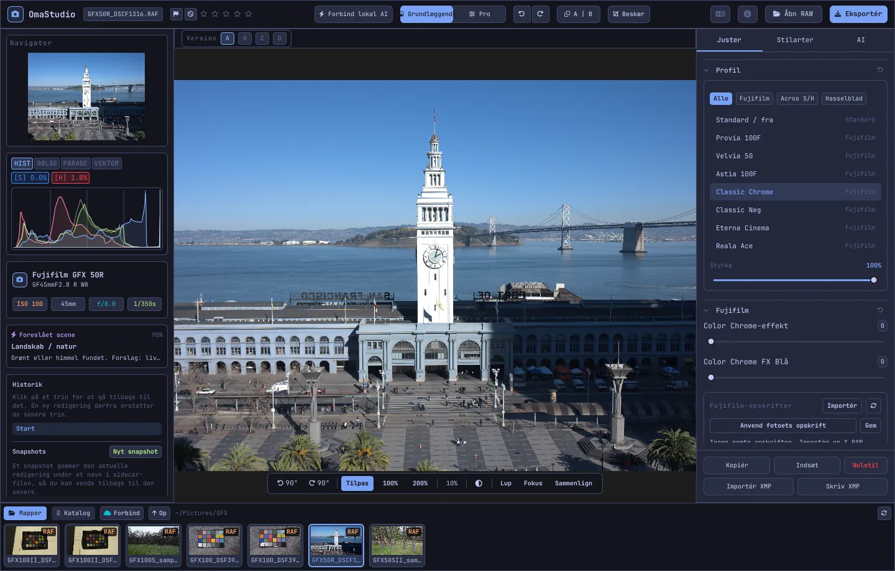

# Brugervejledning til OmaStudio

**OmaStudio: The Complete Medium Format RAW Editor for Omarchy**

[Alle sprog](../README.md) · [Teknologier](../technology/da.md) · [README](../../README.md)

Denne vejledning gælder OmaStudio 3.1. Den forklarer, hvordan du installerer programmet, hvordan vinduet er opbygget, og hvordan du bruger hvert panel og værktøj. Skærmbillederne viser eksempelfiler fra Fujifilm GFX 50R og Hasselblad CFV-50c fra [raw.pixls.us](https://raw.pixls.us) (CC0).



## Indhold

1. [Installation](#1-installation)
2. [Vinduet](#2-vinduet)
3. [Åbn fotos og biblioteket](#3-åbn-fotos-og-biblioteket)
4. [Grundlæggende og Pro](#4-grundlæggende-og-pro)
5. [Fanen Juster](#5-fanen-juster)
6. [Fanen Masker](#6-fanen-masker)
7. [Fanen Stilarter](#7-fanen-stilarter)
8. [Fanen AI og AI-samtalen](#8-fanen-ai-og-ai-samtalen)
9. [Visningshjælp](#9-visningshjælp)
10. [Historik, snapshots og versioner](#10-historik-snapshots-og-versioner)
11. [Fujifilm](#11-fujifilm)
12. [Mellemformat](#12-mellemformat)
13. [Eksport](#13-eksport)
14. [Skykonti](#14-skykonti)
15. [Tastatur og mus](#15-tastatur-og-mus)
16. [Kommandolinje, kontrolsocket og MCP](#16-kommandolinje-kontrolsocket-og-mcp)
17. [Filer og mapper](#17-filer-og-mapper)
18. [Fejlfinding](#18-fejlfinding)

## 1. Installation

OmaStudio kører på Omarchy (Arch Linux) under Wayland og Hyprland.

**Fra pakken.** I en klon af repositoriet:

```bash
makepkg -si
```

Det installerer `omastudio`, `omastudio-app`, `omastudio-engine`, ICC-profilerne, skrivebordsposten, ikonerne og en udev-regel til Fujifilm-kameraer på USB.

**Fra et udgivelsesarkiv.** Hent `omastudio-<version>-x86_64-linux.tar.gz` fra [udgivelsessiden](https://github.com/ozdil/omarchy-omastudio/releases), kontrollér det mod `checksums.txt`, pak det ud, og kopiér `bin/*` til `~/.local/bin` og `share/omastudio` til `~/.local/share/omastudio`.

**Nødvendige pakker:** `libraw` 0.22 eller nyere, `lcms2`, `qt6-base`, `qt6-declarative`, `qt6-wayland` og `qt6-svg` 6.12 eller nyere samt `zenity` til fildialogerne.

**Valgfrie pakker:**

| Pakke | Bruges til |
| :--- | :--- |
| `vulkan-icd-loader` og grafikkortets Vulkan-driver | Demosaicing på GPU'en |
| `perl-image-exiftool` | At bevare EXIF-metadata i eksporterede filer |
| `libwebp-utils`, `libheif`, `ffmpeg` | WebP med tab, HEIF og reserveløsningen til AVIF |
| `onnxruntime` | Lokale AI-masker på en NPU, GPU eller CPU |
| `rclone`, `libsecret`, `gnome-keyring` | Google Drive, OneDrive, Dropbox, Box, pCloud og Yandex Disk |
| `github-cli` | GitHub-konto |
| `ollama` | Lokale AI-modeller til redigeringsassistenten |
| `quickshell` | OmaStudio-knappen i Omarchy-bjælken |

Start OmaStudio fra Omarchys programmenu, eller kør `omastudio` (eventuelt med et foto: `omastudio DSCF0001.RAF`). Hvis et vindue allerede er åbent, åbnes fotoet i det vindue.

## 2. Vinduet

| Område | Indhold |
| :--- | :--- |
| Øverste bjælke | Filnavn, markeringer og stjernebedømmelse, **Forbind lokal AI**, kontakten **Grundlæggende** / **Pro**, fortryd og gentag, før og efter (**A \| B**), **Beskær**, sprogmenu, Om, **Åbn RAW** og **Eksportér** |
| Venstre panel | Navigator, målere (histogram, bølgeform, RGB-parade, vektorskop) med klipningsindikatorer, kamera- og objektivoplysninger, den foreslåede scene, historik og snapshots |
| Midten | Fotoet, versionsbjælken (A–D) over det og visningsbjælken under det: rotér, **Tilpas**, 100 %, 200 %, aktuel zoom, omgivelsesfarve, **Lup**, **Fokus**, **Sammenlign** |
| Højre panel | Fanerne **Juster**, **Masker** (Pro), **Stilarter** og **AI** samt en fast række med **Kopiér**, **Indsæt**, **Nulstil**, **Importér XMP** og **Skriv XMP** |
| Filmstrimmel | **Mapper**, **Katalog**, en fane for hver skykonto, **Forbind**, **Op** og fotoene i den aktuelle mappe |

**Tab** skjuler og viser begge sidepaneler og filmstrimlen på én gang. Hver sektion i et panel foldes ud og sammen fra sin overskrift; **Ctrl+klik** på en overskrift holder kun den sektion åben. Den åbne fane, de sammenfoldede sektioner og hvilke paneler der vises, huskes mellem sessioner.

Farverne, skrifttypen og hjørnernes afrunding følger det aktive Omarchy-tema, med det samme. Området omkring fotoet er som standard neutralt mørkegråt, så temaet ikke ændrer, hvordan farverne opleves; omgivelsesknappen i visningsbjælken skifter til mellemgrå eller temaets farve.

| Tokyo Night | Catppuccin Latte | Gruvbox | Rosé Pine |
| :---: | :---: | :---: | :---: |
|  |  |  |  |

Brugerfladen findes på 30 sprog. Den følger systemets sprog; sprogmenuen i den øverste bjælke vælger et andet og anvender det med det samme.

## 3. Åbn fotos og biblioteket

- **Åbn RAW** (Ctrl+O) åbner fildialogen. Den filtrerer efter fotos, RAW eller billeder.
- Træk et foto eller en mappe fra filhåndteringen ind i vinduet.
- I filmstrimlen viser **Mapper** den aktuelle mappe; klik på en mappe for at gå ind i den og på **Op** for at gå tilbage. Klik på et foto for at åbne det. Ctrl+← og Ctrl+→ går til forrige og næste foto.
- **Katalog** viser alle fotos, OmaStudio har set, med bedømmelse, markering og farveetiket.

OmaStudio åbner alle RAW-formater, som LibRaw 0.22 læser (Fujifilm, Hasselblad, Phase One, Leica, Pentax, Mamiya/Leaf, Canon, Nikon, Sony, Panasonic, Olympus, Sigma, DNG og andre), samt JPEG, PNG, WebP, TIFF, HEIF/HEIC, AVIF, JPEG XL, OpenEXR, Radiance HDR og PNM.

**Bedømmelse og markeringer.** 1 til 5 sætter stjernebedømmelsen, og 0 fjerner den. P markerer et valg, X en forkastelse, og U fjerner markeringen. Bedømmelser og markeringer gemmes straks i kataloget og i sidecar-filen.

**Markering af flere.** Shift+klik markerer et område i filmstrimlen, og Ctrl+klik tilføjer eller fjerner et foto. Når mere end ét foto er markeret, eksporterer eksportvinduet dem alle (**Batch**).

Dine originalfiler ændres aldrig. Redigeringer gemmes ved siden af fotoet i en sidecar-fil, `<foto>.omastudio`, mens du arbejder (Ctrl+S gemmer med det samme).

## 4. Grundlæggende og Pro

Kontakten i den øverste bjælke bestemmer, hvor mange værktøjer der vises.

- **Grundlæggende:** profil, Fujifilm, hvidbalance, tone, nærvær, forudindstillinger og 3D-LUT'er.
- **Pro** tilføjer tonekurve, farvemixer, farvegradering, detaljer og optik, transformering, korn, farvestyring og fanen **Masker**. Pro-sektioner har mærket "Pro".

Når du skifter tilbage til Grundlæggende, skjules Pro-sektionerne; deres indstillinger forbliver anvendt.


## 5. Fanen Juster

Hver skyder nulstilles, når du dobbeltklikker på den. Nulstillingsknappen i en sektions overskrift nulstiller hele sektionen.

### Profil

Grundudseendet: **Standard / fra**, Fujifilms filmsimuleringer (Provia, Velvia, Astia, Classic Chrome, Classic Neg, Eterna, Eterna Bleach Bypass, Reala Ace, Nostalgic Neg, PRO Neg Std og Hi, Acros og Monochrome med gult, rødt og grønt filter, Sepia) og den naturlige farveprofil i Hasselblad-stil. Fanerne filtrerer listen. **Styrke** blander profilen med den neutrale gengivelse.

### Fujifilm

**Color Chrome-effekt** og **Color Chrome FX Blå** (Svag = 50, Stærk = 100) gør mættede farver dybere, og for FX Blå de blå, uden at ændre deres nuance. Opskriftsbiblioteket, kameraet på USB og Pixel Shift er beskrevet under [Fujifilm](#11-fujifilm).

### Hvidbalance

**Temperatur** (2000–12000 K) og **Farvetone** i forhold til den hvidbalance, kameraet registrerede. Et foto åbnes med "som optaget".

### Tone

**Eksponering** (−5 til +5 EV, på lineært lys: +1 EV fordobler lyset), **Kontrast**, **Højlys**, **Skygger**, **Hvide** og **Sorte**.

### Nærvær

**Struktur**, **Klarhed** (mellemtonekontrast), **Fjern dis**, **Livlighed** og **Mætning**.

### Tonekurve (Pro)

En punktkurve over histogrammet, for RGB og for rød, grøn og blå hver for sig. Klik for at tilføje et punkt, træk for at flytte det, og dobbeltklik for at fjerne det. Kurven går aldrig ud over sine punkter. De fire områdeskydere nedenunder (højlys, lyse toner, mørke toner, skygger) former kurven efter område.

### Farvemixer (Pro)

Nuance, mætning og luminans for otte farver: rød, orange, gul, grøn, akvamarin, blå, lilla og magenta.


### Farvegradering (Pro)

Trevejs farvehjul til skygger (lift), mellemtoner (gamma) og højlys (gain) samt en global forskydning, som fire hjul eller som faner. **Farveforstærkning**, **Mellemtonedetalje** og **Kontrastomdrejningspunkt** ligger under hjulene. Kanalmixeren under dem blander rød, grøn og blå ind i hver udgangskanal eller i en monokrom blanding.


### Detaljer og optik (Pro)

**Skarphed**, **Støjreduktion** (luminans og farve), **Vignettering**, **Fjern farvekanter** (kromatisk aberration) og **Korrektion af objektivforvrængning**. Objektivkorrektioner fra Fujifilm- og DNG-filer anvendes automatisk; disse skydere virker oven på dem.

### Transformer (Pro)

**Lodret** retter konvergerende linjer op, som en bygning fotograferet nedefra; **Vandret** gør det samme sidelæns; **Skala** forstørrer resultatet. Beskær bagefter for at fjerne de tomme kanter.

### Korn (Pro)

**Mængde**, **Størrelse** og **Ruhed** for filmkorn.

### Farvestyring (Pro)

- **Gamutkomprimering** fører farver, der er skubbet uden for farveområdet, blødt tilbage i stedet for at klippe dem.
- **ACES-tonekurve** er en filmisk afrunding af højlysene, en tilpasset tilnærmelse af ACES-outputtransformationen.
- **Softproof** (S) viser fotoet, som det vil se ud med en outputprofil, for eksempel en profil for printer og papir. Vælg profilen og gengivelseshensigten. **Gamut-advarsel** maler de farver, profilen ikke kan gengive, i magenta. Redigeringen og eksporten ændres ikke.

Selve outputfarverummet vælges i eksportvinduet.


## 6. Fanen Masker

Fanen Masker vises i Pro-tilstand.

### Ret og klon

Slå **Rediger punkter** til, og klik på en plet på fotoet for at fjerne den. Pletten erstattes fra en kilde ved siden af. Træk i den fuldt optrukne cirkel for at flytte pletten og i den stiplede cirkel for at vælge en anden kilde. **Ret** tilpasser det kopierede område til lyset og farven omkring pletten; **Klon** kopierer det, som det er. **Størrelse**, **Blød kant** og **Uigennemsigtighed** gælder for den valgte plet og for nye.


### Lokale justeringer

Hvert lag anvender eksponering, kontrast, højlys, skygger, hvide, sorte og mætning gennem en maske, med en uigennemsigtighed.

| Maske | Sådan dannes den |
| :--- | :--- |
| **Lineær** | En gradient mellem to håndtag på fotoet |
| **Radial** | En ellipse med et midtpunkt, kanthåndtag og en blød kant |
| **Luminans** | Et lysstyrkeområde (mørkeste, lyseste, overgang) |
| **Farve** | Farver tæt på en, der er valgt fra fotoet (område og blød kant) |
| **Pensel** | Males på fotoet med størrelse, blød kant, flow og en viskelædertilstand; den midterste museknap panorerer |
| **AI-motiv**, **AI-himmel** | En segmenteringsmodel på din computer (se [AI](#8-fanen-ai-og-ai-samtalen)) |

Under **Kombiner med** kan flere dele lægges til, trækkes fra eller skæres med lagets maske, og hver del kan inverteres.


## 7. Fanen Stilarter

- **Forudindstillinger:** **Automatisk** analyserer fotoet og indstiller eksponering, hvidbalance og tone. Stilarterne Dæmpet, Livlig, Varmt portræt, Sort-hvid samt Blågrøn og orange erstatter den forrige stil i stedet for at lægge sig oven på den; hvidbalance, eksponering, beskæring og filmsimulering bevares.
- **LUT:** **Indlæs .cube-fil…** anvender din egen 3D-LUT med en styrke.


## 8. Fanen AI og AI-samtalen

**Forbind lokal AI** i den øverste bjælke bruger den AI, der er sat op på denne computer: Omarchys standardagent (Claude Code eller Codex med deres eget login), ellers Ollama, ellers LM Studio. Når forbindelsen er oprettet, åbner knappen **AI-samtale** over fotoet: skriv, hvad du vil ændre ("varmere, red himlen"), og AI'en indstiller justeringerne. Ctrl+Z fortryder hver ændring.

**Redigeringsassistent** i fanen AI gør det samme fra panelet og kan i stedet bruge en skyudbyder: Anthropic Claude, OpenAI, OpenRouter eller Google Gemini. Deres API-nøgler gemmes i systemets nøglering og skrives aldrig til disken eller på en kommandolinje. Med en skyudbyder eller med Claude Code eller Codex sendes forhåndsvisningen af fotoet til den tjeneste; med Ollama eller LM Studio bliver den på din computer.


**AI-masker.** **AI-motiv** og **AI-himmel** i fanen Masker kører en ONNX-segmenteringsmodel på denne computer: først på en NPU (Intel Core Ultra via OpenVINO, Snapdragon X via QNN, AMD Ryzen AI via Vitis AI), derefter på en GPU og til sidst på CPU'en. Ingen model følger med eller hentes. Læg en model i `~/.local/share/omastudio/models` som `subject.onnx` eller `sky.onnx`; `omastudio npu` viser, hvad der er installeret.

## 9. Visningshjælp

| Hjælpemiddel | Sådan bruges det |
| :--- | :--- |
| Zoom | Musehjulet ved markøren; **Tilpas** (Ctrl+0), **100 %** (Ctrl+1), **200 %**; dobbeltklik skifter mellem tilpas og 200 %. 100 % viser én fotopixel pr. skærmpixel ved enhver skærmskalering. |
| Panorering | Træk med venstre eller midterste museknap; Shift+hjul panorerer sidelæns |
| Rotation | Rotationsknapperne i visningsbjælken; Alt+hjul drejer i trin på 1,5° |
| Beskær (C) | Formatforvalg (Original, 1:1, 4:5, 9:16, 16:9, Fri) og hjælpelinjer (tredjedele, det gyldne snit, gylden spiral) |
| Før og efter (Y eller A \| B) | Fotoet delt i originalen og redigeringen |
| Sammenlign (Shift+C) | Redigeringen ved siden af en anden tilstand: Før, en version eller et snapshot |
| Lup (L) | En firkant under markøren, der viser fotoet i fuld opløsning 1:1 |
| Fokus (Shift+F) | De skarpeste kanter males grønne; kun en visningshjælp |
| Klipning | Klik på **[S]** eller **[H]** over histogrammet for at vise klippede skygger i blåt og klippede højlys i rødt |

| Fokus | Sammenlign |
| :---: | :---: |
|  |  |

| Beskær | Før og efter |
| :---: | :---: |
|  |  |

Når fotoet vises større end forhåndsvisningen, gengiver motoren det synlige område fra filen i fuld opløsning, så de detaljer, du ser, svarer til eksporten.

## 10. Historik, snapshots og versioner

- **Historik** i venstre panel viser hvert trin i redigeringen ved navn ("Eksponering +0,70", "Tonekurve"). Klik på et trin for at gå tilbage til det; en ny ændring derfra erstatter de senere trin, som med Ctrl+Z.
- **Snapshots** gemmer den aktuelle redigering under et navn. **Gendan** henter et tilbage som et nyt trin, som Ctrl+Z kan fortryde. Snapshots gemmes i sidecar-filen.
- **Versioner A–D** over fotoet rummer op til fire separate redigeringer af samme foto. Klik på et bogstav for at skifte (Alt+1 til Alt+4); højreklik kopierer den aktuelle redigering til den version.
- **Kopiér** og **Indsæt** (Ctrl+Shift+C, Ctrl+Shift+V) overfører en redigering til et andet foto. **Nulstil** (Ctrl+R) vender tilbage til standardværdierne.
- **Skriv XMP** gemmer redigering, bedømmelse og etiket som en `.xmp`-sidecar, som Lightroom, Capture One, darktable og digiKam kan læse; **Importér XMP** læser en, der er skrevet af disse programmer.

## 11. Fujifilm

- **Kameraets opskrift.** En RAF eller Fujifilm-JPEG åbnes med de indstillinger, den blev taget med: filmsimulering, tone, farve, skarphed, støjreduktion, klarhed, korn, Color Chrome, forskydning af hvidbalance og dynamikområde (inklusive D-Range Priority). En gemt sidecar-fil har forrang.
- **Lysstyrke.** RAF-filer åbnes med samme lysstyrke som kameraets egen JPEG.
- **Objektivkorrektioner.** Forvrængning, lateral kromatisk aberration og vignettering, som kameraet har registreret, anvendes for XF-, XC- og GF-objektiver.
- **Opskriftsbibliotek.** **Importér** tager en X RAW Studio-profil (.FP1, .FP2, .FP3), opskriftstekst ("Film Simulation: Classic Chrome / Grain Effect: Strong, Small …") eller et Fujifilm-foto. **Anvend opskrift** anvender en gemt; **Anvend fotoets opskrift** går tilbage til den i filen; **Gem** gemmer den aktuelle.
- **Kamera via USB.** Sæt kameraets USB-tilstand til USB RAW CONV./BACKUP RESTORE, og tilslut det. **Læs C1–C7** viser dets brugerindstillinger, **Skriv opskriften til C…** gemmer en opskrift på en plads (det overskriver det, der ligger der), og **Konvertér i kameraet** fremkalder den åbne RAF i kameraet, eventuelt med den valgte opskrift.
- **Pixel Shift.** Markér RAF-billederne fra én GFX Pixel Shift-serie i filmstrimlen, og klik på **Flet billeder til DNG**. Fire billeder giver fuld farve i hver pixel; seksten billeder fordobler opløsningen.

## 12. Mellemformat

- **Fujifilm GFX** (GFX 50S, 50R, 50S II, 100, 100S, 100 II og andre): 16-bit-kæde fra sensor til eksport, filmsimuleringer, objektivkorrektioner og Pixel Shift.
- **Hasselblad** 3FR- og FFF-filer beskæres til kameraets standardbeskæring.
- **Phase One og Leaf** IIQ- og MOS-filer får bagstykkets egen sensorkalibrering.
- **Mamiya** MEF og **Pentax 645** PEF understøttes.
- **Flat field (LCC):** `omastudio-engine medium-format lcc-create <raw>` laver en korrektion ud fra et billede af et jævnt belyst hvidt mål; den anvendes på fotoene i den mappe.
- **Multi-shot:** `medium-format multishot f1 f2 f3 f4 --out merged.tif` fletter en serie på fire billeder.


## 13. Eksport

**Eksportér** (E) åbner eksportvinduet. Enter eksporterer, og Esc lukker.


| Indstilling | Valg |
| :--- | :--- |
| Filformat | JPEG, PNG (8/16 bit), TIFF (8/16 bit, uden, LZW- eller ZIP-komprimering), WebP, AVIF (8/10/12 bit), HEIF (8/10/12 bit), JPEG XL (8/16 bit) og OpenEXR (half eller full float, scene-lineær) |
| Kvalitet | 1–100; 100 er tabsfrit for WebP, AVIF og JPEG XL |
| Størrelse | **Fuld**, 75 %, 50 % eller en lang kant på 3840 eller 2048 px |
| Farveprofil | sRGB, Display P3, Adobe RGB, ProPhoto RGB, Rec. 2020, ACEScg eller din egen ICC-profil |
| Gengivelseshensigt | Perceptuel, Relativ (standard), Mætning, Absolut |
| Metadata | **Behold kameraets metadata (EXIF)**, **Fjern placering (GPS)** |
| Forbered til | Beskæring og outputskarphed til Instagram, Stories og Reels, X, Facebook, kvadrat og YouTube-miniaturer |
| Vandmærke | Tekst med EXIF-felter ({camera}, {lens}, {iso}, {aperture}, {shutter}, {focal}) eller et PNG-logo med placering, uigennemsigtighed, størrelse og skygge |
| Mappe og filnavn | Standard `~/Pictures/OmaStudio_Exports`; et mærke kan føjes til filnavnet |
| Upload til | En tilsluttet skykonto |

Alle formater undtagen OpenEXR indeholder ICC-profilen for deres farverum. En batch eksporterer de markerede fotos et ad gangen.

## 14. Skykonti

**Forbind** i filmstrimlen tilføjer Google Drive, OneDrive, Dropbox, Box, pCloud, Yandex Disk eller GitHub. Du logger ind på tjenestens egen side i din browser; OmaStudio ser aldrig din adgangskode.


- Hver konto får en fane i filmstrimlen. Gennemse dens mapper, og klik på et foto for at hente det (én gang) og åbne det.
- En mappe med navnet `OmaStudio` oprettes på hver konto (på GitHub et privat repositorium `OmaStudio`) og modtager uploads fra eksportvinduet.
- Lagertjenester går gennem rclone med OmaStudios egen konfiguration, krypteret med en nøgle, der opbevares i systemets nøglering. GitHub går gennem GitHub CLI.
- Til Google Drive kan du indtaste dit eget klient-id fra Google Cloud Console under **Eget Google-klient-id**.
- **Afbryd forbindelse** fjerner kontoens nøgler og hentede kopier fra denne computer; filerne på kontoen bliver.

## 15. Tastatur og mus

| Tast | Handling |
| :--- | :--- |
| Ctrl+O | Åbn et foto |
| Ctrl+S | Gem redigeringen nu |
| Ctrl+Z / Ctrl+Shift+Z eller Ctrl+Y | Fortryd / gentag |
| Ctrl+Shift+C / Ctrl+Shift+V | Kopiér / indsæt redigeringen |
| Ctrl+R | Nulstil redigeringen |
| Ctrl+← / Ctrl+→ | Forrige / næste foto |
| Ctrl+0 / Ctrl+1 | Tilpas / 100 % |
| 1–5, 0 | Stjernebedømmelse, fjern bedømmelse |
| P, X, U | Vælg, forkast, fjern markering |
| C | Beskær |
| Y | Før og efter |
| S | Softproof |
| L | Lup |
| Shift+F | Fokus |
| Shift+C | Sammenlign |
| Alt+1 … Alt+4 | Versioner A–D |
| E | Eksportvindue |
| Tab | Skjul eller vis panelerne |
| Esc | Luk det åbne vindue |

| Mus | Handling |
| :--- | :--- |
| Hjul | Zoom ved markøren |
| Shift+hjul | Panorér sidelæns |
| Alt+hjul | Rotér |
| Træk (venstre eller midterste knap) | Panorér |
| Dobbeltklik på fotoet | Tilpas eller 200 % |
| Ctrl+klik på en sektionsoverskrift | Hold kun den sektion åben |
| Højreklik på et versionsbogstav | Kopiér den aktuelle redigering til den version |

## 16. Kommandolinje, kontrolsocket og MCP

**Motorkommandoer.** Hver kommando udskriver ét JSON-objekt, så scripts og agenter kan bruge den.

```bash
omastudio inspect DSCF0001.RAF                      # kamera, objektiv, eksponering, histogram, scene
omastudio export DSCF0001.RAF --recipe '{"exposure":0.5}' --options '{"format":"jpeg"}'
omastudio fuji-recipe DSCF0001.RAF                  # kameraets opskrift
omastudio fuji-pixel-shift DSCF*.RAF --out merged.dng
omastudio xmp export DSCF0001.RAF
omastudio cameras GFX                               # kameraer, som RAW-dekoderen understøtter
omastudio gpu                                       # GPU, der bruges til demosaicing
omastudio npu                                       # ONNX Runtime og acceleratorer
omastudio cloud status
omastudio --cli help                                # alle kommandoer
```

**Kontrolsocket.** `omastudio ipc <metode> [argumenter]` taler med det åbne vindue, for eksempel `openPhoto`, `openFolder`, `applyRecipe`, `applyPreset`, `setExposure`, `setWarmth`, `setMode essentials|pro`, `setRightTab`, `showSection`, `setView peaking|compare|softProof|split on|off`, `setZoom`, `showExport`, `showCloud`, `getStatus` og `screenshot <fil.png>`. Socketen svarer kun den samme bruger.

**MCP.** `omastudio mcp` er en Model Context Protocol-server, så AI-agenter kan undersøge, gengive, sortere og eksportere fotos, læse Fujifilm-opskrifter og styre det åbne vindue. Til Claude Code: `claude mcp add omastudio -- omastudio mcp`. `omastudio skill` installerer agent-skill'en i `~/.claude/skills`.

## 17. Filer og mapper

| Sti | Indhold |
| :--- | :--- |
| `<foto>.omastudio` | Redigeringen af et foto (sidecar) |
| `~/.local/share/omastudio/catalog.json` | Katalog: bedømmelser, markeringer og farveetiketter |
| `~/.local/share/omastudio/fuji-recipes/` | Gemte Fujifilm-opskrifter |
| `~/.local/share/omastudio/icc/` | Dine egne ICC-profiler |
| `~/.local/share/omastudio/models/` | Lokale AI-modeller |
| `~/.local/share/omastudio/film-luts/` | Filmsimulerings-LUT'er målt ud fra dine fotos (`fuji-calibrate`) |
| `~/.config/omastudio/` | Indstillinger, brugerfladens tilstand, sprog, skykonti |
| `~/.cache/omastudio/` | Miniaturer, forhåndsvisninger og hentede skyfotos |

## 18. Fejlfinding

- **Vinduet åbner ikke.** Kør `omastudio` i en terminal, og læs meddelelsen. `omastudio --version` og `omastudio status` viser, hvad der er installeret.
- **GPU'en bruges ikke.** `omastudio gpu` viser enheden. Installér `vulkan-icd-loader` og grafikkortets Vulkan-driver. `OMASTUDIO_GPU=off` tvinger CPU'en.
- **Et kamera findes ikke på USB.** Sæt dets USB-tilstand til USB RAW CONV./BACKUP RESTORE, tilslut det igen, og kontrollér, at pakkens udev-regel er installeret.
- **En skytjeneste siger, at den mangler et program.** Installér den pakke, dialogen nævner, for eksempel `sudo pacman -S rclone libsecret`.
- **Kopiér systeminfo** i vinduet Om kopierer version, GPU og Omarchy-oplysninger til en fejlrapport. Rapportér fejl på [github.com/ozdil/omarchy-omastudio/issues](https://github.com/ozdil/omarchy-omastudio/issues).
