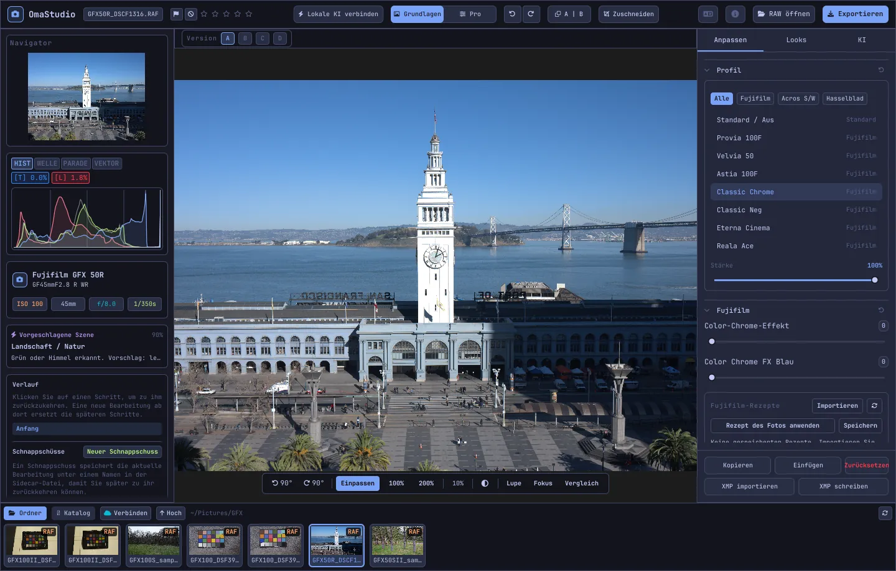

# OmaStudio Benutzerhandbuch

**OmaStudio: The Complete Medium Format RAW Editor for Omarchy**

[Alle Sprachen](../README.md) · [Technologien](../technology/de.md) · [README](../../README.md)

Dieses Handbuch beschreibt OmaStudio 3.1. Es erklärt die Installation, den Aufbau des Fensters und die Verwendung aller Bereiche und Werkzeuge. Die Bildschirmfotos zeigen Beispieldateien einer Fujifilm GFX 50R und einer Hasselblad CFV-50c von [raw.pixls.us](https://raw.pixls.us) (CC0).



## Inhalt

1. [Installation](#1-installation)
2. [Das Fenster](#2-das-fenster)
3. [Fotos öffnen und die Bibliothek](#3-fotos-öffnen-und-die-bibliothek)
4. [Grundlagen und Pro](#4-grundlagen-und-pro)
5. [Der Reiter Anpassen](#5-der-reiter-anpassen)
6. [Der Reiter Masken](#6-der-reiter-masken)
7. [Der Reiter Looks](#7-der-reiter-looks)
8. [Der Reiter KI und der KI-Chat](#8-der-reiter-ki-und-der-ki-chat)
9. [Ansichtshilfen](#9-ansichtshilfen)
10. [Verlauf, Schnappschüsse und Versionen](#10-verlauf-schnappschüsse-und-versionen)
11. [Fujifilm](#11-fujifilm)
12. [Mittelformat](#12-mittelformat)
13. [Export](#13-export)
14. [Cloud-Konten](#14-cloud-konten)
15. [Tastatur und Maus](#15-tastatur-und-maus)
16. [Befehlszeile, Steuer-Socket und MCP](#16-befehlszeile-steuer-socket-und-mcp)
17. [Dateien und Ordner](#17-dateien-und-ordner)
18. [Fehlerbehebung](#18-fehlerbehebung)

## 1. Installation

OmaStudio läuft unter Omarchy (Arch Linux) mit Wayland und Hyprland.

**Als Paket.** In einer Kopie des Repositorys:

```bash
makepkg -si
```

Damit werden `omastudio`, `omastudio-app`, `omastudio-engine`, die ICC-Profile, der Desktop-Eintrag, die Symbole und eine udev-Regel für Fujifilm-Kameras an USB installiert.

**Aus einem Release-Archiv.** Laden Sie `omastudio-<Version>-x86_64-linux.tar.gz` von der [Release-Seite](https://github.com/ozdil/omarchy-omastudio/releases) herunter, prüfen Sie es mit `checksums.txt`, entpacken Sie es und kopieren Sie `bin/*` nach `~/.local/bin` und `share/omastudio` nach `~/.local/share/omastudio`.

**Benötigte Pakete:** `libraw` 0.22 oder neuer, `lcms2`, `qt6-base`, `qt6-declarative`, `qt6-wayland` und `qt6-svg` 6.12 oder neuer sowie `zenity` für die Dateidialoge.

**Optionale Pakete:**

| Paket | Wofür |
| :--- | :--- |
| `vulkan-icd-loader` und der Vulkan-Treiber Ihrer GPU | Demosaicing auf der GPU |
| `perl-image-exiftool` | EXIF-Metadaten in exportierten Dateien behalten |
| `libwebp-utils`, `libheif`, `ffmpeg` | Verlustbehaftetes WebP, HEIF und der AVIF-Ausweichweg |
| `onnxruntime` | Lokale KI-Masken auf NPU, GPU oder CPU |
| `rclone`, `libsecret`, `gnome-keyring` | Google Drive, OneDrive, Dropbox, Box, pCloud und Yandex Disk |
| `github-cli` | GitHub-Konto |
| `ollama` | Lokale KI-Modelle für den Bearbeitungsassistenten |
| `quickshell` | Die OmaStudio-Schaltfläche in der Omarchy-Leiste |

Starten Sie OmaStudio aus dem Omarchy-Anwendungsmenü oder mit `omastudio` (optional mit einem Foto: `omastudio DSCF0001.RAF`). Ist bereits ein Fenster offen, wird das Foto dort geöffnet.

## 2. Das Fenster

| Bereich | Inhalt |
| :--- | :--- |
| Obere Leiste | Dateiname, Markierungen und Sternebewertung, **Lokale KI verbinden**, der Schalter **Grundlagen** / **Pro**, Rückgängig und Wiederholen, Vorher und Nachher (**A \| B**), **Zuschneiden**, Sprachmenü, Info, **RAW öffnen** und **Exportieren** |
| Linker Bereich | Navigator, Messinstrumente (Histogramm, Wellenform, RGB-Parade, Vektorskop) mit Clipping-Anzeigen, Kamera- und Objektivangaben, die vorgeschlagene Szene, Verlauf und Schnappschüsse |
| Mitte | Das Foto, darüber die Versionsleiste (A–D), darunter die Ansichtsleiste: Drehen, **Einpassen**, 100 %, 200 %, aktueller Zoom, Umgebungsfarbe, **Lupe**, **Fokus**, **Vergleich** |
| Rechter Bereich | Die Reiter **Anpassen**, **Masken** (Pro), **Looks** und **KI** sowie eine feste Zeile mit **Kopieren**, **Einfügen**, **Zurücksetzen**, **XMP importieren** und **XMP schreiben** |
| Filmstreifen | **Ordner**, **Katalog**, ein Reiter je Cloud-Konto, **Verbinden**, **Hoch** und die Fotos des aktuellen Ordners |

**Tab** blendet beide Seitenbereiche und den Filmstreifen gemeinsam aus und ein. Jeder Abschnitt lässt sich über seine Kopfzeile auf- und zuklappen; **Strg+Klick** auf eine Kopfzeile lässt nur diesen Abschnitt offen. Der offene Reiter, die zugeklappten Abschnitte und die sichtbaren Bereiche bleiben zwischen Sitzungen erhalten.

Farben, Schrift und Eckenrundung folgen live dem aktiven Omarchy-Theme. Die Fläche um das Foto ist standardmäßig neutral dunkelgrau, damit das Theme die Farbwahrnehmung nicht verschiebt; die Umgebungs-Schaltfläche in der Ansichtsleiste wechselt zu Mittelgrau oder zur Theme-Farbe.

| Tokyo Night | Catppuccin Latte | Gruvbox | Rosé Pine |
| :---: | :---: | :---: | :---: |
|  |  |  |  |

Die Oberfläche gibt es in 30 Sprachen. Sie folgt der Systemsprache; das Sprachmenü in der oberen Leiste wählt eine andere und wendet sie sofort an.

## 3. Fotos öffnen und die Bibliothek

- **RAW öffnen** (Strg+O) öffnet den Dateidialog. Er filtert nach Fotos, RAW oder Bildern.
- Ziehen Sie ein Foto oder einen Ordner aus dem Dateimanager auf das Fenster.
- Im Filmstreifen zeigt **Ordner** den aktuellen Ordner; ein Klick auf einen Ordner öffnet ihn, **Hoch** geht zurück. Ein Klick auf ein Foto öffnet es. Strg+← und Strg+→ springen zum vorigen und nächsten Foto.
- **Katalog** zeigt jedes Foto, das OmaStudio gesehen hat, mit Bewertung, Markierung und Farbetikett.

OmaStudio öffnet jedes RAW-Format, das LibRaw 0.22 liest (Fujifilm, Hasselblad, Phase One, Leica, Pentax, Mamiya/Leaf, Canon, Nikon, Sony, Panasonic, Olympus, Sigma, DNG und andere), sowie JPEG, PNG, WebP, TIFF, HEIF/HEIC, AVIF, JPEG XL, OpenEXR, Radiance HDR und PNM.

**Bewertung und Markierungen.** 1 bis 5 setzen die Sternebewertung, 0 löscht sie. P markiert als ausgewählt, X als abgelehnt, U entfernt die Markierung. Bewertungen und Markierungen werden sofort im Katalog und in der Begleitdatei gespeichert.

**Auswahl.** Umschalt+Klick wählt im Filmstreifen einen Bereich, Strg+Klick fügt ein Foto hinzu oder entfernt es. Sind mehrere Fotos ausgewählt, exportiert das Exportfenster alle (**Stapel**).

Ihre Originaldateien werden nie verändert. Bearbeitungen werden während der Arbeit in einer Begleitdatei neben dem Foto gespeichert, `<Foto>.omastudio` (Strg+S speichert sofort).

## 4. Grundlagen und Pro

Der Schalter in der oberen Leiste legt fest, wie viele Werkzeuge angezeigt werden.

- **Grundlagen:** Profil, Fujifilm, Weißabgleich, Ton, Präsenz, Vorgaben und 3D-LUTs.
- **Pro** ergänzt Gradationskurve, Farbmischer, Farbkorrektur, Details und Optik, Transformieren, Körnung, Farbmanagement und den Reiter **Masken**. Pro-Abschnitte tragen die Kennzeichnung „Pro“.

Beim Zurückschalten auf Grundlagen werden die Pro-Abschnitte ausgeblendet; ihre Einstellungen bleiben wirksam.


## 5. Der Reiter Anpassen

Jeder Regler wird per Doppelklick zurückgesetzt. Die Schaltfläche in der Kopfzeile eines Abschnitts setzt den ganzen Abschnitt zurück.

### Profil

Der Grundlook: **Standard / Aus**, die Fujifilm-Filmsimulationen (Provia, Velvia, Astia, Classic Chrome, Classic Neg, Eterna, Eterna Bleach Bypass, Reala Ace, Nostalgic Neg, PRO Neg Std und Hi, Acros und Monochrom mit Gelb-, Rot- und Grünfilter, Sepia) und das natürliche Farbprofil im Hasselblad-Stil. Die Reiter filtern die Liste. **Stärke** mischt das Profil mit der neutralen Wiedergabe.

### Fujifilm

**Color-Chrome-Effekt** und **Color Chrome FX Blau** (Schwach = 50, Stark = 100) vertiefen gesättigte Farben, bei FX Blau die Blautöne, ohne ihren Farbton zu ändern. Rezeptbibliothek, Kamera an USB und Pixel Shift sind unter [Fujifilm](#11-fujifilm) beschrieben.

### Weißabgleich

**Temperatur** (2000–12000 K) und **Tönung**, relativ zum Weißabgleich, den die Kamera aufgezeichnet hat. Ein Foto öffnet sich „wie aufgenommen“.

### Ton

**Belichtung** (−5 bis +5 LW auf linearem Licht: +1 LW verdoppelt das Licht), **Kontrast**, **Lichter**, **Tiefen**, **Weiß** und **Schwarz**.

### Präsenz

**Textur**, **Klarheit** (Mitteltonkontrast), **Dunst entfernen**, **Dynamik** und **Sättigung**.

### Gradationskurve (Pro)

Eine Punktkurve über dem Histogramm, für RGB und für Rot, Grün und Blau getrennt. Klicken fügt einen Punkt hinzu, Ziehen verschiebt ihn, Doppelklick entfernt ihn. Die Kurve schießt nie über ihre Punkte hinaus. Die vier Bereichsregler darunter (Lichter, Helle Töne, Dunkle Töne, Tiefen) formen die Kurve nach Bereichen.

### Farbmischer (Pro)

Farbton, Sättigung und Luminanz für acht Farben: Rot, Orange, Gelb, Grün, Aquamarin, Blau, Lila und Magenta.


### Farbkorrektur (Pro)

Dreiwege-Farbräder für Tiefen (Lift), Mitteltöne (Gamma) und Lichter (Gain) sowie ein globaler Offset, als vier Räder oder als Reiter. **Farbverstärkung**, **Mitteltondetail** und **Kontrast-Drehpunkt** liegen unter den Rädern. Der Kanalmixer darunter mischt Rot, Grün und Blau in jeden Ausgabekanal oder in eine Monochrom-Mischung.


### Details und Optik (Pro)

**Schärfen**, **Rauschreduzierung** (Luminanz und Farbe), **Vignette**, **Farbsäume entfernen** (chromatische Aberration) und **Objektivverzeichnung korrigieren**. Fujifilm- und DNG-Objektivkorrekturen aus der Datei werden automatisch angewendet; diese Regler wirken zusätzlich.

### Transformieren (Pro)

**Vertikal** richtet stürzende Linien auf, etwa bei einem von unten fotografierten Gebäude; **Horizontal** tut dasselbe seitlich; **Skalieren** vergrößert das Ergebnis. Schneiden Sie danach zu, um die leeren Ränder zu entfernen.

### Körnung (Pro)

**Kornmenge**, **Korngröße** und **Kornrauheit** des Filmkorns.

### Farbmanagement (Pro)

- **Gamut-Kompression** holt Farben, die aus dem Farbumfang geschoben wurden, sanft zurück, statt sie abzuschneiden.
- **ACES-Tonkurve** ist ein filmischer Übergang in den Lichtern, eine angepasste Näherung der ACES-Ausgabetransformation.
- **Softproof** (S) zeigt das Foto so, wie es mit einem Ausgabeprofil aussehen wird, etwa einem Drucker- und Papierprofil. Wählen Sie Profil und Rendering-Intent. **Farbumfang-Warnung** färbt Farben, die das Profil nicht wiedergeben kann, magenta. Bearbeitung und Export ändern sich nicht.

Der Ausgabefarbraum selbst wird im Exportfenster gewählt.


## 6. Der Reiter Masken

Der Reiter Masken erscheint im Pro-Modus.

### Reparieren und Kopieren

Schalten Sie **Stellen bearbeiten** ein und klicken Sie auf eine Stelle im Foto, um sie zu entfernen. Sie wird aus einer Quelle daneben ersetzt. Ziehen Sie den durchgezogenen Kreis, um die Stelle zu verschieben, und den gestrichelten, um eine andere Quelle zu wählen. **Reparieren** gleicht den kopierten Bereich an Licht und Farbe um die Stelle an; **Kopieren** übernimmt ihn unverändert. **Größe**, **Weiche Kante** und **Deckkraft** gelten für die gewählte Stelle und für neue.


### Lokale Anpassungen

Jede Ebene wendet Belichtung, Kontrast, Lichter, Tiefen, Weiß, Schwarz und Sättigung über eine Maske an, mit einer Deckkraft.

| Maske | Wie sie entsteht |
| :--- | :--- |
| **Linear** | Ein Verlauf zwischen zwei Griffen auf dem Foto |
| **Radial** | Eine Ellipse mit Mittel- und Randgriffen und einer weichen Kante |
| **Luminanz** | Ein Helligkeitsbereich (dunkelster, hellster Wert, Übergang) |
| **Farbe** | Farben nahe einer aus dem Foto aufgenommenen Farbe (Bereich und weiche Kante) |
| **Pinsel** | Auf das Foto gemalt, mit Größe, weicher Kante, Fluss und Radiermodus; die mittlere Maustaste verschiebt |
| **KI-Motiv**, **KI-Himmel** | Ein Segmentierungsmodell auf Ihrem Computer (siehe [KI](#8-der-reiter-ki-und-der-ki-chat)) |

Unter **Kombinieren mit:** lassen sich weitere Teile zur Maske der Ebene hinzufügen, von ihr abziehen oder mit ihr schneiden; jeder Teil lässt sich umkehren.


## 7. Der Reiter Looks

- **Vorgaben:** **Automatik** analysiert das Foto und stellt Belichtung, Weißabgleich und Ton ein. Die Looks Gedämpft, Lebendig, Warmes Porträt, Schwarzweiß sowie Petrol und Orange ersetzen den vorherigen Look, statt sich aufzuaddieren; Weißabgleich, Belichtung, Zuschnitt und Filmsimulation bleiben.
- **LUT:** **.cube-Datei laden…** wendet eine eigene 3D-LUT mit einer Stärke an.


## 8. Der Reiter KI und der KI-Chat

**Lokale KI verbinden** in der oberen Leiste nutzt die auf diesem Computer eingerichtete KI: den Standard-Agenten von Omarchy (Claude Code oder Codex mit deren eigener Anmeldung), sonst Ollama, sonst LM Studio. Nach dem Verbinden öffnet die Schaltfläche den **KI-Chat** über dem Foto: Schreiben Sie, was Sie ändern möchten („wärmer, Himmel retten“), und die KI stellt die Regler ein. Strg+Z macht jede Bearbeitung rückgängig.

Der **Bearbeitungsassistent** im Reiter KI tut dasselbe aus dem Bereich heraus und kann stattdessen einen Cloud-Anbieter nutzen: Anthropic Claude, OpenAI, OpenRouter oder Google Gemini. Deren API-Schlüssel liegen im Schlüsselbund des Systems und werden nie auf die Festplatte geschrieben oder auf eine Befehlszeile gesetzt. Mit einem Cloud-Anbieter oder mit Claude Code oder Codex wird die Vorschau des Fotos an diesen Dienst gesendet; mit Ollama oder LM Studio bleibt sie auf Ihrem Computer.


**KI-Masken.** **KI-Motiv** und **KI-Himmel** im Reiter Masken führen ein ONNX-Segmentierungsmodell auf diesem Computer aus: zuerst auf einer NPU (Intel Core Ultra über OpenVINO, Snapdragon X über QNN, AMD Ryzen AI über Vitis AI), dann auf einer GPU, dann auf der CPU. Es wird kein Modell mitgeliefert oder heruntergeladen. Legen Sie ein Modell als `subject.onnx` oder `sky.onnx` in `~/.local/share/omastudio/models` ab; `omastudio npu` zeigt, was installiert ist.

## 9. Ansichtshilfen

| Hilfe | Verwendung |
| :--- | :--- |
| Zoom | Mausrad am Zeiger; **Einpassen** (Strg+0), **100 %** (Strg+1), **200 %**; Doppelklick wechselt zwischen Einpassen und 200 %. 100 % zeigt bei jeder Anzeigeskalierung ein Fotopixel pro Bildschirmpixel. |
| Verschieben | Ziehen mit linker oder mittlerer Maustaste; Umschalt+Mausrad verschiebt seitlich |
| Drehen | Die Dreh-Schaltflächen in der Ansichtsleiste; Alt+Mausrad dreht in Schritten von 1,5° |
| Zuschneiden (C) | Seitenverhältnisse (Original, 1:1, 4:5, 9:16, 16:9, Frei) und Raster (Drittel, Goldener Schnitt, Goldene Spirale) |
| Vorher und Nachher (Y oder A \| B) | Das Foto geteilt in Original und Bearbeitung |
| Vergleich (Umschalt+C) | Die Bearbeitung neben einem anderen Stand: Vorher, eine Version oder ein Schnappschuss |
| Lupe (L) | Ein Quadrat unter dem Zeiger mit dem Foto in voller Auflösung 1:1 |
| Fokus-Peaking (Umschalt+F) | Die schärfsten Kanten grün markiert; nur eine Ansichtshilfe |
| Clipping | Ein Klick auf **[S]** oder **[H]** über dem Histogramm zeigt abgeschnittene Tiefen blau und Lichter rot |

| Fokus-Peaking | Vergleich |
| :---: | :---: |
|  |  |

| Zuschneiden | Vorher und Nachher |
| :---: | :---: |
|  |  |

Wird das Foto größer als die Vorschau angezeigt, berechnet die Engine den sichtbaren Ausschnitt aus der Datei in voller Auflösung; die sichtbaren Details entsprechen also dem Export.

## 10. Verlauf, Schnappschüsse und Versionen

- **Verlauf** im linken Bereich listet jeden Schritt der Bearbeitung mit Namen („Exposure +0.70“, „Tone curve“). Ein Klick auf einen Schritt kehrt dorthin zurück; eine neue Bearbeitung ab dort ersetzt die späteren Schritte, wie bei Strg+Z.
- **Schnappschüsse** sichern die aktuelle Bearbeitung unter einem Namen. **Wiederherstellen** holt einen als neuen Schritt zurück, den Strg+Z rückgängig machen kann. Schnappschüsse werden in der Begleitdatei gespeichert.
- **Versionen A–D** über dem Foto halten bis zu vier getrennte Bearbeitungen desselben Fotos. Ein Klick auf einen Buchstaben wechselt (Alt+1 bis Alt+4); ein Rechtsklick kopiert die aktuelle Bearbeitung in diese Version.
- **Kopieren** und **Einfügen** (Strg+Umschalt+C, Strg+Umschalt+V) übertragen eine Bearbeitung auf ein anderes Foto. **Zurücksetzen** (Strg+R) stellt die Standardwerte her.
- **XMP schreiben** speichert Bearbeitung, Bewertung und Etikett als `.xmp`-Begleitdatei, die Lightroom, Capture One, darktable und digiKam lesen; **XMP importieren** liest eine von diesen Programmen geschriebene.

## 11. Fujifilm

- **Das Rezept der Kamera.** Eine RAF- oder Fujifilm-JPEG-Datei öffnet sich mit den Aufnahmeeinstellungen: Filmsimulation, Ton, Farbe, Schärfe, Rauschreduzierung, Klarheit, Körnung, Color Chrome, Weißabgleich-Verschiebung und Dynamikbereich (einschließlich D-Range Priority). Eine gespeicherte Begleitdatei hat Vorrang.
- **Helligkeit.** RAF-Dateien öffnen sich in der Helligkeit des kameraeigenen JPEGs.
- **Objektivkorrekturen.** Von der Kamera aufgezeichnete Verzeichnung, laterale chromatische Aberration und Vignettierung werden für XF-, XC- und GF-Objektive angewendet.
- **Rezeptbibliothek.** **Importieren** übernimmt ein X RAW Studio-Profil (.FP1, .FP2, .FP3), Rezepttext („Film Simulation: Classic Chrome / Grain Effect: Strong, Small …“) oder ein Fujifilm-Foto. **Rezept anwenden** wendet ein gespeichertes an; **Rezept des Fotos anwenden** kehrt zu dem aus der Datei zurück; **Speichern** sichert das aktuelle.
- **Kamera über USB.** Stellen Sie den USB-Modus der Kamera auf USB RAW CONV./BACKUP RESTORE und schließen Sie sie an. **C1–C7 lesen** zeigt ihre benutzerdefinierten Einstellungen, **Rezept in C… schreiben** speichert ein Rezept in einem Platz (und ersetzt, was dort war), und **In der Kamera konvertieren** entwickelt die offene RAF in der Kamera, wahlweise mit dem gewählten Rezept.
- **Pixel Shift.** Wählen Sie im Filmstreifen die RAF-Bilder einer GFX-Pixel-Shift-Serie und klicken Sie auf **Bilder zu DNG zusammenführen**. Vier Bilder ergeben volle Farbe in jedem Pixel; sechzehn Bilder verdoppeln die Auflösung.

## 12. Mittelformat

- **Fujifilm GFX** (GFX 50S, 50R, 50S II, 100, 100S, 100 II und andere): 16-Bit-Verarbeitung vom Sensor bis zum Export, Filmsimulationen, Objektivkorrekturen und Pixel Shift.
- **Hasselblad**-Dateien (3FR und FFF) werden auf den Standardzuschnitt der Kamera beschnitten.
- **Phase One und Leaf** (IIQ und MOS) erhalten die eigene Sensorkalibrierung des Rückteils.
- **Mamiya** MEF und **Pentax 645** PEF werden unterstützt.
- **Flat Field (LCC):** `omastudio-engine medium-format lcc-create <raw>` erstellt aus einer Aufnahme eines gleichmäßig beleuchteten weißen Ziels eine Korrektur, die auf die Fotos dieses Ordners angewendet wird.
- **Multi-Shot:** `medium-format multishot f1 f2 f3 f4 --out merged.tif` führt eine 4-Shot-Serie zusammen.


## 13. Export

**Exportieren** (E) öffnet das Exportfenster. Eingabe exportiert, Esc schließt.


| Einstellung | Auswahl |
| :--- | :--- |
| Format | JPEG, PNG (8/16 Bit), TIFF (8/16 Bit, ohne, LZW- oder ZIP-Kompression), WebP, AVIF (8/10/12 Bit), HEIF (8/10/12 Bit), JPEG XL (8/16 Bit) und OpenEXR (halbe oder volle Gleitkommagenauigkeit, szenenlinear) |
| Qualität | 1–100; 100 ist bei WebP, AVIF und JPEG XL verlustfrei |
| Größe | Voll, 75 %, 50 % oder eine lange Kante von 3840 bzw. 2048 px |
| Farbprofil | sRGB, Display P3, Adobe RGB, ProPhoto RGB, Rec. 2020, ACEScg oder ein eigenes ICC-Profil |
| Rendering-Intent | Perzeptiv, Relativ (Standard), Sättigung, Absolut |
| Metadaten | Kamera-Metadaten behalten (EXIF), Standort entfernen (GPS) |
| Vorbereiten für | Zuschnitt und Ausgabeschärfung für Instagram, Stories und Reels, X, Facebook, quadratisch und YouTube-Vorschaubilder |
| Wasserzeichen | Text mit EXIF-Platzhaltern ({camera}, {lens}, {iso}, {aperture}, {shutter}, {focal}) oder ein PNG-Logo, mit Position, Deckkraft, Größe und Schatten |
| Ordner und Dateiname | Standard `~/Pictures/OmaStudio_Exports`; dem Dateinamen kann ein Zusatz angehängt werden |
| Hochladen nach | Ein verbundenes Cloud-Konto |

Jedes Format außer OpenEXR enthält das ICC-Profil seines Farbraums. Ein Stapel exportiert die gewählten Fotos nacheinander.

## 14. Cloud-Konten

**Verbinden** im Filmstreifen fügt Google Drive, OneDrive, Dropbox, Box, pCloud, Yandex Disk oder GitHub hinzu. Die Anmeldung erfolgt auf der Seite des Dienstes in Ihrem Browser; OmaStudio sieht Ihr Passwort nie.


- Jedes Konto erhält einen Reiter im Filmstreifen. Durchsuchen Sie seine Ordner und klicken Sie auf ein Foto, um es (einmal) herunterzuladen und zu öffnen.
- In jedem Konto wird ein Ordner `OmaStudio` angelegt (bei GitHub ein privates Repository `OmaStudio`), der Uploads aus dem Exportfenster aufnimmt.
- Speicherdienste laufen über rclone mit einer eigenen OmaStudio-Konfiguration, verschlüsselt mit einem Schlüssel im Schlüsselbund des Systems. GitHub läuft über die GitHub CLI.
- Für Google Drive kann unter **Eigene Google-Client-ID** eine eigene Client-ID aus der Google Cloud Console eingetragen werden.
- **Trennen** entfernt die Schlüssel des Kontos und die heruntergeladenen Kopien von diesem Computer; die Dateien im Konto bleiben.

## 15. Tastatur und Maus

| Taste | Aktion |
| :--- | :--- |
| Strg+O | Foto öffnen |
| Strg+S | Bearbeitung sofort speichern |
| Strg+Z / Strg+Umschalt+Z oder Strg+Y | Rückgängig / Wiederholen |
| Strg+Umschalt+C / Strg+Umschalt+V | Bearbeitung kopieren / einfügen |
| Strg+R | Bearbeitung zurücksetzen |
| Strg+← / Strg+→ | Voriges / nächstes Foto |
| Strg+0 / Strg+1 | Einpassen / 100 % |
| 1–5, 0 | Sternebewertung, Bewertung löschen |
| P, X, U | Auswählen, ablehnen, Markierung entfernen |
| C | Zuschneiden |
| Y | Vorher und Nachher |
| S | Softproof |
| L | Lupe |
| Umschalt+F | Fokus-Peaking |
| Umschalt+C | Vergleich |
| Alt+1 … Alt+4 | Versionen A–D |
| E | Exportfenster |
| Tab | Bereiche aus- oder einblenden |
| Esc | Offenes Fenster schließen |

| Maus | Aktion |
| :--- | :--- |
| Mausrad | Am Zeiger zoomen |
| Umschalt+Mausrad | Seitlich verschieben |
| Alt+Mausrad | Drehen |
| Ziehen (linke oder mittlere Taste) | Verschieben |
| Doppelklick auf das Foto | Einpassen oder 200 % |
| Strg+Klick auf eine Abschnittskopfzeile | Nur diesen Abschnitt offen lassen |
| Rechtsklick auf einen Versionsbuchstaben | Aktuelle Bearbeitung in diese Version kopieren |

## 16. Befehlszeile, Steuer-Socket und MCP

**Engine-Befehle.** Jeder Befehl gibt ein JSON-Objekt aus, sodass Skripte und Agenten ihn nutzen können.

```bash
omastudio inspect DSCF0001.RAF                      # Kamera, Objektiv, Belichtung, Histogramm, Szene
omastudio export DSCF0001.RAF --recipe '{"exposure":0.5}' --options '{"format":"jpeg"}'
omastudio fuji-recipe DSCF0001.RAF                  # das Rezept der Kamera
omastudio fuji-pixel-shift DSCF*.RAF --out merged.dng
omastudio xmp export DSCF0001.RAF
omastudio cameras GFX                               # vom RAW-Decoder unterstützte Kameras
omastudio gpu                                       # GPU für das Demosaicing
omastudio npu                                       # ONNX Runtime und Beschleuniger
omastudio cloud status
omastudio --cli help                                # alle Befehle
```

**Steuer-Socket.** `omastudio ipc <Methode> [Argumente]` spricht mit dem offenen Fenster, zum Beispiel `openPhoto`, `openFolder`, `applyRecipe`, `applyPreset`, `setExposure`, `setWarmth`, `setMode essentials|pro`, `setRightTab`, `showSection`, `setView peaking|compare|softProof|split on|off`, `setZoom`, `showExport`, `showCloud`, `getStatus` und `screenshot <datei.png>`. Der Socket antwortet nur demselben Benutzer.

**MCP.** `omastudio mcp` ist ein Model-Context-Protocol-Server, mit dem KI-Agenten Fotos untersuchen, berechnen, aussortieren und exportieren, Fujifilm-Rezepte lesen und das offene Fenster steuern können. Für Claude Code: `claude mcp add omastudio -- omastudio mcp`. `omastudio skill` installiert den Agenten-Skill nach `~/.claude/skills`.

## 17. Dateien und Ordner

| Pfad | Inhalt |
| :--- | :--- |
| `<Foto>.omastudio` | Die Bearbeitung eines Fotos (Begleitdatei) |
| `~/.local/share/omastudio/catalog.json` | Katalog: Bewertungen, Markierungen und Farbetiketten |
| `~/.local/share/omastudio/fuji-recipes/` | Gespeicherte Fujifilm-Rezepte |
| `~/.local/share/omastudio/icc/` | Eigene ICC-Profile |
| `~/.local/share/omastudio/models/` | Lokale KI-Modelle |
| `~/.local/share/omastudio/film-luts/` | Aus Ihren Fotos gemessene Filmsimulations-LUTs (`fuji-calibrate`) |
| `~/.config/omastudio/` | Einstellungen, Oberflächenzustand, Sprache, Cloud-Konten |
| `~/.cache/omastudio/` | Miniaturen, Vorschauen und heruntergeladene Cloud-Fotos |

## 18. Fehlerbehebung

- **Das Fenster öffnet sich nicht.** Starten Sie `omastudio` in einem Terminal und lesen Sie die Meldung. `omastudio --version` und `omastudio status` zeigen, was installiert ist.
- **Die GPU wird nicht genutzt.** `omastudio gpu` zeigt das Gerät. Installieren Sie `vulkan-icd-loader` und den Vulkan-Treiber Ihrer GPU. `OMASTUDIO_GPU=off` erzwingt die CPU.
- **Eine Kamera wird an USB nicht gefunden.** Stellen Sie ihren USB-Modus auf USB RAW CONV./BACKUP RESTORE, schließen Sie sie neu an und prüfen Sie, ob die udev-Regel des Pakets installiert ist.
- **Ein Cloud-Dienst verlangt ein Programm.** Installieren Sie das Paket, das der Dialog nennt, zum Beispiel `sudo pacman -S rclone libsecret`.
- **Systeminfo kopieren** im Info-Fenster kopiert Version, GPU und Omarchy-Angaben für einen Fehlerbericht. Melden Sie Probleme unter [github.com/ozdil/omarchy-omastudio/issues](https://github.com/ozdil/omarchy-omastudio/issues).
