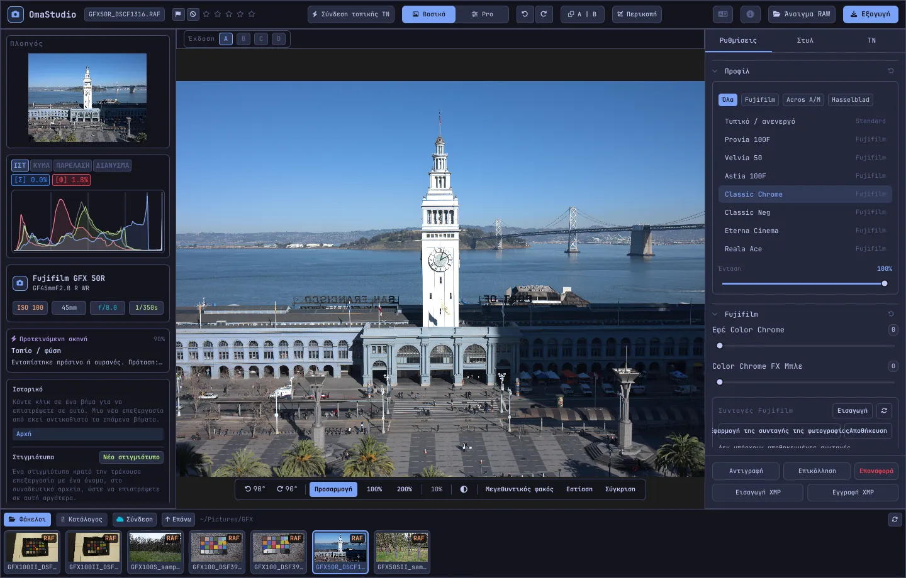

# Οδηγός χρήσης του OmaStudio

**OmaStudio: The Complete Medium Format RAW Editor for Omarchy**

[Όλες οι γλώσσες](../README.md) · [Τεχνολογίες](../technology/el.md) · [README](../../README.md)

Ο οδηγός αυτός αφορά το OmaStudio 3.1. Εξηγεί πώς εγκαθίσταται η εφαρμογή, πώς είναι οργανωμένο το παράθυρο και πώς χρησιμοποιείται κάθε πίνακας και εργαλείο. Τα στιγμιότυπα οθόνης δείχνουν δείγματα αρχείων Fujifilm GFX 50R και Hasselblad CFV-50c από το [raw.pixls.us](https://raw.pixls.us) (CC0).



## Περιεχόμενα

1. [Εγκατάσταση](#1-εγκατάσταση)
2. [Το παράθυρο](#2-το-παράθυρο)
3. [Άνοιγμα φωτογραφιών και βιβλιοθήκη](#3-άνοιγμα-φωτογραφιών-και-βιβλιοθήκη)
4. [Βασικά και Pro](#4-βασικά-και-pro)
5. [Η καρτέλα Ρυθμίσεις](#5-η-καρτέλα-ρυθμίσεις)
6. [Η καρτέλα Μάσκες](#6-η-καρτέλα-μάσκες)
7. [Η καρτέλα Στυλ](#7-η-καρτέλα-στυλ)
8. [Η καρτέλα ΤΝ και η συνομιλία με ΤΝ](#8-η-καρτέλα-τν-και-η-συνομιλία-με-τν)
9. [Βοηθήματα προβολής](#9-βοηθήματα-προβολής)
10. [Ιστορικό, στιγμιότυπα και εκδόσεις](#10-ιστορικό-στιγμιότυπα-και-εκδόσεις)
11. [Fujifilm](#11-fujifilm)
12. [Μεσαίο φορμά](#12-μεσαίο-φορμά)
13. [Εξαγωγή](#13-εξαγωγή)
14. [Λογαριασμοί cloud](#14-λογαριασμοί-cloud)
15. [Πληκτρολόγιο και ποντίκι](#15-πληκτρολόγιο-και-ποντίκι)
16. [Γραμμή εντολών, υποδοχή ελέγχου και MCP](#16-γραμμή-εντολών-υποδοχή-ελέγχου-και-mcp)
17. [Αρχεία και φάκελοι](#17-αρχεία-και-φάκελοι)
18. [Αντιμετώπιση προβλημάτων](#18-αντιμετώπιση-προβλημάτων)

## 1. Εγκατάσταση

Το OmaStudio εκτελείται στο Omarchy (Arch Linux) με Wayland και Hyprland.

**Από το πακέτο.** Σε έναν κλώνο του αποθετηρίου:

```bash
makepkg -si
```

Έτσι εγκαθίστανται τα `omastudio`, `omastudio-app`, `omastudio-engine`, τα προφίλ ICC, η καταχώριση επιφάνειας εργασίας, τα εικονίδια και ένας κανόνας udev για φωτογραφικές μηχανές Fujifilm μέσω USB.

**Από αρχείο έκδοσης.** Κατεβάστε το `omastudio-<έκδοση>-x86_64-linux.tar.gz` από τη [σελίδα εκδόσεων](https://github.com/ozdil/omarchy-omastudio/releases), ελέγξτε το με το `checksums.txt`, αποσυμπιέστε το και αντιγράψτε το `bin/*` στο `~/.local/bin` και το `share/omastudio` στο `~/.local/share/omastudio`.

**Απαιτούμενα πακέτα:** `libraw` 0.22 ή νεότερο, `lcms2`, `qt6-base`, `qt6-declarative`, `qt6-wayland` και `qt6-svg` 6.12 ή νεότερα, καθώς και `zenity` για τα παράθυρα αρχείων.

**Προαιρετικά πακέτα:**

| Πακέτο | Χρήση |
| :--- | :--- |
| `vulkan-icd-loader` και το πρόγραμμα οδήγησης Vulkan της κάρτας γραφικών | Αποψηφιδοποίηση (demosaicing) στη GPU |
| `perl-image-exiftool` | Διατήρηση μεταδεδομένων EXIF στα εξαγόμενα αρχεία |
| `libwebp-utils`, `libheif`, `ffmpeg` | WebP με απώλειες, HEIF και εναλλακτική λύση για AVIF |
| `onnxruntime` | Τοπικές μάσκες ΤΝ σε NPU, GPU ή CPU |
| `rclone`, `libsecret`, `gnome-keyring` | Google Drive, OneDrive, Dropbox, Box, pCloud και Yandex Disk |
| `github-cli` | Λογαριασμός GitHub |
| `ollama` | Τοπικά μοντέλα ΤΝ για τον βοηθό επεξεργασίας |
| `quickshell` | Το κουμπί OmaStudio στη γραμμή του Omarchy |

Ξεκινήστε το OmaStudio από το μενού εφαρμογών του Omarchy ή εκτελέστε `omastudio` (προαιρετικά με μια φωτογραφία: `omastudio DSCF0001.RAF`). Αν ένα παράθυρο είναι ήδη ανοιχτό, η φωτογραφία ανοίγει σε αυτό.

## 2. Το παράθυρο

| Περιοχή | Περιεχόμενο |
| :--- | :--- |
| Επάνω γραμμή | Όνομα αρχείου, σημάνσεις και βαθμολογία με αστέρια, **Σύνδεση τοπικής ΤΝ**, ο διακόπτης **Βασικά** / **Pro**, αναίρεση και επανάληψη, πριν και μετά (**A \| B**), **Περικοπή**, μενού γλώσσας, Πληροφορίες, **Άνοιγμα RAW** και **Εξαγωγή** |
| Αριστερός πίνακας | Πλοηγός, όργανα μέτρησης (ιστόγραμμα, κυματομορφή, παρέλαση RGB, διανυσματοσκόπιο) με ενδείξεις αποκοπής, στοιχεία μηχανής και φακού, η προτεινόμενη σκηνή, ιστορικό και στιγμιότυπα |
| Κέντρο | Η φωτογραφία, η γραμμή εκδόσεων (A–D) από πάνω και η γραμμή προβολής από κάτω: περιστροφή, **Προσαρμογή**, 100%, 200%, τρέχον ζουμ, χρώμα περιβάλλοντος, **Μεγεθυντικός φακός**, **Εστίαση**, **Σύγκριση** |
| Δεξιός πίνακας | Οι καρτέλες **Ρυθμίσεις**, **Μάσκες** (Pro), **Στυλ** και **ΤΝ**, και μια σταθερή σειρά με **Αντιγραφή**, **Επικόλληση**, **Επαναφορά**, **Εισαγωγή XMP** και **Εγγραφή XMP** |
| Ταινία φιλμ | **Φάκελοι**, **Κατάλογος**, μία καρτέλα ανά λογαριασμό cloud, **Σύνδεση**, **Επάνω** και οι φωτογραφίες του τρέχοντος φακέλου |

Το **Tab** κρύβει και εμφανίζει μαζί τους δύο πλευρικούς πίνακες και την ταινία φιλμ. Κάθε ενότητα πίνακα ανοίγει και κλείνει από την κεφαλίδα της· το **Ctrl+κλικ** σε κεφαλίδα αφήνει ανοιχτή μόνο εκείνη την ενότητα. Η ανοιχτή καρτέλα, οι κλειστές ενότητες και οι εμφανιζόμενοι πίνακες απομνημονεύονται μεταξύ συνεδριών.

Τα χρώματα, η γραμματοσειρά και η στρογγύλευση των γωνιών ακολουθούν το ενεργό θέμα του Omarchy σε πραγματικό χρόνο. Η περιοχή γύρω από τη φωτογραφία είναι εξ ορισμού ουδέτερο σκούρο γκρι, ώστε το θέμα να μην αλλάζει την αντίληψη των χρωμάτων· το κουμπί περιβάλλοντος στη γραμμή προβολής αλλάζει σε μεσαίο γκρι ή στο χρώμα του θέματος.

| Tokyo Night | Catppuccin Latte | Gruvbox | Rosé Pine |
| :---: | :---: | :---: | :---: |
|  |  |  |  |

Η διεπαφή διατίθεται σε 30 γλώσσες. Ακολουθεί τη γλώσσα του συστήματος· το μενού γλώσσας στην επάνω γραμμή επιλέγει άλλη και την εφαρμόζει αμέσως.

## 3. Άνοιγμα φωτογραφιών και βιβλιοθήκη

- Το **Άνοιγμα RAW** (Ctrl+O) ανοίγει το παράθυρο αρχείων. Φιλτράρει κατά φωτογραφίες, RAW ή εικόνες.
- Σύρετε μια φωτογραφία ή έναν φάκελο από τη διαχείριση αρχείων στο παράθυρο.
- Στην ταινία φιλμ, οι **Φάκελοι** δείχνουν τον τρέχοντα φάκελο· κάντε κλικ σε φάκελο για να μπείτε και στο **Επάνω** για να επιστρέψετε. Κάντε κλικ σε φωτογραφία για να την ανοίξετε. Τα Ctrl+← και Ctrl+→ μεταβαίνουν στην προηγούμενη και την επόμενη φωτογραφία.
- Ο **Κατάλογος** δείχνει κάθε φωτογραφία που έχει δει το OmaStudio, με τη βαθμολογία, τη σήμανση και την ετικέτα χρώματός της.

Το OmaStudio ανοίγει κάθε μορφή RAW που διαβάζει η LibRaw 0.22 (Fujifilm, Hasselblad, Phase One, Leica, Pentax, Mamiya/Leaf, Canon, Nikon, Sony, Panasonic, Olympus, Sigma, DNG και άλλες), καθώς και JPEG, PNG, WebP, TIFF, HEIF/HEIC, AVIF, JPEG XL, OpenEXR, Radiance HDR και PNM.

**Βαθμολογία και σημάνσεις.** Τα 1 έως 5 ορίζουν τη βαθμολογία με αστέρια και το 0 τη διαγράφει. Το P σημαίνει επιλογή, το X απόρριψη και το U καθαρίζει τη σήμανση. Οι βαθμολογίες και οι σημάνσεις αποθηκεύονται αμέσως στον κατάλογο και στο συνοδευτικό αρχείο.

**Επιλογή.** Το Shift+κλικ επιλέγει ένα εύρος στην ταινία φιλμ και το Ctrl+κλικ προσθέτει ή αφαιρεί μια φωτογραφία. Με περισσότερες από μία επιλεγμένες φωτογραφίες, το παράθυρο εξαγωγής τις εξάγει όλες (**Παρτίδα**).

Τα αρχικά αρχεία σας δεν αλλάζουν ποτέ. Οι επεξεργασίες αποθηκεύονται δίπλα στη φωτογραφία, σε ένα συνοδευτικό αρχείο `<φωτογραφία>.omastudio`, καθώς εργάζεστε (το Ctrl+S αποθηκεύει αμέσως).

## 4. Βασικά και Pro

Ο διακόπτης στην επάνω γραμμή καθορίζει πόσα εργαλεία εμφανίζονται.

- **Βασικά:** προφίλ, Fujifilm, ισορροπία λευκού, τόνος, παρουσία, προκαθορισμένα και 3D LUT.
- Το **Pro** προσθέτει καμπύλη τόνων, μίκτη χρωμάτων, χρωματική διαβάθμιση, λεπτομέρεια και οπτική, μετασχηματισμό, κόκκο, διαχείριση χρώματος και την καρτέλα **Μάσκες**. Οι ενότητες Pro φέρουν την ετικέτα «Pro».

Όταν επιστρέφετε στα Βασικά, οι ενότητες Pro κρύβονται· οι ρυθμίσεις τους παραμένουν εφαρμοσμένες.


## 5. Η καρτέλα Ρυθμίσεις

Κάθε ρυθμιστικό επαναφέρεται με διπλό κλικ. Το κουμπί επαναφοράς στην κεφαλίδα μιας ενότητας επαναφέρει όλη την ενότητα.

### Προφίλ

Η βασική εμφάνιση: **Τυπικό / ανενεργό**, οι προσομοιώσεις φιλμ της Fujifilm (Provia, Velvia, Astia, Classic Chrome, Classic Neg, Eterna, Eterna Bleach Bypass, Reala Ace, Nostalgic Neg, PRO Neg Std και Hi, Acros και Monochrome με κίτρινο, κόκκινο και πράσινο φίλτρο, Sepia) και το φυσικό χρωματικό προφίλ σε στυλ Hasselblad. Οι καρτέλες φιλτράρουν τη λίστα. Η **Ένταση** αναμειγνύει το προφίλ με την ουδέτερη απόδοση.

### Fujifilm

Το **Εφέ Color Chrome** και το **Color Chrome FX Μπλε** (Ασθενές = 50, Ισχυρό = 100) βαθαίνουν τα κορεσμένα χρώματα, και για το FX Μπλε τα μπλε, διατηρώντας την απόχρωσή τους. Η βιβλιοθήκη συνταγών, η μηχανή μέσω USB και το Pixel Shift περιγράφονται στην ενότητα [Fujifilm](#11-fujifilm).

### Ισορροπία λευκού

**Θερμοκρασία** (2000–12000 K) και **Απόχρωση**, σε σχέση με την ισορροπία λευκού που κατέγραψε η μηχανή. Η φωτογραφία ανοίγει με τη ρύθμιση λήψης.

### Τόνος

**Έκθεση** (−5 έως +5 EV, σε γραμμικό φως: το +1 EV διπλασιάζει το φως), **Αντίθεση**, **Φωτεινά**, **Σκιές**, **Λευκά** και **Μαύρα**.

### Παρουσία

**Υφή**, **Ευκρίνεια** (αντίθεση μεσαίων τόνων), **Αφαίρεση θολούρας**, **Ζωντάνια** και **Κορεσμός**.

### Καμπύλη τόνων (Pro)

Καμπύλη σημείων πάνω από το ιστόγραμμα, για RGB και χωριστά για κόκκινο, πράσινο και μπλε. Κάντε κλικ για να προσθέσετε σημείο, σύρετε για να το μετακινήσετε και διπλό κλικ για να το αφαιρέσετε. Η καμπύλη δεν ξεπερνά ποτέ τα σημεία της. Τα τέσσερα ρυθμιστικά περιοχών από κάτω (φωτεινά, ανοιχτοί τόνοι, σκούροι τόνοι, σκιές) διαμορφώνουν την καμπύλη ανά περιοχή.

### Μίκτης χρωμάτων (Pro)

Απόχρωση, κορεσμός και φωτεινότητα για οκτώ χρώματα: κόκκινο, πορτοκαλί, κίτρινο, πράσινο, γαλαζοπράσινο, μπλε, μωβ και ματζέντα.


### Χρωματική διαβάθμιση (Pro)

Τριπλοί τροχοί χρώματος για σκιές (lift), μεσαίους τόνους (gamma) και φωτεινά (gain), καθώς και μια γενική μετατόπιση, ως τέσσερις τροχοί ή ως καρτέλες. Η **Ενίσχυση χρώματος**, η **Λεπτομέρεια μεσαίων τόνων** και ο **Άξονας αντίθεσης** βρίσκονται κάτω από τους τροχούς. Ο μίκτης καναλιών κάτω από αυτά αναμειγνύει κόκκινο, πράσινο και μπλε σε κάθε κανάλι εξόδου ή σε μια μονόχρωμη μίξη.


### Λεπτομέρεια και οπτική (Pro)

**Όξυνση**, **Μείωση θορύβου** (φωτεινότητα και χρώμα), **Βινιέτα**, **Αφαίρεση κροσσών** (χρωματική εκτροπή) και **Διόρθωση παραμόρφωσης φακού**. Οι διορθώσεις φακού από αρχεία Fujifilm και DNG εφαρμόζονται αυτόματα· αυτά τα ρυθμιστικά δρουν επιπλέον.

### Μετασχηματισμός (Pro)

Το **Κατακόρυφα** ισιώνει τις συγκλίνουσες γραμμές, όπως ενός κτιρίου που φωτογραφήθηκε από κάτω· το **Οριζόντια** κάνει το ίδιο πλευρικά· η **Κλίμακα** μεγεθύνει το αποτέλεσμα. Περικόψτε μετά για να αφαιρέσετε τις κενές άκρες.

### Κόκκος (Pro)

**Ποσότητα**, **Μέγεθος** και **Τραχύτητα** του κόκκου φιλμ.

### Διαχείριση χρώματος (Pro)

- Η **Συμπίεση γκάμας** επαναφέρει ομαλά τα χρώματα που βγήκαν εκτός γκάμας, αντί να τα αποκόπτει.
- Η **Καμπύλη τόνων ACES** είναι κινηματογραφική απάλυνση των φωτεινών, μια προσαρμοσμένη προσέγγιση του μετασχηματισμού εξόδου ACES.
- Η **Δοκιμή οθόνης** (S) δείχνει τη φωτογραφία όπως θα φαίνεται με ένα προφίλ εξόδου, για παράδειγμα ένα προφίλ εκτυπωτή και χαρτιού. Επιλέξτε το προφίλ και την πρόθεση απόδοσης. Η **Προειδοποίηση γκάμας** βάφει σε ματζέντα τα χρώματα που το προφίλ δεν μπορεί να αποδώσει. Η επεξεργασία και η εξαγωγή δεν αλλάζουν.

Ο ίδιος ο χρωματικός χώρος εξόδου επιλέγεται στο παράθυρο εξαγωγής.


## 6. Η καρτέλα Μάσκες

Η καρτέλα Μάσκες εμφανίζεται στη λειτουργία Pro.

### Επιδιόρθωση και κλωνοποίηση

Ενεργοποιήστε την **Επεξεργασία σημείων** και κάντε κλικ σε ένα σημείο της φωτογραφίας για να το αφαιρέσετε. Το σημείο αντικαθίσταται από μια πηγή δίπλα του. Σύρετε τον συμπαγή κύκλο για να μετακινήσετε το σημείο και τον διακεκομμένο για να διαλέξετε άλλη πηγή. Η **Επιδιόρθωση** ταιριάζει την αντιγραμμένη περιοχή με το φως και το χρώμα γύρω από το σημείο· η **Κλωνοποίηση** την αντιγράφει ως έχει. Το **Μέγεθος**, η **Απάλυνση** και η **Αδιαφάνεια** ισχύουν για το επιλεγμένο σημείο και για τα νέα.


### Τοπικές ρυθμίσεις

Κάθε επίπεδο εφαρμόζει έκθεση, αντίθεση, φωτεινά, σκιές, λευκά, μαύρα και κορεσμό μέσω μιας μάσκας, με αδιαφάνεια.

| Μάσκα | Πώς δημιουργείται |
| :--- | :--- |
| **Γραμμική** | Διαβάθμιση ανάμεσα σε δύο λαβές πάνω στη φωτογραφία |
| **Ακτινική** | Έλλειψη με κέντρο, λαβές άκρων και απάλυνση |
| **Φωτεινότητα** | Εύρος φωτεινότητας (πιο σκοτεινό, πιο φωτεινό, μετάβαση) |
| **Χρώμα** | Χρώματα κοντά σε ένα που επιλέχθηκε από τη φωτογραφία (εύρος και απάλυνση) |
| **Πινέλο** | Ζωγραφίζεται πάνω στη φωτογραφία, με μέγεθος, απάλυνση, ροή και λειτουργία σβησίματος· το μεσαίο κουμπί του ποντικιού μετακινεί την προβολή |
| **Θέμα (ΤΝ)**, **Ουρανός (ΤΝ)** | Ένα μοντέλο τμηματοποίησης στον υπολογιστή σας (δείτε [ΤΝ](#8-η-καρτέλα-τν-και-η-συνομιλία-με-τν)) |

Στο **Συνδυασμός με** μπορούν να προστεθούν, να αφαιρεθούν ή να τμηθούν επιπλέον τμήματα με τη μάσκα του επιπέδου, και κάθε τμήμα μπορεί να αντιστραφεί.


## 7. Η καρτέλα Στυλ

- **Προκαθορισμένα:** το **Αυτόματο** αναλύει τη φωτογραφία και ορίζει έκθεση, ισορροπία λευκού και τόνο. Τα στυλ Συγκρατημένο, Ζωντανό, Θερμό πορτρέτο, Ασπρόμαυρο και Πετρόλ και πορτοκαλί αντικαθιστούν το προηγούμενο στυλ αντί να προστίθενται σε αυτό· η ισορροπία λευκού, η έκθεση, η περικοπή και η προσομοίωση φιλμ παραμένουν.
- **LUT:** η **Φόρτωση αρχείου .cube…** εφαρμόζει δικό σας 3D LUT, με ένταση.


## 8. Η καρτέλα ΤΝ και η συνομιλία με ΤΝ

Η **Σύνδεση τοπικής ΤΝ** στην επάνω γραμμή χρησιμοποιεί την ΤΝ που έχει ρυθμιστεί σε αυτόν τον υπολογιστή: τον προεπιλεγμένο πράκτορα του Omarchy (Claude Code ή Codex, με δική τους σύνδεση), αλλιώς το Ollama, αλλιώς το LM Studio. Μετά τη σύνδεση, το κουμπί ανοίγει τη **Συνομιλία με ΤΝ** πάνω από τη φωτογραφία: γράψτε τι θέλετε να αλλάξει («πιο ζεστό, σώσε τον ουρανό») και η ΤΝ ορίζει τις ρυθμίσεις. Το Ctrl+Z αναιρεί κάθε αλλαγή.

Ο **Βοηθός επεξεργασίας** στην καρτέλα ΤΝ κάνει το ίδιο από τον πίνακα και μπορεί να χρησιμοποιήσει αντί γι' αυτό έναν πάροχο cloud: Anthropic Claude, OpenAI, OpenRouter ή Google Gemini. Τα κλειδιά API τους αποθηκεύονται στην κλειδοθήκη του συστήματος και δεν γράφονται ποτέ στον δίσκο ή σε γραμμή εντολών. Με πάροχο cloud ή με Claude Code ή Codex, η προεπισκόπηση της φωτογραφίας αποστέλλεται σε εκείνη την υπηρεσία· με Ollama ή LM Studio μένει στον υπολογιστή σας.


**Μάσκες ΤΝ.** Τα **Θέμα (ΤΝ)** και **Ουρανός (ΤΝ)** στην καρτέλα Μάσκες εκτελούν ένα μοντέλο τμηματοποίησης ONNX σε αυτόν τον υπολογιστή: πρώτα σε NPU (Intel Core Ultra μέσω OpenVINO, Snapdragon X μέσω QNN, AMD Ryzen AI μέσω Vitis AI), μετά σε GPU, μετά στη CPU. Κανένα μοντέλο δεν περιλαμβάνεται ούτε κατεβαίνει. Τοποθετήστε ένα μοντέλο στο `~/.local/share/omastudio/models` ως `subject.onnx` ή `sky.onnx`· το `omastudio npu` δείχνει τι είναι εγκατεστημένο.

## 9. Βοηθήματα προβολής

| Βοήθημα | Χρήση |
| :--- | :--- |
| Ζουμ | Ροδέλα ποντικιού στον δείκτη· **Προσαρμογή** (Ctrl+0), **100%** (Ctrl+1), **200%**· το διπλό κλικ εναλλάσσει προσαρμογή και 200%. Το 100% δείχνει ένα pixel φωτογραφίας ανά pixel οθόνης σε κάθε κλίμακα οθόνης. |
| Μετακίνηση | Σύρσιμο με το αριστερό ή το μεσαίο κουμπί· Shift+ροδέλα μετακινεί πλευρικά |
| Περιστροφή | Τα κουμπιά περιστροφής στη γραμμή προβολής· Alt+ροδέλα περιστρέφει σε βήματα 1,5° |
| Περικοπή (C) | Προεπιλογές αναλογιών (Αρχική, 1:1, 4:5, 9:16, 16:9, Ελεύθερη) και πλέγματα (τρίτα, χρυσή τομή, χρυσή σπείρα) |
| Πριν και μετά (Y ή A \| B) | Η φωτογραφία χωρισμένη στο πρωτότυπο και στην επεξεργασία |
| Σύγκριση (Shift+C) | Η επεξεργασία δίπλα σε άλλη κατάσταση: Πριν, μια έκδοση ή ένα στιγμιότυπο |
| Μεγεθυντικός φακός (L) | Ένα τετράγωνο κάτω από τον δείκτη που δείχνει τη φωτογραφία σε πλήρη ανάλυση 1:1 |
| Εστίαση (Shift+F) | Οι πιο ευκρινείς ακμές βάφονται πράσινες· μόνο βοήθημα προβολής |
| Αποκοπή | Κάντε κλικ στο **[S]** ή **[H]** πάνω από το ιστόγραμμα για να δείτε τις αποκομμένες σκιές με μπλε και τα φωτεινά με κόκκινο |

| Εστίαση | Σύγκριση |
| :---: | :---: |
|  |  |

| Περικοπή | Πριν και μετά |
| :---: | :---: |
|  |  |

Όταν η φωτογραφία εμφανίζεται μεγαλύτερη από την προεπισκόπηση, η μηχανή αποδίδει την ορατή περιοχή από το αρχείο πλήρους ανάλυσης, ώστε η λεπτομέρεια που βλέπετε να αντιστοιχεί στην εξαγωγή.

## 10. Ιστορικό, στιγμιότυπα και εκδόσεις

- Το **Ιστορικό** στον αριστερό πίνακα δείχνει κάθε βήμα της επεξεργασίας με όνομα («Έκθεση +0,70», «Καμπύλη τόνων»). Κάντε κλικ σε ένα βήμα για να επιστρέψετε σε αυτό· μια νέα αλλαγή από εκεί αντικαθιστά τα επόμενα βήματα, όπως με το Ctrl+Z.
- Τα **Στιγμιότυπα** κρατούν την τρέχουσα επεξεργασία με ένα όνομα. Η **Επαναφορά** το φέρνει πίσω ως νέο βήμα που το Ctrl+Z μπορεί να αναιρέσει. Τα στιγμιότυπα αποθηκεύονται στο συνοδευτικό αρχείο.
- Οι **Εκδόσεις A–D** πάνω από τη φωτογραφία κρατούν έως τέσσερις ξεχωριστές επεξεργασίες της ίδιας φωτογραφίας. Κάντε κλικ σε ένα γράμμα για εναλλαγή (Alt+1 έως Alt+4)· το δεξί κλικ αντιγράφει την τρέχουσα επεξεργασία σε εκείνη την έκδοση.
- Η **Αντιγραφή** και η **Επικόλληση** (Ctrl+Shift+C, Ctrl+Shift+V) μεταφέρουν μια επεξεργασία σε άλλη φωτογραφία. Η **Επαναφορά** (Ctrl+R) επιστρέφει στις προεπιλογές.
- Η **Εγγραφή XMP** αποθηκεύει την επεξεργασία, τη βαθμολογία και την ετικέτα ως συνοδευτικό αρχείο `.xmp`, που διαβάζουν τα Lightroom, Capture One, darktable και digiKam· η **Εισαγωγή XMP** διαβάζει ένα που γράφτηκε από αυτά τα προγράμματα.

## 11. Fujifilm

- **Η συνταγή της μηχανής.** Ένα RAF ή JPEG της Fujifilm ανοίγει με τις ρυθμίσεις λήψης του: προσομοίωση φιλμ, τόνος, χρώμα, όξυνση, μείωση θορύβου, ευκρίνεια, κόκκος, Color Chrome, μετατόπιση ισορροπίας λευκού και δυναμικό εύρος (συμπεριλαμβανομένου του D-Range Priority). Ένα αποθηκευμένο συνοδευτικό αρχείο έχει προτεραιότητα.
- **Φωτεινότητα.** Τα αρχεία RAF ανοίγουν με τη φωτεινότητα του JPEG της ίδιας της μηχανής.
- **Διορθώσεις φακού.** Η παραμόρφωση, η πλευρική χρωματική εκτροπή και η βινιέτα που κατέγραψε η μηχανή εφαρμόζονται για φακούς XF, XC και GF.
- **Βιβλιοθήκη συνταγών.** Η **Εισαγωγή** δέχεται ένα προφίλ X RAW Studio (.FP1, .FP2, .FP3), κείμενο συνταγής («Film Simulation: Classic Chrome / Grain Effect: Strong, Small …») ή μια φωτογραφία Fujifilm. Η **Εφαρμογή συνταγής** εφαρμόζει μια αποθηκευμένη· η **Εφαρμογή της συνταγής της φωτογραφίας** επιστρέφει σε εκείνη του αρχείου· η **Αποθήκευση** κρατά την τρέχουσα.
- **Μηχανή μέσω USB.** Ορίστε τη λειτουργία USB της μηχανής σε USB RAW CONV./BACKUP RESTORE και συνδέστε τη. Η **Ανάγνωση C1–C7** δείχνει τις προσαρμοσμένες ρυθμίσεις της, η **Εγγραφή συνταγής στο C…** αποθηκεύει μια συνταγή σε μια θέση (αντικαθιστώντας ό,τι υπάρχει), και η **Μετατροπή στη μηχανή** εμφανίζει το ανοιχτό RAF μέσα στη μηχανή, προαιρετικά με την επιλεγμένη συνταγή.
- **Pixel Shift.** Επιλέξτε στην ταινία φιλμ τα καρέ RAF μιας ακολουθίας GFX Pixel Shift και κάντε κλικ στο **Συγχώνευση καρέ σε DNG**. Τέσσερα καρέ δίνουν πλήρες χρώμα σε κάθε pixel· δεκαέξι καρέ διπλασιάζουν την ανάλυση.

## 12. Μεσαίο φορμά

- **Fujifilm GFX** (GFX 50S, 50R, 50S II, 100, 100S, 100 II και άλλες): αλυσίδα 16 bit από τον αισθητήρα έως την εξαγωγή, προσομοιώσεις φιλμ, διορθώσεις φακού και Pixel Shift.
- Τα αρχεία **Hasselblad** 3FR και FFF περικόπτονται στην προεπιλεγμένη περικοπή της μηχανής.
- Τα αρχεία **Phase One και Leaf** IIQ και MOS λαμβάνουν τη βαθμονόμηση αισθητήρα της ίδιας της πλάτης.
- Υποστηρίζονται τα αρχεία **Mamiya** MEF και **Pentax 645** PEF.
- **Flat field (LCC):** το `omastudio-engine medium-format lcc-create <raw>` δημιουργεί διόρθωση από λήψη ενός ομοιόμορφα φωτισμένου λευκού στόχου· εφαρμόζεται στις φωτογραφίες εκείνου του φακέλου.
- **Multi-shot:** το `medium-format multishot f1 f2 f3 f4 --out merged.tif` συγχωνεύει μια ακολουθία τεσσάρων λήψεων.


## 13. Εξαγωγή

Η **Εξαγωγή** (E) ανοίγει το παράθυρο εξαγωγής. Το Enter εξάγει και το Esc κλείνει.


| Ρύθμιση | Επιλογές |
| :--- | :--- |
| Μορφή αρχείου | JPEG, PNG (8/16 bit), TIFF (8/16 bit, χωρίς συμπίεση, LZW ή ZIP), WebP, AVIF (8/10/12 bit), HEIF (8/10/12 bit), JPEG XL (8/16 bit) και OpenEXR (half ή full float, γραμμικό ως προς τη σκηνή) |
| Ποιότητα | 1–100· το 100 είναι χωρίς απώλειες για WebP, AVIF και JPEG XL |
| Μέγεθος | **Πλήρες**, 75%, 50% ή μεγάλη πλευρά 3840 ή 2048 px |
| Χρωματικό προφίλ | sRGB, Display P3, Adobe RGB, ProPhoto RGB, Rec. 2020, ACEScg ή δικό σας προφίλ ICC |
| Πρόθεση απόδοσης | Αντιληπτική, Σχετική (προεπιλογή), Κορεσμός, Απόλυτη |
| Μεταδεδομένα | **Διατήρηση μεταδεδομένων φωτογραφικής μηχανής (EXIF)**, **Αφαίρεση τοποθεσίας (GPS)** |
| Προετοιμασία για | Περικοπή και όξυνση εξόδου για Instagram, Stories και Reels, X, Facebook, τετράγωνο και μικρογραφίες YouTube |
| Υδατογράφημα | Κείμενο με ετικέτες EXIF ({camera}, {lens}, {iso}, {aperture}, {shutter}, {focal}) ή λογότυπο PNG, με θέση, αδιαφάνεια, μέγεθος και σκιά |
| Φάκελος και όνομα αρχείου | Προεπιλογή `~/Pictures/OmaStudio_Exports`· στο όνομα αρχείου μπορεί να προστεθεί ετικέτα |
| Μεταφόρτωση σε | Ένας συνδεδεμένος λογαριασμός cloud |

Κάθε μορφή εκτός από το OpenEXR περιέχει το προφίλ ICC του χρωματικού της χώρου. Μια παρτίδα εξάγει τις επιλεγμένες φωτογραφίες τη μία μετά την άλλη.

## 14. Λογαριασμοί cloud

Η **Σύνδεση** στην ταινία φιλμ προσθέτει Google Drive, OneDrive, Dropbox, Box, pCloud, Yandex Disk ή GitHub. Συνδέεστε στη σελίδα της ίδιας της υπηρεσίας στο πρόγραμμα περιήγησης· το OmaStudio δεν βλέπει ποτέ τον κωδικό σας.


- Κάθε λογαριασμός παίρνει μια καρτέλα στην ταινία φιλμ. Περιηγηθείτε στους φακέλους του και κάντε κλικ σε μια φωτογραφία για να την κατεβάσετε (μία φορά) και να την ανοίξετε.
- Σε κάθε λογαριασμό δημιουργείται ένας φάκελος με όνομα `OmaStudio` (στο GitHub ένα ιδιωτικό αποθετήριο `OmaStudio`) που δέχεται τις μεταφορτώσεις από το παράθυρο εξαγωγής.
- Οι υπηρεσίες αποθήκευσης περνούν μέσω rclone με τη δική του διαμόρφωση του OmaStudio, κρυπτογραφημένη με κλειδί που φυλάσσεται στην κλειδοθήκη του συστήματος. Το GitHub περνά μέσω του GitHub CLI.
- Για το Google Drive μπορείτε να εισαγάγετε δικό σας αναγνωριστικό πελάτη από το Google Cloud Console στο **Δικό σας αναγνωριστικό πελάτη Google**.
- Η **Αποσύνδεση** αφαιρεί τα κλειδιά και τα ληφθέντα αντίγραφα του λογαριασμού από αυτόν τον υπολογιστή· τα αρχεία στον λογαριασμό παραμένουν.

## 15. Πληκτρολόγιο και ποντίκι

| Πλήκτρο | Ενέργεια |
| :--- | :--- |
| Ctrl+O | Άνοιγμα φωτογραφίας |
| Ctrl+S | Αποθήκευση της επεξεργασίας τώρα |
| Ctrl+Z / Ctrl+Shift+Z ή Ctrl+Y | Αναίρεση / επανάληψη |
| Ctrl+Shift+C / Ctrl+Shift+V | Αντιγραφή / επικόλληση της επεξεργασίας |
| Ctrl+R | Επαναφορά της επεξεργασίας |
| Ctrl+← / Ctrl+→ | Προηγούμενη / επόμενη φωτογραφία |
| Ctrl+0 / Ctrl+1 | Προσαρμογή / 100% |
| 1–5, 0 | Βαθμολογία με αστέρια, διαγραφή βαθμολογίας |
| P, X, U | Επιλογή, απόρριψη, καθαρισμός σήμανσης |
| C | Περικοπή |
| Y | Πριν και μετά |
| S | Δοκιμή οθόνης |
| L | Μεγεθυντικός φακός |
| Shift+F | Εστίαση |
| Shift+C | Σύγκριση |
| Alt+1 … Alt+4 | Εκδόσεις A–D |
| E | Παράθυρο εξαγωγής |
| Tab | Απόκρυψη ή εμφάνιση των πινάκων |
| Esc | Κλείσιμο του ανοιχτού παραθύρου |

| Ποντίκι | Ενέργεια |
| :--- | :--- |
| Ροδέλα | Ζουμ στον δείκτη |
| Shift+ροδέλα | Πλευρική μετακίνηση |
| Alt+ροδέλα | Περιστροφή |
| Σύρσιμο (αριστερό ή μεσαίο κουμπί) | Μετακίνηση |
| Διπλό κλικ στη φωτογραφία | Προσαρμογή ή 200% |
| Ctrl+κλικ σε κεφαλίδα ενότητας | Μόνο αυτή η ενότητα μένει ανοιχτή |
| Δεξί κλικ σε γράμμα έκδοσης | Αντιγραφή της τρέχουσας επεξεργασίας σε εκείνη την έκδοση |

## 16. Γραμμή εντολών, υποδοχή ελέγχου και MCP

**Εντολές της μηχανής.** Κάθε εντολή τυπώνει ένα αντικείμενο JSON, ώστε να τη χρησιμοποιούν σενάρια και πράκτορες.

```bash
omastudio inspect DSCF0001.RAF                      # μηχανή, φακός, έκθεση, ιστόγραμμα, σκηνή
omastudio export DSCF0001.RAF --recipe '{"exposure":0.5}' --options '{"format":"jpeg"}'
omastudio fuji-recipe DSCF0001.RAF                  # η συνταγή της μηχανής
omastudio fuji-pixel-shift DSCF*.RAF --out merged.dng
omastudio xmp export DSCF0001.RAF
omastudio cameras GFX                               # μηχανές που υποστηρίζει ο αποκωδικοποιητής RAW
omastudio gpu                                       # GPU για την αποψηφιδοποίηση
omastudio npu                                       # ONNX Runtime και επιταχυντές
omastudio cloud status
omastudio --cli help                                # όλες οι εντολές
```

**Υποδοχή ελέγχου.** Το `omastudio ipc <μέθοδος> [ορίσματα]` επικοινωνεί με το ανοιχτό παράθυρο, για παράδειγμα `openPhoto`, `openFolder`, `applyRecipe`, `applyPreset`, `setExposure`, `setWarmth`, `setMode essentials|pro`, `setRightTab`, `showSection`, `setView peaking|compare|softProof|split on|off`, `setZoom`, `showExport`, `showCloud`, `getStatus` και `screenshot <αρχείο.png>`. Η υποδοχή απαντά μόνο στον ίδιο χρήστη.

**MCP.** Το `omastudio mcp` είναι διακομιστής Model Context Protocol, ώστε πράκτορες ΤΝ να επιθεωρούν, να αποδίδουν, να ξεδιαλέγουν και να εξάγουν φωτογραφίες, να διαβάζουν συνταγές Fujifilm και να ελέγχουν το ανοιχτό παράθυρο. Για το Claude Code: `claude mcp add omastudio -- omastudio mcp`. Το `omastudio skill` εγκαθιστά τη δεξιότητα του πράκτορα στο `~/.claude/skills`.

## 17. Αρχεία και φάκελοι

| Διαδρομή | Περιεχόμενο |
| :--- | :--- |
| `<φωτογραφία>.omastudio` | Η επεξεργασία μιας φωτογραφίας (συνοδευτικό αρχείο) |
| `~/.local/share/omastudio/catalog.json` | Κατάλογος: βαθμολογίες, σημάνσεις και ετικέτες χρώματος |
| `~/.local/share/omastudio/fuji-recipes/` | Αποθηκευμένες συνταγές Fujifilm |
| `~/.local/share/omastudio/icc/` | Τα δικά σας προφίλ ICC |
| `~/.local/share/omastudio/models/` | Τοπικά μοντέλα ΤΝ |
| `~/.local/share/omastudio/film-luts/` | LUT προσομοίωσης φιλμ μετρημένα από τις φωτογραφίες σας (`fuji-calibrate`) |
| `~/.config/omastudio/` | Ρυθμίσεις, κατάσταση διεπαφής, γλώσσα, λογαριασμοί cloud |
| `~/.cache/omastudio/` | Μικρογραφίες, προεπισκοπήσεις και ληφθείσες φωτογραφίες cloud |

## 18. Αντιμετώπιση προβλημάτων

- **Το παράθυρο δεν ανοίγει.** Εκτελέστε `omastudio` σε ένα τερματικό και διαβάστε το μήνυμα. Τα `omastudio --version` και `omastudio status` δείχνουν τι είναι εγκατεστημένο.
- **Η GPU δεν χρησιμοποιείται.** Το `omastudio gpu` δείχνει τη συσκευή. Εγκαταστήστε το `vulkan-icd-loader` και το πρόγραμμα οδήγησης Vulkan της κάρτας γραφικών. Το `OMASTUDIO_GPU=off` επιβάλλει τη CPU.
- **Μια μηχανή δεν εντοπίζεται μέσω USB.** Ορίστε τη λειτουργία USB σε USB RAW CONV./BACKUP RESTORE, συνδέστε την ξανά και ελέγξτε ότι ο κανόνας udev του πακέτου είναι εγκατεστημένος.
- **Μια υπηρεσία cloud λέει ότι χρειάζεται ένα πρόγραμμα.** Εγκαταστήστε το πακέτο που αναφέρει το παράθυρο, για παράδειγμα `sudo pacman -S rclone libsecret`.
- Η **Αντιγραφή πληροφοριών συστήματος** στο παράθυρο Πληροφορίες αντιγράφει την έκδοση, τη GPU και στοιχεία του Omarchy για αναφορά σφάλματος. Αναφέρετε προβλήματα στο [github.com/ozdil/omarchy-omastudio/issues](https://github.com/ozdil/omarchy-omastudio/issues).
