# OmaStudio User Guide

**OmaStudio: The Complete Medium Format RAW Editor for Omarchy**

[All languages](../README.md) · [Technologies](../technology/en.md) · [README](../../README.md)

This guide covers OmaStudio 3.1. It explains how to install the application, find your way around the window, and use each panel and tool. The screenshots show Fujifilm GFX 50R and Hasselblad CFV-50c sample files from [raw.pixls.us](https://raw.pixls.us) (CC0).

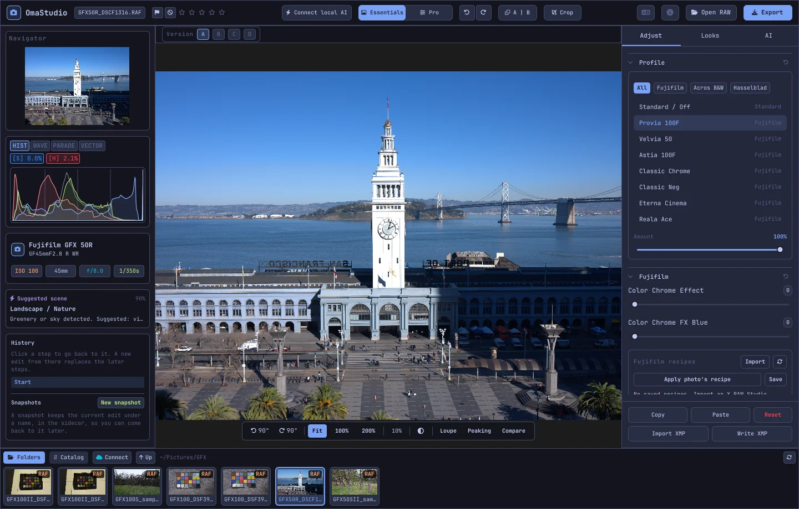

## Contents

1. [Installation](#1-installation)
2. [The window](#2-the-window)
3. [Opening photos and the library](#3-opening-photos-and-the-library)
4. [Essentials and Pro](#4-essentials-and-pro)
5. [The Adjust tab](#5-the-adjust-tab)
6. [The Masks tab](#6-the-masks-tab)
7. [The Looks tab](#7-the-looks-tab)
8. [The AI tab and the AI chat](#8-the-ai-tab-and-the-ai-chat)
9. [Viewing aids](#9-viewing-aids)
10. [History, snapshots and versions](#10-history-snapshots-and-versions)
11. [Fujifilm](#11-fujifilm)
12. [Medium format](#12-medium-format)
13. [Export](#13-export)
14. [Cloud accounts](#14-cloud-accounts)
15. [Keyboard and mouse](#15-keyboard-and-mouse)
16. [Command line, control socket and MCP](#16-command-line-control-socket-and-mcp)
17. [Files and folders](#17-files-and-folders)
18. [Troubleshooting](#18-troubleshooting)

## 1. Installation

OmaStudio runs on Omarchy (Arch Linux) under Wayland and Hyprland.

**From the package.** In a clone of the repository:

```bash
makepkg -si
```

This installs `omastudio`, `omastudio-app`, `omastudio-engine`, the ICC profiles, the desktop entry, the icons and a udev rule for Fujifilm cameras on USB.

**From a release archive.** Download `omastudio-<version>-x86_64-linux.tar.gz` from the [releases page](https://github.com/ozdil/omarchy-omastudio/releases), check it against `checksums.txt`, unpack it and copy `bin/*` to `~/.local/bin` and `share/omastudio` to `~/.local/share/omastudio`.

**Required packages:** `libraw` 0.22 or newer, `lcms2`, `qt6-base`, `qt6-declarative`, `qt6-wayland` and `qt6-svg` 6.12 or newer, and `zenity` for the file dialogs.

**Optional packages:**

| Package | Used for |
| :--- | :--- |
| `vulkan-icd-loader` and your GPU's Vulkan driver | Demosaicing on the GPU |
| `perl-image-exiftool` | Keeping EXIF metadata in exported files |
| `libwebp-utils`, `libheif`, `ffmpeg` | Lossy WebP, HEIF and the AVIF fallback |
| `onnxruntime` | Local AI masks on an NPU, GPU or CPU |
| `rclone`, `libsecret`, `gnome-keyring` | Google Drive, OneDrive, Dropbox, Box, pCloud and Yandex Disk |
| `github-cli` | GitHub account |
| `ollama` | Local AI models for the edit assistant |
| `quickshell` | The OmaStudio button in the Omarchy bar |

Start OmaStudio from the Omarchy app menu, or run `omastudio` (optionally with a photo: `omastudio DSCF0001.RAF`). If a window is already open, the photo opens in that window.

## 2. The window

| Area | What it holds |
| :--- | :--- |
| Top bar | File name, flags and star rating, **Connect local AI**, the **Essentials** and **Pro** switch, undo and redo, before and after (**A \| B**), **Crop**, language menu, About, **Open RAW** and **Export** |
| Left panel | Navigator, scopes (histogram, waveform, RGB parade, vectorscope) with clipping indicators, camera and lens details, the suggested scene, history and snapshots |
| Centre | The photo, the versions bar (A–D) above it, and the view bar below it: rotate, Fit, 100%, 200%, current zoom, surround colour, **Loupe**, **Peaking**, **Compare** |
| Right panel | The **Adjust**, **Masks** (Pro), **Looks** and **AI** tabs, and a fixed row with **Copy**, **Paste**, **Reset**, **Import XMP** and **Write XMP** |
| Filmstrip | **Folders**, **Catalog**, one tab per cloud account, **Connect**, **Up**, and the photos of the current folder |

**Tab** hides and shows both side panels and the filmstrip together. Each panel section folds open and closed from its header; **Ctrl+click** on a header keeps only that section open. The open tab, the folded sections and which panels are shown are remembered between sessions.

The colours, the font and the corner rounding follow the active Omarchy theme, live. The area around the photo is neutral dark grey by default so the theme does not shift how colours look; the surround button in the view bar switches to middle grey or the theme colour.

| Tokyo Night | Catppuccin Latte | Gruvbox | Rosé Pine |
| :---: | :---: | :---: | :---: |
|  | 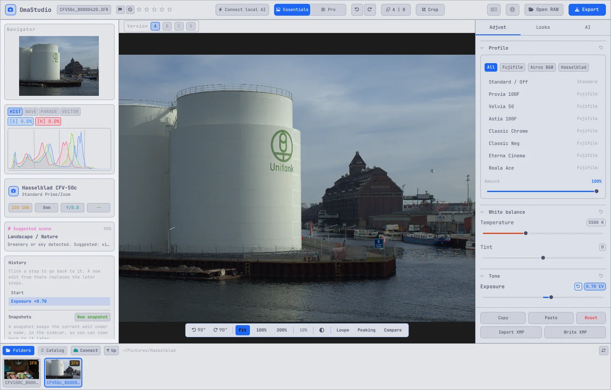 | 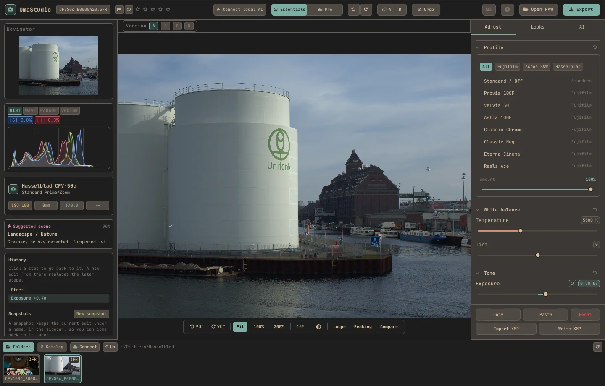 | 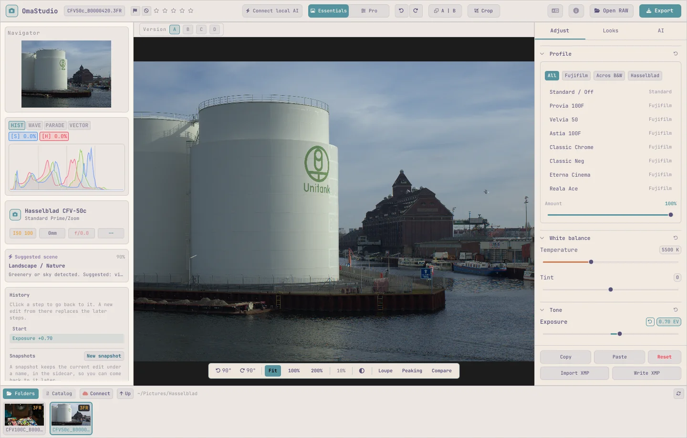 |

The interface is available in 30 languages. It follows the system language; the language menu in the top bar picks another one and applies it at once.

## 3. Opening photos and the library

- **Open RAW** (Ctrl+O) opens the file dialog. It filters by Photos, RAW or Images.
- Drag a photo or a folder from the file manager onto the window.
- In the filmstrip, **Folders** lists the current folder; click a folder to enter it and **Up** to go back. Click a photo to open it. Ctrl+← and Ctrl+→ step to the previous and next photo.
- **Catalog** lists every photo OmaStudio has seen, with its rating, flag and colour label.

OmaStudio opens every RAW format that LibRaw 0.22 reads (Fujifilm, Hasselblad, Phase One, Leica, Pentax, Mamiya/Leaf, Canon, Nikon, Sony, Panasonic, Olympus, Sigma, DNG and others), plus JPEG, PNG, WebP, TIFF, HEIF/HEIC, AVIF, JPEG XL, OpenEXR, Radiance HDR and PNM.

**Rating and flags.** 1 to 5 set the star rating and 0 clears it. P marks a pick, X a reject and U clears the flag. Ratings and flags are saved in the catalog and the sidecar straight away.

**Selection.** Shift+click selects a range in the filmstrip and Ctrl+click adds or removes a photo. With more than one photo selected, the Export window exports them all (**Batch**).

Your original files are never changed. Edits are saved next to the photo in a sidecar, `<photo>.omastudio`, as you work (Ctrl+S saves at once).

## 4. Essentials and Pro

The switch in the top bar picks how many tools are shown.

- **Essentials:** profile, Fujifilm, white balance, tone, presence, presets and 3D LUTs.
- **Pro** adds the tone curve, colour mixer, colour grading, detail and optics, transform, grain, colour management and the **Masks** tab. Pro sections carry a "Pro" tag.

Switching back to Essentials hides the Pro sections; their settings stay applied.

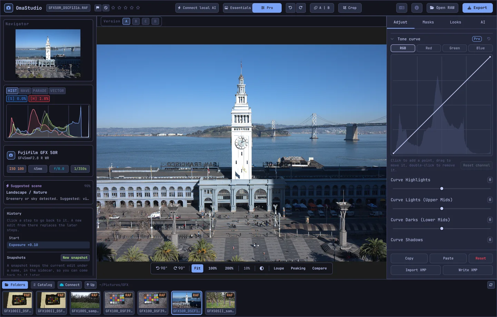

## 5. The Adjust tab

Every slider resets when you double-click it. The reset button in a section header resets the whole section.

### Profile

The base look: **Standard / Off**, the Fujifilm film simulations (Provia, Velvia, Astia, Classic Chrome, Classic Neg, Eterna, Eterna Bleach Bypass, Reala Ace, Nostalgic Neg, PRO Neg Std and Hi, Acros and Monochrome with yellow, red and green filters, Sepia) and the Hasselblad-style natural colour profile. The tabs filter the list. **Amount** blends the profile with the neutral rendering.

### Fujifilm

**Color Chrome Effect** and **Color Chrome FX Blue** (Weak = 50, Strong = 100) deepen saturated colours, and blues for FX Blue, while keeping their hue. The recipe library, the camera on USB and Pixel Shift are described in [Fujifilm](#11-fujifilm).

### White balance

**Temperature** (2000–12000 K) and **Tint**, relative to the white balance the camera recorded. A photo opens at "as shot".

### Tone

**Exposure** (−5 to +5 EV, on linear light: +1 EV doubles the light), **Contrast**, **Highlights**, **Shadows**, **Whites** and **Blacks**.

### Presence

**Texture**, **Clarity** (midtone contrast), **Dehaze**, **Vibrance** and **Saturation**.

### Tone curve (Pro)

A point curve over the histogram, for RGB and for red, green and blue separately. Click to add a point, drag to move it, double-click to remove it. The curve never overshoots its points. The four region sliders below (Highlights, Lights, Darks, Shadows) shape the curve by area.

### Colour mixer (Pro)

Hue, saturation and luminance for eight colours: red, orange, yellow, green, aqua, blue, purple and magenta.

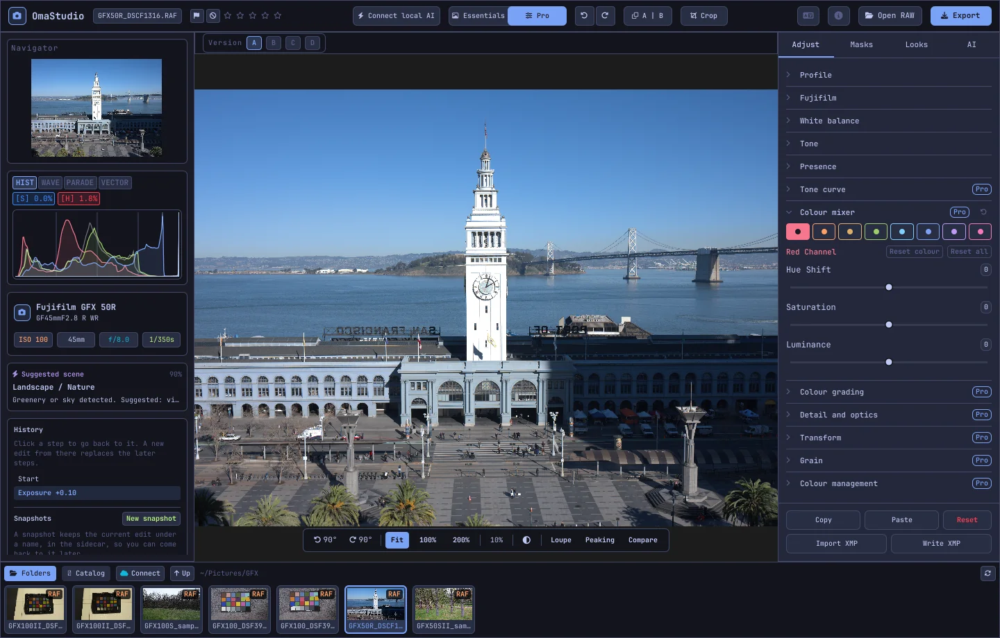

### Colour grading (Pro)

Three-way colour wheels for shadows (lift), midtones (gamma) and highlights (gain), plus a global offset, as four wheels or as tabs. **Color Boost**, **Midtone Detail** and **Contrast Pivot** sit below the wheels. The channel mixer under them mixes red, green and blue into each output channel, or into a monochrome mix.

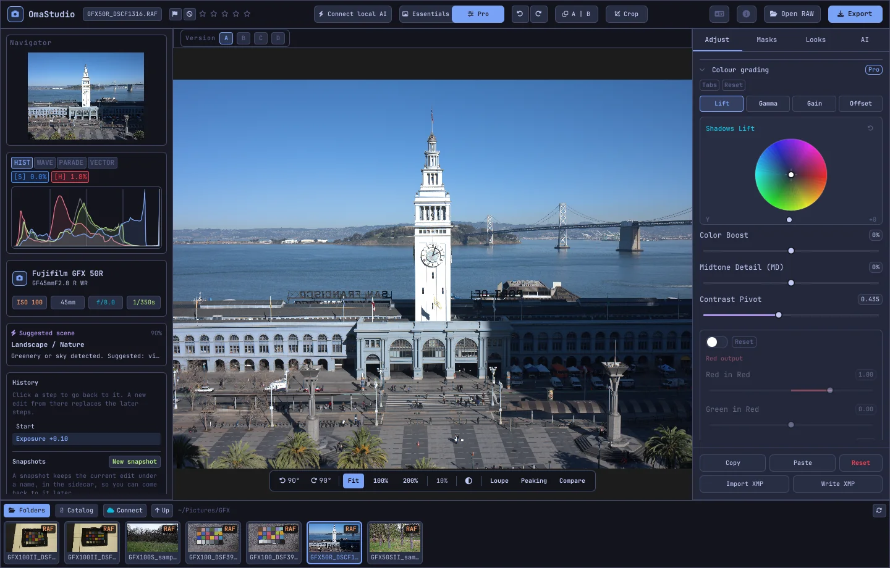

### Detail and optics (Pro)

**Sharpening**, **Noise Reduction** (luminance and colour), **Vignette**, **Defringe** (chromatic aberration) and **Lens Distortion Correction**. Fujifilm and DNG lens corrections from the file are applied automatically; these sliders work on top of them.

### Transform (Pro)

**Vertical** straightens converging lines, such as a building photographed from below; **Horizontal** does the same sideways; **Scale** enlarges the result. Crop afterwards to remove the empty edges.

### Grain (Pro)

**Amount**, **Size** and **Roughness** of film grain.

### Colour management (Pro)

- **Gamut compression** brings colours pushed outside the gamut back in smoothly instead of clipping them.
- **ACES tone curve** is a filmic highlight roll-off, a fitted approximation of the ACES output transform.
- **Soft proof** (S) shows the photo as it will look with an output profile, for example a printer and paper profile. Pick the profile and the rendering intent. **Gamut warning** paints colours the profile cannot reproduce in magenta. The edit and the export do not change.

The output colour space itself is chosen in the Export window.


## 6. The Masks tab

The Masks tab is shown in Pro mode.

### Heal and clone

Turn on **Edit spots** and click a spot on the photo to remove it. The spot is replaced from a source beside it. Drag the solid circle to move the spot and the dashed circle to pick another source. **Heal** matches the copied area to the light and colour around the spot; **Clone** copies it as it is. **Size**, **Feather** and **Opacity** apply to the selected spot and to new ones.


### Local adjustments

Each layer applies exposure, contrast, highlights, shadows, whites, blacks and saturation through a mask, with an opacity.

| Mask | How it is made |
| :--- | :--- |
| **Linear** | A gradient between two handles on the photo |
| **Radial** | An ellipse with a centre and edge handles, and a feather |
| **Luminance** | A brightness range (darkest, brightest, falloff) |
| **Colour** | Colours close to one picked from the photo (range and feather) |
| **Brush** | Painted on the photo, with size, feather, flow and an erase mode; the middle mouse button pans |
| **AI Subject**, **AI Sky** | A segmentation model on your computer (see [AI](#8-the-ai-tab-and-the-ai-chat)) |

Under **Combine with**, further parts can be added to, subtracted from or intersected with the layer's mask, and each part can be inverted.

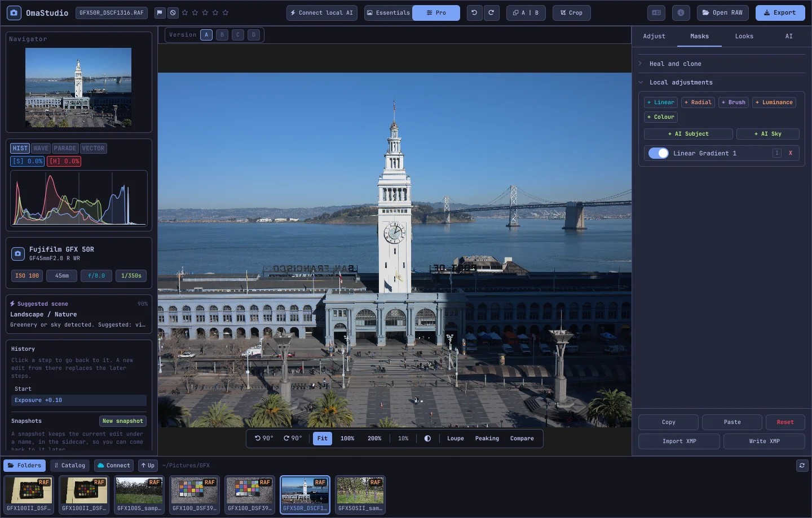

## 7. The Looks tab

- **Presets:** **Auto** analyses the photo and sets exposure, white balance and tone. The looks Muted, Vivid, Warm portrait, Black and white, and Teal and orange replace the previous look instead of adding to it; white balance, exposure, crop and film simulation stay.
- **LUT:** **Load .cube file…** applies a 3D LUT of your own, with an amount.

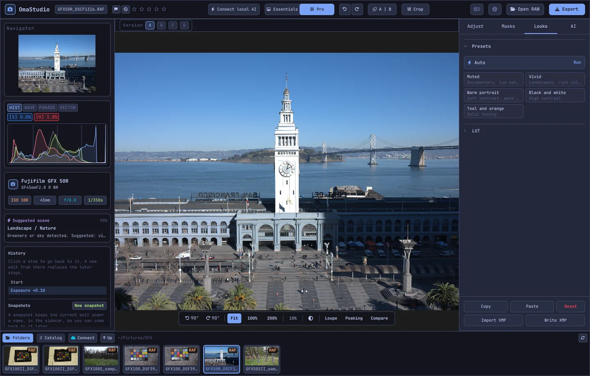

## 8. The AI tab and the AI chat

**Connect local AI** in the top bar uses the AI set up on this computer: Omarchy's default agent (Claude Code or Codex, with their own sign-in), otherwise Ollama, otherwise LM Studio. Once connected, the button opens the **AI chat** over the photo: write what you want to change ("warmer, recover the sky") and the AI sets the adjustments. Ctrl+Z undoes each edit.

The **Edit assistant** in the AI tab does the same from the panel and can use a cloud provider instead: Anthropic Claude, OpenAI, OpenRouter or Google Gemini. Their API keys are stored in the system keyring and are never written to disk or put on a command line. With a cloud provider or with Claude Code or Codex, the photo preview is sent to that service; with Ollama or LM Studio it stays on your computer.

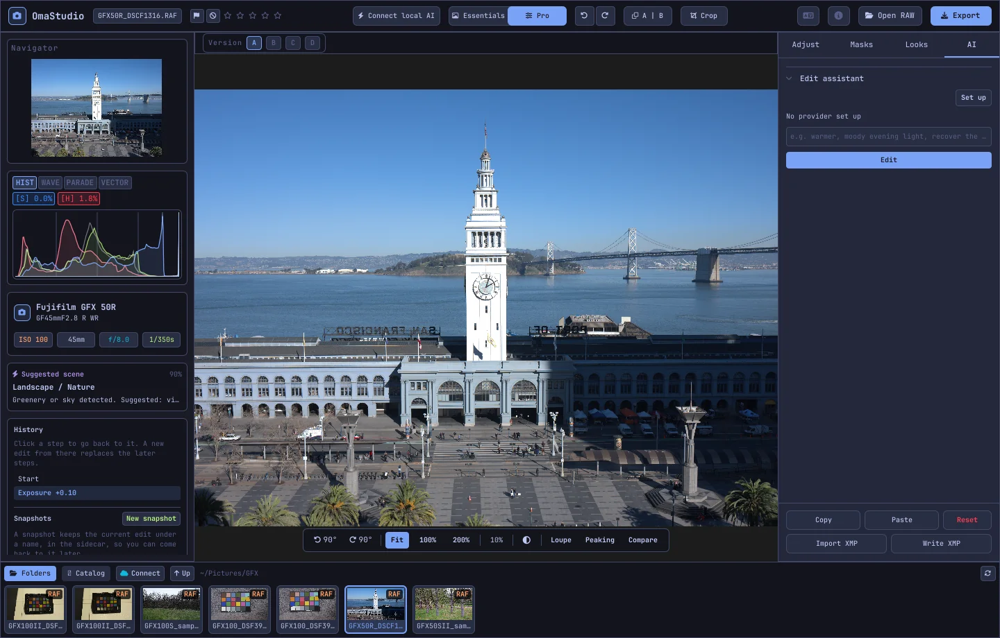

**AI masks.** **AI Subject** and **AI Sky** in the Masks tab run an ONNX segmentation model on this computer: on an NPU first (Intel Core Ultra through OpenVINO, Snapdragon X through QNN, AMD Ryzen AI through Vitis AI), then a GPU, then the CPU. No model is bundled or downloaded. Put a model in `~/.local/share/omastudio/models` as `subject.onnx` or `sky.onnx`; `omastudio npu` shows what is installed.

## 9. Viewing aids

| Aid | How to use it |
| :--- | :--- |
| Zoom | Mouse wheel at the pointer; **Fit** (Ctrl+0), **100%** (Ctrl+1), **200%**; double-click toggles fit and 200%. 100% shows one photo pixel per screen pixel at any display scale. |
| Pan | Drag with the left or middle mouse button; Shift+wheel pans sideways |
| Rotate | The rotate buttons in the view bar; Alt+wheel turns in 1.5° steps |
| Crop (C) | Aspect presets (Original, 1:1, 4:5, 9:16, 16:9, Free) and grids (thirds, golden ratio, golden spiral) |
| Before and after (Y, or A \| B) | The photo split into the original and the edit |
| Compare (Shift+C) | The edit beside another state: Before, a version or a snapshot |
| Loupe (L) | A square under the pointer showing the full-resolution photo at 1:1 |
| Focus peaking (Shift+F) | The sharpest edges painted green; a view aid only |
| Clipping | Click **[S]** or **[H]** above the histogram to show clipped shadows in blue and highlights in red |

| Focus peaking | Compare |
| :---: | :---: |
| 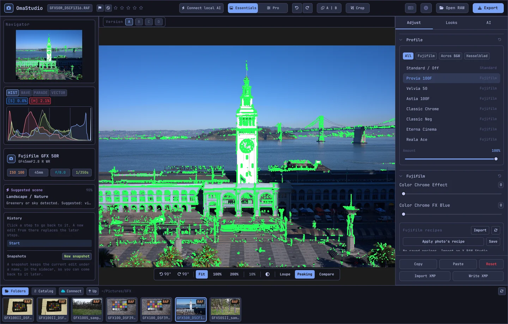 | 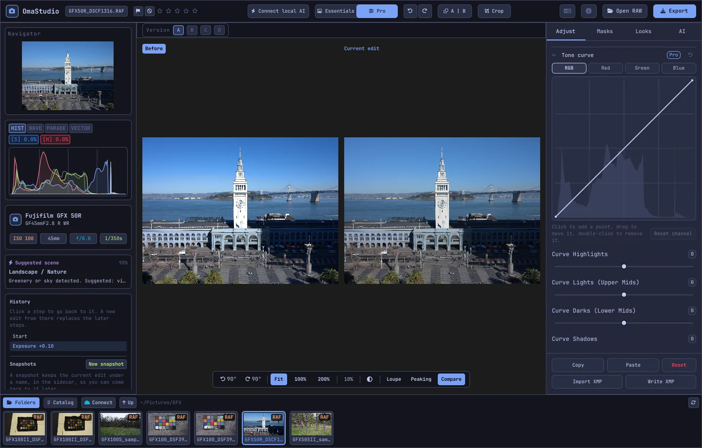 |

| Crop | Before and after |
| :---: | :---: |
| 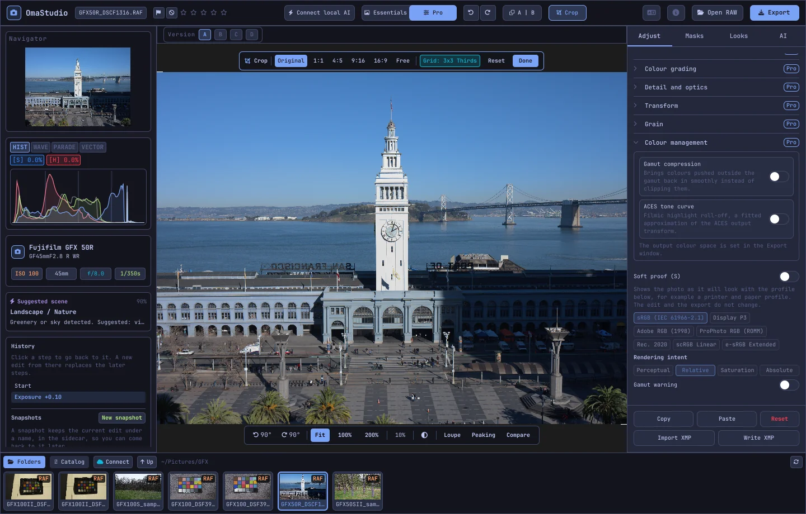 | 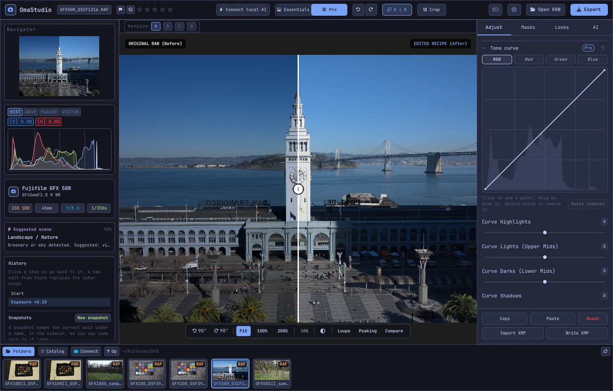 |

When the photo is shown larger than the preview, the engine renders the visible area from the full-resolution file, so the detail you see matches the export.

## 10. History, snapshots and versions

- **History** in the left panel lists every step of the edit by name ("Exposure +0.70", "Tone curve"). Click a step to go back to it; a new edit from there replaces the later steps, as with Ctrl+Z.
- **Snapshots** keep the current edit under a name. **Restore** brings one back as a new step that Ctrl+Z can undo. Snapshots are saved in the sidecar.
- **Versions A–D** above the photo hold up to four separate edits of the same photo. Click a letter to switch (Alt+1 to Alt+4); right-click copies the current edit into that version.
- **Copy** and **Paste** (Ctrl+Shift+C, Ctrl+Shift+V) carry an edit to another photo. **Reset** (Ctrl+R) returns to the defaults.
- **Write XMP** saves the edit, rating and label as an `.xmp` sidecar that Lightroom, Capture One, darktable and digiKam read; **Import XMP** reads one written by those programs.

## 11. Fujifilm

- **The camera's recipe.** A RAF or Fujifilm JPEG opens with the settings it was shot with: film simulation, tone, colour, sharpness, noise reduction, clarity, grain, Color Chrome, white balance shift and dynamic range (including D-Range Priority). A saved sidecar takes precedence.
- **Brightness.** RAFs open at the brightness of the camera's own JPEG.
- **Lens corrections.** Distortion, lateral chromatic aberration and vignetting recorded by the camera are applied for XF, XC and GF lenses.
- **Recipe library.** **Import** takes an X RAW Studio profile (.FP1, .FP2, .FP3), recipe text ("Film Simulation: Classic Chrome / Grain Effect: Strong, Small …") or a Fujifilm photo. **Apply recipe** applies a saved one; **Apply photo's recipe** goes back to the one in the file; **Save** stores the current one.
- **Camera over USB.** Set the camera's USB mode to USB RAW CONV./BACKUP RESTORE and connect it. **Read C1–C7** shows its custom settings, **Write recipe to C…** stores a recipe in a slot (this replaces what is there), and **Convert in camera** develops the open RAF in the camera, optionally with the selected recipe.
- **Pixel Shift.** Select the RAF frames of one GFX Pixel Shift sequence in the filmstrip and click **Merge frames to DNG**. Four frames give full colour at every pixel; sixteen frames double the resolution.

## 12. Medium format

- **Fujifilm GFX** (GFX 50S, 50R, 50S II, 100, 100S, 100 II and others): 16-bit pipeline from sensor to export, film simulations, lens corrections and Pixel Shift.
- **Hasselblad** 3FR and FFF files are cropped to the camera's default crop.
- **Phase One and Leaf** IIQ and MOS files get the back's own sensor calibration.
- **Mamiya** MEF and **Pentax 645** PEF files are supported.
- **Flat field (LCC):** `omastudio-engine medium-format lcc-create <raw>` makes a correction from a shot of an evenly lit white target; it is applied to the photos of that folder.
- **Multi-shot:** `medium-format multishot f1 f2 f3 f4 --out merged.tif` merges a 4-shot sequence.

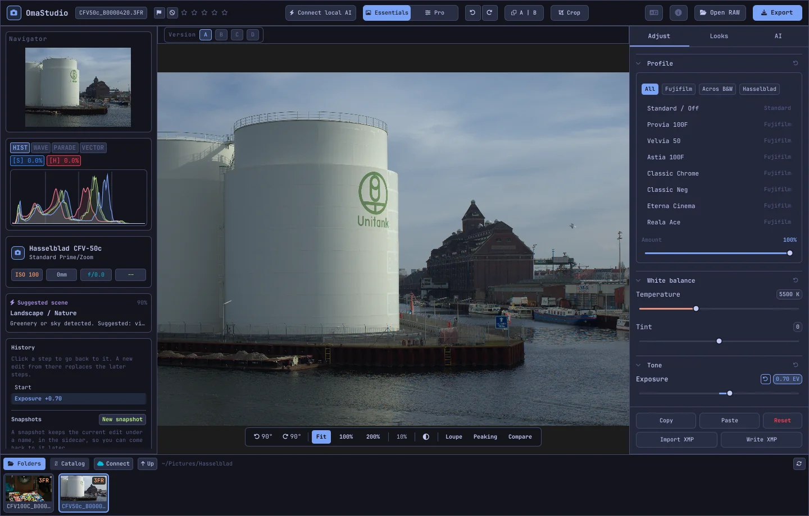

## 13. Export

**Export** (E) opens the Export window. Enter exports and Esc closes.

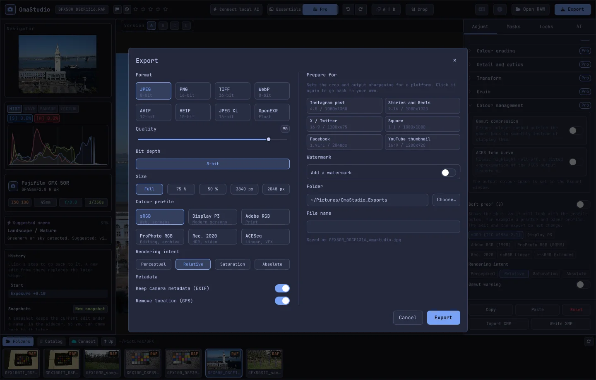

| Setting | Choices |
| :--- | :--- |
| Format | JPEG, PNG (8/16-bit), TIFF (8/16-bit, no, LZW or ZIP compression), WebP, AVIF (8/10/12-bit), HEIF (8/10/12-bit), JPEG XL (8/16-bit) and OpenEXR (half or full float, scene-linear) |
| Quality | 1–100; 100 is lossless for WebP, AVIF and JPEG XL |
| Size | Full, 75%, 50%, or a long edge of 3840 or 2048 px |
| Colour profile | sRGB, Display P3, Adobe RGB, ProPhoto RGB, Rec. 2020, ACEScg, or an ICC profile of your own |
| Rendering intent | Perceptual, Relative (default), Saturation, Absolute |
| Metadata | Keep camera metadata (EXIF), remove location (GPS) |
| Prepare for | Crop and output sharpening for Instagram, Stories and Reels, X, Facebook, square and YouTube thumbnails |
| Watermark | Text with EXIF tags ({camera}, {lens}, {iso}, {aperture}, {shutter}, {focal}) or a PNG logo, with position, opacity, size and shadow |
| Folder and file name | Default `~/Pictures/OmaStudio_Exports`; a tag can be added to the file name |
| Upload to | A connected cloud account |

Every format except OpenEXR carries the ICC profile of its colour space. A batch exports the selected photos one after another.

## 14. Cloud accounts

**Connect** in the filmstrip adds Google Drive, OneDrive, Dropbox, Box, pCloud, Yandex Disk or GitHub. You sign in on the service's own page in your browser; OmaStudio never sees your password.

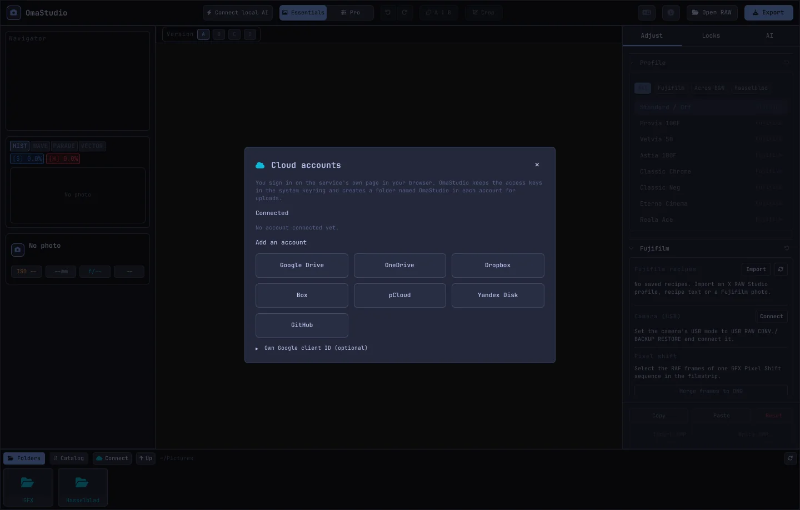

- Each account gets a tab in the filmstrip. Browse its folders and click a photo to download it (once) and open it.
- A folder named `OmaStudio` is created in each account (on GitHub a private repository `OmaStudio`) and receives uploads from the Export window.
- Storage services go through rclone with OmaStudio's own configuration, encrypted with a key kept in the system keyring. GitHub goes through the GitHub CLI.
- For Google Drive, a client ID of your own from the Google Cloud Console can be entered under **Own Google client ID**.
- **Disconnect** removes the account's keys and downloaded copies from this computer; the files in the account stay.

## 15. Keyboard and mouse

| Key | Action |
| :--- | :--- |
| Ctrl+O | Open a photo |
| Ctrl+S | Save the edit now |
| Ctrl+Z / Ctrl+Shift+Z or Ctrl+Y | Undo / redo |
| Ctrl+Shift+C / Ctrl+Shift+V | Copy / paste the edit |
| Ctrl+R | Reset the edit |
| Ctrl+← / Ctrl+→ | Previous / next photo |
| Ctrl+0 / Ctrl+1 | Fit / 100% |
| 1–5, 0 | Star rating, clear rating |
| P, X, U | Pick, reject, clear flag |
| C | Crop |
| Y | Before and after |
| S | Soft proof |
| L | Loupe |
| Shift+F | Focus peaking |
| Shift+C | Compare |
| Alt+1 … Alt+4 | Versions A–D |
| E | Export window |
| Tab | Hide or show the panels |
| Esc | Close the open window |

| Mouse | Action |
| :--- | :--- |
| Wheel | Zoom at the pointer |
| Shift+wheel | Pan sideways |
| Alt+wheel | Rotate |
| Drag (left or middle button) | Pan |
| Double-click on the photo | Fit or 200% |
| Ctrl+click on a section header | Keep only that section open |
| Right-click on a version letter | Copy the current edit into that version |

## 16. Command line, control socket and MCP

**Engine commands.** Every command prints one JSON object, so scripts and agents can use it.

```bash
omastudio inspect DSCF0001.RAF                      # camera, lens, exposure, histogram, scene
omastudio export DSCF0001.RAF --recipe '{"exposure":0.5}' --options '{"format":"jpeg"}'
omastudio fuji-recipe DSCF0001.RAF                  # the camera's recipe
omastudio fuji-pixel-shift DSCF*.RAF --out merged.dng
omastudio xmp export DSCF0001.RAF
omastudio cameras GFX                               # cameras the RAW decoder supports
omastudio gpu                                       # GPU used for demosaicing
omastudio npu                                       # ONNX Runtime and accelerators
omastudio cloud status
omastudio --cli help                                # every command
```

**Control socket.** `omastudio ipc <method> [arguments]` talks to the open window, for example `openPhoto`, `openFolder`, `applyRecipe`, `applyPreset`, `setExposure`, `setWarmth`, `setMode essentials|pro`, `setRightTab`, `showSection`, `setView peaking|compare|softProof|split on|off`, `setZoom`, `showExport`, `showCloud`, `getStatus` and `screenshot <file.png>`. The socket only answers the same user.

**MCP.** `omastudio mcp` is a Model Context Protocol server, so AI agents can inspect, render, cull and export photos, read Fujifilm recipes and control the open window. For Claude Code: `claude mcp add omastudio -- omastudio mcp`. `omastudio skill` installs the agent skill into `~/.claude/skills`.

## 17. Files and folders

| Path | Contents |
| :--- | :--- |
| `<photo>.omastudio` | The edit of a photo (sidecar) |
| `~/.local/share/omastudio/catalog.json` | Catalog: ratings, flags and colour labels |
| `~/.local/share/omastudio/fuji-recipes/` | Saved Fujifilm recipes |
| `~/.local/share/omastudio/icc/` | Your own ICC profiles |
| `~/.local/share/omastudio/models/` | Local AI models |
| `~/.local/share/omastudio/film-luts/` | Film simulation LUTs measured from your photos (`fuji-calibrate`) |
| `~/.config/omastudio/` | Settings, interface state, language, cloud accounts |
| `~/.cache/omastudio/` | Thumbnails, previews and downloaded cloud photos |

## 18. Troubleshooting

- **The window does not open.** Run `omastudio` in a terminal and read the message. `omastudio --version` and `omastudio status` show what is installed.
- **The GPU is not used.** `omastudio gpu` shows the device. Install `vulkan-icd-loader` and your GPU's Vulkan driver. `OMASTUDIO_GPU=off` forces the CPU.
- **A camera is not found on USB.** Set its USB mode to USB RAW CONV./BACKUP RESTORE, reconnect it and check that the package's udev rule is installed.
- **A cloud service says it needs a program.** Install the package the dialog names, for example `sudo pacman -S rclone libsecret`.
- **Copy system info** in the About window copies the version, GPU and Omarchy details for a bug report. Report issues at [github.com/ozdil/omarchy-omastudio/issues](https://github.com/ozdil/omarchy-omastudio/issues).
