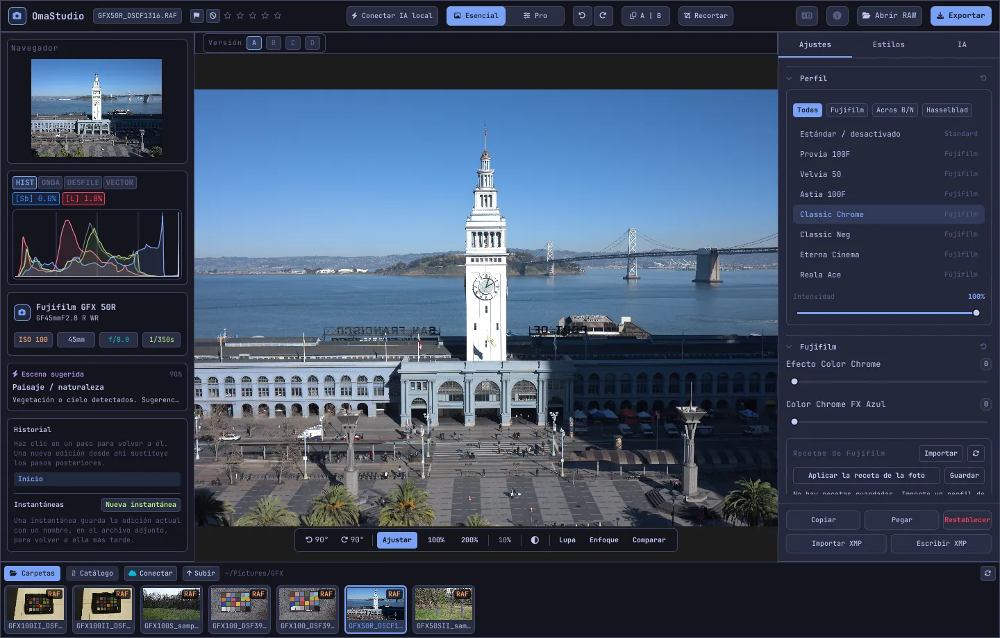

# Guía de uso de OmaStudio

**OmaStudio: The Complete Medium Format RAW Editor for Omarchy**

[Todos los idiomas](../README.md) · [Tecnologías](../technology/es.md) · [README](../../README.md)

Esta guía trata de OmaStudio 3.1. Explica cómo instalar la aplicación, orientarse en la ventana y usar cada panel y herramienta. Las capturas muestran archivos de ejemplo de Fujifilm GFX 50R y Hasselblad CFV-50c de [raw.pixls.us](https://raw.pixls.us) (CC0).



## Contenido

1. [Instalación](#1-instalación)
2. [La ventana](#2-la-ventana)
3. [Abrir fotos y la biblioteca](#3-abrir-fotos-y-la-biblioteca)
4. [Esencial y Pro](#4-esencial-y-pro)
5. [La pestaña Ajustes](#5-la-pestaña-ajustes)
6. [La pestaña Máscaras](#6-la-pestaña-máscaras)
7. [La pestaña Estilos](#7-la-pestaña-estilos)
8. [La pestaña IA y el chat con IA](#8-la-pestaña-ia-y-el-chat-con-ia)
9. [Ayudas de visualización](#9-ayudas-de-visualización)
10. [Historial, instantáneas y versiones](#10-historial-instantáneas-y-versiones)
11. [Fujifilm](#11-fujifilm)
12. [Formato medio](#12-formato-medio)
13. [Exportación](#13-exportación)
14. [Cuentas en la nube](#14-cuentas-en-la-nube)
15. [Teclado y ratón](#15-teclado-y-ratón)
16. [Línea de comandos, socket de control y MCP](#16-línea-de-comandos-socket-de-control-y-mcp)
17. [Archivos y carpetas](#17-archivos-y-carpetas)
18. [Solución de problemas](#18-solución-de-problemas)

## 1. Instalación

OmaStudio funciona en Omarchy (Arch Linux) con Wayland y Hyprland.

**Desde el paquete.** En una copia del repositorio:

```bash
makepkg -si
```

Instala `omastudio`, `omastudio-app`, `omastudio-engine`, los perfiles ICC, la entrada de escritorio, los iconos y una regla udev para cámaras Fujifilm por USB.

**Desde un archivo de versión.** Descargue `omastudio-<versión>-x86_64-linux.tar.gz` de la [página de versiones](https://github.com/ozdil/omarchy-omastudio/releases), compruébelo con `checksums.txt`, descomprímalo y copie `bin/*` en `~/.local/bin` y `share/omastudio` en `~/.local/share/omastudio`.

**Paquetes necesarios:** `libraw` 0.22 o posterior, `lcms2`, `qt6-base`, `qt6-declarative`, `qt6-wayland` y `qt6-svg` 6.12 o posterior, y `zenity` para los diálogos de archivos.

**Paquetes opcionales:**

| Paquete | Para qué sirve |
| :--- | :--- |
| `vulkan-icd-loader` y el controlador Vulkan de su GPU | Interpolación cromática (demosaico) en la GPU |
| `perl-image-exiftool` | Conservar los metadatos EXIF en los archivos exportados |
| `libwebp-utils`, `libheif`, `ffmpeg` | WebP con pérdida, HEIF y la alternativa para AVIF |
| `onnxruntime` | Máscaras de IA locales en NPU, GPU o CPU |
| `rclone`, `libsecret`, `gnome-keyring` | Google Drive, OneDrive, Dropbox, Box, pCloud y Yandex Disk |
| `github-cli` | Cuenta de GitHub |
| `ollama` | Modelos de IA locales para el asistente de edición |
| `quickshell` | El botón de OmaStudio en la barra de Omarchy |

Inicie OmaStudio desde el menú de aplicaciones de Omarchy o ejecute `omastudio` (si quiere, con una foto: `omastudio DSCF0001.RAF`). Si ya hay una ventana abierta, la foto se abre en ella.

## 2. La ventana

| Zona | Contenido |
| :--- | :--- |
| Barra superior | Nombre del archivo, marcas y valoración con estrellas, **Conectar IA local**, el selector **Esencial** / **Pro**, deshacer y rehacer, antes y después (**A \| B**), **Recortar**, menú de idioma, Acerca de, **Abrir RAW** y **Exportar** |
| Panel izquierdo | Navegador, instrumentos de medida (histograma, forma de onda, desfile RGB, vectorscopio) con indicadores de recorte, datos de la cámara y el objetivo, la escena sugerida, el historial y las instantáneas |
| Centro | La foto, encima la barra de versiones (A–D) y debajo la barra de vista: girar, **Ajustar**, 100 %, 200 %, zoom actual, color del entorno, **Lupa**, **Enfoque**, **Comparar** |
| Panel derecho | Las pestañas **Ajustes**, **Máscaras** (Pro), **Estilos** e **IA**, y una fila fija con **Copiar**, **Pegar**, **Restablecer**, **Importar XMP** y **Escribir XMP** |
| Tira de película | **Carpetas**, **Catálogo**, una pestaña por cuenta en la nube, **Conectar**, **Subir** y las fotos de la carpeta actual |

**Tab** oculta y muestra a la vez los dos paneles laterales y la tira de película. Cada sección se pliega y despliega desde su encabezado; **Ctrl+clic** en un encabezado deja abierta solo esa sección. La pestaña abierta, las secciones plegadas y los paneles visibles se recuerdan entre sesiones.

Los colores, la fuente y el redondeo de las esquinas siguen en directo el tema activo de Omarchy. El área alrededor de la foto es por defecto gris oscuro neutro, para que el tema no altere cómo se ven los colores; el botón de entorno de la barra de vista cambia a gris medio o al color del tema.

| Tokyo Night | Catppuccin Latte | Gruvbox | Rosé Pine |
| :---: | :---: | :---: | :---: |
|  |  |  |  |

La interfaz está disponible en 30 idiomas. Sigue el idioma del sistema; el menú de idioma de la barra superior elige otro y lo aplica al momento.

## 3. Abrir fotos y la biblioteca

- **Abrir RAW** (Ctrl+O) abre el diálogo de archivos. Filtra por Fotos, RAW o Imágenes.
- Arrastre una foto o una carpeta desde el gestor de archivos a la ventana.
- En la tira de película, **Carpetas** muestra la carpeta actual; haga clic en una carpeta para entrar y en **Subir** para volver. Haga clic en una foto para abrirla. Ctrl+← y Ctrl+→ pasan a la foto anterior y siguiente.
- **Catálogo** muestra cada foto que OmaStudio ha visto, con su valoración, marca y etiqueta de color.

OmaStudio abre todos los formatos RAW que lee LibRaw 0.22 (Fujifilm, Hasselblad, Phase One, Leica, Pentax, Mamiya/Leaf, Canon, Nikon, Sony, Panasonic, Olympus, Sigma, DNG y otros), además de JPEG, PNG, WebP, TIFF, HEIF/HEIC, AVIF, JPEG XL, OpenEXR, Radiance HDR y PNM.

**Valoración y marcas.** De 1 a 5 asignan estrellas y 0 las borra. P marca como elegida, X como rechazada y U quita la marca. Valoraciones y marcas se guardan al instante en el catálogo y en el archivo auxiliar.

**Selección.** Mayús+clic selecciona un intervalo en la tira de película y Ctrl+clic añade o quita una foto. Con varias fotos seleccionadas, la ventana de exportación las exporta todas (**Lote**).

Sus archivos originales nunca se modifican. Las ediciones se guardan mientras trabaja en un archivo auxiliar junto a la foto, `<foto>.omastudio` (Ctrl+S guarda al momento).

## 4. Esencial y Pro

El selector de la barra superior decide cuántas herramientas se muestran.

- **Esencial:** perfil, Fujifilm, balance de blancos, tono, presencia, ajustes preestablecidos y LUT 3D.
- **Pro** añade la curva de tonos, el mezclador de color, la gradación de color, detalle y óptica, transformar, grano, gestión del color y la pestaña **Máscaras**. Las secciones Pro llevan la etiqueta «Pro».

Al volver a Esencial se ocultan las secciones Pro; sus ajustes siguen aplicados.


## 5. La pestaña Ajustes

Cada control deslizante se restablece con doble clic. El botón de restablecer del encabezado de una sección restablece toda la sección.

### Perfil

El aspecto base: **Estándar / desactivado**, las simulaciones de película de Fujifilm (Provia, Velvia, Astia, Classic Chrome, Classic Neg, Eterna, Eterna Bleach Bypass, Reala Ace, Nostalgic Neg, PRO Neg Std y Hi, Acros y Monochrome con filtros amarillo, rojo y verde, Sepia) y el perfil de color natural de estilo Hasselblad. Las pestañas filtran la lista. **Intensidad** mezcla el perfil con la interpretación neutra.

### Fujifilm

**Efecto Color Chrome** y **Color Chrome FX Azul** (Débil = 50, Fuerte = 100) intensifican los colores saturados, y los azules con FX Azul, manteniendo su tono. La biblioteca de recetas, la cámara por USB y Pixel Shift se describen en [Fujifilm](#11-fujifilm).

### Balance de blancos

**Temperatura** (2000–12000 K) y **Matiz**, respecto al balance de blancos que registró la cámara. Una foto se abre «como se tomó».

### Tono

**Exposición** (−5 a +5 EV, sobre luz lineal: +1 EV duplica la luz), **Contraste**, **Luces**, **Sombras**, **Blancos** y **Negros**.

### Presencia

**Textura**, **Claridad** (contraste de medios tonos), **Eliminar neblina**, **Intensidad** (vibrance) y **Saturación**.

### Curva de tonos (Pro)

Una curva de puntos sobre el histograma, para RGB y para rojo, verde y azul por separado. Haga clic para añadir un punto, arrástrelo para moverlo y haga doble clic para quitarlo. La curva nunca sobrepasa sus puntos. Los cuatro controles de zona de debajo (Luces, Claros, Oscuros, Sombras) dan forma a la curva por zonas.

### Mezclador de color (Pro)

Tono, saturación y luminancia para ocho colores: rojo, naranja, amarillo, verde, aguamarina, azul, morado y magenta.


### Gradación de color (Pro)

Ruedas de color de tres vías para sombras (lift), medios tonos (gamma) y luces (gain), más un desplazamiento global, como cuatro ruedas o como pestañas. **Refuerzo de color**, **Detalle de medios tonos** y **Pivote de contraste** están bajo las ruedas. El mezclador de canales de debajo mezcla rojo, verde y azul en cada canal de salida o en una mezcla monocroma.


### Detalle y óptica (Pro)

**Enfoque**, **Reducción de ruido** (luminancia y color), **Viñeta**, **Eliminar franjas** (aberración cromática) y **Corrección de la distorsión del objetivo**. Las correcciones de objetivo de Fujifilm y DNG del archivo se aplican automáticamente; estos controles actúan además de ellas.

### Transformar (Pro)

**Vertical** endereza líneas convergentes, como un edificio fotografiado desde abajo; **Horizontal** hace lo mismo en sentido lateral; **Escala** amplía el resultado. Recorte después para quitar los bordes vacíos.

### Grano (Pro)

**Cantidad**, **Tamaño** y **Rugosidad** del grano de película.

### Gestión del color (Pro)

- **Compresión de gama** devuelve con suavidad los colores empujados fuera de la gama en lugar de recortarlos.
- **Curva tonal ACES** es una transición fílmica de las luces, una aproximación ajustada de la transformación de salida ACES.
- **Prueba en pantalla** (S) muestra la foto como se verá con un perfil de salida, por ejemplo un perfil de impresora y papel. Elija el perfil y el propósito de interpretación. **Aviso de gama** pinta de magenta los colores que el perfil no puede reproducir. La edición y la exportación no cambian.

El espacio de color de salida se elige en la ventana de exportación.


## 6. La pestaña Máscaras

La pestaña Máscaras se muestra en el modo Pro.

### Corregir y clonar

Active **Editar puntos** y haga clic en una mancha de la foto para quitarla. Se sustituye a partir de una fuente cercana. Arrastre el círculo continuo para mover el punto y el discontinuo para elegir otra fuente. **Corregir** adapta la zona copiada a la luz y el color alrededor del punto; **Clonar** la copia tal cual. **Tamaño**, **Desvanecer** y **Opacidad** se aplican al punto seleccionado y a los nuevos.


### Ajustes locales

Cada capa aplica exposición, contraste, luces, sombras, blancos, negros y saturación a través de una máscara, con una opacidad.

| Máscara | Cómo se crea |
| :--- | :--- |
| **Lineal** | Un degradado entre dos tiradores sobre la foto |
| **Radial** | Una elipse con tiradores de centro y borde y un desvanecimiento |
| **Luminancia** | Un intervalo de luminosidad (más oscuro, más claro, transición) |
| **Color** | Colores cercanos a uno tomado de la foto (intervalo y desvanecimiento) |
| **Pincel** | Pintada sobre la foto, con tamaño, desvanecimiento, flujo y modo borrador; el botón central del ratón desplaza |
| **Sujeto (IA)**, **Cielo (IA)** | Un modelo de segmentación en su ordenador (vea [IA](#8-la-pestaña-ia-y-el-chat-con-ia)) |

En **Combinar con:** se pueden sumar, restar o intersecar más partes con la máscara de la capa, y cada parte puede invertirse.


## 7. La pestaña Estilos

- **Ajustes preestablecidos:** **Automático** analiza la foto y ajusta exposición, balance de blancos y tono. Los estilos Apagado, Vívido, Retrato cálido, Blanco y negro, y Verde azulado y naranja sustituyen al estilo anterior en lugar de sumarse; balance de blancos, exposición, recorte y simulación de película se mantienen.
- **LUT:** **Cargar archivo .cube…** aplica una LUT 3D propia, con una intensidad.


## 8. La pestaña IA y el chat con IA

**Conectar IA local** en la barra superior usa la IA configurada en este ordenador: el agente predeterminado de Omarchy (Claude Code o Codex, con su propio inicio de sesión); si no, Ollama; si no, LM Studio. Una vez conectado, el botón abre el **Chat con IA** sobre la foto: escriba lo que quiere cambiar («más cálido, recupera el cielo») y la IA ajusta los controles. Ctrl+Z deshace cada edición.

El **Asistente de edición** de la pestaña IA hace lo mismo desde el panel y puede usar en su lugar un proveedor en la nube: Anthropic Claude, OpenAI, OpenRouter o Google Gemini. Sus claves de API se guardan en el llavero del sistema y nunca se escriben en disco ni se ponen en una línea de comandos. Con un proveedor en la nube, o con Claude Code o Codex, la vista previa de la foto se envía a ese servicio; con Ollama o LM Studio se queda en su ordenador.


**Máscaras de IA.** **Sujeto (IA)** y **Cielo (IA)** en la pestaña Máscaras ejecutan un modelo de segmentación ONNX en este ordenador: primero en una NPU (Intel Core Ultra mediante OpenVINO, Snapdragon X mediante QNN, AMD Ryzen AI mediante Vitis AI), después en una GPU y por último en la CPU. No se incluye ni se descarga ningún modelo. Coloque un modelo en `~/.local/share/omastudio/models` como `subject.onnx` o `sky.onnx`; `omastudio npu` muestra lo que está instalado.

## 9. Ayudas de visualización

| Ayuda | Cómo se usa |
| :--- | :--- |
| Zoom | Rueda del ratón en el puntero; **Ajustar** (Ctrl+0), **100 %** (Ctrl+1), **200 %**; el doble clic alterna entre ajustar y 200 %. El 100 % muestra un píxel de la foto por píxel de pantalla con cualquier escala. |
| Desplazar | Arrastre con el botón izquierdo o central; Mayús+rueda desplaza en horizontal |
| Girar | Los botones de giro de la barra de vista; Alt+rueda gira en pasos de 1,5° |
| Recortar (C) | Proporciones predefinidas (Original, 1:1, 4:5, 9:16, 16:9, Libre) y cuadrículas (tercios, proporción áurea, espiral áurea) |
| Antes y después (Y, o A \| B) | La foto dividida entre el original y la edición |
| Comparar (Mayús+C) | La edición junto a otro estado: Antes, una versión o una instantánea |
| Lupa (L) | Un cuadrado bajo el puntero con la foto a resolución completa 1:1 |
| Focus peaking (Mayús+F) | Los bordes más nítidos pintados de verde; solo es una ayuda visual |
| Recorte de niveles | Haga clic en **[S]** o **[H]** sobre el histograma para ver las sombras recortadas en azul y las luces en rojo |

| Focus peaking | Comparar |
| :---: | :---: |
|  |  |

| Recortar | Antes y después |
| :---: | :---: |
|  |  |

Cuando la foto se muestra más grande que la vista previa, el motor calcula la zona visible desde el archivo a resolución completa, de modo que el detalle que ve coincide con la exportación.

## 10. Historial, instantáneas y versiones

- **Historial** en el panel izquierdo lista cada paso de la edición por su nombre («Exposure +0.70», «Tone curve»). Haga clic en un paso para volver a él; una edición nueva desde ahí sustituye a los pasos posteriores, como con Ctrl+Z.
- **Instantáneas** guardan la edición actual con un nombre. **Restaurar** recupera una como un paso nuevo que Ctrl+Z puede deshacer. Las instantáneas se guardan en el archivo auxiliar.
- **Versiones A–D** encima de la foto guardan hasta cuatro ediciones distintas de la misma foto. Haga clic en una letra para cambiar (Alt+1 a Alt+4); el clic derecho copia la edición actual en esa versión.
- **Copiar** y **Pegar** (Ctrl+Mayús+C, Ctrl+Mayús+V) llevan una edición a otra foto. **Restablecer** (Ctrl+R) vuelve a los valores predeterminados.
- **Escribir XMP** guarda la edición, la valoración y la etiqueta en un archivo auxiliar `.xmp` que leen Lightroom, Capture One, darktable y digiKam; **Importar XMP** lee uno escrito por esos programas.

## 11. Fujifilm

- **La receta de la cámara.** Un RAF o un JPEG de Fujifilm se abre con los ajustes de la toma: simulación de película, tono, color, nitidez, reducción de ruido, claridad, grano, Color Chrome, desplazamiento del balance de blancos y rango dinámico (incluida D-Range Priority). Un archivo auxiliar guardado tiene prioridad.
- **Luminosidad.** Los RAF se abren con la luminosidad del JPEG de la propia cámara.
- **Correcciones de objetivo.** La distorsión, la aberración cromática lateral y el viñeteo registrados por la cámara se aplican a los objetivos XF, XC y GF.
- **Biblioteca de recetas.** **Importar** admite un perfil de X RAW Studio (.FP1, .FP2, .FP3), texto de receta («Film Simulation: Classic Chrome / Grain Effect: Strong, Small …») o una foto de Fujifilm. **Aplicar receta** aplica una guardada; **Aplicar la receta de la foto** vuelve a la del archivo; **Guardar** almacena la actual.
- **Cámara por USB.** Ponga el modo USB de la cámara en USB RAW CONV./BACKUP RESTORE y conéctela. **Leer C1–C7** muestra sus ajustes personalizados, **Escribir la receta en C…** guarda una receta en una posición (sustituye lo que haya) y **Convertir en la cámara** revela el RAF abierto en la cámara, si quiere con la receta seleccionada.
- **Pixel Shift.** Seleccione en la tira de película los fotogramas RAF de una secuencia Pixel Shift de GFX y haga clic en **Combinar fotogramas en DNG**. Cuatro fotogramas dan color completo en cada píxel; dieciséis duplican la resolución.

## 12. Formato medio

- **Fujifilm GFX** (GFX 50S, 50R, 50S II, 100, 100S, 100 II y otras): procesado de 16 bits del sensor a la exportación, simulaciones de película, correcciones de objetivo y Pixel Shift.
- Los archivos **Hasselblad** 3FR y FFF se recortan al recorte predeterminado de la cámara.
- Los archivos **Phase One y Leaf** IIQ y MOS reciben la calibración del sensor del propio respaldo.
- Se admiten los archivos **Mamiya** MEF y **Pentax 645** PEF.
- **Campo plano (LCC):** `omastudio-engine medium-format lcc-create <raw>` crea una corrección a partir de una toma de un objetivo blanco iluminado de forma uniforme; se aplica a las fotos de esa carpeta.
- **Multidisparo:** `medium-format multishot f1 f2 f3 f4 --out merged.tif` combina una secuencia de 4 disparos.


## 13. Exportación

**Exportar** (E) abre la ventana de exportación. Intro exporta y Esc cierra.


| Ajuste | Opciones |
| :--- | :--- |
| Formato | JPEG, PNG (8/16 bits), TIFF (8/16 bits, sin compresión, LZW o ZIP), WebP, AVIF (8/10/12 bits), HEIF (8/10/12 bits), JPEG XL (8/16 bits) y OpenEXR (coma flotante de media o completa precisión, lineal de escena) |
| Calidad | 1–100; 100 es sin pérdida en WebP, AVIF y JPEG XL |
| Tamaño | Completo, 75 %, 50 % o un lado largo de 3840 o 2048 px |
| Perfil de color | sRGB, Display P3, Adobe RGB, ProPhoto RGB, Rec. 2020, ACEScg o un perfil ICC propio |
| Propósito de interpretación | Perceptual, Relativa (predeterminado), Saturación, Absoluta |
| Metadatos | Conservar los metadatos de la cámara (EXIF), quitar la ubicación (GPS) |
| Preparar para | Recorte y enfoque de salida para Instagram, Stories y Reels, X, Facebook, cuadrado y miniaturas de YouTube |
| Marca de agua | Texto con etiquetas EXIF ({camera}, {lens}, {iso}, {aperture}, {shutter}, {focal}) o un logotipo PNG, con posición, opacidad, tamaño y sombra |
| Carpeta y nombre de archivo | Por defecto `~/Pictures/OmaStudio_Exports`; se puede añadir una etiqueta al nombre del archivo |
| Subir a | Una cuenta en la nube conectada |

Todos los formatos salvo OpenEXR llevan el perfil ICC de su espacio de color. Un lote exporta las fotos seleccionadas una tras otra.

## 14. Cuentas en la nube

**Conectar** en la tira de película añade Google Drive, OneDrive, Dropbox, Box, pCloud, Yandex Disk o GitHub. Se inicia sesión en la página del propio servicio en el navegador; OmaStudio nunca ve su contraseña.


- Cada cuenta tiene una pestaña en la tira de película. Recorra sus carpetas y haga clic en una foto para descargarla (una vez) y abrirla.
- En cada cuenta se crea una carpeta llamada `OmaStudio` (en GitHub, un repositorio privado `OmaStudio`) que recibe las subidas desde la ventana de exportación.
- Los servicios de almacenamiento funcionan con rclone y una configuración propia de OmaStudio, cifrada con una clave guardada en el llavero del sistema. GitHub funciona con GitHub CLI.
- Para Google Drive se puede introducir un ID de cliente propio de Google Cloud Console en **ID de cliente de Google propio**.
- **Desconectar** borra de este ordenador las claves de la cuenta y las copias descargadas; los archivos de la cuenta se quedan.

## 15. Teclado y ratón

| Tecla | Acción |
| :--- | :--- |
| Ctrl+O | Abrir una foto |
| Ctrl+S | Guardar la edición ahora |
| Ctrl+Z / Ctrl+Mayús+Z o Ctrl+Y | Deshacer / rehacer |
| Ctrl+Mayús+C / Ctrl+Mayús+V | Copiar / pegar la edición |
| Ctrl+R | Restablecer la edición |
| Ctrl+← / Ctrl+→ | Foto anterior / siguiente |
| Ctrl+0 / Ctrl+1 | Ajustar / 100 % |
| 1–5, 0 | Valoración con estrellas, borrar valoración |
| P, X, U | Elegir, rechazar, quitar marca |
| C | Recortar |
| Y | Antes y después |
| S | Prueba en pantalla |
| L | Lupa |
| Mayús+F | Focus peaking |
| Mayús+C | Comparar |
| Alt+1 … Alt+4 | Versiones A–D |
| E | Ventana de exportación |
| Tab | Ocultar o mostrar los paneles |
| Esc | Cerrar la ventana abierta |

| Ratón | Acción |
| :--- | :--- |
| Rueda | Zoom en el puntero |
| Mayús+rueda | Desplazar en horizontal |
| Alt+rueda | Girar |
| Arrastrar (botón izquierdo o central) | Desplazar |
| Doble clic en la foto | Ajustar o 200 % |
| Ctrl+clic en el encabezado de una sección | Dejar abierta solo esa sección |
| Clic derecho en una letra de versión | Copiar la edición actual en esa versión |

## 16. Línea de comandos, socket de control y MCP

**Comandos del motor.** Cada comando imprime un objeto JSON, para que scripts y agentes puedan usarlo.

```bash
omastudio inspect DSCF0001.RAF                      # cámara, objetivo, exposición, histograma, escena
omastudio export DSCF0001.RAF --recipe '{"exposure":0.5}' --options '{"format":"jpeg"}'
omastudio fuji-recipe DSCF0001.RAF                  # la receta de la cámara
omastudio fuji-pixel-shift DSCF*.RAF --out merged.dng
omastudio xmp export DSCF0001.RAF
omastudio cameras GFX                               # cámaras que admite el decodificador RAW
omastudio gpu                                       # GPU usada para el demosaico
omastudio npu                                       # ONNX Runtime y aceleradores
omastudio cloud status
omastudio --cli help                                # todos los comandos
```

**Socket de control.** `omastudio ipc <método> [argumentos]` habla con la ventana abierta, por ejemplo `openPhoto`, `openFolder`, `applyRecipe`, `applyPreset`, `setExposure`, `setWarmth`, `setMode essentials|pro`, `setRightTab`, `showSection`, `setView peaking|compare|softProof|split on|off`, `setZoom`, `showExport`, `showCloud`, `getStatus` y `screenshot <archivo.png>`. El socket solo responde al mismo usuario.

**MCP.** `omastudio mcp` es un servidor Model Context Protocol: los agentes de IA pueden inspeccionar, procesar, seleccionar y exportar fotos, leer recetas de Fujifilm y controlar la ventana abierta. Para Claude Code: `claude mcp add omastudio -- omastudio mcp`. `omastudio skill` instala la habilidad del agente en `~/.claude/skills`.

## 17. Archivos y carpetas

| Ruta | Contenido |
| :--- | :--- |
| `<foto>.omastudio` | La edición de una foto (archivo auxiliar) |
| `~/.local/share/omastudio/catalog.json` | Catálogo: valoraciones, marcas y etiquetas de color |
| `~/.local/share/omastudio/fuji-recipes/` | Recetas de Fujifilm guardadas |
| `~/.local/share/omastudio/icc/` | Sus perfiles ICC |
| `~/.local/share/omastudio/models/` | Modelos de IA locales |
| `~/.local/share/omastudio/film-luts/` | LUT de simulación de película medidas a partir de sus fotos (`fuji-calibrate`) |
| `~/.config/omastudio/` | Ajustes, estado de la interfaz, idioma, cuentas en la nube |
| `~/.cache/omastudio/` | Miniaturas, vistas previas y fotos de la nube descargadas |

## 18. Solución de problemas

- **La ventana no se abre.** Ejecute `omastudio` en un terminal y lea el mensaje. `omastudio --version` y `omastudio status` muestran lo que está instalado.
- **No se usa la GPU.** `omastudio gpu` muestra el dispositivo. Instale `vulkan-icd-loader` y el controlador Vulkan de su GPU. `OMASTUDIO_GPU=off` fuerza la CPU.
- **No se encuentra una cámara por USB.** Ponga su modo USB en USB RAW CONV./BACKUP RESTORE, vuelva a conectarla y compruebe que la regla udev del paquete está instalada.
- **Un servicio en la nube pide un programa.** Instale el paquete que indica el diálogo, por ejemplo `sudo pacman -S rclone libsecret`.
- **Copiar información del sistema** en la ventana Acerca de copia la versión, la GPU y los datos de Omarchy para un informe de error. Informe de los problemas en [github.com/ozdil/omarchy-omastudio/issues](https://github.com/ozdil/omarchy-omastudio/issues).
