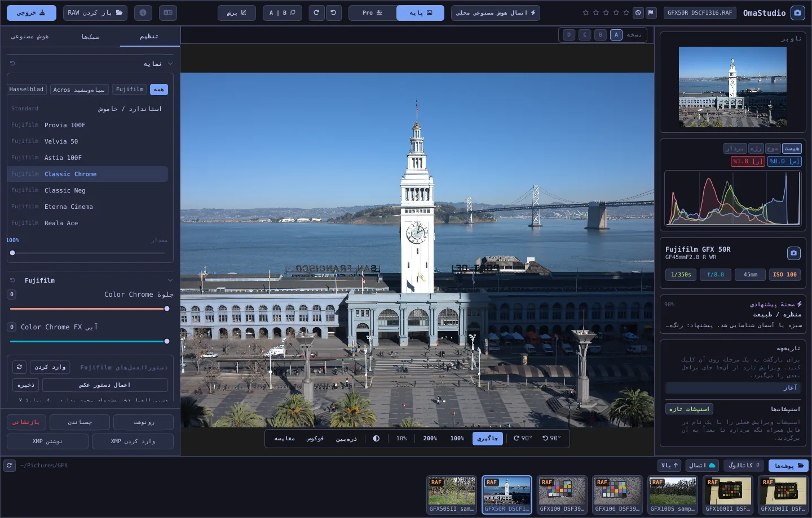

# راهنمای کاربری OmaStudio

**OmaStudio: The Complete Medium Format RAW Editor for Omarchy**

[همهٔ زبان‌ها](../README.md) · [فناوری‌ها](../technology/fa.md) · [README](../../README.md)

این راهنما دربارهٔ OmaStudio 3.1 است. توضیح می‌دهد برنامه را چگونه نصب کنید، در پنجره چگونه جابه‌جا شوید و از هر پنل و ابزار چگونه استفاده کنید. تصویرهای صفحه فایل‌های نمونهٔ Fujifilm GFX 50R و Hasselblad CFV-50c از [raw.pixls.us](https://raw.pixls.us) (CC0) را نشان می‌دهند.



## فهرست

1. [نصب](#1-نصب)
2. [پنجره](#2-پنجره)
3. [باز کردن عکس‌ها و کتابخانه](#3-باز-کردن-عکسها-و-کتابخانه)
4. [پایه و Pro](#4-پایه-و-pro)
5. [زبانهٔ تنظیم](#5-زبانهٔ-تنظیم)
6. [زبانهٔ ماسک‌ها](#6-زبانهٔ-ماسکها)
7. [زبانهٔ سبک‌ها](#7-زبانهٔ-سبکها)
8. [زبانهٔ هوش مصنوعی و گفت‌وگو با هوش مصنوعی](#8-زبانهٔ-هوش-مصنوعی-و-گفتوگو-با-هوش-مصنوعی)
9. [ابزارهای نمایش](#9-ابزارهای-نمایش)
10. [تاریخچه، اسنپ‌شات‌ها و نسخه‌ها](#10-تاریخچه-اسنپشاتها-و-نسخهها)
11. [Fujifilm](#11-fujifilm)
12. [مدیوم فرمت](#12-مدیوم-فرمت)
13. [خروجی](#13-خروجی)
14. [حساب‌های ابری](#14-حسابهای-ابری)
15. [صفحه‌کلید و ماوس](#15-صفحهکلید-و-ماوس)
16. [خط فرمان، سوکت کنترل و MCP](#16-خط-فرمان-سوکت-کنترل-و-mcp)
17. [فایل‌ها و پوشه‌ها](#17-فایلها-و-پوشهها)
18. [رفع اشکال](#18-رفع-اشکال)

## 1. نصب

OmaStudio روی Omarchy (Arch Linux) زیر Wayland و Hyprland اجرا می‌شود.

**از بسته.** در یک نسخهٔ کلون‌شده از مخزن:

```bash
makepkg -si
```

این دستور `omastudio`، `omastudio-app`، `omastudio-engine`، نمایه‌های ICC، مدخل میزکار، آیکون‌ها و یک قاعدهٔ udev برای دوربین‌های Fujifilm متصل با USB را نصب می‌کند.

**از بایگانی انتشار.** فایل `omastudio-<version>-x86_64-linux.tar.gz` را از [صفحهٔ انتشارها](https://github.com/ozdil/omarchy-omastudio/releases) بارگیری کنید، آن را با `checksums.txt` بسنجید، از حالت فشرده خارج کنید و `bin/*` را در `~/.local/bin` و `share/omastudio` را در `~/.local/share/omastudio` رونوشت کنید.

**بسته‌های لازم:** `libraw` نسخهٔ 0.22 یا جدیدتر، `lcms2`، `qt6-base`، `qt6-declarative`، `qt6-wayland` و `qt6-svg` نسخهٔ 6.12 یا جدیدتر، و `zenity` برای پنجره‌های انتخاب فایل.

**بسته‌های اختیاری:**

| بسته | کاربرد |
| :--- | :--- |
| `vulkan-icd-loader` و درایور Vulkan کارت گرافیک | موزاییک‌زدایی روی GPU |
| `perl-image-exiftool` | حفظ فرادادهٔ EXIF در فایل‌های خروجی |
| `libwebp-utils`، `libheif`، `ffmpeg` | WebP با اتلاف، HEIF و جایگزین پشتیبان AVIF |
| `onnxruntime` | ماسک‌های هوش مصنوعی محلی روی NPU، GPU یا CPU |
| `rclone`، `libsecret`، `gnome-keyring` | Google Drive، OneDrive، Dropbox، Box، pCloud و Yandex Disk |
| `github-cli` | حساب GitHub |
| `ollama` | مدل‌های هوش مصنوعی محلی برای دستیار ویرایش |
| `quickshell` | دکمهٔ OmaStudio در نوار Omarchy |

OmaStudio را از منوی برنامه‌های Omarchy باز کنید، یا `omastudio` را اجرا کنید (می‌توانید عکسی هم بدهید: `omastudio DSCF0001.RAF`). اگر پنجره‌ای از قبل باز باشد، عکس در همان پنجره باز می‌شود.

## 2. پنجره

| ناحیه | محتوا |
| :--- | :--- |
| نوار بالا | نام فایل، پرچم‌ها و امتیاز ستاره‌ای، **اتصال هوش مصنوعی محلی**، کلید **پایه** و **Pro**، واگرد و ازنو، قبل و بعد (**A \| B**)، **برش**، منوی زبان، درباره، **باز کردن RAW** و **خروجی** |
| پنل چپ | ناوبر، نمودارها (هیستوگرام، شکل موج، RGB parade، وکتوراسکوپ) با نشانگرهای بریدگی، مشخصات دوربین و لنز، صحنهٔ پیشنهادی، تاریخچه و اسنپ‌شات‌ها |
| وسط | عکس، نوار نسخه‌ها (A–D) بالای آن و نوار نمایش زیر آن: چرخش، **جاگیری**، 100%، 200%، بزرگ‌نمایی فعلی، رنگ پیرامون، **ذره‌بین**، **فوکوس**، **مقایسه** |
| پنل راست | زبانه‌های **تنظیم**، **ماسک‌ها** (Pro)، **سبک‌ها** و **هوش مصنوعی**، و یک ردیف ثابت با **رونوشت**، **چسباندن**، **بازنشانی**، **وارد کردن XMP** و **نوشتن XMP** |
| نوار عکس‌ها | **پوشه‌ها**، **کاتالوگ**، یک زبانه برای هر حساب ابری، **اتصال**، **بالا** و عکس‌های پوشهٔ فعلی |

**Tab** هر دو پنل کناری و نوار عکس‌ها را با هم پنهان و آشکار می‌کند. هر بخش پنل از سرعنوانش باز و بسته می‌شود؛ **Ctrl+کلیک** روی یک سرعنوان فقط همان بخش را باز نگه می‌دارد. زبانهٔ باز، بخش‌های بسته و پنل‌های نمایان بین اجراها به خاطر سپرده می‌شوند.

رنگ‌ها، قلم و گردی گوشه‌ها به‌صورت زنده از پوستهٔ فعال Omarchy پیروی می‌کنند. ناحیهٔ دور عکس به‌طور پیش‌فرض خاکستری تیرهٔ خنثی است تا پوسته دیدن رنگ‌ها را تغییر ندهد؛ دکمهٔ پیرامون در نوار نمایش آن را به خاکستری میانه یا رنگ پوسته تغییر می‌دهد.

| Tokyo Night | Catppuccin Latte | Gruvbox | Rosé Pine |
| :---: | :---: | :---: | :---: |
|  |  |  |  |

رابط کاربری به 30 زبان در دسترس است. از زبان سیستم پیروی می‌کند؛ منوی زبان در نوار بالا زبان دیگری را برمی‌گزیند و فوراً اعمال می‌کند. در فارسی، عربی و عبری رابط از راست به چپ نمایش داده می‌شود.

## 3. باز کردن عکس‌ها و کتابخانه

- **باز کردن RAW** (Ctrl+O) پنجرهٔ انتخاب فایل را باز می‌کند و بر اساس عکس‌ها، RAW یا تصویرها پالایش می‌کند.
- یک عکس یا پوشه را از مدیر فایل روی پنجره بکشید.
- در نوار عکس‌ها، **پوشه‌ها** محتوای پوشهٔ فعلی را نشان می‌دهد؛ روی یک پوشه کلیک کنید تا وارد آن شوید و روی **بالا** تا برگردید. روی عکس کلیک کنید تا باز شود. Ctrl+← و Ctrl+→ به عکس قبلی و بعدی می‌روند.
- **کاتالوگ** همهٔ عکس‌هایی را که OmaStudio دیده است، با امتیاز، پرچم و برچسب رنگی‌شان، فهرست می‌کند.

OmaStudio همهٔ قالب‌های RAW را که LibRaw 0.22 می‌خواند باز می‌کند (Fujifilm، Hasselblad، Phase One، Leica، Pentax، Mamiya/Leaf، Canon، Nikon، Sony، Panasonic، Olympus، Sigma، DNG و دیگران)، به‌علاوهٔ JPEG، PNG، WebP، TIFF، HEIF/HEIC، AVIF، JPEG XL، OpenEXR، Radiance HDR و PNM.

**امتیاز و پرچم‌ها.** کلیدهای 1 تا 5 امتیاز ستاره‌ای را تعیین می‌کنند و 0 آن را پاک می‌کند. P نشان انتخاب، X نشان رد و U پاک کردن پرچم است. امتیاز و پرچم‌ها بی‌درنگ در کاتالوگ و فایل جانبی ذخیره می‌شوند.

**انتخاب.** Shift+کلیک بازه‌ای را در نوار عکس‌ها انتخاب می‌کند و Ctrl+کلیک عکسی را می‌افزاید یا برمی‌دارد. وقتی بیش از یک عکس انتخاب شده باشد، پنجرهٔ خروجی همه را خروجی می‌گیرد (**دسته**).

فایل‌های اصلی شما هرگز تغییر نمی‌کنند. ویرایش‌ها حین کار کنار عکس در یک فایل جانبی، `<photo>.omastudio`، ذخیره می‌شوند (Ctrl+S فوراً ذخیره می‌کند).

## 4. پایه و Pro

کلید نوار بالا تعیین می‌کند چند ابزار نمایش داده شود.

- **پایه:** نمایه، Fujifilm، تراز سفیدی، تُن، حضور، پیش‌تنظیم‌ها و 3D LUT.
- **Pro** منحنی تُن، میکسر رنگ، درجه‌بندی رنگ، جزئیات و اپتیک، تبدیل، دانه، مدیریت رنگ و زبانهٔ **ماسک‌ها** را اضافه می‌کند. بخش‌های Pro برچسب "Pro" دارند.

بازگشت به پایه بخش‌های Pro را پنهان می‌کند؛ تنظیمات آن‌ها اعمال‌شده باقی می‌ماند.


## 5. زبانهٔ تنظیم

هر لغزنده با دوبار کلیک بازنشانی می‌شود. دکمهٔ بازنشانی در سرعنوان بخش، کل بخش را بازنشانی می‌کند.

### نمایه

ظاهر پایه: **استاندارد / خاموش**، شبیه‌سازی‌های فیلم Fujifilm (Provia، Velvia، Astia، Classic Chrome، Classic Neg، Eterna، Eterna Bleach Bypass، Reala Ace، Nostalgic Neg، PRO Neg Std و Hi، Acros و Monochrome با فیلترهای زرد، قرمز و سبز، Sepia) و نمایهٔ رنگ طبیعی به سبک Hasselblad. زبانه‌ها فهرست را پالایش می‌کنند. **مقدار** نمایه را با رندر خنثی می‌آمیزد.

### Fujifilm

**جلوهٔ Color Chrome** و **Color Chrome FX آبی** (ضعیف = 50، قوی = 100) رنگ‌های اشباع‌شده را، و در FX آبی رنگ‌های آبی را، با حفظ فامشان عمیق‌تر می‌کنند. کتابخانهٔ دستورها، دوربین از راه USB و جابه‌جایی پیکسل در [Fujifilm](#11-fujifilm) توضیح داده شده‌اند.

### تراز سفیدی

**دما** (2000–12000 K) و **ته‌رنگ**، نسبت به تراز سفیدی‌ای که دوربین ثبت کرده است. عکس با حالت "مانند عکاسی" باز می‌شود.

### تُن

**نوردهی** (‎−5 تا ‎+5 EV، روی نور خطی: ‎+1 EV نور را دو برابر می‌کند)، **کنتراست**، **روشنی‌ها**، **سایه‌ها**، **سفیدها** و **سیاه‌ها**.

### حضور

**بافت**، **وضوح** (کنتراست میانه‌ها)، **مه‌زدایی**، **سرزندگی** و **اشباع**.

### منحنی تُن (Pro)

یک منحنی نقطه‌ای روی هیستوگرام، برای RGB و جداگانه برای قرمز، سبز و آبی. برای افزودن نقطه کلیک کنید، برای جابه‌جایی بکشید و برای حذف دوبار کلیک کنید. منحنی هرگز از نقاطش فراتر نمی‌رود. چهار لغزندهٔ ناحیه در پایین (روشنی‌ها، روشن‌ها، تیره‌ها، سایه‌ها) منحنی را بر اساس ناحیه شکل می‌دهند.

### میکسر رنگ (Pro)

فام، اشباع و روشنایی برای هشت رنگ: قرمز، نارنجی، زرد، سبز، فیروزه‌ای، آبی، بنفش و ارغوانی.


### درجه‌بندی رنگ (Pro)

چرخ‌های رنگ سه‌گانه برای سایه‌ها (lift)، میانه‌ها (gamma) و روشنی‌ها (gain)، به‌همراه یک جابه‌جایی کلی، به‌صورت چهار چرخ یا زبانه. **تقویت رنگ**، **جزئیات میانه‌ها** و **محور کنتراست** زیر چرخ‌ها قرار دارند. میکسر کانال زیر آن‌ها قرمز، سبز و آبی را در هر کانال خروجی، یا در یک ترکیب تک‌رنگ، می‌آمیزد.


### جزئیات و اپتیک (Pro)

**تیزکردن**، **کاهش نویز** (روشنایی و رنگ)، **سایهٔ گوشه‌ها**، **حذف حاشیهٔ رنگی** (ابیراهی رنگی) و **اصلاح اعوجاج لنز**. اصلاحات لنز ثبت‌شده در فایل‌های Fujifilm و DNG خودکار اعمال می‌شوند؛ این لغزنده‌ها روی آن‌ها کار می‌کنند.

### تبدیل (Pro)

**عمودی** خطوط همگرا را صاف می‌کند، مانند ساختمانی که از پایین عکاسی شده؛ **افقی** همین کار را از پهلو انجام می‌دهد؛ **مقیاس** نتیجه را بزرگ می‌کند. سپس عکس را برش بزنید تا لبه‌های خالی حذف شوند.

### دانه (Pro)

**مقدار**، **اندازه** و **زبری** دانهٔ فیلم.

### مدیریت رنگ (Pro)

- **فشرده‌سازی گستره** رنگ‌هایی را که به بیرون از گستره رانده شده‌اند به‌جای بریدن، به‌نرمی به درون بازمی‌گرداند.
- **منحنی تونال ACES** یک افت سینمایی روشنی‌هاست، تقریبی برازش‌شده از تبدیل خروجی ACES.
- **پیش‌نمایش چاپ (S)** عکس را همان‌طور نشان می‌دهد که با یک نمایهٔ خروجی، مثلاً نمایهٔ چاپگر و کاغذ، دیده خواهد شد. نمایه و هدف رندر را انتخاب کنید. **هشدار گستره رنگ** رنگ‌هایی را که نمایه نمی‌تواند بازتولید کند ارغوانی می‌کند. ویرایش و خروجی تغییر نمی‌کنند.

فضای رنگ خروجی در پنجرهٔ خروجی انتخاب می‌شود.


## 6. زبانهٔ ماسک‌ها

زبانهٔ ماسک‌ها در حالت Pro نمایش داده می‌شود.

### ترمیم و کلون

**ویرایش نقطه‌ها** را روشن کنید و روی لکه‌ای در عکس کلیک کنید تا حذف شود. لکه از یک منبع کنار آن جایگزین می‌شود. دایرهٔ توپر را بکشید تا لکه جابه‌جا شود و دایرهٔ خط‌چین را تا منبع دیگری انتخاب شود. **ترمیم** ناحیهٔ رونوشت‌شده را با نور و رنگ پیرامون لکه هماهنگ می‌کند؛ **کلون** آن را همان‌طور که هست رونوشت می‌کند. **اندازه**، **نرمی لبه** و **کدری** روی لکهٔ انتخاب‌شده و لکه‌های تازه اعمال می‌شوند.


### تنظیمات موضعی

هر لایه نوردهی، کنتراست، روشنی‌ها، سایه‌ها، سفیدها، سیاه‌ها و اشباع را از راه یک ماسک، با یک کدری، اعمال می‌کند.

| ماسک | چگونه ساخته می‌شود |
| :--- | :--- |
| **خطی** | یک گرادیان میان دو دستگیره روی عکس |
| **شعاعی** | یک بیضی با مرکز، دستگیره‌های لبه و نرمی |
| **روشنایی** | یک بازهٔ روشنایی (تیره‌ترین، روشن‌ترین، افت) |
| **رنگ** | رنگ‌های نزدیک به رنگی که از عکس برداشته می‌شود (بازه و نرمی) |
| **قلم‌مو** | روی عکس کشیده می‌شود، با اندازه، نرمی، جریان و حالت پاک‌کن؛ دکمهٔ میانی ماوس عکس را جابه‌جا می‌کند |
| **سوژه (هوش مصنوعی)**، **آسمان (هوش مصنوعی)** | یک مدل بخش‌بندی روی رایانهٔ شما (نگاه کنید به [هوش مصنوعی](#8-زبانهٔ-هوش-مصنوعی-و-گفتوگو-با-هوش-مصنوعی)) |

زیر **ترکیب با:** می‌توان بخش‌های دیگری را به ماسک لایه افزود، از آن کم کرد یا با آن اشتراک گرفت، و هر بخش را وارونه کرد.


## 7. زبانهٔ سبک‌ها

- **پیش‌تنظیم‌ها:** **خودکار** عکس را تحلیل می‌کند و نوردهی، تراز سفیدی و تُن را تنظیم می‌کند. سبک‌های ملایم، پررنگ، پرترهٔ گرم، سیاه‌وسفید و سبزآبی و نارنجی به‌جای افزوده شدن، جایگزین سبک قبلی می‌شوند؛ تراز سفیدی، نوردهی، برش و شبیه‌سازی فیلم باقی می‌مانند.
- **LUT:** **بارگذاری فایل ‎.cube…** یک 3D LUT از خودتان را با یک مقدار اعمال می‌کند.


## 8. زبانهٔ هوش مصنوعی و گفت‌وگو با هوش مصنوعی

**اتصال هوش مصنوعی محلی** در نوار بالا از هوش مصنوعی‌ای استفاده می‌کند که روی این رایانه تنظیم شده است: عامل پیش‌فرض Omarchy (Claude Code یا Codex، با ورود خودشان)، وگرنه Ollama، وگرنه LM Studio. پس از اتصال، این دکمه **گفت‌وگو با هوش مصنوعی** را روی عکس باز می‌کند: بنویسید چه می‌خواهید تغییر کند ("گرم‌تر، آسمان را برگردان") و هوش مصنوعی تنظیمات را انجام می‌دهد. Ctrl+Z هر ویرایش را واگرد می‌کند.

**دستیار ویرایش** در زبانهٔ هوش مصنوعی همین کار را از پنل انجام می‌دهد و می‌تواند به‌جای آن از یک ارائه‌دهندهٔ ابری استفاده کند: Anthropic Claude، OpenAI، OpenRouter یا Google Gemini. کلیدهای API آن‌ها در جاکلیدی سیستم نگه داشته می‌شوند و هرگز روی دیسک نوشته یا در خط فرمان گذاشته نمی‌شوند. با ارائه‌دهندهٔ ابری یا با Claude Code یا Codex، پیش‌نمایش عکس به آن سرویس فرستاده می‌شود؛ با Ollama یا LM Studio روی رایانهٔ شما می‌ماند.


**ماسک‌های هوش مصنوعی.** **سوژه (هوش مصنوعی)** و **آسمان (هوش مصنوعی)** در زبانهٔ ماسک‌ها یک مدل بخش‌بندی ONNX را روی این رایانه اجرا می‌کنند: ابتدا روی NPU (Intel Core Ultra از راه OpenVINO، Snapdragon X از راه QNN، AMD Ryzen AI از راه Vitis AI)، سپس GPU و سپس CPU. هیچ مدلی همراه برنامه نیست و بارگیری نمی‌شود. یک مدل را با نام `subject.onnx` یا `sky.onnx` در `~/.local/share/omastudio/models` بگذارید؛ `omastudio npu` نشان می‌دهد چه چیزی نصب است.

## 9. ابزارهای نمایش

| ابزار | روش استفاده |
| :--- | :--- |
| بزرگ‌نمایی | چرخ ماوس در محل نشانگر؛ **جاگیری** (Ctrl+0)، **100%** (Ctrl+1)، **200%**؛ دوبار کلیک میان جاگیری و 200% جابه‌جا می‌شود. 100% در هر مقیاس نمایشگر یک پیکسل عکس را در یک پیکسل صفحه نشان می‌دهد. |
| جابه‌جایی | کشیدن با دکمهٔ چپ یا میانی ماوس؛ Shift+چرخ به پهلو جابه‌جا می‌کند |
| چرخش | دکمه‌های چرخش در نوار نمایش؛ Alt+چرخ با گام‌های 1.5° می‌چرخاند |
| برش (C) | نسبت‌های آماده (اصلی، 1:1، 4:5، 9:16، 16:9، آزاد) و شبکه‌ها (یک‌سوم‌ها، نسبت طلایی، مارپیچ طلایی) |
| قبل و بعد (Y، یا A \| B) | عکس میان اصل و ویرایش تقسیم می‌شود |
| مقایسه (Shift+C) | ویرایش کنار حالتی دیگر: قبل، یک نسخه یا یک اسنپ‌شات |
| ذره‌بین (L) | مربعی زیر نشانگر که عکس را با وضوح کامل در 1:1 نشان می‌دهد |
| برجسته‌سازی فوکوس (Shift+F) | تیزترین لبه‌ها سبز رنگ می‌شوند؛ فقط ابزار نمایش است |
| بریدگی | روی **[S]** یا **[H]** بالای هیستوگرام کلیک کنید تا سایه‌های بریده با آبی و روشنی‌های بریده با قرمز نمایش داده شوند |

| برجسته‌سازی فوکوس | مقایسه |
| :---: | :---: |
|  |  |

| برش | قبل و بعد |
| :---: | :---: |
|  |  |

وقتی عکس بزرگ‌تر از پیش‌نمایش نشان داده می‌شود، موتور ناحیهٔ دیدنی را از فایل با وضوح کامل رندر می‌کند تا جزئیاتی که می‌بینید با خروجی یکسان باشد.

## 10. تاریخچه، اسنپ‌شات‌ها و نسخه‌ها

- **تاریخچه** در پنل چپ هر گام ویرایش را با نامش فهرست می‌کند ("Exposure +0.70"، "Tone curve"). روی یک گام کلیک کنید تا به آن برگردید؛ ویرایش تازه از آن‌جا، مانند Ctrl+Z، گام‌های بعدی را جایگزین می‌کند.
- **اسنپ‌شات‌ها** ویرایش فعلی را با یک نام نگه می‌دارند. **بازیابی** یکی را به‌صورت گامی تازه برمی‌گرداند که Ctrl+Z می‌تواند واگردش کند. اسنپ‌شات‌ها در فایل جانبی ذخیره می‌شوند.
- **نسخه‌های A–D** بالای عکس تا چهار ویرایش جداگانه از یک عکس را نگه می‌دارند. روی یک حرف کلیک کنید تا جابه‌جا شوید (Alt+1 تا Alt+4)؛ کلیک راست ویرایش فعلی را در آن نسخه رونوشت می‌کند.
- **رونوشت** و **چسباندن** (Ctrl+Shift+C، Ctrl+Shift+V) یک ویرایش را به عکس دیگری می‌برند. **بازنشانی** (Ctrl+R) به پیش‌فرض‌ها برمی‌گرداند.
- **نوشتن XMP** ویرایش، امتیاز و برچسب را در یک فایل جانبی `.xmp` ذخیره می‌کند که Lightroom، Capture One، darktable و digiKam می‌خوانند؛ **وارد کردن XMP** فایلی را که این برنامه‌ها نوشته‌اند می‌خواند.

## 11. Fujifilm

- **دستور دوربین.** یک فایل RAF یا JPEG از Fujifilm با تنظیماتی که با آن عکاسی شده باز می‌شود: شبیه‌سازی فیلم، تُن، رنگ، تیزی، کاهش نویز، وضوح، دانه، Color Chrome، جابه‌جایی تراز سفیدی و دامنهٔ دینامیکی (از جمله D-Range Priority). فایل جانبی ذخیره‌شده اولویت دارد.
- **روشنایی.** فایل‌های RAF با روشنایی JPEG خود دوربین باز می‌شوند.
- **اصلاحات لنز.** اعوجاج، ابیراهی رنگی جانبی و سایهٔ گوشه‌هایی که دوربین ثبت کرده برای لنزهای XF، XC و GF اعمال می‌شوند.
- **کتابخانهٔ دستورها.** **وارد کردن** یک نمایهٔ X RAW Studio (‎.FP1، ‎.FP2، ‎.FP3)، متن یک دستور ("Film Simulation: Classic Chrome / Grain Effect: Strong, Small …") یا یک عکس Fujifilm را می‌پذیرد. **اعمال دستور** یک دستور ذخیره‌شده را اعمال می‌کند؛ **اعمال دستور عکس** به دستور درون فایل برمی‌گردد؛ **ذخیره** دستور فعلی را نگه می‌دارد.
- **دوربین از راه USB.** حالت USB دوربین را روی USB RAW CONV./BACKUP RESTORE بگذارید و آن را وصل کنید. **خواندن C1–C7** تنظیمات سفارشی آن را نشان می‌دهد، **نوشتن دستور در C…** یک دستور را در یک خانه ذخیره می‌کند (و محتوای قبلی را جایگزین می‌کند)، و **تبدیل در دوربین** فایل RAF باز را درون دوربین ظاهر می‌کند، در صورت تمایل با دستور انتخاب‌شده.
- **جابه‌جایی پیکسل.** قاب‌های RAF یک توالی Pixel Shift از GFX را در نوار عکس‌ها انتخاب کنید و روی **ادغام قاب‌ها در DNG** کلیک کنید. چهار قاب در هر پیکسل رنگ کامل می‌دهند؛ شانزده قاب وضوح را دو برابر می‌کنند.

## 12. مدیوم فرمت

- **Fujifilm GFX** (GFX 50S، 50R، 50S II، 100، 100S، 100 II و دیگران): مسیر پردازش 16 بیتی از حسگر تا خروجی، شبیه‌سازی‌های فیلم، اصلاحات لنز و جابه‌جایی پیکسل.
- فایل‌های 3FR و FFF از **Hasselblad** با برش پیش‌فرض دوربین بریده می‌شوند.
- فایل‌های IIQ و MOS از **Phase One و Leaf** کالیبراسیون حسگر همان پشتی دیجیتال را می‌گیرند.
- فایل‌های MEF از **Mamiya** و PEF از **Pentax 645** پشتیبانی می‌شوند.
- **میدان تخت (LCC):** `omastudio-engine medium-format lcc-create <raw>` از عکسی از یک هدف سفید با نور یکنواخت یک اصلاح می‌سازد؛ این اصلاح روی عکس‌های همان پوشه اعمال می‌شود.
- **چندنمایی:** `medium-format multishot f1 f2 f3 f4 --out merged.tif` یک توالی 4 عکسی را ادغام می‌کند.


## 13. خروجی

**خروجی** (E) پنجرهٔ خروجی را باز می‌کند. Enter خروجی می‌گیرد و Esc می‌بندد.


| تنظیم | گزینه‌ها |
| :--- | :--- |
| قالب فایل | JPEG، PNG (8/16 بیت)، TIFF (8/16 بیت، بدون فشرده‌سازی، LZW یا ZIP)، WebP، AVIF (8/10/12 بیت)، HEIF (8/10/12 بیت)، JPEG XL (8/16 بیت) و OpenEXR (half یا full float، scene-linear) |
| کیفیت | 1–100؛ 100 برای WebP، AVIF و JPEG XL بی‌اتلاف است |
| اندازه | کامل، 75%، 50%، یا ضلع بلند 3840 یا 2048 px |
| نمایهٔ رنگ | sRGB، Display P3، Adobe RGB، ProPhoto RGB، Rec. 2020، ACEScg یا یک نمایهٔ ICC از خودتان |
| هدف رندر | ادراکی، نسبی (پیش‌فرض)، اشباع، مطلق |
| فراداده | حفظ فرادادهٔ دوربین (EXIF)، حذف موقعیت (GPS) |
| آماده‌سازی برای | برش و تیزکردن خروجی برای Instagram، Stories و Reels، X، Facebook، مربع و تصویرک‌های YouTube |
| واترمارک | متن با برچسب‌های EXIF ({camera}، {lens}، {iso}، {aperture}، {shutter}، {focal}) یا یک لوگوی PNG، با موقعیت، کدری، اندازه و سایه |
| پوشه و نام فایل | پیش‌فرض `~/Pictures/OmaStudio_Exports`؛ می‌توان یک برچسب به نام فایل افزود |
| بارگذاری در | یک حساب ابری متصل |

همهٔ قالب‌ها جز OpenEXR نمایهٔ ICC فضای رنگ خود را همراه دارند. خروجی دسته‌ای عکس‌های انتخاب‌شده را یکی پس از دیگری خروجی می‌گیرد.

## 14. حساب‌های ابری

**اتصال** در نوار عکس‌ها Google Drive، OneDrive، Dropbox، Box، pCloud، Yandex Disk یا GitHub را می‌افزاید. ورود در صفحهٔ خود سرویس در مرورگرتان انجام می‌شود؛ OmaStudio هرگز گذرواژهٔ شما را نمی‌بیند.


- هر حساب یک زبانه در نوار عکس‌ها می‌گیرد. پوشه‌هایش را مرور کنید و روی عکسی کلیک کنید تا (یک بار) بارگیری و باز شود.
- در هر حساب پوشه‌ای به نام `OmaStudio` ساخته می‌شود (در GitHub یک مخزن خصوصی `OmaStudio`) که بارگذاری‌های پنجرهٔ خروجی را دریافت می‌کند.
- سرویس‌های ذخیره‌سازی از راه rclone با پیکربندی خود OmaStudio کار می‌کنند که با کلیدی نگه‌داری‌شده در جاکلیدی سیستم رمزگذاری شده است. GitHub از راه GitHub CLI کار می‌کند.
- برای Google Drive می‌توان یک شناسهٔ کلاینت از خودتان را از Google Cloud Console در **شناسه کلاینت Google خودتان** وارد کرد.
- **قطع اتصال** کلیدهای حساب و رونوشت‌های بارگیری‌شده را از این رایانه حذف می‌کند؛ فایل‌های درون حساب باقی می‌مانند.

## 15. صفحه‌کلید و ماوس

| کلید | کار |
| :--- | :--- |
| Ctrl+O | باز کردن یک عکس |
| Ctrl+S | ذخیرهٔ ویرایش همین حالا |
| Ctrl+Z / Ctrl+Shift+Z یا Ctrl+Y | واگرد / ازنو |
| Ctrl+Shift+C / Ctrl+Shift+V | رونوشت / چسباندن ویرایش |
| Ctrl+R | بازنشانی ویرایش |
| Ctrl+← / Ctrl+→ | عکس قبلی / بعدی |
| Ctrl+0 / Ctrl+1 | جاگیری / 100% |
| 1–5، 0 | امتیاز ستاره‌ای، پاک کردن امتیاز |
| P، X، U | انتخاب، رد، پاک کردن پرچم |
| C | برش |
| Y | قبل و بعد |
| S | پیش‌نمایش چاپ |
| L | ذره‌بین |
| Shift+F | برجسته‌سازی فوکوس |
| Shift+C | مقایسه |
| Alt+1 … Alt+4 | نسخه‌های A–D |
| E | پنجرهٔ خروجی |
| Tab | پنهان یا آشکار کردن پنل‌ها |
| Esc | بستن پنجرهٔ باز |

| ماوس | کار |
| :--- | :--- |
| چرخ | بزرگ‌نمایی در محل نشانگر |
| Shift+چرخ | جابه‌جایی به پهلو |
| Alt+چرخ | چرخش |
| کشیدن (دکمهٔ چپ یا میانی) | جابه‌جایی |
| دوبار کلیک روی عکس | جاگیری یا 200% |
| Ctrl+کلیک روی سرعنوان بخش | فقط همان بخش باز بماند |
| کلیک راست روی حرف نسخه | رونوشت ویرایش فعلی در آن نسخه |

## 16. خط فرمان، سوکت کنترل و MCP

**دستورهای موتور.** هر دستور یک شیء JSON چاپ می‌کند تا اسکریپت‌ها و عامل‌ها بتوانند از آن استفاده کنند.

```bash
omastudio inspect DSCF0001.RAF                      # camera, lens, exposure, histogram, scene
omastudio export DSCF0001.RAF --recipe '{"exposure":0.5}' --options '{"format":"jpeg"}'
omastudio fuji-recipe DSCF0001.RAF                  # the camera's recipe
omastudio fuji-pixel-shift DSCF*.RAF --out merged.dng
omastudio xmp export DSCF0001.RAF
omastudio cameras GFX                               # cameras the RAW decoder supports
omastudio gpu                                       # GPU used for demosaicing
omastudio npu                                       # ONNX Runtime and accelerators
omastudio cloud status
omastudio --cli help                                # every command
```

**سوکت کنترل.** `omastudio ipc <method> [arguments]` با پنجرهٔ باز گفت‌وگو می‌کند، برای نمونه `openPhoto`، `openFolder`، `applyRecipe`، `applyPreset`، `setExposure`، `setWarmth`، `setMode essentials|pro`، `setRightTab`، `showSection`، `setView peaking|compare|softProof|split on|off`، `setZoom`، `showExport`، `showCloud`، `getStatus` و `screenshot <file.png>`. سوکت فقط به همان کاربر پاسخ می‌دهد.

**MCP.** `omastudio mcp` یک سرور Model Context Protocol است تا عامل‌های هوش مصنوعی بتوانند عکس‌ها را بررسی، رندر، گزینش و خروجی کنند، دستورهای Fujifilm را بخوانند و پنجرهٔ باز را کنترل کنند. برای Claude Code: `claude mcp add omastudio -- omastudio mcp`. `omastudio skill` مهارت عامل را در `~/.claude/skills` نصب می‌کند.

## 17. فایل‌ها و پوشه‌ها

| مسیر | محتوا |
| :--- | :--- |
| `<photo>.omastudio` | ویرایش یک عکس (فایل جانبی) |
| `~/.local/share/omastudio/catalog.json` | کاتالوگ: امتیازها، پرچم‌ها و برچسب‌های رنگی |
| `~/.local/share/omastudio/fuji-recipes/` | دستورهای ذخیره‌شدهٔ Fujifilm |
| `~/.local/share/omastudio/icc/` | نمایه‌های ICC خودتان |
| `~/.local/share/omastudio/models/` | مدل‌های هوش مصنوعی محلی |
| `~/.local/share/omastudio/film-luts/` | LUTهای شبیه‌سازی فیلم که از عکس‌های شما اندازه‌گیری شده‌اند (`fuji-calibrate`) |
| `~/.config/omastudio/` | تنظیمات، وضعیت رابط، زبان، حساب‌های ابری |
| `~/.cache/omastudio/` | تصویرک‌ها، پیش‌نمایش‌ها و عکس‌های بارگیری‌شده از فضای ابری |

## 18. رفع اشکال

- **پنجره باز نمی‌شود.** `omastudio` را در ترمینال اجرا کنید و پیام را بخوانید. `omastudio --version` و `omastudio status` نشان می‌دهند چه چیزی نصب است.
- **از GPU استفاده نمی‌شود.** `omastudio gpu` دستگاه را نشان می‌دهد. `vulkan-icd-loader` و درایور Vulkan کارت گرافیک را نصب کنید. `OMASTUDIO_GPU=off` استفاده از CPU را اجباری می‌کند.
- **دوربین از راه USB پیدا نمی‌شود.** حالت USB آن را روی USB RAW CONV./BACKUP RESTORE بگذارید، دوباره وصلش کنید و بررسی کنید که قاعدهٔ udev بسته نصب شده باشد.
- **یک سرویس ابری می‌گوید به برنامه‌ای نیاز دارد.** بسته‌ای را که پنجره نام می‌برد نصب کنید، برای نمونه `sudo pacman -S rclone libsecret`.
- **رونوشت اطلاعات سیستم** در پنجرهٔ درباره، نسخه، GPU و جزئیات Omarchy را برای گزارش اشکال رونوشت می‌کند. مشکلات را در [github.com/ozdil/omarchy-omastudio/issues](https://github.com/ozdil/omarchy-omastudio/issues) گزارش کنید.
