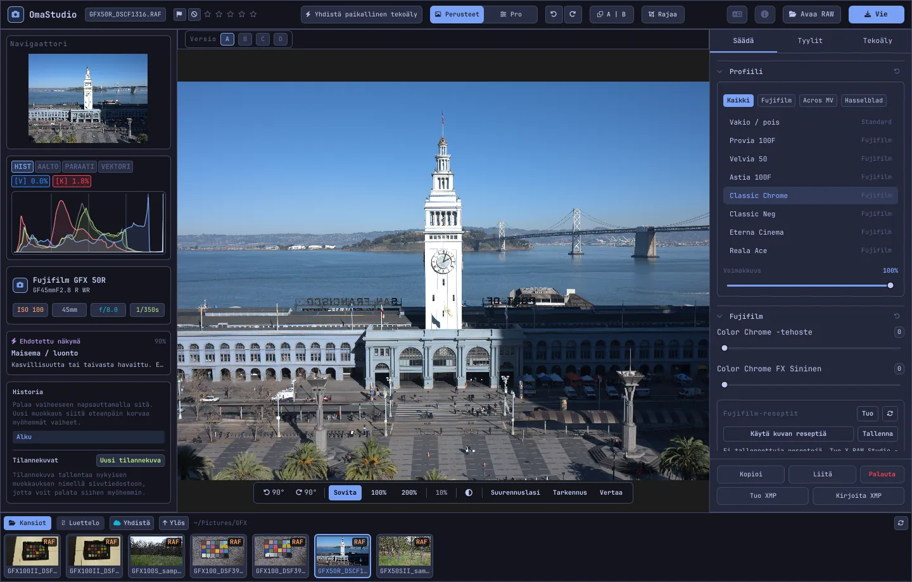

# OmaStudion käyttöopas

**OmaStudio: The Complete Medium Format RAW Editor for Omarchy**

[Kaikki kielet](../README.md) · [Teknologiat](../technology/fi.md) · [README](../../README.md)

Tämä opas koskee OmaStudio 3.1:tä. Se kertoo, miten sovellus asennetaan, miten ikkuna on jäsennelty ja miten kutakin paneelia ja työkalua käytetään. Kuvakaappauksissa on Fujifilm GFX 50R- ja Hasselblad CFV-50c -esimerkkitiedostoja sivustolta [raw.pixls.us](https://raw.pixls.us) (CC0).



## Sisältö

1. [Asennus](#1-asennus)
2. [Ikkuna](#2-ikkuna)
3. [Kuvien avaaminen ja kirjasto](#3-kuvien-avaaminen-ja-kirjasto)
4. [Perusteet ja Pro](#4-perusteet-ja-pro)
5. [Säädä-välilehti](#5-säädä-välilehti)
6. [Maskit-välilehti](#6-maskit-välilehti)
7. [Tyylit-välilehti](#7-tyylit-välilehti)
8. [Tekoäly-välilehti ja tekoälykeskustelu](#8-tekoäly-välilehti-ja-tekoälykeskustelu)
9. [Katseluapuvälineet](#9-katseluapuvälineet)
10. [Historia, tilannekuvat ja versiot](#10-historia-tilannekuvat-ja-versiot)
11. [Fujifilm](#11-fujifilm)
12. [Keskikoko](#12-keskikoko)
13. [Vienti](#13-vienti)
14. [Pilvitilit](#14-pilvitilit)
15. [Näppäimistö ja hiiri](#15-näppäimistö-ja-hiiri)
16. [Komentorivi, ohjaussoketti ja MCP](#16-komentorivi-ohjaussoketti-ja-mcp)
17. [Tiedostot ja kansiot](#17-tiedostot-ja-kansiot)
18. [Vianmääritys](#18-vianmääritys)

## 1. Asennus

OmaStudio toimii Omarchyssa (Arch Linux) Waylandin ja Hyprlandin alla.

**Paketista.** Tietovaraston kloonissa:

```bash
makepkg -si
```

Tämä asentaa ohjelmat `omastudio`, `omastudio-app` ja `omastudio-engine`, ICC-profiilit, työpöytämerkinnän, kuvakkeet ja udev-säännön USB:llä liitetyille Fujifilm-kameroille.

**Julkaisuarkistosta.** Lataa `omastudio-<versio>-x86_64-linux.tar.gz` [julkaisusivulta](https://github.com/ozdil/omarchy-omastudio/releases), tarkista se tiedostoa `checksums.txt` vasten, pura se ja kopioi `bin/*` kansioon `~/.local/bin` ja `share/omastudio` kansioon `~/.local/share/omastudio`.

**Vaaditut paketit:** `libraw` 0.22 tai uudempi, `lcms2`, `qt6-base`, `qt6-declarative`, `qt6-wayland` ja `qt6-svg` 6.12 tai uudempi sekä `zenity` tiedostoikkunoita varten.

**Valinnaiset paketit:**

| Paketti | Käyttötarkoitus |
| :--- | :--- |
| `vulkan-icd-loader` ja näytönohjaimen Vulkan-ajuri | Demosaicing näytönohjaimella |
| `perl-image-exiftool` | EXIF-metatietojen säilyttäminen viedyissä tiedostoissa |
| `libwebp-utils`, `libheif`, `ffmpeg` | Häviöllinen WebP, HEIF ja AVIF-varavaihtoehto |
| `onnxruntime` | Paikalliset tekoälymaskit NPU:lla, GPU:lla tai CPU:lla |
| `rclone`, `libsecret`, `gnome-keyring` | Google Drive, OneDrive, Dropbox, Box, pCloud ja Yandex Disk |
| `github-cli` | GitHub-tili |
| `ollama` | Paikalliset tekoälymallit muokkausavustajalle |
| `quickshell` | OmaStudio-painike Omarchyn palkissa |

Käynnistä OmaStudio Omarchyn sovellusvalikosta tai suorita `omastudio` (halutessasi kuvan kanssa: `omastudio DSCF0001.RAF`). Jos ikkuna on jo auki, kuva avautuu siihen.

## 2. Ikkuna

| Alue | Sisältö |
| :--- | :--- |
| Yläpalkki | Tiedostonimi, liput ja tähtiarvio, **Yhdistä paikallinen tekoäly**, **Perusteet**- ja **Pro**-valitsin, kumoa ja tee uudelleen, ennen ja jälkeen (**A \| B**), **Rajaa**, kielivalikko, Tietoja, **Avaa RAW** ja **Vie** |
| Vasen paneeli | Navigaattori, mittarit (histogrammi, aaltomuoto, RGB-paraati, vektoriskooppi) leikkautumisen ilmaisimilla, kameran ja objektiivin tiedot, ehdotettu näkymä, historia ja tilannekuvat |
| Keskiosa | Kuva, sen yläpuolella versiopalkki (A–D) ja alapuolella näkymäpalkki: kierto, **Sovita**, 100 %, 200 %, nykyinen zoomaus, ympäristön väri, **Suurennuslasi**, **Tarkennus**, **Vertaa** |
| Oikea paneeli | Välilehdet **Säädä**, **Maskit** (Pro), **Tyylit** ja **Tekoäly** sekä kiinteä rivi: **Kopioi**, **Liitä**, **Palauta**, **Tuo XMP** ja **Kirjoita XMP** |
| Filminauha | **Kansiot**, **Luettelo**, oma välilehti kullekin pilvitilille, **Yhdistä**, **Ylös** ja nykyisen kansion kuvat |

**Tab** piilottaa ja näyttää molemmat sivupaneelit ja filminauhan yhdessä. Jokainen paneelin osio avautuu ja sulkeutuu otsikostaan; **Ctrl+napsautus** otsikossa jättää vain sen osion auki. Avoin välilehti, suljetut osiot ja näkyvät paneelit muistetaan istuntojen välillä.

Värit, fontti ja kulmien pyöristys seuraavat aktiivista Omarchy-teemaa reaaliajassa. Kuvan ympärillä oleva alue on oletuksena neutraalin tummanharmaa, jotta teema ei muuta värien näkymistä; näkymäpalkin ympäristöpainike vaihtaa keskiharmaaseen tai teeman väriin.

| Tokyo Night | Catppuccin Latte | Gruvbox | Rosé Pine |
| :---: | :---: | :---: | :---: |
|  |  |  |  |

Käyttöliittymä on saatavilla 30 kielellä. Se seuraa järjestelmän kieltä; yläpalkin kielivalikosta voi valita toisen, joka otetaan käyttöön heti.

## 3. Kuvien avaaminen ja kirjasto

- **Avaa RAW** (Ctrl+O) avaa tiedostoikkunan. Se suodattaa kuvat, RAW-tiedostot tai kuvatiedostot.
- Vedä kuva tai kansio tiedostonhallinnasta ikkunaan.
- Filminauhassa **Kansiot** näyttää nykyisen kansion; napsauta kansiota siirtyäksesi siihen ja **Ylös** palataksesi. Napsauta kuvaa avataksesi sen. Ctrl+← ja Ctrl+→ siirtyvät edelliseen ja seuraavaan kuvaan.
- **Luettelo** näyttää kaikki OmaStudion näkemät kuvat arvioineen, lippuineen ja värimerkintöineen.

OmaStudio avaa kaikki RAW-muodot, joita LibRaw 0.22 lukee (Fujifilm, Hasselblad, Phase One, Leica, Pentax, Mamiya/Leaf, Canon, Nikon, Sony, Panasonic, Olympus, Sigma, DNG ja muut), sekä JPEG-, PNG-, WebP-, TIFF-, HEIF/HEIC-, AVIF-, JPEG XL-, OpenEXR-, Radiance HDR- ja PNM-tiedostot.

**Arviot ja liput.** 1–5 asettavat tähtiarvion ja 0 poistaa sen. P merkitsee valituksi, X hylätyksi ja U poistaa lipun. Arviot ja liput tallentuvat heti luetteloon ja sivutiedostoon.

**Valinta.** Vaihto+napsautus valitsee alueen filminauhasta ja Ctrl+napsautus lisää tai poistaa kuvan. Kun valittuna on useampi kuva, vientiikkuna vie ne kaikki (**Erä**).

Alkuperäisiä tiedostojasi ei koskaan muuteta. Muokkaukset tallentuvat kuvan viereen sivutiedostoon `<kuva>.omastudio` työskennellessäsi (Ctrl+S tallentaa heti).

## 4. Perusteet ja Pro

Yläpalkin valitsin määrää, kuinka monta työkalua näytetään.

- **Perusteet:** profiili, Fujifilm, valkotasapaino, sävy, läsnäolo, esiasetukset ja 3D-LUTit.
- **Pro** lisää sävykäyrän, värimikserin, värimäärittelyn, yksityiskohdat ja optiikan, muunnoksen, rakeisuuden, värinhallinnan ja **Maskit**-välilehden. Pro-osioissa on merkki "Pro".

Kun palaat Perusteisiin, Pro-osiot piiloutuvat; niiden asetukset pysyvät käytössä.


## 5. Säädä-välilehti

Jokainen liukusäädin palautuu, kun kaksoisnapsautat sitä. Osion otsikon palautuspainike palauttaa koko osion.

### Profiili

Perusilme: **Vakio / pois**, Fujifilmin filmisimulaatiot (Provia, Velvia, Astia, Classic Chrome, Classic Neg, Eterna, Eterna Bleach Bypass, Reala Ace, Nostalgic Neg, PRO Neg Std ja Hi, Acros ja Monochrome keltaisella, punaisella ja vihreällä suodattimella, Sepia) sekä Hasselblad-tyylinen luonnollinen väriprofiili. Välilehdet suodattavat luetteloa. **Voimakkuus** sekoittaa profiilin neutraaliin toistoon.

### Fujifilm

**Color Chrome -tehoste** ja **Color Chrome FX Sininen** (Heikko = 50, Vahva = 100) syventävät kylläisiä värejä, FX Sininen sinisiä, muuttamatta niiden sävyä. Reseptikirjasto, USB-kamera ja Pixel Shift kuvataan kohdassa [Fujifilm](#11-fujifilm).

### Valkotasapaino

**Lämpötila** (2000–12000 K) ja **Sävy** suhteessa kameran tallentamaan valkotasapainoon. Kuva avautuu kuvaushetken asetuksella.

### Sävy

**Valotus** (−5…+5 EV lineaarisessa valossa: +1 EV kaksinkertaistaa valon), **Kontrasti**, **Kirkkaat sävyt**, **Varjot**, **Valkoiset** ja **Mustat**.

### Läsnäolo

**Rakenne**, **Selkeys** (keskisävyjen kontrasti), **Usvanpoisto**, **Eloisuus** ja **Kylläisyys**.

### Sävykäyrä (Pro)

Pistekäyrä histogrammin päällä, RGB:lle ja erikseen punaiselle, vihreälle ja siniselle. Napsauta lisätäksesi pisteen, vedä siirtääksesi sitä ja kaksoisnapsauta poistaaksesi sen. Käyrä ei koskaan ylitä pisteitään. Alla olevat neljä aluesäädintä (kirkkaat, vaaleat, tummat, varjot) muotoilevat käyrää alueittain.

### Värimikseri (Pro)

Sävy, kylläisyys ja luminanssi kahdeksalle värille: punainen, oranssi, keltainen, vihreä, turkoosi, sininen, violetti ja magenta.


### Värimäärittely (Pro)

Kolmitieväripyörät varjoille (lift), keskisävyille (gamma) ja kirkkaille sävyille (gain) sekä yleinen siirtymä, neljänä pyöränä tai välilehtinä. **Värien vahvistus**, **Keskisävyjen yksityiskohdat** ja **Kontrastin keskipiste** ovat pyörien alla. Niiden alla oleva kanavamikseri sekoittaa punaisen, vihreän ja sinisen kuhunkin lähtökanavaan tai yksiväriseen sekoitukseen.


### Yksityiskohdat ja optiikka (Pro)

**Terävöitys**, **Kohinanpoisto** (luminanssi ja väri), **Vinjetointi**, **Reunavärien poisto** (kromaattinen aberraatio) ja **Objektiivin vääristymän korjaus**. Fujifilm- ja DNG-tiedostojen objektiivikorjaukset tehdään automaattisesti; nämä säätimet toimivat niiden lisäksi.

### Muunna (Pro)

**Pystysuunta** oikaisee yhtyvät linjat, kuten alhaalta kuvatun rakennuksen; **Vaakasuunta** tekee saman sivusuunnassa; **Skaalaus** suurentaa tulosta. Rajaa lopuksi tyhjät reunat pois.

### Rakeisuus (Pro)

Filmirakeen **määrä**, **koko** ja **karheus**.

### Värinhallinta (Pro)

- **Värialueen pakkaus** tuo väriavaruuden ulkopuolelle työnnetyt värit pehmeästi takaisin leikkaamisen sijaan.
- **ACES-sävykäyrä** on filminomainen kirkkaiden sävyjen pehmennys, sovitettu likiarvo ACES-tulostemuunnoksesta.
- **Näyttövedos** (S) näyttää kuvan sellaisena kuin se näyttää tulosteprofiililla, esimerkiksi tulostimen ja paperin profiililla. Valitse profiili ja toistotapa. **Väriavaruusvaroitus** värittää magentalla värit, joita profiili ei pysty toistamaan. Muokkaus ja vienti eivät muutu.

Itse tulosteen väriavaruus valitaan vientiikkunassa.


## 6. Maskit-välilehti

Maskit-välilehti näkyy Pro-tilassa.

### Korjaus ja kloonaus

Ota **Muokkaa kohtia** käyttöön ja napsauta kuvan täplää poistaaksesi sen. Täplä korvataan viereisestä lähteestä. Vedä yhtenäistä ympyrää siirtääksesi täplää ja katkoviivaympyrää valitaksesi toisen lähteen. **Korjaa** sovittaa kopioidun alueen täplän ympäristön valoon ja väriin; **Kloonaa** kopioi sen sellaisenaan. **Koko**, **Pehmennys** ja **Peittävyys** koskevat valittua ja uusia täpliä.


### Paikalliset säädöt

Jokainen taso käyttää valotusta, kontrastia, kirkkaita sävyjä, varjoja, valkoisia, mustia ja kylläisyyttä maskin kautta peittävyydellä.

| Maski | Miten se tehdään |
| :--- | :--- |
| **Lineaarinen** | Liukuma kahden kuvassa olevan kahvan välillä |
| **Säteittäinen** | Ellipsi, jolla on keskipiste, reunakahvat ja pehmennys |
| **Luminanssi** | Kirkkausalue (tummin, kirkkain, liukuma) |
| **Väri** | Kuvasta poimitun värin lähellä olevat värit (alue ja pehmennys) |
| **Sivellin** | Maalataan kuvaan koolla, pehmennyksellä, virtauksella ja pyyhintätilalla; hiiren keskipainike panoroi |
| **Kohde (tekoäly)**, **Taivas (tekoäly)** | Segmentointimalli omalla tietokoneellasi (katso [Tekoäly](#8-tekoäly-välilehti-ja-tekoälykeskustelu)) |

Kohdassa **Yhdistä** tason maskiin voi lisätä, vähentää tai leikata uusia osia, ja jokaisen osan voi kääntää.


## 7. Tyylit-välilehti

- **Esiasetukset:** **Automaattinen** analysoi kuvan ja asettaa valotuksen, valkotasapainon ja sävyn. Tyylit Hillitty, Eloisa, Lämmin muotokuva, Mustavalko sekä Sinivihreä ja oranssi korvaavat edellisen tyylin sen sijaan, että lisäisivät sen päälle; valkotasapaino, valotus, rajaus ja filmisimulaatio säilyvät.
- **LUT:** **Lataa .cube-tiedosto…** käyttää omaa 3D-LUTiasi voimakkuuden kanssa.


## 8. Tekoäly-välilehti ja tekoälykeskustelu

Yläpalkin **Yhdistä paikallinen tekoäly** käyttää tähän tietokoneeseen määritettyä tekoälyä: Omarchyn oletusagenttia (Claude Code tai Codex omalla kirjautumisellaan), muuten Ollamaa, muuten LM Studiota. Kun yhteys on muodostettu, painike avaa **Tekoälykeskustelu**-ikkunan kuvan päälle: kirjoita, mitä haluat muuttaa ("lämpimämpi, pelasta taivas"), ja tekoäly asettaa säädöt. Ctrl+Z kumoaa jokaisen muutoksen.

**Tekoäly**-välilehden **Muokkausavustaja** tekee saman paneelista ja voi käyttää sen sijaan pilvipalvelua: Anthropic Claude, OpenAI, OpenRouter tai Google Gemini. Niiden API-avaimet tallennetaan järjestelmän avainnippuun eikä niitä koskaan kirjoiteta levylle tai komentoriville. Pilvipalvelua tai Claude Codea tai Codexia käytettäessä kuvan esikatselu lähetetään kyseiseen palveluun; Ollamalla tai LM Studiolla se pysyy tietokoneellasi.


**Tekoälymaskit.** Maskit-välilehden **Kohde (tekoäly)** ja **Taivas (tekoäly)** suorittavat ONNX-segmentointimallin tällä tietokoneella: ensin NPU:lla (Intel Core Ultra OpenVINOn kautta, Snapdragon X QNN:n kautta, AMD Ryzen AI Vitis AI:n kautta), sitten GPU:lla, sitten CPU:lla. Mallia ei toimiteta mukana eikä ladata. Aseta malli kansioon `~/.local/share/omastudio/models` nimellä `subject.onnx` tai `sky.onnx`; `omastudio npu` näyttää, mitä on asennettu.

## 9. Katseluapuvälineet

| Apuväline | Käyttö |
| :--- | :--- |
| Zoomaus | Hiiren rulla osoittimen kohdalla; **Sovita** (Ctrl+0), **100 %** (Ctrl+1), **200 %**; kaksoisnapsautus vaihtaa sovituksen ja 200 %:n välillä. 100 % näyttää yhden kuvapikselin näytön pikseliä kohden millä tahansa näytön skaalauksella. |
| Panorointi | Vedä hiiren vasemmalla tai keskipainikkeella; Vaihto+rulla panoroi sivusuunnassa |
| Kierto | Näkymäpalkin kiertopainikkeet; Alt+rulla kiertää 1,5° askelin |
| Rajaa (C) | Kuvasuhteen esiasetukset (Alkuperäinen, 1:1, 4:5, 9:16, 16:9, Vapaa) ja apuviivat (kolmannekset, kultainen leikkaus, kultainen spiraali) |
| Ennen ja jälkeen (Y tai A \| B) | Kuva jaettuna alkuperäiseen ja muokattuun |
| Vertaa (Vaihto+C) | Muokkaus toisen tilan rinnalla: Ennen, versio tai tilannekuva |
| Suurennuslasi (L) | Osoittimen alla oleva neliö, joka näyttää kuvan täydellä resoluutiolla 1:1 |
| Tarkennus (Vaihto+F) | Terävimmät reunat väritetään vihreiksi; vain katseluapu |
| Leikkautuminen | Napsauta histogrammin yläpuolella **[S]** tai **[H]** näyttääksesi leikkautuneet varjot sinisinä ja kirkkaat sävyt punaisina |

| Tarkennus | Vertaa |
| :---: | :---: |
|  |  |

| Rajaa | Ennen ja jälkeen |
| :---: | :---: |
|  |  |

Kun kuva näytetään esikatselua suurempana, moottori renderöi näkyvän alueen täyden resoluution tiedostosta, joten näkemäsi yksityiskohdat vastaavat vientiä.

## 10. Historia, tilannekuvat ja versiot

- Vasemman paneelin **Historia** näyttää muokkauksen jokaisen vaiheen nimeltä ("Valotus +0,70", "Sävykäyrä"). Napsauta vaihetta palataksesi siihen; uusi muokkaus siitä korvaa myöhemmät vaiheet, kuten Ctrl+Z:n jälkeen.
- **Tilannekuvat** tallentavat nykyisen muokkauksen nimellä. **Palauta** tuo sen takaisin uutena vaiheena, jonka Ctrl+Z voi kumota. Tilannekuvat tallentuvat sivutiedostoon.
- Kuvan yläpuolella olevat **versiot A–D** sisältävät enintään neljä erillistä muokkausta samasta kuvasta. Napsauta kirjainta vaihtaaksesi (Alt+1…Alt+4); hiiren oikea painike kopioi nykyisen muokkauksen siihen versioon.
- **Kopioi** ja **Liitä** (Ctrl+Vaihto+C, Ctrl+Vaihto+V) siirtävät muokkauksen toiseen kuvaan. **Palauta** (Ctrl+R) palaa oletusarvoihin.
- **Kirjoita XMP** tallentaa muokkauksen, arvion ja merkinnän `.xmp`-sivutiedostoksi, jonka Lightroom, Capture One, darktable ja digiKam lukevat; **Tuo XMP** lukee näiden ohjelmien kirjoittaman tiedoston.

## 11. Fujifilm

- **Kameran resepti.** RAF- tai Fujifilm-JPEG-tiedosto avautuu kuvausasetuksillaan: filmisimulaatio, sävy, väri, terävyys, kohinanpoisto, selkeys, rakeisuus, Color Chrome, valkotasapainon siirto ja dynaaminen alue (myös D-Range Priority). Tallennettu sivutiedosto menee edelle.
- **Kirkkaus.** RAF-tiedostot avautuvat kameran oman JPEG-kuvan kirkkaudella.
- **Objektiivikorjaukset.** Kameran tallentamat vääristymä, lateraalinen kromaattinen aberraatio ja vinjetointi korjataan XF-, XC- ja GF-objektiiveille.
- **Reseptikirjasto.** **Tuo** ottaa vastaan X RAW Studio -profiilin (.FP1, .FP2, .FP3), reseptitekstin ("Film Simulation: Classic Chrome / Grain Effect: Strong, Small …") tai Fujifilm-kuvan. **Käytä reseptiä** käyttää tallennettua; **Käytä kuvan reseptiä** palaa tiedoston omaan; **Tallenna** tallentaa nykyisen.
- **Kamera USB:n kautta.** Aseta kameran USB-tilaksi USB RAW CONV./BACKUP RESTORE ja liitä se. **Lue C1–C7** näyttää sen mukautetut asetukset, **Kirjoita resepti paikkaan C…** tallentaa reseptin paikkaan (korvaa sen sisällön), ja **Muunna kamerassa** kehittää avoimen RAF-tiedoston kamerassa, halutessasi valitulla reseptillä.
- **Pixel Shift.** Valitse filminauhasta yhden GFX Pixel Shift -sarjan RAF-ruudut ja napsauta **Yhdistä ruudut DNG:ksi**. Neljä ruutua antaa täyden värin jokaiseen pikseliin; kuusitoista ruutua kaksinkertaistaa resoluution.

## 12. Keskikoko

- **Fujifilm GFX** (GFX 50S, 50R, 50S II, 100, 100S, 100 II ja muut): 16-bittinen ketju kennolta vientiin, filmisimulaatiot, objektiivikorjaukset ja Pixel Shift.
- **Hasselblad** 3FR- ja FFF-tiedostot rajataan kameran oletusrajaukseen.
- **Phase One ja Leaf** IIQ- ja MOS-tiedostot saavat taustan oman kennokalibroinnin.
- **Mamiya** MEF- ja **Pentax 645** PEF -tiedostoja tuetaan.
- **Flat field (LCC):** `omastudio-engine medium-format lcc-create <raw>` luo korjauksen tasaisesti valaistusta valkoisesta kohteesta otetusta kuvasta; se tehdään saman kansion kuville.
- **Multi-shot:** `medium-format multishot f1 f2 f3 f4 --out merged.tif` yhdistää neljän kuvan sarjan.


## 13. Vienti

**Vie** (E) avaa vientiikkunan. Enter vie ja Esc sulkee.


| Asetus | Vaihtoehdot |
| :--- | :--- |
| Tiedostomuoto | JPEG, PNG (8/16-bittinen), TIFF (8/16-bittinen, ei pakkausta, LZW- tai ZIP-pakkaus), WebP, AVIF (8/10/12-bittinen), HEIF (8/10/12-bittinen), JPEG XL (8/16-bittinen) ja OpenEXR (puoli- tai täysi liukuluku, näkymälineaarinen) |
| Laatu | 1–100; 100 on häviötön WebP:lle, AVIF:lle ja JPEG XL:lle |
| Koko | **Täysi**, 75 %, 50 % tai pitkä sivu 3840 tai 2048 px |
| Väriprofiili | sRGB, Display P3, Adobe RGB, ProPhoto RGB, Rec. 2020, ACEScg tai oma ICC-profiili |
| Toistotapa | Havainnollinen, Suhteellinen (oletus), Kylläisyys, Absoluuttinen |
| Metatiedot | **Säilytä kameran metatiedot (EXIF)**, **Poista sijainti (GPS)** |
| Valmistele kohteelle | Rajaus ja tulosteen terävöitys Instagramille, Storiesille ja Reelsille, X:lle, Facebookille, neliölle ja YouTube-pikkukuville |
| Vesileima | Teksti EXIF-tunnisteilla ({camera}, {lens}, {iso}, {aperture}, {shutter}, {focal}) tai PNG-logo, sijainti, peittävyys, koko ja varjo |
| Kansio ja tiedostonimi | Oletus `~/Pictures/OmaStudio_Exports`; tiedostonimeen voi lisätä tunnisteen |
| Lähetä kohteeseen | Yhdistetty pilvitili |

Kaikki muodot paitsi OpenEXR sisältävät väriavaruutensa ICC-profiilin. Erä vie valitut kuvat yksi kerrallaan.

## 14. Pilvitilit

Filminauhan **Yhdistä** lisää Google Driven, OneDriven, Dropboxin, Boxin, pCloudin, Yandex Diskin tai GitHubin. Kirjaudut palvelun omalla sivulla selaimessasi; OmaStudio ei koskaan näe salasanaasi.


- Jokainen tili saa välilehden filminauhaan. Selaa sen kansioita ja napsauta kuvaa ladataksesi sen (kerran) ja avataksesi sen.
- Jokaiselle tilille luodaan kansio nimeltä `OmaStudio` (GitHubissa yksityinen tietovarasto `OmaStudio`), johon vientiikkunan lähetykset menevät.
- Tallennuspalvelut käyttävät rclonea OmaStudion omalla asetustiedostolla, joka on salattu järjestelmän avainnipussa säilytettävällä avaimella. GitHub käyttää GitHub CLI:tä.
- Google Drivea varten voit syöttää oman Google Cloud Consolen asiakastunnuksen kohtaan **Oma Google-asiakastunnus**.
- **Katkaise yhteys** poistaa tilin avaimet ja ladatut kopiot tältä tietokoneelta; tilin tiedostot säilyvät.

## 15. Näppäimistö ja hiiri

| Näppäin | Toiminto |
| :--- | :--- |
| Ctrl+O | Avaa kuva |
| Ctrl+S | Tallenna muokkaus nyt |
| Ctrl+Z / Ctrl+Vaihto+Z tai Ctrl+Y | Kumoa / tee uudelleen |
| Ctrl+Vaihto+C / Ctrl+Vaihto+V | Kopioi / liitä muokkaus |
| Ctrl+R | Palauta muokkaus |
| Ctrl+← / Ctrl+→ | Edellinen / seuraava kuva |
| Ctrl+0 / Ctrl+1 | Sovita / 100 % |
| 1–5, 0 | Tähtiarvio, poista arvio |
| P, X, U | Valitse, hylkää, poista lippu |
| C | Rajaa |
| Y | Ennen ja jälkeen |
| S | Näyttövedos |
| L | Suurennuslasi |
| Vaihto+F | Tarkennus |
| Vaihto+C | Vertaa |
| Alt+1 … Alt+4 | Versiot A–D |
| E | Vientiikkuna |
| Tab | Piilota tai näytä paneelit |
| Esc | Sulje avoin ikkuna |

| Hiiri | Toiminto |
| :--- | :--- |
| Rulla | Zoomaa osoittimen kohdalla |
| Vaihto+rulla | Panoroi sivusuunnassa |
| Alt+rulla | Kierrä |
| Veto (vasen tai keskipainike) | Panoroi |
| Kaksoisnapsautus kuvassa | Sovita tai 200 % |
| Ctrl+napsautus osion otsikossa | Jätä vain se osio auki |
| Oikea napsautus versiokirjaimessa | Kopioi nykyinen muokkaus siihen versioon |

## 16. Komentorivi, ohjaussoketti ja MCP

**Moottorin komennot.** Jokainen komento tulostaa yhden JSON-objektin, joten skriptit ja agentit voivat käyttää sitä.

```bash
omastudio inspect DSCF0001.RAF                      # kamera, objektiivi, valotus, histogrammi, näkymä
omastudio export DSCF0001.RAF --recipe '{"exposure":0.5}' --options '{"format":"jpeg"}'
omastudio fuji-recipe DSCF0001.RAF                  # kameran resepti
omastudio fuji-pixel-shift DSCF*.RAF --out merged.dng
omastudio xmp export DSCF0001.RAF
omastudio cameras GFX                               # RAW-dekooderin tukemat kamerat
omastudio gpu                                       # demosaicingiin käytetty GPU
omastudio npu                                       # ONNX Runtime ja kiihdyttimet
omastudio cloud status
omastudio --cli help                                # kaikki komennot
```

**Ohjaussoketti.** `omastudio ipc <metodi> [argumentit]` keskustelee avoimen ikkunan kanssa, esimerkiksi `openPhoto`, `openFolder`, `applyRecipe`, `applyPreset`, `setExposure`, `setWarmth`, `setMode essentials|pro`, `setRightTab`, `showSection`, `setView peaking|compare|softProof|split on|off`, `setZoom`, `showExport`, `showCloud`, `getStatus` ja `screenshot <tiedosto.png>`. Soketti vastaa vain samalle käyttäjälle.

**MCP.** `omastudio mcp` on Model Context Protocol -palvelin, joten tekoälyagentit voivat tutkia, renderöidä, karsia ja viedä kuvia, lukea Fujifilm-reseptejä ja ohjata avointa ikkunaa. Claude Codelle: `claude mcp add omastudio -- omastudio mcp`. `omastudio skill` asentaa agenttitaidon kansioon `~/.claude/skills`.

## 17. Tiedostot ja kansiot

| Polku | Sisältö |
| :--- | :--- |
| `<kuva>.omastudio` | Kuvan muokkaus (sivutiedosto) |
| `~/.local/share/omastudio/catalog.json` | Luettelo: arviot, liput ja värimerkinnät |
| `~/.local/share/omastudio/fuji-recipes/` | Tallennetut Fujifilm-reseptit |
| `~/.local/share/omastudio/icc/` | Omat ICC-profiilisi |
| `~/.local/share/omastudio/models/` | Paikalliset tekoälymallit |
| `~/.local/share/omastudio/film-luts/` | Kuvistasi mitatut filmisimulaatio-LUTit (`fuji-calibrate`) |
| `~/.config/omastudio/` | Asetukset, käyttöliittymän tila, kieli, pilvitilit |
| `~/.cache/omastudio/` | Pikkukuvat, esikatselut ja ladatut pilvikuvat |

## 18. Vianmääritys

- **Ikkuna ei avaudu.** Suorita `omastudio` päätteessä ja lue viesti. `omastudio --version` ja `omastudio status` näyttävät, mitä on asennettu.
- **GPU:ta ei käytetä.** `omastudio gpu` näyttää laitteen. Asenna `vulkan-icd-loader` ja näytönohjaimen Vulkan-ajuri. `OMASTUDIO_GPU=off` pakottaa CPU:n.
- **Kameraa ei löydy USB:ltä.** Aseta sen USB-tilaksi USB RAW CONV./BACKUP RESTORE, liitä se uudelleen ja tarkista, että paketin udev-sääntö on asennettu.
- **Pilvipalvelu sanoo tarvitsevansa ohjelman.** Asenna ikkunan mainitsema paketti, esimerkiksi `sudo pacman -S rclone libsecret`.
- **Kopioi järjestelmätiedot** Tietoja-ikkunassa kopioi version, GPU:n ja Omarchyn tiedot virheraporttia varten. Ilmoita ongelmista osoitteessa [github.com/ozdil/omarchy-omastudio/issues](https://github.com/ozdil/omarchy-omastudio/issues).
