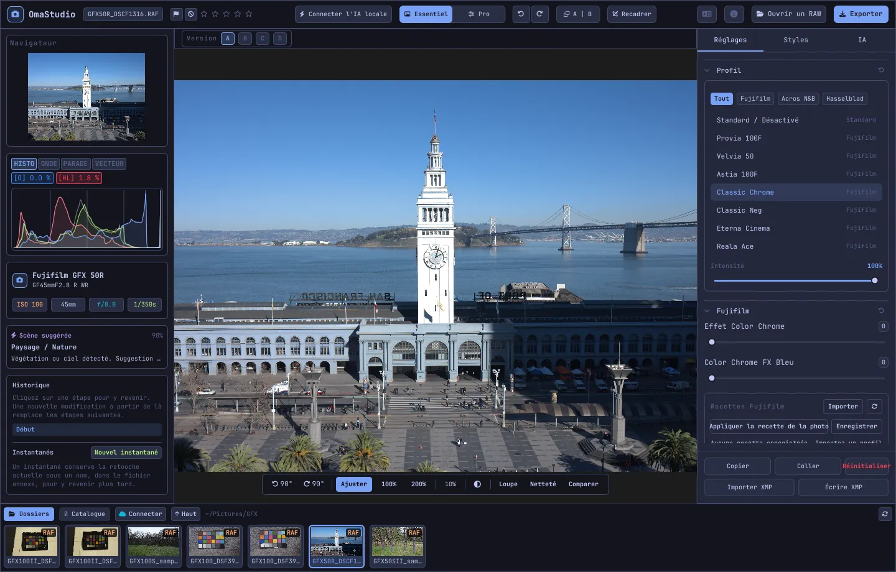

# Guide d'utilisation d'OmaStudio

**OmaStudio: The Complete Medium Format RAW Editor for Omarchy**

[Toutes les langues](../README.md) · [Technologies](../technology/fr.md) · [README](../../README.md)

Ce guide porte sur OmaStudio 3.1. Il explique comment installer l'application, s'orienter dans la fenêtre et utiliser chaque panneau et chaque outil. Les captures d'écran montrent des fichiers d'exemple Fujifilm GFX 50R et Hasselblad CFV-50c issus de [raw.pixls.us](https://raw.pixls.us) (CC0).



## Sommaire

1. [Installation](#1-installation)
2. [La fenêtre](#2-la-fenêtre)
3. [Ouvrir des photos et la bibliothèque](#3-ouvrir-des-photos-et-la-bibliothèque)
4. [Essentiel et Pro](#4-essentiel-et-pro)
5. [L'onglet Réglages](#5-longlet-réglages)
6. [L'onglet Masques](#6-longlet-masques)
7. [L'onglet Styles](#7-longlet-styles)
8. [L'onglet IA et la discussion IA](#8-longlet-ia-et-la-discussion-ia)
9. [Aides à l'affichage](#9-aides-à-laffichage)
10. [Historique, instantanés et versions](#10-historique-instantanés-et-versions)
11. [Fujifilm](#11-fujifilm)
12. [Moyen format](#12-moyen-format)
13. [Exportation](#13-exportation)
14. [Comptes cloud](#14-comptes-cloud)
15. [Clavier et souris](#15-clavier-et-souris)
16. [Ligne de commande, socket de contrôle et MCP](#16-ligne-de-commande-socket-de-contrôle-et-mcp)
17. [Fichiers et dossiers](#17-fichiers-et-dossiers)
18. [Dépannage](#18-dépannage)

## 1. Installation

OmaStudio fonctionne sous Omarchy (Arch Linux) avec Wayland et Hyprland.

**Depuis le paquet.** Dans une copie du dépôt :

```bash
makepkg -si
```

Cette commande installe `omastudio`, `omastudio-app`, `omastudio-engine`, les profils ICC, l'entrée de bureau, les icônes et une règle udev pour les appareils Fujifilm en USB.

**Depuis une archive de version.** Téléchargez `omastudio-<version>-x86_64-linux.tar.gz` sur la [page des versions](https://github.com/ozdil/omarchy-omastudio/releases), vérifiez-la avec `checksums.txt`, décompressez-la, puis copiez `bin/*` dans `~/.local/bin` et `share/omastudio` dans `~/.local/share/omastudio`.

**Paquets requis :** `libraw` 0.22 ou plus récent, `lcms2`, `qt6-base`, `qt6-declarative`, `qt6-wayland` et `qt6-svg` 6.12 ou plus récent, et `zenity` pour les boîtes de dialogue de fichiers.

**Paquets facultatifs :**

| Paquet | Utilisation |
| :--- | :--- |
| `vulkan-icd-loader` et le pilote Vulkan de votre GPU | Dématriçage sur le GPU |
| `perl-image-exiftool` | Conserver les métadonnées EXIF dans les fichiers exportés |
| `libwebp-utils`, `libheif`, `ffmpeg` | WebP avec pertes, HEIF et la solution de repli AVIF |
| `onnxruntime` | Masques IA locaux sur NPU, GPU ou CPU |
| `rclone`, `libsecret`, `gnome-keyring` | Google Drive, OneDrive, Dropbox, Box, pCloud et Yandex Disk |
| `github-cli` | Compte GitHub |
| `ollama` | Modèles d'IA locaux pour l'assistant de retouche |
| `quickshell` | Le bouton OmaStudio dans la barre d'Omarchy |

Lancez OmaStudio depuis le menu des applications d'Omarchy ou exécutez `omastudio` (avec une photo si vous le souhaitez : `omastudio DSCF0001.RAF`). Si une fenêtre est déjà ouverte, la photo s'ouvre dans cette fenêtre.

## 2. La fenêtre

| Zone | Contenu |
| :--- | :--- |
| Barre supérieure | Nom du fichier, marqueurs et note en étoiles, **Connecter l'IA locale**, le sélecteur **Essentiel** / **Pro**, annuler et rétablir, avant et après (**A \| B**), **Recadrer**, menu des langues, À propos, **Ouvrir un RAW** et **Exporter** |
| Panneau gauche | Navigateur, instruments de mesure (histogramme, forme d'onde, parade RVB, vectorscope) avec indicateurs d'écrêtage, informations sur l'appareil et l'objectif, la scène suggérée, l'historique et les instantanés |
| Centre | La photo, la barre des versions (A–D) au-dessus et la barre d'affichage en dessous : rotation, **Ajuster**, 100 %, 200 %, zoom actuel, couleur d'entourage, **Loupe**, **Netteté**, **Comparer** |
| Panneau droit | Les onglets **Réglages**, **Masques** (Pro), **Styles** et **IA**, et une rangée fixe avec **Copier**, **Coller**, **Réinitialiser**, **Importer XMP** et **Écrire XMP** |
| Pellicule | **Dossiers**, **Catalogue**, un onglet par compte cloud, **Connecter**, **Haut** et les photos du dossier courant |

**Tab** masque et affiche ensemble les deux panneaux latéraux et la pellicule. Chaque section se replie et se déplie depuis son en-tête ; **Ctrl+clic** sur un en-tête ne laisse ouverte que cette section. L'onglet ouvert, les sections repliées et les panneaux affichés sont conservés d'une session à l'autre.

Les couleurs, la police et l'arrondi des coins suivent en direct le thème Omarchy actif. Le fond autour de la photo est par défaut un gris foncé neutre, pour que le thème ne modifie pas la perception des couleurs ; le bouton d'entourage de la barre d'affichage passe au gris moyen ou à la couleur du thème.

| Tokyo Night | Catppuccin Latte | Gruvbox | Rosé Pine |
| :---: | :---: | :---: | :---: |
|  |  |  |  |

L'interface est disponible en 30 langues. Elle suit la langue du système ; le menu des langues de la barre supérieure en choisit une autre et l'applique aussitôt.

## 3. Ouvrir des photos et la bibliothèque

- **Ouvrir un RAW** (Ctrl+O) ouvre la boîte de dialogue de fichiers. Elle filtre par Photos, RAW ou Images.
- Faites glisser une photo ou un dossier depuis le gestionnaire de fichiers sur la fenêtre.
- Dans la pellicule, **Dossiers** liste le dossier courant ; cliquez sur un dossier pour y entrer et sur **Haut** pour revenir. Cliquez sur une photo pour l'ouvrir. Ctrl+← et Ctrl+→ passent à la photo précédente et suivante.
- **Catalogue** liste chaque photo qu'OmaStudio a vue, avec sa note, son marqueur et son étiquette de couleur.

OmaStudio ouvre tous les formats RAW que lit LibRaw 0.22 (Fujifilm, Hasselblad, Phase One, Leica, Pentax, Mamiya/Leaf, Canon, Nikon, Sony, Panasonic, Olympus, Sigma, DNG et autres), ainsi que JPEG, PNG, WebP, TIFF, HEIF/HEIC, AVIF, JPEG XL, OpenEXR, Radiance HDR et PNM.

**Notes et marqueurs.** 1 à 5 attribuent la note en étoiles et 0 l'efface. P marque comme retenue, X comme rejetée et U efface le marqueur. Notes et marqueurs sont enregistrés immédiatement dans le catalogue et le fichier annexe.

**Sélection.** Maj+clic sélectionne une plage dans la pellicule et Ctrl+clic ajoute ou retire une photo. Lorsque plusieurs photos sont sélectionnées, la fenêtre d'exportation les exporte toutes (**Lot**).

Vos fichiers d'origine ne sont jamais modifiés. Les retouches sont enregistrées au fil du travail dans un fichier annexe placé à côté de la photo, `<photo>.omastudio` (Ctrl+S enregistre immédiatement).

## 4. Essentiel et Pro

Le sélecteur de la barre supérieure détermine le nombre d'outils affichés.

- **Essentiel :** profil, Fujifilm, balance des blancs, tonalité, présence, préréglages et LUT 3D.
- **Pro** ajoute la courbe des tonalités, le mélangeur de couleurs, l'étalonnage des couleurs, détail et optique, la transformation, le grain, la gestion des couleurs et l'onglet **Masques**. Les sections Pro portent la mention « Pro ».

Revenir à Essentiel masque les sections Pro ; leurs réglages restent appliqués.


## 5. L'onglet Réglages

Chaque curseur se réinitialise par un double-clic. Le bouton de réinitialisation dans l'en-tête d'une section réinitialise toute la section.

### Profil

Le rendu de base : **Standard / Désactivé**, les simulations de film Fujifilm (Provia, Velvia, Astia, Classic Chrome, Classic Neg, Eterna, Eterna Bleach Bypass, Reala Ace, Nostalgic Neg, PRO Neg Std et Hi, Acros et Monochrome avec filtres jaune, rouge et vert, Sépia) et le profil de couleur naturel de style Hasselblad. Les onglets filtrent la liste. **Intensité** mélange le profil avec le rendu neutre.

### Fujifilm

**Effet Color Chrome** et **Color Chrome FX Bleu** (Faible = 50, Fort = 100) approfondissent les couleurs saturées, et les bleus pour FX Bleu, en conservant leur teinte. La bibliothèque de recettes, l'appareil en USB et le Pixel Shift sont décrits dans [Fujifilm](#11-fujifilm).

### Balance des blancs

**Température** (2000–12000 K) et **Teinte**, par rapport à la balance des blancs enregistrée par l'appareil. Une photo s'ouvre « telle que prise ».

### Tonalité

**Exposition** (−5 à +5 IL, sur la lumière linéaire : +1 IL double la lumière), **Contraste**, **Hautes lumières**, **Ombres**, **Blancs** et **Noirs**.

### Présence

**Texture**, **Clarté** (contraste des tons moyens), **Correction du voile**, **Vibrance** et **Saturation**.

### Courbe des tonalités (Pro)

Une courbe à points au-dessus de l'histogramme, pour RVB et pour le rouge, le vert et le bleu séparément. Cliquez pour ajouter un point, faites-le glisser pour le déplacer, double-cliquez pour le supprimer. La courbe ne dépasse jamais ses points. Les quatre curseurs de zones en dessous (Hautes lumières, Tons clairs, Tons foncés, Ombres) façonnent la courbe par zone.

### Mélangeur de couleurs (Pro)

Teinte, saturation et luminance pour huit couleurs : rouge, orange, jaune, vert, cyan, bleu, violet et magenta.


### Étalonnage des couleurs (Pro)

Des roues chromatiques à trois voies pour les ombres (lift), les tons moyens (gamma) et les hautes lumières (gain), plus un décalage global, sous forme de quatre roues ou d'onglets. **Renfort des couleurs**, **Détail des tons moyens** et **Pivot de contraste** se trouvent sous les roues. Le mélangeur de couches en dessous mélange le rouge, le vert et le bleu dans chaque canal de sortie, ou dans un mélange monochrome.


### Détail et optique (Pro)

**Netteté**, **Réduction du bruit** (luminance et couleur), **Vignettage**, **Suppression des franges** (aberration chromatique) et **Correction de la distorsion de l'objectif**. Les corrections d'objectif Fujifilm et DNG contenues dans le fichier sont appliquées automatiquement ; ces curseurs agissent en plus.

### Transformation (Pro)

**Vertical** redresse les lignes convergentes, par exemple un bâtiment photographié d'en bas ; **Horizontal** fait de même latéralement ; **Échelle** agrandit le résultat. Recadrez ensuite pour supprimer les bords vides.

### Grain (Pro)

**Quantité**, **Taille** et **Rugosité** du grain argentique.

### Gestion des couleurs (Pro)

- **Compression de gamut** ramène en douceur les couleurs poussées hors du gamut au lieu de les écrêter.
- **Courbe de tons ACES** est une atténuation filmique des hautes lumières, une approximation ajustée de la transformation de sortie ACES.
- **Épreuvage écran** (S) montre la photo telle qu'elle apparaîtra avec un profil de sortie, par exemple un profil d'imprimante et de papier. Choisissez le profil et le mode de rendu. **Alerte de gamut** peint en magenta les couleurs que le profil ne peut pas reproduire. La retouche et l'exportation ne changent pas.

L'espace colorimétrique de sortie se choisit dans la fenêtre d'exportation.


## 6. L'onglet Masques

L'onglet Masques s'affiche en mode Pro.

### Correction et clonage

Activez **Modifier les zones** et cliquez sur un défaut de la photo pour le supprimer. Il est remplacé à partir d'une source voisine. Faites glisser le cercle plein pour déplacer la zone et le cercle en pointillés pour choisir une autre source. **Corriger** adapte la zone copiée à la lumière et à la couleur autour du défaut ; **Cloner** la copie telle quelle. **Taille**, **Contour progressif** et **Opacité** s'appliquent à la zone sélectionnée et aux nouvelles.


### Réglages locaux

Chaque calque applique l'exposition, le contraste, les hautes lumières, les ombres, les blancs, les noirs et la saturation à travers un masque, avec une opacité.

| Masque | Comment il est créé |
| :--- | :--- |
| **Linéaire** | Un dégradé entre deux poignées sur la photo |
| **Radial** | Une ellipse avec un centre, des poignées de bord et un contour progressif |
| **Luminance** | Une plage de luminosité (plus sombre, plus clair, transition) |
| **Couleur** | Les couleurs proches d'une couleur prélevée sur la photo (plage et contour progressif) |
| **Pinceau** | Peint sur la photo, avec taille, contour progressif, flux et mode gomme ; le bouton central de la souris fait défiler |
| **Sujet IA**, **Ciel IA** | Un modèle de segmentation sur votre ordinateur (voir [IA](#8-longlet-ia-et-la-discussion-ia)) |

Sous **Combiner avec :**, d'autres parties peuvent être ajoutées au masque du calque, soustraites ou intersectées, et chaque partie peut être inversée.


## 7. L'onglet Styles

- **Préréglages :** **Auto** analyse la photo et règle l'exposition, la balance des blancs et la tonalité. Les styles Sourd, Éclatant, Portrait chaud, Noir et blanc, et Bleu canard et orange remplacent le style précédent au lieu de s'y ajouter ; balance des blancs, exposition, recadrage et simulation de film sont conservés.
- **LUT :** **Charger un fichier .cube…** applique une LUT 3D personnelle, avec une intensité.


## 8. L'onglet IA et la discussion IA

**Connecter l'IA locale** dans la barre supérieure utilise l'IA configurée sur cet ordinateur : l'agent par défaut d'Omarchy (Claude Code ou Codex, avec leur propre connexion), sinon Ollama, sinon LM Studio. Une fois connecté, le bouton ouvre la **Discussion IA** au-dessus de la photo : écrivez ce que vous voulez changer (« plus chaud, récupère le ciel ») et l'IA règle les curseurs. Ctrl+Z annule chaque retouche.

L'**Assistant de retouche** de l'onglet IA fait la même chose depuis le panneau et peut utiliser à la place un fournisseur cloud : Anthropic Claude, OpenAI, OpenRouter ou Google Gemini. Leurs clés d'API sont stockées dans le trousseau du système et ne sont jamais écrites sur le disque ni placées sur une ligne de commande. Avec un fournisseur cloud, ou avec Claude Code ou Codex, l'aperçu de la photo est envoyé à ce service ; avec Ollama ou LM Studio, il reste sur votre ordinateur.


**Masques IA.** **Sujet IA** et **Ciel IA** dans l'onglet Masques exécutent un modèle de segmentation ONNX sur cet ordinateur : d'abord sur un NPU (Intel Core Ultra via OpenVINO, Snapdragon X via QNN, AMD Ryzen AI via Vitis AI), puis sur un GPU, puis sur le CPU. Aucun modèle n'est fourni ni téléchargé. Placez un modèle dans `~/.local/share/omastudio/models` sous le nom `subject.onnx` ou `sky.onnx` ; `omastudio npu` indique ce qui est installé.

## 9. Aides à l'affichage

| Aide | Utilisation |
| :--- | :--- |
| Zoom | Molette à la position du pointeur ; **Ajuster** (Ctrl+0), **100 %** (Ctrl+1), **200 %** ; le double-clic bascule entre ajusté et 200 %. 100 % affiche un pixel de la photo par pixel d'écran quelle que soit la mise à l'échelle. |
| Défilement | Glisser avec le bouton gauche ou central ; Maj+molette fait défiler latéralement |
| Rotation | Les boutons de rotation de la barre d'affichage ; Alt+molette tourne par pas de 1,5° |
| Recadrer (C) | Rapports d'aspect (Original, 1:1, 4:5, 9:16, 16:9, Libre) et grilles (tiers, nombre d'or, spirale d'or) |
| Avant et après (Y, ou A \| B) | La photo partagée entre l'original et la retouche |
| Comparer (Maj+C) | La retouche à côté d'un autre état : Avant, une version ou un instantané |
| Loupe (L) | Un carré sous le pointeur montrant la photo en pleine résolution à 1:1 |
| Focus peaking (Maj+F) | Les contours les plus nets peints en vert ; uniquement une aide à l'affichage |
| Écrêtage | Cliquez sur **[S]** ou **[H]** au-dessus de l'histogramme pour afficher les ombres écrêtées en bleu et les hautes lumières en rouge |

| Focus peaking | Comparer |
| :---: | :---: |
|  |  |

| Recadrer | Avant et après |
| :---: | :---: |
|  |  |

Lorsque la photo est affichée plus grande que l'aperçu, le moteur calcule la zone visible à partir du fichier en pleine résolution ; les détails visibles correspondent donc à l'exportation.

## 10. Historique, instantanés et versions

- **Historique** dans le panneau gauche liste chaque étape de la retouche par son nom (« Exposure +0.70 », « Tone curve »). Cliquez sur une étape pour y revenir ; une nouvelle retouche à partir de là remplace les étapes suivantes, comme avec Ctrl+Z.
- **Instantanés** conservent la retouche actuelle sous un nom. **Rétablir** en ramène un sous forme de nouvelle étape que Ctrl+Z peut annuler. Les instantanés sont enregistrés dans le fichier annexe.
- **Versions A–D** au-dessus de la photo contiennent jusqu'à quatre retouches distinctes de la même photo. Cliquez sur une lettre pour changer (Alt+1 à Alt+4) ; un clic droit copie la retouche actuelle dans cette version.
- **Copier** et **Coller** (Ctrl+Maj+C, Ctrl+Maj+V) transfèrent une retouche à une autre photo. **Réinitialiser** (Ctrl+R) revient aux valeurs par défaut.
- **Écrire XMP** enregistre la retouche, la note et l'étiquette dans un fichier annexe `.xmp` que lisent Lightroom, Capture One, darktable et digiKam ; **Importer XMP** lit un fichier écrit par ces programmes.

## 11. Fujifilm

- **La recette de l'appareil.** Un RAF ou un JPEG Fujifilm s'ouvre avec les réglages de la prise de vue : simulation de film, tonalité, couleur, netteté, réduction du bruit, clarté, grain, Color Chrome, décalage de balance des blancs et plage dynamique (y compris D-Range Priority). Un fichier annexe enregistré est prioritaire.
- **Luminosité.** Les RAF s'ouvrent à la luminosité du JPEG de l'appareil.
- **Corrections d'objectif.** La distorsion, l'aberration chromatique latérale et le vignettage enregistrés par l'appareil sont appliqués pour les objectifs XF, XC et GF.
- **Bibliothèque de recettes.** **Importer** accepte un profil X RAW Studio (.FP1, .FP2, .FP3), un texte de recette (« Film Simulation: Classic Chrome / Grain Effect: Strong, Small … ») ou une photo Fujifilm. **Appliquer la recette** applique une recette enregistrée ; **Appliquer la recette de la photo** revient à celle du fichier ; **Enregistrer** conserve la recette actuelle.
- **Appareil en USB.** Réglez le mode USB de l'appareil sur USB RAW CONV./BACKUP RESTORE et branchez-le. **Lire C1–C7** affiche ses réglages personnalisés, **Écrire la recette dans C…** enregistre une recette dans un emplacement (ce qui remplace son contenu), et **Convertir dans l'appareil** développe le RAF ouvert dans l'appareil, éventuellement avec la recette sélectionnée.
- **Pixel Shift.** Sélectionnez dans la pellicule les images RAF d'une séquence Pixel Shift GFX et cliquez sur **Fusionner les images en DNG**. Quatre images donnent la couleur complète à chaque pixel ; seize images doublent la résolution.

## 12. Moyen format

- **Fujifilm GFX** (GFX 50S, 50R, 50S II, 100, 100S, 100 II et autres) : traitement 16 bits du capteur à l'exportation, simulations de film, corrections d'objectif et Pixel Shift.
- Les fichiers **Hasselblad** 3FR et FFF sont recadrés selon le recadrage par défaut de l'appareil.
- Les fichiers **Phase One et Leaf** IIQ et MOS reçoivent l'étalonnage propre au capteur du dos.
- Les fichiers **Mamiya** MEF et **Pentax 645** PEF sont pris en charge.
- **Champ plat (LCC) :** `omastudio-engine medium-format lcc-create <raw>` crée une correction à partir d'une prise de vue d'une cible blanche uniformément éclairée ; elle est appliquée aux photos de ce dossier.
- **Multi-shot :** `medium-format multishot f1 f2 f3 f4 --out merged.tif` fusionne une séquence de 4 prises.


## 13. Exportation

**Exporter** (E) ouvre la fenêtre d'exportation. Entrée exporte et Échap ferme.


| Réglage | Choix |
| :--- | :--- |
| Format | JPEG, PNG (8/16 bits), TIFF (8/16 bits, sans compression, LZW ou ZIP), WebP, AVIF (8/10/12 bits), HEIF (8/10/12 bits), JPEG XL (8/16 bits) et OpenEXR (demi ou pleine précision flottante, linéaire scène) |
| Qualité | 1–100 ; 100 est sans perte pour WebP, AVIF et JPEG XL |
| Taille | Complète, 75 %, 50 % ou un grand côté de 3840 ou 2048 px |
| Profil colorimétrique | sRGB, Display P3, Adobe RGB, ProPhoto RGB, Rec. 2020, ACEScg ou un profil ICC personnel |
| Mode de rendu | Perceptif, Relatif (par défaut), Saturation, Absolu |
| Métadonnées | Conserver les métadonnées de l'appareil (EXIF), supprimer la position (GPS) |
| Préparer pour | Recadrage et accentuation de sortie pour Instagram, Stories et Reels, X, Facebook, carré et miniatures YouTube |
| Filigrane | Texte avec balises EXIF ({camera}, {lens}, {iso}, {aperture}, {shutter}, {focal}) ou logo PNG, avec position, opacité, taille et ombre |
| Dossier et nom du fichier | Par défaut `~/Pictures/OmaStudio_Exports` ; une étiquette peut être ajoutée au nom du fichier |
| Envoyer vers | Un compte cloud connecté |

Tous les formats sauf OpenEXR contiennent le profil ICC de leur espace colorimétrique. Un lot exporte les photos sélectionnées l'une après l'autre.

## 14. Comptes cloud

**Connecter** dans la pellicule ajoute Google Drive, OneDrive, Dropbox, Box, pCloud, Yandex Disk ou GitHub. Vous vous connectez sur la page du service dans votre navigateur ; OmaStudio ne voit jamais votre mot de passe.


- Chaque compte reçoit un onglet dans la pellicule. Parcourez ses dossiers et cliquez sur une photo pour la télécharger (une fois) et l'ouvrir.
- Un dossier nommé `OmaStudio` est créé dans chaque compte (sur GitHub, un dépôt privé `OmaStudio`) et reçoit les envois de la fenêtre d'exportation.
- Les services de stockage passent par rclone avec une configuration propre à OmaStudio, chiffrée avec une clé conservée dans le trousseau du système. GitHub passe par GitHub CLI.
- Pour Google Drive, un ID client personnel issu de la Google Cloud Console peut être saisi sous **Votre propre ID client Google**.
- **Déconnecter** supprime de cet ordinateur les clés du compte et les copies téléchargées ; les fichiers du compte restent.

## 15. Clavier et souris

| Touche | Action |
| :--- | :--- |
| Ctrl+O | Ouvrir une photo |
| Ctrl+S | Enregistrer la retouche maintenant |
| Ctrl+Z / Ctrl+Maj+Z ou Ctrl+Y | Annuler / rétablir |
| Ctrl+Maj+C / Ctrl+Maj+V | Copier / coller la retouche |
| Ctrl+R | Réinitialiser la retouche |
| Ctrl+← / Ctrl+→ | Photo précédente / suivante |
| Ctrl+0 / Ctrl+1 | Ajuster / 100 % |
| 1–5, 0 | Note en étoiles, effacer la note |
| P, X, U | Retenir, rejeter, effacer le marqueur |
| C | Recadrer |
| Y | Avant et après |
| S | Épreuvage écran |
| L | Loupe |
| Maj+F | Focus peaking |
| Maj+C | Comparer |
| Alt+1 … Alt+4 | Versions A–D |
| E | Fenêtre d'exportation |
| Tab | Masquer ou afficher les panneaux |
| Échap | Fermer la fenêtre ouverte |

| Souris | Action |
| :--- | :--- |
| Molette | Zoom à la position du pointeur |
| Maj+molette | Défilement latéral |
| Alt+molette | Rotation |
| Glisser (bouton gauche ou central) | Défilement |
| Double-clic sur la photo | Ajuster ou 200 % |
| Ctrl+clic sur un en-tête de section | Ne laisser ouverte que cette section |
| Clic droit sur une lettre de version | Copier la retouche actuelle dans cette version |

## 16. Ligne de commande, socket de contrôle et MCP

**Commandes du moteur.** Chaque commande affiche un objet JSON, pour que les scripts et les agents puissent l'utiliser.

```bash
omastudio inspect DSCF0001.RAF                      # appareil, objectif, exposition, histogramme, scène
omastudio export DSCF0001.RAF --recipe '{"exposure":0.5}' --options '{"format":"jpeg"}'
omastudio fuji-recipe DSCF0001.RAF                  # la recette de l'appareil
omastudio fuji-pixel-shift DSCF*.RAF --out merged.dng
omastudio xmp export DSCF0001.RAF
omastudio cameras GFX                               # appareils pris en charge par le décodeur RAW
omastudio gpu                                       # GPU utilisé pour le dématriçage
omastudio npu                                       # ONNX Runtime et accélérateurs
omastudio cloud status
omastudio --cli help                                # toutes les commandes
```

**Socket de contrôle.** `omastudio ipc <méthode> [arguments]` communique avec la fenêtre ouverte, par exemple `openPhoto`, `openFolder`, `applyRecipe`, `applyPreset`, `setExposure`, `setWarmth`, `setMode essentials|pro`, `setRightTab`, `showSection`, `setView peaking|compare|softProof|split on|off`, `setZoom`, `showExport`, `showCloud`, `getStatus` et `screenshot <fichier.png>`. Le socket ne répond qu'au même utilisateur.

**MCP.** `omastudio mcp` est un serveur Model Context Protocol : les agents IA peuvent inspecter, calculer, trier et exporter des photos, lire les recettes Fujifilm et piloter la fenêtre ouverte. Pour Claude Code : `claude mcp add omastudio -- omastudio mcp`. `omastudio skill` installe la compétence d'agent dans `~/.claude/skills`.

## 17. Fichiers et dossiers

| Chemin | Contenu |
| :--- | :--- |
| `<photo>.omastudio` | La retouche d'une photo (fichier annexe) |
| `~/.local/share/omastudio/catalog.json` | Catalogue : notes, marqueurs et étiquettes de couleur |
| `~/.local/share/omastudio/fuji-recipes/` | Recettes Fujifilm enregistrées |
| `~/.local/share/omastudio/icc/` | Vos profils ICC |
| `~/.local/share/omastudio/models/` | Modèles d'IA locaux |
| `~/.local/share/omastudio/film-luts/` | LUT de simulation de film mesurées à partir de vos photos (`fuji-calibrate`) |
| `~/.config/omastudio/` | Réglages, état de l'interface, langue, comptes cloud |
| `~/.cache/omastudio/` | Vignettes, aperçus et photos cloud téléchargées |

## 18. Dépannage

- **La fenêtre ne s'ouvre pas.** Lancez `omastudio` dans un terminal et lisez le message. `omastudio --version` et `omastudio status` indiquent ce qui est installé.
- **Le GPU n'est pas utilisé.** `omastudio gpu` affiche le périphérique. Installez `vulkan-icd-loader` et le pilote Vulkan de votre GPU. `OMASTUDIO_GPU=off` force le CPU.
- **Un appareil n'est pas détecté en USB.** Réglez son mode USB sur USB RAW CONV./BACKUP RESTORE, rebranchez-le et vérifiez que la règle udev du paquet est installée.
- **Un service cloud demande un programme.** Installez le paquet indiqué par la boîte de dialogue, par exemple `sudo pacman -S rclone libsecret`.
- **Copier les infos système** dans la fenêtre À propos copie la version, le GPU et les informations Omarchy pour un rapport de bogue. Signalez les problèmes sur [github.com/ozdil/omarchy-omastudio/issues](https://github.com/ozdil/omarchy-omastudio/issues).
