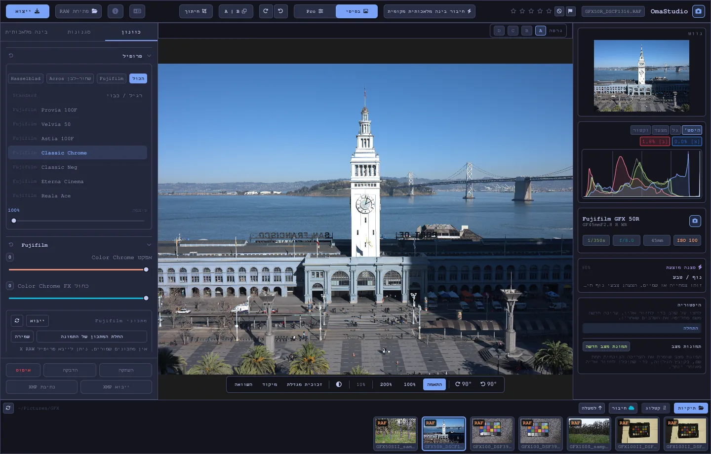

# מדריך למשתמש של OmaStudio

**OmaStudio: The Complete Medium Format RAW Editor for Omarchy**

[כל השפות](../README.md) · [טכנולוגיות](../technology/he.md) · [README](../../README.md)

המדריך עוסק ב־OmaStudio 3.1. הוא מסביר איך להתקין את היישום, איך להתמצא בחלון ואיך להשתמש בכל לוח ובכל כלי. צילומי המסך מציגים קובצי דוגמה של Fujifilm GFX 50R ו־Hasselblad CFV-50c מאתר [raw.pixls.us](https://raw.pixls.us) (CC0).



## תוכן העניינים

1. [התקנה](#1-התקנה)
2. [החלון](#2-החלון)
3. [פתיחת תמונות והספרייה](#3-פתיחת-תמונות-והספרייה)
4. [בסיסי ו־Pro](#4-בסיסי-וpro)
5. [הכרטיסייה כוונון](#5-הכרטיסייה-כוונון)
6. [הכרטיסייה מסכות](#6-הכרטיסייה-מסכות)
7. [הכרטיסייה סגנונות](#7-הכרטיסייה-סגנונות)
8. [הכרטיסייה בינה מלאכותית והשיחה עם הבינה המלאכותית](#8-הכרטיסייה-בינה-מלאכותית-והשיחה-עם-הבינה-המלאכותית)
9. [עזרי תצוגה](#9-עזרי-תצוגה)
10. [היסטוריה, תמונות מצב וגרסאות](#10-היסטוריה-תמונות-מצב-וגרסאות)
11. [Fujifilm](#11-fujifilm)
12. [פורמט בינוני](#12-פורמט-בינוני)
13. [ייצוא](#13-ייצוא)
14. [חשבונות ענן](#14-חשבונות-ענן)
15. [מקלדת ועכבר](#15-מקלדת-ועכבר)
16. [שורת הפקודה, שקע הבקרה ו־MCP](#16-שורת-הפקודה-שקע-הבקרה-וmcp)
17. [קבצים ותיקיות](#17-קבצים-ותיקיות)
18. [פתרון בעיות](#18-פתרון-בעיות)

## 1. התקנה

OmaStudio פועל ב־Omarchy (Arch Linux) תחת Wayland ו־Hyprland.

**מהחבילה.** בעותק משוכפל של המאגר:

```bash
makepkg -si
```

הפקודה מתקינה את `omastudio`, `omastudio-app`, `omastudio-engine`, פרופילי ICC, רשומת שולחן העבודה, הסמלים וכלל udev למצלמות Fujifilm המחוברות ב־USB.

**מארכיון גרסה.** הורידו את `omastudio-<version>-x86_64-linux.tar.gz` מ[דף הגרסאות](https://github.com/ozdil/omarchy-omastudio/releases), בדקו אותו מול `checksums.txt`, חלצו אותו והעתיקו את `bin/*` אל `~/.local/bin` ואת `share/omastudio` אל `~/.local/share/omastudio`.

**חבילות נדרשות:** `libraw` 0.22 ומעלה, `lcms2`, `qt6-base`, `qt6-declarative`, `qt6-wayland` ו־`qt6-svg` 6.12 ומעלה, ו־`zenity` לחלונות בחירת הקבצים.

**חבילות רשות:**

| חבילה | משמשת ל־ |
| :--- | :--- |
| `vulkan-icd-loader` ומנהל ההתקן של Vulkan לכרטיס הגרפי | פענוח פסיפס ב־GPU |
| `perl-image-exiftool` | שמירת מטא־נתוני EXIF בקבצים המיוצאים |
| `libwebp-utils`, `libheif`, `ffmpeg` | WebP עם אובדן, HEIF וחלופת הגיבוי של AVIF |
| `onnxruntime` | מסכות בינה מלאכותית מקומיות ב־NPU, ב־GPU או במעבד |
| `rclone`, `libsecret`, `gnome-keyring` | Google Drive, OneDrive, Dropbox, Box, pCloud ו־Yandex Disk |
| `github-cli` | חשבון GitHub |
| `ollama` | מודלי בינה מלאכותית מקומיים לעוזר העריכה |
| `quickshell` | הכפתור של OmaStudio בסרגל של Omarchy |

הפעילו את OmaStudio מתפריט היישומים של Omarchy, או הריצו `omastudio` (אפשר גם עם תמונה: `omastudio DSCF0001.RAF`). אם חלון כבר פתוח, התמונה נפתחת בו.

## 2. החלון

| אזור | מה יש בו |
| :--- | :--- |
| הסרגל העליון | שם הקובץ, דגלים ודירוג כוכבים, **חיבור בינה מלאכותית מקומית**, המתג **בסיסי** ו־**Pro**, ביטול וביצוע מחדש, לפני ואחרי (**A \| B**), **חיתוך**, תפריט השפה, אודות, **פתיחת RAW** ו־**ייצוא** |
| הלוח השמאלי | נווט, תרשימים (היסטוגרמה, צורת גל, RGB parade, וקטורסקופ) עם מחווני חיתוך, פרטי המצלמה והעדשה, הסצנה המוצעת, היסטוריה ותמונות מצב |
| המרכז | התמונה, סרגל הגרסאות (A–D) מעליה וסרגל התצוגה מתחתיה: סיבוב, **התאמה**, 100%, 200%, הזום הנוכחי, צבע הסביבה, **זכוכית מגדלת**, **מיקוד**, **השוואה** |
| הלוח הימני | הכרטיסיות **כוונון**, **מסכות** (Pro), **סגנונות** ו־**בינה מלאכותית**, ושורה קבועה עם **העתקה**, **הדבקה**, **איפוס**, **ייבוא XMP** ו־**כתיבת XMP** |
| רצועת התמונות | **תיקיות**, **קטלוג**, כרטיסייה לכל חשבון ענן, **חיבור**, **למעלה**, והתמונות של התיקייה הנוכחית |

**Tab** מסתיר ומציג יחד את שני הלוחות הצדדיים ואת רצועת התמונות. כל מקטע בלוח נפתח ונסגר מהכותרת שלו; **Ctrl+לחיצה** על כותרת משאירה פתוח רק את המקטע הזה. הכרטיסייה הפתוחה, המקטעים המקופלים והלוחות המוצגים נשמרים בין הפעלות.

הצבעים, הגופן ועיגול הפינות עוקבים אחרי ערכת הנושא הפעילה של Omarchy, בזמן אמת. האזור שסביב התמונה אפור כהה ניטרלי כברירת מחדל, כדי שערכת הנושא לא תשנה את מראה הצבעים; כפתור הסביבה בסרגל התצוגה מחליף לאפור בינוני או לצבע של ערכת הנושא.

| Tokyo Night | Catppuccin Latte | Gruvbox | Rosé Pine |
| :---: | :---: | :---: | :---: |
|  |  |  |  |

הממשק זמין ב־30 שפות. הוא עוקב אחרי שפת המערכת; תפריט השפה בסרגל העליון בוחר שפה אחרת ומחיל אותה מיד. בעברית, בערבית ובפרסית הממשק מוצג מימין לשמאל.

## 3. פתיחת תמונות והספרייה

- **פתיחת RAW** (Ctrl+O) פותח את חלון בחירת הקבצים, עם סינון לפי תמונות, RAW או תמונות רגילות.
- גררו תמונה או תיקייה ממנהל הקבצים אל החלון.
- ברצועת התמונות, **תיקיות** מציג את התיקייה הנוכחית; לחצו על תיקייה כדי להיכנס אליה ועל **למעלה** כדי לחזור. לחצו על תמונה כדי לפתוח אותה. Ctrl+← ו־Ctrl+→ עוברים לתמונה הקודמת ולבאה.
- **קטלוג** מציג כל תמונה ש־OmaStudio ראה, עם הדירוג, הדגל ותווית הצבע שלה.

OmaStudio פותח כל פורמט RAW ש־LibRaw 0.22 קורא (Fujifilm, Hasselblad, Phase One, Leica, Pentax, Mamiya/Leaf, Canon, Nikon, Sony, Panasonic, Olympus, Sigma, DNG ועוד), וגם JPEG, PNG, WebP, TIFF, HEIF/HEIC, AVIF, JPEG XL, OpenEXR, Radiance HDR ו־PNM.

**דירוג ודגלים.** המקשים 1 עד 5 קובעים את דירוג הכוכבים ו־0 מנקה אותו. P מסמן בחירה, X דחייה ו־U מנקה את הדגל. הדירוג והדגלים נשמרים בקטלוג ובקובץ הצד מיד.

**בחירה.** Shift+לחיצה בוחרת טווח ברצועת התמונות ו־Ctrl+לחיצה מוסיפה או מסירה תמונה. כשנבחרה יותר מתמונה אחת, חלון הייצוא מייצא את כולן (**אצווה**).

הקבצים המקוריים שלכם לעולם אינם משתנים. העריכות נשמרות ליד התמונה בקובץ צד, `<photo>.omastudio`, תוך כדי עבודה (Ctrl+S שומר מיד).

## 4. בסיסי ו־Pro

המתג בסרגל העליון קובע כמה כלים מוצגים.

- **בסיסי:** פרופיל, Fujifilm, איזון לבן, טון, נוכחות, הגדרות קבועות מראש ו־3D LUT.
- **Pro** מוסיף עקומת טונים, מערבל צבעים, דירוג צבע, פרטים ואופטיקה, התמרה, גרעיניות, ניהול צבע ואת הכרטיסייה **מסכות**. מקטעי Pro מסומנים בתג "Pro".

חזרה למצב בסיסי מסתירה את מקטעי Pro; ההגדרות שלהם נשארות בתוקף.


## 5. הכרטיסייה כוונון

כל מחוון מתאפס בלחיצה כפולה עליו. כפתור האיפוס בכותרת המקטע מאפס את כל המקטע.

### פרופיל

המראה הבסיסי: **רגיל / כבוי**, הדמיות הפילם של Fujifilm (Provia, Velvia, Astia, Classic Chrome, Classic Neg, Eterna, Eterna Bleach Bypass, Reala Ace, Nostalgic Neg, PRO Neg Std ו־Hi, Acros ו־Monochrome עם מסנן צהוב, אדום וירוק, Sepia) ופרופיל צבע טבעי בסגנון Hasselblad. הכרטיסיות מסננות את הרשימה. **עוצמה** ממזגת את הפרופיל עם העיבוד הניטרלי.

### Fujifilm

**אפקט Color Chrome** ו־**Color Chrome FX כחול** (חלש = 50, חזק = 100) מעמיקים צבעים רוויים, ובמקרה של FX כחול את הכחולים, תוך שמירה על הגוון שלהם. ספריית המתכונים, המצלמה ב־USB והזזת הפיקסלים מתוארות בפרק [Fujifilm](#11-fujifilm).

### איזון לבן

**טמפרטורה** (2000–12000 K) ו־**גוון**, ביחס לאיזון הלבן שהמצלמה רשמה. התמונה נפתחת במצב "כפי שצולם".

### טון

**חשיפה** (‎−5 עד ‎+5 EV, על אור ליניארי: ‎+1 EV מכפיל את האור), **ניגודיות**, **בהירים**, **צללים**, **לבנים** ו־**שחורים**.

### נוכחות

**מרקם**, **בהירות פרטים** (ניגודיות גוונים בינוניים), **הסרת אובך**, **חיוניות** ו־**רוויה**.

### עקומת טונים (Pro)

עקומת נקודות מעל ההיסטוגרמה, ל־RGB ולאדום, לירוק ולכחול בנפרד. לחצו כדי להוסיף נקודה, גררו כדי להזיז אותה ולחצו לחיצה כפולה כדי להסיר אותה. העקומה לעולם אינה חורגת מהנקודות שלה. ארבעת מחווני האזורים שמתחת (בהירים, בהירים־בינוניים, כהים־בינוניים, צללים) מעצבים את העקומה לפי אזור.

### מערבל צבעים (Pro)

גוון, רוויה ובהירות לשמונה צבעים: אדום, כתום, צהוב, ירוק, טורקיז, כחול, סגול ומג'נטה.


### דירוג צבע (Pro)

גלגלי צבע תלת־כיווניים לצללים (lift), לגוונים הבינוניים (gamma) ולבהירים (gain), ועוד היסט כללי, כארבעה גלגלים או ככרטיסיות. מתחת לגלגלים נמצאים **הגברת צבע**, **פירוט גוונים בינוניים** ו־**ציר הניגודיות**. מערבל הערוצים שמתחתם מערבב אדום, ירוק וכחול לכל ערוץ פלט, או לערבוב מונוכרום.


### פרטים ואופטיקה (Pro)

**חידוד**, **הפחתת רעש** (בהירות וצבע), **הצללת שוליים**, **הסרת שוליים צבעוניים** (סטייה כרומטית) ו־**תיקון עיוות עדשה**. תיקוני העדשה של Fujifilm ו־DNG מתוך הקובץ מוחלים אוטומטית; המחוונים האלה פועלים מעליהם.

### התמרה (Pro)

**אנכי** מיישר קווים מתכנסים, כמו בניין שצולם מלמטה; **אופקי** עושה אותו דבר לרוחב; **קנה מידה** מגדיל את התוצאה. לאחר מכן חתכו את התמונה כדי להסיר את השוליים הריקים.

### גרעיניות (Pro)

**עוצמה**, **גודל** ו־**חספוס** של גרעיניות הפילם.

### ניהול צבע (Pro)

- **דחיסת סולם צבעים** מחזירה פנימה בעדינות צבעים שנדחפו אל מחוץ לטווח, במקום לחתוך אותם.
- **עקומת טונים ACES** היא דעיכה קולנועית של הבהירים, קירוב מותאם של התמרת הפלט של ACES.
- **הגהה על המסך (S)** מציגה את התמונה כפי שתיראה עם פרופיל פלט, למשל פרופיל של מדפסת ונייר. בחרו את הפרופיל ואת כוונת העיבוד. **אזהרת טווח צבעים** צובעת במג'נטה צבעים שהפרופיל אינו יכול לשחזר. העריכה והייצוא אינם משתנים.

מרחב הצבע של הפלט עצמו נבחר בחלון הייצוא.


## 6. הכרטיסייה מסכות

הכרטיסייה מסכות מוצגת במצב Pro.

### ריפוי ושכפול

הפעילו את **עריכת נקודות** ולחצו על כתם בתמונה כדי להסיר אותו. הכתם מוחלף ממקור שלידו. גררו את העיגול המלא כדי להזיז את הכתם ואת העיגול המקווקו כדי לבחור מקור אחר. **ריפוי** מתאים את האזור המועתק לאור ולצבע שסביב הכתם; **שכפול** מעתיק אותו כמו שהוא. **גודל**, **ריכוך שוליים** ו־**אטימות** חלים על הכתם הנבחר ועל כתמים חדשים.


### כוונונים מקומיים

כל שכבה מחילה חשיפה, ניגודיות, בהירים, צללים, לבנים, שחורים ורוויה דרך מסכה, עם אטימות.

| מסכה | איך היא נוצרת |
| :--- | :--- |
| **ליניארי** | מעבר הדרגתי בין שתי ידיות על התמונה |
| **רדיאלי** | אליפסה עם מרכז, ידיות בשוליים וריכוך |
| **בהירות** | טווח בהירות (הכהה ביותר, הבהיר ביותר, דעיכה) |
| **צבע** | צבעים קרובים לצבע שנדגם מהתמונה (טווח וריכוך) |
| **מכחול** | נצבע על התמונה, עם גודל, ריכוך, זרימה ומצב מחיקה; לחצן העכבר האמצעי מזיז את התמונה |
| **נושא (בינה מלאכותית)**, **שמיים (בינה מלאכותית)** | מודל פילוח במחשב שלכם (ראו [בינה מלאכותית](#8-הכרטיסייה-בינה-מלאכותית-והשיחה-עם-הבינה-המלאכותית)) |

תחת **שילוב עם:** אפשר להוסיף חלקים נוספים למסכת השכבה, לחסר אותם ממנה או לחתוך אותם איתה, וכל חלק אפשר להפוך.


## 7. הכרטיסייה סגנונות

- **הגדרות קבועות מראש:** **אוטומטי** מנתח את התמונה וקובע חשיפה, איזון לבן וטון. הסגנונות מעומעם, עז, דיוקן חם, שחור־לבן וטורקיז וכתום מחליפים את הסגנון הקודם במקום להוסיף עליו; איזון הלבן, החשיפה, החיתוך והדמיית הפילם נשארים.
- **LUT:** **טעינת קובץ ‎.cube…** מחילה 3D LUT משלכם, עם עוצמה.


## 8. הכרטיסייה בינה מלאכותית והשיחה עם הבינה המלאכותית

**חיבור בינה מלאכותית מקומית** בסרגל העליון משתמש בבינה המלאכותית שמוגדרת במחשב הזה: סוכן ברירת המחדל של Omarchy ‏(Claude Code או Codex, עם הכניסה שלהם), אחרת Ollama, אחרת LM Studio. אחרי החיבור, הכפתור פותח את **שיחה עם הבינה המלאכותית** מעל התמונה: כתבו מה תרצו לשנות ("חם יותר, להחזיר את השמיים") והבינה המלאכותית תקבע את הכוונונים. Ctrl+Z מבטל כל עריכה.

**עוזר עריכה** בכרטיסייה בינה מלאכותית עושה אותו דבר מתוך הלוח, ויכול להשתמש במקום זאת בספק ענן: Anthropic Claude, ‏OpenAI, ‏OpenRouter או Google Gemini. מפתחות ה־API שלהם נשמרים במחזיק המפתחות של המערכת, ולעולם אינם נכתבים לדיסק או מועברים בשורת פקודה. עם ספק ענן או עם Claude Code או Codex, תצוגה מקדימה של התמונה נשלחת לשירות הזה; עם Ollama או LM Studio היא נשארת במחשב שלכם.


**מסכות בינה מלאכותית.** **נושא (בינה מלאכותית)** ו־**שמיים (בינה מלאכותית)** בכרטיסייה מסכות מריצים מודל פילוח ONNX במחשב הזה: קודם ב־NPU ‏(Intel Core Ultra דרך OpenVINO, ‏Snapdragon X דרך QNN, ‏AMD Ryzen AI דרך Vitis AI), אחר כך ב־GPU ואז במעבד. שום מודל אינו מצורף או מורד. שימו מודל ב־`~/.local/share/omastudio/models` בשם `subject.onnx` או `sky.onnx`; הפקודה `omastudio npu` מציגה מה מותקן.

## 9. עזרי תצוגה

| עזר | איך משתמשים בו |
| :--- | :--- |
| זום | גלגלת העכבר במיקום הסמן; **התאמה** (Ctrl+0), **100%** (Ctrl+1), **200%**; לחיצה כפולה מחליפה בין התאמה ל־200%. ב־100% פיקסל אחד של התמונה מוצג בפיקסל אחד של המסך בכל קנה מידה של התצוגה. |
| הזזה | גרירה בלחצן העכבר השמאלי או האמצעי; Shift+גלגלת מזיזה לרוחב |
| סיבוב | כפתורי הסיבוב בסרגל התצוגה; Alt+גלגלת מסובבת בצעדים של 1.5° |
| חיתוך (C) | יחסי גובה־רוחב מוכנים (מקורי, 1:1, 4:5, 9:16, 16:9, חופשי) ורשתות (שלישים, יחס הזהב, ספירלת הזהב) |
| לפני ואחרי (Y, או A \| B) | התמונה מחולקת בין המקור לעריכה |
| השוואה (Shift+C) | העריכה לצד מצב אחר: לפני, גרסה או תמונת מצב |
| זכוכית מגדלת (L) | ריבוע מתחת לסמן שמציג את התמונה ברזולוציה מלאה ביחס 1:1 |
| הדגשת מיקוד (Shift+F) | הקצוות החדים ביותר נצבעים בירוק; עזר תצוגה בלבד |
| חיתוך ערכים | לחצו על **[S]** או **[H]** מעל ההיסטוגרמה כדי להציג צללים חתוכים בכחול ובהירים חתוכים באדום |

| הדגשת מיקוד | השוואה |
| :---: | :---: |
|  |  |

| חיתוך | לפני ואחרי |
| :---: | :---: |
|  |  |

כשהתמונה מוצגת גדולה יותר מהתצוגה המקדימה, המנוע מעבד את האזור הנראה מהקובץ ברזולוציה מלאה, כך שהפרטים שאתם רואים תואמים לייצוא.

## 10. היסטוריה, תמונות מצב וגרסאות

- **היסטוריה** בלוח השמאלי מציגה כל שלב בעריכה בשמו ("Exposure +0.70", "Tone curve"). לחצו על שלב כדי לחזור אליו; עריכה חדשה משם מחליפה את השלבים שאחריו, כמו עם Ctrl+Z.
- **תמונות מצב** שומרות את העריכה הנוכחית תחת שם. **שחזור** מחזיר אחת מהן כשלב חדש ש־Ctrl+Z יכול לבטל. תמונות המצב נשמרות בקובץ הצד.
- **הגרסאות A–D** מעל התמונה מחזיקות עד ארבע עריכות נפרדות של אותה תמונה. לחצו על אות כדי לעבור (Alt+1 עד Alt+4); לחיצה ימנית מעתיקה את העריכה הנוכחית לגרסה הזו.
- **העתקה** ו־**הדבקה** (Ctrl+Shift+C, ‏Ctrl+Shift+V) מעבירות עריכה לתמונה אחרת. **איפוס** (Ctrl+R) מחזיר לברירות המחדל.
- **כתיבת XMP** שומרת את העריכה, הדירוג והתווית בקובץ צד `.xmp` ש־Lightroom, ‏Capture One, ‏darktable ו־digiKam קוראים; **ייבוא XMP** קורא קובץ שהתוכנות האלה כתבו.

## 11. Fujifilm

- **המתכון של המצלמה.** קובץ RAF או JPEG של Fujifilm נפתח עם ההגדרות שבהן צולם: הדמיית פילם, טון, צבע, חדות, הפחתת רעש, בהירות פרטים, גרעיניות, Color Chrome, היסט איזון הלבן וטווח דינמי (כולל D-Range Priority). לקובץ צד שמור יש עדיפות.
- **בהירות.** קובצי RAF נפתחים בבהירות של קובץ ה־JPEG של המצלמה עצמה.
- **תיקוני עדשה.** עיוות, סטייה כרומטית רוחבית והצללת שוליים שהמצלמה רשמה מוחלים לעדשות XF, ‏XC ו־GF.
- **ספריית מתכונים.** **ייבוא** מקבל פרופיל של X RAW Studio ‏(‎.FP1, ‎.FP2, ‎.FP3), טקסט של מתכון ("Film Simulation: Classic Chrome / Grain Effect: Strong, Small …") או תמונה של Fujifilm. **החלת מתכון** מחילה מתכון שמור; **החלת המתכון של התמונה** חוזרת למתכון שבקובץ; **שמירה** שומרת את המתכון הנוכחי.
- **מצלמה ב־USB.** הגדירו את מצב ה־USB של המצלמה ל־USB RAW CONV./BACKUP RESTORE וחברו אותה. **קריאת C1–C7** מציגה את ההגדרות המותאמות שלה, **כתיבת המתכון ל־C…** שומרת מתכון בחריץ (ומחליפה את מה שיש בו), ו־**המרה במצלמה** מפתחת את ה־RAF הפתוח בתוך המצלמה, ואפשר גם עם המתכון הנבחר.
- **הזזת פיקסלים.** בחרו ברצועת התמונות את פריימי ה־RAF של רצף Pixel Shift אחד של GFX ולחצו על **מיזוג פריימים ל־DNG**. ארבעה פריימים נותנים צבע מלא בכל פיקסל; שישה־עשר פריימים מכפילים את הרזולוציה.

## 12. פורמט בינוני

- **Fujifilm GFX** ‏(GFX 50S, 50R, 50S II, 100, 100S, 100 II ואחרות): צנרת של 16 סיביות מהחיישן ועד הייצוא, הדמיות פילם, תיקוני עדשה והזזת פיקסלים.
- קובצי 3FR ו־FFF של **Hasselblad** נחתכים לפי חיתוך ברירת המחדל של המצלמה.
- קובצי IIQ ו־MOS של **Phase One ו־Leaf** מקבלים את כיול החיישן של הגב הדיגיטלי עצמו.
- קובצי MEF של **Mamiya** ו־PEF של **Pentax 645** נתמכים.
- **שדה שטוח (LCC):** ‏`omastudio-engine medium-format lcc-create <raw>` יוצר תיקון מצילום של מטרה לבנה מוארת באופן אחיד; התיקון מוחל על התמונות של אותה תיקייה.
- **ריבוי צילומים:** ‏`medium-format multishot f1 f2 f3 f4 --out merged.tif` ממזג רצף של 4 צילומים.


## 13. ייצוא

**ייצוא** (E) פותח את חלון הייצוא. Enter מייצא ו־Esc סוגר.


| הגדרה | אפשרויות |
| :--- | :--- |
| תבנית קובץ | JPEG, ‏PNG (8/16 סיביות), TIFF (8/16 סיביות, ללא דחיסה, דחיסת LZW או ZIP), WebP, ‏AVIF (8/10/12 סיביות), HEIF (8/10/12 סיביות), JPEG XL (8/16 סיביות) ו־OpenEXR ‏(half או full float, ‏scene-linear) |
| איכות | 1–100; הערך 100 ללא אובדן ב־WebP, ‏AVIF ו־JPEG XL |
| גודל | מלא, 75%, 50%, או צלע ארוכה של 3840 או 2048 px |
| פרופיל צבע | sRGB, ‏Display P3, ‏Adobe RGB, ‏ProPhoto RGB, ‏Rec. 2020, ‏ACEScg, או פרופיל ICC משלכם |
| כוונת עיבוד | תפיסתית, יחסית (ברירת מחדל), רוויה, מוחלטת |
| מטא־נתונים | שמירת מטא־נתוני המצלמה (EXIF), הסרת מיקום (GPS) |
| הכנה עבור | חיתוך וחידוד פלט ל־Instagram, ‏Stories ו־Reels, ‏X, ‏Facebook, ריבוע ותמונות ממוזערות של YouTube |
| סימן מים | טקסט עם תגי EXIF ‏({camera}, {lens}, {iso}, {aperture}, {shutter}, {focal}) או לוגו PNG, עם מיקום, אטימות, גודל וצל |
| תיקייה ושם קובץ | ברירת המחדל `~/Pictures/OmaStudio_Exports`; אפשר להוסיף תג לשם הקובץ |
| העלאה אל | חשבון ענן מחובר |

כל התבניות מלבד OpenEXR נושאות את פרופיל ה־ICC של מרחב הצבע שלהן. אצווה מייצאת את התמונות הנבחרות זו אחר זו.

## 14. חשבונות ענן

**חיבור** ברצועת התמונות מוסיף Google Drive, ‏OneDrive, ‏Dropbox, ‏Box, ‏pCloud, ‏Yandex Disk או GitHub. ההתחברות נעשית בדף של השירות עצמו בדפדפן; OmaStudio לעולם אינו רואה את הסיסמה שלכם.


- כל חשבון מקבל כרטיסייה ברצועת התמונות. עיינו בתיקיות שלו ולחצו על תמונה כדי להוריד אותה (פעם אחת) ולפתוח אותה.
- בכל חשבון נוצרת תיקייה בשם `OmaStudio` (ב־GitHub מאגר פרטי `OmaStudio`) שמקבלת את ההעלאות מחלון הייצוא.
- שירותי האחסון עוברים דרך rclone עם תצורה משלו של OmaStudio, מוצפנת במפתח שנשמר במחזיק המפתחות של המערכת. GitHub עובר דרך GitHub CLI.
- ב־Google Drive אפשר להזין מזהה לקוח משלכם מ־Google Cloud Console תחת **מזהה לקוח Google משלכם**.
- **ניתוק** מסיר מהמחשב הזה את מפתחות החשבון ואת העותקים שהורדו; הקבצים בחשבון נשארים.

## 15. מקלדת ועכבר

| מקש | פעולה |
| :--- | :--- |
| Ctrl+O | פתיחת תמונה |
| Ctrl+S | שמירת העריכה עכשיו |
| Ctrl+Z / Ctrl+Shift+Z או Ctrl+Y | ביטול / ביצוע מחדש |
| Ctrl+Shift+C / Ctrl+Shift+V | העתקה / הדבקה של העריכה |
| Ctrl+R | איפוס העריכה |
| Ctrl+← / Ctrl+→ | התמונה הקודמת / הבאה |
| Ctrl+0 / Ctrl+1 | התאמה / 100% |
| 1–5, 0 | דירוג כוכבים, ניקוי הדירוג |
| P, X, U | בחירה, דחייה, ניקוי הדגל |
| C | חיתוך |
| Y | לפני ואחרי |
| S | הגהה על המסך |
| L | זכוכית מגדלת |
| Shift+F | הדגשת מיקוד |
| Shift+C | השוואה |
| Alt+1 … Alt+4 | הגרסאות A–D |
| E | חלון הייצוא |
| Tab | הסתרה או הצגה של הלוחות |
| Esc | סגירת החלון הפתוח |

| עכבר | פעולה |
| :--- | :--- |
| גלגלת | זום במיקום הסמן |
| Shift+גלגלת | הזזה לרוחב |
| Alt+גלגלת | סיבוב |
| גרירה (לחצן שמאלי או אמצעי) | הזזה |
| לחיצה כפולה על התמונה | התאמה או 200% |
| Ctrl+לחיצה על כותרת מקטע | השארת המקטע הזה בלבד פתוח |
| לחיצה ימנית על אות של גרסה | העתקת העריכה הנוכחית לגרסה הזו |

## 16. שורת הפקודה, שקע הבקרה ו־MCP

**פקודות המנוע.** כל פקודה מדפיסה אובייקט JSON אחד, כך שסקריפטים וסוכנים יכולים להשתמש בה.

```bash
omastudio inspect DSCF0001.RAF                      # camera, lens, exposure, histogram, scene
omastudio export DSCF0001.RAF --recipe '{"exposure":0.5}' --options '{"format":"jpeg"}'
omastudio fuji-recipe DSCF0001.RAF                  # the camera's recipe
omastudio fuji-pixel-shift DSCF*.RAF --out merged.dng
omastudio xmp export DSCF0001.RAF
omastudio cameras GFX                               # cameras the RAW decoder supports
omastudio gpu                                       # GPU used for demosaicing
omastudio npu                                       # ONNX Runtime and accelerators
omastudio cloud status
omastudio --cli help                                # every command
```

**שקע הבקרה.** ‏`omastudio ipc <method> [arguments]` מדבר עם החלון הפתוח, למשל `openPhoto`, `openFolder`, `applyRecipe`, `applyPreset`, `setExposure`, `setWarmth`, `setMode essentials|pro`, `setRightTab`, `showSection`, `setView peaking|compare|softProof|split on|off`, `setZoom`, `showExport`, `showCloud`, `getStatus` ו־`screenshot <file.png>`. השקע עונה רק לאותו משתמש.

**MCP.** ‏`omastudio mcp` הוא שרת Model Context Protocol, כך שסוכני בינה מלאכותית יכולים לבחון, לעבד, למיין ולייצא תמונות, לקרוא מתכוני Fujifilm ולשלוט בחלון הפתוח. ב־Claude Code: ‏`claude mcp add omastudio -- omastudio mcp`. ‏`omastudio skill` מתקין את מיומנות הסוכן ב־`~/.claude/skills`.

## 17. קבצים ותיקיות

| נתיב | תוכן |
| :--- | :--- |
| `<photo>.omastudio` | העריכה של תמונה (קובץ צד) |
| `~/.local/share/omastudio/catalog.json` | הקטלוג: דירוגים, דגלים ותוויות צבע |
| `~/.local/share/omastudio/fuji-recipes/` | מתכוני Fujifilm שמורים |
| `~/.local/share/omastudio/icc/` | פרופילי ICC משלכם |
| `~/.local/share/omastudio/models/` | מודלי בינה מלאכותית מקומיים |
| `~/.local/share/omastudio/film-luts/` | טבלאות LUT של הדמיות פילם שנמדדו מהתמונות שלכם (`fuji-calibrate`) |
| `~/.config/omastudio/` | הגדרות, מצב הממשק, שפה, חשבונות ענן |
| `~/.cache/omastudio/` | תמונות ממוזערות, תצוגות מקדימות ותמונות שהורדו מהענן |

## 18. פתרון בעיות

- **החלון אינו נפתח.** הריצו `omastudio` במסוף וקראו את ההודעה. ‏`omastudio --version` ו־`omastudio status` מציגים מה מותקן.
- **ה־GPU אינו בשימוש.** ‏`omastudio gpu` מציג את ההתקן. התקינו את `vulkan-icd-loader` ואת מנהל ההתקן של Vulkan לכרטיס הגרפי. ‏`OMASTUDIO_GPU=off` מאלץ שימוש במעבד.
- **מצלמה אינה מזוהה ב־USB.** הגדירו את מצב ה־USB שלה ל־USB RAW CONV./BACKUP RESTORE, חברו אותה מחדש ובדקו שכלל ה־udev של החבילה מותקן.
- **שירות ענן מודיע שנדרשת תוכנה.** התקינו את החבילה שהחלון מציין, למשל `sudo pacman -S rclone libsecret`.
- **העתקת פרטי המערכת** בחלון אודות מעתיקה את הגרסה, ה־GPU ופרטי Omarchy לדיווח על באג. דווחו על בעיות ב־[github.com/ozdil/omarchy-omastudio/issues](https://github.com/ozdil/omarchy-omastudio/issues).
