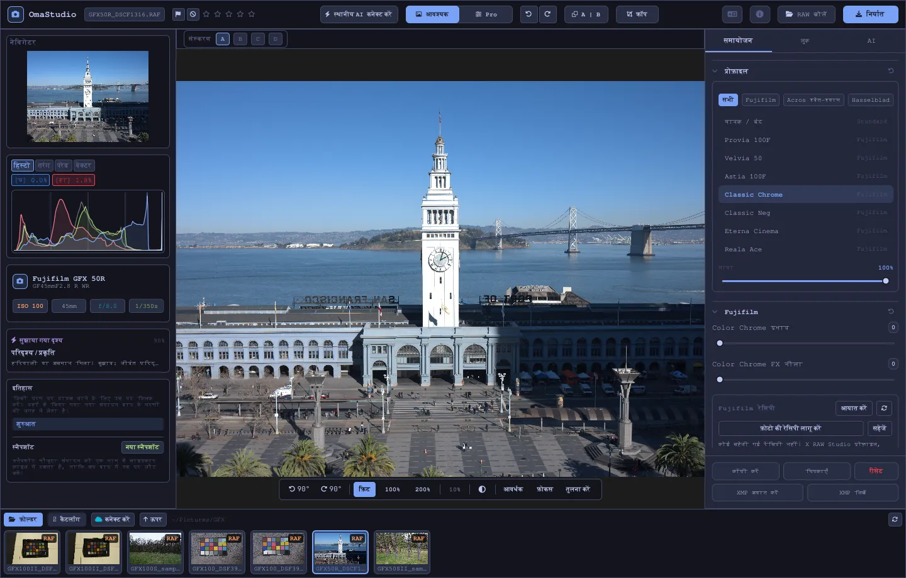

# OmaStudio उपयोगकर्ता गाइड

**OmaStudio: The Complete Medium Format RAW Editor for Omarchy**

[सभी भाषाएँ](../README.md) · [तकनीकें](../technology/hi.md) · [README](../../README.md)

यह गाइड OmaStudio 3.1 के लिए है। इसमें बताया गया है कि ऐप्लिकेशन कैसे इंस्टॉल करें, विंडो में क्या कहाँ है, और हर पैनल व टूल का उपयोग कैसे करें। स्क्रीनशॉट में [raw.pixls.us](https://raw.pixls.us) (CC0) की Fujifilm GFX 50R और Hasselblad CFV-50c नमूना फ़ाइलें दिखाई गई हैं।



## विषय-सूची

1. [इंस्टॉलेशन](#1-इंस्टॉलेशन)
2. [विंडो](#2-विंडो)
3. [फ़ोटो खोलना और लाइब्रेरी](#3-फ़ोटो-खोलना-और-लाइब्रेरी)
4. [आवश्यक और Pro](#4-आवश्यक-और-pro)
5. [समायोजन टैब](#5-समायोजन-टैब)
6. [मास्क टैब](#6-मास्क-टैब)
7. [लुक टैब](#7-लुक-टैब)
8. [AI टैब और AI चैट](#8-ai-टैब-और-ai-चैट)
9. [देखने के सहायक साधन](#9-देखने-के-सहायक-साधन)
10. [इतिहास, स्नैपशॉट और संस्करण](#10-इतिहास-स्नैपशॉट-और-संस्करण)
11. [Fujifilm](#11-fujifilm)
12. [मीडियम फ़ॉर्मैट](#12-मीडियम-फ़ॉर्मैट)
13. [निर्यात](#13-निर्यात)
14. [क्लाउड खाते](#14-क्लाउड-खाते)
15. [कीबोर्ड और माउस](#15-कीबोर्ड-और-माउस)
16. [कमांड लाइन, कंट्रोल सॉकेट और MCP](#16-कमांड-लाइन-कंट्रोल-सॉकेट-और-mcp)
17. [फ़ाइलें और फ़ोल्डर](#17-फ़ाइलें-और-फ़ोल्डर)
18. [समस्या निवारण](#18-समस्या-निवारण)

## 1. इंस्टॉलेशन

OmaStudio, Omarchy (Arch Linux) पर Wayland और Hyprland के साथ चलता है।

**पैकेज से।** रिपॉज़िटरी के क्लोन में:

```bash
makepkg -si
```

इससे `omastudio`, `omastudio-app`, `omastudio-engine`, ICC प्रोफ़ाइलें, डेस्कटॉप एंट्री, आइकन और USB से जुड़े Fujifilm कैमरों के लिए एक udev नियम इंस्टॉल होते हैं।

**रिलीज़ आर्काइव से।** [रिलीज़ पेज](https://github.com/ozdil/omarchy-omastudio/releases) से `omastudio-<संस्करण>-x86_64-linux.tar.gz` डाउनलोड करें, `checksums.txt` से जाँचें, खोलें, और `bin/*` को `~/.local/bin` में तथा `share/omastudio` को `~/.local/share/omastudio` में कॉपी करें।

**ज़रूरी पैकेज:** `libraw` 0.22 या नया, `lcms2`, `qt6-base`, `qt6-declarative`, `qt6-wayland` और `qt6-svg` 6.12 या नए, और फ़ाइल डायलॉग के लिए `zenity`।

**वैकल्पिक पैकेज:**

| पैकेज | उपयोग |
| :--- | :--- |
| `vulkan-icd-loader` और आपके GPU का Vulkan ड्राइवर | GPU पर डीमोज़ेकिंग |
| `perl-image-exiftool` | निर्यात की गई फ़ाइलों में EXIF मेटाडेटा रखना |
| `libwebp-utils`, `libheif`, `ffmpeg` | लॉसी WebP, HEIF और AVIF का वैकल्पिक रास्ता |
| `onnxruntime` | NPU, GPU या CPU पर स्थानीय AI मास्क |
| `rclone`, `libsecret`, `gnome-keyring` | Google Drive, OneDrive, Dropbox, Box, pCloud और Yandex Disk |
| `github-cli` | GitHub खाता |
| `ollama` | संपादन सहायक के लिए स्थानीय AI मॉडल |
| `quickshell` | Omarchy बार में OmaStudio बटन |

OmaStudio को Omarchy के ऐप मेनू से शुरू करें, या `omastudio` चलाएँ (चाहें तो किसी फ़ोटो के साथ: `omastudio DSCF0001.RAF`)। अगर कोई विंडो पहले से खुली है, तो फ़ोटो उसी विंडो में खुलती है।

## 2. विंडो

| क्षेत्र | इसमें क्या है |
| :--- | :--- |
| ऊपरी बार | फ़ाइल नाम, फ़्लैग और स्टार रेटिंग, **स्थानीय AI कनेक्ट करें**, **आवश्यक** / **Pro** स्विच, पूर्ववत और फिर से करें, पहले और बाद में (**A \| B**), **क्रॉप**, भाषा मेनू, परिचय, **RAW खोलें** और **निर्यात** |
| बायाँ पैनल | नेविगेटर, क्लिपिंग संकेतकों के साथ माप उपकरण (हिस्टोग्राम, वेवफ़ॉर्म, RGB परेड, वेक्टरस्कोप), कैमरा और लेंस विवरण, सुझाया गया दृश्य, इतिहास और स्नैपशॉट |
| बीच का हिस्सा | फ़ोटो, उसके ऊपर संस्करण बार (A–D) और नीचे व्यू बार: घुमाएँ, **फ़िट**, 100%, 200%, मौजूदा ज़ूम, आसपास का रंग, **आवर्धक**, **फ़ोकस**, **तुलना करें** |
| दायाँ पैनल | **समायोजन**, **मास्क** (Pro), **लुक** और **AI** टैब, और एक स्थिर पंक्ति जिसमें **कॉपी करें**, **चिपकाएँ**, **रीसेट**, **XMP आयात करें** और **XMP लिखें** हैं |
| फ़िल्मस्ट्रिप | **फ़ोल्डर**, **कैटलॉग**, हर क्लाउड खाते के लिए एक टैब, **कनेक्ट करें**, **ऊपर**, और मौजूदा फ़ोल्डर की फ़ोटो |

**Tab** दोनों साइड पैनल और फ़िल्मस्ट्रिप को एक साथ छिपाता और दिखाता है। पैनल का हर सेक्शन अपने शीर्षक से खुलता और बंद होता है; शीर्षक पर **Ctrl+क्लिक** करने पर सिर्फ़ वही सेक्शन खुला रहता है। खुला टैब, बंद सेक्शन और दिखाए गए पैनल सत्रों के बीच याद रहते हैं।

रंग, फ़ॉन्ट और कोनों की गोलाई सक्रिय Omarchy थीम के साथ तुरंत बदलते हैं। फ़ोटो के आसपास का क्षेत्र डिफ़ॉल्ट रूप से न्यूट्रल गहरे स्लेटी रंग का होता है ताकि थीम रंगों की पहचान को न बदले; व्यू बार का आसपास-रंग बटन इसे मध्यम स्लेटी या थीम के रंग में बदलता है।

| Tokyo Night | Catppuccin Latte | Gruvbox | Rosé Pine |
| :---: | :---: | :---: | :---: |
|  |  |  |  |

इंटरफ़ेस 30 भाषाओं में उपलब्ध है। यह सिस्टम की भाषा का पालन करता है; ऊपरी बार के भाषा मेनू से दूसरी भाषा चुनने पर वह तुरंत लागू होती है।

## 3. फ़ोटो खोलना और लाइब्रेरी

- **RAW खोलें** (Ctrl+O) फ़ाइल डायलॉग खोलता है। यह फ़ोटो, RAW या इमेज के अनुसार छाँटता है।
- फ़ाइल मैनेजर से कोई फ़ोटो या फ़ोल्डर विंडो पर खींचकर छोड़ें।
- फ़िल्मस्ट्रिप में **फ़ोल्डर** मौजूदा फ़ोल्डर दिखाता है; किसी फ़ोल्डर में जाने के लिए उस पर क्लिक करें और वापस आने के लिए **ऊपर** पर। फ़ोटो खोलने के लिए उस पर क्लिक करें। Ctrl+← और Ctrl+→ पिछली और अगली फ़ोटो पर ले जाते हैं।
- **कैटलॉग** उन सभी फ़ोटो की सूची है जिन्हें OmaStudio ने देखा है, उनकी रेटिंग, फ़्लैग और रंग लेबल के साथ।

OmaStudio हर वह RAW फ़ॉर्मैट खोलता है जिसे LibRaw 0.22 पढ़ता है (Fujifilm, Hasselblad, Phase One, Leica, Pentax, Mamiya/Leaf, Canon, Nikon, Sony, Panasonic, Olympus, Sigma, DNG और अन्य), साथ ही JPEG, PNG, WebP, TIFF, HEIF/HEIC, AVIF, JPEG XL, OpenEXR, Radiance HDR और PNM भी।

**रेटिंग और फ़्लैग।** 1 से 5 स्टार रेटिंग देते हैं और 0 उसे हटाता है। P चुनी गई, X अस्वीकृत चिह्नित करता है और U फ़्लैग हटाता है। रेटिंग और फ़्लैग तुरंत कैटलॉग और साइडकार फ़ाइल में सहेजे जाते हैं।

**चयन।** फ़िल्मस्ट्रिप में Shift+क्लिक एक श्रेणी चुनता है और Ctrl+क्लिक किसी फ़ोटो को जोड़ता या हटाता है। एक से अधिक फ़ोटो चुनी हों तो निर्यात विंडो सभी को निर्यात करती है (**बैच**)।

आपकी मूल फ़ाइलें कभी नहीं बदली जातीं। काम करते समय संपादन फ़ोटो के पास एक साइडकार फ़ाइल `<फ़ोटो>.omastudio` में सहेजे जाते हैं (Ctrl+S तुरंत सहेजता है)।

## 4. आवश्यक और Pro

ऊपरी बार का स्विच तय करता है कि कितने टूल दिखें।

- **आवश्यक:** प्रोफ़ाइल, Fujifilm, व्हाइट बैलेंस, टोन, प्रेज़ेंस, प्रीसेट और 3D LUT।
- **Pro** इनमें टोन कर्व, रंग मिक्सर, रंग ग्रेडिंग, विवरण और ऑप्टिक्स, रूपांतरण, ग्रेन, रंग प्रबंधन और **मास्क** टैब जोड़ता है। Pro सेक्शन पर "Pro" टैग होता है।

वापस आवश्यक पर जाने से Pro सेक्शन छिप जाते हैं; उनकी सेटिंग लागू रहती हैं।


## 5. समायोजन टैब

हर स्लाइडर पर डबल-क्लिक करने से वह रीसेट हो जाता है। सेक्शन शीर्षक का रीसेट बटन पूरे सेक्शन को रीसेट करता है।

### प्रोफ़ाइल

मूल रूप: **मानक / बंद**, Fujifilm फ़िल्म सिमुलेशन (Provia, Velvia, Astia, Classic Chrome, Classic Neg, Eterna, Eterna Bleach Bypass, Reala Ace, Nostalgic Neg, PRO Neg Std और Hi, पीले, लाल और हरे फ़िल्टर वाले Acros और Monochrome, Sepia) और Hasselblad शैली की प्राकृतिक रंग प्रोफ़ाइल। टैब सूची को छाँटते हैं। **मात्रा** प्रोफ़ाइल को न्यूट्रल रेंडरिंग के साथ मिलाती है।

### Fujifilm

**Color Chrome प्रभाव** और **Color Chrome FX नीला** (कमज़ोर = 50, मज़बूत = 100) संतृप्त रंगों को, और FX नीला नीले रंगों को, उनके ह्यू को बनाए रखते हुए गहरा करते हैं। रेसिपी लाइब्रेरी, USB पर कैमरा और पिक्सेल शिफ़्ट का विवरण [Fujifilm](#11-fujifilm) में है।

### व्हाइट बैलेंस

**तापमान** (2000–12000 K) और **टिंट**, कैमरे द्वारा दर्ज व्हाइट बैलेंस के सापेक्ष। फ़ोटो शूटिंग के समय की सेटिंग के साथ खुलती है।

### टोन

**एक्सपोज़र** (−5 से +5 EV, रेखीय प्रकाश पर: +1 EV प्रकाश को दोगुना करता है), **कंट्रास्ट**, **हाइलाइट**, **छाया**, **सफ़ेद** और **काले**।

### प्रेज़ेंस

**बनावट**, **स्पष्टता** (मध्य टोन कंट्रास्ट), **धुंध हटाएँ**, **वाइब्रेंस** और **संतृप्ति**।

### टोन कर्व (Pro)

हिस्टोग्राम के ऊपर एक पॉइंट कर्व, RGB के लिए और लाल, हरे व नीले के लिए अलग-अलग। बिंदु जोड़ने के लिए क्लिक करें, खिसकाने के लिए खींचें, हटाने के लिए डबल-क्लिक करें। कर्व अपने बिंदुओं से आगे नहीं निकलता। नीचे के चार क्षेत्र स्लाइडर (हाइलाइट, हल्के, गहरे, छाया) क्षेत्र के अनुसार कर्व को आकार देते हैं।

### रंग मिक्सर (Pro)

आठ रंगों के लिए ह्यू, संतृप्ति और ल्यूमिनेंस: लाल, नारंगी, पीला, हरा, एक्वा, नीला, बैंगनी और मैजेंटा।


### रंग ग्रेडिंग (Pro)

छाया (lift), मध्य टोन (gamma) और हाइलाइट (gain) के लिए तीन-तरफ़ा रंग पहिए, साथ में एक वैश्विक ऑफ़सेट, चार पहियों या टैब के रूप में। पहियों के नीचे **रंग बूस्ट**, **मध्य टोन विवरण** और **कंट्रास्ट धुरी** हैं। उनके नीचे का चैनल मिक्सर लाल, हरे और नीले को हर आउटपुट चैनल में, या मोनोक्रोम मिश्रण में मिलाता है।


### विवरण और ऑप्टिक्स (Pro)

**शार्पनिंग**, **शोर कमी** (ल्यूमा और रंग), **विनेट**, **रंगीन किनारे हटाएँ** (वर्णिक विपथन) और **लेंस विरूपण सुधार**। Fujifilm और DNG फ़ाइलों के लेंस सुधार अपने आप लागू होते हैं; ये स्लाइडर उनके ऊपर काम करते हैं।

### रूपांतरण (Pro)

**लंबवत** मिलती हुई रेखाओं को सीधा करता है, जैसे नीचे से खींची गई इमारत; **क्षैतिज** यही काम बगल की दिशा में करता है; **स्केल** परिणाम को बड़ा करता है। बाद में खाली किनारे हटाने के लिए क्रॉप करें।

### ग्रेन (Pro)

फ़िल्म ग्रेन की **मात्रा**, **आकार** और **खुरदरापन**।

### रंग प्रबंधन (Pro)

- **गैमट संपीड़न** गैमट से बाहर धकेले गए रंगों को काटने के बजाय धीरे से वापस लाता है।
- **ACES टोन कर्व** फ़िल्म जैसी हाइलाइट नरमी है, ACES आउटपुट ट्रांसफ़ॉर्म का फ़िट किया गया अनुमान।
- **सॉफ़्ट प्रूफ़** (S) फ़ोटो को वैसे दिखाता है जैसे वह किसी आउटपुट प्रोफ़ाइल के साथ दिखेगी, जैसे प्रिंटर और काग़ज़ की प्रोफ़ाइल। प्रोफ़ाइल और रेंडरिंग इंटेंट चुनें। **गैमट चेतावनी** उन रंगों को मैजेंटा में रंगती है जिन्हें प्रोफ़ाइल दोहरा नहीं सकती। संपादन और निर्यात नहीं बदलते।

आउटपुट कलर स्पेस निर्यात विंडो में चुना जाता है।


## 6. मास्क टैब

मास्क टैब Pro मोड में दिखता है।

### सुधार और क्लोन

**बिंदु संपादित करें** चालू करें और फ़ोटो पर किसी धब्बे पर क्लिक करके उसे हटाएँ। धब्बे को उसके पास के स्रोत से बदला जाता है। धब्बे को खिसकाने के लिए ठोस वृत्त और दूसरा स्रोत चुनने के लिए डैश वाला वृत्त खींचें। **सुधारें** कॉपी किए गए हिस्से को धब्बे के आसपास के प्रकाश और रंग से मिलाता है; **क्लोन** उसे जैसा है वैसा कॉपी करता है। **आकार**, **किनारा नरमी** और **अपारदर्शिता** चुने गए और नए धब्बों पर लागू होते हैं।


### स्थानीय समायोजन

हर लेयर एक मास्क के ज़रिए अपारदर्शिता के साथ एक्सपोज़र, कंट्रास्ट, हाइलाइट, छाया, सफ़ेद, काले और संतृप्ति लागू करती है।

| मास्क | कैसे बनता है |
| :--- | :--- |
| **रेखीय** | फ़ोटो पर दो हैंडल के बीच ग्रेडिएंट |
| **रेडियल** | केंद्र, किनारे के हैंडल और किनारा नरमी वाला दीर्घवृत्त |
| **ल्यूमिनेंस** | चमक की एक सीमा (सबसे गहरा, सबसे चमकीला, संक्रमण) |
| **रंग** | फ़ोटो से चुने गए रंग के नज़दीकी रंग (सीमा और किनारा नरमी) |
| **ब्रश** | फ़ोटो पर पेंट किया जाता है, आकार, किनारा नरमी, प्रवाह और मिटाने के मोड के साथ; माउस का बीच वाला बटन दृश्य खिसकाता है |
| **AI विषय**, **AI आसमान** | आपके कंप्यूटर पर चलने वाला एक सेगमेंटेशन मॉडल (देखें [AI](#8-ai-टैब-और-ai-चैट)) |

**इसके साथ मिलाएँ** के तहत और हिस्से लेयर के मास्क में जोड़े, घटाए या उससे प्रतिच्छेदित किए जा सकते हैं, और हर हिस्से को उलटा जा सकता है।


## 7. लुक टैब

- **प्रीसेट:** **स्वचालित** फ़ोटो का विश्लेषण करके एक्सपोज़र, व्हाइट बैलेंस और टोन सेट करता है। हल्का, चटकीला, गर्म पोर्ट्रेट, श्वेत-श्याम, और टील और नारंगी लुक पिछले लुक के ऊपर जुड़ने के बजाय उसे बदल देते हैं; व्हाइट बैलेंस, एक्सपोज़र, क्रॉप और फ़िल्म सिमुलेशन बने रहते हैं।
- **LUT:** **.cube फ़ाइल लोड करें…** आपकी अपनी 3D LUT को एक मात्रा के साथ लागू करता है।


## 8. AI टैब और AI चैट

ऊपरी बार का **स्थानीय AI कनेक्ट करें** इस कंप्यूटर पर सेट किए गए AI का उपयोग करता है: Omarchy का डिफ़ॉल्ट एजेंट (Claude Code या Codex, उनके अपने साइन-इन के साथ), वह न हो तो Ollama, वह भी न हो तो LM Studio। कनेक्ट होने के बाद यह बटन फ़ोटो के ऊपर **AI चैट** खोलता है: लिखें कि आप क्या बदलना चाहते हैं ("थोड़ा गर्म करो, आसमान बचाओ") और AI समायोजन सेट कर देता है। Ctrl+Z हर संपादन को पूर्ववत करता है।

AI टैब का **संपादन सहायक** यही काम पैनल से करता है और इसकी जगह क्लाउड प्रदाता का भी उपयोग कर सकता है: Anthropic Claude, OpenAI, OpenRouter या Google Gemini। उनकी API कुंजियाँ सिस्टम कीरिंग में रखी जाती हैं और कभी डिस्क पर या कमांड लाइन में नहीं लिखी जातीं। क्लाउड प्रदाता या Claude Code या Codex के साथ फ़ोटो का प्रीव्यू उस सेवा को भेजा जाता है; Ollama या LM Studio के साथ वह आपके कंप्यूटर पर ही रहता है।


**AI मास्क।** मास्क टैब के **AI विषय** और **AI आसमान** इस कंप्यूटर पर एक ONNX सेगमेंटेशन मॉडल चलाते हैं: पहले NPU पर (OpenVINO के ज़रिए Intel Core Ultra, QNN के ज़रिए Snapdragon X, Vitis AI के ज़रिए AMD Ryzen AI), फिर GPU पर, फिर CPU पर। कोई मॉडल साथ में नहीं आता और न ही डाउनलोड होता है। `~/.local/share/omastudio/models` में `subject.onnx` या `sky.onnx` नाम से मॉडल रखें; `omastudio npu` दिखाता है कि क्या इंस्टॉल है।

## 9. देखने के सहायक साधन

| साधन | उपयोग कैसे करें |
| :--- | :--- |
| ज़ूम | पॉइंटर पर माउस व्हील; **फ़िट** (Ctrl+0), **100%** (Ctrl+1), **200%**; डबल-क्लिक फ़िट और 200% के बीच बदलता है। 100% किसी भी डिस्प्ले स्केल पर एक स्क्रीन पिक्सेल पर फ़ोटो का एक पिक्सेल दिखाता है। |
| पैन | बाएँ या बीच वाले माउस बटन से खींचें; Shift+व्हील बगल में खिसकाता है |
| घुमाना | व्यू बार के घुमाने वाले बटन; Alt+व्हील 1.5° के क़दमों में घुमाता है |
| क्रॉप (C) | आस्पेक्ट प्रीसेट (मूल, 1:1, 4:5, 9:16, 16:9, मुक्त) और ग्रिड (तिहाई, स्वर्ण अनुपात, स्वर्ण सर्पिल) |
| पहले और बाद में (Y, या A \| B) | फ़ोटो मूल और संपादन में बँटी हुई |
| तुलना करें (Shift+C) | संपादन किसी दूसरी अवस्था के बगल में: पहले, कोई संस्करण या कोई स्नैपशॉट |
| आवर्धक (L) | पॉइंटर के नीचे एक वर्ग जो पूर्ण रिज़ॉल्यूशन फ़ोटो को 1:1 पर दिखाता है |
| फ़ोकस (Shift+F) | सबसे तीखे किनारे हरे रंग में; केवल देखने का सहायक |
| क्लिपिंग | कटी हुई छाया को नीले और हाइलाइट को लाल में दिखाने के लिए हिस्टोग्राम के ऊपर **[S]** या **[H]** पर क्लिक करें |

| फ़ोकस | तुलना करें |
| :---: | :---: |
|  |  |

| क्रॉप | पहले और बाद में |
| :---: | :---: |
|  |  |

जब फ़ोटो प्रीव्यू से बड़ी दिखाई जाती है, तो इंजन दिख रहे हिस्से को पूर्ण रिज़ॉल्यूशन फ़ाइल से रेंडर करता है, ताकि आप जो विवरण देखें वह निर्यात से मेल खाए।

## 10. इतिहास, स्नैपशॉट और संस्करण

- बाएँ पैनल का **इतिहास** संपादन के हर क़दम को नाम से दिखाता है ("एक्सपोज़र +0.70", "टोन कर्व")। किसी क़दम पर वापस जाने के लिए उस पर क्लिक करें; वहाँ से किया गया नया संपादन बाद के क़दमों की जगह ले लेता है, जैसे Ctrl+Z के बाद।
- **स्नैपशॉट** मौजूदा संपादन को एक नाम से रखते हैं। **पुनर्स्थापित करें** उसे एक नए क़दम के रूप में वापस लाता है जिसे Ctrl+Z पूर्ववत कर सकता है। स्नैपशॉट साइडकार फ़ाइल में सहेजे जाते हैं।
- फ़ोटो के ऊपर **संस्करण A–D** एक ही फ़ोटो के चार अलग-अलग संपादन तक रख सकते हैं। बदलने के लिए किसी अक्षर पर क्लिक करें (Alt+1 से Alt+4); राइट-क्लिक मौजूदा संपादन को उस संस्करण में कॉपी करता है।
- **कॉपी करें** और **चिपकाएँ** (Ctrl+Shift+C, Ctrl+Shift+V) एक संपादन को दूसरी फ़ोटो पर ले जाते हैं। **रीसेट** (Ctrl+R) डिफ़ॉल्ट पर लौटाता है।
- **XMP लिखें** संपादन, रेटिंग और लेबल को `.xmp` साइडकार के रूप में सहेजता है जिसे Lightroom, Capture One, darktable और digiKam पढ़ते हैं; **XMP आयात करें** इन प्रोग्रामों द्वारा लिखी गई फ़ाइल पढ़ता है।

## 11. Fujifilm

- **कैमरे की रेसिपी।** RAF या Fujifilm JPEG उन्हीं सेटिंग के साथ खुलती है जिनसे वह खींची गई थी: फ़िल्म सिमुलेशन, टोन, रंग, शार्पनेस, शोर कमी, स्पष्टता, ग्रेन, Color Chrome, व्हाइट बैलेंस शिफ़्ट और डायनेमिक रेंज (D-Range Priority सहित)। सहेजी गई साइडकार फ़ाइल को प्राथमिकता मिलती है।
- **चमक।** RAF फ़ाइलें कैमरे के अपने JPEG की चमक पर खुलती हैं।
- **लेंस सुधार।** कैमरे द्वारा दर्ज विरूपण, पार्श्व वर्णिक विपथन और विनेटिंग XF, XC और GF लेंसों के लिए लागू होते हैं।
- **रेसिपी लाइब्रेरी।** **आयात करें** X RAW Studio प्रोफ़ाइल (.FP1, .FP2, .FP3), रेसिपी टेक्स्ट ("Film Simulation: Classic Chrome / Grain Effect: Strong, Small …") या Fujifilm फ़ोटो लेता है। **रेसिपी लागू करें** सहेजी गई रेसिपी लागू करता है; **फ़ोटो की रेसिपी लागू करें** फ़ाइल वाली रेसिपी पर लौटता है; **सहेजें** मौजूदा रेसिपी सहेजता है।
- **USB पर कैमरा।** कैमरे का USB मोड USB RAW CONV./BACKUP RESTORE पर सेट करें और जोड़ें। **C1–C7 पढ़ें** उसकी कस्टम सेटिंग दिखाता है, **रेसिपी C… में लिखें** किसी स्लॉट में रेसिपी रखता है (वहाँ जो है उसकी जगह), और **कैमरे में बदलें** खुली RAF को कैमरे में ही डेवलप करता है, चाहें तो चुनी गई रेसिपी के साथ।
- **पिक्सेल शिफ़्ट।** फ़िल्मस्ट्रिप में एक GFX Pixel Shift क्रम के RAF फ़्रेम चुनें और **फ़्रेम को DNG में मिलाएँ** पर क्लिक करें। चार फ़्रेम हर पिक्सेल पर पूरा रंग देते हैं; सोलह फ़्रेम रिज़ॉल्यूशन दोगुना करते हैं।

## 12. मीडियम फ़ॉर्मैट

- **Fujifilm GFX** (GFX 50S, 50R, 50S II, 100, 100S, 100 II और अन्य): सेंसर से निर्यात तक 16-बिट पाइपलाइन, फ़िल्म सिमुलेशन, लेंस सुधार और पिक्सेल शिफ़्ट।
- **Hasselblad** 3FR और FFF फ़ाइलें कैमरे के डिफ़ॉल्ट क्रॉप पर काटी जाती हैं।
- **Phase One और Leaf** की IIQ और MOS फ़ाइलों को उस डिजिटल बैक का अपना सेंसर कैलिब्रेशन मिलता है।
- **Mamiya** MEF और **Pentax 645** PEF फ़ाइलें समर्थित हैं।
- **फ़्लैट फ़ील्ड (LCC):** `omastudio-engine medium-format lcc-create <raw>` समान रूप से प्रकाशित सफ़ेद लक्ष्य की तस्वीर से एक सुधार बनाता है; यह उस फ़ोल्डर की फ़ोटो पर लागू होता है।
- **मल्टी-शॉट:** `medium-format multishot f1 f2 f3 f4 --out merged.tif` चार शॉट के क्रम को मिलाता है।


## 13. निर्यात

**निर्यात** (E) निर्यात विंडो खोलता है। Enter निर्यात करता है और Esc बंद करता है।


| सेटिंग | विकल्प |
| :--- | :--- |
| फ़ाइल फ़ॉर्मैट | JPEG, PNG (8/16-बिट), TIFF (8/16-बिट, बिना संपीड़न, LZW या ZIP), WebP, AVIF (8/10/12-बिट), HEIF (8/10/12-बिट), JPEG XL (8/16-बिट) और OpenEXR (half या full float, सीन-रेखीय) |
| गुणवत्ता | 1–100; WebP, AVIF और JPEG XL के लिए 100 लॉसलेस है |
| आकार | **पूर्ण**, 75%, 50%, या 3840 या 2048 px का लंबा किनारा |
| रंग प्रोफ़ाइल | sRGB, Display P3, Adobe RGB, ProPhoto RGB, Rec. 2020, ACEScg, या आपकी अपनी ICC प्रोफ़ाइल |
| रेंडरिंग इंटेंट | बोधात्मक, सापेक्ष (डिफ़ॉल्ट), संतृप्ति, निरपेक्ष |
| मेटाडेटा | **कैमरा मेटाडेटा रखें (EXIF)**, **स्थान हटाएँ (GPS)** |
| इसके लिए तैयार करें | Instagram, Stories और Reels, X, Facebook, वर्गाकार और YouTube थंबनेल के लिए क्रॉप और आउटपुट शार्पनिंग |
| वॉटरमार्क | EXIF टैग ({camera}, {lens}, {iso}, {aperture}, {shutter}, {focal}) वाला टेक्स्ट या PNG लोगो, स्थान, अपारदर्शिता, आकार और छाया के साथ |
| फ़ोल्डर और फ़ाइल नाम | डिफ़ॉल्ट `~/Pictures/OmaStudio_Exports`; फ़ाइल नाम में एक टैग जोड़ा जा सकता है |
| यहाँ अपलोड करें | एक जुड़ा हुआ क्लाउड खाता |

OpenEXR को छोड़कर हर फ़ॉर्मैट में उसके कलर स्पेस की ICC प्रोफ़ाइल होती है। बैच चुनी गई फ़ोटो को एक-एक करके निर्यात करता है।

## 14. क्लाउड खाते

फ़िल्मस्ट्रिप का **कनेक्ट करें** Google Drive, OneDrive, Dropbox, Box, pCloud, Yandex Disk या GitHub जोड़ता है। आप ब्राउज़र में सेवा के अपने पेज पर साइन इन करते हैं; OmaStudio आपका पासवर्ड कभी नहीं देखता।


- हर खाते को फ़िल्मस्ट्रिप में एक टैब मिलता है। उसके फ़ोल्डर ब्राउज़ करें और किसी फ़ोटो को डाउनलोड (एक बार) करके खोलने के लिए उस पर क्लिक करें।
- हर खाते में `OmaStudio` नाम का एक फ़ोल्डर बनता है (GitHub पर एक निजी रिपॉज़िटरी `OmaStudio`) जिसमें निर्यात विंडो से अपलोड आते हैं।
- स्टोरेज सेवाएँ OmaStudio के अपने rclone कॉन्फ़िगरेशन से चलती हैं, जो सिस्टम कीरिंग में रखी कुंजी से एन्क्रिप्ट होता है। GitHub, GitHub CLI से चलता है।
- Google Drive के लिए Google Cloud Console से अपनी क्लाइंट आईडी **अपनी Google क्लाइंट आईडी** में डाली जा सकती है।
- **डिस्कनेक्ट करें** इस कंप्यूटर से खाते की कुंजियाँ और डाउनलोड की गई प्रतियाँ हटाता है; खाते की फ़ाइलें बनी रहती हैं।

## 15. कीबोर्ड और माउस

| कुंजी | क्रिया |
| :--- | :--- |
| Ctrl+O | फ़ोटो खोलें |
| Ctrl+S | संपादन अभी सहेजें |
| Ctrl+Z / Ctrl+Shift+Z या Ctrl+Y | पूर्ववत / फिर से करें |
| Ctrl+Shift+C / Ctrl+Shift+V | संपादन कॉपी करें / चिपकाएँ |
| Ctrl+R | संपादन रीसेट करें |
| Ctrl+← / Ctrl+→ | पिछली / अगली फ़ोटो |
| Ctrl+0 / Ctrl+1 | फ़िट / 100% |
| 1–5, 0 | स्टार रेटिंग, रेटिंग हटाएँ |
| P, X, U | चुनें, अस्वीकार करें, फ़्लैग हटाएँ |
| C | क्रॉप |
| Y | पहले और बाद में |
| S | सॉफ़्ट प्रूफ़ |
| L | आवर्धक |
| Shift+F | फ़ोकस |
| Shift+C | तुलना करें |
| Alt+1 … Alt+4 | संस्करण A–D |
| E | निर्यात विंडो |
| Tab | पैनल छिपाएँ या दिखाएँ |
| Esc | खुली विंडो बंद करें |

| माउस | क्रिया |
| :--- | :--- |
| व्हील | पॉइंटर पर ज़ूम |
| Shift+व्हील | बगल में पैन |
| Alt+व्हील | घुमाएँ |
| खींचना (बायाँ या बीच वाला बटन) | पैन |
| फ़ोटो पर डबल-क्लिक | फ़िट या 200% |
| सेक्शन शीर्षक पर Ctrl+क्लिक | सिर्फ़ वही सेक्शन खुला रखें |
| संस्करण अक्षर पर राइट-क्लिक | मौजूदा संपादन को उस संस्करण में कॉपी करें |

## 16. कमांड लाइन, कंट्रोल सॉकेट और MCP

**इंजन कमांड।** हर कमांड एक JSON ऑब्जेक्ट प्रिंट करती है, ताकि स्क्रिप्ट और एजेंट उसका उपयोग कर सकें।

```bash
omastudio inspect DSCF0001.RAF                      # कैमरा, लेंस, एक्सपोज़र, हिस्टोग्राम, दृश्य
omastudio export DSCF0001.RAF --recipe '{"exposure":0.5}' --options '{"format":"jpeg"}'
omastudio fuji-recipe DSCF0001.RAF                  # कैमरे की रेसिपी
omastudio fuji-pixel-shift DSCF*.RAF --out merged.dng
omastudio xmp export DSCF0001.RAF
omastudio cameras GFX                               # RAW डिकोडर द्वारा समर्थित कैमरे
omastudio gpu                                       # डीमोज़ेकिंग के लिए उपयोग होने वाला GPU
omastudio npu                                       # ONNX Runtime और एक्सेलेरेटर
omastudio cloud status
omastudio --cli help                                # सभी कमांड
```

**कंट्रोल सॉकेट।** `omastudio ipc <मेथड> [आर्ग्युमेंट]` खुली विंडो से बात करता है, जैसे `openPhoto`, `openFolder`, `applyRecipe`, `applyPreset`, `setExposure`, `setWarmth`, `setMode essentials|pro`, `setRightTab`, `showSection`, `setView peaking|compare|softProof|split on|off`, `setZoom`, `showExport`, `showCloud`, `getStatus` और `screenshot <फ़ाइल.png>`। सॉकेट केवल उसी उपयोगकर्ता को जवाब देता है।

**MCP।** `omastudio mcp` एक Model Context Protocol सर्वर है, जिससे AI एजेंट फ़ोटो की जाँच, रेंडर, छँटाई और निर्यात कर सकते हैं, Fujifilm रेसिपी पढ़ सकते हैं और खुली विंडो को नियंत्रित कर सकते हैं। Claude Code के लिए: `claude mcp add omastudio -- omastudio mcp`। `omastudio skill` एजेंट स्किल को `~/.claude/skills` में इंस्टॉल करता है।

## 17. फ़ाइलें और फ़ोल्डर

| पाथ | सामग्री |
| :--- | :--- |
| `<फ़ोटो>.omastudio` | किसी फ़ोटो का संपादन (साइडकार) |
| `~/.local/share/omastudio/catalog.json` | कैटलॉग: रेटिंग, फ़्लैग और रंग लेबल |
| `~/.local/share/omastudio/fuji-recipes/` | सहेजी गई Fujifilm रेसिपी |
| `~/.local/share/omastudio/icc/` | आपकी अपनी ICC प्रोफ़ाइलें |
| `~/.local/share/omastudio/models/` | स्थानीय AI मॉडल |
| `~/.local/share/omastudio/film-luts/` | आपकी फ़ोटो से मापी गई फ़िल्म सिमुलेशन LUT (`fuji-calibrate`) |
| `~/.config/omastudio/` | सेटिंग, इंटरफ़ेस की स्थिति, भाषा, क्लाउड खाते |
| `~/.cache/omastudio/` | थंबनेल, प्रीव्यू और डाउनलोड की गई क्लाउड फ़ोटो |

## 18. समस्या निवारण

- **विंडो नहीं खुलती।** टर्मिनल में `omastudio` चलाएँ और संदेश पढ़ें। `omastudio --version` और `omastudio status` बताते हैं कि क्या इंस्टॉल है।
- **GPU का उपयोग नहीं हो रहा।** `omastudio gpu` डिवाइस दिखाता है। `vulkan-icd-loader` और अपने GPU का Vulkan ड्राइवर इंस्टॉल करें। `OMASTUDIO_GPU=off` CPU का उपयोग अनिवार्य करता है।
- **USB पर कैमरा नहीं मिलता।** उसका USB मोड USB RAW CONV./BACKUP RESTORE पर सेट करें, फिर से जोड़ें, और जाँचें कि पैकेज का udev नियम इंस्टॉल है।
- **क्लाउड सेवा कहती है कि उसे किसी प्रोग्राम की ज़रूरत है।** डायलॉग में बताया गया पैकेज इंस्टॉल करें, जैसे `sudo pacman -S rclone libsecret`।
- परिचय विंडो का **सिस्टम जानकारी कॉपी करें** बग रिपोर्ट के लिए संस्करण, GPU और Omarchy विवरण कॉपी करता है। समस्याएँ [github.com/ozdil/omarchy-omastudio/issues](https://github.com/ozdil/omarchy-omastudio/issues) पर रिपोर्ट करें।
