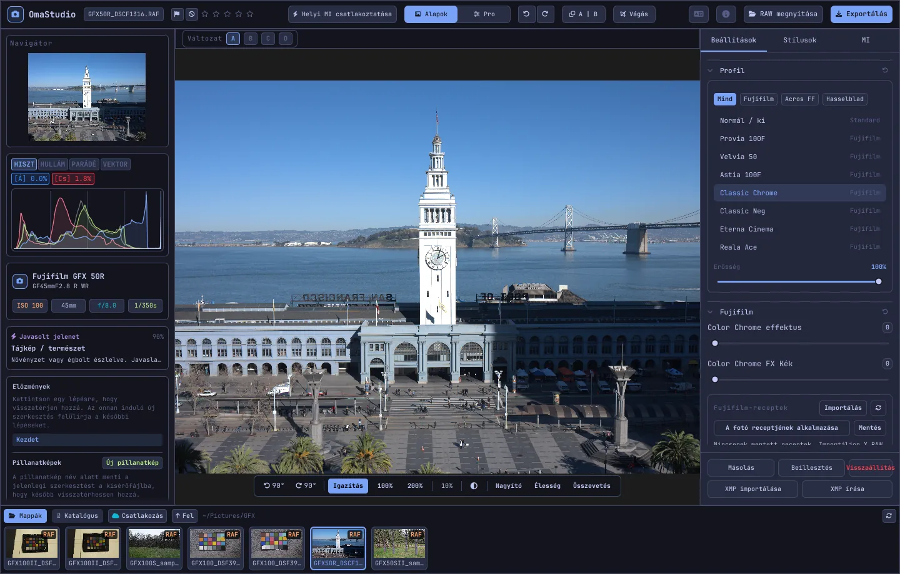

# OmaStudio felhasználói útmutató

**OmaStudio: The Complete Medium Format RAW Editor for Omarchy**

[Minden nyelv](../README.md) · [Technológiák](../technology/hu.md) · [README](../../README.md)

Ez az útmutató az OmaStudio 3.1-es verziójáról szól. Bemutatja az alkalmazás telepítését, az ablak felépítését, valamint az egyes panelek és eszközök használatát. A képernyőképeken Fujifilm GFX 50R és Hasselblad CFV-50c mintafájlok láthatók a [raw.pixls.us](https://raw.pixls.us) oldalról (CC0).



## Tartalom

1. [Telepítés](#1-telepítés)
2. [Az ablak](#2-az-ablak)
3. [Fotók megnyitása és a könyvtár](#3-fotók-megnyitása-és-a-könyvtár)
4. [Alapok és Pro](#4-alapok-és-pro)
5. [A Beállítások lap](#5-a-beállítások-lap)
6. [A Maszkok lap](#6-a-maszkok-lap)
7. [A Stílusok lap](#7-a-stílusok-lap)
8. [Az MI lap és az MI-csevegés](#8-az-mi-lap-és-az-mi-csevegés)
9. [Megjelenítési segédeszközök](#9-megjelenítési-segédeszközök)
10. [Előzmények, pillanatképek és változatok](#10-előzmények-pillanatképek-és-változatok)
11. [Fujifilm](#11-fujifilm)
12. [Középformátum](#12-középformátum)
13. [Exportálás](#13-exportálás)
14. [Felhőfiókok](#14-felhőfiókok)
15. [Billentyűzet és egér](#15-billentyűzet-és-egér)
16. [Parancssor, vezérlőfoglalat és MCP](#16-parancssor-vezérlőfoglalat-és-mcp)
17. [Fájlok és mappák](#17-fájlok-és-mappák)
18. [Hibaelhárítás](#18-hibaelhárítás)

## 1. Telepítés

Az OmaStudio Omarchy (Arch Linux) rendszeren fut, Wayland és Hyprland alatt.

**Csomagból.** A tároló egy klónjában:

```bash
makepkg -si
```

Ez telepíti az `omastudio`, `omastudio-app` és `omastudio-engine` programokat, az ICC-profilokat, az asztali bejegyzést, az ikonokat és egy udev-szabályt az USB-n csatlakoztatott Fujifilm fényképezőgépekhez.

**Kiadási archívumból.** Töltse le az `omastudio-<verzió>-x86_64-linux.tar.gz` fájlt a [kiadások oldaláról](https://github.com/ozdil/omarchy-omastudio/releases), ellenőrizze a `checksums.txt` alapján, csomagolja ki, majd másolja a `bin/*` tartalmát a `~/.local/bin`, a `share/omastudio` mappát pedig a `~/.local/share/omastudio` helyre.

**Szükséges csomagok:** `libraw` 0.22 vagy újabb, `lcms2`, `qt6-base`, `qt6-declarative`, `qt6-wayland` és `qt6-svg` 6.12 vagy újabb, valamint `zenity` a fájlpárbeszédekhez.

**Nem kötelező csomagok:**

| Csomag | Mire való |
| :--- | :--- |
| `vulkan-icd-loader` és a GPU Vulkan-illesztőprogramja | Demozaikolás a GPU-n |
| `perl-image-exiftool` | Az EXIF-metaadatok megtartása az exportált fájlokban |
| `libwebp-utils`, `libheif`, `ffmpeg` | Veszteséges WebP, HEIF és az AVIF tartalékmegoldása |
| `onnxruntime` | Helyi MI-maszkok NPU-n, GPU-n vagy CPU-n |
| `rclone`, `libsecret`, `gnome-keyring` | Google Drive, OneDrive, Dropbox, Box, pCloud és Yandex Disk |
| `github-cli` | GitHub-fiók |
| `ollama` | Helyi MI-modellek a szerkesztési asszisztenshez |
| `quickshell` | Az OmaStudio gomb az Omarchy sávban |

Indítsa el az OmaStudiót az Omarchy alkalmazásmenüjéből, vagy futtassa az `omastudio` parancsot (akár egy fotóval: `omastudio DSCF0001.RAF`). Ha már van nyitott ablak, a fotó abban nyílik meg.

## 2. Az ablak

| Terület | Tartalma |
| :--- | :--- |
| Felső sáv | Fájlnév, jelölők és csillagos értékelés, **Helyi MI csatlakoztatása**, az **Alapok** / **Pro** kapcsoló, visszavonás és ismétlés, előtte és utána (**A \| B**), **Vágás**, nyelvi menü, Névjegy, **RAW megnyitása** és **Exportálás** |
| Bal panel | Navigátor, mérők (hisztogram, hullámforma, RGB-parádé, vektorszkóp) vágásjelzőkkel, a fényképezőgép és az objektív adatai, a javasolt jelenet, előzmények és pillanatképek |
| Középső rész | A fotó, felette a változatsáv (A–D), alatta a nézetsáv: forgatás, **Igazítás**, 100%, 200%, aktuális nagyítás, környezeti szín, **Nagyító**, **Élesség**, **Összevetés** |
| Jobb panel | A **Beállítások**, **Maszkok** (Pro), **Stílusok** és **MI** lapok, valamint egy rögzített sor: **Másolás**, **Beillesztés**, **Visszaállítás**, **XMP importálása** és **XMP írása** |
| Filmszalag | **Mappák**, **Katalógus**, felhőfiókonként egy lap, **Csatlakozás**, **Fel**, valamint az aktuális mappa fotói |

A **Tab** egyszerre rejti el és jeleníti meg a két oldalpanelt és a filmszalagot. A panelek minden szakasza a fejlécére kattintva nyitható és csukható; a fejlécen végzett **Ctrl+kattintás** csak azt a szakaszt hagyja nyitva. A nyitott lap, az összecsukott szakaszok és a látható panelek munkamenetek között is megmaradnak.

A színek, a betűtípus és a sarkok kerekítése valós időben követi az aktív Omarchy-témát. A fotó körüli terület alapértelmezés szerint semleges sötétszürke, hogy a téma ne befolyásolja a színek megítélését; a nézetsáv környezeti gombja középszürkére vagy a téma színére vált.

| Tokyo Night | Catppuccin Latte | Gruvbox | Rosé Pine |
| :---: | :---: | :---: | :---: |
|  |  |  |  |

A felület 30 nyelven érhető el. A rendszer nyelvét követi; a felső sáv nyelvi menüjében másik nyelv választható, amely azonnal érvénybe lép.

## 3. Fotók megnyitása és a könyvtár

- A **RAW megnyitása** (Ctrl+O) megnyitja a fájlpárbeszédet. Fotók, RAW-fájlok vagy képek szerint szűr.
- Húzzon egy fotót vagy mappát a fájlkezelőből az ablakba.
- A filmszalagon a **Mappák** az aktuális mappát mutatja; kattintson egy mappára a belépéshez, és a **Fel** gombra a visszalépéshez. Kattintson egy fotóra a megnyitásához. A Ctrl+← és a Ctrl+→ az előző és a következő fotóra lép.
- A **Katalógus** minden fotót felsorol, amelyet az OmaStudio látott, értékeléssel, jelölővel és színcímkével.

Az OmaStudio minden RAW-formátumot megnyit, amelyet a LibRaw 0.22 olvas (Fujifilm, Hasselblad, Phase One, Leica, Pentax, Mamiya/Leaf, Canon, Nikon, Sony, Panasonic, Olympus, Sigma, DNG és mások), továbbá a JPEG, PNG, WebP, TIFF, HEIF/HEIC, AVIF, JPEG XL, OpenEXR, Radiance HDR és PNM fájlokat.

**Értékelés és jelölők.** Az 1–5 billentyű beállítja a csillagos értékelést, a 0 törli. A P kiválasztottnak, az X elutasítottnak jelöl, az U törli a jelölőt. Az értékelések és jelölők azonnal mentésre kerülnek a katalógusba és a kísérőfájlba.

**Kijelölés.** A Shift+kattintás tartományt jelöl ki a filmszalagon, a Ctrl+kattintás hozzáad vagy eltávolít egy fotót. Ha egynél több fotó van kijelölve, az Exportálás ablak mindet exportálja (**Köteg**).

Az eredeti fájlok soha nem változnak. A szerkesztések munka közben a fotó mellé, egy `<fotó>.omastudio` kísérőfájlba kerülnek (a Ctrl+S azonnal ment).

## 4. Alapok és Pro

A felső sáv kapcsolója határozza meg, hány eszköz látható.

- **Alapok:** profil, Fujifilm, fehéregyensúly, tónus, jelenlét, előbeállítások és 3D LUT-ok.
- A **Pro** hozzáadja a tónusgörbét, a színkeverőt, a színkorrekciót, a részleteket és optikát, az átalakítást, a szemcsét, a színkezelést és a **Maszkok** lapot. A Pro szakaszokon "Pro" címke látható.

Az Alapokra visszaváltva a Pro szakaszok elrejtődnek; a beállításaik érvényben maradnak.


## 5. A Beállítások lap

Minden csúszka alaphelyzetbe áll, ha duplán kattint rá. A szakaszfejléc visszaállítás gombja az egész szakaszt alaphelyzetbe állítja.

### Profil

Az alapmegjelenés: **Normál / ki**, a Fujifilm filmszimulációk (Provia, Velvia, Astia, Classic Chrome, Classic Neg, Eterna, Eterna Bleach Bypass, Reala Ace, Nostalgic Neg, PRO Neg Std és Hi, Acros és Monochrome sárga, piros és zöld szűrővel, Sepia), valamint a Hasselblad stílusú természetes színprofil. A lapok szűrik a listát. Az **Erősség** a profilt a semleges megjelenítéssel keveri.

### Fujifilm

A **Color Chrome effektus** és a **Color Chrome FX Kék** (Gyenge = 50, Erős = 100) mélyíti a telített színeket, az FX Kék a kékeket, az árnyalatuk megtartásával. A receptkönyvtárat, az USB-s fényképezőgépet és a Pixel Shiftet a [Fujifilm](#11-fujifilm) szakasz ismerteti.

### Fehéregyensúly

**Színhőmérséklet** (2000–12000 K) és **Színárnyalat**, a fényképezőgép által rögzített fehéregyensúlyhoz képest. A fotó a felvételkori beállítással nyílik meg.

### Tónus

**Expozíció** (−5 és +5 EV között, lineáris fényen: a +1 EV megduplázza a fényt), **Kontraszt**, **Csúcsfények**, **Árnyékok**, **Fehérek** és **Feketék**.

### Jelenlét

**Textúra**, **Tisztaság** (középtónus-kontraszt), **Párátlanítás**, **Élénkség** és **Telítettség**.

### Tónusgörbe (Pro)

Pontgörbe a hisztogram fölött, RGB-re, valamint külön a vörösre, zöldre és kékre. Kattintással pontot ad hozzá, húzással mozgatja, dupla kattintással eltávolítja. A görbe soha nem lendül túl a pontjain. Az alatta lévő négy tartománycsúszka (csúcsfények, világos tónusok, sötét tónusok, árnyékok) területenként formálja a görbét.

### Színkeverő (Pro)

Árnyalat, telítettség és fénysűrűség nyolc színhez: vörös, narancs, sárga, zöld, akvamarin, kék, lila és bíbor.


### Színkorrekció (Pro)

Háromutas színkerekek az árnyékokhoz (lift), a középtónusokhoz (gamma) és a csúcsfényekhez (gain), valamint egy globális eltolás, négy kerékként vagy lapokként. A **Színerősítés**, a **Középtónus-részletek** és a **Kontraszt forgáspontja** a kerekek alatt található. Az alattuk lévő csatornakeverő a vöröset, a zöldet és a kéket keveri az egyes kimeneti csatornákba vagy egy monokróm keverésbe.


### Részletek és optika (Pro)

**Élesítés**, **Zajcsökkentés** (fénysűrűség és szín), **Vignettálás**, **Színszegély eltávolítása** (kromatikus aberráció) és **Objektív torzításának korrekciója**. A Fujifilm és DNG fájlokban tárolt objektívkorrekciók automatikusan érvényesülnek; ezek a csúszkák ezeken felül hatnak.

### Átalakítás (Pro)

A **Függőleges** kiegyenesíti az összetartó vonalakat, például egy alulról fényképezett épületét; a **Vízszintes** ugyanezt oldalirányban teszi; a **Méret** felnagyítja az eredményt. Utána vágja le az üres széleket.

### Szemcse (Pro)

A filmszemcse **mennyisége**, **mérete** és **durvasága**.

### Színkezelés (Pro)

- A **Színtartomány-tömörítés** a színtartományon kívülre tolt színeket levágás helyett lágyan visszahozza.
- Az **ACES tónusgörbe** filmszerű csúcsfény-lekerekítés, az ACES kimeneti transzformáció illesztett közelítése.
- A **Képernyős próbanyomat** (S) úgy mutatja a fotót, ahogyan egy kimeneti profillal, például egy nyomtató- és papírprofillal fog kinézni. Válassza ki a profilt és a megjelenítési módot. A **Színtér-figyelmeztetés** bíborral festi azokat a színeket, amelyeket a profil nem tud visszaadni. A szerkesztés és az exportálás nem változik.

Magát a kimeneti színteret az Exportálás ablakban kell kiválasztani.


## 6. A Maszkok lap

A Maszkok lap Pro módban látható.

### Javítás és klónozás

Kapcsolja be a **Pontok szerkesztése** lehetőséget, és kattintson egy foltra a fotón az eltávolításához. A folt egy mellette lévő forrásból cserélődik. A folytonos kört húzva a foltot mozgatja, a szaggatott kört húzva másik forrást választ. A **Javítás** a másolt területet a folt körüli fényhez és színhez igazítja; a **Klónozás** változatlanul másolja. A **Méret**, a **Lágy szél** és az **Átlátszatlanság** a kijelölt és az új foltokra vonatkozik.


### Helyi korrekciók

Minden réteg expozíciót, kontrasztot, csúcsfényeket, árnyékokat, fehéreket, feketéket és telítettséget alkalmaz egy maszkon keresztül, átlátszatlansággal.

| Maszk | Hogyan készül |
| :--- | :--- |
| **Lineáris** | Átmenet két fogantyú között a fotón |
| **Sugaras** | Ellipszis középponttal, szélfogantyúkkal és lágy széllel |
| **Fénysűrűség** | Fényességtartomány (legsötétebb, legvilágosabb, átmenet) |
| **Szín** | A fotóról kiválasztott színhez közeli színek (tartomány és lágy szél) |
| **Ecset** | A fotóra festve, mérettel, lágy széllel, áramlással és radír móddal; a középső egérgomb mozgatja a nézetet |
| **MI-téma**, **MI-égbolt** | Szegmentációs modell a saját számítógépén (lásd: [MI](#8-az-mi-lap-és-az-mi-csevegés)) |

A **Kombinálás ezzel** alatt további részek adhatók a réteg maszkjához, vonhatók ki belőle vagy metszhetők vele, és minden rész invertálható.


## 7. A Stílusok lap

- **Előbeállítások:** az **Automatikus** elemzi a fotót, és beállítja az expozíciót, a fehéregyensúlyt és a tónust. A Tompa, Élénk, Meleg portré, Fekete-fehér, valamint Kékeszöld és narancs stílusok lecserélik az előző stílust ahelyett, hogy ráépülnének; a fehéregyensúly, az expozíció, a vágás és a filmszimuláció megmarad.
- **LUT:** a **.cube fájl betöltése…** saját 3D LUT-ot alkalmaz, erősséggel.


## 8. Az MI lap és az MI-csevegés

A felső sáv **Helyi MI csatlakoztatása** gombja a számítógépen beállított MI-t használja: az Omarchy alapértelmezett ügynökét (Claude Code vagy Codex, saját bejelentkezéssel), ennek hiányában az Ollamát, ennek hiányában az LM Studiót. Csatlakozás után a gomb megnyitja az **MI-csevegés** ablakot a fotó fölött: írja le, mit szeretne módosítani („melegebb, mentsd meg az eget"), és az MI beállítja a korrekciókat. A Ctrl+Z minden módosítást visszavon.

Az **MI** lap **Szerkesztési asszisztens** eleme ugyanezt teszi a panelről, és felhőszolgáltatót is használhat: Anthropic Claude, OpenAI, OpenRouter vagy Google Gemini. API-kulcsaik a rendszer kulcstartójában tárolódnak, és soha nem kerülnek lemezre vagy parancssorba. Felhőszolgáltatóval, illetve Claude Code-dal vagy Codexszel a fotó előnézete az adott szolgáltatáshoz kerül; Ollamával vagy LM Studióval a számítógépen marad.


**MI-maszkok.** A Maszkok lap **MI-téma** és **MI-égbolt** maszkja ONNX szegmentációs modellt futtat ezen a számítógépen: először NPU-n (Intel Core Ultra az OpenVINO-n, Snapdragon X a QNN-en, AMD Ryzen AI a Vitis AI-on keresztül), majd GPU-n, végül CPU-n. Modell nincs mellékelve, és nem is töltődik le. Helyezzen egy modellt a `~/.local/share/omastudio/models` mappába `subject.onnx` vagy `sky.onnx` néven; az `omastudio npu` megmutatja, mi van telepítve.

## 9. Megjelenítési segédeszközök

| Segédeszköz | Használat |
| :--- | :--- |
| Nagyítás | Egérgörgő a mutatónál; **Igazítás** (Ctrl+0), **100%** (Ctrl+1), **200%**; a dupla kattintás az igazítás és a 200% között vált. A 100% bármilyen kijelzőskálázásnál képernyőpixelenként egy fotópixelt mutat. |
| Mozgatás | Húzás a bal vagy a középső egérgombbal; a Shift+görgő oldalirányban mozgat |
| Forgatás | A nézetsáv forgatógombjai; az Alt+görgő 1,5°-os lépésekben forgat |
| Vágás (C) | Képarány-előbeállítások (Eredeti, 1:1, 4:5, 9:16, 16:9, Szabad) és segédrácsok (harmadolás, aranymetszés, aranyspirál) |
| Előtte és utána (Y vagy A \| B) | A fotó az eredetire és a szerkesztettre osztva |
| Összevetés (Shift+C) | A szerkesztés egy másik állapot mellett: Előtte, egy változat vagy egy pillanatkép |
| Nagyító (L) | A mutató alatti négyzet, amely 1:1 arányban, teljes felbontásban mutatja a fotót |
| Élesség (Shift+F) | A legélesebb élek zölddel festve; csak megjelenítési segítség |
| Vágás jelzése | A hisztogram fölötti **[S]** vagy **[H]** gombbal kékkel jelennek meg a levágott árnyékok, pirossal a levágott csúcsfények |

| Élesség | Összevetés |
| :---: | :---: |
|  |  |

| Vágás | Előtte és utána |
| :---: | :---: |
|  |  |

Ha a fotó nagyobb méretben látszik, mint az előnézet, a motor a látható területet a teljes felbontású fájlból jeleníti meg, így a látott részletek megegyeznek az exportéval.

## 10. Előzmények, pillanatképek és változatok

- A bal panel **Előzmények** listája a szerkesztés minden lépését névvel mutatja („Expozíció +0,70", „Tónusgörbe"). Egy lépésre kattintva visszatérhet hozzá; az onnan végzett új módosítás felülírja a későbbi lépéseket, mint a Ctrl+Z után.
- A **Pillanatképek** név alatt őrzik az aktuális szerkesztést. A **Visszaállítás** új lépésként hozza vissza, amelyet a Ctrl+Z visszavonhat. A pillanatképek a kísérőfájlba kerülnek.
- A fotó fölötti **A–D változatok** legfeljebb négy külön szerkesztést tárolnak ugyanarról a fotóról. A betűre kattintva válthat (Alt+1–Alt+4); a jobb kattintás az aktuális szerkesztést abba a változatba másolja.
- A **Másolás** és a **Beillesztés** (Ctrl+Shift+C, Ctrl+Shift+V) egy szerkesztést másik fotóra visz át. A **Visszaállítás** (Ctrl+R) az alapértékekre áll vissza.
- Az **XMP írása** a szerkesztést, az értékelést és a címkét `.xmp` kísérőfájlba menti, amelyet a Lightroom, a Capture One, a darktable és a digiKam olvas; az **XMP importálása** az ezek által írt fájlt olvassa be.

## 11. Fujifilm

- **A fényképezőgép receptje.** Egy RAF vagy Fujifilm JPEG a felvételkori beállításokkal nyílik meg: filmszimuláció, tónus, szín, élesség, zajcsökkentés, tisztaság, szemcse, Color Chrome, fehéregyensúly-eltolás és dinamikatartomány (a D-Range Priorityt is beleértve). A mentett kísérőfájl elsőbbséget élvez.
- **Fényesség.** A RAF fájlok a fényképezőgép saját JPEG-jének fényességével nyílnak meg.
- **Objektívkorrekciók.** A fényképezőgép által rögzített torzítás, laterális kromatikus aberráció és vignettálás korrekciója XF, XC és GF objektíveknél érvényesül.
- **Receptkönyvtár.** Az **Importálás** X RAW Studio profilt (.FP1, .FP2, .FP3), recept szövegét („Film Simulation: Classic Chrome / Grain Effect: Strong, Small …") vagy Fujifilm fotót fogad. A **Recept alkalmazása** egy mentett receptet alkalmaz; **A fotó receptjének alkalmazása** visszatér a fájlban lévőhöz; a **Mentés** eltárolja az aktuálisat.
- **Fényképezőgép USB-n.** Állítsa a gép USB-módját USB RAW CONV./BACKUP RESTORE értékre, és csatlakoztassa. A **C1–C7 beolvasása** megmutatja az egyéni beállításokat, a **Recept írása ide: C…** egy helyre menti a receptet (felülírja az ott lévőt), a **Konvertálás a fényképezőgépen** pedig a fényképezőgépben hívja elő a nyitott RAF fájlt, igény szerint a kiválasztott recepttel.
- **Pixel Shift.** Jelölje ki egy GFX Pixel Shift sorozat RAF képkockáit a filmszalagon, és kattintson a **Képkockák egyesítése DNG-be** gombra. Négy képkocka minden pixelen teljes színt ad; tizenhat képkocka megduplázza a felbontást.

## 12. Középformátum

- **Fujifilm GFX** (GFX 50S, 50R, 50S II, 100, 100S, 100 II és mások): 16 bites lánc az érzékelőtől az exportig, filmszimulációk, objektívkorrekciók és Pixel Shift.
- A **Hasselblad** 3FR és FFF fájlok a fényképezőgép alapértelmezett vágására vágódnak.
- A **Phase One és Leaf** IIQ és MOS fájlok a hátfal saját érzékelőkalibrációját kapják.
- A **Mamiya** MEF és a **Pentax 645** PEF fájlok támogatottak.
- **Flat field (LCC):** az `omastudio-engine medium-format lcc-create <raw>` egy egyenletesen megvilágított fehér célról készült felvételből készít korrekciót; ez az adott mappa fotóira érvényesül.
- **Multi-shot:** a `medium-format multishot f1 f2 f3 f4 --out merged.tif` egy négyképes sorozatot egyesít.


## 13. Exportálás

Az **Exportálás** (E) megnyitja az Exportálás ablakot. Az Enter exportál, az Esc bezár.


| Beállítás | Lehetőségek |
| :--- | :--- |
| Fájlformátum | JPEG, PNG (8/16 bit), TIFF (8/16 bit, tömörítés nélkül, LZW vagy ZIP), WebP, AVIF (8/10/12 bit), HEIF (8/10/12 bit), JPEG XL (8/16 bit) és OpenEXR (fél vagy teljes lebegőpontos, jelenet-lineáris) |
| Minőség | 1–100; a 100 veszteségmentes WebP, AVIF és JPEG XL esetén |
| Méret | **Teljes**, 75%, 50%, vagy 3840 vagy 2048 px hosszú oldal |
| Színprofil | sRGB, Display P3, Adobe RGB, ProPhoto RGB, Rec. 2020, ACEScg vagy saját ICC-profil |
| Megjelenítési mód | Érzékelési, Relatív (alapértelmezett), Telítettség, Abszolút |
| Metaadatok | **Fényképezőgép metaadatainak megtartása (EXIF)**, **Helyadatok eltávolítása (GPS)** |
| Előkészítés ehhez | Vágás és kimeneti élesítés Instagramhoz, Storieshoz és Reelshez, X-hez, Facebookhoz, négyzethez és YouTube bélyegképekhez |
| Vízjel | Szöveg EXIF-címkékkel ({camera}, {lens}, {iso}, {aperture}, {shutter}, {focal}) vagy PNG logó, pozícióval, átlátszatlansággal, mérettel és árnyékkal |
| Mappa és fájlnév | Alapértelmezés: `~/Pictures/OmaStudio_Exports`; a fájlnévhez címke fűzhető |
| Feltöltés ide | Egy csatlakoztatott felhőfiók |

Az OpenEXR kivételével minden formátum tartalmazza a színtere ICC-profilját. A köteg egymás után exportálja a kijelölt fotókat.

## 14. Felhőfiókok

A filmszalag **Csatlakozás** gombja Google Drive, OneDrive, Dropbox, Box, pCloud, Yandex Disk vagy GitHub fiókot ad hozzá. A bejelentkezés a szolgáltatás saját oldalán, a böngészőben történik; az OmaStudio soha nem látja a jelszavát.


- Minden fiók saját lapot kap a filmszalagon. Böngésszen a mappáiban, és kattintson egy fotóra a letöltéséhez (egyszer) és megnyitásához.
- Minden fiókban létrejön egy `OmaStudio` nevű mappa (GitHubon egy privát `OmaStudio` tároló), amely az Exportálás ablak feltöltéseit fogadja.
- A tárhelyszolgáltatások az rclone-on keresztül működnek, az OmaStudio saját konfigurációjával, amelyet a rendszer kulcstartójában őrzött kulcs titkosít. A GitHub a GitHub CLI-n keresztül működik.
- Google Drive esetén a Google Cloud Console-ból származó saját ügyfélazonosító adható meg a **Saját Google-ügyfélazonosító** mezőben.
- A **Leválasztás** eltávolítja a fiók kulcsait és letöltött másolatait erről a számítógépről; a fiókban lévő fájlok megmaradnak.

## 15. Billentyűzet és egér

| Billentyű | Művelet |
| :--- | :--- |
| Ctrl+O | Fotó megnyitása |
| Ctrl+S | A szerkesztés mentése most |
| Ctrl+Z / Ctrl+Shift+Z vagy Ctrl+Y | Visszavonás / ismétlés |
| Ctrl+Shift+C / Ctrl+Shift+V | A szerkesztés másolása / beillesztése |
| Ctrl+R | A szerkesztés visszaállítása |
| Ctrl+← / Ctrl+→ | Előző / következő fotó |
| Ctrl+0 / Ctrl+1 | Igazítás / 100% |
| 1–5, 0 | Csillagos értékelés, értékelés törlése |
| P, X, U | Kiválasztás, elutasítás, jelölő törlése |
| C | Vágás |
| Y | Előtte és utána |
| S | Képernyős próbanyomat |
| L | Nagyító |
| Shift+F | Élesség |
| Shift+C | Összevetés |
| Alt+1 … Alt+4 | A–D változatok |
| E | Exportálás ablak |
| Tab | A panelek elrejtése vagy megjelenítése |
| Esc | A nyitott ablak bezárása |

| Egér | Művelet |
| :--- | :--- |
| Görgő | Nagyítás a mutatónál |
| Shift+görgő | Oldalirányú mozgatás |
| Alt+görgő | Forgatás |
| Húzás (bal vagy középső gomb) | Mozgatás |
| Dupla kattintás a fotón | Igazítás vagy 200% |
| Ctrl+kattintás egy szakaszfejlécen | Csak az a szakasz marad nyitva |
| Jobb kattintás egy változat betűjén | Az aktuális szerkesztés másolása abba a változatba |

## 16. Parancssor, vezérlőfoglalat és MCP

**Motorparancsok.** Minden parancs egyetlen JSON-objektumot ír ki, így szkriptek és ügynökök is használhatják.

```bash
omastudio inspect DSCF0001.RAF                      # fényképezőgép, objektív, expozíció, hisztogram, jelenet
omastudio export DSCF0001.RAF --recipe '{"exposure":0.5}' --options '{"format":"jpeg"}'
omastudio fuji-recipe DSCF0001.RAF                  # a fényképezőgép receptje
omastudio fuji-pixel-shift DSCF*.RAF --out merged.dng
omastudio xmp export DSCF0001.RAF
omastudio cameras GFX                               # a RAW-dekóder által támogatott gépek
omastudio gpu                                       # a demozaikoláshoz használt GPU
omastudio npu                                       # ONNX Runtime és gyorsítók
omastudio cloud status
omastudio --cli help                                # minden parancs
```

**Vezérlőfoglalat.** Az `omastudio ipc <metódus> [argumentumok]` a nyitott ablakkal kommunikál, például `openPhoto`, `openFolder`, `applyRecipe`, `applyPreset`, `setExposure`, `setWarmth`, `setMode essentials|pro`, `setRightTab`, `showSection`, `setView peaking|compare|softProof|split on|off`, `setZoom`, `showExport`, `showCloud`, `getStatus` és `screenshot <fájl.png>`. A foglalat csak ugyanannak a felhasználónak válaszol.

**MCP.** Az `omastudio mcp` egy Model Context Protocol kiszolgáló, így az MI-ügynökök vizsgálhatnak, megjeleníthetnek, válogathatnak és exportálhatnak fotókat, olvashatják a Fujifilm recepteket és vezérelhetik a nyitott ablakot. Claude Code esetén: `claude mcp add omastudio -- omastudio mcp`. Az `omastudio skill` telepíti az ügynök-képességet a `~/.claude/skills` mappába.

## 17. Fájlok és mappák

| Útvonal | Tartalom |
| :--- | :--- |
| `<fotó>.omastudio` | Egy fotó szerkesztése (kísérőfájl) |
| `~/.local/share/omastudio/catalog.json` | Katalógus: értékelések, jelölők és színcímkék |
| `~/.local/share/omastudio/fuji-recipes/` | Mentett Fujifilm receptek |
| `~/.local/share/omastudio/icc/` | Saját ICC-profilok |
| `~/.local/share/omastudio/models/` | Helyi MI-modellek |
| `~/.local/share/omastudio/film-luts/` | A saját fotóiból mért filmszimulációs LUT-ok (`fuji-calibrate`) |
| `~/.config/omastudio/` | Beállítások, a felület állapota, nyelv, felhőfiókok |
| `~/.cache/omastudio/` | Bélyegképek, előnézetek és letöltött felhős fotók |

## 18. Hibaelhárítás

- **Az ablak nem nyílik meg.** Futtassa az `omastudio` parancsot egy terminálban, és olvassa el az üzenetet. Az `omastudio --version` és az `omastudio status` megmutatja, mi van telepítve.
- **A GPU nincs használatban.** Az `omastudio gpu` megmutatja az eszközt. Telepítse a `vulkan-icd-loader` csomagot és a GPU Vulkan-illesztőprogramját. Az `OMASTUDIO_GPU=off` a CPU-t kényszeríti.
- **A fényképezőgép nem található USB-n.** Állítsa az USB-módját USB RAW CONV./BACKUP RESTORE értékre, csatlakoztassa újra, és ellenőrizze, hogy a csomag udev-szabálya telepítve van-e.
- **Egy felhőszolgáltatás programot hiányol.** Telepítse a párbeszédben megnevezett csomagot, például `sudo pacman -S rclone libsecret`.
- A Névjegy ablak **Rendszerinformáció másolása** gombja a verziót, a GPU-t és az Omarchy adatait másolja egy hibajelentéshez. A hibákat itt jelentheti: [github.com/ozdil/omarchy-omastudio/issues](https://github.com/ozdil/omarchy-omastudio/issues).
