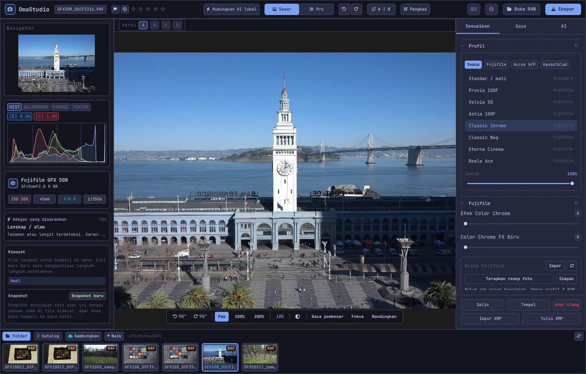

# Panduan Pengguna OmaStudio

**OmaStudio: The Complete Medium Format RAW Editor for Omarchy**

[Semua bahasa](../README.md) · [Teknologi](../technology/id.md) · [README](../../README.md)

Panduan ini membahas OmaStudio 3.1. Isinya menjelaskan cara memasang aplikasi, mengenali bagian-bagian jendela, dan menggunakan setiap panel dan alat. Tangkapan layar menampilkan berkas contoh Fujifilm GFX 50R dan Hasselblad CFV-50c dari [raw.pixls.us](https://raw.pixls.us) (CC0).



## Daftar isi

1. [Pemasangan](#1-pemasangan)
2. [Jendela](#2-jendela)
3. [Membuka foto dan pustaka](#3-membuka-foto-dan-pustaka)
4. [Dasar dan Pro](#4-dasar-dan-pro)
5. [Tab Sesuaikan](#5-tab-sesuaikan)
6. [Tab Masker](#6-tab-masker)
7. [Tab Gaya](#7-tab-gaya)
8. [Tab AI dan obrolan AI](#8-tab-ai-dan-obrolan-ai)
9. [Alat bantu tampilan](#9-alat-bantu-tampilan)
10. [Riwayat, snapshot, dan versi](#10-riwayat-snapshot-dan-versi)
11. [Fujifilm](#11-fujifilm)
12. [Format medium](#12-format-medium)
13. [Ekspor](#13-ekspor)
14. [Akun cloud](#14-akun-cloud)
15. [Papan ketik dan tetikus](#15-papan-ketik-dan-tetikus)
16. [Baris perintah, soket kontrol, dan MCP](#16-baris-perintah-soket-kontrol-dan-mcp)
17. [Berkas dan folder](#17-berkas-dan-folder)
18. [Pemecahan masalah](#18-pemecahan-masalah)

## 1. Pemasangan

OmaStudio berjalan di Omarchy (Arch Linux) dengan Wayland dan Hyprland.

**Dari paket.** Di salinan klon repositori:

```bash
makepkg -si
```

Perintah ini memasang `omastudio`, `omastudio-app`, `omastudio-engine`, profil ICC, entri desktop, ikon, dan aturan udev untuk kamera Fujifilm melalui USB.

**Dari arsip rilis.** Unduh `omastudio-<versi>-x86_64-linux.tar.gz` dari [halaman rilis](https://github.com/ozdil/omarchy-omastudio/releases), periksa dengan `checksums.txt`, ekstrak, lalu salin `bin/*` ke `~/.local/bin` dan `share/omastudio` ke `~/.local/share/omastudio`.

**Paket wajib:** `libraw` 0.22 atau lebih baru, `lcms2`, `qt6-base`, `qt6-declarative`, `qt6-wayland`, dan `qt6-svg` 6.12 atau lebih baru, serta `zenity` untuk dialog berkas.

**Paket opsional:**

| Paket | Kegunaan |
| :--- | :--- |
| `vulkan-icd-loader` dan driver Vulkan GPU Anda | Demosaicing di GPU |
| `perl-image-exiftool` | Mempertahankan metadata EXIF di berkas ekspor |
| `libwebp-utils`, `libheif`, `ffmpeg` | WebP lossy, HEIF, dan cadangan untuk AVIF |
| `onnxruntime` | Masker AI lokal di NPU, GPU, atau CPU |
| `rclone`, `libsecret`, `gnome-keyring` | Google Drive, OneDrive, Dropbox, Box, pCloud, dan Yandex Disk |
| `github-cli` | Akun GitHub |
| `ollama` | Model AI lokal untuk asisten penyuntingan |
| `quickshell` | Tombol OmaStudio di bilah Omarchy |

Jalankan OmaStudio dari menu aplikasi Omarchy, atau jalankan `omastudio` (bisa dengan foto: `omastudio DSCF0001.RAF`). Jika jendela sudah terbuka, foto dibuka di jendela itu.

## 2. Jendela

| Area | Isi |
| :--- | :--- |
| Bilah atas | Nama berkas, penanda dan peringkat bintang, **Hubungkan AI lokal**, sakelar **Dasar** / **Pro**, urungkan dan ulangi, sebelum dan sesudah (**A \| B**), **Pangkas**, menu bahasa, Tentang, **Buka RAW**, dan **Ekspor** |
| Panel kiri | Navigator, alat ukur (histogram, bentuk gelombang, parade RGB, vektorskop) dengan indikator clipping, detail kamera dan lensa, adegan yang disarankan, riwayat, dan snapshot |
| Tengah | Foto, bilah versi (A–D) di atasnya, dan bilah tampilan di bawahnya: putar, **Pas**, 100%, 200%, zoom saat ini, warna sekitar, **Kaca pembesar**, **Fokus**, **Bandingkan** |
| Panel kanan | Tab **Sesuaikan**, **Masker** (Pro), **Gaya**, dan **AI**, serta baris tetap berisi **Salin**, **Tempel**, **Atur ulang**, **Impor XMP**, dan **Tulis XMP** |
| Strip film | **Folder**, **Katalog**, satu tab per akun cloud, **Sambungkan**, **Naik**, dan foto-foto di folder saat ini |

**Tab** menyembunyikan dan menampilkan kedua panel samping dan strip film sekaligus. Setiap bagian panel dapat dibuka dan ditutup dari judulnya; **Ctrl+klik** pada judul hanya membiarkan bagian itu terbuka. Tab yang terbuka, bagian yang ditutup, dan panel yang ditampilkan diingat antarsesi.

Warna, fon, dan kelengkungan sudut mengikuti tema Omarchy yang aktif secara langsung. Area di sekitar foto secara bawaan berwarna abu-abu gelap netral agar tema tidak mengubah tampilan warna; tombol warna sekitar di bilah tampilan beralih ke abu-abu tengah atau warna tema.

| Tokyo Night | Catppuccin Latte | Gruvbox | Rosé Pine |
| :---: | :---: | :---: | :---: |
|  |  |  |  |

Antarmuka tersedia dalam 30 bahasa. Antarmuka mengikuti bahasa sistem; menu bahasa di bilah atas memilih bahasa lain dan langsung menerapkannya.

## 3. Membuka foto dan pustaka

- **Buka RAW** (Ctrl+O) membuka dialog berkas. Dialog ini menyaring menurut foto, RAW, atau gambar.
- Seret foto atau folder dari pengelola berkas ke jendela.
- Di strip film, **Folder** menampilkan folder saat ini; klik folder untuk masuk dan **Naik** untuk kembali. Klik foto untuk membukanya. Ctrl+← dan Ctrl+→ berpindah ke foto sebelumnya dan berikutnya.
- **Katalog** menampilkan setiap foto yang pernah dilihat OmaStudio, lengkap dengan peringkat, penanda, dan label warnanya.

OmaStudio membuka setiap format RAW yang dibaca LibRaw 0.22 (Fujifilm, Hasselblad, Phase One, Leica, Pentax, Mamiya/Leaf, Canon, Nikon, Sony, Panasonic, Olympus, Sigma, DNG, dan lainnya), serta JPEG, PNG, WebP, TIFF, HEIF/HEIC, AVIF, JPEG XL, OpenEXR, Radiance HDR, dan PNM.

**Peringkat dan penanda.** Tombol 1 sampai 5 mengatur peringkat bintang dan 0 menghapusnya. P menandai sebagai pilihan, X sebagai ditolak, dan U menghapus penanda. Peringkat dan penanda langsung disimpan di katalog dan berkas pendamping.

**Pemilihan.** Shift+klik memilih rentang di strip film dan Ctrl+klik menambah atau menghapus foto. Jika lebih dari satu foto dipilih, jendela Ekspor mengekspor semuanya (**Batch**).

Berkas asli Anda tidak pernah diubah. Suntingan disimpan di samping foto dalam berkas pendamping, `<foto>.omastudio`, selagi Anda bekerja (Ctrl+S langsung menyimpan).

## 4. Dasar dan Pro

Sakelar di bilah atas menentukan berapa banyak alat yang ditampilkan.

- **Dasar:** profil, Fujifilm, keseimbangan putih, nada, kehadiran, preset, dan LUT 3D.
- **Pro** menambahkan kurva nada, mixer warna, gradasi warna, detail dan optik, transformasi, butiran, manajemen warna, dan tab **Masker**. Bagian Pro diberi label "Pro".

Saat kembali ke Dasar, bagian Pro disembunyikan; pengaturannya tetap diterapkan.


## 5. Tab Sesuaikan

Setiap penggeser diatur ulang saat diklik ganda. Tombol atur ulang di judul bagian mengatur ulang seluruh bagian.

### Profil

Tampilan dasar: **Standar / mati**, simulasi film Fujifilm (Provia, Velvia, Astia, Classic Chrome, Classic Neg, Eterna, Eterna Bleach Bypass, Reala Ace, Nostalgic Neg, PRO Neg Std dan Hi, Acros dan Monochrome dengan filter kuning, merah, dan hijau, Sepia), dan profil warna alami bergaya Hasselblad. Tab-tabnya menyaring daftar. **Jumlah** mencampur profil dengan rendering netral.

### Fujifilm

**Efek Color Chrome** dan **Color Chrome FX Biru** (Lemah = 50, Kuat = 100) memperdalam warna jenuh, dan warna biru untuk FX Biru, sambil mempertahankan ronanya. Pustaka resep, kamera melalui USB, dan Pixel Shift dijelaskan di [Fujifilm](#11-fujifilm).

### Keseimbangan putih

**Suhu** (2000–12000 K) dan **Rona**, relatif terhadap keseimbangan putih yang direkam kamera. Foto dibuka dengan pengaturan saat pemotretan.

### Nada

**Eksposur** (−5 sampai +5 EV, pada cahaya linear: +1 EV menggandakan cahaya), **Kontras**, **Sorotan**, **Bayangan**, **Putih**, dan **Hitam**.

### Kehadiran

**Tekstur**, **Kejernihan** (kontras nada tengah), **Hilangkan kabut**, **Vibransi**, dan **Saturasi**.

### Kurva nada (Pro)

Kurva titik di atas histogram, untuk RGB dan untuk merah, hijau, dan biru secara terpisah. Klik untuk menambah titik, seret untuk memindahkannya, dan klik ganda untuk menghapusnya. Kurva tidak pernah melampaui titik-titiknya. Empat penggeser wilayah di bawahnya (sorotan, terang, gelap, bayangan) membentuk kurva per area.

### Mixer warna (Pro)

Rona, saturasi, dan luminans untuk delapan warna: merah, oranye, kuning, hijau, aqua, biru, ungu, dan magenta.


### Gradasi warna (Pro)

Roda warna tiga arah untuk bayangan (lift), nada tengah (gamma), dan sorotan (gain), ditambah offset global, sebagai empat roda atau sebagai tab. **Penguat warna**, **Detail nada tengah**, dan **Poros kontras** berada di bawah roda. Mixer kanal di bawahnya mencampur merah, hijau, dan biru ke setiap kanal keluaran, atau ke campuran monokrom.


### Detail dan optik (Pro)

**Penajaman**, **Pengurangan derau** (luma dan warna), **Vinyet**, **Hilangkan pinggiran warna** (aberasi kromatik), dan **Koreksi distorsi lensa**. Koreksi lensa dari berkas Fujifilm dan DNG diterapkan otomatis; penggeser ini bekerja di atasnya.

### Transformasi (Pro)

**Vertikal** meluruskan garis yang menyatu, seperti gedung yang dipotret dari bawah; **Horizontal** melakukan hal yang sama ke samping; **Skala** memperbesar hasilnya. Pangkas setelahnya untuk menghapus tepi kosong.

### Butiran (Pro)

**Jumlah**, **Ukuran**, dan **Kekasaran** butiran film.

### Manajemen warna (Pro)

- **Kompresi gamut** mengembalikan warna yang terdorong ke luar gamut secara halus, alih-alih memotongnya.
- **Kurva nada ACES** adalah peredaman sorotan bergaya film, sebuah pendekatan yang disesuaikan dari transformasi keluaran ACES.
- **Soft proof** (S) menampilkan foto seperti yang akan terlihat dengan profil keluaran, misalnya profil printer dan kertas. Pilih profil dan tujuan rendering. **Peringatan gamut** mewarnai magenta warna yang tidak dapat direproduksi profil. Suntingan dan ekspor tidak berubah.

Ruang warna keluaran sendiri dipilih di jendela Ekspor.


## 6. Tab Masker

Tab Masker ditampilkan dalam mode Pro.

### Perbaiki dan kloning

Aktifkan **Edit titik** dan klik noda pada foto untuk menghapusnya. Noda diganti dari sumber di sebelahnya. Seret lingkaran padat untuk memindahkan noda dan lingkaran putus-putus untuk memilih sumber lain. **Perbaiki** menyesuaikan area salinan dengan cahaya dan warna di sekitar noda; **Kloning** menyalinnya apa adanya. **Ukuran**, **Kelembutan tepi**, dan **Opasitas** berlaku untuk noda yang dipilih dan noda baru.


### Penyesuaian lokal

Setiap lapisan menerapkan eksposur, kontras, sorotan, bayangan, putih, hitam, dan saturasi melalui sebuah masker, dengan opasitas.

| Masker | Cara pembuatan |
| :--- | :--- |
| **Linear** | Gradien di antara dua pegangan pada foto |
| **Radial** | Elips dengan titik tengah, pegangan tepi, dan kelembutan tepi |
| **Luminans** | Rentang kecerahan (tergelap, tercerah, transisi) |
| **Warna** | Warna yang mendekati warna yang diambil dari foto (rentang dan kelembutan tepi) |
| **Kuas** | Dilukis pada foto, dengan ukuran, kelembutan tepi, aliran, dan mode hapus; tombol tengah tetikus menggeser tampilan |
| **Subjek AI**, **Langit AI** | Model segmentasi di komputer Anda (lihat [AI](#8-tab-ai-dan-obrolan-ai)) |

Di **Gabungkan dengan**, bagian tambahan dapat ditambahkan ke, dikurangkan dari, atau diirisankan dengan masker lapisan, dan setiap bagian dapat dibalik.


## 7. Tab Gaya

- **Preset:** **Otomatis** menganalisis foto dan mengatur eksposur, keseimbangan putih, dan nada. Gaya Redup, Cerah, Potret hangat, Hitam putih, serta Teal dan oranye menggantikan gaya sebelumnya alih-alih menumpuk di atasnya; keseimbangan putih, eksposur, pangkasan, dan simulasi film tetap dipertahankan.
- **LUT:** **Muat berkas .cube…** menerapkan LUT 3D milik Anda, dengan jumlah tertentu.


## 8. Tab AI dan obrolan AI

**Hubungkan AI lokal** di bilah atas menggunakan AI yang disiapkan di komputer ini: agen bawaan Omarchy (Claude Code atau Codex, dengan proses masuk masing-masing), jika tidak ada maka Ollama, jika tidak ada maka LM Studio. Setelah terhubung, tombol ini membuka **Obrolan AI** di atas foto: tulis apa yang ingin Anda ubah ("lebih hangat, selamatkan langitnya") dan AI mengatur penyesuaiannya. Ctrl+Z mengurungkan setiap suntingan.

**Asisten penyuntingan** di tab AI melakukan hal yang sama dari panel dan dapat memakai penyedia cloud sebagai gantinya: Anthropic Claude, OpenAI, OpenRouter, atau Google Gemini. Kunci API-nya disimpan di gantungan kunci sistem dan tidak pernah ditulis ke disk atau ke baris perintah. Dengan penyedia cloud atau dengan Claude Code atau Codex, pratinjau foto dikirim ke layanan tersebut; dengan Ollama atau LM Studio, pratinjau tetap di komputer Anda.


**Masker AI.** **Subjek AI** dan **Langit AI** di tab Masker menjalankan model segmentasi ONNX di komputer ini: pertama di NPU (Intel Core Ultra melalui OpenVINO, Snapdragon X melalui QNN, AMD Ryzen AI melalui Vitis AI), lalu di GPU, lalu di CPU. Tidak ada model yang disertakan atau diunduh. Letakkan model di `~/.local/share/omastudio/models` sebagai `subject.onnx` atau `sky.onnx`; `omastudio npu` menampilkan apa yang terpasang.

## 9. Alat bantu tampilan

| Alat bantu | Cara pakai |
| :--- | :--- |
| Zoom | Roda tetikus di posisi penunjuk; **Pas** (Ctrl+0), **100%** (Ctrl+1), **200%**; klik ganda beralih antara pas dan 200%. 100% menampilkan satu piksel foto per piksel layar pada skala tampilan apa pun. |
| Geser | Seret dengan tombol kiri atau tengah tetikus; Shift+roda menggeser ke samping |
| Putar | Tombol putar di bilah tampilan; Alt+roda memutar dengan langkah 1,5° |
| Pangkas (C) | Preset rasio aspek (Asli, 1:1, 4:5, 9:16, 16:9, Bebas) dan kisi (sepertiga, rasio emas, spiral emas) |
| Sebelum dan sesudah (Y, atau A \| B) | Foto dibagi menjadi asli dan suntingan |
| Bandingkan (Shift+C) | Suntingan di samping keadaan lain: Sebelum, sebuah versi, atau snapshot |
| Kaca pembesar (L) | Kotak di bawah penunjuk yang menampilkan foto resolusi penuh dengan skala 1:1 |
| Fokus (Shift+F) | Tepi paling tajam diwarnai hijau; hanya alat bantu tampilan |
| Clipping | Klik **[S]** atau **[H]** di atas histogram untuk menampilkan bayangan yang terpotong dengan biru dan sorotan dengan merah |

| Fokus | Bandingkan |
| :---: | :---: |
|  |  |

| Pangkas | Sebelum dan sesudah |
| :---: | :---: |
|  |  |

Saat foto ditampilkan lebih besar daripada pratinjau, mesin merender area yang terlihat dari berkas resolusi penuh, sehingga detail yang Anda lihat sama dengan hasil ekspor.

## 10. Riwayat, snapshot, dan versi

- **Riwayat** di panel kiri menampilkan setiap langkah suntingan beserta namanya ("Eksposur +0,70", "Kurva nada"). Klik sebuah langkah untuk kembali ke sana; suntingan baru dari titik itu menggantikan langkah-langkah sesudahnya, seperti pada Ctrl+Z.
- **Snapshot** menyimpan suntingan saat ini dengan sebuah nama. **Pulihkan** mengembalikannya sebagai langkah baru yang dapat diurungkan dengan Ctrl+Z. Snapshot disimpan di berkas pendamping.
- **Versi A–D** di atas foto menyimpan hingga empat suntingan terpisah dari foto yang sama. Klik sebuah huruf untuk beralih (Alt+1 sampai Alt+4); klik kanan menyalin suntingan saat ini ke versi itu.
- **Salin** dan **Tempel** (Ctrl+Shift+C, Ctrl+Shift+V) membawa suntingan ke foto lain. **Atur ulang** (Ctrl+R) kembali ke nilai bawaan.
- **Tulis XMP** menyimpan suntingan, peringkat, dan label sebagai berkas pendamping `.xmp` yang dibaca Lightroom, Capture One, darktable, dan digiKam; **Impor XMP** membaca berkas yang ditulis program-program tersebut.

## 11. Fujifilm

- **Resep kamera.** RAF atau JPEG Fujifilm dibuka dengan pengaturan saat pemotretan: simulasi film, nada, warna, ketajaman, pengurangan derau, kejernihan, butiran, Color Chrome, pergeseran keseimbangan putih, dan rentang dinamis (termasuk D-Range Priority). Berkas pendamping yang tersimpan didahulukan.
- **Kecerahan.** Berkas RAF dibuka dengan kecerahan JPEG bawaan kamera.
- **Koreksi lensa.** Distorsi, aberasi kromatik lateral, dan vinyet yang direkam kamera diterapkan untuk lensa XF, XC, dan GF.
- **Pustaka resep.** **Impor** menerima profil X RAW Studio (.FP1, .FP2, .FP3), teks resep ("Film Simulation: Classic Chrome / Grain Effect: Strong, Small …"), atau foto Fujifilm. **Terapkan resep** menerapkan resep yang tersimpan; **Terapkan resep foto** kembali ke resep di dalam berkas; **Simpan** menyimpan resep saat ini.
- **Kamera melalui USB.** Setel mode USB kamera ke USB RAW CONV./BACKUP RESTORE lalu sambungkan. **Baca C1–C7** menampilkan pengaturan kustomnya, **Tulis resep ke C…** menyimpan resep ke sebuah slot (menggantikan isinya), dan **Konversi di kamera** memproses RAF yang terbuka di dalam kamera, bisa dengan resep yang dipilih.
- **Pixel Shift.** Pilih bingkai RAF dari satu rangkaian GFX Pixel Shift di strip film lalu klik **Gabungkan bingkai menjadi DNG**. Empat bingkai memberi warna penuh di setiap piksel; enam belas bingkai menggandakan resolusi.

## 12. Format medium

- **Fujifilm GFX** (GFX 50S, 50R, 50S II, 100, 100S, 100 II, dan lainnya): alur 16-bit dari sensor hingga ekspor, simulasi film, koreksi lensa, dan Pixel Shift.
- Berkas **Hasselblad** 3FR dan FFF dipangkas ke pangkasan bawaan kamera.
- Berkas **Phase One dan Leaf** IIQ dan MOS mendapatkan kalibrasi sensor milik digital back tersebut.
- Berkas **Mamiya** MEF dan **Pentax 645** PEF didukung.
- **Flat field (LCC):** `omastudio-engine medium-format lcc-create <raw>` membuat koreksi dari bidikan target putih yang diterangi merata; koreksi ini diterapkan ke foto di folder tersebut.
- **Multi-shot:** `medium-format multishot f1 f2 f3 f4 --out merged.tif` menggabungkan rangkaian empat bidikan.


## 13. Ekspor

**Ekspor** (E) membuka jendela Ekspor. Enter mengekspor dan Esc menutup.


| Pengaturan | Pilihan |
| :--- | :--- |
| Format berkas | JPEG, PNG (8/16-bit), TIFF (8/16-bit, tanpa kompresi, LZW, atau ZIP), WebP, AVIF (8/10/12-bit), HEIF (8/10/12-bit), JPEG XL (8/16-bit), dan OpenEXR (half atau full float, linear terhadap adegan) |
| Kualitas | 1–100; 100 bersifat lossless untuk WebP, AVIF, dan JPEG XL |
| Ukuran | **Penuh**, 75%, 50%, atau sisi panjang 3840 atau 2048 px |
| Profil warna | sRGB, Display P3, Adobe RGB, ProPhoto RGB, Rec. 2020, ACEScg, atau profil ICC milik Anda |
| Tujuan rendering | Perseptual, Relatif (bawaan), Saturasi, Absolut |
| Metadata | **Pertahankan metadata kamera (EXIF)**, **Hapus lokasi (GPS)** |
| Siapkan untuk | Pangkasan dan penajaman keluaran untuk Instagram, Stories dan Reels, X, Facebook, persegi, dan gambar mini YouTube |
| Tanda air | Teks dengan tag EXIF ({camera}, {lens}, {iso}, {aperture}, {shutter}, {focal}) atau logo PNG, dengan posisi, opasitas, ukuran, dan bayangan |
| Folder dan nama file | Bawaan `~/Pictures/OmaStudio_Exports`; tag dapat ditambahkan ke nama file |
| Unggah ke | Akun cloud yang tersambung |

Setiap format kecuali OpenEXR membawa profil ICC dari ruang warnanya. Batch mengekspor foto yang dipilih satu per satu.

## 14. Akun cloud

**Sambungkan** di strip film menambahkan Google Drive, OneDrive, Dropbox, Box, pCloud, Yandex Disk, atau GitHub. Anda masuk di halaman layanan itu sendiri di peramban; OmaStudio tidak pernah melihat kata sandi Anda.


- Setiap akun mendapat tab di strip film. Telusuri foldernya dan klik foto untuk mengunduhnya (sekali) dan membukanya.
- Folder bernama `OmaStudio` dibuat di setiap akun (di GitHub berupa repositori privat `OmaStudio`) dan menerima unggahan dari jendela Ekspor.
- Layanan penyimpanan berjalan melalui rclone dengan konfigurasi milik OmaStudio sendiri, yang dienkripsi dengan kunci yang disimpan di gantungan kunci sistem. GitHub berjalan melalui GitHub CLI.
- Untuk Google Drive, ID klien Anda sendiri dari Google Cloud Console dapat dimasukkan di **ID klien Google sendiri**.
- **Putuskan** menghapus kunci akun dan salinan unduhan dari komputer ini; berkas di akun tetap ada.

## 15. Papan ketik dan tetikus

| Tombol | Tindakan |
| :--- | :--- |
| Ctrl+O | Buka foto |
| Ctrl+S | Simpan suntingan sekarang |
| Ctrl+Z / Ctrl+Shift+Z atau Ctrl+Y | Urungkan / ulangi |
| Ctrl+Shift+C / Ctrl+Shift+V | Salin / tempel suntingan |
| Ctrl+R | Atur ulang suntingan |
| Ctrl+← / Ctrl+→ | Foto sebelumnya / berikutnya |
| Ctrl+0 / Ctrl+1 | Pas / 100% |
| 1–5, 0 | Peringkat bintang, hapus peringkat |
| P, X, U | Pilih, tolak, hapus penanda |
| C | Pangkas |
| Y | Sebelum dan sesudah |
| S | Soft proof |
| L | Kaca pembesar |
| Shift+F | Fokus |
| Shift+C | Bandingkan |
| Alt+1 … Alt+4 | Versi A–D |
| E | Jendela Ekspor |
| Tab | Sembunyikan atau tampilkan panel |
| Esc | Tutup jendela yang terbuka |

| Tetikus | Tindakan |
| :--- | :--- |
| Roda | Zoom di posisi penunjuk |
| Shift+roda | Geser ke samping |
| Alt+roda | Putar |
| Seret (tombol kiri atau tengah) | Geser |
| Klik ganda pada foto | Pas atau 200% |
| Ctrl+klik pada judul bagian | Hanya bagian itu yang tetap terbuka |
| Klik kanan pada huruf versi | Salin suntingan saat ini ke versi itu |

## 16. Baris perintah, soket kontrol, dan MCP

**Perintah mesin.** Setiap perintah mencetak satu objek JSON, sehingga skrip dan agen dapat menggunakannya.

```bash
omastudio inspect DSCF0001.RAF                      # kamera, lensa, eksposur, histogram, adegan
omastudio export DSCF0001.RAF --recipe '{"exposure":0.5}' --options '{"format":"jpeg"}'
omastudio fuji-recipe DSCF0001.RAF                  # resep kamera
omastudio fuji-pixel-shift DSCF*.RAF --out merged.dng
omastudio xmp export DSCF0001.RAF
omastudio cameras GFX                               # kamera yang didukung dekoder RAW
omastudio gpu                                       # GPU untuk demosaicing
omastudio npu                                       # ONNX Runtime dan akselerator
omastudio cloud status
omastudio --cli help                                # semua perintah
```

**Soket kontrol.** `omastudio ipc <metode> [argumen]` berkomunikasi dengan jendela yang terbuka, misalnya `openPhoto`, `openFolder`, `applyRecipe`, `applyPreset`, `setExposure`, `setWarmth`, `setMode essentials|pro`, `setRightTab`, `showSection`, `setView peaking|compare|softProof|split on|off`, `setZoom`, `showExport`, `showCloud`, `getStatus`, dan `screenshot <berkas.png>`. Soket hanya menjawab pengguna yang sama.

**MCP.** `omastudio mcp` adalah server Model Context Protocol, sehingga agen AI dapat memeriksa, merender, menyeleksi, dan mengekspor foto, membaca resep Fujifilm, dan mengendalikan jendela yang terbuka. Untuk Claude Code: `claude mcp add omastudio -- omastudio mcp`. `omastudio skill` memasang skill agen ke `~/.claude/skills`.

## 17. Berkas dan folder

| Jalur | Isi |
| :--- | :--- |
| `<foto>.omastudio` | Suntingan sebuah foto (berkas pendamping) |
| `~/.local/share/omastudio/catalog.json` | Katalog: peringkat, penanda, dan label warna |
| `~/.local/share/omastudio/fuji-recipes/` | Resep Fujifilm yang tersimpan |
| `~/.local/share/omastudio/icc/` | Profil ICC milik Anda |
| `~/.local/share/omastudio/models/` | Model AI lokal |
| `~/.local/share/omastudio/film-luts/` | LUT simulasi film yang diukur dari foto Anda (`fuji-calibrate`) |
| `~/.config/omastudio/` | Pengaturan, keadaan antarmuka, bahasa, akun cloud |
| `~/.cache/omastudio/` | Gambar mini, pratinjau, dan foto cloud yang diunduh |

## 18. Pemecahan masalah

- **Jendela tidak terbuka.** Jalankan `omastudio` di terminal dan baca pesannya. `omastudio --version` dan `omastudio status` menampilkan apa yang terpasang.
- **GPU tidak digunakan.** `omastudio gpu` menampilkan perangkatnya. Pasang `vulkan-icd-loader` dan driver Vulkan GPU Anda. `OMASTUDIO_GPU=off` memaksa CPU.
- **Kamera tidak ditemukan di USB.** Setel mode USB-nya ke USB RAW CONV./BACKUP RESTORE, sambungkan ulang, dan pastikan aturan udev dari paket sudah terpasang.
- **Layanan cloud menyatakan membutuhkan sebuah program.** Pasang paket yang disebut dialog, misalnya `sudo pacman -S rclone libsecret`.
- **Salin info sistem** di jendela Tentang menyalin versi, GPU, dan detail Omarchy untuk laporan bug. Laporkan masalah di [github.com/ozdil/omarchy-omastudio/issues](https://github.com/ozdil/omarchy-omastudio/issues).
