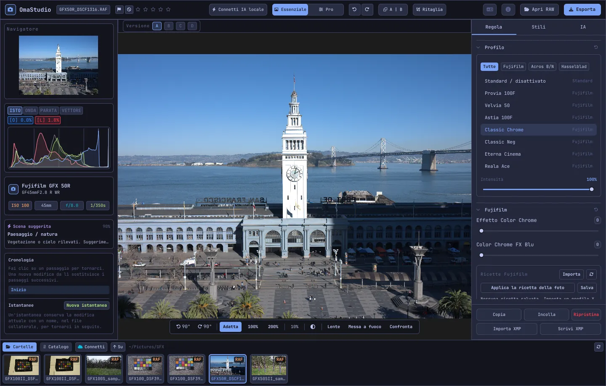

# Guida all'uso di OmaStudio

**OmaStudio: The Complete Medium Format RAW Editor for Omarchy**

[Tutte le lingue](../README.md) · [Tecnologie](../technology/it.md) · [README](../../README.md)

Questa guida riguarda OmaStudio 3.1. Spiega come installare l'applicazione, orientarsi nella finestra e usare ogni pannello e strumento. Le schermate mostrano file di esempio di Fujifilm GFX 50R e Hasselblad CFV-50c da [raw.pixls.us](https://raw.pixls.us) (CC0).



## Indice

1. [Installazione](#1-installazione)
2. [La finestra](#2-la-finestra)
3. [Aprire le foto e la libreria](#3-aprire-le-foto-e-la-libreria)
4. [Essenziale e Pro](#4-essenziale-e-pro)
5. [La scheda Regola](#5-la-scheda-regola)
6. [La scheda Maschere](#6-la-scheda-maschere)
7. [La scheda Stili](#7-la-scheda-stili)
8. [La scheda IA e la conversazione IA](#8-la-scheda-ia-e-la-conversazione-ia)
9. [Aiuti alla visualizzazione](#9-aiuti-alla-visualizzazione)
10. [Cronologia, istantanee e versioni](#10-cronologia-istantanee-e-versioni)
11. [Fujifilm](#11-fujifilm)
12. [Medio formato](#12-medio-formato)
13. [Esportazione](#13-esportazione)
14. [Account cloud](#14-account-cloud)
15. [Tastiera e mouse](#15-tastiera-e-mouse)
16. [Riga di comando, socket di controllo e MCP](#16-riga-di-comando-socket-di-controllo-e-mcp)
17. [File e cartelle](#17-file-e-cartelle)
18. [Risoluzione dei problemi](#18-risoluzione-dei-problemi)

## 1. Installazione

OmaStudio funziona su Omarchy (Arch Linux) con Wayland e Hyprland.

**Dal pacchetto.** In una copia del repository:

```bash
makepkg -si
```

Vengono installati `omastudio`, `omastudio-app`, `omastudio-engine`, i profili ICC, la voce del menu, le icone e una regola udev per le fotocamere Fujifilm collegate via USB.

**Da un archivio di rilascio.** Scaricate `omastudio-<versione>-x86_64-linux.tar.gz` dalla [pagina dei rilasci](https://github.com/ozdil/omarchy-omastudio/releases), verificatelo con `checksums.txt`, estraetelo e copiate `bin/*` in `~/.local/bin` e `share/omastudio` in `~/.local/share/omastudio`.

**Pacchetti necessari:** `libraw` 0.22 o successivo, `lcms2`, `qt6-base`, `qt6-declarative`, `qt6-wayland` e `qt6-svg` 6.12 o successivi, e `zenity` per le finestre di selezione dei file.

**Pacchetti facoltativi:**

| Pacchetto | A cosa serve |
| :--- | :--- |
| `vulkan-icd-loader` e il driver Vulkan della GPU | Demosaicizzazione sulla GPU |
| `perl-image-exiftool` | Mantenere i metadati EXIF nei file esportati |
| `libwebp-utils`, `libheif`, `ffmpeg` | WebP con perdita, HEIF e l'alternativa per AVIF |
| `onnxruntime` | Maschere IA locali su NPU, GPU o CPU |
| `rclone`, `libsecret`, `gnome-keyring` | Google Drive, OneDrive, Dropbox, Box, pCloud e Yandex Disk |
| `github-cli` | Account GitHub |
| `ollama` | Modelli IA locali per l'assistente di modifica |
| `quickshell` | Il pulsante di OmaStudio nella barra di Omarchy |

Avviate OmaStudio dal menu delle applicazioni di Omarchy o eseguite `omastudio` (anche con una foto: `omastudio DSCF0001.RAF`). Se una finestra è già aperta, la foto si apre lì.

## 2. La finestra

| Area | Contenuto |
| :--- | :--- |
| Barra superiore | Nome del file, contrassegni e valutazione a stelle, **Connetti IA locale**, il selettore **Essenziale** / **Pro**, annulla e ripeti, prima e dopo (**A \| B**), **Ritaglia**, menu della lingua, Informazioni, **Apri RAW** ed **Esporta** |
| Pannello sinistro | Navigatore, strumenti di misura (istogramma, forma d'onda, parata RGB, vettorscopio) con indicatori di clipping, dati di fotocamera e obiettivo, la scena suggerita, cronologia e istantanee |
| Centro | La foto, sopra la barra delle versioni (A–D) e sotto la barra di visualizzazione: rotazione, **Adatta**, 100%, 200%, zoom attuale, colore dello sfondo, **Lente**, **Messa a fuoco**, **Confronta** |
| Pannello destro | Le schede **Regola**, **Maschere** (Pro), **Stili** e **IA**, e una riga fissa con **Copia**, **Incolla**, **Ripristina**, **Importa XMP** e **Scrivi XMP** |
| Pellicola | **Cartelle**, **Catalogo**, una scheda per ogni account cloud, **Connetti**, **Su** e le foto della cartella attuale |

**Tab** nasconde e mostra insieme i due pannelli laterali e la pellicola. Ogni sezione si apre e si chiude dalla sua intestazione; **Ctrl+clic** su un'intestazione lascia aperta solo quella sezione. La scheda aperta, le sezioni chiuse e i pannelli visibili vengono ricordati tra una sessione e l'altra.

Colori, carattere e arrotondamento degli angoli seguono in tempo reale il tema Omarchy attivo. L'area intorno alla foto è per impostazione predefinita grigio scuro neutro, così il tema non altera la percezione dei colori; il pulsante dello sfondo nella barra di visualizzazione passa al grigio medio o al colore del tema.

| Tokyo Night | Catppuccin Latte | Gruvbox | Rosé Pine |
| :---: | :---: | :---: | :---: |
|  |  |  |  |

L'interfaccia è disponibile in 30 lingue. Segue la lingua del sistema; il menu della lingua nella barra superiore ne sceglie un'altra e la applica subito.

## 3. Aprire le foto e la libreria

- **Apri RAW** (Ctrl+O) apre la finestra di selezione. Filtra per Foto, RAW o Immagini.
- Trascinate una foto o una cartella dal gestore di file sulla finestra.
- Nella pellicola, **Cartelle** elenca la cartella attuale; fate clic su una cartella per entrarvi e su **Su** per tornare indietro. Fate clic su una foto per aprirla. Ctrl+← e Ctrl+→ passano alla foto precedente e successiva.
- **Catalogo** elenca ogni foto vista da OmaStudio, con valutazione, contrassegno ed etichetta colore.

OmaStudio apre tutti i formati RAW letti da LibRaw 0.22 (Fujifilm, Hasselblad, Phase One, Leica, Pentax, Mamiya/Leaf, Canon, Nikon, Sony, Panasonic, Olympus, Sigma, DNG e altri), oltre a JPEG, PNG, WebP, TIFF, HEIF/HEIC, AVIF, JPEG XL, OpenEXR, Radiance HDR e PNM.

**Valutazioni e contrassegni.** Da 1 a 5 assegnano le stelle e 0 le cancella. P contrassegna come scelta, X come scartata e U toglie il contrassegno. Valutazioni e contrassegni vengono salvati subito nel catalogo e nel file collaterale.

**Selezione.** Maiusc+clic seleziona un intervallo nella pellicola e Ctrl+clic aggiunge o toglie una foto. Con più foto selezionate, la finestra di esportazione le esporta tutte (**Blocco**).

I file originali non vengono mai modificati. Le modifiche vengono salvate durante il lavoro in un file collaterale accanto alla foto, `<foto>.omastudio` (Ctrl+S salva subito).

## 4. Essenziale e Pro

Il selettore nella barra superiore stabilisce quanti strumenti mostrare.

- **Essenziale:** profilo, Fujifilm, bilanciamento del bianco, tono, presenza, predefiniti e LUT 3D.
- **Pro** aggiunge curva tonale, miscelatore colore, correzione colore, dettaglio e ottica, trasforma, grana, gestione del colore e la scheda **Maschere**. Le sezioni Pro hanno l'etichetta «Pro».

Tornando a Essenziale le sezioni Pro vengono nascoste; le loro impostazioni restano applicate.


## 5. La scheda Regola

Ogni cursore si azzera con un doppio clic. Il pulsante di ripristino nell'intestazione di una sezione azzera l'intera sezione.

### Profilo

L'aspetto di base: **Standard / disattivato**, le simulazioni di pellicola Fujifilm (Provia, Velvia, Astia, Classic Chrome, Classic Neg, Eterna, Eterna Bleach Bypass, Reala Ace, Nostalgic Neg, PRO Neg Std e Hi, Acros e Monochrome con filtri giallo, rosso e verde, Seppia) e il profilo colore naturale in stile Hasselblad. Le schede filtrano l'elenco. **Intensità** fonde il profilo con la resa neutra.

### Fujifilm

**Effetto Color Chrome** e **Color Chrome FX Blu** (Debole = 50, Forte = 100) intensificano i colori saturi, e i blu con FX Blu, mantenendone la tinta. La libreria di ricette, la fotocamera via USB e il Pixel Shift sono descritti in [Fujifilm](#11-fujifilm).

### Bilanciamento del bianco

**Temperatura** (2000–12000 K) e **Tinta**, rispetto al bilanciamento del bianco registrato dalla fotocamera. Una foto si apre «come scattata».

### Tono

**Esposizione** (da −5 a +5 EV, su luce lineare: +1 EV raddoppia la luce), **Contrasto**, **Luci**, **Ombre**, **Bianchi** e **Neri**.

### Presenza

**Texture**, **Chiarezza** (contrasto dei mezzitoni), **Rimozione foschia**, **Vividezza** e **Saturazione**.

### Curva tonale (Pro)

Una curva a punti sopra l'istogramma, per RGB e per rosso, verde e blu separatamente. Fate clic per aggiungere un punto, trascinatelo per spostarlo, fate doppio clic per eliminarlo. La curva non oltrepassa mai i suoi punti. I quattro cursori di zona sotto (Luci, Chiari, Scuri, Ombre) modellano la curva per aree.

### Miscelatore colore (Pro)

Tinta, saturazione e luminanza per otto colori: rosso, arancione, giallo, verde, acqua, blu, viola e magenta.


### Correzione colore (Pro)

Ruote colore a tre vie per ombre (lift), mezzitoni (gamma) e luci (gain), più un offset globale, come quattro ruote o come schede. **Potenziamento colore**, **Dettaglio mezzitoni** e **Pivot del contrasto** si trovano sotto le ruote. Il miscelatore canali sottostante miscela rosso, verde e blu in ogni canale di uscita o in una miscela monocromatica.


### Dettaglio e ottica (Pro)

**Nitidezza**, **Riduzione rumore** (luminanza e colore), **Vignettatura**, **Rimozione frange** (aberrazione cromatica) e **Correzione della distorsione dell'obiettivo**. Le correzioni dell'obiettivo Fujifilm e DNG presenti nel file vengono applicate automaticamente; questi cursori agiscono in aggiunta.

### Trasforma (Pro)

**Verticale** raddrizza le linee convergenti, come un edificio fotografato dal basso; **Orizzontale** fa lo stesso lateralmente; **Scala** ingrandisce il risultato. Ritagliate poi per eliminare i bordi vuoti.

### Grana (Pro)

**Quantità**, **Dimensione** e **Ruvidità** della grana della pellicola.

### Gestione del colore (Pro)

- **Compressione della gamma** riporta dolcemente all'interno i colori spinti fuori gamma invece di tagliarli.
- **Curva tonale ACES** è un passaggio cinematografico delle luci, un'approssimazione adattata della trasformazione di uscita ACES.
- **Prova a video** (S) mostra la foto come apparirà con un profilo di uscita, per esempio un profilo di stampante e carta. Scegliete il profilo e l'intento di rendering. **Avviso gamut** colora di magenta i colori che il profilo non può riprodurre. Modifica ed esportazione non cambiano.

Lo spazio colore di uscita si sceglie nella finestra di esportazione.


## 6. La scheda Maschere

La scheda Maschere compare in modalità Pro.

### Correggi e clona

Attivate **Modifica punti** e fate clic su una macchia nella foto per rimuoverla. Viene sostituita da un'area sorgente vicina. Trascinate il cerchio pieno per spostare il punto e quello tratteggiato per scegliere un'altra sorgente. **Correggi** adatta l'area copiata alla luce e al colore intorno al punto; **Clona** la copia così com'è. **Dimensioni**, **Sfumatura** e **Opacità** valgono per il punto selezionato e per quelli nuovi.


### Regolazioni locali

Ogni livello applica esposizione, contrasto, luci, ombre, bianchi, neri e saturazione attraverso una maschera, con un'opacità.

| Maschera | Come si crea |
| :--- | :--- |
| **Lineare** | Una sfumatura tra due maniglie sulla foto |
| **Radiale** | Un'ellisse con maniglie di centro e di bordo e una sfumatura |
| **Luminanza** | Un intervallo di luminosità (più scuro, più chiaro, transizione) |
| **Colore** | I colori vicini a uno prelevato dalla foto (intervallo e sfumatura) |
| **Pennello** | Dipinta sulla foto, con dimensioni, sfumatura, flusso e modalità gomma; il tasto centrale del mouse sposta la vista |
| **Soggetto (IA)**, **Cielo (IA)** | Un modello di segmentazione sul vostro computer (vedi [IA](#8-la-scheda-ia-e-la-conversazione-ia)) |

In **Combina con:** si possono aggiungere, sottrarre o intersecare altre parti con la maschera del livello, e ogni parte può essere invertita.


## 7. La scheda Stili

- **Predefiniti:** **Automatico** analizza la foto e imposta esposizione, bilanciamento del bianco e tono. Gli stili Tenue, Vivido, Ritratto caldo, Bianco e nero, e Verde acqua e arancione sostituiscono lo stile precedente invece di sommarsi; bilanciamento del bianco, esposizione, ritaglio e simulazione di pellicola restano.
- **LUT:** **Carica file .cube…** applica una LUT 3D personale, con un'intensità.


## 8. La scheda IA e la conversazione IA

**Connetti IA locale** nella barra superiore usa l'IA configurata su questo computer: l'agente predefinito di Omarchy (Claude Code o Codex, con il loro accesso), altrimenti Ollama, altrimenti LM Studio. Dopo la connessione il pulsante apre la **Conversazione IA** sopra la foto: scrivete cosa volete cambiare («più caldo, recupera il cielo») e l'IA regola i cursori. Ctrl+Z annulla ogni modifica.

L'**Assistente di modifica** nella scheda IA fa lo stesso dal pannello e può usare invece un fornitore cloud: Anthropic Claude, OpenAI, OpenRouter o Google Gemini. Le loro chiavi API sono conservate nel portachiavi di sistema e non vengono mai scritte su disco né messe su una riga di comando. Con un fornitore cloud, o con Claude Code o Codex, l'anteprima della foto viene inviata a quel servizio; con Ollama o LM Studio resta sul vostro computer.


**Maschere IA.** **Soggetto (IA)** e **Cielo (IA)** nella scheda Maschere eseguono un modello di segmentazione ONNX su questo computer: prima su una NPU (Intel Core Ultra tramite OpenVINO, Snapdragon X tramite QNN, AMD Ryzen AI tramite Vitis AI), poi su una GPU, poi sulla CPU. Nessun modello è incluso o scaricato. Mettete un modello in `~/.local/share/omastudio/models` come `subject.onnx` o `sky.onnx`; `omastudio npu` mostra cosa è installato.

## 9. Aiuti alla visualizzazione

| Aiuto | Come si usa |
| :--- | :--- |
| Zoom | Rotella del mouse sul puntatore; **Adatta** (Ctrl+0), **100%** (Ctrl+1), **200%**; il doppio clic alterna adatta e 200%. Il 100% mostra un pixel della foto per pixel dello schermo a qualsiasi scala. |
| Spostamento | Trascinate con il tasto sinistro o centrale; Maiusc+rotella sposta in orizzontale |
| Rotazione | I pulsanti di rotazione nella barra di visualizzazione; Alt+rotella ruota a passi di 1,5° |
| Ritaglia (C) | Proporzioni predefinite (Originale, 1:1, 4:5, 9:16, 16:9, Libera) e griglie (terzi, sezione aurea, spirale aurea) |
| Prima e dopo (Y, o A \| B) | La foto divisa tra originale e modifica |
| Confronta (Maiusc+C) | La modifica accanto a un altro stato: Prima, una versione o un'istantanea |
| Lente (L) | Un quadrato sotto il puntatore con la foto a piena risoluzione in scala 1:1 |
| Focus peaking (Maiusc+F) | I bordi più nitidi colorati di verde; è solo un aiuto visivo |
| Clipping | Fate clic su **[S]** o **[H]** sopra l'istogramma per vedere le ombre tagliate in blu e le luci in rosso |

| Focus peaking | Confronta |
| :---: | :---: |
|  |  |

| Ritaglia | Prima e dopo |
| :---: | :---: |
|  |  |

Quando la foto è mostrata più grande dell'anteprima, il motore elabora l'area visibile dal file a piena risoluzione, così il dettaglio che vedete corrisponde all'esportazione.

## 10. Cronologia, istantanee e versioni

- **Cronologia** nel pannello sinistro elenca ogni passaggio della modifica per nome («Exposure +0.70», «Tone curve»). Fate clic su un passaggio per tornarvi; una nuova modifica da lì sostituisce i passaggi successivi, come con Ctrl+Z.
- **Istantanee** conservano la modifica attuale con un nome. **Ripristina** ne recupera una come nuovo passaggio che Ctrl+Z può annullare. Le istantanee vengono salvate nel file collaterale.
- **Versioni A–D** sopra la foto contengono fino a quattro modifiche separate della stessa foto. Fate clic su una lettera per passare (Alt+1 – Alt+4); il clic destro copia la modifica attuale in quella versione.
- **Copia** e **Incolla** (Ctrl+Maiusc+C, Ctrl+Maiusc+V) portano una modifica su un'altra foto. **Ripristina** (Ctrl+R) torna ai valori predefiniti.
- **Scrivi XMP** salva modifica, valutazione ed etichetta in un file collaterale `.xmp` letto da Lightroom, Capture One, darktable e digiKam; **Importa XMP** legge un file scritto da questi programmi.

## 11. Fujifilm

- **La ricetta della fotocamera.** Un RAF o un JPEG Fujifilm si apre con le impostazioni dello scatto: simulazione di pellicola, tono, colore, nitidezza, riduzione rumore, chiarezza, grana, Color Chrome, spostamento del bilanciamento del bianco e gamma dinamica (compresa D-Range Priority). Un file collaterale salvato ha la precedenza.
- **Luminosità.** I RAF si aprono con la luminosità del JPEG della fotocamera.
- **Correzioni dell'obiettivo.** Distorsione, aberrazione cromatica laterale e vignettatura registrate dalla fotocamera vengono applicate agli obiettivi XF, XC e GF.
- **Libreria di ricette.** **Importa** accetta un profilo X RAW Studio (.FP1, .FP2, .FP3), il testo di una ricetta («Film Simulation: Classic Chrome / Grain Effect: Strong, Small …») o una foto Fujifilm. **Applica ricetta** applica una ricetta salvata; **Applica la ricetta della foto** torna a quella del file; **Salva** conserva quella attuale.
- **Fotocamera via USB.** Impostate la modalità USB della fotocamera su USB RAW CONV./BACKUP RESTORE e collegatela. **Leggi C1–C7** mostra le sue impostazioni personalizzate, **Scrivi la ricetta in C…** salva una ricetta in uno slot (sostituendone il contenuto) e **Converti nella fotocamera** sviluppa il RAF aperto nella fotocamera, se volete con la ricetta selezionata.
- **Pixel Shift.** Selezionate nella pellicola i fotogrammi RAF di una sequenza Pixel Shift GFX e fate clic su **Unisci i fotogrammi in DNG**. Quattro fotogrammi danno colore completo in ogni pixel; sedici fotogrammi raddoppiano la risoluzione.

## 12. Medio formato

- **Fujifilm GFX** (GFX 50S, 50R, 50S II, 100, 100S, 100 II e altre): elaborazione a 16 bit dal sensore all'esportazione, simulazioni di pellicola, correzioni dell'obiettivo e Pixel Shift.
- I file **Hasselblad** 3FR e FFF vengono ritagliati secondo il ritaglio predefinito della fotocamera.
- I file **Phase One e Leaf** IIQ e MOS ricevono la calibrazione del sensore del dorso.
- Sono supportati i file **Mamiya** MEF e **Pentax 645** PEF.
- **Campo piatto (LCC):** `omastudio-engine medium-format lcc-create <raw>` crea una correzione da uno scatto di un bersaglio bianco illuminato in modo uniforme; viene applicata alle foto di quella cartella.
- **Multi-shot:** `medium-format multishot f1 f2 f3 f4 --out merged.tif` unisce una sequenza di 4 scatti.


## 13. Esportazione

**Esporta** (E) apre la finestra di esportazione. Invio esporta ed Esc chiude.


| Impostazione | Scelte |
| :--- | :--- |
| Formato | JPEG, PNG (8/16 bit), TIFF (8/16 bit, senza compressione, LZW o ZIP), WebP, AVIF (8/10/12 bit), HEIF (8/10/12 bit), JPEG XL (8/16 bit) e OpenEXR (virgola mobile a mezza o piena precisione, lineare di scena) |
| Qualità | 1–100; 100 è senza perdita per WebP, AVIF e JPEG XL |
| Dimensioni | Piena, 75%, 50% o un lato lungo di 3840 o 2048 px |
| Profilo colore | sRGB, Display P3, Adobe RGB, ProPhoto RGB, Rec. 2020, ACEScg o un profilo ICC personale |
| Intento di rendering | Percettivo, Relativo (predefinito), Saturazione, Assoluto |
| Metadati | Mantieni i metadati della fotocamera (EXIF), rimuovi la posizione (GPS) |
| Prepara per | Ritaglio e nitidezza di uscita per Instagram, Storie e Reel, X, Facebook, quadrato e miniature di YouTube |
| Filigrana | Testo con tag EXIF ({camera}, {lens}, {iso}, {aperture}, {shutter}, {focal}) o un logo PNG, con posizione, opacità, dimensioni e ombra |
| Cartella e nome file | Predefinita `~/Pictures/OmaStudio_Exports`; al nome del file si può aggiungere un'etichetta |
| Carica su | Un account cloud collegato |

Tutti i formati tranne OpenEXR contengono il profilo ICC del loro spazio colore. Un blocco esporta le foto selezionate una dopo l'altra.

## 14. Account cloud

**Connetti** nella pellicola aggiunge Google Drive, OneDrive, Dropbox, Box, pCloud, Yandex Disk o GitHub. L'accesso avviene sulla pagina del servizio nel browser; OmaStudio non vede mai la vostra password.


- Ogni account ha una scheda nella pellicola. Sfogliate le sue cartelle e fate clic su una foto per scaricarla (una volta) e aprirla.
- In ogni account viene creata una cartella `OmaStudio` (su GitHub un repository privato `OmaStudio`) che riceve i caricamenti dalla finestra di esportazione.
- I servizi di archiviazione passano per rclone con una configurazione propria di OmaStudio, cifrata con una chiave conservata nel portachiavi di sistema. GitHub passa per GitHub CLI.
- Per Google Drive si può inserire un ID client personale della Google Cloud Console in **ID client Google personale**.
- **Scollega** rimuove da questo computer le chiavi dell'account e le copie scaricate; i file nell'account restano.

## 15. Tastiera e mouse

| Tasto | Azione |
| :--- | :--- |
| Ctrl+O | Apri una foto |
| Ctrl+S | Salva subito la modifica |
| Ctrl+Z / Ctrl+Maiusc+Z o Ctrl+Y | Annulla / ripeti |
| Ctrl+Maiusc+C / Ctrl+Maiusc+V | Copia / incolla la modifica |
| Ctrl+R | Ripristina la modifica |
| Ctrl+← / Ctrl+→ | Foto precedente / successiva |
| Ctrl+0 / Ctrl+1 | Adatta / 100% |
| 1–5, 0 | Valutazione a stelle, cancella valutazione |
| P, X, U | Scegli, scarta, togli contrassegno |
| C | Ritaglia |
| Y | Prima e dopo |
| S | Prova a video |
| L | Lente |
| Maiusc+F | Focus peaking |
| Maiusc+C | Confronta |
| Alt+1 … Alt+4 | Versioni A–D |
| E | Finestra di esportazione |
| Tab | Nascondi o mostra i pannelli |
| Esc | Chiudi la finestra aperta |

| Mouse | Azione |
| :--- | :--- |
| Rotella | Zoom sul puntatore |
| Maiusc+rotella | Spostamento orizzontale |
| Alt+rotella | Rotazione |
| Trascinamento (tasto sinistro o centrale) | Spostamento |
| Doppio clic sulla foto | Adatta o 200% |
| Ctrl+clic sull'intestazione di una sezione | Lascia aperta solo quella sezione |
| Clic destro su una lettera di versione | Copia la modifica attuale in quella versione |

## 16. Riga di comando, socket di controllo e MCP

**Comandi del motore.** Ogni comando stampa un oggetto JSON, così script e agenti possono usarlo.

```bash
omastudio inspect DSCF0001.RAF                      # fotocamera, obiettivo, esposizione, istogramma, scena
omastudio export DSCF0001.RAF --recipe '{"exposure":0.5}' --options '{"format":"jpeg"}'
omastudio fuji-recipe DSCF0001.RAF                  # la ricetta della fotocamera
omastudio fuji-pixel-shift DSCF*.RAF --out merged.dng
omastudio xmp export DSCF0001.RAF
omastudio cameras GFX                               # fotocamere supportate dal decodificatore RAW
omastudio gpu                                       # GPU usata per la demosaicizzazione
omastudio npu                                       # ONNX Runtime e acceleratori
omastudio cloud status
omastudio --cli help                                # tutti i comandi
```

**Socket di controllo.** `omastudio ipc <metodo> [argomenti]` comunica con la finestra aperta, per esempio `openPhoto`, `openFolder`, `applyRecipe`, `applyPreset`, `setExposure`, `setWarmth`, `setMode essentials|pro`, `setRightTab`, `showSection`, `setView peaking|compare|softProof|split on|off`, `setZoom`, `showExport`, `showCloud`, `getStatus` e `screenshot <file.png>`. Il socket risponde solo allo stesso utente.

**MCP.** `omastudio mcp` è un server Model Context Protocol: gli agenti IA possono esaminare, elaborare, selezionare ed esportare foto, leggere le ricette Fujifilm e controllare la finestra aperta. Per Claude Code: `claude mcp add omastudio -- omastudio mcp`. `omastudio skill` installa la skill dell'agente in `~/.claude/skills`.

## 17. File e cartelle

| Percorso | Contenuto |
| :--- | :--- |
| `<foto>.omastudio` | La modifica di una foto (file collaterale) |
| `~/.local/share/omastudio/catalog.json` | Catalogo: valutazioni, contrassegni ed etichette colore |
| `~/.local/share/omastudio/fuji-recipes/` | Ricette Fujifilm salvate |
| `~/.local/share/omastudio/icc/` | I vostri profili ICC |
| `~/.local/share/omastudio/models/` | Modelli IA locali |
| `~/.local/share/omastudio/film-luts/` | LUT di simulazione pellicola misurate dalle vostre foto (`fuji-calibrate`) |
| `~/.config/omastudio/` | Impostazioni, stato dell'interfaccia, lingua, account cloud |
| `~/.cache/omastudio/` | Miniature, anteprime e foto cloud scaricate |

## 18. Risoluzione dei problemi

- **La finestra non si apre.** Eseguite `omastudio` in un terminale e leggete il messaggio. `omastudio --version` e `omastudio status` mostrano cosa è installato.
- **La GPU non viene usata.** `omastudio gpu` mostra il dispositivo. Installate `vulkan-icd-loader` e il driver Vulkan della GPU. `OMASTUDIO_GPU=off` forza la CPU.
- **Una fotocamera USB non viene trovata.** Impostate la modalità USB su USB RAW CONV./BACKUP RESTORE, ricollegatela e verificate che la regola udev del pacchetto sia installata.
- **Un servizio cloud chiede un programma.** Installate il pacchetto indicato dalla finestra, per esempio `sudo pacman -S rclone libsecret`.
- **Copia informazioni di sistema** nella finestra Informazioni copia versione, GPU e dati di Omarchy per una segnalazione. Segnalate i problemi su [github.com/ozdil/omarchy-omastudio/issues](https://github.com/ozdil/omarchy-omastudio/issues).
