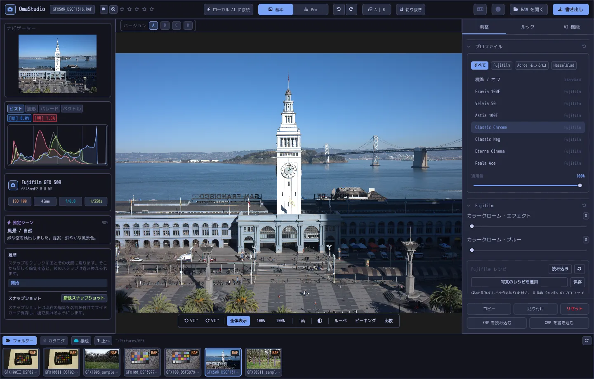

# OmaStudio ユーザーガイド

**OmaStudio: The Complete Medium Format RAW Editor for Omarchy**

[すべての言語](../README.md) · [使用技術](../technology/ja.md) · [README](../../README.md)

このガイドは OmaStudio 3.1 を対象としています。アプリケーションのインストール方法、ウィンドウの構成、各パネルとツールの使い方を説明します。スクリーンショットには [raw.pixls.us](https://raw.pixls.us)（CC0）の Fujifilm GFX 50R と Hasselblad CFV-50c のサンプルファイルを使っています。



## 目次

1. [インストール](#1-インストール)
2. [ウィンドウ](#2-ウィンドウ)
3. [写真を開く・ライブラリ](#3-写真を開くライブラリ)
4. [基本と Pro](#4-基本と-pro)
5. [調整タブ](#5-調整タブ)
6. [マスクタブ](#6-マスクタブ)
7. [ルックタブ](#7-ルックタブ)
8. [AI 機能タブと AI チャット](#8-ai-機能タブと-ai-チャット)
9. [表示の補助機能](#9-表示の補助機能)
10. [履歴・スナップショット・バージョン](#10-履歴スナップショットバージョン)
11. [Fujifilm](#11-fujifilm)
12. [中判](#12-中判)
13. [書き出し](#13-書き出し)
14. [クラウドアカウント](#14-クラウドアカウント)
15. [キーボードとマウス](#15-キーボードとマウス)
16. [コマンドライン・制御ソケット・MCP](#16-コマンドライン制御ソケットmcp)
17. [ファイルとフォルダー](#17-ファイルとフォルダー)
18. [トラブルシューティング](#18-トラブルシューティング)

## 1. インストール

OmaStudio は Omarchy（Arch Linux）の Wayland と Hyprland 上で動作します。

**パッケージから。** リポジトリのクローンで次を実行します。

```bash
makepkg -si
```

`omastudio`、`omastudio-app`、`omastudio-engine`、ICC プロファイル、デスクトップエントリー、アイコン、USB 接続の Fujifilm カメラ用 udev ルールがインストールされます。

**リリースアーカイブから。** [リリースページ](https://github.com/ozdil/omarchy-omastudio/releases)から `omastudio-<バージョン>-x86_64-linux.tar.gz` をダウンロードし、`checksums.txt` で検証してから展開し、`bin/*` を `~/.local/bin` に、`share/omastudio` を `~/.local/share/omastudio` にコピーします。

**必須パッケージ:** `libraw` 0.22 以降、`lcms2`、`qt6-base`、`qt6-declarative`、`qt6-wayland`、`qt6-svg` 6.12 以降、およびファイルダイアログ用の `zenity`。

**任意のパッケージ:**

| パッケージ | 用途 |
| :--- | :--- |
| `vulkan-icd-loader` と GPU の Vulkan ドライバー | GPU でのデモザイク |
| `perl-image-exiftool` | 書き出したファイルに EXIF メタデータを残す |
| `libwebp-utils`、`libheif`、`ffmpeg` | 非可逆 WebP、HEIF、AVIF の代替手段 |
| `onnxruntime` | NPU、GPU、CPU でのローカル AI マスク |
| `rclone`、`libsecret`、`gnome-keyring` | Google Drive、OneDrive、Dropbox、Box、pCloud、Yandex Disk |
| `github-cli` | GitHub アカウント |
| `ollama` | 編集アシスタント用のローカル AI モデル |
| `quickshell` | Omarchy バーの OmaStudio ボタン |

Omarchy のアプリメニューから OmaStudio を起動するか、`omastudio` を実行します（写真を指定することもできます: `omastudio DSCF0001.RAF`）。すでにウィンドウが開いている場合は、そのウィンドウで写真が開きます。

## 2. ウィンドウ

| 領域 | 内容 |
| :--- | :--- |
| 上部バー | ファイル名、フラグと星の評価、**ローカル AI に接続**、**基本** / **Pro** の切り替え、取り消しとやり直し、補正前と補正後（**A \| B**）、**切り抜き**、言語メニュー、バージョン情報、**RAW を開く**、**書き出し** |
| 左パネル | ナビゲーター、白とび・黒つぶれ表示付きの計測表示（ヒストグラム、波形、RGB パレード、ベクトルスコープ）、カメラとレンズの情報、推定シーン、履歴、スナップショット |
| 中央 | 写真、その上のバージョンバー（A–D）、その下の表示バー: 回転、**全体表示**、100%、200%、現在の拡大率、周囲の色、**ルーペ**、**ピーキング**、**比較** |
| 右パネル | **調整**、**マスク**（Pro）、**ルック**、**AI 機能** の各タブと、**コピー**、**貼り付け**、**リセット**、**XMP を読み込む**、**XMP を書き込む** が並ぶ固定行 |
| フィルムストリップ | **フォルダー**、**カタログ**、クラウドアカウントごとのタブ、**接続**、**上へ**、現在のフォルダーの写真 |

**Tab** キーで両側のパネルとフィルムストリップをまとめて隠したり表示したりできます。パネルの各セクションは見出しで開閉でき、見出しを **Ctrl+クリック** するとそのセクションだけが開いた状態になります。開いているタブ、閉じたセクション、表示中のパネルはセッションをまたいで記憶されます。

色、フォント、角の丸みは、有効な Omarchy テーマにリアルタイムで追従します。写真の周囲は既定でニュートラルなダークグレーなので、テーマによって色の見え方が変わりません。表示バーの周囲色ボタンで、ミドルグレーまたはテーマの色に切り替えられます。

| Tokyo Night | Catppuccin Latte | Gruvbox | Rosé Pine |
| :---: | :---: | :---: | :---: |
|  |  |  |  |

インターフェースは 30 言語に対応しています。システムの言語に従い、上部バーの言語メニューで別の言語を選ぶとすぐに切り替わります。

## 3. 写真を開く・ライブラリ

- **RAW を開く**（Ctrl+O）でファイルダイアログが開きます。写真、RAW、画像で絞り込めます。
- ファイルマネージャーから写真やフォルダーをウィンドウにドラッグできます。
- フィルムストリップの **フォルダー** には現在のフォルダーが表示されます。フォルダーをクリックすると中に入り、**上へ** で戻ります。写真をクリックすると開きます。Ctrl+← と Ctrl+→ で前後の写真に移動します。
- **カタログ** には、OmaStudio が一度でも読み込んだすべての写真が評価、フラグ、カラーラベルとともに表示されます。

OmaStudio は LibRaw 0.22 が読み込めるすべての RAW 形式（Fujifilm、Hasselblad、Phase One、Leica、Pentax、Mamiya/Leaf、Canon、Nikon、Sony、Panasonic、Olympus、Sigma、DNG など）に加え、JPEG、PNG、WebP、TIFF、HEIF/HEIC、AVIF、JPEG XL、OpenEXR、Radiance HDR、PNM を開けます。

**評価とフラグ。** 1〜5 で星の評価を付け、0 で消去します。P で採用、X で不採用、U でフラグを消去します。評価とフラグはすぐにカタログとサイドカーファイルに保存されます。

**選択。** フィルムストリップで Shift+クリックすると範囲を選択し、Ctrl+クリックで写真を追加・解除します。複数の写真を選択していると、書き出しウィンドウはそのすべてを書き出します（**一括**）。

元のファイルが変更されることはありません。編集内容は作業中に写真の横のサイドカーファイル `<写真>.omastudio` に保存されます（Ctrl+S ですぐに保存）。

## 4. 基本と Pro

上部バーの切り替えで、表示するツールの数を選びます。

- **基本:** プロファイル、Fujifilm、ホワイトバランス、トーン、外観、プリセット、3D LUT。
- **Pro** ではトーンカーブ、カラーミキサー、カラーグレーディング、ディテールと光学、変形、粒状感、カラーマネジメント、**マスク** タブが加わります。Pro のセクションには「Pro」のタグが付きます。

基本に戻すと Pro のセクションは隠れますが、その設定は適用されたままです。


## 5. 調整タブ

スライダーはダブルクリックでリセットされます。セクション見出しのリセットボタンは、そのセクション全体をリセットします。

### プロファイル

基本の仕上がりです。**標準 / オフ**、Fujifilm のフィルムシミュレーション（Provia、Velvia、Astia、Classic Chrome、Classic Neg、Eterna、Eterna Bleach Bypass、Reala Ace、Nostalgic Neg、PRO Neg Std と Hi、Acros と Monochrome の黄・赤・緑フィルター、Sepia）、Hasselblad 風のナチュラルカラープロファイルがあります。タブで一覧を絞り込めます。**適用量** でプロファイルとニュートラルな描写を混ぜ合わせます。

### Fujifilm

**カラークローム・エフェクト** と **カラークローム・ブルー**（弱 = 50、強 = 100）は、色相を保ったまま彩度の高い色を深くします。カラークローム・ブルーは青に作用します。レシピライブラリ、USB 接続のカメラ、ピクセルシフトについては [Fujifilm](#11-fujifilm) を参照してください。

### ホワイトバランス

**色温度**（2000〜12000 K）と **色かぶり補正** で、カメラが記録したホワイトバランスを基準に調整します。写真は撮影時の設定で開きます。

### トーン

**露光量**（−5〜+5 EV、リニアな光に対して作用: +1 EV で光が 2 倍）、**コントラスト**、**ハイライト**、**シャドウ**、**白レベル**、**黒レベル**。

### 外観

**テクスチャ**、**明瞭度**（中間調のコントラスト）、**かすみの除去**、**自然な彩度**、**彩度**。

### トーンカーブ（Pro）

ヒストグラムの上に表示されるポイントカーブで、RGB と赤・緑・青を個別に調整できます。クリックで点を追加し、ドラッグで移動し、ダブルクリックで削除します。カーブが点を越えて行き過ぎることはありません。下にある 4 つの領域スライダー（ハイライト、明るい部分、暗い部分、シャドウ）で領域ごとにカーブを整えます。

### カラーミキサー（Pro）

レッド、オレンジ、イエロー、グリーン、アクア、ブルー、パープル、マゼンタの 8 色について、色相、彩度、輝度を調整します。


### カラーグレーディング（Pro）

シャドウ（リフト）、中間調（ガンマ）、ハイライト（ゲイン）の 3 方向カラーホイールと全体のオフセットを、4 つのホイールまたはタブで表示します。ホイールの下に **カラーブースト**、**中間調ディテール**、**コントラストの支点** があります。その下のチャンネルミキサーは、赤・緑・青を各出力チャンネル、またはモノクロミックスに混ぜ合わせます。


### ディテールと光学（Pro）

**シャープ**、**ノイズ低減**（輝度とカラー）、**周辺光量**、**フリンジ除去**（色収差）、**レンズの歪曲補正**。Fujifilm と DNG ファイルに含まれるレンズ補正は自動で適用され、これらのスライダーはその上に作用します。

### 変形（Pro）

**垂直方向** は、下から撮った建物のように収束する線をまっすぐにします。**水平方向** は同じことを横方向に行います。**拡大・縮小** で結果を拡大します。その後、切り抜きで空白の縁を取り除いてください。

### 粒状感（Pro）

フィルム粒子の **量**、**サイズ**、**粗さ**。

### カラーマネジメント（Pro）

- **色域圧縮** は、色域の外に押し出された色をクリップせずに、なめらかに色域内へ戻します。
- **ACES トーンカーブ** はフィルムのようなハイライトの丸め込みで、ACES 出力変換をフィッティングした近似です。
- **ソフトプルーフ**（S）は、プリンターと用紙のプロファイルなど、出力プロファイルで写真がどう見えるかを表示します。プロファイルとレンダリングインテントを選びます。**色域外警告** は、そのプロファイルで再現できない色をマゼンタで表示します。編集内容と書き出しは変わりません。

出力の色空間そのものは書き出しウィンドウで選びます。


## 6. マスクタブ

マスクタブは Pro モードで表示されます。

### 修復とコピー

**スポットを編集** をオンにして写真上のスポットをクリックすると、そのスポットが消えます。スポットはそばのソースで置き換えられます。実線の円をドラッグするとスポットが移動し、破線の円をドラッグすると別のソースを選べます。**修復** はコピーした範囲をスポット周辺の明るさと色に合わせ、**コピー** はそのまま複製します。**サイズ**、**ぼかし**、**不透明度** は選択中のスポットと新しいスポットに適用されます。


### 部分補正

各レイヤーは、露光量、コントラスト、ハイライト、シャドウ、白レベル、黒レベル、彩度をマスクを通して不透明度付きで適用します。

| マスク | 作り方 |
| :--- | :--- |
| **線形** | 写真上の 2 つのハンドル間のグラデーション |
| **円形** | 中心、縁のハンドル、ぼかしを持つ楕円 |
| **輝度** | 明るさの範囲（最も暗い値、最も明るい値、境界のなだらかさ） |
| **カラー** | 写真から選んだ色に近い色（範囲とぼかし） |
| **ブラシ** | 写真上に描く。サイズ、ぼかし、流量、消去モード付き。マウスの中ボタンで表示を移動 |
| **AI 被写体**、**AI 空** | お使いのコンピューター上のセグメンテーションモデル（[AI](#8-ai-機能タブと-ai-チャット) を参照） |

**組み合わせ** では、レイヤーのマスクに別の部分を追加、減算、交差でき、それぞれの部分を反転できます。


## 7. ルックタブ

- **プリセット:** **自動** は写真を解析して、露光量、ホワイトバランス、トーンを設定します。落ち着いた、鮮やか、暖かいポートレート、モノクロ、ティール＆オレンジの各ルックは、前のルックに重ねるのではなく置き換えます。ホワイトバランス、露光量、切り抜き、フィルムシミュレーションはそのまま残ります。
- **LUT:** **.cube ファイルを読み込む…** で独自の 3D LUT を適用量付きで適用します。


## 8. AI 機能タブと AI チャット

上部バーの **ローカル AI に接続** は、このコンピューターに設定された AI を使います。Omarchy の既定のエージェント（Claude Code または Codex、それぞれのサインインを使用）、なければ Ollama、それもなければ LM Studio です。接続すると、このボタンで写真の上に **AI チャット** が開きます。変更したい内容を書くと（「もっと暖かく、空を復元して」）、AI が調整を設定します。Ctrl+Z で編集を 1 つずつ取り消せます。

**AI 機能** タブの **編集アシスタント** はパネルから同じことを行い、代わりにクラウドプロバイダー（Anthropic Claude、OpenAI、OpenRouter、Google Gemini）を使うこともできます。API キーはシステムのキーリングに保存され、ディスクやコマンドラインに書き込まれることはありません。クラウドプロバイダーや Claude Code、Codex を使う場合は写真のプレビューがそのサービスに送信されます。Ollama や LM Studio ではコンピューターの外に出ません。


**AI マスク。** マスクタブの **AI 被写体** と **AI 空** は、このコンピューター上で ONNX のセグメンテーションモデルを実行します。まず NPU（OpenVINO 経由の Intel Core Ultra、QNN 経由の Snapdragon X、Vitis AI 経由の AMD Ryzen AI）、次に GPU、最後に CPU を使います。モデルは同梱もダウンロードもされません。`~/.local/share/omastudio/models` に `subject.onnx` または `sky.onnx` としてモデルを置いてください。`omastudio npu` でインストール状況を確認できます。

## 9. 表示の補助機能

| 機能 | 使い方 |
| :--- | :--- |
| 拡大・縮小 | ポインター位置でマウスホイール。**全体表示**（Ctrl+0）、**100%**（Ctrl+1）、**200%**。ダブルクリックで全体表示と 200% を切り替え。100% はディスプレイの拡大率にかかわらず、写真の 1 ピクセルを画面の 1 ピクセルで表示します。 |
| 移動 | 左ボタンまたは中ボタンでドラッグ。Shift+ホイールで横に移動 |
| 回転 | 表示バーの回転ボタン。Alt+ホイールで 1.5° ずつ回転 |
| 切り抜き（C） | 縦横比のプリセット（元画像、1:1、4:5、9:16、16:9、自由）とガイド（三分割、黄金比、黄金螺旋） |
| 補正前と補正後（Y または A \| B） | 写真を元画像と編集後に分割して表示 |
| 比較（Shift+C） | 編集結果を別の状態（補正前、バージョン、スナップショット）と並べて表示 |
| ルーペ（L） | ポインターの下に、フル解像度の写真を 1:1 で表示する四角形 |
| ピーキング（Shift+F） | 最もシャープなエッジを緑で表示。表示上の補助のみ |
| 白とび・黒つぶれ | ヒストグラム上の **[S]** または **[H]** をクリックすると、黒つぶれを青、白とびを赤で表示 |

| ピーキング | 比較 |
| :---: | :---: |
|  |  |

| 切り抜き | 補正前と補正後 |
| :---: | :---: |
|  |  |

写真をプレビューより大きく表示すると、エンジンは表示範囲をフル解像度のファイルからレンダリングするため、見えているディテールが書き出し結果と一致します。

## 10. 履歴・スナップショット・バージョン

- 左パネルの **履歴** には、編集の各手順が名前付きで表示されます（「露光量 +0.70」「トーンカーブ」）。手順をクリックするとその時点に戻り、そこから新たに編集すると、Ctrl+Z の後と同じように以降の手順が置き換わります。
- **スナップショット** は現在の編集を名前を付けて保存します。**復元** で新しい手順として戻すことができ、Ctrl+Z で取り消せます。スナップショットはサイドカーファイルに保存されます。
- 写真の上の **バージョン A–D** には、同じ写真の別々の編集を最大 4 つ保持できます。文字をクリックして切り替え（Alt+1〜Alt+4）、右クリックで現在の編集をそのバージョンにコピーします。
- **コピー** と **貼り付け**（Ctrl+Shift+C、Ctrl+Shift+V）で編集内容を別の写真に適用します。**リセット**（Ctrl+R）で既定値に戻ります。
- **XMP を書き込む** は、編集内容、評価、ラベルを Lightroom、Capture One、darktable、digiKam が読める `.xmp` サイドカーに保存します。**XMP を読み込む** はこれらのプログラムが書いたファイルを読み込みます。

## 11. Fujifilm

- **カメラのレシピ。** RAF や Fujifilm の JPEG は、撮影時の設定で開きます。フィルムシミュレーション、トーン、色、シャープネス、ノイズリダクション、明瞭度、粒状感、カラークローム、ホワイトバランスシフト、ダイナミックレンジ（D レンジ優先を含む）です。保存済みのサイドカーファイルがある場合はそちらが優先されます。
- **明るさ。** RAF はカメラ自身の JPEG と同じ明るさで開きます。
- **レンズ補正。** カメラが記録した歪曲収差、倍率色収差、周辺光量落ちの補正が、XF、XC、GF レンズに適用されます。
- **レシピライブラリ。** **読み込み** では X RAW Studio のプロファイル（.FP1、.FP2、.FP3）、レシピのテキスト（「Film Simulation: Classic Chrome / Grain Effect: Strong, Small …」）、または Fujifilm の写真を取り込めます。**レシピを適用** は保存済みのレシピを適用し、**写真のレシピを適用** はファイル内のレシピに戻し、**保存** は現在のレシピを保存します。
- **USB 接続のカメラ。** カメラの USB モードを USB RAW CONV./BACKUP RESTORE にして接続します。**C1–C7 を読み込む** でカスタム設定を表示し、**レシピを C… に書き込む** でスロットにレシピを保存し（既存の内容は置き換わります）、**カメラ内で変換** で開いている RAF をカメラ内で現像します。選択したレシピを使うこともできます。
- **ピクセルシフト。** フィルムストリップで GFX のピクセルシフト 1 回分の RAF フレームを選び、**フレームを DNG に合成** をクリックします。4 フレームではすべてのピクセルでフルカラーが得られ、16 フレームでは解像度が 2 倍になります。

## 12. 中判

- **Fujifilm GFX**（GFX 50S、50R、50S II、100、100S、100 II など）: センサーから書き出しまでの 16 ビット処理、フィルムシミュレーション、レンズ補正、ピクセルシフト。
- **Hasselblad** の 3FR と FFF ファイルは、カメラの既定のクロップで切り抜かれます。
- **Phase One と Leaf** の IIQ と MOS ファイルには、そのデジタルバック固有のセンサーキャリブレーションが適用されます。
- **Mamiya** の MEF と **Pentax 645** の PEF に対応しています。
- **フラットフィールド（LCC）:** `omastudio-engine medium-format lcc-create <raw>` は、均一に照らした白いターゲットを撮影した画像から補正データを作成します。同じフォルダーの写真に適用されます。
- **マルチショット:** `medium-format multishot f1 f2 f3 f4 --out merged.tif` で 4 ショットのシーケンスを合成します。


## 13. 書き出し

**書き出し**（E）で書き出しウィンドウが開きます。Enter で書き出し、Esc で閉じます。


| 設定 | 選択肢 |
| :--- | :--- |
| ファイル形式 | JPEG、PNG（8/16 ビット）、TIFF（8/16 ビット、圧縮なし・LZW・ZIP）、WebP、AVIF（8/10/12 ビット）、HEIF（8/10/12 ビット）、JPEG XL（8/16 ビット）、OpenEXR（半精度または単精度浮動小数点、シーンリニア） |
| 画質 | 1〜100。WebP、AVIF、JPEG XL では 100 が可逆圧縮 |
| サイズ | **フル**、75%、50%、または長辺 3840 px / 2048 px |
| カラープロファイル | sRGB、Display P3、Adobe RGB、ProPhoto RGB、Rec. 2020、ACEScg、または独自の ICC プロファイル |
| レンダリングインテント | 知覚的、相対的（既定）、彩度、絶対的 |
| メタデータ | **カメラのメタデータを保持 (EXIF)**、**位置情報を削除 (GPS)** |
| 用途 | Instagram、ストーリーズとリール、X、Facebook、正方形、YouTube サムネイル向けの切り抜きと出力シャープ |
| 透かし | EXIF タグ（{camera}、{lens}、{iso}、{aperture}、{shutter}、{focal}）を使ったテキスト、または PNG ロゴ。位置、不透明度、サイズ、影を指定可能 |
| フォルダーとファイル名 | 既定は `~/Pictures/OmaStudio_Exports`。ファイル名にタグを追加できます |
| アップロード先 | 接続済みのクラウドアカウント |

OpenEXR 以外のすべての形式には、その色空間の ICC プロファイルが埋め込まれます。一括書き出しでは、選択した写真を順番に書き出します。

## 14. クラウドアカウント

フィルムストリップの **接続** で、Google Drive、OneDrive、Dropbox、Box、pCloud、Yandex Disk、GitHub を追加できます。サインインはブラウザーでそのサービス自身のページから行うため、OmaStudio がパスワードを見ることはありません。


- アカウントごとにフィルムストリップにタブが追加されます。フォルダーを閲覧し、写真をクリックするとダウンロード（1 回のみ）して開きます。
- 各アカウントに `OmaStudio` というフォルダー（GitHub では非公開リポジトリ `OmaStudio`）が作成され、書き出しウィンドウからのアップロード先になります。
- ストレージサービスは OmaStudio 専用の rclone 設定を使い、その設定はシステムのキーリングに保管された鍵で暗号化されます。GitHub は GitHub CLI を使います。
- Google Drive では、Google Cloud Console で取得した独自のクライアント ID を **独自の Google クライアント ID** に入力できます。
- **接続を解除** すると、このコンピューターからそのアカウントの鍵とダウンロード済みのコピーが削除されます。アカウント上のファイルは残ります。

## 15. キーボードとマウス

| キー | 操作 |
| :--- | :--- |
| Ctrl+O | 写真を開く |
| Ctrl+S | 編集内容を今すぐ保存 |
| Ctrl+Z / Ctrl+Shift+Z または Ctrl+Y | 取り消し / やり直し |
| Ctrl+Shift+C / Ctrl+Shift+V | 編集内容のコピー / 貼り付け |
| Ctrl+R | 編集内容をリセット |
| Ctrl+← / Ctrl+→ | 前の写真 / 次の写真 |
| Ctrl+0 / Ctrl+1 | 全体表示 / 100% |
| 1–5、0 | 星の評価、評価の消去 |
| P、X、U | 採用、不採用、フラグの消去 |
| C | 切り抜き |
| Y | 補正前と補正後 |
| S | ソフトプルーフ |
| L | ルーペ |
| Shift+F | ピーキング |
| Shift+C | 比較 |
| Alt+1 … Alt+4 | バージョン A–D |
| E | 書き出しウィンドウ |
| Tab | パネルの表示・非表示 |
| Esc | 開いているウィンドウを閉じる |

| マウス | 操作 |
| :--- | :--- |
| ホイール | ポインター位置で拡大・縮小 |
| Shift+ホイール | 横に移動 |
| Alt+ホイール | 回転 |
| ドラッグ（左ボタンまたは中ボタン） | 移動 |
| 写真をダブルクリック | 全体表示または 200% |
| セクション見出しを Ctrl+クリック | そのセクションだけを開く |
| バージョンの文字を右クリック | 現在の編集をそのバージョンにコピー |

## 16. コマンドライン・制御ソケット・MCP

**エンジンのコマンド。** どのコマンドも JSON オブジェクトを 1 つ出力するため、スクリプトやエージェントから利用できます。

```bash
omastudio inspect DSCF0001.RAF                      # カメラ、レンズ、露出、ヒストグラム、シーン
omastudio export DSCF0001.RAF --recipe '{"exposure":0.5}' --options '{"format":"jpeg"}'
omastudio fuji-recipe DSCF0001.RAF                  # カメラのレシピ
omastudio fuji-pixel-shift DSCF*.RAF --out merged.dng
omastudio xmp export DSCF0001.RAF
omastudio cameras GFX                               # RAW デコーダーが対応するカメラ
omastudio gpu                                       # デモザイクに使う GPU
omastudio npu                                       # ONNX Runtime とアクセラレーター
omastudio cloud status
omastudio --cli help                                # すべてのコマンド
```

**制御ソケット。** `omastudio ipc <メソッド> [引数]` で開いているウィンドウとやり取りします。たとえば `openPhoto`、`openFolder`、`applyRecipe`、`applyPreset`、`setExposure`、`setWarmth`、`setMode essentials|pro`、`setRightTab`、`showSection`、`setView peaking|compare|softProof|split on|off`、`setZoom`、`showExport`、`showCloud`、`getStatus`、`screenshot <ファイル.png>` です。ソケットは同じユーザーにのみ応答します。

**MCP。** `omastudio mcp` は Model Context Protocol サーバーで、AI エージェントが写真の調査、レンダリング、選別、書き出し、Fujifilm レシピの読み取り、開いているウィンドウの操作を行えます。Claude Code の場合: `claude mcp add omastudio -- omastudio mcp`。`omastudio skill` はエージェント用スキルを `~/.claude/skills` にインストールします。

## 17. ファイルとフォルダー

| パス | 内容 |
| :--- | :--- |
| `<写真>.omastudio` | 写真の編集内容（サイドカー） |
| `~/.local/share/omastudio/catalog.json` | カタログ: 評価、フラグ、カラーラベル |
| `~/.local/share/omastudio/fuji-recipes/` | 保存済みの Fujifilm レシピ |
| `~/.local/share/omastudio/icc/` | 独自の ICC プロファイル |
| `~/.local/share/omastudio/models/` | ローカル AI モデル |
| `~/.local/share/omastudio/film-luts/` | 自分の写真から測定したフィルムシミュレーション LUT（`fuji-calibrate`） |
| `~/.config/omastudio/` | 設定、インターフェースの状態、言語、クラウドアカウント |
| `~/.cache/omastudio/` | サムネイル、プレビュー、ダウンロードしたクラウドの写真 |

## 18. トラブルシューティング

- **ウィンドウが開かない。** ターミナルで `omastudio` を実行し、メッセージを確認してください。`omastudio --version` と `omastudio status` でインストール状況がわかります。
- **GPU が使われない。** `omastudio gpu` でデバイスを確認できます。`vulkan-icd-loader` と GPU の Vulkan ドライバーをインストールしてください。`OMASTUDIO_GPU=off` で CPU を強制します。
- **USB でカメラが見つからない。** USB モードを USB RAW CONV./BACKUP RESTORE にして接続し直し、パッケージの udev ルールがインストールされているか確認してください。
- **クラウドサービスでプログラムが必要と表示される。** ダイアログに表示されたパッケージをインストールしてください（例: `sudo pacman -S rclone libsecret`）。
- バージョン情報ウィンドウの **システム情報をコピー** で、バージョン、GPU、Omarchy の情報をバグ報告用にコピーできます。問題は [github.com/ozdil/omarchy-omastudio/issues](https://github.com/ozdil/omarchy-omastudio/issues) に報告してください。
