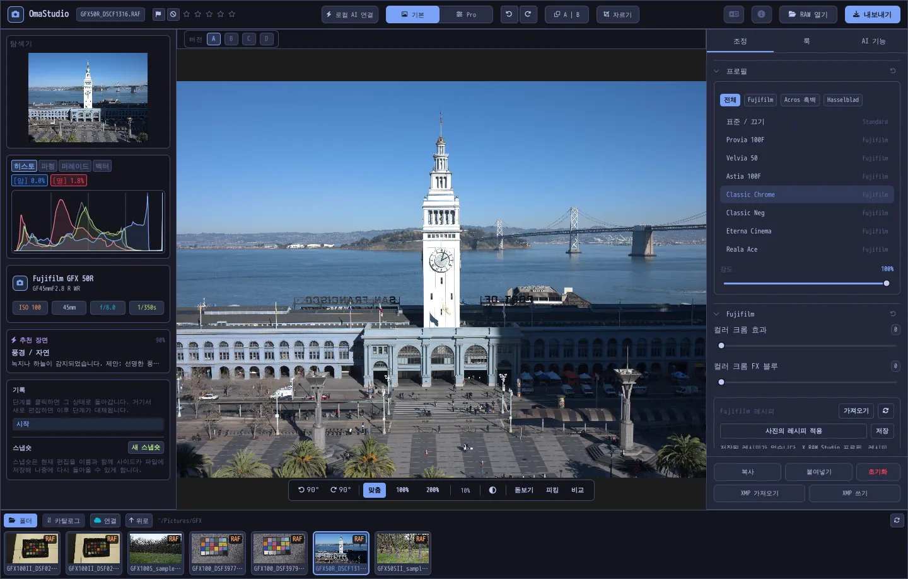

# OmaStudio 사용 설명서

**OmaStudio: The Complete Medium Format RAW Editor for Omarchy**

[모든 언어](../README.md) · [사용 기술](../technology/ko.md) · [README](../../README.md)

이 설명서는 OmaStudio 3.1을 다룹니다. 응용 프로그램 설치 방법, 창의 구성, 각 패널과 도구의 사용법을 설명합니다. 스크린샷에는 [raw.pixls.us](https://raw.pixls.us)(CC0)의 Fujifilm GFX 50R 및 Hasselblad CFV-50c 샘플 파일을 사용했습니다.



## 목차

1. [설치](#1-설치)
2. [창](#2-창)
3. [사진 열기와 라이브러리](#3-사진-열기와-라이브러리)
4. [기본과 Pro](#4-기본과-pro)
5. [조정 탭](#5-조정-탭)
6. [마스크 탭](#6-마스크-탭)
7. [룩 탭](#7-룩-탭)
8. [AI 기능 탭과 AI 채팅](#8-ai-기능-탭과-ai-채팅)
9. [보기 도구](#9-보기-도구)
10. [기록, 스냅숏, 버전](#10-기록-스냅숏-버전)
11. [Fujifilm](#11-fujifilm)
12. [중형 포맷](#12-중형-포맷)
13. [내보내기](#13-내보내기)
14. [클라우드 계정](#14-클라우드-계정)
15. [키보드와 마우스](#15-키보드와-마우스)
16. [명령줄, 제어 소켓, MCP](#16-명령줄-제어-소켓-mcp)
17. [파일과 폴더](#17-파일과-폴더)
18. [문제 해결](#18-문제-해결)

## 1. 설치

OmaStudio는 Omarchy(Arch Linux)의 Wayland와 Hyprland에서 실행됩니다.

**패키지로 설치.** 저장소를 복제한 폴더에서 다음을 실행합니다.

```bash
makepkg -si
```

`omastudio`, `omastudio-app`, `omastudio-engine`, ICC 프로필, 데스크톱 항목, 아이콘, USB로 연결한 Fujifilm 카메라용 udev 규칙이 설치됩니다.

**릴리스 압축 파일로 설치.** [릴리스 페이지](https://github.com/ozdil/omarchy-omastudio/releases)에서 `omastudio-<버전>-x86_64-linux.tar.gz`를 내려받아 `checksums.txt`로 확인한 뒤 압축을 풀고, `bin/*`를 `~/.local/bin`에, `share/omastudio`를 `~/.local/share/omastudio`에 복사합니다.

**필수 패키지:** `libraw` 0.22 이상, `lcms2`, `qt6-base`, `qt6-declarative`, `qt6-wayland`, `qt6-svg` 6.12 이상, 파일 대화 상자용 `zenity`.

**선택 패키지:**

| 패키지 | 용도 |
| :--- | :--- |
| `vulkan-icd-loader`와 GPU의 Vulkan 드라이버 | GPU에서 디모자이크 |
| `perl-image-exiftool` | 내보낸 파일에 EXIF 메타데이터 유지 |
| `libwebp-utils`, `libheif`, `ffmpeg` | 손실 WebP, HEIF, AVIF 대체 경로 |
| `onnxruntime` | NPU, GPU, CPU에서 로컬 AI 마스크 |
| `rclone`, `libsecret`, `gnome-keyring` | Google Drive, OneDrive, Dropbox, Box, pCloud, Yandex Disk |
| `github-cli` | GitHub 계정 |
| `ollama` | 편집 도우미용 로컬 AI 모델 |
| `quickshell` | Omarchy 막대의 OmaStudio 버튼 |

Omarchy 앱 메뉴에서 OmaStudio를 시작하거나 `omastudio`를 실행합니다(사진을 함께 지정할 수도 있습니다: `omastudio DSCF0001.RAF`). 창이 이미 열려 있으면 그 창에서 사진이 열립니다.

## 2. 창

| 영역 | 내용 |
| :--- | :--- |
| 상단 막대 | 파일 이름, 플래그와 별점, **로컬 AI 연결**, **기본** / **Pro** 전환, 실행 취소와 다시 실행, 이전과 이후(**A \| B**), **자르기**, 언어 메뉴, 정보, **RAW 열기**, **내보내기** |
| 왼쪽 패널 | 탐색기, 클리핑 표시가 있는 측정 도구(히스토그램, 파형, RGB 퍼레이드, 벡터스코프), 카메라와 렌즈 정보, 추천 장면, 기록, 스냅숏 |
| 가운데 | 사진, 그 위의 버전 막대(A–D), 아래의 보기 막대: 회전, **맞춤**, 100%, 200%, 현재 확대 비율, 주변 색, **돋보기**, **피킹**, **비교** |
| 오른쪽 패널 | **조정**, **마스크**(Pro), **룩**, **AI 기능** 탭과 **복사**, **붙여넣기**, **초기화**, **XMP 가져오기**, **XMP 쓰기**가 있는 고정 줄 |
| 필름 스트립 | **폴더**, **카탈로그**, 클라우드 계정마다 하나의 탭, **연결**, **위로**, 현재 폴더의 사진 |

**Tab** 키는 양쪽 패널과 필름 스트립을 한꺼번에 숨기거나 표시합니다. 패널의 각 섹션은 머리글을 눌러 펼치거나 접을 수 있으며, 머리글을 **Ctrl+클릭**하면 그 섹션만 열어 둡니다. 열린 탭, 접힌 섹션, 표시 중인 패널은 세션이 바뀌어도 기억됩니다.

색, 글꼴, 모서리 둥글기는 활성 Omarchy 테마를 실시간으로 따릅니다. 사진 주변은 기본적으로 중립적인 짙은 회색이어서 테마 때문에 색이 다르게 보이지 않습니다. 보기 막대의 주변 색 버튼으로 중간 회색이나 테마 색으로 바꿀 수 있습니다.

| Tokyo Night | Catppuccin Latte | Gruvbox | Rosé Pine |
| :---: | :---: | :---: | :---: |
|  |  |  |  |

인터페이스는 30개 언어로 제공됩니다. 시스템 언어를 따르며, 상단 막대의 언어 메뉴에서 다른 언어를 고르면 바로 적용됩니다.

## 3. 사진 열기와 라이브러리

- **RAW 열기**(Ctrl+O)는 파일 대화 상자를 엽니다. 사진, RAW, 이미지별로 걸러 볼 수 있습니다.
- 파일 관리자에서 사진이나 폴더를 창으로 끌어다 놓을 수 있습니다.
- 필름 스트립의 **폴더**에는 현재 폴더가 표시됩니다. 폴더를 클릭하면 들어가고 **위로**를 누르면 돌아옵니다. 사진을 클릭하면 열립니다. Ctrl+←와 Ctrl+→는 이전 사진과 다음 사진으로 이동합니다.
- **카탈로그**에는 OmaStudio가 열어 본 모든 사진이 별점, 플래그, 색상 라벨과 함께 표시됩니다.

OmaStudio는 LibRaw 0.22가 읽는 모든 RAW 형식(Fujifilm, Hasselblad, Phase One, Leica, Pentax, Mamiya/Leaf, Canon, Nikon, Sony, Panasonic, Olympus, Sigma, DNG 등)과 JPEG, PNG, WebP, TIFF, HEIF/HEIC, AVIF, JPEG XL, OpenEXR, Radiance HDR, PNM을 엽니다.

**별점과 플래그.** 1~5는 별점을 매기고 0은 지웁니다. P는 채택, X는 거부, U는 플래그 지우기입니다. 별점과 플래그는 카탈로그와 사이드카 파일에 바로 저장됩니다.

**선택.** 필름 스트립에서 Shift+클릭은 범위를 선택하고 Ctrl+클릭은 사진을 추가하거나 뺍니다. 두 장 이상을 선택하면 내보내기 창이 모두 내보냅니다(**일괄**).

원본 파일은 절대 바뀌지 않습니다. 편집 내용은 작업하는 동안 사진 옆의 사이드카 파일 `<사진>.omastudio`에 저장됩니다(Ctrl+S는 즉시 저장).

## 4. 기본과 Pro

상단 막대의 전환으로 표시할 도구의 양을 고릅니다.

- **기본:** 프로필, Fujifilm, 화이트 밸런스, 톤, 존재감, 사전 설정, 3D LUT.
- **Pro**는 톤 곡선, 색상 혼합, 색 보정, 디테일 및 광학, 변형, 그레인, 색상 관리, **마스크** 탭을 추가합니다. Pro 섹션에는 "Pro" 표시가 붙습니다.

기본으로 돌아가면 Pro 섹션은 숨겨지지만 설정은 그대로 적용됩니다.


## 5. 조정 탭

슬라이더를 두 번 클릭하면 초기화됩니다. 섹션 머리글의 초기화 버튼은 섹션 전체를 초기화합니다.

### 프로필

기본 느낌을 정합니다. **표준 / 끄기**, Fujifilm 필름 시뮬레이션(Provia, Velvia, Astia, Classic Chrome, Classic Neg, Eterna, Eterna Bleach Bypass, Reala Ace, Nostalgic Neg, PRO Neg Std 및 Hi, 노랑·빨강·초록 필터의 Acros와 Monochrome, Sepia), Hasselblad 스타일의 자연스러운 색상 프로필이 있습니다. 탭으로 목록을 걸러 봅니다. **강도**는 프로필과 중립적인 표현을 섞습니다.

### Fujifilm

**컬러 크롬 효과**와 **컬러 크롬 FX 블루**(약 = 50, 강 = 100)는 색조를 유지하면서 채도가 높은 색을, FX 블루는 파란색을 더 깊게 만듭니다. 레시피 라이브러리, USB 카메라, 픽셀 시프트는 [Fujifilm](#11-fujifilm)에서 설명합니다.

### 화이트 밸런스

**색온도**(2000~12000 K)와 **색조**는 카메라가 기록한 화이트 밸런스를 기준으로 합니다. 사진은 촬영 시 설정으로 열립니다.

### 톤

**노출**(−5~+5 EV, 선형 광에 작용: +1 EV는 빛을 두 배로), **대비**, **하이라이트**, **섀도**, **흰색 계열**, **검정 계열**.

### 존재감

**텍스처**, **부분 대비**(중간톤 대비), **디헤이즈**, **생동감**, **채도**.

### 톤 곡선 (Pro)

히스토그램 위의 점 곡선으로, RGB와 빨강·초록·파랑을 따로 조정합니다. 클릭하면 점을 추가하고, 끌면 옮기고, 두 번 클릭하면 지웁니다. 곡선은 점을 넘어서 출렁이지 않습니다. 아래의 영역 슬라이더 네 개(하이라이트, 밝은 영역, 어두운 영역, 섀도)로 영역별로 곡선을 다듬습니다.

### 색상 혼합 (Pro)

빨강, 주황, 노랑, 초록, 아쿠아, 파랑, 보라, 마젠타 여덟 가지 색의 색조, 채도, 휘도를 조정합니다.


### 색 보정 (Pro)

섀도(리프트), 중간톤(감마), 하이라이트(게인)의 3방향 색상 휠과 전체 오프셋을 네 개의 휠 또는 탭으로 표시합니다. 휠 아래에 **색상 강화**, **중간톤 디테일**, **대비 기준점**이 있습니다. 그 아래의 채널 혼합은 빨강, 초록, 파랑을 각 출력 채널이나 흑백 혼합에 섞습니다.


### 디테일 및 광학 (Pro)

**선명하게**, **노이즈 감소**(휘도와 색상), **비네팅**, **프린지 제거**(색수차), **렌즈 왜곡 보정**. Fujifilm 및 DNG 파일에 들어 있는 렌즈 보정은 자동으로 적용되며, 이 슬라이더는 그 위에 더해집니다.

### 변형 (Pro)

**세로**는 아래에서 찍은 건물처럼 모이는 선을 곧게 펴고, **가로**는 같은 작업을 옆 방향으로 하며, **배율**은 결과를 확대합니다. 그런 다음 잘라서 빈 가장자리를 없앱니다.

### 그레인 (Pro)

필름 그레인의 **양**, **크기**, **거칠기**.

### 색상 관리 (Pro)

- **색 영역 압축**은 색역 밖으로 밀려난 색을 잘라 내지 않고 부드럽게 되돌립니다.
- **ACES 톤 커브**는 필름처럼 하이라이트를 부드럽게 눌러 주는 곡선으로, ACES 출력 변환을 맞춘 근사치입니다.
- **소프트 프루프**(S)는 프린터와 용지 프로필 같은 출력 프로필로 사진이 어떻게 보일지 표시합니다. 프로필과 렌더링 의도를 고릅니다. **색역 경고**는 그 프로필이 재현할 수 없는 색을 마젠타로 칠합니다. 편집과 내보내기는 바뀌지 않습니다.

출력 색 공간 자체는 내보내기 창에서 고릅니다.


## 6. 마스크 탭

마스크 탭은 Pro 모드에서 표시됩니다.

### 복구 및 복제

**스팟 편집**을 켜고 사진의 얼룩을 클릭하면 지워집니다. 얼룩은 옆의 원본 영역으로 대체됩니다. 실선 원을 끌면 얼룩 위치가, 점선 원을 끌면 원본 영역이 바뀝니다. **복구**는 복사한 영역을 얼룩 주변의 밝기와 색에 맞추고, **복제**는 그대로 복사합니다. **크기**, **페더**, **불투명도**는 선택한 스팟과 새 스팟에 적용됩니다.


### 부분 조정

각 레이어는 노출, 대비, 하이라이트, 섀도, 흰색 계열, 검정 계열, 채도를 마스크를 통해 불투명도와 함께 적용합니다.

| 마스크 | 만드는 방법 |
| :--- | :--- |
| **선형** | 사진 위 두 핸들 사이의 그러데이션 |
| **방사형** | 중심, 가장자리 핸들, 페더가 있는 타원 |
| **휘도** | 밝기 범위(가장 어두운 값, 가장 밝은 값, 전환 폭) |
| **색상** | 사진에서 고른 색과 가까운 색(범위와 페더) |
| **브러시** | 사진 위에 칠하며 크기, 페더, 흐름, 지우개 모드를 지원. 마우스 가운데 버튼으로 화면 이동 |
| **AI 피사체**, **AI 하늘** | 이 컴퓨터에서 실행되는 분할 모델([AI](#8-ai-기능-탭과-ai-채팅) 참고) |

**결합**에서는 레이어 마스크에 다른 부분을 더하거나, 빼거나, 교차할 수 있고 각 부분을 반전할 수 있습니다.


## 7. 룩 탭

- **사전 설정:** **자동**은 사진을 분석해 노출, 화이트 밸런스, 톤을 설정합니다. 차분함, 선명함, 따뜻한 인물, 흑백, 틸 앤 오렌지 룩은 이전 룩 위에 쌓이지 않고 이를 대체합니다. 화이트 밸런스, 노출, 자르기, 필름 시뮬레이션은 유지됩니다.
- **LUT:** **.cube 파일 불러오기…**로 직접 만든 3D LUT를 강도와 함께 적용합니다.


## 8. AI 기능 탭과 AI 채팅

상단 막대의 **로컬 AI 연결**은 이 컴퓨터에 설정된 AI를 사용합니다. Omarchy 기본 에이전트(각자 로그인한 Claude Code 또는 Codex)가 먼저이고, 없으면 Ollama, 그것도 없으면 LM Studio를 씁니다. 연결되면 이 버튼이 사진 위에 **AI 채팅**을 엽니다. 바꾸고 싶은 내용을 쓰면("더 따뜻하게, 하늘 살려 줘") AI가 조정값을 설정합니다. Ctrl+Z로 편집을 하나씩 취소합니다.

**AI 기능** 탭의 **편집 도우미**는 패널에서 같은 일을 하며, 대신 클라우드 제공자(Anthropic Claude, OpenAI, OpenRouter, Google Gemini)를 사용할 수도 있습니다. API 키는 시스템 키링에 저장되며 디스크나 명령줄에 기록되지 않습니다. 클라우드 제공자나 Claude Code, Codex를 사용하면 사진 미리 보기가 해당 서비스로 전송되고, Ollama나 LM Studio를 사용하면 컴퓨터 밖으로 나가지 않습니다.


**AI 마스크.** 마스크 탭의 **AI 피사체**와 **AI 하늘**은 이 컴퓨터에서 ONNX 분할 모델을 실행합니다. 먼저 NPU(OpenVINO를 통한 Intel Core Ultra, QNN을 통한 Snapdragon X, Vitis AI를 통한 AMD Ryzen AI), 그다음 GPU, 마지막으로 CPU를 씁니다. 모델은 포함되거나 다운로드되지 않습니다. `~/.local/share/omastudio/models`에 `subject.onnx` 또는 `sky.onnx`로 모델을 넣으세요. `omastudio npu`로 설치 상태를 확인할 수 있습니다.

## 9. 보기 도구

| 도구 | 사용법 |
| :--- | :--- |
| 확대/축소 | 포인터 위치에서 마우스 휠, **맞춤**(Ctrl+0), **100%**(Ctrl+1), **200%**. 두 번 클릭하면 맞춤과 200%를 전환합니다. 100%는 디스플레이 배율과 관계없이 사진 1픽셀을 화면 1픽셀로 표시합니다. |
| 이동 | 왼쪽 또는 가운데 버튼으로 끌기. Shift+휠은 옆으로 이동 |
| 회전 | 보기 막대의 회전 버튼. Alt+휠은 1.5°씩 회전 |
| 자르기(C) | 비율 사전 설정(원본, 1:1, 4:5, 9:16, 16:9, 자유)과 안내선(삼분할, 황금비, 황금 나선) |
| 이전과 이후(Y 또는 A \| B) | 원본과 편집본으로 나눈 사진 |
| 비교(Shift+C) | 편집본을 다른 상태(이전, 버전, 스냅숏)와 나란히 표시 |
| 돋보기(L) | 포인터 아래에 전체 해상도 사진을 1:1로 보여 주는 사각형 |
| 피킹(Shift+F) | 가장 선명한 경계를 초록색으로 표시. 보기 도구일 뿐입니다 |
| 클리핑 | 히스토그램 위의 **[S]** 또는 **[H]**를 클릭하면 잘린 섀도는 파란색, 잘린 하이라이트는 빨간색으로 표시 |

| 피킹 | 비교 |
| :---: | :---: |
|  |  |

| 자르기 | 이전과 이후 |
| :---: | :---: |
|  |  |

사진을 미리 보기보다 크게 표시하면 엔진이 보이는 영역을 전체 해상도 파일에서 렌더링하므로, 보이는 디테일이 내보낸 결과와 같습니다.

## 10. 기록, 스냅숏, 버전

- 왼쪽 패널의 **기록**에는 편집의 모든 단계가 이름과 함께 표시됩니다("노출 +0.70", "톤 곡선"). 단계를 클릭하면 그 시점으로 돌아가며, 거기서 새로 편집하면 Ctrl+Z를 쓴 뒤처럼 이후 단계가 대체됩니다.
- **스냅숏**은 현재 편집을 이름을 붙여 보관합니다. **복원**은 이를 새 단계로 되돌리며, Ctrl+Z로 취소할 수 있습니다. 스냅숏은 사이드카 파일에 저장됩니다.
- 사진 위의 **버전 A–D**에는 같은 사진의 서로 다른 편집을 최대 네 개까지 담을 수 있습니다. 글자를 클릭해 전환하고(Alt+1~Alt+4), 오른쪽 클릭하면 현재 편집을 그 버전에 복사합니다.
- **복사**와 **붙여넣기**(Ctrl+Shift+C, Ctrl+Shift+V)로 편집을 다른 사진에 옮깁니다. **초기화**(Ctrl+R)는 기본값으로 되돌립니다.
- **XMP 쓰기**는 편집, 별점, 라벨을 Lightroom, Capture One, darktable, digiKam이 읽을 수 있는 `.xmp` 사이드카로 저장하고, **XMP 가져오기**는 이 프로그램들이 쓴 파일을 읽습니다.

## 11. Fujifilm

- **카메라의 레시피.** RAF나 Fujifilm JPEG는 촬영 당시의 설정으로 열립니다. 필름 시뮬레이션, 톤, 색, 선명도, 노이즈 감소, 부분 대비, 그레인, 컬러 크롬, 화이트 밸런스 시프트, 다이내믹 레인지(D 레인지 우선 포함)가 해당됩니다. 저장된 사이드카 파일이 있으면 그것이 우선합니다.
- **밝기.** RAF는 카메라가 만든 JPEG와 같은 밝기로 열립니다.
- **렌즈 보정.** 카메라가 기록한 왜곡, 배율 색수차, 비네팅 보정이 XF, XC, GF 렌즈에 적용됩니다.
- **레시피 라이브러리.** **가져오기**는 X RAW Studio 프로필(.FP1, .FP2, .FP3), 레시피 텍스트("Film Simulation: Classic Chrome / Grain Effect: Strong, Small …") 또는 Fujifilm 사진을 받습니다. **레시피 적용**은 저장된 레시피를 적용하고, **사진의 레시피 적용**은 파일 안의 레시피로 돌아가며, **저장**은 현재 레시피를 보관합니다.
- **USB 카메라.** 카메라의 USB 모드를 USB RAW CONV./BACKUP RESTORE로 설정하고 연결합니다. **C1–C7 읽기**는 사용자 설정을 보여 주고, **레시피를 C…에 쓰기**는 슬롯에 레시피를 저장하며(기존 내용은 대체됨), **카메라에서 변환**은 열려 있는 RAF를 카메라 안에서 현상합니다. 선택한 레시피를 함께 쓸 수 있습니다.
- **픽셀 시프트.** 필름 스트립에서 GFX 픽셀 시프트 한 세트의 RAF 프레임을 선택하고 **프레임을 DNG로 병합**을 클릭합니다. 4프레임은 모든 픽셀에서 완전한 색을, 16프레임은 두 배의 해상도를 제공합니다.

## 12. 중형 포맷

- **Fujifilm GFX**(GFX 50S, 50R, 50S II, 100, 100S, 100 II 등): 센서부터 내보내기까지 16비트 처리, 필름 시뮬레이션, 렌즈 보정, 픽셀 시프트.
- **Hasselblad** 3FR 및 FFF 파일은 카메라의 기본 자르기로 잘립니다.
- **Phase One 및 Leaf** IIQ, MOS 파일에는 해당 디지털 백 고유의 센서 보정이 적용됩니다.
- **Mamiya** MEF와 **Pentax 645** PEF 파일을 지원합니다.
- **플랫 필드(LCC):** `omastudio-engine medium-format lcc-create <raw>`는 고르게 비춘 흰색 대상을 찍은 사진으로 보정 데이터를 만들며, 같은 폴더의 사진에 적용됩니다.
- **멀티숏:** `medium-format multishot f1 f2 f3 f4 --out merged.tif`로 4장 연속 촬영을 병합합니다.


## 13. 내보내기

**내보내기**(E)는 내보내기 창을 엽니다. Enter는 내보내고 Esc는 닫습니다.


| 설정 | 선택 항목 |
| :--- | :--- |
| 파일 형식 | JPEG, PNG(8/16비트), TIFF(8/16비트, 압축 없음·LZW·ZIP), WebP, AVIF(8/10/12비트), HEIF(8/10/12비트), JPEG XL(8/16비트), OpenEXR(반정밀도 또는 단정밀도 부동소수점, 장면 선형) |
| 품질 | 1~100. WebP, AVIF, JPEG XL에서는 100이 무손실 |
| 크기 | **전체**, 75%, 50% 또는 긴 변 3840 px나 2048 px |
| 색상 프로필 | sRGB, Display P3, Adobe RGB, ProPhoto RGB, Rec. 2020, ACEScg 또는 직접 준비한 ICC 프로필 |
| 렌더링 의도 | 지각적, 상대적(기본값), 채도, 절대적 |
| 메타데이터 | **카메라 메타데이터 유지 (EXIF)**, **위치 정보 제거 (GPS)** |
| 용도 | Instagram, 스토리와 릴스, X, Facebook, 정사각형, YouTube 썸네일에 맞춘 자르기와 출력 선명도 |
| 워터마크 | EXIF 태그({camera}, {lens}, {iso}, {aperture}, {shutter}, {focal})를 쓴 텍스트 또는 PNG 로고. 위치, 불투명도, 크기, 그림자 지정 |
| 폴더와 파일 이름 | 기본값 `~/Pictures/OmaStudio_Exports`. 파일 이름에 태그를 붙일 수 있습니다 |
| 업로드 위치 | 연결된 클라우드 계정 |

OpenEXR을 제외한 모든 형식에는 해당 색 공간의 ICC 프로필이 포함됩니다. 일괄 내보내기는 선택한 사진을 하나씩 차례로 내보냅니다.

## 14. 클라우드 계정

필름 스트립의 **연결**로 Google Drive, OneDrive, Dropbox, Box, pCloud, Yandex Disk, GitHub를 추가합니다. 로그인은 브라우저에서 서비스 자체 페이지로 하므로 OmaStudio는 비밀번호를 볼 수 없습니다.


- 계정마다 필름 스트립에 탭이 생깁니다. 폴더를 둘러보고 사진을 클릭하면 (한 번만) 내려받아 엽니다.
- 각 계정에 `OmaStudio`라는 폴더(GitHub에서는 비공개 저장소 `OmaStudio`)가 만들어지며, 내보내기 창에서 올린 파일이 여기에 저장됩니다.
- 저장소 서비스는 OmaStudio 전용 rclone 설정을 통해 연결되며, 이 설정은 시스템 키링에 보관된 키로 암호화됩니다. GitHub는 GitHub CLI를 사용합니다.
- Google Drive에서는 Google Cloud Console에서 발급한 클라이언트 ID를 **자체 Google 클라이언트 ID**에 입력할 수 있습니다.
- **연결 해제**는 이 컴퓨터에서 해당 계정의 키와 내려받은 사본을 지웁니다. 계정의 파일은 그대로 남습니다.

## 15. 키보드와 마우스

| 키 | 동작 |
| :--- | :--- |
| Ctrl+O | 사진 열기 |
| Ctrl+S | 지금 편집 저장 |
| Ctrl+Z / Ctrl+Shift+Z 또는 Ctrl+Y | 실행 취소 / 다시 실행 |
| Ctrl+Shift+C / Ctrl+Shift+V | 편집 복사 / 붙여넣기 |
| Ctrl+R | 편집 초기화 |
| Ctrl+← / Ctrl+→ | 이전 사진 / 다음 사진 |
| Ctrl+0 / Ctrl+1 | 맞춤 / 100% |
| 1–5, 0 | 별점, 별점 지우기 |
| P, X, U | 채택, 거부, 플래그 지우기 |
| C | 자르기 |
| Y | 이전과 이후 |
| S | 소프트 프루프 |
| L | 돋보기 |
| Shift+F | 피킹 |
| Shift+C | 비교 |
| Alt+1 … Alt+4 | 버전 A–D |
| E | 내보내기 창 |
| Tab | 패널 숨기기 또는 표시 |
| Esc | 열린 창 닫기 |

| 마우스 | 동작 |
| :--- | :--- |
| 휠 | 포인터 위치에서 확대/축소 |
| Shift+휠 | 옆으로 이동 |
| Alt+휠 | 회전 |
| 끌기(왼쪽 또는 가운데 버튼) | 이동 |
| 사진 두 번 클릭 | 맞춤 또는 200% |
| 섹션 머리글 Ctrl+클릭 | 그 섹션만 열어 두기 |
| 버전 글자 오른쪽 클릭 | 현재 편집을 그 버전에 복사 |

## 16. 명령줄, 제어 소켓, MCP

**엔진 명령.** 모든 명령은 JSON 객체 하나를 출력하므로 스크립트와 에이전트에서 쓸 수 있습니다.

```bash
omastudio inspect DSCF0001.RAF                      # 카메라, 렌즈, 노출, 히스토그램, 장면
omastudio export DSCF0001.RAF --recipe '{"exposure":0.5}' --options '{"format":"jpeg"}'
omastudio fuji-recipe DSCF0001.RAF                  # 카메라의 레시피
omastudio fuji-pixel-shift DSCF*.RAF --out merged.dng
omastudio xmp export DSCF0001.RAF
omastudio cameras GFX                               # RAW 디코더가 지원하는 카메라
omastudio gpu                                       # 디모자이크에 쓰는 GPU
omastudio npu                                       # ONNX Runtime과 가속기
omastudio cloud status
omastudio --cli help                                # 모든 명령
```

**제어 소켓.** `omastudio ipc <메서드> [인수]`는 열려 있는 창과 통신합니다. 예: `openPhoto`, `openFolder`, `applyRecipe`, `applyPreset`, `setExposure`, `setWarmth`, `setMode essentials|pro`, `setRightTab`, `showSection`, `setView peaking|compare|softProof|split on|off`, `setZoom`, `showExport`, `showCloud`, `getStatus`, `screenshot <파일.png>`. 소켓은 같은 사용자에게만 응답합니다.

**MCP.** `omastudio mcp`는 Model Context Protocol 서버로, AI 에이전트가 사진을 살펴보고, 렌더링하고, 고르고, 내보내며, Fujifilm 레시피를 읽고, 열린 창을 제어할 수 있습니다. Claude Code에서는 `claude mcp add omastudio -- omastudio mcp`. `omastudio skill`은 에이전트 스킬을 `~/.claude/skills`에 설치합니다.

## 17. 파일과 폴더

| 경로 | 내용 |
| :--- | :--- |
| `<사진>.omastudio` | 사진의 편집 내용(사이드카) |
| `~/.local/share/omastudio/catalog.json` | 카탈로그: 별점, 플래그, 색상 라벨 |
| `~/.local/share/omastudio/fuji-recipes/` | 저장된 Fujifilm 레시피 |
| `~/.local/share/omastudio/icc/` | 직접 추가한 ICC 프로필 |
| `~/.local/share/omastudio/models/` | 로컬 AI 모델 |
| `~/.local/share/omastudio/film-luts/` | 내 사진에서 측정한 필름 시뮬레이션 LUT(`fuji-calibrate`) |
| `~/.config/omastudio/` | 설정, 인터페이스 상태, 언어, 클라우드 계정 |
| `~/.cache/omastudio/` | 썸네일, 미리 보기, 내려받은 클라우드 사진 |

## 18. 문제 해결

- **창이 열리지 않습니다.** 터미널에서 `omastudio`를 실행하고 메시지를 확인하세요. `omastudio --version`과 `omastudio status`로 설치 상태를 볼 수 있습니다.
- **GPU가 사용되지 않습니다.** `omastudio gpu`로 장치를 확인하세요. `vulkan-icd-loader`와 GPU의 Vulkan 드라이버를 설치하세요. `OMASTUDIO_GPU=off`는 CPU를 강제합니다.
- **USB에서 카메라를 찾지 못합니다.** USB 모드를 USB RAW CONV./BACKUP RESTORE로 설정하고 다시 연결한 뒤, 패키지의 udev 규칙이 설치되었는지 확인하세요.
- **클라우드 서비스에서 프로그램이 필요하다고 합니다.** 대화 상자에 표시된 패키지를 설치하세요. 예: `sudo pacman -S rclone libsecret`.
- 정보 창의 **시스템 정보 복사**는 버그 보고용으로 버전, GPU, Omarchy 정보를 복사합니다. 문제는 [github.com/ozdil/omarchy-omastudio/issues](https://github.com/ozdil/omarchy-omastudio/issues)에 보고하세요.
