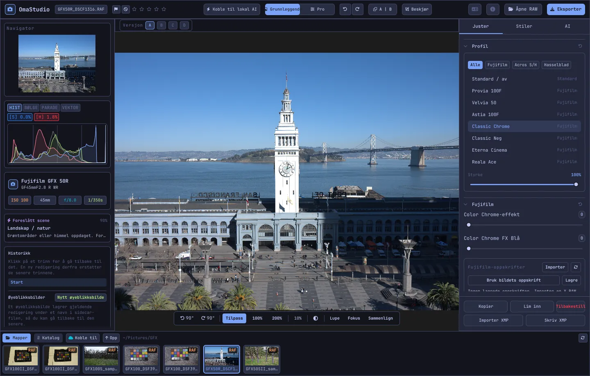

# Brukerveiledning for OmaStudio

**OmaStudio: The Complete Medium Format RAW Editor for Omarchy**

[Alle språk](../README.md) · [Teknologier](../technology/nb.md) · [README](../../README.md)

Denne veiledningen gjelder OmaStudio 3.1. Den forklarer hvordan du installerer programmet, hvordan vinduet er bygd opp, og hvordan du bruker hvert panel og verktøy. Skjermbildene viser eksempelfiler fra Fujifilm GFX 50R og Hasselblad CFV-50c fra [raw.pixls.us](https://raw.pixls.us) (CC0).



## Innhold

1. [Installasjon](#1-installasjon)
2. [Vinduet](#2-vinduet)
3. [Åpne bilder og biblioteket](#3-åpne-bilder-og-biblioteket)
4. [Grunnleggende og Pro](#4-grunnleggende-og-pro)
5. [Fanen Juster](#5-fanen-juster)
6. [Fanen Masker](#6-fanen-masker)
7. [Fanen Stiler](#7-fanen-stiler)
8. [Fanen AI og KI-samtalen](#8-fanen-ai-og-ki-samtalen)
9. [Visningshjelp](#9-visningshjelp)
10. [Historikk, øyeblikksbilder og versjoner](#10-historikk-øyeblikksbilder-og-versjoner)
11. [Fujifilm](#11-fujifilm)
12. [Mellomformat](#12-mellomformat)
13. [Eksport](#13-eksport)
14. [Skykontoer](#14-skykontoer)
15. [Tastatur og mus](#15-tastatur-og-mus)
16. [Kommandolinje, kontrollsocket og MCP](#16-kommandolinje-kontrollsocket-og-mcp)
17. [Filer og mapper](#17-filer-og-mapper)
18. [Feilsøking](#18-feilsøking)

## 1. Installasjon

OmaStudio kjører på Omarchy (Arch Linux) under Wayland og Hyprland.

**Fra pakken.** I en klone av depotet:

```bash
makepkg -si
```

Dette installerer `omastudio`, `omastudio-app`, `omastudio-engine`, ICC-profilene, skrivebordsoppføringen, ikonene og en udev-regel for Fujifilm-kameraer på USB.

**Fra et utgivelsesarkiv.** Last ned `omastudio-<versjon>-x86_64-linux.tar.gz` fra [utgivelsessiden](https://github.com/ozdil/omarchy-omastudio/releases), kontroller det mot `checksums.txt`, pakk det ut, og kopier `bin/*` til `~/.local/bin` og `share/omastudio` til `~/.local/share/omastudio`.

**Nødvendige pakker:** `libraw` 0.22 eller nyere, `lcms2`, `qt6-base`, `qt6-declarative`, `qt6-wayland` og `qt6-svg` 6.12 eller nyere, og `zenity` for fildialogene.

**Valgfrie pakker:**

| Pakke | Brukes til |
| :--- | :--- |
| `vulkan-icd-loader` og grafikkortets Vulkan-driver | Demosaicing på GPU-en |
| `perl-image-exiftool` | Å beholde EXIF-metadata i eksporterte filer |
| `libwebp-utils`, `libheif`, `ffmpeg` | WebP med tap, HEIF og reserveløsningen for AVIF |
| `onnxruntime` | Lokale AI-masker på en NPU, GPU eller CPU |
| `rclone`, `libsecret`, `gnome-keyring` | Google Drive, OneDrive, Dropbox, Box, pCloud og Yandex Disk |
| `github-cli` | GitHub-konto |
| `ollama` | Lokale AI-modeller for redigeringsassistenten |
| `quickshell` | OmaStudio-knappen i Omarchy-linjen |

Start OmaStudio fra Omarchys programmeny, eller kjør `omastudio` (eventuelt med et bilde: `omastudio DSCF0001.RAF`). Hvis et vindu allerede er åpent, åpnes bildet i det vinduet.

## 2. Vinduet

| Område | Innhold |
| :--- | :--- |
| Øverste linje | Filnavn, flagg og stjernevurdering, **Koble til lokal AI**, bryteren **Grunnleggende** / **Pro**, angre og gjør om, før og etter (**A \| B**), **Beskjær**, språkmeny, Om, **Åpne RAW** og **Eksporter** |
| Venstre panel | Navigator, målere (histogram, bølgeform, RGB-parade, vektorskop) med klippingsindikatorer, kamera- og objektivdetaljer, den foreslåtte scenen, historikk og øyeblikksbilder |
| Midten | Bildet, versjonslinjen (A–D) over det og visningslinjen under det: roter, **Tilpass**, 100 %, 200 %, gjeldende zoom, omgivelsesfarge, **Lupe**, **Fokus**, **Sammenlign** |
| Høyre panel | Fanene **Juster**, **Masker** (Pro), **Stiler** og **AI**, og en fast rad med **Kopier**, **Lim inn**, **Tilbakestill**, **Importer XMP** og **Skriv XMP** |
| Filmstripe | **Mapper**, **Katalog**, én fane per skykonto, **Koble til**, **Opp** og bildene i gjeldende mappe |

**Tab** skjuler og viser begge sidepanelene og filmstripen samtidig. Hver seksjon i et panel kan brettes ut og sammen fra overskriften; **Ctrl+klikk** på en overskrift holder bare den seksjonen åpen. Den åpne fanen, de sammenbrettede seksjonene og hvilke paneler som vises, huskes mellom øktene.

Fargene, skrifttypen og hjørneavrundingen følger det aktive Omarchy-temaet, umiddelbart. Området rundt bildet er nøytralt mørkegrått som standard, slik at temaet ikke endrer hvordan fargene oppfattes; omgivelsesknappen i visningslinjen bytter til mellomgrått eller temafargen.

| Tokyo Night | Catppuccin Latte | Gruvbox | Rosé Pine |
| :---: | :---: | :---: | :---: |
|  |  |  |  |

Grensesnittet finnes på 30 språk. Det følger systemspråket; språkmenyen i den øverste linjen velger et annet og tar det i bruk med en gang.

## 3. Åpne bilder og biblioteket

- **Åpne RAW** (Ctrl+O) åpner fildialogen. Den filtrerer på bilder, RAW eller bildefiler.
- Dra et bilde eller en mappe fra filbehandleren inn i vinduet.
- I filmstripen viser **Mapper** gjeldende mappe; klikk på en mappe for å gå inn i den og på **Opp** for å gå tilbake. Klikk på et bilde for å åpne det. Ctrl+← og Ctrl+→ går til forrige og neste bilde.
- **Katalog** viser alle bilder OmaStudio har sett, med vurdering, flagg og fargeetikett.

OmaStudio åpner alle RAW-formater som LibRaw 0.22 leser (Fujifilm, Hasselblad, Phase One, Leica, Pentax, Mamiya/Leaf, Canon, Nikon, Sony, Panasonic, Olympus, Sigma, DNG og andre), i tillegg til JPEG, PNG, WebP, TIFF, HEIF/HEIC, AVIF, JPEG XL, OpenEXR, Radiance HDR og PNM.

**Vurdering og flagg.** 1 til 5 setter stjernevurderingen, og 0 fjerner den. P merker et valg, X en forkastelse, og U fjerner flagget. Vurderinger og flagg lagres i katalogen og sidefilen med en gang.

**Utvalg.** Shift+klikk velger et område i filmstripen, og Ctrl+klikk legger til eller fjerner et bilde. Når mer enn ett bilde er valgt, eksporterer eksportvinduet alle sammen (**Sats**).

Originalfilene dine endres aldri. Redigeringer lagres ved siden av bildet i en sidefil, `<bilde>.omastudio`, mens du jobber (Ctrl+S lagrer med en gang).

## 4. Grunnleggende og Pro

Bryteren i den øverste linjen bestemmer hvor mange verktøy som vises.

- **Grunnleggende:** profil, Fujifilm, hvitbalanse, tone, nærvær, forhåndsinnstillinger og 3D-LUT-er.
- **Pro** legger til tonekurve, fargemikser, fargegradering, detaljer og optikk, transformering, korn, fargestyring og fanen **Masker**. Pro-seksjoner er merket "Pro".

Når du bytter tilbake til Grunnleggende, skjules Pro-seksjonene; innstillingene deres forblir i bruk.


## 5. Fanen Juster

Hver glidebryter tilbakestilles når du dobbeltklikker på den. Tilbakestillingsknappen i en seksjonsoverskrift tilbakestiller hele seksjonen.

### Profil

Grunnutseendet: **Standard / av**, Fujifilms filmsimuleringer (Provia, Velvia, Astia, Classic Chrome, Classic Neg, Eterna, Eterna Bleach Bypass, Reala Ace, Nostalgic Neg, PRO Neg Std og Hi, Acros og Monochrome med gult, rødt og grønt filter, Sepia) og den naturlige fargeprofilen i Hasselblad-stil. Fanene filtrerer listen. **Styrke** blander profilen med den nøytrale gjengivelsen.

### Fujifilm

**Color Chrome-effekt** og **Color Chrome FX Blå** (Svak = 50, Sterk = 100) gjør mettede farger dypere, og for FX Blå de blå, uten å endre fargetonen. Oppskriftsbiblioteket, kameraet på USB og Pixel Shift er beskrevet under [Fujifilm](#11-fujifilm).

### Hvitbalanse

**Temperatur** (2000–12000 K) og **Fargetone**, i forhold til hvitbalansen kameraet registrerte. Et bilde åpnes med "som tatt".

### Tone

**Eksponering** (−5 til +5 EV, på lineært lys: +1 EV dobler lyset), **Kontrast**, **Høylys**, **Skygger**, **Hvite** og **Svarte**.

### Nærvær

**Struktur**, **Klarhet** (mellomtonekontrast), **Fjern dis**, **Livfullhet** og **Metning**.

### Tonekurve (Pro)

En punktkurve over histogrammet, for RGB og for rød, grønn og blå hver for seg. Klikk for å legge til et punkt, dra for å flytte det, dobbeltklikk for å fjerne det. Kurven går aldri forbi punktene sine. De fire områdeglidebryterne under (høylys, lyse toner, mørke toner, skygger) former kurven etter område.

### Fargemikser (Pro)

Fargetone, metning og luminans for åtte farger: rød, oransje, gul, grønn, akva, blå, lilla og magenta.


### Fargegradering (Pro)

Treveis fargehjul for skygger (lift), mellomtoner (gamma) og høylys (gain), pluss en global forskyvning, som fire hjul eller som faner. **Fargeforsterkning**, **Mellomtonedetalj** og **Kontrastdreiepunkt** ligger under hjulene. Kanalmikseren under dem blander rødt, grønt og blått inn i hver utgangskanal, eller i en monokrom miks.


### Detaljer og optikk (Pro)

**Skarphet**, **Støyreduksjon** (luminans og farge), **Vignettering**, **Fjern fargekanter** (kromatisk aberrasjon) og **Korrigering av objektivforvrengning**. Objektivkorrigeringer fra Fujifilm- og DNG-filer brukes automatisk; disse glidebryterne virker i tillegg.

### Transformer (Pro)

**Loddrett** retter opp konvergerende linjer, som en bygning fotografert nedenfra; **Vannrett** gjør det samme sidelengs; **Skala** forstørrer resultatet. Beskjær etterpå for å fjerne de tomme kantene.

### Korn (Pro)

**Mengde**, **Størrelse** og **Ruhet** for filmkorn.

### Fargestyring (Pro)

- **Gamutkomprimering** fører farger som er dyttet utenfor fargeomfanget, mykt tilbake i stedet for å klippe dem.
- **ACES-tonekurve** er en filmisk avrunding av høylysene, en tilpasset tilnærming til ACES-utgangstransformasjonen.
- **Softproof** (S) viser bildet slik det vil se ut med en utgangsprofil, for eksempel en profil for skriver og papir. Velg profilen og gjengivelsesmetoden. **Fargeomfangsvarsel** maler fargene profilen ikke kan gjengi, i magenta. Redigeringen og eksporten endres ikke.

Selve utgangsfargerommet velges i eksportvinduet.


## 6. Fanen Masker

Fanen Masker vises i Pro-modus.

### Reparer og klon

Slå på **Rediger punkter**, og klikk på en flekk i bildet for å fjerne den. Flekken erstattes fra en kilde ved siden av. Dra den heltrukne sirkelen for å flytte flekken og den stiplede sirkelen for å velge en annen kilde. **Reparer** tilpasser det kopierte området til lyset og fargen rundt flekken; **Klon** kopierer det som det er. **Størrelse**, **Myk kant** og **Dekkevne** gjelder den valgte flekken og nye flekker.


### Lokale justeringer

Hvert lag bruker eksponering, kontrast, høylys, skygger, hvite, svarte og metning gjennom en maske, med en dekkevne.

| Maske | Slik lages den |
| :--- | :--- |
| **Lineær** | En gradient mellom to håndtak på bildet |
| **Radial** | En ellipse med et senter, kanthåndtak og en myk kant |
| **Luminans** | Et lysstyrkeområde (mørkeste, lyseste, overgang) |
| **Farge** | Farger nær en som er plukket fra bildet (område og myk kant) |
| **Pensel** | Males på bildet med størrelse, myk kant, flyt og en viskemodus; den midtre museknappen panorerer |
| **AI-motiv**, **AI-himmel** | En segmenteringsmodell på datamaskinen din (se [AI](#8-fanen-ai-og-ki-samtalen)) |

Under **Kombiner med** kan flere deler legges til, trekkes fra eller snittes med lagets maske, og hver del kan inverteres.


## 7. Fanen Stiler

- **Forhåndsinnstillinger:** **Automatisk** analyserer bildet og stiller inn eksponering, hvitbalanse og tone. Stilene Dempet, Livlig, Varmt portrett, Svart-hvitt og Blågrønn og oransje erstatter den forrige stilen i stedet for å legges oppå den; hvitbalanse, eksponering, beskjæring og filmsimulering beholdes.
- **LUT:** **Last inn .cube-fil…** bruker din egen 3D-LUT, med en styrke.


## 8. Fanen AI og KI-samtalen

**Koble til lokal AI** i den øverste linjen bruker AI-en som er satt opp på denne datamaskinen: Omarchys standardagent (Claude Code eller Codex, med egen pålogging), ellers Ollama, ellers LM Studio. Når den er tilkoblet, åpner knappen **KI-samtale** over bildet: skriv hva du vil endre ("varmere, berg himmelen"), og AI-en stiller inn justeringene. Ctrl+Z angrer hver endring.

**Redigeringsassistent** i fanen AI gjør det samme fra panelet og kan bruke en skyleverandør i stedet: Anthropic Claude, OpenAI, OpenRouter eller Google Gemini. API-nøklene deres lagres i systemets nøkkelring og skrives aldri til disk eller på en kommandolinje. Med en skyleverandør eller med Claude Code eller Codex sendes forhåndsvisningen av bildet til den tjenesten; med Ollama eller LM Studio blir den på datamaskinen din.


**AI-masker.** **AI-motiv** og **AI-himmel** i fanen Masker kjører en ONNX-segmenteringsmodell på denne datamaskinen: først på en NPU (Intel Core Ultra via OpenVINO, Snapdragon X via QNN, AMD Ryzen AI via Vitis AI), så på en GPU, så på CPU-en. Ingen modell følger med eller lastes ned. Legg en modell i `~/.local/share/omastudio/models` som `subject.onnx` eller `sky.onnx`; `omastudio npu` viser hva som er installert.

## 9. Visningshjelp

| Hjelpemiddel | Slik brukes det |
| :--- | :--- |
| Zoom | Musehjulet ved pekeren; **Tilpass** (Ctrl+0), **100 %** (Ctrl+1), **200 %**; dobbeltklikk veksler mellom tilpass og 200 %. 100 % viser én bildepiksel per skjermpiksel ved enhver skjermskalering. |
| Panorering | Dra med venstre eller midtre museknapp; Shift+hjul panorerer sidelengs |
| Rotering | Roteringsknappene i visningslinjen; Alt+hjul dreier i steg på 1,5° |
| Beskjær (C) | Forhåndsvalgte formater (Original, 1:1, 4:5, 9:16, 16:9, Fri) og hjelpelinjer (tredjedeler, det gylne snitt, gyllen spiral) |
| Før og etter (Y, eller A \| B) | Bildet delt i originalen og redigeringen |
| Sammenlign (Shift+C) | Redigeringen ved siden av en annen tilstand: Før, en versjon eller et øyeblikksbilde |
| Lupe (L) | En firkant under pekeren som viser bildet i full oppløsning 1:1 |
| Fokus (Shift+F) | De skarpeste kantene males grønne; bare en visningshjelp |
| Klipping | Klikk **[S]** eller **[H]** over histogrammet for å vise klippede skygger i blått og høylys i rødt |

| Fokus | Sammenlign |
| :---: | :---: |
|  |  |

| Beskjær | Før og etter |
| :---: | :---: |
|  |  |

Når bildet vises større enn forhåndsvisningen, gjengir motoren det synlige området fra filen i full oppløsning, slik at detaljene du ser, stemmer med eksporten.

## 10. Historikk, øyeblikksbilder og versjoner

- **Historikk** i venstre panel viser hvert steg i redigeringen ved navn ("Eksponering +0,70", "Tonekurve"). Klikk på et steg for å gå tilbake til det; en ny endring derfra erstatter de senere stegene, som med Ctrl+Z.
- **Øyeblikksbilder** tar vare på den gjeldende redigeringen under et navn. **Gjenopprett** henter et tilbake som et nytt steg som Ctrl+Z kan angre. Øyeblikksbilder lagres i sidefilen.
- **Versjoner A–D** over bildet rommer opptil fire separate redigeringer av samme bilde. Klikk på en bokstav for å bytte (Alt+1 til Alt+4); høyreklikk kopierer den gjeldende redigeringen til den versjonen.
- **Kopier** og **Lim inn** (Ctrl+Shift+C, Ctrl+Shift+V) overfører en redigering til et annet bilde. **Tilbakestill** (Ctrl+R) går tilbake til standardverdiene.
- **Skriv XMP** lagrer redigering, vurdering og etikett som en `.xmp`-sidefil som Lightroom, Capture One, darktable og digiKam leser; **Importer XMP** leser en som er skrevet av disse programmene.

## 11. Fujifilm

- **Kameraets oppskrift.** En RAF eller Fujifilm-JPEG åpnes med innstillingene den ble tatt med: filmsimulering, tone, farge, skarphet, støyreduksjon, klarhet, korn, Color Chrome, hvitbalanseforskyvning og dynamisk område (inkludert D-Range Priority). En lagret sidefil har forrang.
- **Lysstyrke.** RAF-filer åpnes med samme lysstyrke som kameraets egen JPEG.
- **Objektivkorrigeringer.** Forvrengning, lateral kromatisk aberrasjon og vignettering som kameraet har registrert, brukes for XF-, XC- og GF-objektiver.
- **Oppskriftsbibliotek.** **Importer** tar en X RAW Studio-profil (.FP1, .FP2, .FP3), oppskriftstekst ("Film Simulation: Classic Chrome / Grain Effect: Strong, Small …") eller et Fujifilm-bilde. **Bruk oppskrift** bruker en lagret; **Bruk bildets oppskrift** går tilbake til den i filen; **Lagre** lagrer den gjeldende.
- **Kamera via USB.** Sett kameraets USB-modus til USB RAW CONV./BACKUP RESTORE og koble det til. **Les C1–C7** viser de egendefinerte innstillingene, **Skriv oppskriften til C…** lagrer en oppskrift på en plass (det erstatter det som ligger der), og **Konverter i kameraet** fremkaller den åpne RAF-filen i kameraet, eventuelt med den valgte oppskriften.
- **Pixel Shift.** Velg RAF-bildene fra én GFX Pixel Shift-serie i filmstripen og klikk **Slå sammen bilder til DNG**. Fire bilder gir full farge i hver piksel; seksten bilder dobler oppløsningen.

## 12. Mellomformat

- **Fujifilm GFX** (GFX 50S, 50R, 50S II, 100, 100S, 100 II og andre): 16-biters kjede fra sensor til eksport, filmsimuleringer, objektivkorrigeringer og Pixel Shift.
- **Hasselblad** 3FR- og FFF-filer beskjæres til kameraets standardbeskjæring.
- **Phase One og Leaf** IIQ- og MOS-filer får bakstykkets egen sensorkalibrering.
- **Mamiya** MEF og **Pentax 645** PEF støttes.
- **Flat field (LCC):** `omastudio-engine medium-format lcc-create <raw>` lager en korrigering fra et bilde av et jevnt opplyst hvitt mål; den brukes på bildene i den mappen.
- **Multi-shot:** `medium-format multishot f1 f2 f3 f4 --out merged.tif` slår sammen en serie på fire bilder.


## 13. Eksport

**Eksporter** (E) åpner eksportvinduet. Enter eksporterer, og Esc lukker.


| Innstilling | Valg |
| :--- | :--- |
| Filformat | JPEG, PNG (8/16 bit), TIFF (8/16 bit, uten, LZW- eller ZIP-komprimering), WebP, AVIF (8/10/12 bit), HEIF (8/10/12 bit), JPEG XL (8/16 bit) og OpenEXR (half eller full float, scene-lineær) |
| Kvalitet | 1–100; 100 er tapsfritt for WebP, AVIF og JPEG XL |
| Størrelse | **Full**, 75 %, 50 % eller en lang kant på 3840 eller 2048 px |
| Fargeprofil | sRGB, Display P3, Adobe RGB, ProPhoto RGB, Rec. 2020, ACEScg eller din egen ICC-profil |
| Gjengivelsesmetode | Perseptuell, Relativ (standard), Metning, Absolutt |
| Metadata | **Behold kameraets metadata (EXIF)**, **Fjern posisjon (GPS)** |
| Forbered for | Beskjæring og utgangsskarphet for Instagram, Stories og Reels, X, Facebook, kvadrat og YouTube-miniatyrbilder |
| Vannmerke | Tekst med EXIF-felt ({camera}, {lens}, {iso}, {aperture}, {shutter}, {focal}) eller en PNG-logo, med plassering, dekkevne, størrelse og skygge |
| Mappe og filnavn | Standard `~/Pictures/OmaStudio_Exports`; en merkelapp kan legges til filnavnet |
| Last opp til | En tilkoblet skykonto |

Alle formater unntatt OpenEXR inneholder ICC-profilen for fargerommet sitt. En sats eksporterer de valgte bildene ett etter ett.

## 14. Skykontoer

**Koble til** i filmstripen legger til Google Drive, OneDrive, Dropbox, Box, pCloud, Yandex Disk eller GitHub. Du logger på tjenestens egen side i nettleseren; OmaStudio ser aldri passordet ditt.


- Hver konto får en fane i filmstripen. Bla gjennom mappene og klikk på et bilde for å laste det ned (én gang) og åpne det.
- En mappe med navnet `OmaStudio` opprettes i hver konto (på GitHub et privat depot `OmaStudio`) og tar imot opplastinger fra eksportvinduet.
- Lagringstjenester går gjennom rclone med OmaStudios egen konfigurasjon, kryptert med en nøkkel som oppbevares i systemets nøkkelring. GitHub går gjennom GitHub CLI.
- For Google Drive kan du skrive inn din egen klient-ID fra Google Cloud Console under **Egen Google-klient-ID**.
- **Koble fra** fjerner kontoens nøkler og nedlastede kopier fra denne datamaskinen; filene i kontoen blir værende.

## 15. Tastatur og mus

| Tast | Handling |
| :--- | :--- |
| Ctrl+O | Åpne et bilde |
| Ctrl+S | Lagre redigeringen nå |
| Ctrl+Z / Ctrl+Shift+Z eller Ctrl+Y | Angre / gjør om |
| Ctrl+Shift+C / Ctrl+Shift+V | Kopier / lim inn redigeringen |
| Ctrl+R | Tilbakestill redigeringen |
| Ctrl+← / Ctrl+→ | Forrige / neste bilde |
| Ctrl+0 / Ctrl+1 | Tilpass / 100 % |
| 1–5, 0 | Stjernevurdering, fjern vurdering |
| P, X, U | Velg, forkast, fjern flagg |
| C | Beskjær |
| Y | Før og etter |
| S | Softproof |
| L | Lupe |
| Shift+F | Fokus |
| Shift+C | Sammenlign |
| Alt+1 … Alt+4 | Versjoner A–D |
| E | Eksportvindu |
| Tab | Skjul eller vis panelene |
| Esc | Lukk det åpne vinduet |

| Mus | Handling |
| :--- | :--- |
| Hjul | Zoom ved pekeren |
| Shift+hjul | Panorer sidelengs |
| Alt+hjul | Roter |
| Dra (venstre eller midtre knapp) | Panorer |
| Dobbeltklikk på bildet | Tilpass eller 200 % |
| Ctrl+klikk på en seksjonsoverskrift | Hold bare den seksjonen åpen |
| Høyreklikk på en versjonsbokstav | Kopier den gjeldende redigeringen til den versjonen |

## 16. Kommandolinje, kontrollsocket og MCP

**Motorkommandoer.** Hver kommando skriver ut ett JSON-objekt, så skript og agenter kan bruke den.

```bash
omastudio inspect DSCF0001.RAF                      # kamera, objektiv, eksponering, histogram, scene
omastudio export DSCF0001.RAF --recipe '{"exposure":0.5}' --options '{"format":"jpeg"}'
omastudio fuji-recipe DSCF0001.RAF                  # kameraets oppskrift
omastudio fuji-pixel-shift DSCF*.RAF --out merged.dng
omastudio xmp export DSCF0001.RAF
omastudio cameras GFX                               # kameraer RAW-dekoderen støtter
omastudio gpu                                       # GPU som brukes til demosaicing
omastudio npu                                       # ONNX Runtime og akseleratorer
omastudio cloud status
omastudio --cli help                                # alle kommandoer
```

**Kontrollsocket.** `omastudio ipc <metode> [argumenter]` snakker med det åpne vinduet, for eksempel `openPhoto`, `openFolder`, `applyRecipe`, `applyPreset`, `setExposure`, `setWarmth`, `setMode essentials|pro`, `setRightTab`, `showSection`, `setView peaking|compare|softProof|split on|off`, `setZoom`, `showExport`, `showCloud`, `getStatus` og `screenshot <fil.png>`. Socketen svarer bare samme bruker.

**MCP.** `omastudio mcp` er en Model Context Protocol-server, slik at AI-agenter kan undersøke, gjengi, sortere og eksportere bilder, lese Fujifilm-oppskrifter og styre det åpne vinduet. For Claude Code: `claude mcp add omastudio -- omastudio mcp`. `omastudio skill` installerer agentferdigheten i `~/.claude/skills`.

## 17. Filer og mapper

| Sti | Innhold |
| :--- | :--- |
| `<bilde>.omastudio` | Redigeringen av et bilde (sidefil) |
| `~/.local/share/omastudio/catalog.json` | Katalog: vurderinger, flagg og fargeetiketter |
| `~/.local/share/omastudio/fuji-recipes/` | Lagrede Fujifilm-oppskrifter |
| `~/.local/share/omastudio/icc/` | Dine egne ICC-profiler |
| `~/.local/share/omastudio/models/` | Lokale AI-modeller |
| `~/.local/share/omastudio/film-luts/` | Filmsimulerings-LUT-er målt fra bildene dine (`fuji-calibrate`) |
| `~/.config/omastudio/` | Innstillinger, grensesnittets tilstand, språk, skykontoer |
| `~/.cache/omastudio/` | Miniatyrbilder, forhåndsvisninger og nedlastede skybilder |

## 18. Feilsøking

- **Vinduet åpnes ikke.** Kjør `omastudio` i en terminal og les meldingen. `omastudio --version` og `omastudio status` viser hva som er installert.
- **GPU-en brukes ikke.** `omastudio gpu` viser enheten. Installer `vulkan-icd-loader` og grafikkortets Vulkan-driver. `OMASTUDIO_GPU=off` tvinger CPU-en.
- **Et kamera blir ikke funnet på USB.** Sett USB-modusen til USB RAW CONV./BACKUP RESTORE, koble det til på nytt, og kontroller at pakkens udev-regel er installert.
- **En skytjeneste sier at den trenger et program.** Installer pakken dialogen nevner, for eksempel `sudo pacman -S rclone libsecret`.
- **Kopier systeminfo** i Om-vinduet kopierer versjon, GPU og Omarchy-detaljer til en feilrapport. Rapporter feil på [github.com/ozdil/omarchy-omastudio/issues](https://github.com/ozdil/omarchy-omastudio/issues).
