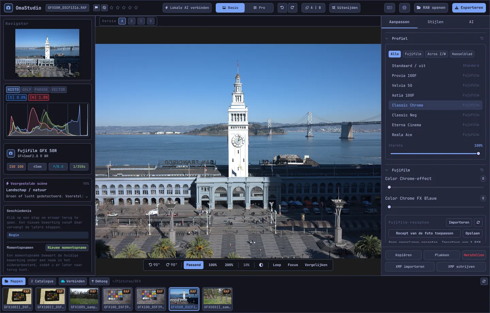

# Handleiding van OmaStudio

**OmaStudio: The Complete Medium Format RAW Editor for Omarchy**

[Alle talen](../README.md) · [Technologieën](../technology/nl.md) · [README](../../README.md)

Deze handleiding gaat over OmaStudio 3.1. Ze legt uit hoe u de toepassing installeert, hoe het venster is ingedeeld en hoe u elk paneel en elk gereedschap gebruikt. De schermafbeeldingen tonen voorbeeldbestanden van een Fujifilm GFX 50R en een Hasselblad CFV-50c van [raw.pixls.us](https://raw.pixls.us) (CC0).



## Inhoud

1. [Installatie](#1-installatie)
2. [Het venster](#2-het-venster)
3. [Foto's openen en de bibliotheek](#3-fotos-openen-en-de-bibliotheek)
4. [Basis en Pro](#4-basis-en-pro)
5. [Het tabblad Aanpassen](#5-het-tabblad-aanpassen)
6. [Het tabblad Maskers](#6-het-tabblad-maskers)
7. [Het tabblad Stijlen](#7-het-tabblad-stijlen)
8. [Het tabblad AI en het AI-gesprek](#8-het-tabblad-ai-en-het-ai-gesprek)
9. [Weergavehulpmiddelen](#9-weergavehulpmiddelen)
10. [Geschiedenis, momentopnamen en versies](#10-geschiedenis-momentopnamen-en-versies)
11. [Fujifilm](#11-fujifilm)
12. [Middenformaat](#12-middenformaat)
13. [Exporteren](#13-exporteren)
14. [Cloudaccounts](#14-cloudaccounts)
15. [Toetsenbord en muis](#15-toetsenbord-en-muis)
16. [Opdrachtregel, besturingssocket en MCP](#16-opdrachtregel-besturingssocket-en-mcp)
17. [Bestanden en mappen](#17-bestanden-en-mappen)
18. [Problemen oplossen](#18-problemen-oplossen)

## 1. Installatie

OmaStudio draait op Omarchy (Arch Linux) onder Wayland en Hyprland.

**Vanuit het pakket.** In een kopie van de repository:

```bash
makepkg -si
```

Dit installeert `omastudio`, `omastudio-app`, `omastudio-engine`, de ICC-profielen, het menu-item, de pictogrammen en een udev-regel voor Fujifilm-camera's via usb.

**Vanuit een release-archief.** Download `omastudio-<versie>-x86_64-linux.tar.gz` van de [releasepagina](https://github.com/ozdil/omarchy-omastudio/releases), controleer het met `checksums.txt`, pak het uit en kopieer `bin/*` naar `~/.local/bin` en `share/omastudio` naar `~/.local/share/omastudio`.

**Vereiste pakketten:** `libraw` 0.22 of nieuwer, `lcms2`, `qt6-base`, `qt6-declarative`, `qt6-wayland` en `qt6-svg` 6.12 of nieuwer, en `zenity` voor de bestandsdialogen.

**Optionele pakketten:**

| Pakket | Gebruikt voor |
| :--- | :--- |
| `vulkan-icd-loader` en het Vulkan-stuurprogramma van uw GPU | Demosaicing op de GPU |
| `perl-image-exiftool` | EXIF-gegevens behouden in geëxporteerde bestanden |
| `libwebp-utils`, `libheif`, `ffmpeg` | WebP met verlies, HEIF en de AVIF-uitwijkroute |
| `onnxruntime` | Lokale AI-maskers op een NPU, GPU of CPU |
| `rclone`, `libsecret`, `gnome-keyring` | Google Drive, OneDrive, Dropbox, Box, pCloud en Yandex Disk |
| `github-cli` | GitHub-account |
| `ollama` | Lokale AI-modellen voor de bewerkingsassistent |
| `quickshell` | De OmaStudio-knop in de balk van Omarchy |

Start OmaStudio vanuit het toepassingsmenu van Omarchy of voer `omastudio` uit (eventueel met een foto: `omastudio DSCF0001.RAF`). Is er al een venster open, dan opent de foto daarin.

## 2. Het venster

| Gebied | Inhoud |
| :--- | :--- |
| Bovenbalk | Bestandsnaam, markeringen en sterbeoordeling, **Lokale AI verbinden**, de schakelaar **Basis** / **Pro**, ongedaan maken en opnieuw, voor en na (**A \| B**), **Uitsnijden**, taalmenu, Info, **RAW openen** en **Exporteren** |
| Linkerpaneel | Navigator, meetinstrumenten (histogram, golfvorm, RGB-parade, vectorscoop) met clippingindicatoren, camera- en objectiefgegevens, de voorgestelde scène, geschiedenis en momentopnamen |
| Midden | De foto, erboven de versiebalk (A–D) en eronder de weergavebalk: draaien, **Passend**, 100%, 200%, huidige zoom, omgevingskleur, **Loep**, **Focus**, **Vergelijken** |
| Rechterpaneel | De tabbladen **Aanpassen**, **Maskers** (Pro), **Stijlen** en **AI**, en een vaste rij met **Kopiëren**, **Plakken**, **Herstellen**, **XMP importeren** en **XMP schrijven** |
| Filmstrook | **Mappen**, **Catalogus**, een tabblad per cloudaccount, **Verbinden**, **Omhoog** en de foto's van de huidige map |

**Tab** verbergt en toont beide zijpanelen en de filmstrook tegelijk. Elke sectie klapt open en dicht via de kop; **Ctrl+klik** op een kop laat alleen die sectie open. Het geopende tabblad, de ingeklapte secties en de zichtbare panelen worden tussen sessies onthouden.

Kleuren, lettertype en hoekafronding volgen live het actieve Omarchy-thema. De rand rond de foto is standaard neutraal donkergrijs, zodat het thema de kleurwaarneming niet beïnvloedt; de omgevingsknop in de weergavebalk schakelt naar middengrijs of naar de themakleur.

| Tokyo Night | Catppuccin Latte | Gruvbox | Rosé Pine |
| :---: | :---: | :---: | :---: |
|  |  |  |  |

De interface is beschikbaar in 30 talen. Ze volgt de systeemtaal; het taalmenu in de bovenbalk kiest een andere taal en past die meteen toe.

## 3. Foto's openen en de bibliotheek

- **RAW openen** (Ctrl+O) opent het bestandsdialoog. Het filtert op Foto's, RAW of Afbeeldingen.
- Sleep een foto of map vanuit het bestandsbeheer naar het venster.
- In de filmstrook toont **Mappen** de huidige map; klik op een map om erin te gaan en op **Omhoog** om terug te gaan. Klik op een foto om die te openen. Ctrl+← en Ctrl+→ gaan naar de vorige en volgende foto.
- **Catalogus** toont elke foto die OmaStudio heeft gezien, met beoordeling, markering en kleurlabel.

OmaStudio opent elk RAW-formaat dat LibRaw 0.22 leest (Fujifilm, Hasselblad, Phase One, Leica, Pentax, Mamiya/Leaf, Canon, Nikon, Sony, Panasonic, Olympus, Sigma, DNG en andere), en daarnaast JPEG, PNG, WebP, TIFF, HEIF/HEIC, AVIF, JPEG XL, OpenEXR, Radiance HDR en PNM.

**Beoordeling en markeringen.** 1 tot 5 geven sterren en 0 wist ze. P markeert als gekozen, X als afgewezen en U wist de markering. Beoordelingen en markeringen worden meteen in de catalogus en het sidecar-bestand opgeslagen.

**Selectie.** Shift+klik selecteert een reeks in de filmstrook en Ctrl+klik voegt een foto toe of haalt hem weg. Met meerdere foto's geselecteerd exporteert het exportvenster ze allemaal (**Batch**).

Uw originele bestanden worden nooit gewijzigd. Bewerkingen worden tijdens het werk opgeslagen in een sidecar-bestand naast de foto, `<foto>.omastudio` (Ctrl+S slaat meteen op).

## 4. Basis en Pro

De schakelaar in de bovenbalk bepaalt hoeveel gereedschappen zichtbaar zijn.

- **Basis:** profiel, Fujifilm, witbalans, toon, presentie, voorinstellingen en 3D-LUT's.
- **Pro** voegt tooncurve, kleurmixer, kleurcorrectie, detail en optiek, transformeren, korrel, kleurbeheer en het tabblad **Maskers** toe. Pro-secties dragen het label „Pro”.

Terug naar Basis verbergt de Pro-secties; hun instellingen blijven toegepast.


## 5. Het tabblad Aanpassen

Elke schuifregelaar wordt hersteld met een dubbelklik. De herstelknop in de kop van een sectie herstelt de hele sectie.

### Profiel

De basislook: **Standaard / uit**, de Fujifilm-filmsimulaties (Provia, Velvia, Astia, Classic Chrome, Classic Neg, Eterna, Eterna Bleach Bypass, Reala Ace, Nostalgic Neg, PRO Neg Std en Hi, Acros en Monochrome met geel-, rood- en groenfilter, Sepia) en het natuurlijke kleurprofiel in Hasselblad-stijl. De tabbladen filteren de lijst. **Sterkte** mengt het profiel met de neutrale weergave.

### Fujifilm

**Color Chrome-effect** en **Color Chrome FX Blauw** (Zwak = 50, Sterk = 100) verdiepen verzadigde kleuren, en bij FX Blauw de blauwtinten, met behoud van hun tint. De receptenbibliotheek, de camera via usb en Pixel Shift staan beschreven bij [Fujifilm](#11-fujifilm).

### Witbalans

**Temperatuur** (2000–12000 K) en **Tint**, ten opzichte van de witbalans die de camera vastlegde. Een foto opent „zoals genomen”.

### Toon

**Belichting** (−5 tot +5 EV, op lineair licht: +1 EV verdubbelt het licht), **Contrast**, **Hoge lichten**, **Schaduwen**, **Witte tinten** en **Zwarte tinten**.

### Presentie

**Textuur**, **Helderheid** (middentooncontrast), **Nevel verwijderen**, **Levendigheid** en **Verzadiging**.

### Tooncurve (Pro)

Een puntencurve boven het histogram, voor RGB en voor rood, groen en blauw apart. Klik om een punt toe te voegen, sleep om het te verplaatsen en dubbelklik om het te verwijderen. De curve schiet nooit voorbij haar punten. De vier gebiedsregelaars eronder (Hoge lichten, Lichte tinten, Donkere tinten, Schaduwen) vormen de curve per gebied.

### Kleurmixer (Pro)

Tint, verzadiging en luminantie voor acht kleuren: rood, oranje, geel, groen, aqua, blauw, paars en magenta.


### Kleurcorrectie (Pro)

Driewegkleurwielen voor schaduwen (lift), middentonen (gamma) en hoge lichten (gain), plus een globale offset, als vier wielen of als tabbladen. **Kleurversterking**, **Detail middentonen** en **Contrastdraaipunt** staan onder de wielen. De kanaalmixer daaronder mengt rood, groen en blauw in elk uitvoerkanaal of in een monochrome mix.


### Detail en optiek (Pro)

**Verscherping**, **Ruisonderdrukking** (luminantie en kleur), **Vignettering**, **Randen verwijderen** (chromatische aberratie) en **Correctie van objectiefvervorming**. Fujifilm- en DNG-objectiefcorrecties uit het bestand worden automatisch toegepast; deze regelaars werken daarbovenop.

### Transformeren (Pro)

**Verticaal** zet convergerende lijnen recht, zoals bij een gebouw dat van onderen is gefotografeerd; **Horizontaal** doet hetzelfde zijwaarts; **Schaal** vergroot het resultaat. Snijd daarna bij om de lege randen te verwijderen.

### Korrel (Pro)

**Korrelhoeveelheid**, **Korrelgrootte** en **Korrelruwheid** van filmkorrel.

### Kleurbeheer (Pro)

- **Gamutcompressie** brengt kleuren die buiten de gamut zijn geduwd zacht terug in plaats van ze af te kappen.
- **ACES-toonkromme** is een filmische afloop van de hoge lichten, een benadering van de ACES-uitvoertransformatie.
- **Softproof** (S) toont de foto zoals die eruit zal zien met een uitvoerprofiel, bijvoorbeeld een printer- en papierprofiel. Kies het profiel en de weergave-intentie. **Gamutwaarschuwing** kleurt kleuren die het profiel niet kan weergeven magenta. De bewerking en de export veranderen niet.

De uitvoerkleurruimte zelf kiest u in het exportvenster.


## 6. Het tabblad Maskers

Het tabblad Maskers is zichtbaar in de Pro-modus.

### Herstellen en klonen

Zet **Plekken bewerken** aan en klik op een vlek in de foto om die te verwijderen. De plek wordt vervangen vanuit een bron ernaast. Sleep de doorgetrokken cirkel om de plek te verplaatsen en de gestippelde om een andere bron te kiezen. **Herstellen** past het gekopieerde gebied aan het licht en de kleur rond de plek aan; **Klonen** kopieert het zoals het is. **Grootte**, **Doezelaar** en **Dekking** gelden voor de geselecteerde plek en voor nieuwe.


### Lokale aanpassingen

Elke laag past belichting, contrast, hoge lichten, schaduwen, witte tinten, zwarte tinten en verzadiging toe via een masker, met een dekking.

| Masker | Hoe het ontstaat |
| :--- | :--- |
| **Lineair** | Een verloop tussen twee grepen op de foto |
| **Radiaal** | Een ellips met midden- en randgrepen en een zachte rand |
| **Luminantie** | Een helderheidsbereik (donkerst, lichtst, overgang) |
| **Kleur** | Kleuren dicht bij een kleur die u uit de foto kiest (bereik en zachte rand) |
| **Penseel** | Op de foto geschilderd, met grootte, zachte rand, stroom en gummodus; de middelste muisknop verschuift het beeld |
| **AI-onderwerp**, **AI-lucht** | Een segmentatiemodel op uw computer (zie [AI](#8-het-tabblad-ai-en-het-ai-gesprek)) |

Onder **Combineren met:** kunnen meer delen bij het masker van de laag worden opgeteld, ervan worden afgetrokken of ermee worden doorsneden; elk deel kan worden omgekeerd.


## 7. Het tabblad Stijlen

- **Voorinstellingen:** **Automatisch** analyseert de foto en stelt belichting, witbalans en toon in. De stijlen Gedempt, Levendig, Warm portret, Zwart-wit en Blauwgroen en oranje vervangen de vorige stijl in plaats van erbij op te tellen; witbalans, belichting, uitsnede en filmsimulatie blijven behouden.
- **LUT:** **.cube-bestand laden…** past een eigen 3D-LUT toe, met een sterkte.


## 8. Het tabblad AI en het AI-gesprek

**Lokale AI verbinden** in de bovenbalk gebruikt de AI die op deze computer is ingesteld: de standaardagent van Omarchy (Claude Code of Codex, met hun eigen aanmelding), anders Ollama, anders LM Studio. Na het verbinden opent de knop het **AI-gesprek** boven de foto: schrijf wat u wilt veranderen („warmer, de lucht terughalen”) en de AI stelt de regelaars in. Ctrl+Z maakt elke bewerking ongedaan.

De **Bewerkingsassistent** op het tabblad AI doet hetzelfde vanuit het paneel en kan in plaats daarvan een cloudaanbieder gebruiken: Anthropic Claude, OpenAI, OpenRouter of Google Gemini. Hun API-sleutels staan in de sleutelbos van het systeem en worden nooit naar schijf geschreven of op een opdrachtregel gezet. Met een cloudaanbieder, of met Claude Code of Codex, wordt het voorbeeld van de foto naar die dienst gestuurd; met Ollama of LM Studio blijft het op uw computer.


**AI-maskers.** **AI-onderwerp** en **AI-lucht** op het tabblad Maskers draaien een ONNX-segmentatiemodel op deze computer: eerst op een NPU (Intel Core Ultra via OpenVINO, Snapdragon X via QNN, AMD Ryzen AI via Vitis AI), dan op een GPU, dan op de CPU. Er wordt geen model meegeleverd of gedownload. Zet een model in `~/.local/share/omastudio/models` als `subject.onnx` of `sky.onnx`; `omastudio npu` laat zien wat er is geïnstalleerd.

## 9. Weergavehulpmiddelen

| Hulpmiddel | Gebruik |
| :--- | :--- |
| Zoomen | Muiswiel bij de aanwijzer; **Passend** (Ctrl+0), **100%** (Ctrl+1), **200%**; dubbelklikken wisselt tussen passend en 200%. 100% toont bij elke schermschaal één fotopixel per schermpixel. |
| Verschuiven | Slepen met de linker- of middelste muisknop; Shift+wiel verschuift zijwaarts |
| Draaien | De draaiknoppen in de weergavebalk; Alt+wiel draait in stappen van 1,5° |
| Uitsnijden (C) | Beeldverhoudingen (Origineel, 1:1, 4:5, 9:16, 16:9, Vrij) en rasters (derden, gulden snede, gulden spiraal) |
| Voor en na (Y, of A \| B) | De foto gesplitst in origineel en bewerking |
| Vergelijken (Shift+C) | De bewerking naast een andere toestand: Voor, een versie of een momentopname |
| Loep (L) | Een vierkant onder de aanwijzer met de foto op volle resolutie, 1:1 |
| Focus peaking (Shift+F) | De scherpste randen groen gekleurd; alleen een weergavehulp |
| Clipping | Klik op **[S]** of **[H]** boven het histogram om afgekapte schaduwen blauw en hoge lichten rood te tonen |

| Focus peaking | Vergelijken |
| :---: | :---: |
|  |  |

| Uitsnijden | Voor en na |
| :---: | :---: |
|  |  |

Wordt de foto groter getoond dan het voorbeeld, dan berekent de engine het zichtbare deel uit het bestand op volle resolutie; het detail dat u ziet komt dus overeen met de export.

## 10. Geschiedenis, momentopnamen en versies

- **Geschiedenis** in het linkerpaneel toont elke stap van de bewerking met naam („Exposure +0.70”, „Tone curve”). Klik op een stap om ernaar terug te gaan; een nieuwe bewerking vanaf daar vervangt de latere stappen, zoals bij Ctrl+Z.
- **Momentopnamen** bewaren de huidige bewerking onder een naam. **Herstellen** haalt er een terug als nieuwe stap die Ctrl+Z ongedaan kan maken. Momentopnamen worden in het sidecar-bestand bewaard.
- **Versies A–D** boven de foto bevatten tot vier afzonderlijke bewerkingen van dezelfde foto. Klik op een letter om te wisselen (Alt+1 tot Alt+4); rechtsklikken kopieert de huidige bewerking naar die versie.
- **Kopiëren** en **Plakken** (Ctrl+Shift+C, Ctrl+Shift+V) brengen een bewerking over naar een andere foto. **Herstellen** (Ctrl+R) zet alles terug naar de standaardwaarden.
- **XMP schrijven** slaat bewerking, beoordeling en label op als `.xmp`-sidecar die Lightroom, Capture One, darktable en digiKam lezen; **XMP importeren** leest er een die door die programma's is geschreven.

## 11. Fujifilm

- **Het recept van de camera.** Een RAF of Fujifilm-JPEG opent met de instellingen van de opname: filmsimulatie, toon, kleur, scherpte, ruisonderdrukking, helderheid, korrel, Color Chrome, witbalansverschuiving en dynamisch bereik (inclusief D-Range Priority). Een opgeslagen sidecar-bestand gaat voor.
- **Helderheid.** RAF-bestanden openen met de helderheid van de eigen JPEG van de camera.
- **Objectiefcorrecties.** Door de camera vastgelegde vervorming, laterale chromatische aberratie en vignettering worden toegepast voor XF-, XC- en GF-objectieven.
- **Receptenbibliotheek.** **Importeren** neemt een X RAW Studio-profiel (.FP1, .FP2, .FP3), recepttekst („Film Simulation: Classic Chrome / Grain Effect: Strong, Small …”) of een Fujifilm-foto. **Recept toepassen** past een opgeslagen recept toe; **Recept van de foto toepassen** gaat terug naar dat uit het bestand; **Opslaan** bewaart het huidige.
- **Camera via usb.** Zet de usb-modus van de camera op USB RAW CONV./BACKUP RESTORE en sluit hem aan. **C1–C7 lezen** toont de eigen instellingen, **Recept naar C… schrijven** zet een recept in een plek (en vervangt wat daar stond), en **In de camera converteren** ontwikkelt de geopende RAF in de camera, eventueel met het geselecteerde recept.
- **Pixel Shift.** Selecteer in de filmstrook de RAF-beelden van één GFX-Pixel-Shift-reeks en klik op **Beelden samenvoegen tot DNG**. Vier beelden geven volledige kleur in elke pixel; zestien beelden verdubbelen de resolutie.

## 12. Middenformaat

- **Fujifilm GFX** (GFX 50S, 50R, 50S II, 100, 100S, 100 II en andere): 16-bitsverwerking van sensor tot export, filmsimulaties, objectiefcorrecties en Pixel Shift.
- **Hasselblad**-bestanden (3FR en FFF) worden bijgesneden tot de standaarduitsnede van de camera.
- **Phase One- en Leaf**-bestanden (IIQ en MOS) krijgen de eigen sensorkalibratie van de achterwand.
- **Mamiya** MEF en **Pentax 645** PEF worden ondersteund.
- **Flat field (LCC):** `omastudio-engine medium-format lcc-create <raw>` maakt een correctie uit een opname van een gelijkmatig belicht wit doel; die wordt toegepast op de foto's in die map.
- **Multi-shot:** `medium-format multishot f1 f2 f3 f4 --out merged.tif` voegt een reeks van 4 opnamen samen.


## 13. Exporteren

**Exporteren** (E) opent het exportvenster. Enter exporteert en Esc sluit.


| Instelling | Keuzes |
| :--- | :--- |
| Bestandsindeling | JPEG, PNG (8/16 bit), TIFF (8/16 bit, zonder, LZW- of ZIP-compressie), WebP, AVIF (8/10/12 bit), HEIF (8/10/12 bit), JPEG XL (8/16 bit) en OpenEXR (halve of volle drijvende komma, scène-lineair) |
| Kwaliteit | 1–100; 100 is verliesvrij voor WebP, AVIF en JPEG XL |
| Grootte | Volledig, 75%, 50% of een lange zijde van 3840 of 2048 px |
| Kleurprofiel | sRGB, Display P3, Adobe RGB, ProPhoto RGB, Rec. 2020, ACEScg of een eigen ICC-profiel |
| Weergave-intentie | Perceptueel, Relatief (standaard), Verzadiging, Absoluut |
| Metagegevens | Cameragegevens behouden (EXIF), locatie verwijderen (gps) |
| Voorbereiden voor | Uitsnede en uitvoerverscherping voor Instagram, Stories en Reels, X, Facebook, vierkant en YouTube-miniaturen |
| Watermerk | Tekst met EXIF-tags ({camera}, {lens}, {iso}, {aperture}, {shutter}, {focal}) of een PNG-logo, met positie, dekking, grootte en schaduw |
| Map en bestandsnaam | Standaard `~/Pictures/OmaStudio_Exports`; aan de bestandsnaam kan een toevoeging worden gehangen |
| Uploaden naar | Een verbonden cloudaccount |

Elke indeling behalve OpenEXR bevat het ICC-profiel van haar kleurruimte. Een batch exporteert de geselecteerde foto's na elkaar.

## 14. Cloudaccounts

**Verbinden** in de filmstrook voegt Google Drive, OneDrive, Dropbox, Box, pCloud, Yandex Disk of GitHub toe. U meldt zich aan op de eigen pagina van de dienst in uw browser; OmaStudio ziet uw wachtwoord nooit.


- Elk account krijgt een tabblad in de filmstrook. Blader door de mappen en klik op een foto om die (eenmalig) te downloaden en te openen.
- In elk account wordt een map `OmaStudio` aangemaakt (op GitHub een privérepository `OmaStudio`) die uploads uit het exportvenster ontvangt.
- Opslagdiensten lopen via rclone met een eigen configuratie van OmaStudio, versleuteld met een sleutel uit de sleutelbos van het systeem. GitHub loopt via GitHub CLI.
- Voor Google Drive kunt u bij **Eigen Google-client-ID** een eigen client-ID uit de Google Cloud Console invullen.
- **Ontkoppelen** verwijdert de sleutels van het account en de gedownloade kopieën van deze computer; de bestanden in het account blijven staan.

## 15. Toetsenbord en muis

| Toets | Actie |
| :--- | :--- |
| Ctrl+O | Een foto openen |
| Ctrl+S | De bewerking nu opslaan |
| Ctrl+Z / Ctrl+Shift+Z of Ctrl+Y | Ongedaan maken / opnieuw |
| Ctrl+Shift+C / Ctrl+Shift+V | Bewerking kopiëren / plakken |
| Ctrl+R | Bewerking herstellen |
| Ctrl+← / Ctrl+→ | Vorige / volgende foto |
| Ctrl+0 / Ctrl+1 | Passend / 100% |
| 1–5, 0 | Sterbeoordeling, beoordeling wissen |
| P, X, U | Kiezen, afwijzen, markering wissen |
| C | Uitsnijden |
| Y | Voor en na |
| S | Softproof |
| L | Loep |
| Shift+F | Focus peaking |
| Shift+C | Vergelijken |
| Alt+1 … Alt+4 | Versies A–D |
| E | Exportvenster |
| Tab | Panelen verbergen of tonen |
| Esc | Het geopende venster sluiten |

| Muis | Actie |
| :--- | :--- |
| Wiel | Zoomen bij de aanwijzer |
| Shift+wiel | Zijwaarts verschuiven |
| Alt+wiel | Draaien |
| Slepen (linker- of middelste knop) | Verschuiven |
| Dubbelklik op de foto | Passend of 200% |
| Ctrl+klik op een sectiekop | Alleen die sectie open laten |
| Rechtsklik op een versieletter | De huidige bewerking naar die versie kopiëren |

## 16. Opdrachtregel, besturingssocket en MCP

**Engine-opdrachten.** Elke opdracht drukt één JSON-object af, zodat scripts en agents ermee kunnen werken.

```bash
omastudio inspect DSCF0001.RAF                      # camera, objectief, belichting, histogram, scène
omastudio export DSCF0001.RAF --recipe '{"exposure":0.5}' --options '{"format":"jpeg"}'
omastudio fuji-recipe DSCF0001.RAF                  # het recept van de camera
omastudio fuji-pixel-shift DSCF*.RAF --out merged.dng
omastudio xmp export DSCF0001.RAF
omastudio cameras GFX                               # camera's die de RAW-decoder ondersteunt
omastudio gpu                                       # GPU voor demosaicing
omastudio npu                                       # ONNX Runtime en versnellers
omastudio cloud status
omastudio --cli help                                # alle opdrachten
```

**Besturingssocket.** `omastudio ipc <methode> [argumenten]` praat met het geopende venster, bijvoorbeeld `openPhoto`, `openFolder`, `applyRecipe`, `applyPreset`, `setExposure`, `setWarmth`, `setMode essentials|pro`, `setRightTab`, `showSection`, `setView peaking|compare|softProof|split on|off`, `setZoom`, `showExport`, `showCloud`, `getStatus` en `screenshot <bestand.png>`. De socket antwoordt alleen aan dezelfde gebruiker.

**MCP.** `omastudio mcp` is een Model Context Protocol-server, zodat AI-agents foto's kunnen inspecteren, berekenen, selecteren en exporteren, Fujifilm-recepten kunnen lezen en het geopende venster kunnen besturen. Voor Claude Code: `claude mcp add omastudio -- omastudio mcp`. `omastudio skill` installeert de agent-skill in `~/.claude/skills`.

## 17. Bestanden en mappen

| Pad | Inhoud |
| :--- | :--- |
| `<foto>.omastudio` | De bewerking van een foto (sidecar-bestand) |
| `~/.local/share/omastudio/catalog.json` | Catalogus: beoordelingen, markeringen en kleurlabels |
| `~/.local/share/omastudio/fuji-recipes/` | Opgeslagen Fujifilm-recepten |
| `~/.local/share/omastudio/icc/` | Uw eigen ICC-profielen |
| `~/.local/share/omastudio/models/` | Lokale AI-modellen |
| `~/.local/share/omastudio/film-luts/` | Filmsimulatie-LUT's gemeten uit uw foto's (`fuji-calibrate`) |
| `~/.config/omastudio/` | Instellingen, interfacetoestand, taal, cloudaccounts |
| `~/.cache/omastudio/` | Miniaturen, voorbeelden en gedownloade cloudfoto's |

## 18. Problemen oplossen

- **Het venster opent niet.** Voer `omastudio` uit in een terminal en lees de melding. `omastudio --version` en `omastudio status` tonen wat er is geïnstalleerd.
- **De GPU wordt niet gebruikt.** `omastudio gpu` toont het apparaat. Installeer `vulkan-icd-loader` en het Vulkan-stuurprogramma van uw GPU. `OMASTUDIO_GPU=off` dwingt de CPU af.
- **Een camera wordt via usb niet gevonden.** Zet de usb-modus op USB RAW CONV./BACKUP RESTORE, sluit hem opnieuw aan en controleer of de udev-regel van het pakket is geïnstalleerd.
- **Een clouddienst vraagt om een programma.** Installeer het pakket dat het dialoogvenster noemt, bijvoorbeeld `sudo pacman -S rclone libsecret`.
- **Systeeminfo kopiëren** in het Info-venster kopieert versie, GPU en Omarchy-gegevens voor een foutmelding. Meld problemen op [github.com/ozdil/omarchy-omastudio/issues](https://github.com/ozdil/omarchy-omastudio/issues).
