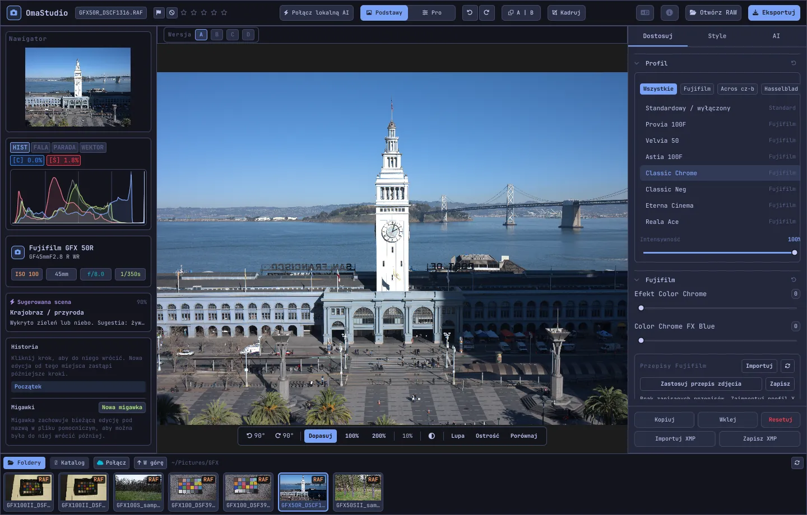

# Podręcznik użytkownika OmaStudio

**OmaStudio: The Complete Medium Format RAW Editor for Omarchy**

[Wszystkie języki](../README.md) · [Technologie](../technology/pl.md) · [README](../../README.md)

Ten podręcznik dotyczy OmaStudio 3.1. Wyjaśnia, jak zainstalować aplikację, jak zbudowane jest okno i jak korzystać z każdego panelu i narzędzia. Zrzuty ekranu pokazują przykładowe pliki z aparatów Fujifilm GFX 50R i Hasselblad CFV-50c z serwisu [raw.pixls.us](https://raw.pixls.us) (CC0).



## Spis treści

1. [Instalacja](#1-instalacja)
2. [Okno](#2-okno)
3. [Otwieranie zdjęć i biblioteka](#3-otwieranie-zdjęć-i-biblioteka)
4. [Podstawy i Pro](#4-podstawy-i-pro)
5. [Karta Dostosuj](#5-karta-dostosuj)
6. [Karta Maski](#6-karta-maski)
7. [Karta Style](#7-karta-style)
8. [Karta AI i czat z SI](#8-karta-ai-i-czat-z-si)
9. [Pomoce podglądu](#9-pomoce-podglądu)
10. [Historia, migawki i wersje](#10-historia-migawki-i-wersje)
11. [Fujifilm](#11-fujifilm)
12. [Średni format](#12-średni-format)
13. [Eksport](#13-eksport)
14. [Konta w chmurze](#14-konta-w-chmurze)
15. [Klawiatura i mysz](#15-klawiatura-i-mysz)
16. [Wiersz poleceń, gniazdo sterujące i MCP](#16-wiersz-poleceń-gniazdo-sterujące-i-mcp)
17. [Pliki i foldery](#17-pliki-i-foldery)
18. [Rozwiązywanie problemów](#18-rozwiązywanie-problemów)

## 1. Instalacja

OmaStudio działa w Omarchy (Arch Linux) pod Wayland i Hyprland.

**Z pakietu.** W kopii repozytorium:

```bash
makepkg -si
```

Instaluje to `omastudio`, `omastudio-app`, `omastudio-engine`, profile ICC, wpis w menu, ikony i regułę udev dla aparatów Fujifilm podłączonych przez USB.

**Z archiwum wydania.** Pobierz `omastudio-<wersja>-x86_64-linux.tar.gz` ze [strony wydań](https://github.com/ozdil/omarchy-omastudio/releases), sprawdź je za pomocą `checksums.txt`, rozpakuj i skopiuj `bin/*` do `~/.local/bin`, a `share/omastudio` do `~/.local/share/omastudio`.

**Wymagane pakiety:** `libraw` 0.22 lub nowszy, `lcms2`, `qt6-base`, `qt6-declarative`, `qt6-wayland` i `qt6-svg` 6.12 lub nowsze oraz `zenity` do okien wyboru plików.

**Pakiety opcjonalne:**

| Pakiet | Do czego służy |
| :--- | :--- |
| `vulkan-icd-loader` i sterownik Vulkan karty graficznej | Demozaikowanie na GPU |
| `perl-image-exiftool` | Zachowanie metadanych EXIF w eksportowanych plikach |
| `libwebp-utils`, `libheif`, `ffmpeg` | Stratny WebP, HEIF i zapasowa ścieżka dla AVIF |
| `onnxruntime` | Lokalne maski AI na NPU, GPU lub CPU |
| `rclone`, `libsecret`, `gnome-keyring` | Google Drive, OneDrive, Dropbox, Box, pCloud i Yandex Disk |
| `github-cli` | Konto GitHub |
| `ollama` | Lokalne modele AI dla asystenta edycji |
| `quickshell` | Przycisk OmaStudio na pasku Omarchy |

Uruchom OmaStudio z menu aplikacji Omarchy albo poleceniem `omastudio` (opcjonalnie ze zdjęciem: `omastudio DSCF0001.RAF`). Jeśli okno jest już otwarte, zdjęcie otworzy się w nim.

## 2. Okno

| Obszar | Zawartość |
| :--- | :--- |
| Górny pasek | Nazwa pliku, oznaczenia i ocena gwiazdkowa, **Połącz lokalną AI**, przełącznik **Podstawy** / **Pro**, cofnij i ponów, przed i po (**A \| B**), **Kadruj**, menu języka, O programie, **Otwórz RAW** i **Eksportuj** |
| Lewy panel | Nawigator, narzędzia pomiarowe (histogram, przebieg, parada RGB, wektoroskop) ze wskaźnikami przepaleń, dane aparatu i obiektywu, proponowana scena, historia i migawki |
| Środek | Zdjęcie, nad nim pasek wersji (A–D), pod nim pasek podglądu: obrót, **Dopasuj**, 100%, 200%, bieżące powiększenie, kolor otoczenia, **Lupa**, **Ostrość**, **Porównaj** |
| Prawy panel | Karty **Dostosuj**, **Maski** (Pro), **Style** i **AI** oraz stały wiersz z przyciskami **Kopiuj**, **Wklej**, **Resetuj**, **Importuj XMP** i **Zapisz XMP** |
| Taśma filmowa | **Foldery**, **Katalog**, karta dla każdego konta w chmurze, **Połącz**, **W górę** i zdjęcia z bieżącego folderu |

**Tab** jednocześnie ukrywa i pokazuje oba panele boczne oraz taśmę filmową. Każda sekcja zwija się i rozwija po kliknięciu nagłówka; **Ctrl+kliknięcie** nagłówka zostawia otwartą tylko tę sekcję. Otwarta karta, zwinięte sekcje i widoczne panele są zapamiętywane między sesjami.

Kolory, czcionka i zaokrąglenie narożników na bieżąco podążają za aktywnym motywem Omarchy. Obszar wokół zdjęcia jest domyślnie neutralnie ciemnoszary, aby motyw nie zmieniał odbioru kolorów; przycisk otoczenia na pasku podglądu przełącza na średnią szarość lub kolor motywu.

| Tokyo Night | Catppuccin Latte | Gruvbox | Rosé Pine |
| :---: | :---: | :---: | :---: |
|  |  |  |  |

Interfejs jest dostępny w 30 językach. Podąża za językiem systemu; menu języka na górnym pasku wybiera inny język i od razu go stosuje.

## 3. Otwieranie zdjęć i biblioteka

- **Otwórz RAW** (Ctrl+O) otwiera okno wyboru pliku. Filtruje według Zdjęć, RAW lub Obrazów.
- Przeciągnij zdjęcie lub folder z menedżera plików na okno.
- Na taśmie filmowej **Foldery** pokazuje bieżący folder; kliknij folder, aby do niego wejść, a **W górę**, aby wrócić. Kliknij zdjęcie, aby je otworzyć. Ctrl+← i Ctrl+→ przechodzą do poprzedniego i następnego zdjęcia.
- **Katalog** pokazuje każde zdjęcie, które OmaStudio widziało, z oceną, oznaczeniem i etykietą koloru.

OmaStudio otwiera każdy format RAW obsługiwany przez LibRaw 0.22 (Fujifilm, Hasselblad, Phase One, Leica, Pentax, Mamiya/Leaf, Canon, Nikon, Sony, Panasonic, Olympus, Sigma, DNG i inne), a także JPEG, PNG, WebP, TIFF, HEIF/HEIC, AVIF, JPEG XL, OpenEXR, Radiance HDR i PNM.

**Oceny i oznaczenia.** Klawisze 1–5 ustawiają ocenę gwiazdkową, 0 ją czyści. P oznacza zdjęcie jako wybrane, X jako odrzucone, U usuwa oznaczenie. Oceny i oznaczenia są od razu zapisywane w katalogu i w pliku pomocniczym.

**Zaznaczanie.** Shift+kliknięcie zaznacza zakres na taśmie filmowej, a Ctrl+kliknięcie dodaje lub usuwa zdjęcie. Gdy zaznaczonych jest kilka zdjęć, okno eksportu eksportuje je wszystkie (**Partia**).

Pliki oryginalne nigdy nie są zmieniane. Edycje są zapisywane w trakcie pracy w pliku pomocniczym obok zdjęcia, `<zdjęcie>.omastudio` (Ctrl+S zapisuje od razu).

## 4. Podstawy i Pro

Przełącznik na górnym pasku określa, ile narzędzi jest widocznych.

- **Podstawy:** profil, Fujifilm, balans bieli, ton, obecność, ustawienia predefiniowane i LUT 3D.
- **Pro** dodaje krzywą tonalną, mikser kolorów, korekcję barwną, szczegóły i optykę, przekształcenie, ziarno, zarządzanie kolorem i kartę **Maski**. Sekcje Pro mają etykietę „Pro”.

Powrót do Podstaw ukrywa sekcje Pro; ich ustawienia pozostają zastosowane.


## 5. Karta Dostosuj

Każdy suwak resetuje się po dwukrotnym kliknięciu. Przycisk resetowania w nagłówku sekcji resetuje całą sekcję.

### Profil

Wygląd bazowy: **Standardowy / wyłączony**, symulacje filmów Fujifilm (Provia, Velvia, Astia, Classic Chrome, Classic Neg, Eterna, Eterna Bleach Bypass, Reala Ace, Nostalgic Neg, PRO Neg Std i Hi, Acros i Monochrome z filtrami żółtym, czerwonym i zielonym, Sepia) oraz naturalny profil kolorów w stylu Hasselblad. Karty filtrują listę. **Intensywność** miesza profil z neutralnym odwzorowaniem.

### Fujifilm

**Efekt Color Chrome** i **Color Chrome FX Blue** (Słaby = 50, Silny = 100) pogłębiają nasycone kolory, a przy FX Blue błękity, zachowując ich odcień. Biblioteka przepisów, aparat przez USB i Pixel Shift są opisane w rozdziale [Fujifilm](#11-fujifilm).

### Balans bieli

**Temperatura** (2000–12000 K) i **Odcień** względem balansu bieli zapisanego przez aparat. Zdjęcie otwiera się „tak, jak zostało wykonane”.

### Ton

**Ekspozycja** (od −5 do +5 EV na świetle liniowym: +1 EV podwaja światło), **Kontrast**, **Światła**, **Cienie**, **Biele** i **Czernie**.

### Obecność

**Tekstura**, **Przejrzystość** (kontrast półtonów), **Usuwanie zamglenia**, **Jaskrawość** i **Nasycenie**.

### Krzywa tonalna (Pro)

Krzywa punktowa nad histogramem, dla RGB oraz osobno dla czerwieni, zieleni i błękitu. Kliknij, aby dodać punkt, przeciągnij, aby go przesunąć, kliknij dwukrotnie, aby go usunąć. Krzywa nigdy nie wychodzi poza swoje punkty. Cztery suwaki obszarów poniżej (Światła, Jasne tony, Ciemne tony, Cienie) kształtują krzywą według zakresów.

### Mikser kolorów (Pro)

Barwa, nasycenie i luminancja dla ośmiu kolorów: czerwonego, pomarańczowego, żółtego, zielonego, akwamarynowego, niebieskiego, fioletowego i purpurowego.


### Korekcja barwna (Pro)

Trójdrożne koła kolorów dla cieni (lift), półtonów (gamma) i świateł (gain) oraz globalne przesunięcie, jako cztery koła lub karty. **Wzmocnienie koloru**, **Szczegóły półtonów** i **Punkt obrotu kontrastu** znajdują się pod kołami. Mikser kanałów pod nimi miesza czerwień, zieleń i błękit w każdy kanał wyjściowy lub w mieszanie monochromatyczne.


### Szczegóły i optyka (Pro)

**Wyostrzanie**, **Redukcja szumów** (luminancja i kolor), **Winieta**, **Usuwanie obwódek** (aberracja chromatyczna) i **Korekcja dystorsji obiektywu**. Korekcje obiektywu Fujifilm i DNG zapisane w pliku są stosowane automatycznie; te suwaki działają dodatkowo.

### Przekształć (Pro)

**Pionowo** prostuje zbiegające się linie, np. budynku sfotografowanego od dołu; **Poziomo** robi to samo w bok; **Skala** powiększa wynik. Następnie wykadruj zdjęcie, aby usunąć puste krawędzie.

### Ziarno (Pro)

**Ilość**, **Wielkość** i **Szorstkość** ziarna filmowego.

### Zarządzanie kolorem (Pro)

- **Kompresja gamy** łagodnie przywraca kolory wypchnięte poza gamę, zamiast je obcinać.
- **Krzywa tonalna ACES** to filmowe łagodne przejście w światłach, dopasowane przybliżenie transformacji wyjściowej ACES.
- **Próba ekranowa** (S) pokazuje, jak zdjęcie będzie wyglądać z profilem wyjściowym, np. profilem drukarki i papieru. Wybierz profil i metodę odwzorowania. **Ostrzeżenie o gamucie** maluje na purpurowo kolory, których profil nie może odtworzyć. Edycja i eksport się nie zmieniają.

Wyjściową przestrzeń kolorów wybiera się w oknie eksportu.


## 6. Karta Maski

Karta Maski jest widoczna w trybie Pro.

### Korekta i klonowanie

Włącz **Edytuj punkty** i kliknij plamkę na zdjęciu, aby ją usunąć. Zostanie zastąpiona fragmentem źródłowym obok. Przeciągnij ciągły okrąg, aby przesunąć punkt, a przerywany, aby wybrać inne źródło. **Koryguj** dopasowuje skopiowany obszar do światła i koloru wokół punktu; **Klonuj** kopiuje go bez zmian. **Rozmiar**, **Wtapianie** i **Krycie** dotyczą zaznaczonego punktu i nowych punktów.


### Korekty lokalne

Każda warstwa stosuje ekspozycję, kontrast, światła, cienie, biele, czernie i nasycenie przez maskę, z ustalonym kryciem.

| Maska | Jak powstaje |
| :--- | :--- |
| **Liniowa** | Gradient między dwoma uchwytami na zdjęciu |
| **Radialna** | Elipsa z uchwytami środka i krawędzi oraz wtapianiem |
| **Luminancja** | Zakres jasności (najciemniejszy, najjaśniejszy, przejście) |
| **Kolor** | Kolory bliskie kolorowi pobranemu ze zdjęcia (zakres i wtapianie) |
| **Pędzel** | Malowana na zdjęciu, z rozmiarem, wtapianiem, przepływem i trybem gumki; środkowy przycisk myszy przesuwa obraz |
| **Obiekt (AI)**, **Niebo (AI)** | Model segmentacji na Twoim komputerze (zob. [AI](#8-karta-ai-i-czat-z-si)) |

W **Połącz z:** do maski warstwy można dodać kolejne części, odjąć je lub wyznaczyć część wspólną; każdą część można odwrócić.


## 7. Karta Style

- **Ustawienia predefiniowane:** **Automatycznie** analizuje zdjęcie i ustawia ekspozycję, balans bieli i ton. Style Stonowany, Żywy, Ciepły portret, Czarno-białe oraz Morski i pomarańczowy zastępują poprzedni styl, zamiast się z nim sumować; balans bieli, ekspozycja, kadr i symulacja filmu pozostają.
- **LUT:** **Wczytaj plik .cube…** stosuje własny LUT 3D z wybraną intensywnością.


## 8. Karta AI i czat z SI

**Połącz lokalną AI** na górnym pasku używa AI skonfigurowanej na tym komputerze: domyślnego agenta Omarchy (Claude Code lub Codex z ich własnym logowaniem), w przeciwnym razie Ollamy, a w ostateczności LM Studio. Po połączeniu przycisk otwiera **Czat z SI** nad zdjęciem: napisz, co chcesz zmienić („cieplej, odzyskaj niebo”), a AI ustawi suwaki. Ctrl+Z cofa każdą edycję.

**Asystent edycji** na karcie AI robi to samo z poziomu panelu i może zamiast tego użyć dostawcy w chmurze: Anthropic Claude, OpenAI, OpenRouter lub Google Gemini. Ich klucze API są przechowywane w systemowym pęku kluczy i nigdy nie są zapisywane na dysku ani umieszczane w wierszu poleceń. Z dostawcą w chmurze, a także z Claude Code lub Codex, podgląd zdjęcia jest wysyłany do tej usługi; z Ollamą lub LM Studio pozostaje na Twoim komputerze.


**Maski AI.** **Obiekt (AI)** i **Niebo (AI)** na karcie Maski uruchamiają model segmentacji ONNX na tym komputerze: najpierw na NPU (Intel Core Ultra przez OpenVINO, Snapdragon X przez QNN, AMD Ryzen AI przez Vitis AI), potem na GPU, a na końcu na CPU. Żaden model nie jest dołączany ani pobierany. Umieść model w `~/.local/share/omastudio/models` jako `subject.onnx` lub `sky.onnx`; `omastudio npu` pokazuje, co jest zainstalowane.

## 9. Pomoce podglądu

| Pomoc | Jak używać |
| :--- | :--- |
| Powiększenie | Kółko myszy w miejscu wskaźnika; **Dopasuj** (Ctrl+0), **100%** (Ctrl+1), **200%**; dwukrotne kliknięcie przełącza dopasowanie i 200%. 100% pokazuje jeden piksel zdjęcia na piksel ekranu przy każdym skalowaniu. |
| Przesuwanie | Przeciągnij lewym lub środkowym przyciskiem; Shift+kółko przesuwa w poziomie |
| Obrót | Przyciski obrotu na pasku podglądu; Alt+kółko obraca co 1,5° |
| Kadruj (C) | Proporcje (Oryginalne, 1:1, 4:5, 9:16, 16:9, Dowolne) i siatki (trójpodział, złoty podział, złota spirala) |
| Przed i po (Y lub A \| B) | Zdjęcie podzielone na oryginał i edycję |
| Porównaj (Shift+C) | Edycja obok innego stanu: Przed, wersji lub migawki |
| Lupa (L) | Kwadrat pod wskaźnikiem ze zdjęciem w pełnej rozdzielczości 1:1 |
| Focus peaking (Shift+F) | Najostrzejsze krawędzie pomalowane na zielono; tylko pomoc podglądu |
| Przepalenia | Kliknij **[S]** lub **[H]** nad histogramem, aby pokazać obcięte cienie na niebiesko, a światła na czerwono |

| Focus peaking | Porównaj |
| :---: | :---: |
|  |  |

| Kadruj | Przed i po |
| :---: | :---: |
|  |  |

Gdy zdjęcie jest wyświetlane w większym rozmiarze niż podgląd, silnik oblicza widoczny obszar z pliku w pełnej rozdzielczości, więc widoczne szczegóły odpowiadają eksportowi.

## 10. Historia, migawki i wersje

- **Historia** w lewym panelu pokazuje każdy krok edycji z nazwą („Exposure +0.70”, „Tone curve”). Kliknij krok, aby do niego wrócić; nowa edycja od tego miejsca zastępuje późniejsze kroki, jak przy Ctrl+Z.
- **Migawki** zapisują bieżącą edycję pod nazwą. **Przywróć** przywraca migawkę jako nowy krok, który Ctrl+Z może cofnąć. Migawki są zapisywane w pliku pomocniczym.
- **Wersje A–D** nad zdjęciem przechowują do czterech osobnych edycji tego samego zdjęcia. Kliknij literę, aby przełączyć (Alt+1 do Alt+4); prawy przycisk kopiuje bieżącą edycję do tej wersji.
- **Kopiuj** i **Wklej** (Ctrl+Shift+C, Ctrl+Shift+V) przenoszą edycję na inne zdjęcie. **Resetuj** (Ctrl+R) przywraca wartości domyślne.
- **Zapisz XMP** zapisuje edycję, ocenę i etykietę w pliku `.xmp`, który odczytują Lightroom, Capture One, darktable i digiKam; **Importuj XMP** odczytuje plik zapisany przez te programy.

## 11. Fujifilm

- **Przepis aparatu.** Plik RAF lub JPEG z aparatu Fujifilm otwiera się z ustawieniami zdjęcia: symulacją filmu, tonem, kolorem, ostrością, redukcją szumów, przejrzystością, ziarnem, Color Chrome, przesunięciem balansu bieli i zakresem dynamiki (łącznie z D-Range Priority). Zapisany plik pomocniczy ma pierwszeństwo.
- **Jasność.** Pliki RAF otwierają się z jasnością JPEG-a z aparatu.
- **Korekcje obiektywu.** Dystorsja, poprzeczna aberracja chromatyczna i winietowanie zapisane przez aparat są stosowane dla obiektywów XF, XC i GF.
- **Biblioteka przepisów.** **Importuj** przyjmuje profil X RAW Studio (.FP1, .FP2, .FP3), tekst przepisu („Film Simulation: Classic Chrome / Grain Effect: Strong, Small …”) lub zdjęcie z aparatu Fujifilm. **Zastosuj przepis** stosuje zapisany przepis; **Zastosuj przepis zdjęcia** wraca do przepisu z pliku; **Zapisz** zachowuje bieżący.
- **Aparat przez USB.** Ustaw tryb USB aparatu na USB RAW CONV./BACKUP RESTORE i podłącz go. **Odczytaj C1–C7** pokazuje jego ustawienia własne, **Zapisz przepis w C…** zapisuje przepis w gnieździe (zastępując jego zawartość), a **Konwertuj w aparacie** wywołuje otwarty plik RAF w aparacie, opcjonalnie z wybranym przepisem.
- **Pixel Shift.** Zaznacz na taśmie filmowej klatki RAF jednej sekwencji Pixel Shift z GFX i kliknij **Scal klatki w DNG**. Cztery klatki dają pełny kolor w każdym pikselu; szesnaście klatek podwaja rozdzielczość.

## 12. Średni format

- **Fujifilm GFX** (GFX 50S, 50R, 50S II, 100, 100S, 100 II i inne): 16-bitowe przetwarzanie od matrycy do eksportu, symulacje filmów, korekcje obiektywu i Pixel Shift.
- Pliki **Hasselblad** 3FR i FFF są przycinane do domyślnego kadru aparatu.
- Pliki **Phase One i Leaf** IIQ i MOS otrzymują własną kalibrację matrycy ścianki.
- Obsługiwane są pliki **Mamiya** MEF i **Pentax 645** PEF.
- **Flat field (LCC):** `omastudio-engine medium-format lcc-create <raw>` tworzy korekcję ze zdjęcia równomiernie oświetlonego białego celu; jest ona stosowana do zdjęć z tego folderu.
- **Multi-shot:** `medium-format multishot f1 f2 f3 f4 --out merged.tif` scala sekwencję 4 ujęć.


## 13. Eksport

**Eksportuj** (E) otwiera okno eksportu. Enter eksportuje, Esc zamyka.


| Ustawienie | Opcje |
| :--- | :--- |
| Format pliku | JPEG, PNG (8/16 bitów), TIFF (8/16 bitów, bez kompresji, LZW lub ZIP), WebP, AVIF (8/10/12 bitów), HEIF (8/10/12 bitów), JPEG XL (8/16 bitów) i OpenEXR (zmiennoprzecinkowy o połowicznej lub pełnej precyzji, liniowy sceny) |
| Jakość | 1–100; 100 to bezstratnie dla WebP, AVIF i JPEG XL |
| Rozmiar | Pełny, 75%, 50% lub dłuższy bok 3840 albo 2048 px |
| Profil kolorów | sRGB, Display P3, Adobe RGB, ProPhoto RGB, Rec. 2020, ACEScg lub własny profil ICC |
| Metoda odwzorowania | Percepcyjna, Względna (domyślnie), Nasycenie, Bezwzględna |
| Metadane | Zachowaj metadane aparatu (EXIF), usuń lokalizację (GPS) |
| Przygotuj dla | Kadr i wyostrzanie wyjściowe dla Instagrama, Stories i Reels, X, Facebooka, kwadratu i miniatur YouTube |
| Znak wodny | Tekst ze znacznikami EXIF ({camera}, {lens}, {iso}, {aperture}, {shutter}, {focal}) lub logo PNG, z położeniem, kryciem, rozmiarem i cieniem |
| Folder i nazwa pliku | Domyślnie `~/Pictures/OmaStudio_Exports`; do nazwy pliku można dodać dopisek |
| Prześlij do | Połączone konto w chmurze |

Każdy format oprócz OpenEXR zawiera profil ICC swojej przestrzeni kolorów. Partia eksportuje zaznaczone zdjęcia jedno po drugim.

## 14. Konta w chmurze

**Połącz** na taśmie filmowej dodaje Google Drive, OneDrive, Dropbox, Box, pCloud, Yandex Disk lub GitHub. Logujesz się na stronie danej usługi w przeglądarce; OmaStudio nigdy nie widzi Twojego hasła.


- Każde konto ma kartę na taśmie filmowej. Przeglądaj jego foldery i kliknij zdjęcie, aby je pobrać (jednorazowo) i otworzyć.
- Na każdym koncie tworzony jest folder `OmaStudio` (na GitHubie prywatne repozytorium `OmaStudio`), do którego trafiają przesyłki z okna eksportu.
- Usługi przechowywania działają przez rclone z własną konfiguracją OmaStudio, zaszyfrowaną kluczem z systemowego pęku kluczy. GitHub działa przez GitHub CLI.
- Dla Google Drive w polu **Własny identyfikator klienta Google** można podać własny identyfikator klienta z Google Cloud Console.
- **Rozłącz** usuwa z tego komputera klucze konta i pobrane kopie; pliki na koncie pozostają.

## 15. Klawiatura i mysz

| Klawisz | Działanie |
| :--- | :--- |
| Ctrl+O | Otwórz zdjęcie |
| Ctrl+S | Zapisz edycję teraz |
| Ctrl+Z / Ctrl+Shift+Z lub Ctrl+Y | Cofnij / ponów |
| Ctrl+Shift+C / Ctrl+Shift+V | Kopiuj / wklej edycję |
| Ctrl+R | Resetuj edycję |
| Ctrl+← / Ctrl+→ | Poprzednie / następne zdjęcie |
| Ctrl+0 / Ctrl+1 | Dopasuj / 100% |
| 1–5, 0 | Ocena gwiazdkowa, wyczyść ocenę |
| P, X, U | Wybierz, odrzuć, usuń oznaczenie |
| C | Kadruj |
| Y | Przed i po |
| S | Próba ekranowa |
| L | Lupa |
| Shift+F | Focus peaking |
| Shift+C | Porównaj |
| Alt+1 … Alt+4 | Wersje A–D |
| E | Okno eksportu |
| Tab | Ukryj lub pokaż panele |
| Esc | Zamknij otwarte okno |

| Mysz | Działanie |
| :--- | :--- |
| Kółko | Powiększenie w miejscu wskaźnika |
| Shift+kółko | Przesuwanie w poziomie |
| Alt+kółko | Obrót |
| Przeciąganie (lewy lub środkowy przycisk) | Przesuwanie |
| Dwukrotne kliknięcie zdjęcia | Dopasuj lub 200% |
| Ctrl+kliknięcie nagłówka sekcji | Zostaw otwartą tylko tę sekcję |
| Prawy przycisk na literze wersji | Skopiuj bieżącą edycję do tej wersji |

## 16. Wiersz poleceń, gniazdo sterujące i MCP

**Polecenia silnika.** Każde polecenie wypisuje jeden obiekt JSON, dzięki czemu mogą z niego korzystać skrypty i agenci.

```bash
omastudio inspect DSCF0001.RAF                      # aparat, obiektyw, ekspozycja, histogram, scena
omastudio export DSCF0001.RAF --recipe '{"exposure":0.5}' --options '{"format":"jpeg"}'
omastudio fuji-recipe DSCF0001.RAF                  # przepis aparatu
omastudio fuji-pixel-shift DSCF*.RAF --out merged.dng
omastudio xmp export DSCF0001.RAF
omastudio cameras GFX                               # aparaty obsługiwane przez dekoder RAW
omastudio gpu                                       # GPU używany do demozaikowania
omastudio npu                                       # ONNX Runtime i akceleratory
omastudio cloud status
omastudio --cli help                                # wszystkie polecenia
```

**Gniazdo sterujące.** `omastudio ipc <metoda> [argumenty]` komunikuje się z otwartym oknem, na przykład `openPhoto`, `openFolder`, `applyRecipe`, `applyPreset`, `setExposure`, `setWarmth`, `setMode essentials|pro`, `setRightTab`, `showSection`, `setView peaking|compare|softProof|split on|off`, `setZoom`, `showExport`, `showCloud`, `getStatus` i `screenshot <plik.png>`. Gniazdo odpowiada tylko temu samemu użytkownikowi.

**MCP.** `omastudio mcp` to serwer Model Context Protocol: agenci AI mogą badać, przetwarzać, selekcjonować i eksportować zdjęcia, odczytywać przepisy Fujifilm i sterować otwartym oknem. Dla Claude Code: `claude mcp add omastudio -- omastudio mcp`. `omastudio skill` instaluje umiejętność agenta w `~/.claude/skills`.

## 17. Pliki i foldery

| Ścieżka | Zawartość |
| :--- | :--- |
| `<zdjęcie>.omastudio` | Edycja zdjęcia (plik pomocniczy) |
| `~/.local/share/omastudio/catalog.json` | Katalog: oceny, oznaczenia i etykiety kolorów |
| `~/.local/share/omastudio/fuji-recipes/` | Zapisane przepisy Fujifilm |
| `~/.local/share/omastudio/icc/` | Twoje profile ICC |
| `~/.local/share/omastudio/models/` | Lokalne modele AI |
| `~/.local/share/omastudio/film-luts/` | LUT-y symulacji filmów zmierzone na Twoich zdjęciach (`fuji-calibrate`) |
| `~/.config/omastudio/` | Ustawienia, stan interfejsu, język, konta w chmurze |
| `~/.cache/omastudio/` | Miniatury, podglądy i pobrane zdjęcia z chmury |

## 18. Rozwiązywanie problemów

- **Okno się nie otwiera.** Uruchom `omastudio` w terminalu i przeczytaj komunikat. `omastudio --version` i `omastudio status` pokazują, co jest zainstalowane.
- **GPU nie jest używany.** `omastudio gpu` pokazuje urządzenie. Zainstaluj `vulkan-icd-loader` i sterownik Vulkan karty graficznej. `OMASTUDIO_GPU=off` wymusza CPU.
- **Aparat nie jest wykrywany przez USB.** Ustaw jego tryb USB na USB RAW CONV./BACKUP RESTORE, podłącz go ponownie i sprawdź, czy reguła udev z pakietu jest zainstalowana.
- **Usługa w chmurze wymaga programu.** Zainstaluj pakiet wskazany w oknie dialogowym, na przykład `sudo pacman -S rclone libsecret`.
- **Kopiuj informacje o systemie** w oknie O programie kopiuje wersję, dane GPU i Omarchy do zgłoszenia błędu. Problemy zgłaszaj na [github.com/ozdil/omarchy-omastudio/issues](https://github.com/ozdil/omarchy-omastudio/issues).
