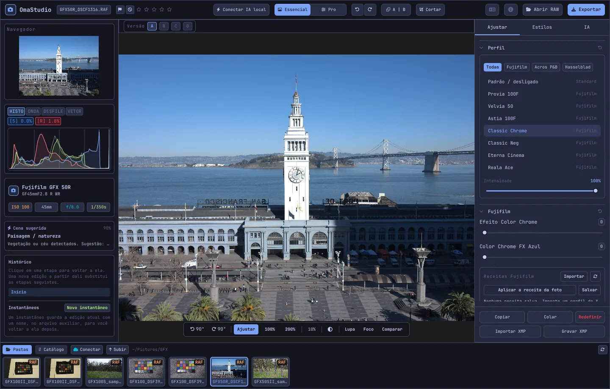

# Guia do usuário do OmaStudio

**OmaStudio: The Complete Medium Format RAW Editor for Omarchy**

[Todos os idiomas](../README.md) · [Tecnologias](../technology/pt_BR.md) · [README](../../README.md)

Este guia trata do OmaStudio 3.1. Ele explica como instalar o aplicativo, se orientar na janela e usar cada painel e ferramenta. As capturas de tela mostram arquivos de exemplo da Fujifilm GFX 50R e da Hasselblad CFV-50c do [raw.pixls.us](https://raw.pixls.us) (CC0).



## Conteúdo

1. [Instalação](#1-instalação)
2. [A janela](#2-a-janela)
3. [Abrir fotos e a biblioteca](#3-abrir-fotos-e-a-biblioteca)
4. [Essencial e Pro](#4-essencial-e-pro)
5. [A aba Ajustar](#5-a-aba-ajustar)
6. [A aba Máscaras](#6-a-aba-máscaras)
7. [A aba Estilos](#7-a-aba-estilos)
8. [A aba IA e a conversa com IA](#8-a-aba-ia-e-a-conversa-com-ia)
9. [Recursos de visualização](#9-recursos-de-visualização)
10. [Histórico, instantâneos e versões](#10-histórico-instantâneos-e-versões)
11. [Fujifilm](#11-fujifilm)
12. [Médio formato](#12-médio-formato)
13. [Exportação](#13-exportação)
14. [Contas na nuvem](#14-contas-na-nuvem)
15. [Teclado e mouse](#15-teclado-e-mouse)
16. [Linha de comando, soquete de controle e MCP](#16-linha-de-comando-soquete-de-controle-e-mcp)
17. [Arquivos e pastas](#17-arquivos-e-pastas)
18. [Solução de problemas](#18-solução-de-problemas)

## 1. Instalação

O OmaStudio roda no Omarchy (Arch Linux) com Wayland e Hyprland.

**Pelo pacote.** Em uma cópia do repositório:

```bash
makepkg -si
```

Isso instala `omastudio`, `omastudio-app`, `omastudio-engine`, os perfis ICC, a entrada da área de trabalho, os ícones e uma regra udev para câmeras Fujifilm via USB.

**Por um arquivo de versão.** Baixe `omastudio-<versão>-x86_64-linux.tar.gz` da [página de versões](https://github.com/ozdil/omarchy-omastudio/releases), confira com `checksums.txt`, descompacte e copie `bin/*` para `~/.local/bin` e `share/omastudio` para `~/.local/share/omastudio`.

**Pacotes obrigatórios:** `libraw` 0.22 ou mais recente, `lcms2`, `qt6-base`, `qt6-declarative`, `qt6-wayland` e `qt6-svg` 6.12 ou mais recentes, e `zenity` para as caixas de diálogo de arquivos.

**Pacotes opcionais:**

| Pacote | Para que serve |
| :--- | :--- |
| `vulkan-icd-loader` e o driver Vulkan da sua GPU | Demosaico na GPU |
| `perl-image-exiftool` | Manter os metadados EXIF nos arquivos exportados |
| `libwebp-utils`, `libheif`, `ffmpeg` | WebP com perdas, HEIF e a alternativa para AVIF |
| `onnxruntime` | Máscaras de IA locais em NPU, GPU ou CPU |
| `rclone`, `libsecret`, `gnome-keyring` | Google Drive, OneDrive, Dropbox, Box, pCloud e Yandex Disk |
| `github-cli` | Conta do GitHub |
| `ollama` | Modelos de IA locais para o assistente de edição |
| `quickshell` | O botão do OmaStudio na barra do Omarchy |

Abra o OmaStudio pelo menu de aplicativos do Omarchy ou execute `omastudio` (se quiser, com uma foto: `omastudio DSCF0001.RAF`). Se já houver uma janela aberta, a foto abre nela.

## 2. A janela

| Área | O que contém |
| :--- | :--- |
| Barra superior | Nome do arquivo, marcações e classificação por estrelas, **Conectar IA local**, a chave **Essencial** / **Pro**, desfazer e refazer, antes e depois (**A \| B**), **Cortar**, menu de idioma, Sobre, **Abrir RAW** e **Exportar** |
| Painel esquerdo | Navegador, instrumentos de medição (histograma, forma de onda, parada RGB, vetorscópio) com indicadores de recorte, dados da câmera e da lente, a cena sugerida, histórico e instantâneos |
| Centro | A foto, acima a barra de versões (A–D) e abaixo a barra de visualização: girar, **Ajustar**, 100%, 200%, zoom atual, cor do entorno, **Lupa**, **Foco**, **Comparar** |
| Painel direito | As abas **Ajustar**, **Máscaras** (Pro), **Estilos** e **IA**, e uma linha fixa com **Copiar**, **Colar**, **Redefinir**, **Importar XMP** e **Gravar XMP** |
| Tira de filme | **Pastas**, **Catálogo**, uma aba por conta na nuvem, **Conectar**, **Subir** e as fotos da pasta atual |

**Tab** oculta e mostra ao mesmo tempo os dois painéis laterais e a tira de filme. Cada seção abre e fecha pelo cabeçalho; **Ctrl+clique** em um cabeçalho deixa apenas aquela seção aberta. A aba aberta, as seções recolhidas e os painéis visíveis são lembrados entre as sessões.

As cores, a fonte e o arredondamento dos cantos seguem ao vivo o tema ativo do Omarchy. A área em volta da foto é, por padrão, cinza-escuro neutro, para que o tema não altere a percepção das cores; o botão de entorno na barra de visualização muda para cinza médio ou para a cor do tema.

| Tokyo Night | Catppuccin Latte | Gruvbox | Rosé Pine |
| :---: | :---: | :---: | :---: |
|  |  |  |  |

A interface está disponível em 30 idiomas. Ela segue o idioma do sistema; o menu de idioma da barra superior escolhe outro e o aplica na hora.

## 3. Abrir fotos e a biblioteca

- **Abrir RAW** (Ctrl+O) abre a caixa de diálogo de arquivos. Ela filtra por Fotos, RAW ou Imagens.
- Arraste uma foto ou uma pasta do gerenciador de arquivos para a janela.
- Na tira de filme, **Pastas** lista a pasta atual; clique em uma pasta para entrar e em **Subir** para voltar. Clique em uma foto para abri-la. Ctrl+← e Ctrl+→ passam para a foto anterior e a próxima.
- **Catálogo** lista todas as fotos que o OmaStudio já viu, com classificação, marcação e rótulo de cor.

O OmaStudio abre todos os formatos RAW lidos pela LibRaw 0.22 (Fujifilm, Hasselblad, Phase One, Leica, Pentax, Mamiya/Leaf, Canon, Nikon, Sony, Panasonic, Olympus, Sigma, DNG e outros), além de JPEG, PNG, WebP, TIFF, HEIF/HEIC, AVIF, JPEG XL, OpenEXR, Radiance HDR e PNM.

**Classificação e marcações.** De 1 a 5 definem as estrelas e 0 as apaga. P marca como escolhida, X como rejeitada e U remove a marcação. Classificações e marcações são salvas na hora no catálogo e no arquivo auxiliar.

**Seleção.** Shift+clique seleciona um intervalo na tira de filme e Ctrl+clique adiciona ou remove uma foto. Com várias fotos selecionadas, a janela de exportação exporta todas (**Lote**).

Seus arquivos originais nunca são alterados. As edições são salvas enquanto você trabalha em um arquivo auxiliar ao lado da foto, `<foto>.omastudio` (Ctrl+S salva na hora).

## 4. Essencial e Pro

A chave na barra superior define quantas ferramentas aparecem.

- **Essencial:** perfil, Fujifilm, balanço de branco, tom, presença, predefinições e LUTs 3D.
- **Pro** acrescenta curva de tons, misturador de cores, correção de cor, detalhe e óptica, transformar, granulação, gerenciamento de cor e a aba **Máscaras**. As seções Pro têm a etiqueta "Pro".

Ao voltar para Essencial, as seções Pro ficam ocultas; seus ajustes continuam aplicados.


## 5. A aba Ajustar

Cada controle deslizante volta ao padrão com um clique duplo. O botão de redefinir no cabeçalho de uma seção redefine a seção inteira.

### Perfil

O visual de base: **Padrão / desligado**, as simulações de filme da Fujifilm (Provia, Velvia, Astia, Classic Chrome, Classic Neg, Eterna, Eterna Bleach Bypass, Reala Ace, Nostalgic Neg, PRO Neg Std e Hi, Acros e Monochrome com filtros amarelo, vermelho e verde, Sépia) e o perfil de cor natural no estilo Hasselblad. As abas filtram a lista. **Intensidade** mistura o perfil com a renderização neutra.

### Fujifilm

**Efeito Color Chrome** e **Color Chrome FX Azul** (Fraco = 50, Forte = 100) aprofundam as cores saturadas, e os azuis no FX Azul, mantendo o matiz. A biblioteca de receitas, a câmera via USB e o Pixel Shift estão descritos em [Fujifilm](#11-fujifilm).

### Balanço de branco

**Temperatura** (2000–12000 K) e **Matiz**, em relação ao balanço de branco gravado pela câmera. Uma foto abre "como fotografada".

### Tom

**Exposição** (−5 a +5 EV, sobre luz linear: +1 EV dobra a luz), **Contraste**, **Realces**, **Sombras**, **Brancos** e **Pretos**.

### Presença

**Textura**, **Claridade** (contraste dos meios-tons), **Remover névoa**, **Vibração** e **Saturação**.

### Curva de tons (Pro)

Uma curva de pontos sobre o histograma, para RGB e para vermelho, verde e azul separadamente. Clique para adicionar um ponto, arraste para movê-lo e clique duas vezes para removê-lo. A curva nunca ultrapassa seus pontos. Os quatro controles de região abaixo (Realces, Claros, Escuros, Sombras) moldam a curva por faixa.

### Misturador de cores (Pro)

Matiz, saturação e luminância para oito cores: vermelho, laranja, amarelo, verde, água, azul, roxo e magenta.


### Correção de cor (Pro)

Rodas de cor de três vias para sombras (lift), meios-tons (gamma) e realces (gain), mais um deslocamento global, como quatro rodas ou como abas. **Reforço de cor**, **Detalhe dos meios-tons** e **Pivô de contraste** ficam abaixo das rodas. O misturador de canais abaixo deles mistura vermelho, verde e azul em cada canal de saída ou em uma mistura monocromática.


### Detalhe e óptica (Pro)

**Nitidez**, **Redução de ruído** (luminância e cor), **Vinheta**, **Remover franjas** (aberração cromática) e **Correção de distorção da lente**. As correções de lente da Fujifilm e do DNG contidas no arquivo são aplicadas automaticamente; estes controles atuam além delas.

### Transformar (Pro)

**Vertical** endireita linhas convergentes, como um prédio fotografado de baixo; **Horizontal** faz o mesmo na lateral; **Escala** amplia o resultado. Corte depois para remover as bordas vazias.

### Granulação (Pro)

**Quantidade**, **Tamanho** e **Aspereza** do grão de filme.

### Gerenciamento de cor (Pro)

- **Compressão de gama** traz de volta com suavidade as cores empurradas para fora da gama, em vez de cortá-las.
- **Curva de tons ACES** é uma transição cinematográfica dos realces, uma aproximação ajustada da transformação de saída ACES.
- **Prova de tela** (S) mostra a foto como ela ficará com um perfil de saída, por exemplo um perfil de impressora e papel. Escolha o perfil e o tipo de renderização. **Aviso de gama** pinta de magenta as cores que o perfil não consegue reproduzir. A edição e a exportação não mudam.

O espaço de cor de saída é escolhido na janela de exportação.


## 6. A aba Máscaras

A aba Máscaras aparece no modo Pro.

### Corrigir e clonar

Ative **Editar pontos** e clique em uma mancha na foto para removê-la. Ela é substituída a partir de uma origem ao lado. Arraste o círculo contínuo para mover o ponto e o tracejado para escolher outra origem. **Corrigir** adapta a área copiada à luz e à cor em volta do ponto; **Clonar** copia como está. **Tamanho**, **Suavização** e **Opacidade** valem para o ponto selecionado e para os novos.


### Ajustes locais

Cada camada aplica exposição, contraste, realces, sombras, brancos, pretos e saturação através de uma máscara, com uma opacidade.

| Máscara | Como é feita |
| :--- | :--- |
| **Linear** | Um gradiente entre duas alças sobre a foto |
| **Radial** | Uma elipse com alças de centro e de borda e uma suavização |
| **Luminância** | Uma faixa de brilho (mais escuro, mais claro, transição) |
| **Cor** | Cores próximas de uma coletada na foto (faixa e suavização) |
| **Pincel** | Pintada sobre a foto, com tamanho, suavização, fluxo e modo borracha; o botão do meio do mouse move a imagem |
| **Assunto (IA)**, **Céu (IA)** | Um modelo de segmentação no seu computador (veja [IA](#8-a-aba-ia-e-a-conversa-com-ia)) |

Em **Combinar com:** é possível somar, subtrair ou intersectar outras partes com a máscara da camada, e cada parte pode ser invertida.


## 7. A aba Estilos

- **Predefinições:** **Automático** analisa a foto e ajusta exposição, balanço de branco e tom. Os estilos Suave, Vívido, Retrato quente, Preto e branco, e Azul-petróleo e laranja substituem o estilo anterior em vez de se somarem; balanço de branco, exposição, corte e simulação de filme são mantidos.
- **LUT:** **Carregar arquivo .cube…** aplica uma LUT 3D própria, com uma intensidade.


## 8. A aba IA e a conversa com IA

**Conectar IA local** na barra superior usa a IA configurada neste computador: o agente padrão do Omarchy (Claude Code ou Codex, com o próprio login), senão o Ollama, senão o LM Studio. Depois de conectado, o botão abre a **Conversa com IA** sobre a foto: escreva o que quer mudar ("mais quente, recupere o céu") e a IA ajusta os controles. Ctrl+Z desfaz cada edição.

O **Assistente de edição** na aba IA faz o mesmo pelo painel e pode usar um provedor na nuvem no lugar: Anthropic Claude, OpenAI, OpenRouter ou Google Gemini. As chaves de API ficam no chaveiro do sistema e nunca são gravadas em disco nem colocadas em uma linha de comando. Com um provedor na nuvem, ou com Claude Code ou Codex, a prévia da foto é enviada a esse serviço; com Ollama ou LM Studio, ela fica no seu computador.


**Máscaras de IA.** **Assunto (IA)** e **Céu (IA)** na aba Máscaras executam um modelo de segmentação ONNX neste computador: primeiro em uma NPU (Intel Core Ultra via OpenVINO, Snapdragon X via QNN, AMD Ryzen AI via Vitis AI), depois em uma GPU e por fim na CPU. Nenhum modelo vem junto ou é baixado. Coloque um modelo em `~/.local/share/omastudio/models` como `subject.onnx` ou `sky.onnx`; `omastudio npu` mostra o que está instalado.

## 9. Recursos de visualização

| Recurso | Como usar |
| :--- | :--- |
| Zoom | Roda do mouse no ponteiro; **Ajustar** (Ctrl+0), **100%** (Ctrl+1), **200%**; o clique duplo alterna entre ajustar e 200%. 100% mostra um pixel da foto por pixel da tela em qualquer escala. |
| Mover | Arraste com o botão esquerdo ou do meio; Shift+roda move na horizontal |
| Girar | Os botões de girar na barra de visualização; Alt+roda gira em passos de 1,5° |
| Cortar (C) | Proporções predefinidas (Original, 1:1, 4:5, 9:16, 16:9, Livre) e grades (terços, proporção áurea, espiral áurea) |
| Antes e depois (Y, ou A \| B) | A foto dividida entre o original e a edição |
| Comparar (Shift+C) | A edição ao lado de outro estado: Antes, uma versão ou um instantâneo |
| Lupa (L) | Um quadrado sob o ponteiro com a foto em resolução total, 1:1 |
| Focus peaking (Shift+F) | As bordas mais nítidas pintadas de verde; é só um recurso visual |
| Recorte de níveis | Clique em **[S]** ou **[H]** acima do histograma para ver as sombras cortadas em azul e os realces em vermelho |

| Focus peaking | Comparar |
| :---: | :---: |
|  |  |

| Cortar | Antes e depois |
| :---: | :---: |
|  |  |

Quando a foto é mostrada maior que a prévia, o motor renderiza a área visível a partir do arquivo em resolução total, então o detalhe que você vê corresponde à exportação.

## 10. Histórico, instantâneos e versões

- **Histórico** no painel esquerdo lista cada etapa da edição pelo nome ("Exposure +0.70", "Tone curve"). Clique em uma etapa para voltar a ela; uma nova edição a partir dali substitui as etapas seguintes, como no Ctrl+Z.
- **Instantâneos** guardam a edição atual com um nome. **Restaurar** traz um de volta como nova etapa, que o Ctrl+Z pode desfazer. Os instantâneos ficam salvos no arquivo auxiliar.
- **Versões A–D** acima da foto guardam até quatro edições separadas da mesma foto. Clique em uma letra para trocar (Alt+1 a Alt+4); o clique direito copia a edição atual para aquela versão.
- **Copiar** e **Colar** (Ctrl+Shift+C, Ctrl+Shift+V) levam uma edição para outra foto. **Redefinir** (Ctrl+R) volta aos padrões.
- **Gravar XMP** salva a edição, a classificação e o rótulo em um arquivo auxiliar `.xmp` que o Lightroom, o Capture One, o darktable e o digiKam leem; **Importar XMP** lê um arquivo gravado por esses programas.

## 11. Fujifilm

- **A receita da câmera.** Um RAF ou um JPEG da Fujifilm abre com os ajustes da captura: simulação de filme, tom, cor, nitidez, redução de ruído, claridade, granulação, Color Chrome, deslocamento do balanço de branco e faixa dinâmica (inclusive D-Range Priority). Um arquivo auxiliar salvo tem prioridade.
- **Brilho.** Os RAFs abrem com o brilho do JPEG da própria câmera.
- **Correções de lente.** Distorção, aberração cromática lateral e vinheta gravadas pela câmera são aplicadas às lentes XF, XC e GF.
- **Biblioteca de receitas.** **Importar** aceita um perfil do X RAW Studio (.FP1, .FP2, .FP3), o texto de uma receita ("Film Simulation: Classic Chrome / Grain Effect: Strong, Small …") ou uma foto da Fujifilm. **Aplicar receita** aplica uma receita salva; **Aplicar a receita da foto** volta para a do arquivo; **Salvar** guarda a atual.
- **Câmera via USB.** Coloque o modo USB da câmera em USB RAW CONV./BACKUP RESTORE e conecte-a. **Ler C1–C7** mostra os ajustes personalizados, **Gravar a receita em C…** grava uma receita em uma posição (substituindo o que houver) e **Converter na câmera** revela o RAF aberto na câmera, se quiser com a receita selecionada.
- **Pixel Shift.** Selecione na tira de filme os quadros RAF de uma sequência Pixel Shift da GFX e clique em **Mesclar quadros em DNG**. Quatro quadros dão cor completa em cada pixel; dezesseis quadros dobram a resolução.

## 12. Médio formato

- **Fujifilm GFX** (GFX 50S, 50R, 50S II, 100, 100S, 100 II e outras): processamento de 16 bits do sensor até a exportação, simulações de filme, correções de lente e Pixel Shift.
- Os arquivos **Hasselblad** 3FR e FFF são cortados pelo corte padrão da câmera.
- Os arquivos **Phase One e Leaf** IIQ e MOS recebem a calibração do sensor do próprio back digital.
- Arquivos **Mamiya** MEF e **Pentax 645** PEF são compatíveis.
- **Campo plano (LCC):** `omastudio-engine medium-format lcc-create <raw>` cria uma correção a partir de uma foto de um alvo branco iluminado por igual; ela é aplicada às fotos daquela pasta.
- **Multi-shot:** `medium-format multishot f1 f2 f3 f4 --out merged.tif` mescla uma sequência de 4 capturas.


## 13. Exportação

**Exportar** (E) abre a janela de exportação. Enter exporta e Esc fecha.


| Ajuste | Opções |
| :--- | :--- |
| Formato | JPEG, PNG (8/16 bits), TIFF (8/16 bits, sem compressão, LZW ou ZIP), WebP, AVIF (8/10/12 bits), HEIF (8/10/12 bits), JPEG XL (8/16 bits) e OpenEXR (ponto flutuante de meia ou total precisão, linear de cena) |
| Qualidade | 1–100; 100 é sem perdas em WebP, AVIF e JPEG XL |
| Tamanho | Completo, 75%, 50% ou lado maior de 3840 ou 2048 px |
| Perfil de cor | sRGB, Display P3, Adobe RGB, ProPhoto RGB, Rec. 2020, ACEScg ou um perfil ICC próprio |
| Tipo de renderização | Perceptiva, Relativa (padrão), Saturação, Absoluta |
| Metadados | Manter os metadados da câmera (EXIF), remover a localização (GPS) |
| Preparar para | Corte e nitidez de saída para Instagram, Stories e Reels, X, Facebook, quadrado e miniaturas do YouTube |
| Marca d'água | Texto com tags EXIF ({camera}, {lens}, {iso}, {aperture}, {shutter}, {focal}) ou um logotipo PNG, com posição, opacidade, tamanho e sombra |
| Pasta e nome do arquivo | Padrão `~/Pictures/OmaStudio_Exports`; é possível acrescentar uma etiqueta ao nome do arquivo |
| Enviar para | Uma conta na nuvem conectada |

Todos os formatos, exceto OpenEXR, levam o perfil ICC do seu espaço de cor. Um lote exporta as fotos selecionadas uma após a outra.

## 14. Contas na nuvem

**Conectar** na tira de filme adiciona Google Drive, OneDrive, Dropbox, Box, pCloud, Yandex Disk ou GitHub. O login é feito na página do próprio serviço, no navegador; o OmaStudio nunca vê a sua senha.


- Cada conta ganha uma aba na tira de filme. Navegue pelas pastas e clique em uma foto para baixá-la (uma vez) e abri-la.
- Em cada conta é criada uma pasta chamada `OmaStudio` (no GitHub, um repositório privado `OmaStudio`), que recebe os envios da janela de exportação.
- Os serviços de armazenamento funcionam pelo rclone com uma configuração própria do OmaStudio, criptografada com uma chave guardada no chaveiro do sistema. O GitHub funciona pelo GitHub CLI.
- Para o Google Drive, um ID de cliente próprio do Google Cloud Console pode ser informado em **ID de cliente Google próprio**.
- **Desconectar** remove deste computador as chaves da conta e as cópias baixadas; os arquivos da conta continuam lá.

## 15. Teclado e mouse

| Tecla | Ação |
| :--- | :--- |
| Ctrl+O | Abrir uma foto |
| Ctrl+S | Salvar a edição agora |
| Ctrl+Z / Ctrl+Shift+Z ou Ctrl+Y | Desfazer / refazer |
| Ctrl+Shift+C / Ctrl+Shift+V | Copiar / colar a edição |
| Ctrl+R | Redefinir a edição |
| Ctrl+← / Ctrl+→ | Foto anterior / próxima |
| Ctrl+0 / Ctrl+1 | Ajustar / 100% |
| 1–5, 0 | Classificação por estrelas, apagar classificação |
| P, X, U | Escolher, rejeitar, remover marcação |
| C | Cortar |
| Y | Antes e depois |
| S | Prova de tela |
| L | Lupa |
| Shift+F | Focus peaking |
| Shift+C | Comparar |
| Alt+1 … Alt+4 | Versões A–D |
| E | Janela de exportação |
| Tab | Ocultar ou mostrar os painéis |
| Esc | Fechar a janela aberta |

| Mouse | Ação |
| :--- | :--- |
| Roda | Zoom no ponteiro |
| Shift+roda | Mover na horizontal |
| Alt+roda | Girar |
| Arrastar (botão esquerdo ou do meio) | Mover |
| Clique duplo na foto | Ajustar ou 200% |
| Ctrl+clique no cabeçalho de uma seção | Deixar só essa seção aberta |
| Clique direito em uma letra de versão | Copiar a edição atual para essa versão |

## 16. Linha de comando, soquete de controle e MCP

**Comandos do motor.** Cada comando imprime um objeto JSON, para que scripts e agentes possam usá-lo.

```bash
omastudio inspect DSCF0001.RAF                      # câmera, lente, exposição, histograma, cena
omastudio export DSCF0001.RAF --recipe '{"exposure":0.5}' --options '{"format":"jpeg"}'
omastudio fuji-recipe DSCF0001.RAF                  # a receita da câmera
omastudio fuji-pixel-shift DSCF*.RAF --out merged.dng
omastudio xmp export DSCF0001.RAF
omastudio cameras GFX                               # câmeras compatíveis com o decodificador RAW
omastudio gpu                                       # GPU usada no demosaico
omastudio npu                                       # ONNX Runtime e aceleradores
omastudio cloud status
omastudio --cli help                                # todos os comandos
```

**Soquete de controle.** `omastudio ipc <método> [argumentos]` conversa com a janela aberta, por exemplo `openPhoto`, `openFolder`, `applyRecipe`, `applyPreset`, `setExposure`, `setWarmth`, `setMode essentials|pro`, `setRightTab`, `showSection`, `setView peaking|compare|softProof|split on|off`, `setZoom`, `showExport`, `showCloud`, `getStatus` e `screenshot <arquivo.png>`. O soquete só responde ao mesmo usuário.

**MCP.** `omastudio mcp` é um servidor Model Context Protocol: agentes de IA podem inspecionar, renderizar, selecionar e exportar fotos, ler receitas da Fujifilm e controlar a janela aberta. Para o Claude Code: `claude mcp add omastudio -- omastudio mcp`. `omastudio skill` instala a skill do agente em `~/.claude/skills`.

## 17. Arquivos e pastas

| Caminho | Conteúdo |
| :--- | :--- |
| `<foto>.omastudio` | A edição de uma foto (arquivo auxiliar) |
| `~/.local/share/omastudio/catalog.json` | Catálogo: classificações, marcações e rótulos de cor |
| `~/.local/share/omastudio/fuji-recipes/` | Receitas Fujifilm salvas |
| `~/.local/share/omastudio/icc/` | Seus perfis ICC |
| `~/.local/share/omastudio/models/` | Modelos de IA locais |
| `~/.local/share/omastudio/film-luts/` | LUTs de simulação de filme medidas a partir das suas fotos (`fuji-calibrate`) |
| `~/.config/omastudio/` | Configurações, estado da interface, idioma, contas na nuvem |
| `~/.cache/omastudio/` | Miniaturas, prévias e fotos da nuvem baixadas |

## 18. Solução de problemas

- **A janela não abre.** Execute `omastudio` em um terminal e leia a mensagem. `omastudio --version` e `omastudio status` mostram o que está instalado.
- **A GPU não é usada.** `omastudio gpu` mostra o dispositivo. Instale `vulkan-icd-loader` e o driver Vulkan da sua GPU. `OMASTUDIO_GPU=off` força a CPU.
- **Uma câmera não é encontrada via USB.** Coloque o modo USB em USB RAW CONV./BACKUP RESTORE, reconecte e verifique se a regra udev do pacote está instalada.
- **Um serviço na nuvem pede um programa.** Instale o pacote indicado na caixa de diálogo, por exemplo `sudo pacman -S rclone libsecret`.
- **Copiar informações do sistema** na janela Sobre copia a versão, a GPU e os dados do Omarchy para um relatório de erro. Relate problemas em [github.com/ozdil/omarchy-omastudio/issues](https://github.com/ozdil/omarchy-omastudio/issues).
