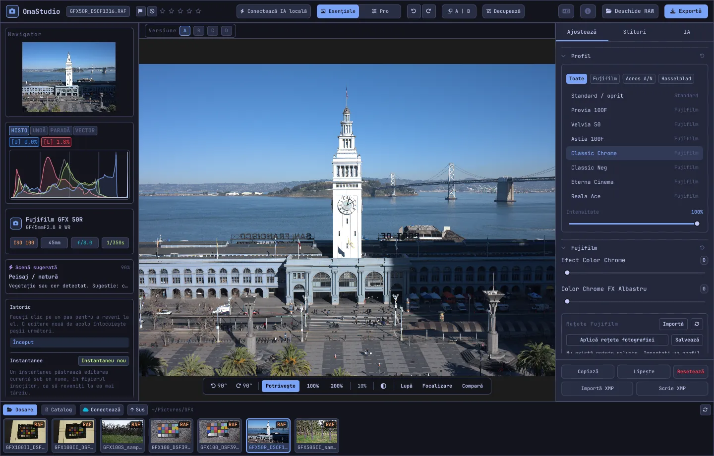

# Ghidul utilizatorului OmaStudio

**OmaStudio: The Complete Medium Format RAW Editor for Omarchy**

[Toate limbile](../README.md) · [Tehnologii](../technology/ro.md) · [README](../../README.md)

Acest ghid se referă la OmaStudio 3.1. Explică instalarea aplicației, organizarea ferestrei și folosirea fiecărui panou și instrument. Capturile de ecran arată fișiere de exemplu Fujifilm GFX 50R și Hasselblad CFV-50c de pe [raw.pixls.us](https://raw.pixls.us) (CC0).



## Cuprins

1. [Instalare](#1-instalare)
2. [Fereastra](#2-fereastra)
3. [Deschiderea fotografiilor și biblioteca](#3-deschiderea-fotografiilor-și-biblioteca)
4. [Esențiale și Pro](#4-esențiale-și-pro)
5. [Fila Ajustează](#5-fila-ajustează)
6. [Fila Măști](#6-fila-măști)
7. [Fila Stiluri](#7-fila-stiluri)
8. [Fila IA și conversația IA](#8-fila-ia-și-conversația-ia)
9. [Ajutoare de vizualizare](#9-ajutoare-de-vizualizare)
10. [Istoric, instantanee și versiuni](#10-istoric-instantanee-și-versiuni)
11. [Fujifilm](#11-fujifilm)
12. [Format mediu](#12-format-mediu)
13. [Export](#13-export)
14. [Conturi în cloud](#14-conturi-în-cloud)
15. [Tastatură și mouse](#15-tastatură-și-mouse)
16. [Linia de comandă, socketul de control și MCP](#16-linia-de-comandă-socketul-de-control-și-mcp)
17. [Fișiere și dosare](#17-fișiere-și-dosare)
18. [Depanare](#18-depanare)

## 1. Instalare

OmaStudio rulează pe Omarchy (Arch Linux) sub Wayland și Hyprland.

**Din pachet.** Într-o clonă a depozitului:

```bash
makepkg -si
```

Comanda instalează `omastudio`, `omastudio-app`, `omastudio-engine`, profilurile ICC, intrarea de desktop, pictogramele și o regulă udev pentru camerele Fujifilm conectate prin USB.

**Dintr-o arhivă de versiune.** Descărcați `omastudio-<versiune>-x86_64-linux.tar.gz` de pe [pagina de versiuni](https://github.com/ozdil/omarchy-omastudio/releases), verificați-o cu `checksums.txt`, dezarhivați-o și copiați `bin/*` în `~/.local/bin` și `share/omastudio` în `~/.local/share/omastudio`.

**Pachete necesare:** `libraw` 0.22 sau mai nou, `lcms2`, `qt6-base`, `qt6-declarative`, `qt6-wayland` și `qt6-svg` 6.12 sau mai noi, plus `zenity` pentru dialogurile de fișiere.

**Pachete opționale:**

| Pachet | Folosit pentru |
| :--- | :--- |
| `vulkan-icd-loader` și driverul Vulkan al plăcii video | Demosaicing pe GPU |
| `perl-image-exiftool` | Păstrarea metadatelor EXIF în fișierele exportate |
| `libwebp-utils`, `libheif`, `ffmpeg` | WebP cu pierderi, HEIF și varianta de rezervă pentru AVIF |
| `onnxruntime` | Măști IA locale pe NPU, GPU sau CPU |
| `rclone`, `libsecret`, `gnome-keyring` | Google Drive, OneDrive, Dropbox, Box, pCloud și Yandex Disk |
| `github-cli` | Cont GitHub |
| `ollama` | Modele IA locale pentru asistentul de editare |
| `quickshell` | Butonul OmaStudio din bara Omarchy |

Porniți OmaStudio din meniul de aplicații Omarchy sau rulați `omastudio` (opțional cu o fotografie: `omastudio DSCF0001.RAF`). Dacă o fereastră este deja deschisă, fotografia se deschide în acea fereastră.

## 2. Fereastra

| Zonă | Ce conține |
| :--- | :--- |
| Bara de sus | Numele fișierului, marcajele și evaluarea cu stele, **Conectează IA locală**, comutatorul **Esențiale** / **Pro**, anulare și refacere, înainte și după (**A \| B**), **Decupează**, meniul de limbă, Despre, **Deschide RAW** și **Exportă** |
| Panoul din stânga | Navigator, instrumente de măsură (histogramă, formă de undă, paradă RGB, vectorscop) cu indicatori de tăiere, detaliile camerei și ale obiectivului, scena sugerată, istoricul și instantaneele |
| Centru | Fotografia, bara de versiuni (A–D) deasupra și bara de vizualizare dedesubt: rotire, **Potrivește**, 100%, 200%, zoomul curent, culoarea fundalului, **Lupă**, **Focalizare**, **Compară** |
| Panoul din dreapta | Filele **Ajustează**, **Măști** (Pro), **Stiluri** și **IA**, plus un rând fix cu **Copiază**, **Lipește**, **Resetează**, **Importă XMP** și **Scrie XMP** |
| Banda de film | **Dosare**, **Catalog**, câte o filă pentru fiecare cont în cloud, **Conectează**, **Sus** și fotografiile din dosarul curent |

**Tab** ascunde și afișează împreună ambele panouri laterale și banda de film. Fiecare secțiune a unui panou se pliază și se deschide din antet; **Ctrl+clic** pe un antet păstrează deschisă doar acea secțiune. Fila deschisă, secțiunile pliate și panourile afișate sunt reținute între sesiuni.

Culorile, fontul și rotunjirea colțurilor urmează tema Omarchy activă, în timp real. Zona din jurul fotografiei este implicit gri închis neutru, ca tema să nu schimbe felul în care arată culorile; butonul de fundal din bara de vizualizare comută la gri mediu sau la culoarea temei.

| Tokyo Night | Catppuccin Latte | Gruvbox | Rosé Pine |
| :---: | :---: | :---: | :---: |
|  |  |  |  |

Interfața este disponibilă în 30 de limbi. Urmează limba sistemului; meniul de limbă din bara de sus alege alta și o aplică imediat.

## 3. Deschiderea fotografiilor și biblioteca

- **Deschide RAW** (Ctrl+O) deschide dialogul de fișiere. Filtrează după fotografii, RAW sau imagini.
- Trageți o fotografie sau un dosar din managerul de fișiere în fereastră.
- În banda de film, **Dosare** afișează dosarul curent; faceți clic pe un dosar pentru a intra în el și pe **Sus** pentru a reveni. Faceți clic pe o fotografie pentru a o deschide. Ctrl+← și Ctrl+→ trec la fotografia anterioară și următoare.
- **Catalog** afișează toate fotografiile văzute de OmaStudio, cu evaluarea, marcajul și eticheta de culoare.

OmaStudio deschide toate formatele RAW citite de LibRaw 0.22 (Fujifilm, Hasselblad, Phase One, Leica, Pentax, Mamiya/Leaf, Canon, Nikon, Sony, Panasonic, Olympus, Sigma, DNG și altele), plus JPEG, PNG, WebP, TIFF, HEIF/HEIC, AVIF, JPEG XL, OpenEXR, Radiance HDR și PNM.

**Evaluare și marcaje.** Tastele 1–5 setează evaluarea cu stele, iar 0 o șterge. P marchează o alegere, X o respingere, iar U șterge marcajul. Evaluările și marcajele se salvează imediat în catalog și în fișierul însoțitor.

**Selecție.** Shift+clic selectează un interval în banda de film, iar Ctrl+clic adaugă sau elimină o fotografie. Cu mai multe fotografii selectate, fereastra de export le exportă pe toate (**Lot**).

Fișierele originale nu sunt modificate niciodată. Editările se salvează lângă fotografie, într-un fișier însoțitor `<fotografie>.omastudio`, pe măsură ce lucrați (Ctrl+S salvează imediat).

## 4. Esențiale și Pro

Comutatorul din bara de sus stabilește câte instrumente sunt afișate.

- **Esențiale:** profil, Fujifilm, balansul de alb, ton, prezență, presetări și LUT-uri 3D.
- **Pro** adaugă curba de ton, mixerul de culori, corecția de culoare, detaliile și optica, transformarea, granulația, gestionarea culorii și fila **Măști**. Secțiunile Pro poartă eticheta „Pro".

La revenirea la Esențiale, secțiunile Pro se ascund; setările lor rămân aplicate.


## 5. Fila Ajustează

Fiecare glisor se resetează la dublu clic. Butonul de resetare din antetul unei secțiuni resetează întreaga secțiune.

### Profil

Aspectul de bază: **Standard / oprit**, simulările de film Fujifilm (Provia, Velvia, Astia, Classic Chrome, Classic Neg, Eterna, Eterna Bleach Bypass, Reala Ace, Nostalgic Neg, PRO Neg Std și Hi, Acros și Monochrome cu filtru galben, roșu și verde, Sepia) și profilul de culoare natural în stil Hasselblad. Filele filtrează lista. **Intensitate** amestecă profilul cu redarea neutră.

### Fujifilm

**Efect Color Chrome** și **Color Chrome FX Albastru** (Slab = 50, Puternic = 100) adâncesc culorile saturate, respectiv albastrurile pentru FX Albastru, păstrându-le nuanța. Biblioteca de rețete, camera prin USB și Pixel Shift sunt descrise la [Fujifilm](#11-fujifilm).

### Balansul de alb

**Temperatură** (2000–12000 K) și **Nuanță**, relativ la balansul de alb înregistrat de cameră. O fotografie se deschide cu setarea de la fotografiere.

### Ton

**Expunere** (−5 până la +5 EV, pe lumină liniară: +1 EV dublează lumina), **Contrast**, **Lumini**, **Umbre**, **Albe** și **Negre**.

### Prezență

**Textură**, **Claritate** (contrastul tonurilor medii), **Eliminare ceață**, **Vivacitate** și **Saturație**.

### Curbă de ton (Pro)

O curbă cu puncte peste histogramă, pentru RGB și separat pentru roșu, verde și albastru. Faceți clic pentru a adăuga un punct, trageți pentru a-l muta și dublu clic pentru a-l elimina. Curba nu depășește niciodată punctele. Cele patru glisoare de regiune de dedesubt (lumini, tonuri deschise, tonuri închise, umbre) modelează curba pe zone.

### Mixer de culori (Pro)

Nuanță, saturație și luminanță pentru opt culori: roșu, portocaliu, galben, verde, acvamarin, albastru, violet și magenta.


### Corecție de culoare (Pro)

Roți de culoare în trei căi pentru umbre (lift), tonuri medii (gamma) și lumini (gain), plus un decalaj global, ca patru roți sau ca file. **Amplificare culoare**, **Detaliu tonuri medii** și **Pivot contrast** se află sub roți. Mixerul de canale de sub ele amestecă roșul, verdele și albastrul în fiecare canal de ieșire sau într-o mixare monocromă.


### Detalii și optică (Pro)

**Clarificare**, **Reducerea zgomotului** (luminanță și culoare), **Vignetare**, **Eliminarea franjurilor** (aberație cromatică) și **Corecția distorsiunii obiectivului**. Corecțiile de obiectiv din fișierele Fujifilm și DNG se aplică automat; aceste glisoare acționează peste ele.

### Transformare (Pro)

**Vertical** îndreaptă liniile convergente, de exemplu o clădire fotografiată de jos; **Orizontal** face același lucru lateral; **Scară** mărește rezultatul. Decupați apoi pentru a elimina marginile goale.

### Granulație (Pro)

**Cantitatea**, **mărimea** și **asperitatea** granulației de film.

### Gestionarea culorii (Pro)

- **Comprimarea gamei** readuce lin culorile împinse în afara gamei, în loc să le taie.
- **Curbă de tonuri ACES** este o atenuare cinematografică a luminilor, o aproximare ajustată a transformării de ieșire ACES.
- **Probă pe ecran** (S) arată fotografia așa cum va arăta cu un profil de ieșire, de exemplu un profil de imprimantă și hârtie. Alegeți profilul și intenția de randare. **Avertizare gamă** colorează în magenta culorile pe care profilul nu le poate reproduce. Editarea și exportul nu se schimbă.

Spațiul de culoare de ieșire se alege în fereastra de export.


## 6. Fila Măști

Fila Măști este afișată în modul Pro.

### Corectare și clonare

Activați **Editează punctele** și faceți clic pe un punct din fotografie pentru a-l elimina. Punctul este înlocuit dintr-o sursă de alături. Trageți cercul plin pentru a muta punctul și cercul punctat pentru a alege altă sursă. **Corectează** potrivește zona copiată cu lumina și culoarea din jurul punctului; **Clonează** o copiază așa cum este. **Dimensiune**, **Estompare** și **Opacitate** se aplică punctului selectat și celor noi.


### Ajustări locale

Fiecare strat aplică expunere, contrast, lumini, umbre, albe, negre și saturație printr-o mască, cu o opacitate.

| Mască | Cum se creează |
| :--- | :--- |
| **Liniar** | Un gradient între două mânere pe fotografie |
| **Radial** | O elipsă cu centru, mânere de margine și estompare |
| **Luminanță** | Un interval de luminozitate (cel mai întunecat, cel mai luminos, tranziție) |
| **Culoare** | Culori apropiate de una aleasă din fotografie (interval și estompare) |
| **Pensulă** | Pictată pe fotografie, cu dimensiune, estompare, flux și mod de ștergere; butonul din mijloc al mouse-ului deplasează imaginea |
| **Subiect (IA)**, **Cer (IA)** | Un model de segmentare pe computerul dvs. (vedeți [IA](#8-fila-ia-și-conversația-ia)) |

La **Combină cu** se pot adăuga, scădea sau intersecta alte părți cu masca stratului, iar fiecare parte poate fi inversată.


## 7. Fila Stiluri

- **Presetări:** **Automat** analizează fotografia și setează expunerea, balansul de alb și tonul. Stilurile Estompat, Viu, Portret cald, Alb-negru și Turcoaz și portocaliu înlocuiesc stilul anterior în loc să se adauge peste el; balansul de alb, expunerea, decuparea și simularea de film rămân.
- **LUT:** **Încarcă fișier .cube…** aplică propriul LUT 3D, cu o intensitate.


## 8. Fila IA și conversația IA

**Conectează IA locală** din bara de sus folosește IA configurată pe acest computer: agentul implicit Omarchy (Claude Code sau Codex, cu propria autentificare), altfel Ollama, altfel LM Studio. După conectare, butonul deschide **Conversație IA** peste fotografie: scrieți ce doriți să schimbați („mai cald, salvează cerul"), iar IA setează ajustările. Ctrl+Z anulează fiecare modificare.

**Asistent de editare** din fila IA face același lucru din panou și poate folosi în schimb un furnizor în cloud: Anthropic Claude, OpenAI, OpenRouter sau Google Gemini. Cheile lor API sunt păstrate în portcheiul sistemului și nu sunt scrise niciodată pe disc sau într-o linie de comandă. Cu un furnizor în cloud sau cu Claude Code ori Codex, previzualizarea fotografiei este trimisă acelui serviciu; cu Ollama sau LM Studio rămâne pe computerul dvs.


**Măști IA.** **Subiect (IA)** și **Cer (IA)** din fila Măști rulează un model de segmentare ONNX pe acest computer: întâi pe un NPU (Intel Core Ultra prin OpenVINO, Snapdragon X prin QNN, AMD Ryzen AI prin Vitis AI), apoi pe GPU, apoi pe CPU. Niciun model nu este inclus sau descărcat. Puneți un model în `~/.local/share/omastudio/models` ca `subject.onnx` sau `sky.onnx`; `omastudio npu` arată ce este instalat.

## 9. Ajutoare de vizualizare

| Ajutor | Cum se folosește |
| :--- | :--- |
| Zoom | Rotița mouse-ului la indicator; **Potrivește** (Ctrl+0), **100%** (Ctrl+1), **200%**; dublu clic comută între potrivire și 200%. 100% afișează un pixel al fotografiei pe pixel de ecran la orice scalare a afișajului. |
| Deplasare | Trageți cu butonul stâng sau din mijloc; Shift+rotiță deplasează lateral |
| Rotire | Butoanele de rotire din bara de vizualizare; Alt+rotiță rotește în pași de 1,5° |
| Decupează (C) | Presetări de proporții (Original, 1:1, 4:5, 9:16, 16:9, Liber) și grile (treimi, secțiunea de aur, spirala de aur) |
| Înainte și după (Y sau A \| B) | Fotografia împărțită în original și editare |
| Compară (Shift+C) | Editarea alături de altă stare: Înainte, o versiune sau un instantaneu |
| Lupă (L) | Un pătrat sub indicator care arată fotografia la rezoluție completă, 1:1 |
| Focalizare (Shift+F) | Cele mai clare margini colorate în verde; doar un ajutor de vizualizare |
| Tăiere | Faceți clic pe **[S]** sau **[H]** deasupra histogramei pentru a afișa umbrele tăiate cu albastru și luminile cu roșu |

| Focalizare | Compară |
| :---: | :---: |
|  |  |

| Decupează | Înainte și după |
| :---: | :---: |
|  |  |

Când fotografia este afișată mai mare decât previzualizarea, motorul randează zona vizibilă din fișierul la rezoluție completă, astfel încât detaliile pe care le vedeți corespund exportului.

## 10. Istoric, instantanee și versiuni

- **Istoric** din panoul stâng afișează fiecare pas al editării după nume („Expunere +0,70", „Curbă de ton"). Faceți clic pe un pas pentru a reveni la el; o nouă editare de acolo înlocuiește pașii ulteriori, ca la Ctrl+Z.
- **Instantanee** păstrează editarea curentă sub un nume. **Restabilește** o readuce ca pas nou, pe care Ctrl+Z îl poate anula. Instantaneele se salvează în fișierul însoțitor.
- **Versiunile A–D** de deasupra fotografiei păstrează până la patru editări separate ale aceleiași fotografii. Faceți clic pe o literă pentru a comuta (Alt+1 până la Alt+4); clic dreapta copiază editarea curentă în acea versiune.
- **Copiază** și **Lipește** (Ctrl+Shift+C, Ctrl+Shift+V) transferă o editare la altă fotografie. **Resetează** (Ctrl+R) revine la valorile implicite.
- **Scrie XMP** salvează editarea, evaluarea și eticheta ca fișier însoțitor `.xmp`, citit de Lightroom, Capture One, darktable și digiKam; **Importă XMP** citește unul scris de aceste programe.

## 11. Fujifilm

- **Rețeta camerei.** Un RAF sau un JPEG Fujifilm se deschide cu setările cu care a fost fotografiat: simulare de film, ton, culoare, claritate, reducerea zgomotului, claritate locală, granulație, Color Chrome, deplasarea balansului de alb și gama dinamică (inclusiv D-Range Priority). Un fișier însoțitor salvat are prioritate.
- **Luminozitate.** Fișierele RAF se deschid la luminozitatea JPEG-ului propriu al camerei.
- **Corecții de obiectiv.** Distorsiunea, aberația cromatică laterală și vignetarea înregistrate de cameră se aplică pentru obiectivele XF, XC și GF.
- **Biblioteca de rețete.** **Importă** acceptă un profil X RAW Studio (.FP1, .FP2, .FP3), textul unei rețete („Film Simulation: Classic Chrome / Grain Effect: Strong, Small …") sau o fotografie Fujifilm. **Aplică rețeta** aplică una salvată; **Aplică rețeta fotografiei** revine la cea din fișier; **Salvează** o păstrează pe cea curentă.
- **Camera prin USB.** Setați modul USB al camerei pe USB RAW CONV./BACKUP RESTORE și conectați-o. **Citește C1–C7** afișează setările personalizate, **Scrie rețeta în C…** salvează o rețetă într-un slot (înlocuiește ce era acolo), iar **Convertește în cameră** developează RAF-ul deschis în cameră, opțional cu rețeta selectată.
- **Pixel Shift.** Selectați în banda de film cadrele RAF ale unei secvențe GFX Pixel Shift și faceți clic pe **Combină cadrele în DNG**. Patru cadre oferă culoare completă în fiecare pixel; șaisprezece cadre dublează rezoluția.

## 12. Format mediu

- **Fujifilm GFX** (GFX 50S, 50R, 50S II, 100, 100S, 100 II și altele): lanț pe 16 biți de la senzor la export, simulări de film, corecții de obiectiv și Pixel Shift.
- Fișierele **Hasselblad** 3FR și FFF sunt decupate la decuparea implicită a camerei.
- Fișierele **Phase One și Leaf** IIQ și MOS primesc calibrarea proprie a senzorului spatelui digital.
- Sunt acceptate fișierele **Mamiya** MEF și **Pentax 645** PEF.
- **Flat field (LCC):** `omastudio-engine medium-format lcc-create <raw>` creează o corecție dintr-o fotografie a unei ținte albe iluminate uniform; se aplică fotografiilor din acel dosar.
- **Multi-shot:** `medium-format multishot f1 f2 f3 f4 --out merged.tif` combină o secvență de patru cadre.


## 13. Export

**Exportă** (E) deschide fereastra de export. Enter exportă, iar Esc închide.


| Setare | Opțiuni |
| :--- | :--- |
| Format de fișier | JPEG, PNG (8/16 biți), TIFF (8/16 biți, fără compresie, LZW sau ZIP), WebP, AVIF (8/10/12 biți), HEIF (8/10/12 biți), JPEG XL (8/16 biți) și OpenEXR (virgulă mobilă pe jumătate sau completă, liniar față de scenă) |
| Calitate | 1–100; 100 este fără pierderi pentru WebP, AVIF și JPEG XL |
| Dimensiune | **Completă**, 75%, 50% sau o latură lungă de 3840 sau 2048 px |
| Profil de culoare | sRGB, Display P3, Adobe RGB, ProPhoto RGB, Rec. 2020, ACEScg sau un profil ICC propriu |
| Intenție de randare | Perceptuală, Relativă (implicit), Saturație, Absolută |
| Metadate | **Păstrează metadatele camerei (EXIF)**, **Elimină locația (GPS)** |
| Pregătește pentru | Decupare și clarificare de ieșire pentru Instagram, Stories și Reels, X, Facebook, pătrat și miniaturi YouTube |
| Filigran | Text cu etichete EXIF ({camera}, {lens}, {iso}, {aperture}, {shutter}, {focal}) sau un logo PNG, cu poziție, opacitate, dimensiune și umbră |
| Dosar și nume fișier | Implicit `~/Pictures/OmaStudio_Exports`; se poate adăuga o etichetă la numele fișierului |
| Încarcă în | Un cont în cloud conectat |

Toate formatele, cu excepția OpenEXR, conțin profilul ICC al spațiului lor de culoare. Un lot exportă fotografiile selectate una după alta.

## 14. Conturi în cloud

**Conectează** din banda de film adaugă Google Drive, OneDrive, Dropbox, Box, pCloud, Yandex Disk sau GitHub. Vă autentificați pe pagina serviciului, în browser; OmaStudio nu vă vede niciodată parola.


- Fiecare cont primește o filă în banda de film. Răsfoiți dosarele și faceți clic pe o fotografie pentru a o descărca (o singură dată) și a o deschide.
- În fiecare cont se creează un dosar numit `OmaStudio` (pe GitHub un depozit privat `OmaStudio`), care primește încărcările din fereastra de export.
- Serviciile de stocare folosesc rclone cu configurația proprie a OmaStudio, criptată cu o cheie păstrată în portcheiul sistemului. GitHub folosește GitHub CLI.
- Pentru Google Drive se poate introduce un ID de client propriu din Google Cloud Console la **ID client Google propriu**.
- **Deconectează** elimină cheile contului și copiile descărcate de pe acest computer; fișierele din cont rămân.

## 15. Tastatură și mouse

| Tastă | Acțiune |
| :--- | :--- |
| Ctrl+O | Deschide o fotografie |
| Ctrl+S | Salvează editarea acum |
| Ctrl+Z / Ctrl+Shift+Z sau Ctrl+Y | Anulează / refă |
| Ctrl+Shift+C / Ctrl+Shift+V | Copiază / lipește editarea |
| Ctrl+R | Resetează editarea |
| Ctrl+← / Ctrl+→ | Fotografia anterioară / următoare |
| Ctrl+0 / Ctrl+1 | Potrivește / 100% |
| 1–5, 0 | Evaluare cu stele, ștergerea evaluării |
| P, X, U | Alege, respinge, șterge marcajul |
| C | Decupează |
| Y | Înainte și după |
| S | Probă pe ecran |
| L | Lupă |
| Shift+F | Focalizare |
| Shift+C | Compară |
| Alt+1 … Alt+4 | Versiunile A–D |
| E | Fereastra de export |
| Tab | Ascunde sau afișează panourile |
| Esc | Închide fereastra deschisă |

| Mouse | Acțiune |
| :--- | :--- |
| Rotiță | Zoom la indicator |
| Shift+rotiță | Deplasare laterală |
| Alt+rotiță | Rotire |
| Tragere (butonul stâng sau din mijloc) | Deplasare |
| Dublu clic pe fotografie | Potrivire sau 200% |
| Ctrl+clic pe antetul unei secțiuni | Păstrează deschisă doar acea secțiune |
| Clic dreapta pe litera unei versiuni | Copiază editarea curentă în acea versiune |

## 16. Linia de comandă, socketul de control și MCP

**Comenzile motorului.** Fiecare comandă afișează un singur obiect JSON, astfel încât scripturile și agenții îl pot folosi.

```bash
omastudio inspect DSCF0001.RAF                      # cameră, obiectiv, expunere, histogramă, scenă
omastudio export DSCF0001.RAF --recipe '{"exposure":0.5}' --options '{"format":"jpeg"}'
omastudio fuji-recipe DSCF0001.RAF                  # rețeta camerei
omastudio fuji-pixel-shift DSCF*.RAF --out merged.dng
omastudio xmp export DSCF0001.RAF
omastudio cameras GFX                               # camerele acceptate de decodorul RAW
omastudio gpu                                       # GPU folosit pentru demosaicing
omastudio npu                                       # ONNX Runtime și acceleratoare
omastudio cloud status
omastudio --cli help                                # toate comenzile
```

**Socketul de control.** `omastudio ipc <metodă> [argumente]` comunică cu fereastra deschisă, de exemplu `openPhoto`, `openFolder`, `applyRecipe`, `applyPreset`, `setExposure`, `setWarmth`, `setMode essentials|pro`, `setRightTab`, `showSection`, `setView peaking|compare|softProof|split on|off`, `setZoom`, `showExport`, `showCloud`, `getStatus` și `screenshot <fișier.png>`. Socketul răspunde doar aceluiași utilizator.

**MCP.** `omastudio mcp` este un server Model Context Protocol, astfel încât agenții IA pot inspecta, randa, selecta și exporta fotografii, pot citi rețete Fujifilm și pot controla fereastra deschisă. Pentru Claude Code: `claude mcp add omastudio -- omastudio mcp`. `omastudio skill` instalează abilitatea agentului în `~/.claude/skills`.

## 17. Fișiere și dosare

| Cale | Conținut |
| :--- | :--- |
| `<fotografie>.omastudio` | Editarea unei fotografii (fișier însoțitor) |
| `~/.local/share/omastudio/catalog.json` | Catalog: evaluări, marcaje și etichete de culoare |
| `~/.local/share/omastudio/fuji-recipes/` | Rețete Fujifilm salvate |
| `~/.local/share/omastudio/icc/` | Profilurile ICC proprii |
| `~/.local/share/omastudio/models/` | Modele IA locale |
| `~/.local/share/omastudio/film-luts/` | LUT-uri de simulare de film măsurate din fotografiile dvs. (`fuji-calibrate`) |
| `~/.config/omastudio/` | Setări, starea interfeței, limbă, conturi în cloud |
| `~/.cache/omastudio/` | Miniaturi, previzualizări și fotografii descărcate din cloud |

## 18. Depanare

- **Fereastra nu se deschide.** Rulați `omastudio` într-un terminal și citiți mesajul. `omastudio --version` și `omastudio status` arată ce este instalat.
- **GPU-ul nu este folosit.** `omastudio gpu` afișează dispozitivul. Instalați `vulkan-icd-loader` și driverul Vulkan al plăcii video. `OMASTUDIO_GPU=off` forțează CPU-ul.
- **O cameră nu este găsită prin USB.** Setați modul USB pe USB RAW CONV./BACKUP RESTORE, reconectați-o și verificați că regula udev a pachetului este instalată.
- **Un serviciu în cloud spune că are nevoie de un program.** Instalați pachetul indicat de dialog, de exemplu `sudo pacman -S rclone libsecret`.
- **Copiază informațiile de sistem** din fereastra Despre copiază versiunea, GPU-ul și detaliile Omarchy pentru un raport de eroare. Raportați problemele la [github.com/ozdil/omarchy-omastudio/issues](https://github.com/ozdil/omarchy-omastudio/issues).
