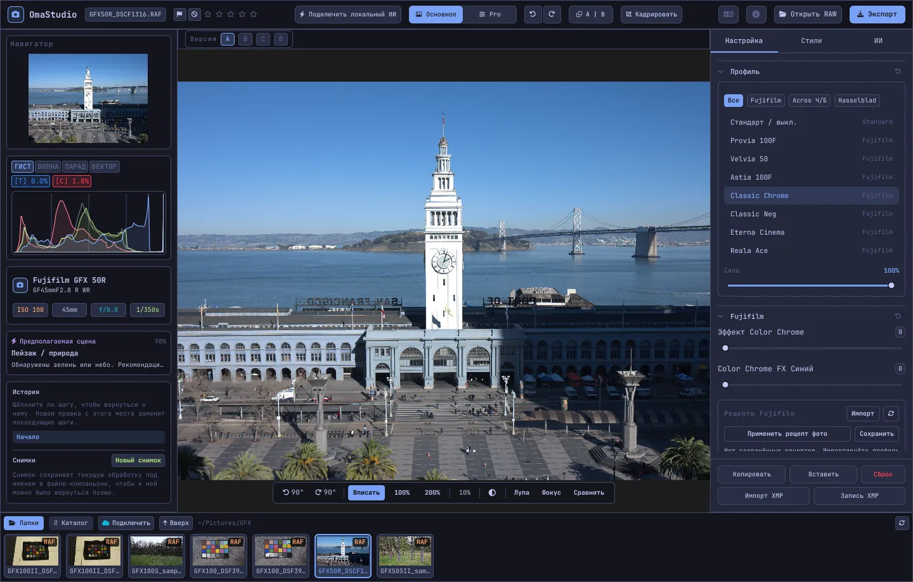

# Руководство пользователя OmaStudio

**OmaStudio: The Complete Medium Format RAW Editor for Omarchy**

[Все языки](../README.md) · [Технологии](../technology/ru.md) · [README](../../README.md)

Это руководство описывает OmaStudio 3.1. В нём рассказано, как установить приложение, как устроено окно и как пользоваться каждой панелью и каждым инструментом. На снимках экрана — примеры файлов Fujifilm GFX 50R и Hasselblad CFV-50c с сайта [raw.pixls.us](https://raw.pixls.us) (CC0).



## Содержание

1. [Установка](#1-установка)
2. [Окно](#2-окно)
3. [Открытие фотографий и библиотека](#3-открытие-фотографий-и-библиотека)
4. [Основное и Pro](#4-основное-и-pro)
5. [Вкладка «Настройка»](#5-вкладка-настройка)
6. [Вкладка «Маски»](#6-вкладка-маски)
7. [Вкладка «Стили»](#7-вкладка-стили)
8. [Вкладка «ИИ» и чат с ИИ](#8-вкладка-ии-и-чат-с-ии)
9. [Средства просмотра](#9-средства-просмотра)
10. [История, снимки и версии](#10-история-снимки-и-версии)
11. [Fujifilm](#11-fujifilm)
12. [Средний формат](#12-средний-формат)
13. [Экспорт](#13-экспорт)
14. [Облачные аккаунты](#14-облачные-аккаунты)
15. [Клавиатура и мышь](#15-клавиатура-и-мышь)
16. [Командная строка, управляющий сокет и MCP](#16-командная-строка-управляющий-сокет-и-mcp)
17. [Файлы и папки](#17-файлы-и-папки)
18. [Устранение неполадок](#18-устранение-неполадок)

## 1. Установка

OmaStudio работает в Omarchy (Arch Linux) под Wayland и Hyprland.

**Из пакета.** В копии репозитория:

```bash
makepkg -si
```

Будут установлены `omastudio`, `omastudio-app`, `omastudio-engine`, ICC-профили, ярлык приложения, значки и правило udev для камер Fujifilm, подключённых по USB.

**Из архива выпуска.** Скачайте `omastudio-<версия>-x86_64-linux.tar.gz` со [страницы выпусков](https://github.com/ozdil/omarchy-omastudio/releases), проверьте его по `checksums.txt`, распакуйте и скопируйте `bin/*` в `~/.local/bin`, а `share/omastudio` — в `~/.local/share/omastudio`.

**Обязательные пакеты:** `libraw` 0.22 или новее, `lcms2`, `qt6-base`, `qt6-declarative`, `qt6-wayland` и `qt6-svg` 6.12 или новее, а также `zenity` для диалогов выбора файлов.

**Необязательные пакеты:**

| Пакет | Для чего |
| :--- | :--- |
| `vulkan-icd-loader` и драйвер Vulkan вашей видеокарты | Дебайеризация на GPU |
| `perl-image-exiftool` | Сохранение метаданных EXIF в экспортированных файлах |
| `libwebp-utils`, `libheif`, `ffmpeg` | WebP с потерями, HEIF и запасной путь для AVIF |
| `onnxruntime` | Локальные маски ИИ на NPU, GPU или CPU |
| `rclone`, `libsecret`, `gnome-keyring` | Google Drive, OneDrive, Dropbox, Box, pCloud и Яндекс Диск |
| `github-cli` | Аккаунт GitHub |
| `ollama` | Локальные модели ИИ для ассистента редактирования |
| `quickshell` | Кнопка OmaStudio на панели Omarchy |

Запустите OmaStudio из меню приложений Omarchy или командой `omastudio` (можно сразу с фотографией: `omastudio DSCF0001.RAF`). Если окно уже открыто, фотография откроется в нём.

## 2. Окно

| Область | Что там находится |
| :--- | :--- |
| Верхняя панель | Имя файла, отметки и рейтинг звёздами, **Подключить локальный ИИ**, переключатель **Основное** / **Pro**, отмена и повтор, до и после (**A \| B**), **Кадрировать**, меню языка, «О программе», **Открыть RAW** и **Экспорт** |
| Левая панель | Навигатор, измерительные инструменты (гистограмма, осциллограф, RGB-парад, вектороскоп) с индикаторами пересветов, сведения о камере и объективе, предлагаемая сцена, история и снимки |
| Центр | Фотография, над ней панель версий (A–D), под ней панель просмотра: поворот, **Вписать**, 100 %, 200 %, текущий масштаб, цвет фона, **Лупа**, **Фокус**, **Сравнить** |
| Правая панель | Вкладки **Настройка**, **Маски** (Pro), **Стили** и **ИИ** и закреплённая строка с кнопками **Копировать**, **Вставить**, **Сброс**, **Импорт XMP** и **Запись XMP** |
| Лента | **Папки**, **Каталог**, по вкладке на каждый облачный аккаунт, **Подключить**, **Вверх** и фотографии текущей папки |

**Tab** одновременно скрывает и показывает обе боковые панели и ленту. Каждый раздел сворачивается и разворачивается по щелчку на заголовке; **Ctrl+щелчок** по заголовку оставляет открытым только этот раздел. Открытая вкладка, свёрнутые разделы и видимые панели сохраняются между сеансами.

Цвета, шрифт и скругление углов следуют активной теме Omarchy и меняются вместе с ней. Фон вокруг фотографии по умолчанию нейтрально-тёмно-серый, чтобы тема не искажала восприятие цвета; кнопка фона на панели просмотра переключает его на средне-серый или на цвет темы.

| Tokyo Night | Catppuccin Latte | Gruvbox | Rosé Pine |
| :---: | :---: | :---: | :---: |
|  |  |  |  |

Интерфейс доступен на 30 языках. Он следует языку системы; меню языка на верхней панели выбирает другой язык и сразу применяет его.

## 3. Открытие фотографий и библиотека

- **Открыть RAW** (Ctrl+O) открывает диалог выбора файла. В нём есть фильтры «Фотографии», RAW и «Изображения».
- Перетащите фотографию или папку из файлового менеджера в окно.
- На ленте **Папки** показывает текущую папку; щёлкните по папке, чтобы войти в неё, и по **Вверх**, чтобы вернуться. Щёлкните по фотографии, чтобы открыть её. Ctrl+← и Ctrl+→ переходят к предыдущей и следующей фотографии.
- **Каталог** показывает все фотографии, которые видел OmaStudio, с рейтингом, отметкой и цветовой меткой.

OmaStudio открывает все RAW-форматы, которые читает LibRaw 0.22 (Fujifilm, Hasselblad, Phase One, Leica, Pentax, Mamiya/Leaf, Canon, Nikon, Sony, Panasonic, Olympus, Sigma, DNG и другие), а также JPEG, PNG, WebP, TIFF, HEIF/HEIC, AVIF, JPEG XL, OpenEXR, Radiance HDR и PNM.

**Рейтинг и отметки.** Клавиши 1–5 ставят рейтинг, 0 снимает его. P отмечает снимок как отобранный, X — как отклонённый, U снимает отметку. Рейтинг и отметки сразу сохраняются в каталоге и в файле правок.

**Выделение.** Shift+щелчок выделяет диапазон на ленте, Ctrl+щелчок добавляет или убирает фотографию. Если выделено несколько фотографий, окно экспорта экспортирует их все (**Пакет**).

Исходные файлы никогда не изменяются. Правки по ходу работы сохраняются в файл рядом с фотографией, `<фото>.omastudio` (Ctrl+S сохраняет сразу).

## 4. Основное и Pro

Переключатель на верхней панели определяет, сколько инструментов видно.

- **Основное:** профиль, Fujifilm, баланс белого, тон, присутствие, пресеты и 3D LUT.
- **Pro** добавляет тоновую кривую, микшер цветов, цветокоррекцию, детализацию и оптику, трансформацию, зерно, управление цветом и вкладку **Маски**. Разделы Pro отмечены меткой «Pro».

При возврате в «Основное» разделы Pro скрываются, но их настройки продолжают действовать.


## 5. Вкладка «Настройка»

Любой ползунок сбрасывается двойным щелчком. Кнопка сброса в заголовке раздела сбрасывает весь раздел.

### Профиль

Базовый вид: **Стандарт / выкл.**, плёночные симуляции Fujifilm (Provia, Velvia, Astia, Classic Chrome, Classic Neg, Eterna, Eterna Bleach Bypass, Reala Ace, Nostalgic Neg, PRO Neg Std и Hi, Acros и Monochrome с жёлтым, красным и зелёным фильтрами, Sepia) и естественный цветовой профиль в стиле Hasselblad. Вкладки фильтруют список. **Сила** смешивает профиль с нейтральным изображением.

### Fujifilm

**Эффект Color Chrome** и **Color Chrome FX Синий** (Слабо = 50, Сильно = 100) делают насыщенные цвета глубже, а FX Синий — синие, не меняя их оттенка. Библиотека рецептов, камера по USB и Pixel Shift описаны в разделе [Fujifilm](#11-fujifilm).

### Баланс белого

**Температура** (2000–12000 K) и **Оттенок** относительно баланса белого, записанного камерой. Фотография открывается «как снято».

### Тон

**Экспозиция** (от −5 до +5 EV в линейном свете: +1 EV удваивает свет), **Контраст**, **Света**, **Тени**, **Белые** и **Чёрные**.

### Присутствие

**Текстура**, **Чёткость** (контраст средних тонов), **Удаление дымки**, **Красочность** и **Насыщенность**.

### Тоновая кривая (Pro)

Кривая по точкам поверх гистограммы — для RGB и отдельно для красного, зелёного и синего. Щелчок добавляет точку, перетаскивание двигает её, двойной щелчок удаляет. Кривая никогда не выходит за свои точки. Четыре ползунка областей под ней (света, светлые тона, тёмные тона, тени) формируют кривую по участкам.

### Микшер цветов (Pro)

Оттенок, насыщенность и яркость для восьми цветов: красного, оранжевого, жёлтого, зелёного, голубого, синего, фиолетового и пурпурного.


### Цветокоррекция (Pro)

Трёхканальные цветовые круги для теней (lift), средних тонов (gamma) и светов (gain) и общий сдвиг — в виде четырёх кругов или вкладок. Под кругами находятся **Усиление цвета**, **Детализация средних тонов** и **Точка опоры контраста**. Микшер каналов под ними смешивает красный, зелёный и синий в каждый выходной канал или в монохромное смешение.


### Детализация и оптика (Pro)

**Резкость**, **Шумоподавление** (яркость и цвет), **Виньетка**, **Удаление каймы** (хроматическая аберрация) и **Коррекция дисторсии объектива**. Коррекции объектива Fujifilm и DNG из файла применяются автоматически; эти ползунки действуют поверх них.

### Трансформация (Pro)

**По вертикали** выпрямляет сходящиеся линии, например у здания, снятого снизу; **По горизонтали** делает то же в стороны; **Масштаб** увеличивает результат. Затем кадрируйте, чтобы убрать пустые края.

### Зерно (Pro)

**Количество**, **Размер** и **Шероховатость** плёночного зерна.

### Управление цветом (Pro)

- **Сжатие охвата** мягко возвращает цвета, вышедшие за пределы охвата, вместо того чтобы обрезать их.
- **Тональная кривая ACES** — плёночный спад в светах, подогнанное приближение выходного преобразования ACES.
- **Цветопроба** (S) показывает, как фотография будет выглядеть с выходным профилем, например профилем принтера и бумаги. Выберите профиль и метод рендеринга. **Предупреждение об охвате** закрашивает пурпурным цвета, которые профиль не может воспроизвести. Правка и экспорт при этом не меняются.

Само выходное цветовое пространство выбирается в окне экспорта.


## 6. Вкладка «Маски»

Вкладка «Маски» показывается в режиме Pro.

### Восстановление и клонирование

Включите **Изменить точки** и щёлкните по пятну на фотографии, чтобы убрать его. Оно заменяется фрагментом-источником рядом. Перетащите сплошной круг, чтобы переместить точку, и пунктирный, чтобы выбрать другой источник. **Восстановить** подгоняет скопированный участок под свет и цвет вокруг точки; **Клонировать** копирует его как есть. **Размер**, **Растушёвка** и **Непрозрачность** относятся к выбранной точке и к новым.


### Локальные коррекции

Каждый слой применяет экспозицию, контраст, света, тени, белые, чёрные и насыщенность через маску, с заданной непрозрачностью.

| Маска | Как создаётся |
| :--- | :--- |
| **Линейная** | Градиент между двумя маркерами на фотографии |
| **Радиальная** | Эллипс с маркерами центра и края и растушёвкой |
| **Яркость** | Диапазон яркости (самое тёмное, самое светлое, переход) |
| **Цвет** | Цвета, близкие к взятому с фотографии (диапазон и растушёвка) |
| **Кисть** | Рисуется на фотографии; есть размер, растушёвка, поток и режим ластика; средняя кнопка мыши сдвигает изображение |
| **Объект (ИИ)**, **Небо (ИИ)** | Модель сегментации на вашем компьютере (см. [ИИ](#8-вкладка-ии-и-чат-с-ии)) |

В разделе **Объединить с:** к маске слоя можно добавить другие части, вычесть их или пересечь с ними; каждую часть можно инвертировать.


## 7. Вкладка «Стили»

- **Пресеты:** **Авто** анализирует фотографию и подбирает экспозицию, баланс белого и тон. Стили «Приглушённый», «Яркий», «Тёплый портрет», «Чёрно-белый» и «Бирюзовый и оранжевый» заменяют предыдущий стиль, а не добавляются к нему; баланс белого, экспозиция, кадрирование и плёночная симуляция сохраняются.
- **LUT:** **Загрузить файл .cube…** применяет собственную 3D LUT с заданной силой.


## 8. Вкладка «ИИ» и чат с ИИ

**Подключить локальный ИИ** на верхней панели использует ИИ, настроенный на этом компьютере: агента Omarchy по умолчанию (Claude Code или Codex со своим входом), если его нет — Ollama, а если нет и его — LM Studio. После подключения кнопка открывает **Чат с ИИ** поверх фотографии: напишите, что хотите изменить («теплее, вытяни небо»), и ИИ выставит ползунки. Ctrl+Z отменяет каждую правку.

**Ассистент редактирования** на вкладке «ИИ» делает то же самое из панели и может вместо этого использовать облачного провайдера: Anthropic Claude, OpenAI, OpenRouter или Google Gemini. Их API-ключи хранятся в системной связке ключей и никогда не записываются на диск и не передаются в командной строке. С облачным провайдером, а также с Claude Code или Codex, превью фотографии отправляется в этот сервис; с Ollama или LM Studio оно остаётся на вашем компьютере.


**Маски ИИ.** **Объект (ИИ)** и **Небо (ИИ)** на вкладке «Маски» запускают модель сегментации ONNX на этом компьютере: сначала на NPU (Intel Core Ultra через OpenVINO, Snapdragon X через QNN, AMD Ryzen AI через Vitis AI), затем на GPU, затем на CPU. Модели не поставляются и не скачиваются. Положите модель в `~/.local/share/omastudio/models` под именем `subject.onnx` или `sky.onnx`; `omastudio npu` покажет, что установлено.

## 9. Средства просмотра

| Средство | Как пользоваться |
| :--- | :--- |
| Масштаб | Колесо мыши в точке указателя; **Вписать** (Ctrl+0), **100 %** (Ctrl+1), **200 %**; двойной щелчок переключает «вписать» и 200 %. 100 % показывает один пиксель фотографии на пиксель экрана при любом масштабировании дисплея. |
| Сдвиг | Перетаскивание левой или средней кнопкой; Shift+колесо сдвигает по горизонтали |
| Поворот | Кнопки поворота на панели просмотра; Alt+колесо поворачивает с шагом 1,5° |
| Кадрировать (C) | Пропорции (исходные, 1:1, 4:5, 9:16, 16:9, свободные) и сетки (трети, золотое сечение, золотая спираль) |
| До и после (Y или A \| B) | Фотография, разделённая на оригинал и правку |
| Сравнить (Shift+C) | Правка рядом с другим состоянием: «До», версией или снимком |
| Лупа (L) | Квадрат под указателем с фотографией в полном разрешении 1:1 |
| Фокус-пикинг (Shift+F) | Самые резкие края подсвечиваются зелёным; это только средство просмотра |
| Пересветы | Щёлкните **[S]** или **[H]** над гистограммой, чтобы показать обрезанные тени синим, а света красным |

| Фокус-пикинг | Сравнить |
| :---: | :---: |
|  |  |

| Кадрировать | До и после |
| :---: | :---: |
|  |  |

Когда фотография показана крупнее превью, движок рассчитывает видимую область из файла в полном разрешении, поэтому детали на экране совпадают с экспортом.

## 10. История, снимки и версии

- **История** на левой панели перечисляет все шаги правки по названиям («Exposure +0.70», «Tone curve»). Щёлкните по шагу, чтобы вернуться к нему; новая правка с этого места заменит последующие шаги, как при Ctrl+Z.
- **Снимки** сохраняют текущую правку под именем. **Восстановить** возвращает снимок как новый шаг, который можно отменить через Ctrl+Z. Снимки сохраняются в файле правок.
- **Версии A–D** над фотографией хранят до четырёх отдельных правок одной фотографии. Щёлкните по букве, чтобы переключиться (Alt+1 … Alt+4); правый щелчок копирует текущую правку в эту версию.
- **Копировать** и **Вставить** (Ctrl+Shift+C, Ctrl+Shift+V) переносят правку на другую фотографию. **Сброс** (Ctrl+R) возвращает значения по умолчанию.
- **Запись XMP** сохраняет правку, рейтинг и метку в файл `.xmp`, который читают Lightroom, Capture One, darktable и digiKam; **Импорт XMP** читает файл, записанный этими программами.

## 11. Fujifilm

- **Рецепт камеры.** RAF или JPEG от Fujifilm открывается с настройками съёмки: плёночная симуляция, тон, цвет, резкость, шумоподавление, чёткость, зерно, Color Chrome, сдвиг баланса белого и динамический диапазон (включая D-Range Priority). Сохранённый файл правок имеет приоритет.
- **Яркость.** RAF открывается с яркостью собственного JPEG камеры.
- **Коррекции объектива.** Дисторсия, поперечная хроматическая аберрация и виньетирование, записанные камерой, применяются для объективов XF, XC и GF.
- **Библиотека рецептов.** **Импорт** принимает профиль X RAW Studio (.FP1, .FP2, .FP3), текст рецепта («Film Simulation: Classic Chrome / Grain Effect: Strong, Small …») или фотографию Fujifilm. **Применить рецепт** применяет сохранённый рецепт; **Применить рецепт фото** возвращает рецепт из файла; **Сохранить** сохраняет текущий.
- **Камера по USB.** Установите режим USB камеры в USB RAW CONV./BACKUP RESTORE и подключите её. **Прочитать C1–C7** показывает её пользовательские настройки, **Записать рецепт в C…** сохраняет рецепт в ячейку (заменяя её содержимое), а **Конвертировать в камере** проявляет открытый RAF в самой камере, при желании с выбранным рецептом.
- **Pixel Shift.** Выделите на ленте кадры RAF одной серии Pixel Shift с GFX и нажмите **Объединить кадры в DNG**. Четыре кадра дают полный цвет в каждом пикселе; шестнадцать кадров удваивают разрешение.

## 12. Средний формат

- **Fujifilm GFX** (GFX 50S, 50R, 50S II, 100, 100S, 100 II и другие): 16-битная обработка от сенсора до экспорта, плёночные симуляции, коррекции объектива и Pixel Shift.
- Файлы **Hasselblad** 3FR и FFF обрезаются по кадрированию камеры по умолчанию.
- Файлы **Phase One и Leaf** IIQ и MOS получают собственную калибровку сенсора задника.
- Поддерживаются файлы **Mamiya** MEF и **Pentax 645** PEF.
- **Плоское поле (LCC):** `omastudio-engine medium-format lcc-create <raw>` создаёт коррекцию по снимку равномерно освещённой белой мишени; она применяется к фотографиям этой папки.
- **Мультишот:** `medium-format multishot f1 f2 f3 f4 --out merged.tif` объединяет серию из 4 кадров.


## 13. Экспорт

**Экспорт** (E) открывает окно экспорта. Enter запускает экспорт, Esc закрывает окно.


| Параметр | Варианты |
| :--- | :--- |
| Формат | JPEG, PNG (8/16 бит), TIFF (8/16 бит, без сжатия, LZW или ZIP), WebP, AVIF (8/10/12 бит), HEIF (8/10/12 бит), JPEG XL (8/16 бит) и OpenEXR (половинная или полная точность с плавающей точкой, линейный свет сцены) |
| Качество | 1–100; 100 — без потерь для WebP, AVIF и JPEG XL |
| Размер | Полный, 75 %, 50 % или длинная сторона 3840 или 2048 пикселей |
| Цветовой профиль | sRGB, Display P3, Adobe RGB, ProPhoto RGB, Rec. 2020, ACEScg или собственный ICC-профиль |
| Метод рендеринга | Перцепционный, Относительный (по умолчанию), Насыщенность, Абсолютный |
| Метаданные | Сохранять метаданные камеры (EXIF), удалить местоположение (GPS) |
| Подготовить для | Кадрирование и выходная резкость для Instagram, Stories и Reels, X, Facebook, квадрата и обложек YouTube |
| Водяной знак | Текст с тегами EXIF ({camera}, {lens}, {iso}, {aperture}, {shutter}, {focal}) или логотип PNG; положение, непрозрачность, размер и тень |
| Папка и имя файла | По умолчанию `~/Pictures/OmaStudio_Exports`; к имени файла можно добавить метку |
| Загрузить в | Подключённый облачный аккаунт |

Все форматы, кроме OpenEXR, содержат ICC-профиль своего цветового пространства. Пакет экспортирует выделенные фотографии одну за другой.

## 14. Облачные аккаунты

**Подключить** на ленте добавляет Google Drive, OneDrive, Dropbox, Box, pCloud, Яндекс Диск или GitHub. Вход выполняется на странице самого сервиса в браузере; OmaStudio никогда не видит ваш пароль.


- У каждого аккаунта есть вкладка на ленте. Просматривайте его папки и щёлкните по фотографии, чтобы скачать (один раз) и открыть её.
- В каждом аккаунте создаётся папка `OmaStudio` (в GitHub — приватный репозиторий `OmaStudio`), куда отправляются загрузки из окна экспорта.
- Хранилища работают через rclone с отдельной конфигурацией OmaStudio, зашифрованной ключом из системной связки ключей. GitHub работает через GitHub CLI.
- Для Google Drive в поле **Собственный ID клиента Google** можно указать свой ID клиента из Google Cloud Console.
- **Отключить** удаляет с этого компьютера ключи аккаунта и скачанные копии; файлы в самом аккаунте остаются.

## 15. Клавиатура и мышь

| Клавиша | Действие |
| :--- | :--- |
| Ctrl+O | Открыть фотографию |
| Ctrl+S | Сохранить правку сейчас |
| Ctrl+Z / Ctrl+Shift+Z или Ctrl+Y | Отменить / повторить |
| Ctrl+Shift+C / Ctrl+Shift+V | Копировать / вставить правку |
| Ctrl+R | Сбросить правку |
| Ctrl+← / Ctrl+→ | Предыдущая / следующая фотография |
| Ctrl+0 / Ctrl+1 | Вписать / 100 % |
| 1–5, 0 | Рейтинг звёздами, снять рейтинг |
| P, X, U | Отобрать, отклонить, снять отметку |
| C | Кадрировать |
| Y | До и после |
| S | Цветопроба |
| L | Лупа |
| Shift+F | Фокус-пикинг |
| Shift+C | Сравнить |
| Alt+1 … Alt+4 | Версии A–D |
| E | Окно экспорта |
| Tab | Скрыть или показать панели |
| Esc | Закрыть открытое окно |

| Мышь | Действие |
| :--- | :--- |
| Колесо | Масштаб в точке указателя |
| Shift+колесо | Сдвиг по горизонтали |
| Alt+колесо | Поворот |
| Перетаскивание (левая или средняя кнопка) | Сдвиг |
| Двойной щелчок по фотографии | Вписать или 200 % |
| Ctrl+щелчок по заголовку раздела | Оставить открытым только этот раздел |
| Правый щелчок по букве версии | Скопировать текущую правку в эту версию |

## 16. Командная строка, управляющий сокет и MCP

**Команды движка.** Каждая команда выводит один объект JSON, поэтому её удобно использовать в скриптах и агентах.

```bash
omastudio inspect DSCF0001.RAF                      # камера, объектив, экспозиция, гистограмма, сцена
omastudio export DSCF0001.RAF --recipe '{"exposure":0.5}' --options '{"format":"jpeg"}'
omastudio fuji-recipe DSCF0001.RAF                  # рецепт камеры
omastudio fuji-pixel-shift DSCF*.RAF --out merged.dng
omastudio xmp export DSCF0001.RAF
omastudio cameras GFX                               # камеры, которые поддерживает RAW-декодер
omastudio gpu                                       # GPU для дебайеризации
omastudio npu                                       # ONNX Runtime и ускорители
omastudio cloud status
omastudio --cli help                                # все команды
```

**Управляющий сокет.** `omastudio ipc <метод> [аргументы]` обращается к открытому окну, например `openPhoto`, `openFolder`, `applyRecipe`, `applyPreset`, `setExposure`, `setWarmth`, `setMode essentials|pro`, `setRightTab`, `showSection`, `setView peaking|compare|softProof|split on|off`, `setZoom`, `showExport`, `showCloud`, `getStatus` и `screenshot <файл.png>`. Сокет отвечает только тому же пользователю.

**MCP.** `omastudio mcp` — сервер Model Context Protocol: агенты ИИ могут анализировать, обрабатывать, отбирать и экспортировать фотографии, читать рецепты Fujifilm и управлять открытым окном. Для Claude Code: `claude mcp add omastudio -- omastudio mcp`. `omastudio skill` устанавливает навык агента в `~/.claude/skills`.

## 17. Файлы и папки

| Путь | Содержимое |
| :--- | :--- |
| `<фото>.omastudio` | Правка фотографии (файл правок) |
| `~/.local/share/omastudio/catalog.json` | Каталог: рейтинги, отметки и цветовые метки |
| `~/.local/share/omastudio/fuji-recipes/` | Сохранённые рецепты Fujifilm |
| `~/.local/share/omastudio/icc/` | Ваши ICC-профили |
| `~/.local/share/omastudio/models/` | Локальные модели ИИ |
| `~/.local/share/omastudio/film-luts/` | LUT плёночных симуляций, измеренные по вашим фотографиям (`fuji-calibrate`) |
| `~/.config/omastudio/` | Настройки, состояние интерфейса, язык, облачные аккаунты |
| `~/.cache/omastudio/` | Миниатюры, превью и скачанные из облака фотографии |

## 18. Устранение неполадок

- **Окно не открывается.** Запустите `omastudio` в терминале и прочитайте сообщение. `omastudio --version` и `omastudio status` показывают, что установлено.
- **GPU не используется.** `omastudio gpu` показывает устройство. Установите `vulkan-icd-loader` и драйвер Vulkan вашей видеокарты. `OMASTUDIO_GPU=off` принудительно включает CPU.
- **Камера по USB не находится.** Установите режим USB в USB RAW CONV./BACKUP RESTORE, переподключите камеру и убедитесь, что правило udev из пакета установлено.
- **Облачный сервис требует программу.** Установите пакет, указанный в диалоге, например `sudo pacman -S rclone libsecret`.
- **Скопировать сведения о системе** в окне «О программе» копирует версию, данные GPU и Omarchy для отчёта об ошибке. Сообщайте о проблемах на [github.com/ozdil/omarchy-omastudio/issues](https://github.com/ozdil/omarchy-omastudio/issues).
