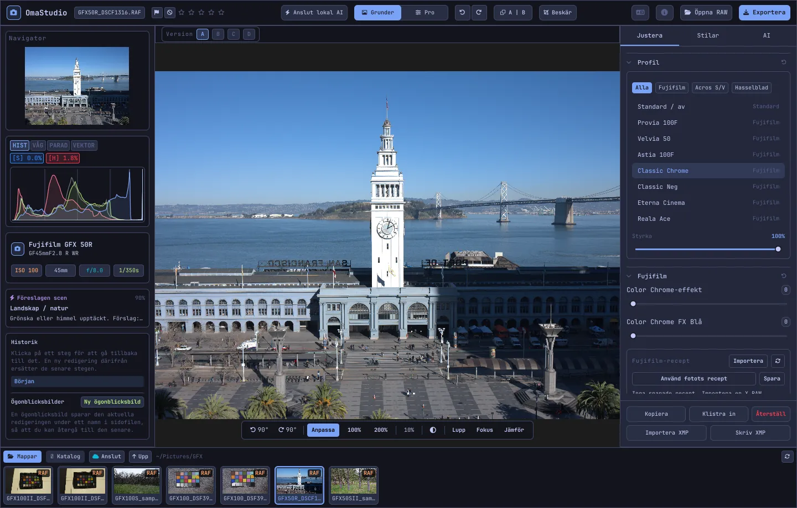

# Användarhandbok för OmaStudio

**OmaStudio: The Complete Medium Format RAW Editor for Omarchy**

[Alla språk](../README.md) · [Teknik](../technology/sv.md) · [README](../../README.md)

Den här handboken gäller OmaStudio 3.1. Den förklarar hur du installerar programmet, hur fönstret är uppbyggt och hur du använder varje panel och verktyg. Skärmbilderna visar exempelfiler från Fujifilm GFX 50R och Hasselblad CFV-50c från [raw.pixls.us](https://raw.pixls.us) (CC0).



## Innehåll

1. [Installation](#1-installation)
2. [Fönstret](#2-fönstret)
3. [Öppna foton och biblioteket](#3-öppna-foton-och-biblioteket)
4. [Grunder och Pro](#4-grunder-och-pro)
5. [Fliken Justera](#5-fliken-justera)
6. [Fliken Masker](#6-fliken-masker)
7. [Fliken Stilar](#7-fliken-stilar)
8. [Fliken AI och AI-samtalet](#8-fliken-ai-och-ai-samtalet)
9. [Visningshjälpmedel](#9-visningshjälpmedel)
10. [Historik, ögonblicksbilder och versioner](#10-historik-ögonblicksbilder-och-versioner)
11. [Fujifilm](#11-fujifilm)
12. [Mellanformat](#12-mellanformat)
13. [Export](#13-export)
14. [Molnkonton](#14-molnkonton)
15. [Tangentbord och mus](#15-tangentbord-och-mus)
16. [Kommandorad, styrsocket och MCP](#16-kommandorad-styrsocket-och-mcp)
17. [Filer och mappar](#17-filer-och-mappar)
18. [Felsökning](#18-felsökning)

## 1. Installation

OmaStudio körs på Omarchy (Arch Linux) under Wayland och Hyprland.

**Från paketet.** I en kopia av förrådet:

```bash
makepkg -si
```

Detta installerar `omastudio`, `omastudio-app`, `omastudio-engine`, ICC-profilerna, menyposten, ikonerna och en udev-regel för Fujifilm-kameror via USB.

**Från ett versionsarkiv.** Ladda ner `omastudio-<version>-x86_64-linux.tar.gz` från [versionssidan](https://github.com/ozdil/omarchy-omastudio/releases), kontrollera det mot `checksums.txt`, packa upp det och kopiera `bin/*` till `~/.local/bin` och `share/omastudio` till `~/.local/share/omastudio`.

**Paket som krävs:** `libraw` 0.22 eller senare, `lcms2`, `qt6-base`, `qt6-declarative`, `qt6-wayland` och `qt6-svg` 6.12 eller senare samt `zenity` för fildialogerna.

**Valfria paket:**

| Paket | Används för |
| :--- | :--- |
| `vulkan-icd-loader` och grafikkortets Vulkan-drivrutin | Demosaicing på GPU:n |
| `perl-image-exiftool` | Behålla EXIF-metadata i exporterade filer |
| `libwebp-utils`, `libheif`, `ffmpeg` | WebP med förlust, HEIF och reservvägen för AVIF |
| `onnxruntime` | Lokala AI-masker på NPU, GPU eller CPU |
| `rclone`, `libsecret`, `gnome-keyring` | Google Drive, OneDrive, Dropbox, Box, pCloud och Yandex Disk |
| `github-cli` | GitHub-konto |
| `ollama` | Lokala AI-modeller för redigeringsassistenten |
| `quickshell` | OmaStudio-knappen i Omarchys panel |

Starta OmaStudio från Omarchys programmeny eller kör `omastudio` (gärna med ett foto: `omastudio DSCF0001.RAF`). Om ett fönster redan är öppet öppnas fotot där.

## 2. Fönstret

| Område | Innehåll |
| :--- | :--- |
| Övre fältet | Filnamn, flaggor och stjärnbetyg, **Anslut lokal AI**, växeln **Grunder** / **Pro**, ångra och gör om, före och efter (**A \| B**), **Beskär**, språkmeny, Om, **Öppna RAW** och **Exportera** |
| Vänster panel | Navigator, mätverktyg (histogram, vågform, RGB-parad, vektorskop) med klippningsindikatorer, kamera- och objektivuppgifter, föreslagen scen, historik och ögonblicksbilder |
| Mitten | Fotot, ovanför det versionsfältet (A–D) och under det visningsfältet: rotera, **Anpassa**, 100 %, 200 %, aktuell zoom, omgivningsfärg, **Lupp**, **Fokus**, **Jämför** |
| Höger panel | Flikarna **Justera**, **Masker** (Pro), **Stilar** och **AI** samt en fast rad med **Kopiera**, **Klistra in**, **Återställ**, **Importera XMP** och **Skriv XMP** |
| Filmremsa | **Mappar**, **Katalog**, en flik per molnkonto, **Anslut**, **Upp** och fotona i den aktuella mappen |

**Tab** döljer och visar båda sidopanelerna och filmremsan samtidigt. Varje avsnitt fälls ihop och ut från rubriken; **Ctrl+klick** på en rubrik låter bara det avsnittet vara öppet. Den öppna fliken, hopfällda avsnitt och vilka paneler som visas sparas mellan sessionerna.

Färger, typsnitt och hörnrundning följer det aktiva Omarchy-temat direkt. Ytan runt fotot är som standard neutralt mörkgrå så att temat inte påverkar hur färgerna uppfattas; omgivningsknappen i visningsfältet växlar till mellangrått eller temafärgen.

| Tokyo Night | Catppuccin Latte | Gruvbox | Rosé Pine |
| :---: | :---: | :---: | :---: |
|  |  |  |  |

Gränssnittet finns på 30 språk. Det följer systemspråket; språkmenyn i det övre fältet väljer ett annat och tillämpar det direkt.

## 3. Öppna foton och biblioteket

- **Öppna RAW** (Ctrl+O) öppnar fildialogen. Den filtrerar på Foton, RAW eller Bilder.
- Dra ett foto eller en mapp från filhanteraren till fönstret.
- I filmremsan visar **Mappar** den aktuella mappen; klicka på en mapp för att gå in i den och på **Upp** för att gå tillbaka. Klicka på ett foto för att öppna det. Ctrl+← och Ctrl+→ går till föregående och nästa foto.
- **Katalog** visar alla foton som OmaStudio har sett, med betyg, flagga och färgetikett.

OmaStudio öppnar alla RAW-format som LibRaw 0.22 läser (Fujifilm, Hasselblad, Phase One, Leica, Pentax, Mamiya/Leaf, Canon, Nikon, Sony, Panasonic, Olympus, Sigma, DNG med flera) samt JPEG, PNG, WebP, TIFF, HEIF/HEIC, AVIF, JPEG XL, OpenEXR, Radiance HDR och PNM.

**Betyg och flaggor.** 1 till 5 sätter stjärnbetyget och 0 tar bort det. P markerar som vald, X som avvisad och U tar bort flaggan. Betyg och flaggor sparas direkt i katalogen och i sidofilen.

**Markering.** Skift+klick markerar ett intervall i filmremsan och Ctrl+klick lägger till eller tar bort ett foto. När flera foton är markerade exporterar exportfönstret alla (**Batch**).

Originalfilerna ändras aldrig. Redigeringar sparas medan du arbetar i en sidofil bredvid fotot, `<foto>.omastudio` (Ctrl+S sparar direkt).

## 4. Grunder och Pro

Växeln i det övre fältet avgör hur många verktyg som visas.

- **Grunder:** profil, Fujifilm, vitbalans, ton, närvaro, förinställningar och 3D-LUT:ar.
- **Pro** lägger till tonkurva, färgmixer, färggradering, detalj och optik, omforma, korn, färghantering och fliken **Masker**. Pro-avsnitten är märkta ”Pro”.

När du byter tillbaka till Grunder döljs Pro-avsnitten; deras inställningar fortsätter att gälla.


## 5. Fliken Justera

Varje reglage återställs med ett dubbelklick. Återställningsknappen i ett avsnitts rubrik återställer hela avsnittet.

### Profil

Grundutseendet: **Standard / av**, Fujifilms filmsimuleringar (Provia, Velvia, Astia, Classic Chrome, Classic Neg, Eterna, Eterna Bleach Bypass, Reala Ace, Nostalgic Neg, PRO Neg Std och Hi, Acros och Monochrome med gult, rött och grönt filter, Sepia) och den naturliga färgprofilen i Hasselblad-stil. Flikarna filtrerar listan. **Styrka** blandar profilen med den neutrala återgivningen.

### Fujifilm

**Color Chrome-effekt** och **Color Chrome FX Blå** (Svag = 50, Stark = 100) fördjupar mättade färger, och blått för FX Blå, utan att ändra deras nyans. Receptbiblioteket, kameran via USB och Pixel Shift beskrivs under [Fujifilm](#11-fujifilm).

### Vitbalans

**Temperatur** (2000–12000 K) och **Färgton**, i förhållande till den vitbalans kameran registrerade. Ett foto öppnas ”som taget”.

### Ton

**Exponering** (−5 till +5 EV på linjärt ljus: +1 EV fördubblar ljuset), **Kontrast**, **Högdagrar**, **Skuggor**, **Vita** och **Svarta**.

### Närvaro

**Struktur**, **Klarhet** (mellantonskontrast), **Ta bort dis**, **Lyster** och **Mättnad**.

### Tonkurva (Pro)

En punktkurva ovanpå histogrammet, för RGB och för rött, grönt och blått var för sig. Klicka för att lägga till en punkt, dra för att flytta den och dubbelklicka för att ta bort den. Kurvan går aldrig förbi sina punkter. De fyra områdesreglagen under (högdagrar, ljusa toner, mörka toner, skuggor) formar kurvan per område.

### Färgmixer (Pro)

Nyans, mättnad och luminans för åtta färger: rött, orange, gult, grönt, akvamarin, blått, lila och magenta.


### Färggradering (Pro)

Trevägs färghjul för skuggor (lift), mellantoner (gamma) och högdagrar (gain) samt en global förskjutning, som fyra hjul eller som flikar. **Färgförstärkning**, **Mellantonsdetalj** och **Kontrastpivot** finns under hjulen. Kanalmixern under dem blandar rött, grönt och blått till varje utkanal eller till en monokrom mix.


### Detalj och optik (Pro)

**Skärpa**, **Brusreducering** (luminans och färg), **Vinjettering**, **Ta bort färgkanter** (kromatisk aberration) och **Korrigering av objektivdistorsion**. Fujifilms och DNG:s objektivkorrigeringar i filen tillämpas automatiskt; de här reglagen verkar ovanpå dem.

### Omforma (Pro)

**Vertikal** rätar upp störtande linjer, till exempel en byggnad som fotograferats underifrån; **Horisontell** gör samma sak i sidled; **Skala** förstorar resultatet. Beskär sedan för att ta bort de tomma kanterna.

### Korn (Pro)

**Kornmängd**, **Kornstorlek** och **Kornets grovhet** för filmkorn.

### Färghantering (Pro)

- **Gamutkomprimering** för mjukt tillbaka färger som hamnat utanför färgomfånget i stället för att klippa dem.
- **ACES-tonkurva** är en filmisk övergång i högdagrarna, en anpassad approximation av ACES-utdatatransformen.
- **Skärmkorrektur** (S) visar fotot så som det kommer att se ut med en utdataprofil, till exempel en skrivar- och pappersprofil. Välj profil och återgivningsavsikt. **Färgomfångsvarning** målar färger som profilen inte kan återge i magenta. Redigeringen och exporten ändras inte.

Själva utdatafärgrymden väljs i exportfönstret.


## 6. Fliken Masker

Fliken Masker visas i Pro-läget.

### Läk och klona

Slå på **Redigera punkter** och klicka på en fläck i fotot för att ta bort den. Den ersätts från en källa bredvid. Dra den heldragna cirkeln för att flytta punkten och den streckade för att välja en annan källa. **Läk** anpassar det kopierade området till ljuset och färgen runt punkten; **Klona** kopierar det som det är. **Storlek**, **Mjuk kant** och **Opacitet** gäller den markerade punkten och nya punkter.


### Lokala justeringar

Varje lager tillämpar exponering, kontrast, högdagrar, skuggor, vita, svarta och mättnad genom en mask, med en opacitet.

| Mask | Hur den skapas |
| :--- | :--- |
| **Linjär** | En toning mellan två handtag på fotot |
| **Radiell** | En ellips med mitt- och kanthandtag och en mjuk kant |
| **Luminans** | Ett ljushetsintervall (mörkast, ljusast, övergång) |
| **Färg** | Färger nära en färg som hämtats från fotot (intervall och mjuk kant) |
| **Pensel** | Målas på fotot, med storlek, mjuk kant, flöde och suddläge; mittenknappen på musen panorerar |
| **AI-motiv**, **AI-himmel** | En segmenteringsmodell på din dator (se [AI](#8-fliken-ai-och-ai-samtalet)) |

Under **Kombinera med:** kan fler delar läggas till, dras ifrån eller skäras med lagrets mask, och varje del kan inverteras.


## 7. Fliken Stilar

- **Förinställningar:** **Automatiskt** analyserar fotot och ställer in exponering, vitbalans och ton. Stilarna Dämpad, Livfull, Varmt porträtt, Svartvitt samt Blågrönt och orange ersätter den tidigare stilen i stället för att läggas ovanpå; vitbalans, exponering, beskärning och filmsimulering behålls.
- **LUT:** **Läs in .cube-fil…** tillämpar en egen 3D-LUT med en styrka.


## 8. Fliken AI och AI-samtalet

**Anslut lokal AI** i det övre fältet använder den AI som är inställd på datorn: Omarchys standardagent (Claude Code eller Codex, med deras egen inloggning), annars Ollama, annars LM Studio. När anslutningen är klar öppnar knappen **AI-samtalet** över fotot: skriv vad du vill ändra (”varmare, rädda himlen”) så ställer AI:n in reglagen. Ctrl+Z ångrar varje redigering.

**Redigeringsassistenten** på fliken AI gör samma sak från panelen och kan i stället använda en molnleverantör: Anthropic Claude, OpenAI, OpenRouter eller Google Gemini. Deras API-nycklar lagras i systemets nyckelring och skrivs aldrig till disk eller läggs på en kommandorad. Med en molnleverantör, eller med Claude Code eller Codex, skickas fotots förhandsvisning till den tjänsten; med Ollama eller LM Studio stannar den på din dator.


**AI-masker.** **AI-motiv** och **AI-himmel** på fliken Masker kör en ONNX-segmenteringsmodell på den här datorn: först på en NPU (Intel Core Ultra via OpenVINO, Snapdragon X via QNN, AMD Ryzen AI via Vitis AI), sedan på en GPU och sist på CPU:n. Ingen modell medföljer eller laddas ner. Lägg en modell i `~/.local/share/omastudio/models` som `subject.onnx` eller `sky.onnx`; `omastudio npu` visar vad som är installerat.

## 9. Visningshjälpmedel

| Hjälpmedel | Så används det |
| :--- | :--- |
| Zoom | Mushjulet vid pekaren; **Anpassa** (Ctrl+0), **100 %** (Ctrl+1), **200 %**; dubbelklick växlar mellan anpassa och 200 %. 100 % visar en fotopixel per skärmpixel vid alla skalningar. |
| Panorera | Dra med vänster- eller mittenknappen; Skift+hjul panorerar i sidled |
| Rotera | Rotationsknapparna i visningsfältet; Alt+hjul vrider i steg om 1,5° |
| Beskär (C) | Bildförhållanden (Original, 1:1, 4:5, 9:16, 16:9, Fritt) och rutnät (tredjedelar, gyllene snittet, gyllene spiralen) |
| Före och efter (Y, eller A \| B) | Fotot delat i originalet och redigeringen |
| Jämför (Skift+C) | Redigeringen bredvid ett annat läge: Före, en version eller en ögonblicksbild |
| Lupp (L) | En ruta under pekaren som visar fotot i full upplösning 1:1 |
| Fokustoppning (Skift+F) | De skarpaste kanterna markeras i grönt; bara ett visningshjälpmedel |
| Klippning | Klicka på **[S]** eller **[H]** ovanför histogrammet för att visa klippta skuggor i blått och högdagrar i rött |

| Fokustoppning | Jämför |
| :---: | :---: |
|  |  |

| Beskär | Före och efter |
| :---: | :---: |
|  |  |

När fotot visas större än förhandsvisningen beräknar motorn det synliga området från filen i full upplösning, så detaljerna du ser stämmer med exporten.

## 10. Historik, ögonblicksbilder och versioner

- **Historik** i den vänstra panelen listar varje steg i redigeringen med namn (”Exposure +0.70”, ”Tone curve”). Klicka på ett steg för att gå tillbaka till det; en ny redigering därifrån ersätter de senare stegen, precis som med Ctrl+Z.
- **Ögonblicksbilder** sparar den aktuella redigeringen under ett namn. **Återställ** tar tillbaka en som ett nytt steg som Ctrl+Z kan ångra. Ögonblicksbilderna sparas i sidofilen.
- **Versionerna A–D** ovanför fotot rymmer upp till fyra separata redigeringar av samma foto. Klicka på en bokstav för att byta (Alt+1 till Alt+4); högerklick kopierar den aktuella redigeringen till den versionen.
- **Kopiera** och **Klistra in** (Ctrl+Skift+C, Ctrl+Skift+V) för över en redigering till ett annat foto. **Återställ** (Ctrl+R) återgår till standardvärdena.
- **Skriv XMP** sparar redigering, betyg och etikett som en `.xmp`-sidofil som Lightroom, Capture One, darktable och digiKam läser; **Importera XMP** läser en som skrivits av de programmen.

## 11. Fujifilm

- **Kamerans recept.** En RAF eller Fujifilm-JPEG öppnas med inställningarna från tagningen: filmsimulering, ton, färg, skärpa, brusreducering, klarhet, korn, Color Chrome, vitbalansförskjutning och dynamiskt omfång (inklusive D-Range Priority). En sparad sidofil har företräde.
- **Ljushet.** RAF-filer öppnas med samma ljushet som kamerans egen JPEG.
- **Objektivkorrigeringar.** Distorsion, lateral kromatisk aberration och vinjettering som kameran registrerat tillämpas för XF-, XC- och GF-objektiv.
- **Receptbibliotek.** **Importera** tar emot en X RAW Studio-profil (.FP1, .FP2, .FP3), recepttext (”Film Simulation: Classic Chrome / Grain Effect: Strong, Small …”) eller ett Fujifilm-foto. **Använd recept** tillämpar ett sparat recept; **Använd fotots recept** går tillbaka till det i filen; **Spara** sparar det aktuella.
- **Kamera via USB.** Ställ kamerans USB-läge på USB RAW CONV./BACKUP RESTORE och anslut den. **Läs C1–C7** visar dess egna inställningar, **Skriv receptet till C…** sparar ett recept på en plats (och ersätter det som fanns där), och **Konvertera i kameran** framkallar den öppna RAF-filen i kameran, eventuellt med det valda receptet.
- **Pixel Shift.** Markera RAF-bildrutorna från en GFX Pixel Shift-sekvens i filmremsan och klicka på **Slå ihop bildrutor till DNG**. Fyra bildrutor ger full färg i varje pixel; sexton bildrutor fördubblar upplösningen.

## 12. Mellanformat

- **Fujifilm GFX** (GFX 50S, 50R, 50S II, 100, 100S, 100 II med flera): 16-bitars bearbetning från sensor till export, filmsimuleringar, objektivkorrigeringar och Pixel Shift.
- **Hasselblad**-filer (3FR och FFF) beskärs till kamerans standardbeskärning.
- **Phase One- och Leaf**-filer (IIQ och MOS) får bakstyckets egen sensorkalibrering.
- **Mamiya** MEF och **Pentax 645** PEF stöds.
- **Flat field (LCC):** `omastudio-engine medium-format lcc-create <raw>` skapar en korrigering från en bild av ett jämnt belyst vitt mål; den tillämpas på fotona i den mappen.
- **Multi-shot:** `medium-format multishot f1 f2 f3 f4 --out merged.tif` slår ihop en sekvens med fyra bilder.


## 13. Export

**Exportera** (E) öppnar exportfönstret. Retur exporterar och Esc stänger.


| Inställning | Val |
| :--- | :--- |
| Filformat | JPEG, PNG (8/16 bitar), TIFF (8/16 bitar, ingen, LZW- eller ZIP-komprimering), WebP, AVIF (8/10/12 bitar), HEIF (8/10/12 bitar), JPEG XL (8/16 bitar) och OpenEXR (halv eller full flyttalsprecision, scenlinjär) |
| Kvalitet | 1–100; 100 är förlustfritt för WebP, AVIF och JPEG XL |
| Storlek | Full, 75 %, 50 % eller en långsida på 3840 eller 2048 px |
| Färgprofil | sRGB, Display P3, Adobe RGB, ProPhoto RGB, Rec. 2020, ACEScg eller en egen ICC-profil |
| Återgivningsavsikt | Perceptuell, Relativ (standard), Mättnad, Absolut |
| Metadata | Behåll kamerans metadata (EXIF), ta bort plats (GPS) |
| Förbered för | Beskärning och utdataskärpa för Instagram, Stories och Reels, X, Facebook, kvadrat och YouTube-miniatyrer |
| Vattenstämpel | Text med EXIF-taggar ({camera}, {lens}, {iso}, {aperture}, {shutter}, {focal}) eller en PNG-logotyp, med position, opacitet, storlek och skugga |
| Mapp och filnamn | Standard `~/Pictures/OmaStudio_Exports`; ett tillägg kan läggas till filnamnet |
| Ladda upp till | Ett anslutet molnkonto |

Alla format utom OpenEXR bär ICC-profilen för sin färgrymd. En batch exporterar de markerade fotona efter varandra.

## 14. Molnkonton

**Anslut** i filmremsan lägger till Google Drive, OneDrive, Dropbox, Box, pCloud, Yandex Disk eller GitHub. Du loggar in på tjänstens egen sida i webbläsaren; OmaStudio ser aldrig ditt lösenord.


- Varje konto får en flik i filmremsan. Bläddra i mapparna och klicka på ett foto för att ladda ner (en gång) och öppna det.
- En mapp som heter `OmaStudio` skapas i varje konto (på GitHub ett privat förråd `OmaStudio`) och tar emot uppladdningar från exportfönstret.
- Lagringstjänsterna går via rclone med OmaStudios egen konfiguration, krypterad med en nyckel i systemets nyckelring. GitHub går via GitHub CLI.
- För Google Drive kan ett eget klient-ID från Google Cloud Console anges under **Eget Google-klient-ID**.
- **Koppla från** tar bort kontots nycklar och nedladdade kopior från datorn; filerna i kontot finns kvar.

## 15. Tangentbord och mus

| Tangent | Åtgärd |
| :--- | :--- |
| Ctrl+O | Öppna ett foto |
| Ctrl+S | Spara redigeringen nu |
| Ctrl+Z / Ctrl+Skift+Z eller Ctrl+Y | Ångra / gör om |
| Ctrl+Skift+C / Ctrl+Skift+V | Kopiera / klistra in redigeringen |
| Ctrl+R | Återställ redigeringen |
| Ctrl+← / Ctrl+→ | Föregående / nästa foto |
| Ctrl+0 / Ctrl+1 | Anpassa / 100 % |
| 1–5, 0 | Stjärnbetyg, ta bort betyg |
| P, X, U | Välj, avvisa, ta bort flagga |
| C | Beskär |
| Y | Före och efter |
| S | Skärmkorrektur |
| L | Lupp |
| Skift+F | Fokustoppning |
| Skift+C | Jämför |
| Alt+1 … Alt+4 | Versionerna A–D |
| E | Exportfönstret |
| Tab | Dölj eller visa panelerna |
| Esc | Stäng det öppna fönstret |

| Mus | Åtgärd |
| :--- | :--- |
| Hjul | Zooma vid pekaren |
| Skift+hjul | Panorera i sidled |
| Alt+hjul | Rotera |
| Dra (vänster- eller mittenknapp) | Panorera |
| Dubbelklick på fotot | Anpassa eller 200 % |
| Ctrl+klick på en avsnittsrubrik | Låt bara det avsnittet vara öppet |
| Högerklick på en versionsbokstav | Kopiera den aktuella redigeringen till den versionen |

## 16. Kommandorad, styrsocket och MCP

**Motorkommandon.** Varje kommando skriver ut ett JSON-objekt, så att skript och agenter kan använda det.

```bash
omastudio inspect DSCF0001.RAF                      # kamera, objektiv, exponering, histogram, scen
omastudio export DSCF0001.RAF --recipe '{"exposure":0.5}' --options '{"format":"jpeg"}'
omastudio fuji-recipe DSCF0001.RAF                  # kamerans recept
omastudio fuji-pixel-shift DSCF*.RAF --out merged.dng
omastudio xmp export DSCF0001.RAF
omastudio cameras GFX                               # kameror som RAW-avkodaren stöder
omastudio gpu                                       # GPU som används för demosaicing
omastudio npu                                       # ONNX Runtime och acceleratorer
omastudio cloud status
omastudio --cli help                                # alla kommandon
```

**Styrsocket.** `omastudio ipc <metod> [argument]` pratar med det öppna fönstret, till exempel `openPhoto`, `openFolder`, `applyRecipe`, `applyPreset`, `setExposure`, `setWarmth`, `setMode essentials|pro`, `setRightTab`, `showSection`, `setView peaking|compare|softProof|split on|off`, `setZoom`, `showExport`, `showCloud`, `getStatus` och `screenshot <fil.png>`. Socketen svarar bara samma användare.

**MCP.** `omastudio mcp` är en Model Context Protocol-server, så att AI-agenter kan granska, rendera, gallra och exportera foton, läsa Fujifilm-recept och styra det öppna fönstret. För Claude Code: `claude mcp add omastudio -- omastudio mcp`. `omastudio skill` installerar agentens färdighet i `~/.claude/skills`.

## 17. Filer och mappar

| Sökväg | Innehåll |
| :--- | :--- |
| `<foto>.omastudio` | Redigeringen av ett foto (sidofil) |
| `~/.local/share/omastudio/catalog.json` | Katalog: betyg, flaggor och färgetiketter |
| `~/.local/share/omastudio/fuji-recipes/` | Sparade Fujifilm-recept |
| `~/.local/share/omastudio/icc/` | Dina egna ICC-profiler |
| `~/.local/share/omastudio/models/` | Lokala AI-modeller |
| `~/.local/share/omastudio/film-luts/` | LUT:ar för filmsimulering uppmätta från dina foton (`fuji-calibrate`) |
| `~/.config/omastudio/` | Inställningar, gränssnittsläge, språk, molnkonton |
| `~/.cache/omastudio/` | Miniatyrer, förhandsvisningar och nedladdade molnfoton |

## 18. Felsökning

- **Fönstret öppnas inte.** Kör `omastudio` i en terminal och läs meddelandet. `omastudio --version` och `omastudio status` visar vad som är installerat.
- **GPU:n används inte.** `omastudio gpu` visar enheten. Installera `vulkan-icd-loader` och grafikkortets Vulkan-drivrutin. `OMASTUDIO_GPU=off` tvingar fram CPU:n.
- **En kamera hittas inte via USB.** Ställ dess USB-läge på USB RAW CONV./BACKUP RESTORE, anslut den igen och kontrollera att paketets udev-regel är installerad.
- **En molntjänst kräver ett program.** Installera paketet som dialogen nämner, till exempel `sudo pacman -S rclone libsecret`.
- **Kopiera systeminfo** i Om-fönstret kopierar version, GPU och Omarchy-uppgifter till en felrapport. Rapportera problem på [github.com/ozdil/omarchy-omastudio/issues](https://github.com/ozdil/omarchy-omastudio/issues).
