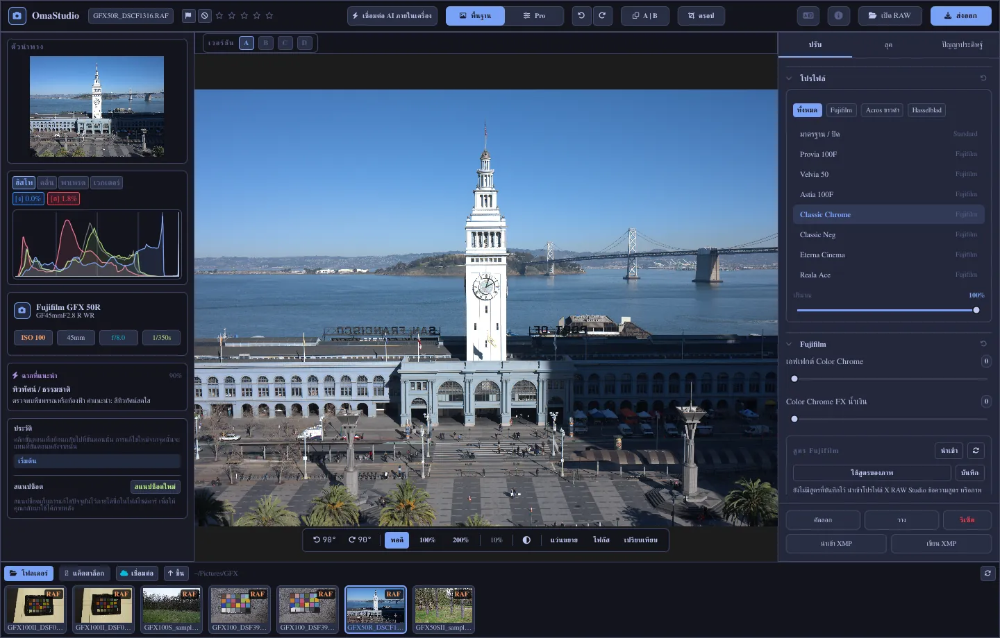

# คู่มือการใช้งาน OmaStudio

**OmaStudio: The Complete Medium Format RAW Editor for Omarchy**

[ทุกภาษา](../README.md) · [เทคโนโลยี](../technology/th.md) · [README](../../README.md)

คู่มือนี้ครอบคลุม OmaStudio 3.1 อธิบายวิธีติดตั้งแอปพลิเคชัน ส่วนต่าง ๆ ของหน้าต่าง และการใช้แต่ละแผงและเครื่องมือ ภาพหน้าจอใช้ไฟล์ตัวอย่างจาก Fujifilm GFX 50R และ Hasselblad CFV-50c จาก [raw.pixls.us](https://raw.pixls.us) (CC0)



## สารบัญ

1. [การติดตั้ง](#1-การติดตั้ง)
2. [หน้าต่างโปรแกรม](#2-หน้าต่างโปรแกรม)
3. [การเปิดภาพและคลังภาพ](#3-การเปิดภาพและคลังภาพ)
4. [พื้นฐานและ Pro](#4-พื้นฐานและ-pro)
5. [แท็บปรับ](#5-แท็บปรับ)
6. [แท็บมาสก์](#6-แท็บมาสก์)
7. [แท็บลุค](#7-แท็บลุค)
8. [แท็บปัญญาประดิษฐ์และแชตกับ AI](#8-แท็บปัญญาประดิษฐ์และแชตกับ-ai)
9. [ตัวช่วยการดูภาพ](#9-ตัวช่วยการดูภาพ)
10. [ประวัติ สแนปช็อต และเวอร์ชัน](#10-ประวัติ-สแนปช็อต-และเวอร์ชัน)
11. [Fujifilm](#11-fujifilm)
12. [มีเดียมฟอร์แมต](#12-มีเดียมฟอร์แมต)
13. [การส่งออก](#13-การส่งออก)
14. [บัญชีคลาวด์](#14-บัญชีคลาวด์)
15. [แป้นพิมพ์และเมาส์](#15-แป้นพิมพ์และเมาส์)
16. [บรรทัดคำสั่ง ซ็อกเก็ตควบคุม และ MCP](#16-บรรทัดคำสั่ง-ซ็อกเก็ตควบคุม-และ-mcp)
17. [ไฟล์และโฟลเดอร์](#17-ไฟล์และโฟลเดอร์)
18. [การแก้ไขปัญหา](#18-การแก้ไขปัญหา)

## 1. การติดตั้ง

OmaStudio ทำงานบน Omarchy (Arch Linux) ภายใต้ Wayland และ Hyprland

**จากแพ็กเกจ** ในโฟลเดอร์ที่โคลนรีโพซิทอรีไว้:

```bash
makepkg -si
```

คำสั่งนี้ติดตั้ง `omastudio`, `omastudio-app`, `omastudio-engine`, โปรไฟล์ ICC, รายการเดสก์ท็อป, ไอคอน และกฎ udev สำหรับกล้อง Fujifilm ที่ต่อผ่าน USB

**จากไฟล์รีลีส** ดาวน์โหลด `omastudio-<version>-x86_64-linux.tar.gz` จาก[หน้ารีลีส](https://github.com/ozdil/omarchy-omastudio/releases) ตรวจสอบกับ `checksums.txt` แตกไฟล์ แล้วคัดลอก `bin/*` ไปที่ `~/.local/bin` และ `share/omastudio` ไปที่ `~/.local/share/omastudio`

**แพ็กเกจที่จำเป็น:** `libraw` 0.22 ขึ้นไป, `lcms2`, `qt6-base`, `qt6-declarative`, `qt6-wayland` และ `qt6-svg` 6.12 ขึ้นไป และ `zenity` สำหรับหน้าต่างเลือกไฟล์

**แพ็กเกจเสริม:**

| แพ็กเกจ | ใช้สำหรับ |
| :--- | :--- |
| `vulkan-icd-loader` และไดรเวอร์ Vulkan ของ GPU | การดีโมเซอิกบน GPU |
| `perl-image-exiftool` | เก็บข้อมูลเมตา EXIF ในไฟล์ที่ส่งออก |
| `libwebp-utils`, `libheif`, `ffmpeg` | WebP แบบสูญเสียข้อมูล, HEIF และทางเลือกสำรองของ AVIF |
| `onnxruntime` | มาสก์ AI ภายในเครื่องบน NPU, GPU หรือ CPU |
| `rclone`, `libsecret`, `gnome-keyring` | Google Drive, OneDrive, Dropbox, Box, pCloud และ Yandex Disk |
| `github-cli` | บัญชี GitHub |
| `ollama` | โมเดล AI ภายในเครื่องสำหรับผู้ช่วยแก้ไข |
| `quickshell` | ปุ่ม OmaStudio ในแถบของ Omarchy |

เปิด OmaStudio จากเมนูแอปของ Omarchy หรือรัน `omastudio` (จะระบุภาพด้วยก็ได้: `omastudio DSCF0001.RAF`) หากมีหน้าต่างเปิดอยู่แล้ว ภาพจะเปิดในหน้าต่างนั้น

## 2. หน้าต่างโปรแกรม

| พื้นที่ | สิ่งที่อยู่ในนั้น |
| :--- | :--- |
| แถบด้านบน | ชื่อไฟล์ ธงและดาว, **เชื่อมต่อ AI ภายในเครื่อง**, สวิตช์ **พื้นฐาน** และ **Pro**, เลิกทำและทำซ้ำ, ก่อนและหลัง (**A \| B**), **ครอป**, เมนูภาษา, เกี่ยวกับ, **เปิด RAW** และ **ส่งออก** |
| แผงซ้าย | ตัวนำทาง, สโคป (ฮิสโตแกรม, เวฟฟอร์ม, RGB พาเหรด, เวกเตอร์สโคป) พร้อมตัวบอกการตัดสี, ข้อมูลกล้องและเลนส์, ฉากที่แนะนำ, ประวัติและสแนปช็อต |
| ตรงกลาง | ภาพ, แถบเวอร์ชัน (A–D) ด้านบน และแถบมุมมองด้านล่าง: หมุน, **พอดี**, 100%, 200%, ระดับซูมปัจจุบัน, สีพื้นรอบภาพ, **แว่นขยาย**, **โฟกัส**, **เปรียบเทียบ** |
| แผงขวา | แท็บ **ปรับ**, **มาสก์** (Pro), **ลุค** และ **ปัญญาประดิษฐ์** และแถวคงที่ที่มี **คัดลอก**, **วาง**, **รีเซ็ต**, **นำเข้า XMP** และ **เขียน XMP** |
| ฟิล์มสตริป | **โฟลเดอร์**, **แค็ตตาล็อก**, แท็บละหนึ่งบัญชีคลาวด์, **เชื่อมต่อ**, **ขึ้น** และภาพในโฟลเดอร์ปัจจุบัน |

**Tab** ซ่อนและแสดงแผงทั้งสองข้างและฟิล์มสตริปพร้อมกัน แต่ละส่วนของแผงพับและกางได้จากหัวข้อ **Ctrl+คลิก** ที่หัวข้อจะเปิดไว้เฉพาะส่วนนั้น แท็บที่เปิด ส่วนที่พับ และแผงที่แสดง จะถูกจำไว้ข้ามการใช้งาน

สี ฟอนต์ และความมนของมุม เป็นไปตามธีม Omarchy ที่ใช้อยู่แบบสด พื้นที่รอบภาพเป็นสีเทาเข้มกลาง ๆ โดยค่าเริ่มต้น เพื่อไม่ให้ธีมทำให้การมองสีเพี้ยน ปุ่มสีพื้นรอบภาพในแถบมุมมองสลับเป็นเทากลางหรือสีของธีมได้

| Tokyo Night | Catppuccin Latte | Gruvbox | Rosé Pine |
| :---: | :---: | :---: | :---: |
|  |  |  |  |

อินเทอร์เฟซมีให้ใช้ 30 ภาษา โดยจะตามภาษาของระบบ เมนูภาษาในแถบด้านบนใช้เลือกภาษาอื่นและมีผลทันที

## 3. การเปิดภาพและคลังภาพ

- **เปิด RAW** (Ctrl+O) เปิดหน้าต่างเลือกไฟล์ กรองได้ตามภาพถ่าย, RAW หรือรูปภาพ
- ลากภาพหรือโฟลเดอร์จากตัวจัดการไฟล์มาวางบนหน้าต่าง
- ในฟิล์มสตริป **โฟลเดอร์** แสดงรายการในโฟลเดอร์ปัจจุบัน คลิกโฟลเดอร์เพื่อเข้าไป และ **ขึ้น** เพื่อย้อนกลับ คลิกภาพเพื่อเปิด Ctrl+← และ Ctrl+→ ไปยังภาพก่อนหน้าและถัดไป
- **แค็ตตาล็อก** แสดงทุกภาพที่ OmaStudio เคยเห็น พร้อมดาว ธง และป้ายสี

OmaStudio เปิดไฟล์ RAW ทุกรูปแบบที่ LibRaw 0.22 อ่านได้ (Fujifilm, Hasselblad, Phase One, Leica, Pentax, Mamiya/Leaf, Canon, Nikon, Sony, Panasonic, Olympus, Sigma, DNG และอื่น ๆ) รวมถึง JPEG, PNG, WebP, TIFF, HEIF/HEIC, AVIF, JPEG XL, OpenEXR, Radiance HDR และ PNM

**ดาวและธง** ปุ่ม 1 ถึง 5 ให้ดาว และ 0 ล้างดาว P ทำเครื่องหมายว่าเลือก X ว่าคัดทิ้ง และ U ล้างธง ดาวและธงจะบันทึกลงแค็ตตาล็อกและไฟล์ไซด์คาร์ทันที

**การเลือก** Shift+คลิก เลือกเป็นช่วงในฟิล์มสตริป และ Ctrl+คลิก เพิ่มหรือเอาภาพออก เมื่อเลือกไว้มากกว่าหนึ่งภาพ หน้าต่างส่งออกจะส่งออกทั้งหมด (**ชุด**)

ไฟล์ต้นฉบับของคุณไม่ถูกแก้ไขเลย การแก้ไขจะบันทึกไว้ข้างภาพในไฟล์ไซด์คาร์ `<photo>.omastudio` ระหว่างที่คุณทำงาน (Ctrl+S บันทึกทันที)

## 4. พื้นฐานและ Pro

สวิตช์ในแถบด้านบนกำหนดว่าจะแสดงเครื่องมือมากเพียงใด

- **พื้นฐาน:** โปรไฟล์, Fujifilm, สมดุลแสงขาว, โทน, ความโดดเด่น, พรีเซ็ต และ 3D LUT
- **Pro** เพิ่มเส้นโค้งโทน, มิกเซอร์สี, การเกรดสี, รายละเอียดและออปติก, แปลงรูป, เกรน, การจัดการสี และแท็บ **มาสก์** ส่วนของ Pro มีป้าย "Pro" กำกับ

เมื่อสลับกลับเป็นพื้นฐาน ส่วนของ Pro จะถูกซ่อน แต่ค่าที่ตั้งไว้ยังคงมีผล


## 5. แท็บปรับ

ดับเบิลคลิกที่แถบเลื่อนใดก็ได้เพื่อรีเซ็ต ปุ่มรีเซ็ตที่หัวข้อส่วนจะรีเซ็ตทั้งส่วน

### โปรไฟล์

ลุคพื้นฐาน: **มาตรฐาน / ปิด**, ฟิล์มซิมูเลชันของ Fujifilm (Provia, Velvia, Astia, Classic Chrome, Classic Neg, Eterna, Eterna Bleach Bypass, Reala Ace, Nostalgic Neg, PRO Neg Std และ Hi, Acros และ Monochrome พร้อมฟิลเตอร์เหลือง แดง และเขียว, Sepia) และโปรไฟล์สีธรรมชาติแบบ Hasselblad แท็บใช้กรองรายการ **ปริมาณ** ผสมโปรไฟล์เข้ากับการเรนเดอร์แบบเป็นกลาง

### Fujifilm

**เอฟเฟกต์ Color Chrome** และ **Color Chrome FX น้ำเงิน** (อ่อน = 50, แรง = 100) ทำให้สีที่อิ่มตัวเข้มขึ้น และสีน้ำเงินสำหรับ FX น้ำเงิน โดยคงเฉดสีไว้ คลังสูตร กล้องผ่าน USB และการเลื่อนพิกเซล อธิบายไว้ใน [Fujifilm](#11-fujifilm)

### สมดุลแสงขาว

**อุณหภูมิสี** (2000–12000 K) และ **โทนสี** เทียบกับสมดุลแสงขาวที่กล้องบันทึกไว้ ภาพจะเปิดด้วยค่า "ตามที่ถ่าย"

### โทน

**การเปิดรับแสง** (−5 ถึง +5 EV บนแสงเชิงเส้น: +1 EV เพิ่มแสงเป็นสองเท่า), **คอนทราสต์**, **ไฮไลต์**, **เงา**, **ส่วนขาว** และ **ส่วนดำ**

### ความโดดเด่น

**พื้นผิว**, **ความชัด** (คอนทราสต์โทนกลาง), **ลดหมอก**, **ความสดใส** และ **ความอิ่มตัว**

### เส้นโค้งโทน (Pro)

เส้นโค้งแบบจุดบนฮิสโตแกรม สำหรับ RGB และสำหรับแดง เขียว และน้ำเงินแยกกัน คลิกเพื่อเพิ่มจุด ลากเพื่อย้าย ดับเบิลคลิกเพื่อลบ เส้นโค้งจะไม่เกินจุดของมัน แถบเลื่อนสี่ช่วงด้านล่าง (ไฮไลต์, สว่าง, มืด, เงา) ปรับรูปเส้นโค้งตามช่วง

### มิกเซอร์สี (Pro)

เฉดสี ความอิ่มตัว และความสว่างของแปดสี: แดง ส้ม เหลือง เขียว ฟ้าน้ำทะเล น้ำเงิน ม่วง และม่วงแดง


### การเกรดสี (Pro)

วงล้อสีสามทางสำหรับเงา (lift), โทนกลาง (gamma) และไฮไลต์ (gain) พร้อมออฟเซ็ตรวม แสดงเป็นสี่วงล้อหรือเป็นแท็บ **เสริมสี**, **รายละเอียดโทนกลาง** และ **จุดหมุนคอนทราสต์** อยู่ใต้วงล้อ มิกเซอร์ช่องสีด้านล่างผสมแดง เขียว และน้ำเงินเข้าแต่ละช่องสีขาออก หรือเป็นการผสมขาวดำ


### รายละเอียดและออปติก (Pro)

**ความคมชัด**, **ลดสัญญาณรบกวน** (ความสว่างและสี), **ขอบมืด**, **ลดขอบสี** (ความคลาดสี) และ **แก้ไขความบิดเบี้ยวของเลนส์** การแก้ไขเลนส์ของ Fujifilm และ DNG จากไฟล์จะใช้โดยอัตโนมัติ แถบเลื่อนเหล่านี้ทำงานต่อจากนั้น

### แปลงรูป (Pro)

**แนวตั้ง** ทำให้เส้นที่ลู่เข้าหากันตรง เช่น อาคารที่ถ่ายจากด้านล่าง **แนวนอน** ทำแบบเดียวกันในแนวข้าง **มาตราส่วน** ขยายผลลัพธ์ จากนั้นครอปเพื่อตัดขอบที่ว่างออก

### เกรน (Pro)

**ปริมาณ**, **ขนาด** และ **ความหยาบ** ของเกรนฟิล์ม

### การจัดการสี (Pro)

- **การบีบอัดขอบเขตสี** นำสีที่ถูกดันออกนอกขอบเขตสีกลับเข้ามาอย่างนุ่มนวลแทนการตัดทิ้ง
- **เส้นโค้งโทน ACES** คือการไล่ไฮไลต์แบบฟิล์ม เป็นการประมาณค่าที่ฟิตไว้ของ ACES output transform
- **พรูฟบนจอ (S)** แสดงภาพตามที่จะปรากฏกับโปรไฟล์ขาออก เช่น โปรไฟล์เครื่องพิมพ์และกระดาษ เลือกโปรไฟล์และวิธีการเรนเดอร์ **เตือนขอบเขตสี** ระบายสีที่โปรไฟล์สร้างซ้ำไม่ได้เป็นสีม่วงแดง การแก้ไขและการส่งออกไม่เปลี่ยนแปลง

พื้นที่สีขาออกเลือกในหน้าต่างส่งออก


## 6. แท็บมาสก์

แท็บมาสก์แสดงในโหมด Pro

### ซ่อมและโคลน

เปิด **แก้ไขจุด** แล้วคลิกจุดบนภาพเพื่อลบออก จุดจะถูกแทนที่ด้วยแหล่งข้าง ๆ ลากวงกลมทึบเพื่อย้ายจุด และวงกลมเส้นประเพื่อเลือกแหล่งอื่น **ซ่อม** ปรับพื้นที่ที่คัดลอกให้เข้ากับแสงและสีรอบจุด **โคลน** คัดลอกมาตามเดิม **ขนาด**, **ขอบนุ่ม** และ **ความทึบ** ใช้กับจุดที่เลือกและจุดใหม่


### การปรับเฉพาะจุด

แต่ละเลเยอร์ใช้การเปิดรับแสง คอนทราสต์ ไฮไลต์ เงา ส่วนขาว ส่วนดำ และความอิ่มตัว ผ่านมาสก์ พร้อมความทึบ

| มาสก์ | วิธีสร้าง |
| :--- | :--- |
| **เชิงเส้น** | การไล่ระดับระหว่างจุดจับสองจุดบนภาพ |
| **รัศมี** | วงรีที่มีจุดศูนย์กลาง จุดจับที่ขอบ และขอบนุ่ม |
| **ความสว่าง** | ช่วงความสว่าง (มืดที่สุด สว่างที่สุด การลดหลั่น) |
| **สี** | สีที่ใกล้เคียงกับสีที่เลือกจากภาพ (ช่วงและขอบนุ่ม) |
| **แปรง** | ระบายบนภาพ พร้อมขนาด ขอบนุ่ม อัตราการไหล และโหมดลบ ปุ่มกลางของเมาส์ใช้เลื่อนภาพ |
| **วัตถุหลัก (AI)**, **ท้องฟ้า (AI)** | โมเดลแบ่งส่วนภาพบนคอมพิวเตอร์ของคุณ (ดู [ปัญญาประดิษฐ์](#8-แท็บปัญญาประดิษฐ์และแชตกับ-ai)) |

ภายใต้ **รวมกับ:** สามารถเพิ่ม ลบ หรือหาส่วนร่วมของส่วนอื่น ๆ กับมาสก์ของเลเยอร์ และกลับด้านแต่ละส่วนได้


## 7. แท็บลุค

- **พรีเซ็ต:** **อัตโนมัติ** วิเคราะห์ภาพและตั้งค่าการเปิดรับแสง สมดุลแสงขาว และโทน ลุค นุ่มนวล, สดใส, ภาพบุคคลโทนอุ่น, ขาวดำ และฟ้าอมเขียวและส้ม จะแทนที่ลุคเดิมแทนการซ้อนทับ สมดุลแสงขาว การเปิดรับแสง การครอป และฟิล์มซิมูเลชันยังคงอยู่
- **LUT:** **โหลดไฟล์ .cube…** ใช้ 3D LUT ของคุณเอง พร้อมปริมาณ


## 8. แท็บปัญญาประดิษฐ์และแชตกับ AI

**เชื่อมต่อ AI ภายในเครื่อง** ในแถบด้านบนใช้ AI ที่ตั้งค่าไว้บนคอมพิวเตอร์เครื่องนี้: เอเจนต์เริ่มต้นของ Omarchy (Claude Code หรือ Codex พร้อมการลงชื่อเข้าใช้ของตัวเอง) หากไม่มีจะใช้ Ollama และหากไม่มีอีกจะใช้ LM Studio เมื่อเชื่อมต่อแล้ว ปุ่มนี้จะเปิด **แชตกับ AI** บนภาพ: เขียนสิ่งที่อยากเปลี่ยน ("อุ่นขึ้น กู้ท้องฟ้ากลับมา") แล้ว AI จะตั้งค่าการปรับให้ Ctrl+Z เลิกทำการแก้ไขแต่ละครั้ง

**ผู้ช่วยแก้ไข** ในแท็บปัญญาประดิษฐ์ทำแบบเดียวกันจากแผง และใช้ผู้ให้บริการคลาวด์แทนได้: Anthropic Claude, OpenAI, OpenRouter หรือ Google Gemini คีย์ API ของบริการเหล่านี้เก็บไว้ในคีย์ริงของระบบ ไม่ถูกเขียนลงดิสก์หรือใส่ในบรรทัดคำสั่ง เมื่อใช้ผู้ให้บริการคลาวด์ หรือ Claude Code หรือ Codex ภาพตัวอย่างจะถูกส่งไปยังบริการนั้น เมื่อใช้ Ollama หรือ LM Studio ภาพจะอยู่บนคอมพิวเตอร์ของคุณ


**มาสก์ AI** **วัตถุหลัก (AI)** และ **ท้องฟ้า (AI)** ในแท็บมาสก์ รันโมเดลแบ่งส่วนภาพ ONNX บนคอมพิวเตอร์เครื่องนี้: บน NPU ก่อน (Intel Core Ultra ผ่าน OpenVINO, Snapdragon X ผ่าน QNN, AMD Ryzen AI ผ่าน Vitis AI) จากนั้น GPU แล้วจึง CPU ไม่มีโมเดลรวมมาหรือดาวน์โหลดให้ ให้วางโมเดลไว้ใน `~/.local/share/omastudio/models` ชื่อ `subject.onnx` หรือ `sky.onnx` คำสั่ง `omastudio npu` แสดงสิ่งที่ติดตั้งอยู่

## 9. ตัวช่วยการดูภาพ

| ตัวช่วย | วิธีใช้ |
| :--- | :--- |
| ซูม | ล้อเมาส์ ณ ตำแหน่งตัวชี้, **พอดี** (Ctrl+0), **100%** (Ctrl+1), **200%** ดับเบิลคลิกสลับระหว่างพอดีกับ 200% ที่ 100% หนึ่งพิกเซลของภาพเท่ากับหนึ่งพิกเซลของจอ ไม่ว่าจะตั้งสเกลจอไว้เท่าใด |
| เลื่อนภาพ | ลากด้วยปุ่มซ้ายหรือปุ่มกลางของเมาส์ Shift+ล้อ เลื่อนไปด้านข้าง |
| หมุน | ปุ่มหมุนในแถบมุมมอง Alt+ล้อ หมุนครั้งละ 1.5° |
| ครอป (C) | อัตราส่วนสำเร็จรูป (ต้นฉบับ, 1:1, 4:5, 9:16, 16:9, อิสระ) และเส้นตาราง (กฎสามส่วน, อัตราส่วนทองคำ, เกลียวทองคำ) |
| ก่อนและหลัง (Y หรือ A \| B) | ภาพแบ่งเป็นต้นฉบับกับภาพที่แก้ไข |
| เปรียบเทียบ (Shift+C) | ภาพที่แก้ไขข้างสถานะอื่น: ก่อน, เวอร์ชัน หรือสแนปช็อต |
| แว่นขยาย (L) | สี่เหลี่ยมใต้ตัวชี้ที่แสดงภาพความละเอียดเต็มที่ 1:1 |
| โฟกัสพีคกิง (Shift+F) | ขอบที่คมที่สุดถูกระบายเป็นสีเขียว เป็นตัวช่วยดูเท่านั้น |
| การตัดสี | คลิก **[S]** หรือ **[H]** เหนือฮิสโตแกรม เพื่อแสดงเงาที่ถูกตัดเป็นสีน้ำเงินและไฮไลต์ที่ถูกตัดเป็นสีแดง |

| โฟกัสพีคกิง | เปรียบเทียบ |
| :---: | :---: |
|  |  |

| ครอป | ก่อนและหลัง |
| :---: | :---: |
|  |  |

เมื่อแสดงภาพใหญ่กว่าภาพตัวอย่าง เอนจินจะเรนเดอร์พื้นที่ที่มองเห็นจากไฟล์ความละเอียดเต็ม ดังนั้นรายละเอียดที่เห็นจึงตรงกับผลการส่งออก

## 10. ประวัติ สแนปช็อต และเวอร์ชัน

- **ประวัติ** ในแผงซ้ายแสดงทุกขั้นของการแก้ไขตามชื่อ ("Exposure +0.70", "Tone curve") คลิกขั้นใดเพื่อย้อนกลับไปที่นั่น การแก้ไขใหม่จากจุดนั้นจะแทนที่ขั้นที่อยู่ถัดไป เหมือนกับ Ctrl+Z
- **สแนปช็อต** เก็บการแก้ไขปัจจุบันไว้ภายใต้ชื่อ **คืนค่า** นำสแนปช็อตกลับมาเป็นขั้นใหม่ที่ Ctrl+Z เลิกทำได้ สแนปช็อตบันทึกอยู่ในไฟล์ไซด์คาร์
- **เวอร์ชัน A–D** เหนือภาพเก็บการแก้ไขแยกกันได้สูงสุดสี่แบบสำหรับภาพเดียวกัน คลิกตัวอักษรเพื่อสลับ (Alt+1 ถึง Alt+4) คลิกขวาเพื่อคัดลอกการแก้ไขปัจจุบันไปยังเวอร์ชันนั้น
- **คัดลอก** และ **วาง** (Ctrl+Shift+C, Ctrl+Shift+V) นำการแก้ไขไปใช้กับภาพอื่น **รีเซ็ต** (Ctrl+R) กลับไปที่ค่าเริ่มต้น
- **เขียน XMP** บันทึกการแก้ไข ดาว และป้าย เป็นไฟล์ไซด์คาร์ `.xmp` ที่ Lightroom, Capture One, darktable และ digiKam อ่านได้ **นำเข้า XMP** อ่านไฟล์ที่โปรแกรมเหล่านั้นเขียนไว้

## 11. Fujifilm

- **สูตรของกล้อง** ไฟล์ RAF หรือ JPEG ของ Fujifilm จะเปิดด้วยค่าที่ใช้ถ่าย: ฟิล์มซิมูเลชัน โทน สี ความคมชัด การลดสัญญาณรบกวน ความชัด เกรน Color Chrome การชดเชยสมดุลแสงขาว และช่วงไดนามิก (รวมถึง D-Range Priority) ไฟล์ไซด์คาร์ที่บันทึกไว้จะมีลำดับความสำคัญกว่า
- **ความสว่าง** ไฟล์ RAF เปิดด้วยความสว่างเท่ากับ JPEG ของกล้องเอง
- **การแก้ไขเลนส์** ความบิดเบี้ยว ความคลาดสีด้านข้าง และขอบมืดที่กล้องบันทึกไว้จะถูกใช้กับเลนส์ XF, XC และ GF
- **คลังสูตร** **นำเข้า** รับโปรไฟล์ X RAW Studio (.FP1, .FP2, .FP3), ข้อความสูตร ("Film Simulation: Classic Chrome / Grain Effect: Strong, Small …") หรือภาพจาก Fujifilm **ใช้สูตร** ใช้สูตรที่บันทึกไว้ **ใช้สูตรของภาพ** กลับไปใช้สูตรในไฟล์ **บันทึก** เก็บสูตรปัจจุบัน
- **กล้องผ่าน USB** ตั้งโหมด USB ของกล้องเป็น USB RAW CONV./BACKUP RESTORE แล้วเชื่อมต่อ **อ่าน C1–C7** แสดงค่าที่กำหนดเองของกล้อง **เขียนสูตรลง C…** เก็บสูตรลงในช่อง (แทนที่สิ่งที่มีอยู่) และ **แปลงในกล้อง** ประมวลผล RAF ที่เปิดอยู่ในกล้อง โดยจะใช้สูตรที่เลือกด้วยก็ได้
- **การเลื่อนพิกเซล** เลือกเฟรม RAF ของลำดับ Pixel Shift ของ GFX ชุดเดียวในฟิล์มสตริป แล้วคลิก **รวมเฟรมเป็น DNG** สี่เฟรมให้สีเต็มในทุกพิกเซล สิบหกเฟรมเพิ่มความละเอียดเป็นสองเท่า

## 12. มีเดียมฟอร์แมต

- **Fujifilm GFX** (GFX 50S, 50R, 50S II, 100, 100S, 100 II และอื่น ๆ): ไปป์ไลน์ 16 บิตตั้งแต่เซ็นเซอร์จนถึงการส่งออก ฟิล์มซิมูเลชัน การแก้ไขเลนส์ และการเลื่อนพิกเซล
- ไฟล์ 3FR และ FFF ของ **Hasselblad** ถูกครอปตามการครอปเริ่มต้นของกล้อง
- ไฟล์ IIQ และ MOS ของ **Phase One และ Leaf** ได้รับการคาลิเบรตเซ็นเซอร์ของดิจิทัลแบ็กนั้นเอง
- รองรับไฟล์ MEF ของ **Mamiya** และ PEF ของ **Pentax 645**
- **แฟลตฟิลด์ (LCC):** `omastudio-engine medium-format lcc-create <raw>` สร้างการแก้ไขจากภาพถ่ายเป้าสีขาวที่ได้รับแสงสม่ำเสมอ และใช้กับภาพในโฟลเดอร์นั้น
- **มัลติช็อต:** `medium-format multishot f1 f2 f3 f4 --out merged.tif` รวมลำดับ 4 ช็อต


## 13. การส่งออก

**ส่งออก** (E) เปิดหน้าต่างส่งออก Enter เพื่อส่งออก และ Esc เพื่อปิด


| การตั้งค่า | ตัวเลือก |
| :--- | :--- |
| รูปแบบไฟล์ | JPEG, PNG (8/16 บิต), TIFF (8/16 บิต ไม่บีบอัด, บีบอัด LZW หรือ ZIP), WebP, AVIF (8/10/12 บิต), HEIF (8/10/12 บิต), JPEG XL (8/16 บิต) และ OpenEXR (half หรือ full float, scene-linear) |
| คุณภาพ | 1–100 ค่า 100 ไม่สูญเสียข้อมูลสำหรับ WebP, AVIF และ JPEG XL |
| ขนาด | เต็ม, 75%, 50% หรือด้านยาว 3840 หรือ 2048 px |
| โปรไฟล์สี | sRGB, Display P3, Adobe RGB, ProPhoto RGB, Rec. 2020, ACEScg หรือโปรไฟล์ ICC ของคุณเอง |
| วิธีการเรนเดอร์ | ตามการรับรู้, สัมพัทธ์ (ค่าเริ่มต้น), ความอิ่มตัว, สัมบูรณ์ |
| ข้อมูลเมตา | เก็บข้อมูลเมตาของกล้อง (EXIF), ลบตำแหน่ง (GPS) |
| เตรียมสำหรับ | การครอปและการเพิ่มความคมชัดขาออกสำหรับ Instagram, Stories และ Reels, X, Facebook, ภาพสี่เหลี่ยมจัตุรัส และภาพย่อ YouTube |
| ลายน้ำ | ข้อความพร้อมแท็ก EXIF ({camera}, {lens}, {iso}, {aperture}, {shutter}, {focal}) หรือโลโก้ PNG พร้อมตำแหน่ง ความทึบ ขนาด และเงา |
| โฟลเดอร์และชื่อไฟล์ | ค่าเริ่มต้น `~/Pictures/OmaStudio_Exports` เพิ่มแท็กในชื่อไฟล์ได้ |
| อัปโหลดไปที่ | บัญชีคลาวด์ที่เชื่อมต่อไว้ |

ทุกรูปแบบยกเว้น OpenEXR ฝังโปรไฟล์ ICC ของพื้นที่สีไว้ การส่งออกแบบชุดจะส่งออกภาพที่เลือกทีละภาพ

## 14. บัญชีคลาวด์

**เชื่อมต่อ** ในฟิล์มสตริปเพิ่ม Google Drive, OneDrive, Dropbox, Box, pCloud, Yandex Disk หรือ GitHub คุณลงชื่อเข้าใช้บนหน้าเว็บของบริการเองในเบราว์เซอร์ OmaStudio ไม่เคยเห็นรหัสผ่านของคุณ


- แต่ละบัญชีมีแท็บในฟิล์มสตริป เรียกดูโฟลเดอร์และคลิกภาพเพื่อดาวน์โหลด (ครั้งเดียว) และเปิด
- ในแต่ละบัญชีจะมีโฟลเดอร์ชื่อ `OmaStudio` ถูกสร้างขึ้น (บน GitHub เป็นรีโพซิทอรีส่วนตัว `OmaStudio`) เพื่อรับไฟล์อัปโหลดจากหน้าต่างส่งออก
- บริการจัดเก็บข้อมูลทำงานผ่าน rclone ด้วยการตั้งค่าของ OmaStudio เอง ซึ่งเข้ารหัสด้วยคีย์ที่เก็บไว้ในคีย์ริงของระบบ GitHub ทำงานผ่าน GitHub CLI
- สำหรับ Google Drive สามารถใส่รหัสไคลเอนต์ของคุณเองจาก Google Cloud Console ได้ที่ **รหัสไคลเอนต์ Google ของคุณเอง**
- **ยกเลิกการเชื่อมต่อ** ลบคีย์ของบัญชีและสำเนาที่ดาวน์โหลดไว้ออกจากคอมพิวเตอร์เครื่องนี้ ไฟล์ในบัญชียังคงอยู่

## 15. แป้นพิมพ์และเมาส์

| แป้น | การทำงาน |
| :--- | :--- |
| Ctrl+O | เปิดภาพ |
| Ctrl+S | บันทึกการแก้ไขทันที |
| Ctrl+Z / Ctrl+Shift+Z หรือ Ctrl+Y | เลิกทำ / ทำซ้ำ |
| Ctrl+Shift+C / Ctrl+Shift+V | คัดลอก / วางการแก้ไข |
| Ctrl+R | รีเซ็ตการแก้ไข |
| Ctrl+← / Ctrl+→ | ภาพก่อนหน้า / ถัดไป |
| Ctrl+0 / Ctrl+1 | พอดี / 100% |
| 1–5, 0 | ให้ดาว, ล้างดาว |
| P, X, U | เลือก, คัดทิ้ง, ล้างธง |
| C | ครอป |
| Y | ก่อนและหลัง |
| S | พรูฟบนจอ |
| L | แว่นขยาย |
| Shift+F | โฟกัสพีคกิง |
| Shift+C | เปรียบเทียบ |
| Alt+1 … Alt+4 | เวอร์ชัน A–D |
| E | หน้าต่างส่งออก |
| Tab | ซ่อนหรือแสดงแผง |
| Esc | ปิดหน้าต่างที่เปิดอยู่ |

| เมาส์ | การทำงาน |
| :--- | :--- |
| ล้อ | ซูม ณ ตำแหน่งตัวชี้ |
| Shift+ล้อ | เลื่อนไปด้านข้าง |
| Alt+ล้อ | หมุน |
| ลาก (ปุ่มซ้ายหรือปุ่มกลาง) | เลื่อนภาพ |
| ดับเบิลคลิกบนภาพ | พอดีหรือ 200% |
| Ctrl+คลิกที่หัวข้อส่วน | เปิดไว้เฉพาะส่วนนั้น |
| คลิกขวาที่ตัวอักษรเวอร์ชัน | คัดลอกการแก้ไขปัจจุบันไปยังเวอร์ชันนั้น |

## 16. บรรทัดคำสั่ง ซ็อกเก็ตควบคุม และ MCP

**คำสั่งของเอนจิน** ทุกคำสั่งพิมพ์ออบเจกต์ JSON หนึ่งตัว สคริปต์และเอเจนต์จึงนำไปใช้ได้

```bash
omastudio inspect DSCF0001.RAF                      # camera, lens, exposure, histogram, scene
omastudio export DSCF0001.RAF --recipe '{"exposure":0.5}' --options '{"format":"jpeg"}'
omastudio fuji-recipe DSCF0001.RAF                  # the camera's recipe
omastudio fuji-pixel-shift DSCF*.RAF --out merged.dng
omastudio xmp export DSCF0001.RAF
omastudio cameras GFX                               # cameras the RAW decoder supports
omastudio gpu                                       # GPU used for demosaicing
omastudio npu                                       # ONNX Runtime and accelerators
omastudio cloud status
omastudio --cli help                                # every command
```

**ซ็อกเก็ตควบคุม** `omastudio ipc <method> [arguments]` สื่อสารกับหน้าต่างที่เปิดอยู่ เช่น `openPhoto`, `openFolder`, `applyRecipe`, `applyPreset`, `setExposure`, `setWarmth`, `setMode essentials|pro`, `setRightTab`, `showSection`, `setView peaking|compare|softProof|split on|off`, `setZoom`, `showExport`, `showCloud`, `getStatus` และ `screenshot <file.png>` ซ็อกเก็ตตอบเฉพาะผู้ใช้คนเดียวกันเท่านั้น

**MCP** `omastudio mcp` เป็นเซิร์ฟเวอร์ Model Context Protocol เพื่อให้เอเจนต์ AI ตรวจดู เรนเดอร์ คัดเลือก และส่งออกภาพ อ่านสูตร Fujifilm และควบคุมหน้าต่างที่เปิดอยู่ได้ สำหรับ Claude Code: `claude mcp add omastudio -- omastudio mcp` คำสั่ง `omastudio skill` ติดตั้งสกิลของเอเจนต์ลงใน `~/.claude/skills`

## 17. ไฟล์และโฟลเดอร์

| ตำแหน่ง | เนื้อหา |
| :--- | :--- |
| `<photo>.omastudio` | การแก้ไขของภาพ (ไซด์คาร์) |
| `~/.local/share/omastudio/catalog.json` | แค็ตตาล็อก: ดาว ธง และป้ายสี |
| `~/.local/share/omastudio/fuji-recipes/` | สูตร Fujifilm ที่บันทึกไว้ |
| `~/.local/share/omastudio/icc/` | โปรไฟล์ ICC ของคุณเอง |
| `~/.local/share/omastudio/models/` | โมเดล AI ภายในเครื่อง |
| `~/.local/share/omastudio/film-luts/` | LUT ฟิล์มซิมูเลชันที่วัดจากภาพของคุณ (`fuji-calibrate`) |
| `~/.config/omastudio/` | การตั้งค่า สถานะอินเทอร์เฟซ ภาษา บัญชีคลาวด์ |
| `~/.cache/omastudio/` | ภาพย่อ ภาพตัวอย่าง และภาพที่ดาวน์โหลดจากคลาวด์ |

## 18. การแก้ไขปัญหา

- **หน้าต่างไม่เปิด** รัน `omastudio` ในเทอร์มินัลแล้วอ่านข้อความ `omastudio --version` และ `omastudio status` แสดงสิ่งที่ติดตั้งอยู่
- **ไม่ได้ใช้ GPU** `omastudio gpu` แสดงอุปกรณ์ ติดตั้ง `vulkan-icd-loader` และไดรเวอร์ Vulkan ของ GPU `OMASTUDIO_GPU=off` บังคับใช้ CPU
- **ไม่พบกล้องทาง USB** ตั้งโหมด USB ของกล้องเป็น USB RAW CONV./BACKUP RESTORE เชื่อมต่อใหม่ และตรวจสอบว่าได้ติดตั้งกฎ udev ของแพ็กเกจแล้ว
- **บริการคลาวด์แจ้งว่าต้องใช้โปรแกรม** ติดตั้งแพ็กเกจที่หน้าต่างระบุ เช่น `sudo pacman -S rclone libsecret`
- **คัดลอกข้อมูลระบบ** ในหน้าต่างเกี่ยวกับ คัดลอกเวอร์ชัน GPU และรายละเอียด Omarchy สำหรับรายงานข้อผิดพลาด แจ้งปัญหาได้ที่ [github.com/ozdil/omarchy-omastudio/issues](https://github.com/ozdil/omarchy-omastudio/issues)
