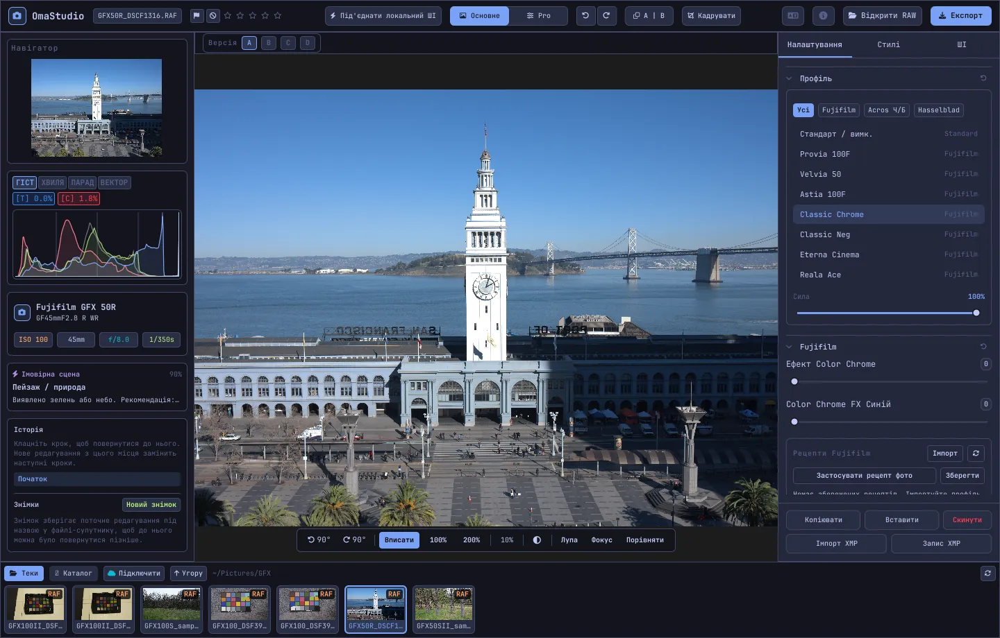

# Посібник користувача OmaStudio

**OmaStudio: The Complete Medium Format RAW Editor for Omarchy**

[Усі мови](../README.md) · [Технології](../technology/uk.md) · [README](../../README.md)

Цей посібник описує OmaStudio 3.1. У ньому пояснено, як установити застосунок, як влаштоване вікно і як користуватися кожною панеллю та кожним інструментом. На знімках екрана — приклади файлів Fujifilm GFX 50R і Hasselblad CFV-50c із сайту [raw.pixls.us](https://raw.pixls.us) (CC0).



## Зміст

1. [Установлення](#1-установлення)
2. [Вікно](#2-вікно)
3. [Відкриття фотографій і бібліотека](#3-відкриття-фотографій-і-бібліотека)
4. [Основне і Pro](#4-основне-і-pro)
5. [Вкладка «Налаштування»](#5-вкладка-налаштування)
6. [Вкладка «Маски»](#6-вкладка-маски)
7. [Вкладка «Стилі»](#7-вкладка-стилі)
8. [Вкладка «ШІ» і чат зі ШІ](#8-вкладка-ші-і-чат-зі-ші)
9. [Засоби перегляду](#9-засоби-перегляду)
10. [Історія, знімки та версії](#10-історія-знімки-та-версії)
11. [Fujifilm](#11-fujifilm)
12. [Середній формат](#12-середній-формат)
13. [Експорт](#13-експорт)
14. [Хмарні облікові записи](#14-хмарні-облікові-записи)
15. [Клавіатура і миша](#15-клавіатура-і-миша)
16. [Командний рядок, керувальний сокет і MCP](#16-командний-рядок-керувальний-сокет-і-mcp)
17. [Файли й теки](#17-файли-й-теки)
18. [Усунення несправностей](#18-усунення-несправностей)

## 1. Установлення

OmaStudio працює в Omarchy (Arch Linux) під Wayland і Hyprland.

**З пакета.** У копії репозиторію:

```bash
makepkg -si
```

Буде встановлено `omastudio`, `omastudio-app`, `omastudio-engine`, ICC-профілі, ярлик застосунку, піктограми та правило udev для камер Fujifilm, під'єднаних через USB.

**З архіву випуску.** Завантажте `omastudio-<версія>-x86_64-linux.tar.gz` зі [сторінки випусків](https://github.com/ozdil/omarchy-omastudio/releases), перевірте його за `checksums.txt`, розпакуйте й скопіюйте `bin/*` до `~/.local/bin`, а `share/omastudio` — до `~/.local/share/omastudio`.

**Обов'язкові пакети:** `libraw` 0.22 або новіший, `lcms2`, `qt6-base`, `qt6-declarative`, `qt6-wayland` і `qt6-svg` 6.12 або новіші, а також `zenity` для діалогів вибору файлів.

**Необов'язкові пакети:**

| Пакет | Для чого |
| :--- | :--- |
| `vulkan-icd-loader` і драйвер Vulkan вашої відеокарти | Дебаєризація на GPU |
| `perl-image-exiftool` | Збереження метаданих EXIF в експортованих файлах |
| `libwebp-utils`, `libheif`, `ffmpeg` | WebP із втратами, HEIF і запасний шлях для AVIF |
| `onnxruntime` | Локальні маски ШІ на NPU, GPU або CPU |
| `rclone`, `libsecret`, `gnome-keyring` | Google Drive, OneDrive, Dropbox, Box, pCloud і Yandex Disk |
| `github-cli` | Обліковий запис GitHub |
| `ollama` | Локальні моделі ШІ для асистента редагування |
| `quickshell` | Кнопка OmaStudio на панелі Omarchy |

Запустіть OmaStudio з меню застосунків Omarchy або командою `omastudio` (можна одразу з фотографією: `omastudio DSCF0001.RAF`). Якщо вікно вже відкрите, фотографія відкриється в ньому.

## 2. Вікно

| Область | Що там розміщено |
| :--- | :--- |
| Верхня панель | Ім'я файлу, позначки й рейтинг зірками, **Під'єднати локальний ШІ**, перемикач **Основне** / **Pro**, скасування і повтор, до і після (**A \| B**), **Кадрувати**, меню мови, «Про програму», **Відкрити RAW** і **Експорт** |
| Ліва панель | Навігатор, вимірювальні інструменти (гістограма, осцилограма, RGB-парад, вектороскоп) з індикаторами пересвітів, відомості про камеру й об'єктив, запропонована сцена, історія і знімки |
| Центр | Фотографія, над нею панель версій (A–D), під нею панель перегляду: поворот, **Вписати**, 100 %, 200 %, поточний масштаб, колір тла, **Лупа**, **Фокус**, **Порівняти** |
| Права панель | Вкладки **Налаштування**, **Маски** (Pro), **Стилі** і **ШІ** та закріплений рядок із кнопками **Копіювати**, **Вставити**, **Скинути**, **Імпорт XMP** і **Запис XMP** |
| Стрічка | **Теки**, **Каталог**, вкладка для кожного хмарного облікового запису, **Підключити**, **Угору** і фотографії поточної теки |

**Tab** водночас ховає й показує обидві бічні панелі та стрічку. Кожен розділ згортається й розгортається клацанням по заголовку; **Ctrl+клацання** по заголовку залишає відкритим лише цей розділ. Відкрита вкладка, згорнуті розділи і видимі панелі зберігаються між сеансами.

Кольори, шрифт і заокруглення кутів відповідають активній темі Omarchy і змінюються разом із нею. Тло навколо фотографії типово нейтрально-темно-сіре, щоб тема не спотворювала сприйняття кольору; кнопка тла на панелі перегляду перемикає його на середньо-сіре або на колір теми.

| Tokyo Night | Catppuccin Latte | Gruvbox | Rosé Pine |
| :---: | :---: | :---: | :---: |
|  |  |  |  |

Інтерфейс доступний 30 мовами. Він відповідає мові системи; меню мови на верхній панелі вибирає іншу мову й одразу її застосовує.

## 3. Відкриття фотографій і бібліотека

- **Відкрити RAW** (Ctrl+O) відкриває діалог вибору файлу. У ньому є фільтри «Фотографії», RAW і «Зображення».
- Перетягніть фотографію або теку з файлового менеджера у вікно.
- На стрічці **Теки** показує поточну теку; клацніть по теці, щоб увійти в неї, і по **Угору**, щоб повернутися. Клацніть по фотографії, щоб відкрити її. Ctrl+← і Ctrl+→ переходять до попередньої і наступної фотографії.
- **Каталог** показує всі фотографії, які бачив OmaStudio, з рейтингом, позначкою і кольоровою міткою.

OmaStudio відкриває всі формати RAW, які читає LibRaw 0.22 (Fujifilm, Hasselblad, Phase One, Leica, Pentax, Mamiya/Leaf, Canon, Nikon, Sony, Panasonic, Olympus, Sigma, DNG та інші), а також JPEG, PNG, WebP, TIFF, HEIF/HEIC, AVIF, JPEG XL, OpenEXR, Radiance HDR і PNM.

**Рейтинг і позначки.** Клавіші 1–5 ставлять рейтинг, 0 знімає його. P позначає знімок як відібраний, X — як відхилений, U знімає позначку. Рейтинг і позначки одразу зберігаються в каталозі та у файлі правок.

**Виділення.** Shift+клацання виділяє діапазон на стрічці, Ctrl+клацання додає або прибирає фотографію. Якщо виділено кілька фотографій, вікно експорту експортує їх усі (**Пакет**).

Початкові файли ніколи не змінюються. Правки під час роботи зберігаються у файл поруч із фотографією, `<фото>.omastudio` (Ctrl+S зберігає одразу).

## 4. Основне і Pro

Перемикач на верхній панелі визначає, скільки інструментів видно.

- **Основне:** профіль, Fujifilm, баланс білого, тон, присутність, пресети і 3D LUT.
- **Pro** додає тонову криву, мікшер кольорів, кольорокорекцію, деталізацію та оптику, трансформацію, зерно, керування кольором і вкладку **Маски**. Розділи Pro мають мітку «Pro».

Після повернення до «Основне» розділи Pro ховаються, але їхні налаштування й далі діють.


## 5. Вкладка «Налаштування»

Будь-який повзунок скидається подвійним клацанням. Кнопка скидання в заголовку розділу скидає весь розділ.

### Профіль

Базовий вигляд: **Стандарт / вимк.**, плівкові симуляції Fujifilm (Provia, Velvia, Astia, Classic Chrome, Classic Neg, Eterna, Eterna Bleach Bypass, Reala Ace, Nostalgic Neg, PRO Neg Std і Hi, Acros і Monochrome із жовтим, червоним і зеленим фільтрами, Sepia) і природний колірний профіль у стилі Hasselblad. Вкладки фільтрують список. **Сила** змішує профіль із нейтральним зображенням.

### Fujifilm

**Ефект Color Chrome** і **Color Chrome FX Синій** (Слабко = 50, Сильно = 100) роблять насичені кольори глибшими, а FX Синій — сині, не змінюючи їхнього відтінку. Бібліотеку рецептів, камеру через USB і Pixel Shift описано в розділі [Fujifilm](#11-fujifilm).

### Баланс білого

**Температура** (2000–12000 K) і **Відтінок** відносно балансу білого, записаного камерою. Фотографія відкривається «як знято».

### Тон

**Експозиція** (від −5 до +5 EV у лінійному світлі: +1 EV подвоює світло), **Контраст**, **Світла**, **Тіні**, **Білі** і **Чорні**.

### Присутність

**Текстура**, **Чіткість** (контраст середніх тонів), **Усунення серпанку**, **Соковитість** і **Насиченість**.

### Тонова крива (Pro)

Крива за точками поверх гістограми — для RGB і окремо для червоного, зеленого й синього. Клацання додає точку, перетягування пересуває її, подвійне клацання видаляє. Крива ніколи не виходить за свої точки. Чотири повзунки областей під нею (світла, світлі тони, темні тони, тіні) формують криву за ділянками.

### Мікшер кольорів (Pro)

Відтінок, насиченість і яскравість для восьми кольорів: червоного, помаранчевого, жовтого, зеленого, блакитного, синього, фіолетового й пурпурового.


### Кольорокорекція (Pro)

Триканальні колірні круги для тіней (lift), середніх тонів (gamma) і світел (gain) та загальний зсув — у вигляді чотирьох кругів або вкладок. Під кругами розміщено **Підсилення кольору**, **Деталізація середніх тонів** і **Точка опори контрасту**. Мікшер каналів під ними змішує червоний, зелений і синій у кожен вихідний канал або в монохромне змішування.


### Деталізація та оптика (Pro)

**Різкість**, **Шумозаглушення** (яскравість і колір), **Віньєтка**, **Усунення облямівки** (хроматична аберація) і **Корекція дисторсії об'єктива**. Корекції об'єктива Fujifilm і DNG з файлу застосовуються автоматично; ці повзунки діють поверх них.

### Трансформація (Pro)

**По вертикалі** вирівнює лінії, що сходяться, наприклад у будівлі, знятої знизу; **По горизонталі** робить те саме вбік; **Масштаб** збільшує результат. Потім кадруйте, щоб прибрати порожні краї.

### Зерно (Pro)

**Кількість**, **Розмір** і **Шорсткість** плівкового зерна.

### Керування кольором (Pro)

- **Стиснення охоплення** м'яко повертає кольори, що вийшли за межі охоплення, замість того щоб обрізати їх.
- **Тональна крива ACES** — плівковий спад у світлах, підігнане наближення вихідного перетворення ACES.
- **Кольоропроба** (S) показує, як фотографія виглядатиме з вихідним профілем, наприклад профілем принтера й паперу. Виберіть профіль і метод рендерингу. **Попередження про охоплення** зафарбовує пурпуровим кольори, які профіль не може відтворити. Правка й експорт при цьому не змінюються.

Саме вихідний колірний простір вибирають у вікні експорту.


## 6. Вкладка «Маски»

Вкладку «Маски» видно в режимі Pro.

### Відновлення і клонування

Увімкніть **Змінити точки** й клацніть по плямі на фотографії, щоб прибрати її. Її буде замінено фрагментом-джерелом поруч. Перетягніть суцільне коло, щоб пересунути точку, і пунктирне, щоб вибрати інше джерело. **Відновити** підганяє скопійовану ділянку під світло й колір навколо точки; **Клонувати** копіює її як є. **Розмір**, **Розмиття краю** і **Непрозорість** стосуються вибраної точки та нових.


### Локальні корекції

Кожен шар застосовує експозицію, контраст, світла, тіні, білі, чорні й насиченість через маску, із заданою непрозорістю.

| Маска | Як створюється |
| :--- | :--- |
| **Лінійна** | Градієнт між двома маркерами на фотографії |
| **Радіальна** | Еліпс із маркерами центру й краю та розмиттям краю |
| **Яскравість** | Діапазон яскравості (найтемніше, найсвітліше, перехід) |
| **Колір** | Кольори, близькі до взятого з фотографії (діапазон і розмиття краю) |
| **Пензель** | Малюється на фотографії; є розмір, розмиття краю, потік і режим гумки; середня кнопка миші зсуває зображення |
| **Об'єкт (ШІ)**, **Небо (ШІ)** | Модель сегментації на вашому комп'ютері (див. [ШІ](#8-вкладка-ші-і-чат-зі-ші)) |

У розділі **Поєднати з:** до маски шару можна додати інші частини, відняти їх або перетнути з ними; кожну частину можна інвертувати.


## 7. Вкладка «Стилі»

- **Пресети:** **Авто** аналізує фотографію й підбирає експозицію, баланс білого і тон. Стилі «Приглушений», «Яскравий», «Теплий портрет», «Чорно-білий» і «Бірюзовий і помаранчевий» замінюють попередній стиль, а не додаються до нього; баланс білого, експозиція, кадрування і плівкова симуляція зберігаються.
- **LUT:** **Завантажити файл .cube…** застосовує власну 3D LUT із заданою силою.


## 8. Вкладка «ШІ» і чат зі ШІ

**Під'єднати локальний ШІ** на верхній панелі використовує ШІ, налаштований на цьому комп'ютері: типового агента Omarchy (Claude Code або Codex із власним входом), якщо його немає — Ollama, а якщо немає і його — LM Studio. Після під'єднання кнопка відкриває **Чат зі ШІ** поверх фотографії: напишіть, що хочете змінити («тепліше, відновити небо»), і ШІ виставить повзунки. Ctrl+Z скасовує кожну правку.

**Асистент редагування** на вкладці «ШІ» робить те саме з панелі й може натомість використовувати хмарного постачальника: Anthropic Claude, OpenAI, OpenRouter або Google Gemini. Їхні API-ключі зберігаються в системній в'язці ключів і ніколи не записуються на диск та не передаються в командному рядку. З хмарним постачальником, а також із Claude Code або Codex, попередній перегляд фотографії надсилається до цього сервісу; з Ollama або LM Studio він залишається на вашому комп'ютері.


**Маски ШІ.** **Об'єкт (ШІ)** і **Небо (ШІ)** на вкладці «Маски» запускають модель сегментації ONNX на цьому комп'ютері: спочатку на NPU (Intel Core Ultra через OpenVINO, Snapdragon X через QNN, AMD Ryzen AI через Vitis AI), потім на GPU, потім на CPU. Моделі не постачаються й не завантажуються. Покладіть модель до `~/.local/share/omastudio/models` під назвою `subject.onnx` або `sky.onnx`; `omastudio npu` покаже, що встановлено.

## 9. Засоби перегляду

| Засіб | Як користуватися |
| :--- | :--- |
| Масштаб | Коліщатко миші в точці вказівника; **Вписати** (Ctrl+0), **100 %** (Ctrl+1), **200 %**; подвійне клацання перемикає «вписати» і 200 %. 100 % показує один піксель фотографії на піксель екрана за будь-якого масштабування дисплея. |
| Зсув | Перетягування лівою або середньою кнопкою; Shift+коліщатко зсуває по горизонталі |
| Поворот | Кнопки повороту на панелі перегляду; Alt+коліщатко повертає з кроком 1,5° |
| Кадрувати (C) | Пропорції (початкові, 1:1, 4:5, 9:16, 16:9, вільні) і сітки (третини, золотий перетин, золота спіраль) |
| До і після (Y або A \| B) | Фотографія, поділена на оригінал і правку |
| Порівняти (Shift+C) | Правка поруч з іншим станом: «До», версією або знімком |
| Лупа (L) | Квадрат під вказівником із фотографією в повній роздільності 1:1 |
| Фокус-пікінг (Shift+F) | Найрізкіші краї підсвічуються зеленим; це лише засіб перегляду |
| Пересвіти | Клацніть **[S]** або **[H]** над гістограмою, щоб показати обрізані тіні синім, а світла червоним |

| Фокус-пікінг | Порівняти |
| :---: | :---: |
|  |  |

| Кадрувати | До і після |
| :---: | :---: |
|  |  |

Коли фотографію показано більшою за попередній перегляд, рушій розраховує видиму область із файлу в повній роздільності, тож деталі на екрані збігаються з експортом.

## 10. Історія, знімки та версії

- **Історія** на лівій панелі перелічує всі кроки правки за назвами («Exposure +0.70», «Tone curve»). Клацніть по кроку, щоб повернутися до нього; нова правка з цього місця замінить подальші кроки, як і з Ctrl+Z.
- **Знімки** зберігають поточну правку під назвою. **Відновити** повертає знімок як новий крок, який можна скасувати через Ctrl+Z. Знімки зберігаються у файлі правок.
- **Версії A–D** над фотографією зберігають до чотирьох окремих правок однієї фотографії. Клацніть по літері, щоб перемкнутися (Alt+1 … Alt+4); клацання правою кнопкою копіює поточну правку в цю версію.
- **Копіювати** і **Вставити** (Ctrl+Shift+C, Ctrl+Shift+V) переносять правку на іншу фотографію. **Скинути** (Ctrl+R) повертає типові значення.
- **Запис XMP** зберігає правку, рейтинг і мітку у файл `.xmp`, який читають Lightroom, Capture One, darktable і digiKam; **Імпорт XMP** читає файл, записаний цими програмами.

## 11. Fujifilm

- **Рецепт камери.** RAF або JPEG від Fujifilm відкривається з налаштуваннями зйомки: плівкова симуляція, тон, колір, різкість, шумозаглушення, чіткість, зерно, Color Chrome, зсув балансу білого і динамічний діапазон (зокрема D-Range Priority). Збережений файл правок має пріоритет.
- **Яскравість.** RAF відкривається з яскравістю власного JPEG камери.
- **Корекції об'єктива.** Дисторсія, поперечна хроматична аберація і віньєтування, записані камерою, застосовуються для об'єктивів XF, XC і GF.
- **Бібліотека рецептів.** **Імпорт** приймає профіль X RAW Studio (.FP1, .FP2, .FP3), текст рецепта («Film Simulation: Classic Chrome / Grain Effect: Strong, Small …») або фотографію Fujifilm. **Застосувати рецепт** застосовує збережений рецепт; **Застосувати рецепт фото** повертає рецепт із файлу; **Зберегти** зберігає поточний.
- **Камера через USB.** Установіть режим USB камери на USB RAW CONV./BACKUP RESTORE і під'єднайте її. **Прочитати C1–C7** показує її власні налаштування, **Записати рецепт у C…** зберігає рецепт у комірку (замінюючи її вміст), а **Конвертувати в камері** проявляє відкритий RAF у самій камері, за бажання з вибраним рецептом.
- **Pixel Shift.** Виділіть на стрічці кадри RAF однієї серії Pixel Shift з GFX і натисніть **Об’єднати кадри у DNG**. Чотири кадри дають повний колір у кожному пікселі; шістнадцять кадрів подвоюють роздільність.

## 12. Середній формат

- **Fujifilm GFX** (GFX 50S, 50R, 50S II, 100, 100S, 100 II та інші): 16-бітна обробка від сенсора до експорту, плівкові симуляції, корекції об'єктива і Pixel Shift.
- Файли **Hasselblad** 3FR і FFF обрізаються за типовим кадруванням камери.
- Файли **Phase One і Leaf** IIQ і MOS отримують власне калібрування сенсора задника.
- Підтримуються файли **Mamiya** MEF і **Pentax 645** PEF.
- **Пласке поле (LCC):** `omastudio-engine medium-format lcc-create <raw>` створює корекцію за знімком рівномірно освітленої білої мішені; її застосовують до фотографій цієї теки.
- **Мультишот:** `medium-format multishot f1 f2 f3 f4 --out merged.tif` об'єднує серію з 4 кадрів.


## 13. Експорт

**Експорт** (E) відкриває вікно експорту. Enter запускає експорт, Esc закриває вікно.


| Параметр | Варіанти |
| :--- | :--- |
| Формат | JPEG, PNG (8/16 біт), TIFF (8/16 біт, без стиснення, LZW або ZIP), WebP, AVIF (8/10/12 біт), HEIF (8/10/12 біт), JPEG XL (8/16 біт) і OpenEXR (половинна або повна точність з рухомою комою, лінійне світло сцени) |
| Якість | 1–100; 100 — без втрат для WebP, AVIF і JPEG XL |
| Розмір | Повний, 75 %, 50 % або довга сторона 3840 чи 2048 пікселів |
| Колірний профіль | sRGB, Display P3, Adobe RGB, ProPhoto RGB, Rec. 2020, ACEScg або власний ICC-профіль |
| Метод рендерингу | Перцептивний, Відносний (типово), Насиченість, Абсолютний |
| Метадані | Зберігати метадані камери (EXIF), видалити місцезнаходження (GPS) |
| Підготувати для | Кадрування й вихідна різкість для Instagram, Stories і Reels, X, Facebook, квадрата й обкладинок YouTube |
| Водяний знак | Текст із тегами EXIF ({camera}, {lens}, {iso}, {aperture}, {shutter}, {focal}) або логотип PNG; положення, непрозорість, розмір і тінь |
| Тека та ім'я файлу | Типово `~/Pictures/OmaStudio_Exports`; до імені файлу можна додати мітку |
| Вивантажити до | Під'єднаний хмарний обліковий запис |

Усі формати, крім OpenEXR, містять ICC-профіль свого колірного простору. Пакет експортує виділені фотографії одну за одною.

## 14. Хмарні облікові записи

**Підключити** на стрічці додає Google Drive, OneDrive, Dropbox, Box, pCloud, Yandex Disk або GitHub. Вхід виконується на сторінці самого сервісу в браузері; OmaStudio ніколи не бачить вашого пароля.


- Кожен обліковий запис має вкладку на стрічці. Переглядайте його теки й клацніть по фотографії, щоб завантажити (один раз) і відкрити її.
- У кожному обліковому записі створюється тека `OmaStudio` (у GitHub — приватний репозиторій `OmaStudio`), куди надходять вивантаження з вікна експорту.
- Сховища працюють через rclone з окремою конфігурацією OmaStudio, зашифрованою ключем із системної в'язки ключів. GitHub працює через GitHub CLI.
- Для Google Drive у полі **Власний ID клієнта Google** можна вказати свій ID клієнта з Google Cloud Console.
- **Відключити** видаляє з цього комп'ютера ключі облікового запису і завантажені копії; файли в самому обліковому записі залишаються.

## 15. Клавіатура і миша

| Клавіша | Дія |
| :--- | :--- |
| Ctrl+O | Відкрити фотографію |
| Ctrl+S | Зберегти правку зараз |
| Ctrl+Z / Ctrl+Shift+Z або Ctrl+Y | Скасувати / повторити |
| Ctrl+Shift+C / Ctrl+Shift+V | Копіювати / вставити правку |
| Ctrl+R | Скинути правку |
| Ctrl+← / Ctrl+→ | Попередня / наступна фотографія |
| Ctrl+0 / Ctrl+1 | Вписати / 100 % |
| 1–5, 0 | Рейтинг зірками, зняти рейтинг |
| P, X, U | Відібрати, відхилити, зняти позначку |
| C | Кадрувати |
| Y | До і після |
| S | Кольоропроба |
| L | Лупа |
| Shift+F | Фокус-пікінг |
| Shift+C | Порівняти |
| Alt+1 … Alt+4 | Версії A–D |
| E | Вікно експорту |
| Tab | Сховати або показати панелі |
| Esc | Закрити відкрите вікно |

| Миша | Дія |
| :--- | :--- |
| Коліщатко | Масштаб у точці вказівника |
| Shift+коліщатко | Зсув по горизонталі |
| Alt+коліщатко | Поворот |
| Перетягування (ліва або середня кнопка) | Зсув |
| Подвійне клацання по фотографії | Вписати або 200 % |
| Ctrl+клацання по заголовку розділу | Залишити відкритим лише цей розділ |
| Клацання правою кнопкою по літері версії | Скопіювати поточну правку в цю версію |

## 16. Командний рядок, керувальний сокет і MCP

**Команди рушія.** Кожна команда виводить один об'єкт JSON, тож її зручно використовувати у скриптах і агентах.

```bash
omastudio inspect DSCF0001.RAF                      # камера, об'єктив, експозиція, гістограма, сцена
omastudio export DSCF0001.RAF --recipe '{"exposure":0.5}' --options '{"format":"jpeg"}'
omastudio fuji-recipe DSCF0001.RAF                  # рецепт камери
omastudio fuji-pixel-shift DSCF*.RAF --out merged.dng
omastudio xmp export DSCF0001.RAF
omastudio cameras GFX                               # камери, які підтримує RAW-декодер
omastudio gpu                                       # GPU для дебаєризації
omastudio npu                                       # ONNX Runtime і прискорювачі
omastudio cloud status
omastudio --cli help                                # усі команди
```

**Керувальний сокет.** `omastudio ipc <метод> [аргументи]` звертається до відкритого вікна, наприклад `openPhoto`, `openFolder`, `applyRecipe`, `applyPreset`, `setExposure`, `setWarmth`, `setMode essentials|pro`, `setRightTab`, `showSection`, `setView peaking|compare|softProof|split on|off`, `setZoom`, `showExport`, `showCloud`, `getStatus` і `screenshot <файл.png>`. Сокет відповідає лише тому самому користувачеві.

**MCP.** `omastudio mcp` — сервер Model Context Protocol: агенти ШІ можуть аналізувати, обробляти, відбирати й експортувати фотографії, читати рецепти Fujifilm і керувати відкритим вікном. Для Claude Code: `claude mcp add omastudio -- omastudio mcp`. `omastudio skill` встановлює навичку агента до `~/.claude/skills`.

## 17. Файли й теки

| Шлях | Вміст |
| :--- | :--- |
| `<фото>.omastudio` | Правка фотографії (файл правок) |
| `~/.local/share/omastudio/catalog.json` | Каталог: рейтинги, позначки й кольорові мітки |
| `~/.local/share/omastudio/fuji-recipes/` | Збережені рецепти Fujifilm |
| `~/.local/share/omastudio/icc/` | Ваші ICC-профілі |
| `~/.local/share/omastudio/models/` | Локальні моделі ШІ |
| `~/.local/share/omastudio/film-luts/` | LUT плівкових симуляцій, виміряні за вашими фотографіями (`fuji-calibrate`) |
| `~/.config/omastudio/` | Налаштування, стан інтерфейсу, мова, хмарні облікові записи |
| `~/.cache/omastudio/` | Мініатюри, попередні перегляди й завантажені з хмари фотографії |

## 18. Усунення несправностей

- **Вікно не відкривається.** Запустіть `omastudio` у терміналі й прочитайте повідомлення. `omastudio --version` і `omastudio status` показують, що встановлено.
- **GPU не використовується.** `omastudio gpu` показує пристрій. Установіть `vulkan-icd-loader` і драйвер Vulkan вашої відеокарти. `OMASTUDIO_GPU=off` примусово вмикає CPU.
- **Камеру через USB не знайдено.** Установіть режим USB на USB RAW CONV./BACKUP RESTORE, перепід'єднайте камеру й переконайтеся, що правило udev із пакета встановлено.
- **Хмарний сервіс вимагає програму.** Установіть пакет, указаний у діалозі, наприклад `sudo pacman -S rclone libsecret`.
- **Скопіювати відомості про систему** у вікні «Про програму» копіює версію, дані GPU та Omarchy для звіту про помилку. Повідомляйте про проблеми на [github.com/ozdil/omarchy-omastudio/issues](https://github.com/ozdil/omarchy-omastudio/issues).
