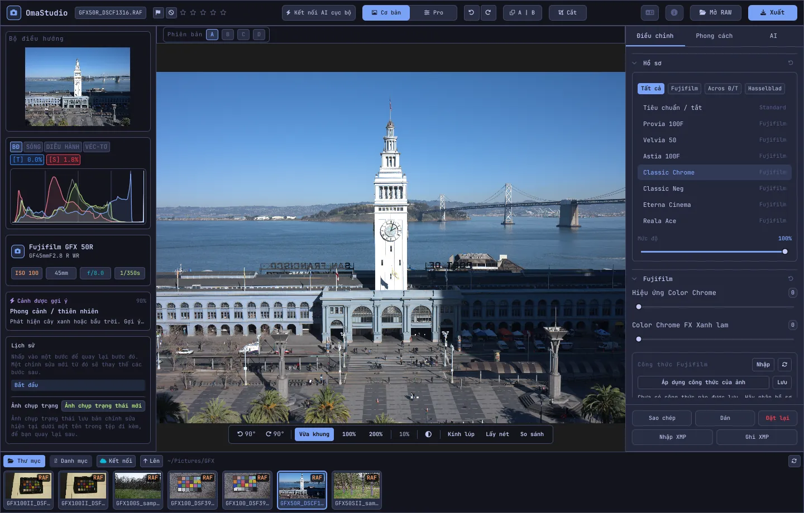

# Hướng dẫn sử dụng OmaStudio

**OmaStudio: The Complete Medium Format RAW Editor for Omarchy**

[Tất cả ngôn ngữ](../README.md) · [Công nghệ](../technology/vi.md) · [README](../../README.md)

Hướng dẫn này dành cho OmaStudio 3.1. Tài liệu giải thích cách cài đặt ứng dụng, bố cục cửa sổ và cách dùng từng bảng điều khiển và công cụ. Ảnh chụp màn hình dùng các tệp mẫu Fujifilm GFX 50R và Hasselblad CFV-50c từ [raw.pixls.us](https://raw.pixls.us) (CC0).



## Mục lục

1. [Cài đặt](#1-cài-đặt)
2. [Cửa sổ](#2-cửa-sổ)
3. [Mở ảnh và thư viện](#3-mở-ảnh-và-thư-viện)
4. [Cơ bản và Pro](#4-cơ-bản-và-pro)
5. [Thẻ Điều chỉnh](#5-thẻ-điều-chỉnh)
6. [Thẻ Mặt nạ](#6-thẻ-mặt-nạ)
7. [Thẻ Phong cách](#7-thẻ-phong-cách)
8. [Thẻ AI và trò chuyện với AI](#8-thẻ-ai-và-trò-chuyện-với-ai)
9. [Công cụ hỗ trợ xem](#9-công-cụ-hỗ-trợ-xem)
10. [Lịch sử, ảnh chụp trạng thái và phiên bản](#10-lịch-sử-ảnh-chụp-trạng-thái-và-phiên-bản)
11. [Fujifilm](#11-fujifilm)
12. [Định dạng trung bình](#12-định-dạng-trung-bình)
13. [Xuất](#13-xuất)
14. [Tài khoản đám mây](#14-tài-khoản-đám-mây)
15. [Bàn phím và chuột](#15-bàn-phím-và-chuột)
16. [Dòng lệnh, socket điều khiển và MCP](#16-dòng-lệnh-socket-điều-khiển-và-mcp)
17. [Tệp và thư mục](#17-tệp-và-thư-mục)
18. [Khắc phục sự cố](#18-khắc-phục-sự-cố)

## 1. Cài đặt

OmaStudio chạy trên Omarchy (Arch Linux) với Wayland và Hyprland.

**Từ gói.** Trong một bản sao (clone) của kho mã:

```bash
makepkg -si
```

Lệnh này cài `omastudio`, `omastudio-app`, `omastudio-engine`, các hồ sơ ICC, mục desktop, biểu tượng và một quy tắc udev cho máy ảnh Fujifilm kết nối qua USB.

**Từ gói phát hành.** Tải `omastudio-<phiên bản>-x86_64-linux.tar.gz` từ [trang phát hành](https://github.com/ozdil/omarchy-omastudio/releases), kiểm tra bằng `checksums.txt`, giải nén rồi chép `bin/*` vào `~/.local/bin` và `share/omastudio` vào `~/.local/share/omastudio`.

**Gói bắt buộc:** `libraw` 0.22 trở lên, `lcms2`, `qt6-base`, `qt6-declarative`, `qt6-wayland` và `qt6-svg` 6.12 trở lên, cùng `zenity` cho các hộp thoại tệp.

**Gói tùy chọn:**

| Gói | Dùng để |
| :--- | :--- |
| `vulkan-icd-loader` và driver Vulkan của GPU | Demosaicing trên GPU |
| `perl-image-exiftool` | Giữ siêu dữ liệu EXIF trong tệp xuất |
| `libwebp-utils`, `libheif`, `ffmpeg` | WebP nén mất dữ liệu, HEIF và phương án dự phòng cho AVIF |
| `onnxruntime` | Mặt nạ AI cục bộ trên NPU, GPU hoặc CPU |
| `rclone`, `libsecret`, `gnome-keyring` | Google Drive, OneDrive, Dropbox, Box, pCloud và Yandex Disk |
| `github-cli` | Tài khoản GitHub |
| `ollama` | Mô hình AI cục bộ cho trợ lý chỉnh sửa |
| `quickshell` | Nút OmaStudio trên thanh Omarchy |

Mở OmaStudio từ menu ứng dụng của Omarchy, hoặc chạy `omastudio` (có thể kèm một ảnh: `omastudio DSCF0001.RAF`). Nếu đã có cửa sổ đang mở, ảnh sẽ mở trong cửa sổ đó.

## 2. Cửa sổ

| Khu vực | Nội dung |
| :--- | :--- |
| Thanh trên cùng | Tên tệp, cờ và xếp hạng sao, **Kết nối AI cục bộ**, công tắc **Cơ bản** / **Pro**, hoàn tác và làm lại, trước và sau (**A \| B**), **Cắt**, menu ngôn ngữ, Giới thiệu, **Mở RAW** và **Xuất** |
| Bảng bên trái | Bộ điều hướng, các công cụ đo (biểu đồ histogram, dạng sóng, RGB parade, vectorscope) với chỉ báo cắt sáng, thông tin máy ảnh và ống kính, cảnh gợi ý, lịch sử và ảnh chụp trạng thái |
| Giữa | Ảnh, thanh phiên bản (A–D) ở trên và thanh xem ở dưới: xoay, **Vừa khung**, 100%, 200%, mức thu phóng hiện tại, màu nền xung quanh, **Kính lúp**, **Lấy nét**, **So sánh** |
| Bảng bên phải | Các thẻ **Điều chỉnh**, **Mặt nạ** (Pro), **Phong cách** và **AI**, cùng một hàng cố định gồm **Sao chép**, **Dán**, **Đặt lại**, **Nhập XMP** và **Ghi XMP** |
| Dải phim | **Thư mục**, **Danh mục**, mỗi tài khoản đám mây một thẻ, **Kết nối**, **Lên** và các ảnh trong thư mục hiện tại |

**Tab** ẩn và hiện cùng lúc cả hai bảng bên và dải phim. Mỗi mục trong bảng được mở hoặc thu gọn từ tiêu đề; **Ctrl+nhấp** vào tiêu đề chỉ giữ mục đó mở. Thẻ đang mở, các mục thu gọn và những bảng được hiển thị được ghi nhớ giữa các phiên.

Màu sắc, phông chữ và độ bo góc đi theo chủ đề Omarchy đang dùng, theo thời gian thực. Vùng quanh ảnh mặc định là xám tối trung tính để chủ đề không làm thay đổi cảm nhận màu; nút màu nền trên thanh xem chuyển sang xám trung bình hoặc màu của chủ đề.

| Tokyo Night | Catppuccin Latte | Gruvbox | Rosé Pine |
| :---: | :---: | :---: | :---: |
|  |  |  |  |

Giao diện có 30 ngôn ngữ. Giao diện đi theo ngôn ngữ hệ thống; menu ngôn ngữ trên thanh trên cùng chọn ngôn ngữ khác và áp dụng ngay.

## 3. Mở ảnh và thư viện

- **Mở RAW** (Ctrl+O) mở hộp thoại tệp. Hộp thoại lọc theo ảnh, RAW hoặc hình ảnh.
- Kéo một ảnh hoặc thư mục từ trình quản lý tệp vào cửa sổ.
- Trong dải phim, **Thư mục** hiển thị thư mục hiện tại; nhấp vào một thư mục để vào trong và **Lên** để quay lại. Nhấp vào ảnh để mở. Ctrl+← và Ctrl+→ chuyển sang ảnh trước và ảnh sau.
- **Danh mục** liệt kê mọi ảnh OmaStudio đã thấy, kèm xếp hạng, cờ và nhãn màu.

OmaStudio mở mọi định dạng RAW mà LibRaw 0.22 đọc được (Fujifilm, Hasselblad, Phase One, Leica, Pentax, Mamiya/Leaf, Canon, Nikon, Sony, Panasonic, Olympus, Sigma, DNG và các loại khác), cùng JPEG, PNG, WebP, TIFF, HEIF/HEIC, AVIF, JPEG XL, OpenEXR, Radiance HDR và PNM.

**Xếp hạng và cờ.** Phím 1 đến 5 đặt xếp hạng sao và 0 xóa xếp hạng. P đánh dấu chọn, X đánh dấu loại và U xóa cờ. Xếp hạng và cờ được lưu ngay vào danh mục và tệp đi kèm.

**Chọn nhiều ảnh.** Shift+nhấp chọn một dải trong dải phim và Ctrl+nhấp thêm hoặc bỏ một ảnh. Khi chọn nhiều ảnh, cửa sổ Xuất sẽ xuất tất cả (**Lô**).

Tệp gốc của bạn không bao giờ bị thay đổi. Chỉnh sửa được lưu cạnh ảnh trong tệp đi kèm `<ảnh>.omastudio` khi bạn làm việc (Ctrl+S lưu ngay).

## 4. Cơ bản và Pro

Công tắc trên thanh trên cùng quyết định có bao nhiêu công cụ được hiển thị.

- **Cơ bản:** hồ sơ, Fujifilm, cân bằng trắng, tông, độ hiện diện, cài đặt sẵn và LUT 3D.
- **Pro** thêm đường cong tông, bộ trộn màu, chỉnh màu, chi tiết và quang học, biến đổi, hạt, quản lý màu và thẻ **Mặt nạ**. Các mục Pro có nhãn "Pro".

Khi chuyển về Cơ bản, các mục Pro bị ẩn; thiết lập của chúng vẫn được áp dụng.


## 5. Thẻ Điều chỉnh

Mỗi thanh trượt được đặt lại khi nhấp đúp. Nút đặt lại ở tiêu đề mục sẽ đặt lại toàn bộ mục.

### Hồ sơ

Diện mạo cơ bản: **Tiêu chuẩn / tắt**, các giả lập phim Fujifilm (Provia, Velvia, Astia, Classic Chrome, Classic Neg, Eterna, Eterna Bleach Bypass, Reala Ace, Nostalgic Neg, PRO Neg Std và Hi, Acros và Monochrome với bộ lọc vàng, đỏ và xanh lục, Sepia) và hồ sơ màu tự nhiên theo phong cách Hasselblad. Các thẻ lọc danh sách. **Mức độ** trộn hồ sơ với cách hiển thị trung tính.

### Fujifilm

**Hiệu ứng Color Chrome** và **Color Chrome FX Xanh lam** (Yếu = 50, Mạnh = 100) làm sâu các màu bão hòa, riêng FX Xanh lam là các sắc xanh, mà vẫn giữ sắc độ. Thư viện công thức, máy ảnh qua USB và dịch điểm ảnh được mô tả ở [Fujifilm](#11-fujifilm).

### Cân bằng trắng

**Nhiệt độ màu** (2000–12000 K) và **Sắc thái**, so với cân bằng trắng mà máy ảnh đã ghi. Ảnh mở với thiết lập lúc chụp.

### Tông

**Phơi sáng** (−5 đến +5 EV, trên ánh sáng tuyến tính: +1 EV tăng gấp đôi ánh sáng), **Tương phản**, **Vùng sáng**, **Vùng tối**, **Vùng trắng** và **Vùng đen**.

### Độ hiện diện

**Kết cấu**, **Độ rõ** (tương phản tông trung tính), **Khử sương mù**, **Độ rực** và **Độ bão hòa**.

### Đường cong tông (Pro)

Đường cong điểm vẽ trên histogram, cho RGB và riêng cho đỏ, xanh lục và xanh lam. Nhấp để thêm điểm, kéo để di chuyển, nhấp đúp để xóa. Đường cong không bao giờ vượt quá các điểm của nó. Bốn thanh trượt vùng bên dưới (vùng sáng, tông sáng, tông tối, vùng tối) định hình đường cong theo từng vùng.

### Bộ trộn màu (Pro)

Sắc độ, độ bão hòa và độ chói cho tám màu: đỏ, cam, vàng, xanh lục, xanh ngọc, xanh lam, tím và hồng tím.


### Chỉnh màu (Pro)

Bánh xe màu ba chiều cho vùng tối (lift), tông trung tính (gamma) và vùng sáng (gain), cộng một độ lệch toàn cục, hiển thị dạng bốn bánh xe hoặc dạng thẻ. **Tăng cường màu**, **Chi tiết tông trung tính** và **Trục tương phản** nằm dưới các bánh xe. Bộ trộn kênh bên dưới trộn đỏ, xanh lục và xanh lam vào từng kênh đầu ra, hoặc vào một bản trộn đơn sắc.


### Chi tiết và quang học (Pro)

**Làm nét**, **Giảm nhiễu** (độ chói và màu), **Làm tối góc**, **Khử viền màu** (quang sai màu) và **Hiệu chỉnh méo ống kính**. Hiệu chỉnh ống kính có sẵn trong tệp Fujifilm và DNG được áp dụng tự động; các thanh trượt này tác động thêm lên trên.

### Biến đổi (Pro)

**Dọc** làm thẳng các đường hội tụ, ví dụ một tòa nhà chụp từ dưới lên; **Ngang** làm điều tương tự theo chiều ngang; **Tỷ lệ** phóng to kết quả. Sau đó hãy cắt để bỏ các mép trống.

### Hạt (Pro)

**Lượng**, **Kích thước** và **Độ thô** của hạt phim.

### Quản lý màu (Pro)

- **Nén gam màu** đưa các màu bị đẩy ra ngoài gam trở lại một cách mềm mại thay vì cắt bỏ.
- **Đường cong tông ACES** làm dịu vùng sáng theo kiểu điện ảnh, một phép xấp xỉ được khớp của phép biến đổi đầu ra ACES.
- **Soft proof** (S) hiển thị ảnh như khi dùng một hồ sơ đầu ra, ví dụ hồ sơ máy in và giấy. Chọn hồ sơ và mục đích kết xuất. **Cảnh báo gam màu** tô màu hồng tím những màu mà hồ sơ không tái tạo được. Bản chỉnh sửa và ảnh xuất không thay đổi.

Không gian màu đầu ra được chọn trong cửa sổ Xuất.


## 6. Thẻ Mặt nạ

Thẻ Mặt nạ hiển thị ở chế độ Pro.

### Sửa và nhân bản

Bật **Sửa điểm** và nhấp vào một vết trên ảnh để xóa nó. Vết được thay bằng một vùng nguồn bên cạnh. Kéo vòng tròn liền để di chuyển vết và vòng tròn nét đứt để chọn nguồn khác. **Sửa** khớp vùng sao chép với ánh sáng và màu xung quanh vết; **Nhân bản** sao chép nguyên trạng. **Kích thước**, **Làm mềm viền** và **Độ mờ đục** áp dụng cho vết đang chọn và các vết mới.


### Điều chỉnh cục bộ

Mỗi lớp áp dụng phơi sáng, tương phản, vùng sáng, vùng tối, vùng trắng, vùng đen và độ bão hòa qua một mặt nạ, kèm độ mờ đục.

| Mặt nạ | Cách tạo |
| :--- | :--- |
| **Tuyến tính** | Dải chuyển giữa hai tay cầm trên ảnh |
| **Tỏa tròn** | Hình elip có tâm, tay cầm ở mép và độ mềm viền |
| **Độ chói** | Một khoảng độ sáng (tối nhất, sáng nhất, độ chuyển) |
| **Màu** | Các màu gần với màu được lấy từ ảnh (khoảng và độ mềm viền) |
| **Cọ** | Vẽ trên ảnh, với kích thước, độ mềm viền, lưu lượng và chế độ tẩy; nút giữa chuột để di chuyển khung nhìn |
| **Chủ thể AI**, **Bầu trời AI** | Một mô hình phân đoạn chạy trên máy tính của bạn (xem [AI](#8-thẻ-ai-và-trò-chuyện-với-ai)) |

Trong **Kết hợp với**, có thể cộng thêm, trừ bớt hoặc lấy giao các phần khác với mặt nạ của lớp, và mỗi phần đều có thể đảo ngược.


## 7. Thẻ Phong cách

- **Cài đặt sẵn:** **Tự động** phân tích ảnh và đặt phơi sáng, cân bằng trắng và tông. Các phong cách Dịu, Rực rỡ, Chân dung ấm, Đen trắng, Xanh mòng két và cam thay thế phong cách trước đó thay vì chồng lên; cân bằng trắng, phơi sáng, khung cắt và giả lập phim được giữ nguyên.
- **LUT:** **Tải tệp .cube…** áp dụng LUT 3D của riêng bạn, với một mức độ.


## 8. Thẻ AI và trò chuyện với AI

**Kết nối AI cục bộ** trên thanh trên cùng dùng AI đã được cài trên máy tính này: tác tử mặc định của Omarchy (Claude Code hoặc Codex, với đăng nhập riêng), nếu không có thì Ollama, nếu không có nữa thì LM Studio. Sau khi kết nối, nút này mở **Trò chuyện với AI** trên ảnh: viết điều bạn muốn thay đổi ("ấm hơn, cứu bầu trời") và AI đặt các điều chỉnh. Ctrl+Z hoàn tác từng thay đổi.

**Trợ lý chỉnh sửa** trong thẻ AI làm điều tương tự từ bảng điều khiển và có thể dùng nhà cung cấp đám mây thay thế: Anthropic Claude, OpenAI, OpenRouter hoặc Google Gemini. Khóa API của họ được lưu trong kho khóa của hệ thống và không bao giờ được ghi ra đĩa hay đặt trên dòng lệnh. Với nhà cung cấp đám mây, hoặc với Claude Code hay Codex, ảnh xem trước được gửi tới dịch vụ đó; với Ollama hoặc LM Studio, ảnh ở lại trên máy tính của bạn.


**Mặt nạ AI.** **Chủ thể AI** và **Bầu trời AI** trong thẻ Mặt nạ chạy một mô hình phân đoạn ONNX trên máy tính này: trước tiên trên NPU (Intel Core Ultra qua OpenVINO, Snapdragon X qua QNN, AMD Ryzen AI qua Vitis AI), sau đó trên GPU, rồi đến CPU. Không có mô hình nào được đi kèm hay tải xuống. Đặt mô hình vào `~/.local/share/omastudio/models` với tên `subject.onnx` hoặc `sky.onnx`; `omastudio npu` cho biết những gì đã được cài.

## 9. Công cụ hỗ trợ xem

| Công cụ | Cách dùng |
| :--- | :--- |
| Thu phóng | Con lăn chuột tại con trỏ; **Vừa khung** (Ctrl+0), **100%** (Ctrl+1), **200%**; nhấp đúp chuyển giữa vừa khung và 200%. 100% hiển thị một điểm ảnh của ảnh cho mỗi điểm ảnh màn hình ở mọi tỷ lệ hiển thị. |
| Di chuyển | Kéo bằng nút trái hoặc nút giữa chuột; Shift+con lăn di chuyển ngang |
| Xoay | Các nút xoay trên thanh xem; Alt+con lăn xoay theo bước 1,5° |
| Cắt (C) | Tỷ lệ khung đặt sẵn (Gốc, 1:1, 4:5, 9:16, 16:9, Tự do) và lưới (một phần ba, tỷ lệ vàng, xoắn ốc vàng) |
| Trước và sau (Y, hoặc A \| B) | Ảnh chia đôi thành bản gốc và bản chỉnh sửa |
| So sánh (Shift+C) | Bản chỉnh sửa đặt cạnh một trạng thái khác: Trước, một phiên bản hoặc một ảnh chụp trạng thái |
| Kính lúp (L) | Một ô vuông dưới con trỏ hiển thị ảnh ở độ phân giải đầy đủ, tỷ lệ 1:1 |
| Lấy nét (Shift+F) | Các cạnh sắc nét nhất được tô xanh lục; chỉ là công cụ hỗ trợ xem |
| Cắt sáng | Nhấp **[S]** hoặc **[H]** phía trên histogram để hiển thị vùng tối bị cắt bằng màu xanh lam và vùng sáng bị cắt bằng màu đỏ |

| Lấy nét | So sánh |
| :---: | :---: |
|  |  |

| Cắt | Trước và sau |
| :---: | :---: |
|  |  |

Khi ảnh được hiển thị lớn hơn ảnh xem trước, bộ xử lý kết xuất vùng đang thấy từ tệp có độ phân giải đầy đủ, nên chi tiết bạn thấy khớp với ảnh xuất.

## 10. Lịch sử, ảnh chụp trạng thái và phiên bản

- **Lịch sử** ở bảng bên trái liệt kê từng bước chỉnh sửa theo tên ("Phơi sáng +0,70", "Đường cong tông"). Nhấp vào một bước để quay lại; một thay đổi mới từ đó sẽ thay thế các bước sau, giống như sau Ctrl+Z.
- **Ảnh chụp trạng thái** lưu bản chỉnh sửa hiện tại dưới một cái tên. **Khôi phục** đưa nó trở lại thành một bước mới mà Ctrl+Z có thể hoàn tác. Ảnh chụp trạng thái được lưu trong tệp đi kèm.
- **Phiên bản A–D** phía trên ảnh chứa tối đa bốn bản chỉnh sửa riêng của cùng một ảnh. Nhấp vào một chữ cái để chuyển (Alt+1 đến Alt+4); nhấp chuột phải để sao chép bản chỉnh sửa hiện tại vào phiên bản đó.
- **Sao chép** và **Dán** (Ctrl+Shift+C, Ctrl+Shift+V) mang một bản chỉnh sửa sang ảnh khác. **Đặt lại** (Ctrl+R) quay về giá trị mặc định.
- **Ghi XMP** lưu bản chỉnh sửa, xếp hạng và nhãn thành tệp đi kèm `.xmp` mà Lightroom, Capture One, darktable và digiKam đọc được; **Nhập XMP** đọc tệp do các chương trình đó ghi.

## 11. Fujifilm

- **Công thức của máy ảnh.** Một tệp RAF hoặc JPEG của Fujifilm mở với các thiết lập lúc chụp: giả lập phim, tông, màu, độ nét, giảm nhiễu, độ rõ, hạt, Color Chrome, độ lệch cân bằng trắng và dải tương phản động (kể cả D-Range Priority). Tệp đi kèm đã lưu được ưu tiên.
- **Độ sáng.** Tệp RAF mở với độ sáng giống tệp JPEG do chính máy ảnh tạo.
- **Hiệu chỉnh ống kính.** Méo hình, quang sai màu bên và làm tối góc mà máy ảnh ghi lại được áp dụng cho ống kính XF, XC và GF.
- **Thư viện công thức.** **Nhập** nhận hồ sơ X RAW Studio (.FP1, .FP2, .FP3), văn bản công thức ("Film Simulation: Classic Chrome / Grain Effect: Strong, Small …") hoặc một ảnh Fujifilm. **Áp dụng công thức** áp dụng công thức đã lưu; **Áp dụng công thức của ảnh** quay về công thức trong tệp; **Lưu** lưu công thức hiện tại.
- **Máy ảnh qua USB.** Đặt chế độ USB của máy ảnh là USB RAW CONV./BACKUP RESTORE rồi kết nối. **Đọc C1–C7** hiển thị các thiết lập tùy chỉnh, **Ghi công thức vào C…** lưu công thức vào một khe (thay thế nội dung hiện có), và **Chuyển đổi trong máy ảnh** xử lý tệp RAF đang mở ngay trong máy ảnh, có thể kèm công thức đã chọn.
- **Dịch điểm ảnh (Pixel Shift).** Chọn các khung RAF của một chuỗi GFX Pixel Shift trong dải phim rồi nhấp **Gộp các khung hình thành DNG**. Bốn khung cho màu đầy đủ ở mọi điểm ảnh; mười sáu khung tăng gấp đôi độ phân giải.

## 12. Định dạng trung bình

- **Fujifilm GFX** (GFX 50S, 50R, 50S II, 100, 100S, 100 II và các mẫu khác): chuỗi xử lý 16-bit từ cảm biến đến khi xuất, giả lập phim, hiệu chỉnh ống kính và Pixel Shift.
- Tệp **Hasselblad** 3FR và FFF được cắt theo khung cắt mặc định của máy ảnh.
- Tệp **Phase One và Leaf** IIQ và MOS được dùng hiệu chuẩn cảm biến riêng của back.
- Hỗ trợ tệp **Mamiya** MEF và **Pentax 645** PEF.
- **Flat field (LCC):** `omastudio-engine medium-format lcc-create <raw>` tạo một hiệu chỉnh từ ảnh chụp một tấm nền trắng được chiếu sáng đều; hiệu chỉnh này áp dụng cho các ảnh trong thư mục đó.
- **Multi-shot:** `medium-format multishot f1 f2 f3 f4 --out merged.tif` gộp một chuỗi bốn ảnh.


## 13. Xuất

**Xuất** (E) mở cửa sổ Xuất. Enter để xuất và Esc để đóng.


| Thiết lập | Lựa chọn |
| :--- | :--- |
| Định dạng tệp | JPEG, PNG (8/16-bit), TIFF (8/16-bit, không nén, LZW hoặc ZIP), WebP, AVIF (8/10/12-bit), HEIF (8/10/12-bit), JPEG XL (8/16-bit) và OpenEXR (half hoặc full float, tuyến tính theo cảnh) |
| Chất lượng | 1–100; 100 là không mất dữ liệu với WebP, AVIF và JPEG XL |
| Kích thước | **Đầy đủ**, 75%, 50%, hoặc cạnh dài 3840 hay 2048 px |
| Hồ sơ màu | sRGB, Display P3, Adobe RGB, ProPhoto RGB, Rec. 2020, ACEScg hoặc hồ sơ ICC của riêng bạn |
| Mục đích kết xuất | Cảm nhận, Tương đối (mặc định), Độ bão hòa, Tuyệt đối |
| Siêu dữ liệu | **Giữ siêu dữ liệu máy ảnh (EXIF)**, **Xóa vị trí (GPS)** |
| Chuẩn bị cho | Khung cắt và làm nét đầu ra cho Instagram, Stories và Reels, X, Facebook, khung vuông và ảnh thu nhỏ YouTube |
| Hình mờ | Văn bản với thẻ EXIF ({camera}, {lens}, {iso}, {aperture}, {shutter}, {focal}) hoặc logo PNG, với vị trí, độ mờ đục, kích thước và bóng đổ |
| Thư mục và tên tệp | Mặc định `~/Pictures/OmaStudio_Exports`; có thể thêm thẻ vào tên tệp |
| Tải lên | Một tài khoản đám mây đã kết nối |

Mọi định dạng trừ OpenEXR đều mang hồ sơ ICC của không gian màu tương ứng. Một lô xuất lần lượt từng ảnh đã chọn.

## 14. Tài khoản đám mây

**Kết nối** trong dải phim thêm Google Drive, OneDrive, Dropbox, Box, pCloud, Yandex Disk hoặc GitHub. Bạn đăng nhập trên trang của chính dịch vụ trong trình duyệt; OmaStudio không bao giờ thấy mật khẩu của bạn.


- Mỗi tài khoản có một thẻ trong dải phim. Duyệt các thư mục và nhấp vào một ảnh để tải xuống (một lần) và mở.
- Một thư mục tên `OmaStudio` được tạo trong mỗi tài khoản (trên GitHub là kho riêng tư `OmaStudio`) và nhận các tệp tải lên từ cửa sổ Xuất.
- Các dịch vụ lưu trữ đi qua rclone với cấu hình riêng của OmaStudio, được mã hóa bằng một khóa giữ trong kho khóa hệ thống. GitHub đi qua GitHub CLI.
- Với Google Drive, có thể nhập ID ứng dụng khách của riêng bạn từ Google Cloud Console ở **ID ứng dụng khách Google riêng**.
- **Ngắt kết nối** xóa khóa và các bản sao đã tải của tài khoản khỏi máy tính này; tệp trong tài khoản vẫn còn nguyên.

## 15. Bàn phím và chuột

| Phím | Thao tác |
| :--- | :--- |
| Ctrl+O | Mở ảnh |
| Ctrl+S | Lưu bản chỉnh sửa ngay |
| Ctrl+Z / Ctrl+Shift+Z hoặc Ctrl+Y | Hoàn tác / làm lại |
| Ctrl+Shift+C / Ctrl+Shift+V | Sao chép / dán bản chỉnh sửa |
| Ctrl+R | Đặt lại bản chỉnh sửa |
| Ctrl+← / Ctrl+→ | Ảnh trước / ảnh sau |
| Ctrl+0 / Ctrl+1 | Vừa khung / 100% |
| 1–5, 0 | Xếp hạng sao, xóa xếp hạng |
| P, X, U | Chọn, loại, xóa cờ |
| C | Cắt |
| Y | Trước và sau |
| S | Soft proof |
| L | Kính lúp |
| Shift+F | Lấy nét |
| Shift+C | So sánh |
| Alt+1 … Alt+4 | Phiên bản A–D |
| E | Cửa sổ Xuất |
| Tab | Ẩn hoặc hiện các bảng |
| Esc | Đóng cửa sổ đang mở |

| Chuột | Thao tác |
| :--- | :--- |
| Con lăn | Thu phóng tại con trỏ |
| Shift+con lăn | Di chuyển ngang |
| Alt+con lăn | Xoay |
| Kéo (nút trái hoặc nút giữa) | Di chuyển |
| Nhấp đúp vào ảnh | Vừa khung hoặc 200% |
| Ctrl+nhấp vào tiêu đề mục | Chỉ giữ mục đó mở |
| Nhấp chuột phải vào chữ cái phiên bản | Sao chép bản chỉnh sửa hiện tại vào phiên bản đó |

## 16. Dòng lệnh, socket điều khiển và MCP

**Lệnh của bộ xử lý.** Mỗi lệnh in ra một đối tượng JSON, nên script và tác tử có thể sử dụng.

```bash
omastudio inspect DSCF0001.RAF                      # máy ảnh, ống kính, phơi sáng, histogram, cảnh
omastudio export DSCF0001.RAF --recipe '{"exposure":0.5}' --options '{"format":"jpeg"}'
omastudio fuji-recipe DSCF0001.RAF                  # công thức của máy ảnh
omastudio fuji-pixel-shift DSCF*.RAF --out merged.dng
omastudio xmp export DSCF0001.RAF
omastudio cameras GFX                               # máy ảnh mà bộ giải mã RAW hỗ trợ
omastudio gpu                                       # GPU dùng cho demosaicing
omastudio npu                                       # ONNX Runtime và bộ tăng tốc
omastudio cloud status
omastudio --cli help                                # mọi lệnh
```

**Socket điều khiển.** `omastudio ipc <phương thức> [đối số]` giao tiếp với cửa sổ đang mở, ví dụ `openPhoto`, `openFolder`, `applyRecipe`, `applyPreset`, `setExposure`, `setWarmth`, `setMode essentials|pro`, `setRightTab`, `showSection`, `setView peaking|compare|softProof|split on|off`, `setZoom`, `showExport`, `showCloud`, `getStatus` và `screenshot <tệp.png>`. Socket chỉ trả lời cùng một người dùng.

**MCP.** `omastudio mcp` là một máy chủ Model Context Protocol, nhờ đó tác tử AI có thể kiểm tra, kết xuất, lọc chọn và xuất ảnh, đọc công thức Fujifilm và điều khiển cửa sổ đang mở. Với Claude Code: `claude mcp add omastudio -- omastudio mcp`. `omastudio skill` cài kỹ năng cho tác tử vào `~/.claude/skills`.

## 17. Tệp và thư mục

| Đường dẫn | Nội dung |
| :--- | :--- |
| `<ảnh>.omastudio` | Bản chỉnh sửa của một ảnh (tệp đi kèm) |
| `~/.local/share/omastudio/catalog.json` | Danh mục: xếp hạng, cờ và nhãn màu |
| `~/.local/share/omastudio/fuji-recipes/` | Các công thức Fujifilm đã lưu |
| `~/.local/share/omastudio/icc/` | Hồ sơ ICC của riêng bạn |
| `~/.local/share/omastudio/models/` | Mô hình AI cục bộ |
| `~/.local/share/omastudio/film-luts/` | LUT giả lập phim đo từ ảnh của bạn (`fuji-calibrate`) |
| `~/.config/omastudio/` | Thiết lập, trạng thái giao diện, ngôn ngữ, tài khoản đám mây |
| `~/.cache/omastudio/` | Ảnh thu nhỏ, ảnh xem trước và ảnh đám mây đã tải |

## 18. Khắc phục sự cố

- **Cửa sổ không mở.** Chạy `omastudio` trong terminal và đọc thông báo. `omastudio --version` và `omastudio status` cho biết những gì đã được cài.
- **GPU không được dùng.** `omastudio gpu` hiển thị thiết bị. Cài `vulkan-icd-loader` và driver Vulkan của GPU. `OMASTUDIO_GPU=off` buộc dùng CPU.
- **Không tìm thấy máy ảnh qua USB.** Đặt chế độ USB là USB RAW CONV./BACKUP RESTORE, kết nối lại và kiểm tra quy tắc udev của gói đã được cài.
- **Dịch vụ đám mây báo cần một chương trình.** Cài gói mà hộp thoại nêu tên, ví dụ `sudo pacman -S rclone libsecret`.
- **Sao chép thông tin hệ thống** trong cửa sổ Giới thiệu sao chép phiên bản, GPU và thông tin Omarchy để gửi báo cáo lỗi. Báo lỗi tại [github.com/ozdil/omarchy-omastudio/issues](https://github.com/ozdil/omarchy-omastudio/issues).
