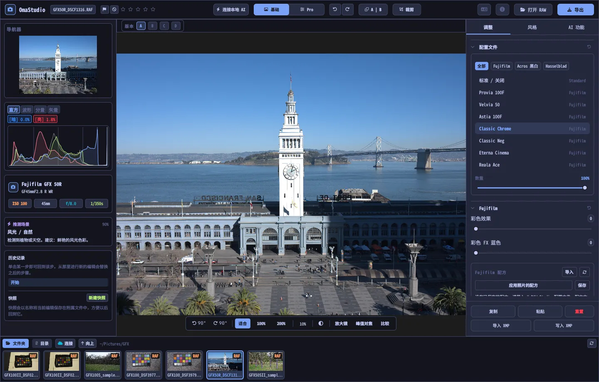

# OmaStudio 用户指南

**OmaStudio: The Complete Medium Format RAW Editor for Omarchy**

[所有语言](../README.md) · [所用技术](../technology/zh_CN.md) · [README](../../README.md)

本指南适用于 OmaStudio 3.1，介绍如何安装应用、窗口的布局，以及每个面板和工具的用法。截图使用的是 [raw.pixls.us](https://raw.pixls.us)（CC0）上的 Fujifilm GFX 50R 和 Hasselblad CFV-50c 示例文件。



## 目录

1. [安装](#1-安装)
2. [窗口](#2-窗口)
3. [打开照片与图库](#3-打开照片与图库)
4. [基础与 Pro](#4-基础与-pro)
5. [调整选项卡](#5-调整选项卡)
6. [蒙版选项卡](#6-蒙版选项卡)
7. [风格选项卡](#7-风格选项卡)
8. [AI 功能选项卡与 AI 对话](#8-ai-功能选项卡与-ai-对话)
9. [查看辅助工具](#9-查看辅助工具)
10. [历史记录、快照与版本](#10-历史记录快照与版本)
11. [Fujifilm](#11-fujifilm)
12. [中画幅](#12-中画幅)
13. [导出](#13-导出)
14. [云账户](#14-云账户)
15. [键盘与鼠标](#15-键盘与鼠标)
16. [命令行、控制套接字与 MCP](#16-命令行控制套接字与-mcp)
17. [文件与文件夹](#17-文件与文件夹)
18. [故障排除](#18-故障排除)

## 1. 安装

OmaStudio 运行于 Omarchy（Arch Linux）的 Wayland 和 Hyprland 环境。

**通过软件包安装。** 在仓库的克隆目录中运行：

```bash
makepkg -si
```

这会安装 `omastudio`、`omastudio-app`、`omastudio-engine`、ICC 配置文件、桌面项、图标，以及用于 USB 连接 Fujifilm 相机的 udev 规则。

**通过发布包安装。** 从[发布页面](https://github.com/ozdil/omarchy-omastudio/releases)下载 `omastudio-<版本>-x86_64-linux.tar.gz`，用 `checksums.txt` 校验后解压，将 `bin/*` 复制到 `~/.local/bin`，将 `share/omastudio` 复制到 `~/.local/share/omastudio`。

**必需的软件包：** `libraw` 0.22 或更高版本、`lcms2`、`qt6-base`、`qt6-declarative`、`qt6-wayland` 和 `qt6-svg` 6.12 或更高版本，以及用于文件对话框的 `zenity`。

**可选的软件包：**

| 软件包 | 用途 |
| :--- | :--- |
| `vulkan-icd-loader` 和显卡的 Vulkan 驱动 | 在 GPU 上去马赛克 |
| `perl-image-exiftool` | 在导出文件中保留 EXIF 元数据 |
| `libwebp-utils`、`libheif`、`ffmpeg` | 有损 WebP、HEIF 以及 AVIF 的备用方案 |
| `onnxruntime` | 在 NPU、GPU 或 CPU 上运行本地 AI 蒙版 |
| `rclone`、`libsecret`、`gnome-keyring` | Google Drive、OneDrive、Dropbox、Box、pCloud 和 Yandex Disk |
| `github-cli` | GitHub 账户 |
| `ollama` | 供编辑助手使用的本地 AI 模型 |
| `quickshell` | Omarchy 状态栏中的 OmaStudio 按钮 |

从 Omarchy 应用菜单启动 OmaStudio，或运行 `omastudio`（也可以附带一张照片：`omastudio DSCF0001.RAF`）。如果已有窗口打开，照片会在该窗口中打开。

## 2. 窗口

| 区域 | 内容 |
| :--- | :--- |
| 顶栏 | 文件名、旗标和星级、**连接本地 AI**、**基础** / **Pro** 切换、撤销和重做、前后对比（**A \| B**）、**裁剪**、语言菜单、关于、**打开 RAW** 和 **导出** |
| 左侧面板 | 导航器、带溢出指示的测量工具（直方图、波形图、RGB 分量图、矢量示波器）、相机与镜头信息、推荐场景、历史记录和快照 |
| 中央 | 照片、上方的版本栏（A–D）以及下方的视图栏：旋转、**适合**、100%、200%、当前缩放、周围颜色、**放大镜**、**峰值对焦**、**比较** |
| 右侧面板 | **调整**、**蒙版**（Pro）、**风格** 和 **AI 功能** 选项卡，以及固定的一行：**复制**、**粘贴**、**重置**、**导入 XMP** 和 **写入 XMP** |
| 胶片带 | **文件夹**、**目录**、每个云账户一个选项卡、**连接**、**向上**，以及当前文件夹中的照片 |

**Tab** 键可同时隐藏或显示两侧面板和胶片带。面板中的每个分区都可以通过标题展开或折叠；**Ctrl+单击** 标题只保留该分区展开。打开的选项卡、折叠的分区和显示的面板会在会话之间保留。

颜色、字体和圆角会实时跟随当前的 Omarchy 主题。照片周围默认为中性深灰色，避免主题影响对颜色的判断；视图栏中的周围颜色按钮可切换为中灰色或主题颜色。

| Tokyo Night | Catppuccin Latte | Gruvbox | Rosé Pine |
| :---: | :---: | :---: | :---: |
|  |  |  |  |

界面提供 30 种语言。默认跟随系统语言；在顶栏的语言菜单中选择其他语言会立即生效。

## 3. 打开照片与图库

- **打开 RAW**（Ctrl+O）会打开文件对话框，可按照片、RAW 或图像筛选。
- 可以从文件管理器把照片或文件夹拖到窗口中。
- 在胶片带中，**文件夹** 显示当前文件夹；单击文件夹进入，单击 **向上** 返回。单击照片即可打开。Ctrl+← 和 Ctrl+→ 切换到上一张和下一张照片。
- **目录** 列出 OmaStudio 打开过的所有照片及其星级、旗标和颜色标签。

OmaStudio 可以打开 LibRaw 0.22 支持的所有 RAW 格式（Fujifilm、Hasselblad、Phase One、Leica、Pentax、Mamiya/Leaf、Canon、Nikon、Sony、Panasonic、Olympus、Sigma、DNG 等），以及 JPEG、PNG、WebP、TIFF、HEIF/HEIC、AVIF、JPEG XL、OpenEXR、Radiance HDR 和 PNM。

**星级与旗标。** 1 到 5 设置星级，0 清除星级。P 标记为留用，X 标记为排除，U 清除旗标。星级和旗标会立即保存到目录和附属文件中。

**选择。** 在胶片带中按 Shift+单击 选择一个范围，按 Ctrl+单击 添加或移除照片。选中多张照片时，导出窗口会全部导出（**批量**）。

原始文件永远不会被修改。编辑内容会在工作时保存到照片旁边的附属文件 `<照片>.omastudio` 中（Ctrl+S 立即保存）。

## 4. 基础与 Pro

顶栏的切换开关决定显示多少工具。

- **基础：** 配置文件、Fujifilm、白平衡、色调、鲜明度、预设和 3D LUT。
- **Pro** 增加色调曲线、混色器、调色、细节与光学、变换、颗粒、色彩管理和 **蒙版** 选项卡。Pro 分区带有 "Pro" 标签。

切换回基础后，Pro 分区会隐藏，但其设置仍然生效。


## 5. 调整选项卡

双击滑块即可重置。分区标题中的重置按钮会重置整个分区。

### 配置文件

基础风格：**标准 / 关闭**、Fujifilm 胶片模拟（Provia、Velvia、Astia、Classic Chrome、Classic Neg、Eterna、Eterna Bleach Bypass、Reala Ace、Nostalgic Neg、PRO Neg Std 和 Hi、带黄色、红色和绿色滤镜的 Acros 与 Monochrome、Sepia），以及 Hasselblad 风格的自然色彩配置文件。选项卡用于筛选列表。**数量** 将配置文件与中性渲染混合。

### Fujifilm

**彩色效果** 和 **彩色 FX 蓝色**（弱 = 50，强 = 100）在保持色相的同时加深饱和的颜色，FX 蓝色针对蓝色。配方库、USB 相机和像素位移见 [Fujifilm](#11-fujifilm)。

### 白平衡

**色温**（2000–12000 K）和 **色调**，以相机记录的白平衡为基准。照片以拍摄时的设置打开。

### 色调

**曝光**（−5 到 +5 EV，作用于线性光：+1 EV 使光量加倍）、**对比度**、**高光**、**阴影**、**白色** 和 **黑色**。

### 鲜明度

**纹理**、**清晰度**（中间调对比度）、**去朦胧**、**自然饱和度** 和 **饱和度**。

### 色调曲线（Pro）

显示在直方图上的点曲线，可调整 RGB，也可分别调整红、绿、蓝。单击添加点，拖动移动点，双击删除点。曲线不会越过它的点。下方的四个区域滑块（高光、亮部、暗部、阴影）按区域塑造曲线。

### 混色器（Pro）

调整八种颜色的色相、饱和度和明亮度：红、橙、黄、绿、浅绿、蓝、紫和洋红。


### 调色（Pro）

用于阴影（提升）、中间调（伽马）和高光（增益）的三向色轮，外加全局偏移，可显示为四个色轮或选项卡。色轮下方是 **色彩增强**、**中间调细节** 和 **对比度支点**。再下方的通道混合器把红、绿、蓝混合到每个输出通道，或混合为单色。


### 细节与光学（Pro）

**锐化**、**降噪**（明亮度和颜色）、**暗角**、**去边**（色差）和 **镜头畸变校正**。Fujifilm 和 DNG 文件中的镜头校正会自动应用，这些滑块在其基础上起作用。

### 变换（Pro）

**垂直** 校正汇聚的线条，例如从下方拍摄的建筑；**水平** 在横向上做同样的校正；**缩放** 放大结果。之后再裁剪掉空白边缘。

### 颗粒（Pro）

胶片颗粒的 **数量**、**大小** 和 **粗糙度**。

### 色彩管理（Pro）

- **色域压缩** 会把超出色域的颜色平滑地拉回，而不是直接裁切。
- **ACES 色调曲线** 是胶片式的高光滚降，是 ACES 输出变换的拟合近似。
- **软打样**（S）显示照片使用某个输出配置文件（例如打印机和纸张配置文件）时的样子。选择配置文件和渲染意图。**色域警告** 会用洋红色标出该配置文件无法再现的颜色。编辑和导出不会改变。

输出色彩空间本身在导出窗口中选择。


## 6. 蒙版选项卡

蒙版选项卡在 Pro 模式下显示。

### 修复与仿制

打开 **编辑污点**，单击照片上的污点即可去除。污点会用旁边的源区域替换。拖动实线圆可移动污点，拖动虚线圆可选择其他源区域。**修复** 会让复制的区域匹配污点周围的亮度和颜色；**仿制** 则原样复制。**尺寸**、**羽化** 和 **不透明度** 作用于所选污点和新的污点。


### 局部调整

每个图层通过一个蒙版，以设定的不透明度应用曝光、对比度、高光、阴影、白色、黑色和饱和度。

| 蒙版 | 创建方式 |
| :--- | :--- |
| **线性** | 照片上两个控制点之间的渐变 |
| **径向** | 带中心点、边缘控制点和羽化的椭圆 |
| **明亮度** | 一个亮度范围（最暗、最亮、过渡） |
| **颜色** | 与从照片中拾取的颜色相近的颜色（范围和羽化） |
| **画笔** | 在照片上绘制，可设置尺寸、羽化、流量和擦除模式；鼠标中键用于平移 |
| **AI 主体**、**AI 天空** | 在你的电脑上运行的分割模型（见 [AI](#8-ai-功能选项卡与-ai-对话)） |

在 **组合方式** 下，可以将其他部分与图层蒙版相加、相减或相交，每个部分都可以反转。


## 7. 风格选项卡

- **预设：** **自动** 会分析照片并设置曝光、白平衡和色调。柔和、鲜艳、暖调人像、黑白和青橙色调这些风格会替换之前的风格，而不是叠加在上面；白平衡、曝光、裁剪和胶片模拟保持不变。
- **LUT：** **加载 .cube 文件…** 可应用你自己的 3D LUT，并设置数量。


## 8. AI 功能选项卡与 AI 对话

顶栏中的 **连接本地 AI** 使用这台电脑上配置的 AI：Omarchy 的默认代理（Claude Code 或 Codex，各自登录），没有则用 Ollama，再没有则用 LM Studio。连接后，该按钮会在照片上方打开 **AI 对话**：写下你想修改的内容（"暖一些，救回天空"），AI 会设置相应的调整。Ctrl+Z 可逐步撤销每次编辑。

**AI 功能** 选项卡中的 **编辑助手** 在面板中完成同样的操作，也可以改用云服务商：Anthropic Claude、OpenAI、OpenRouter 或 Google Gemini。它们的 API 密钥保存在系统密钥环中，不会写入磁盘，也不会出现在命令行上。使用云服务商或 Claude Code、Codex 时，照片预览会发送到相应服务；使用 Ollama 或 LM Studio 时，预览留在你的电脑上。


**AI 蒙版。** 蒙版选项卡中的 **AI 主体** 和 **AI 天空** 在这台电脑上运行 ONNX 分割模型：优先使用 NPU（通过 OpenVINO 的 Intel Core Ultra、通过 QNN 的 Snapdragon X、通过 Vitis AI 的 AMD Ryzen AI），然后是 GPU，最后是 CPU。软件不附带也不会下载模型。请将模型以 `subject.onnx` 或 `sky.onnx` 的名称放到 `~/.local/share/omastudio/models`；`omastudio npu` 可显示已安装的内容。

## 9. 查看辅助工具

| 工具 | 用法 |
| :--- | :--- |
| 缩放 | 在指针处滚动鼠标滚轮；**适合**（Ctrl+0）、**100%**（Ctrl+1）、**200%**；双击在适合和 200% 之间切换。无论显示缩放比例如何，100% 都以一个屏幕像素显示一个照片像素。 |
| 平移 | 用鼠标左键或中键拖动；Shift+滚轮横向平移 |
| 旋转 | 视图栏中的旋转按钮；Alt+滚轮以 1.5° 为步长旋转 |
| 裁剪（C） | 宽高比预设（原始、1:1、4:5、9:16、16:9、自由）和参考线（三分法、黄金比例、黄金螺旋） |
| 前后对比（Y 或 A \| B） | 照片分为原图和编辑后两部分 |
| 比较（Shift+C） | 将编辑结果与另一种状态并排显示：之前、某个版本或某个快照 |
| 放大镜（L） | 指针下方的方框，以 1:1 显示全分辨率照片 |
| 峰值对焦（Shift+F） | 将最锐利的边缘标为绿色；仅作查看辅助 |
| 溢出 | 单击直方图上方的 **[S]** 或 **[H]**，以蓝色显示溢出的阴影、以红色显示溢出的高光 |

| 峰值对焦 | 比较 |
| :---: | :---: |
|  |  |

| 裁剪 | 前后对比 |
| :---: | :---: |
|  |  |

当照片显示得比预览更大时，引擎会从全分辨率文件渲染可见区域，因此你看到的细节与导出结果一致。

## 10. 历史记录、快照与版本

- 左侧面板的 **历史记录** 按名称列出编辑的每一步（"曝光 +0.70"、"色调曲线"）。单击某一步即可回到该处；从那里进行新的编辑会替换之后的步骤，与 Ctrl+Z 后的行为相同。
- **快照** 以一个名称保存当前编辑。**恢复** 会把它作为新的一步恢复，可用 Ctrl+Z 撤销。快照保存在附属文件中。
- 照片上方的 **版本 A–D** 可为同一张照片保存最多四个独立的编辑。单击字母切换（Alt+1 到 Alt+4）；右键单击会把当前编辑复制到该版本。
- **复制** 和 **粘贴**（Ctrl+Shift+C、Ctrl+Shift+V）可把编辑应用到另一张照片。**重置**（Ctrl+R）恢复默认值。
- **写入 XMP** 会把编辑、星级和标签保存为 `.xmp` 附属文件，供 Lightroom、Capture One、darktable 和 digiKam 读取；**导入 XMP** 读取这些程序写入的文件。

## 11. Fujifilm

- **相机的配方。** RAF 或 Fujifilm JPEG 会以拍摄时的设置打开：胶片模拟、色调、颜色、锐度、降噪、清晰度、颗粒、彩色效果、白平衡偏移和动态范围（包括 D 范围优先）。已保存的附属文件优先。
- **亮度。** RAF 文件以相机自身 JPEG 的亮度打开。
- **镜头校正。** 相机记录的畸变、横向色差和暗角校正适用于 XF、XC 和 GF 镜头。
- **配方库。** **导入** 可接受 X RAW Studio 配置文件（.FP1、.FP2、.FP3）、配方文本（"Film Simulation: Classic Chrome / Grain Effect: Strong, Small …"）或 Fujifilm 照片。**应用配方** 应用已保存的配方；**应用照片的配方** 回到文件中的配方；**保存** 保存当前配方。
- **USB 连接相机。** 将相机的 USB 模式设为 USB RAW CONV./BACKUP RESTORE 并连接。**读取 C1–C7** 显示其自定义设置，**将配方写入 C…** 把配方保存到某个槽位（替换原有内容），**在相机中转换** 在相机内冲洗当前打开的 RAF，可选择使用所选配方。
- **像素位移。** 在胶片带中选择一组 GFX 像素位移拍摄的 RAF 帧，然后单击 **将帧合并为 DNG**。四帧可在每个像素获得完整色彩；十六帧可使分辨率加倍。

## 12. 中画幅

- **Fujifilm GFX**（GFX 50S、50R、50S II、100、100S、100 II 等）：从传感器到导出的 16 位处理流程、胶片模拟、镜头校正和像素位移。
- **Hasselblad** 3FR 和 FFF 文件按相机的默认裁剪进行裁切。
- **Phase One 和 Leaf** 的 IIQ 和 MOS 文件使用该数码后背自身的传感器校准。
- 支持 **Mamiya** MEF 和 **Pentax 645** PEF 文件。
- **平场校正（LCC）：** `omastudio-engine medium-format lcc-create <raw>` 根据一张均匀照明的白色目标照片生成校正，并应用于该文件夹中的照片。
- **多重拍摄：** `medium-format multishot f1 f2 f3 f4 --out merged.tif` 合并一组四张的拍摄序列。


## 13. 导出

**导出**（E）打开导出窗口。Enter 开始导出，Esc 关闭窗口。


| 设置 | 选项 |
| :--- | :--- |
| 文件格式 | JPEG、PNG（8/16 位）、TIFF（8/16 位，无压缩、LZW 或 ZIP）、WebP、AVIF（8/10/12 位）、HEIF（8/10/12 位）、JPEG XL（8/16 位）和 OpenEXR（半精度或全精度浮点，场景线性） |
| 质量 | 1–100；对 WebP、AVIF 和 JPEG XL 而言 100 为无损 |
| 尺寸 | **完整**、75%、50%，或长边 3840 或 2048 px |
| 颜色配置文件 | sRGB、Display P3、Adobe RGB、ProPhoto RGB、Rec. 2020、ACEScg，或你自己的 ICC 配置文件 |
| 渲染意图 | 可感知、相对（默认）、饱和度、绝对 |
| 元数据 | **保留相机元数据（EXIF）**、**移除位置（GPS）** |
| 准备用于 | 为 Instagram、Stories 和 Reels、X、Facebook、方形图以及 YouTube 缩略图裁剪并进行输出锐化 |
| 水印 | 使用 EXIF 标签（{camera}、{lens}、{iso}、{aperture}、{shutter}、{focal}）的文字或 PNG 标志，可设置位置、不透明度、大小和阴影 |
| 文件夹与文件名 | 默认为 `~/Pictures/OmaStudio_Exports`；可在文件名中添加标签 |
| 上传到 | 已连接的云账户 |

除 OpenEXR 外，所有格式都会嵌入其色彩空间的 ICC 配置文件。批量导出会依次导出所选照片。

## 14. 云账户

胶片带中的 **连接** 可添加 Google Drive、OneDrive、Dropbox、Box、pCloud、Yandex Disk 或 GitHub。你在浏览器中通过服务自己的页面登录；OmaStudio 不会看到你的密码。


- 每个账户在胶片带中有一个选项卡。浏览其文件夹，单击照片即可下载（仅一次）并打开。
- 每个账户中都会创建一个名为 `OmaStudio` 的文件夹（在 GitHub 上为私有仓库 `OmaStudio`），用于接收导出窗口上传的文件。
- 存储服务通过 rclone 连接，使用 OmaStudio 自己的配置，该配置由保存在系统密钥环中的密钥加密。GitHub 通过 GitHub CLI 连接。
- 对于 Google Drive，可在 **自有 Google 客户端 ID** 中填写你从 Google Cloud Console 获取的客户端 ID。
- **断开连接** 会从这台电脑上删除该账户的密钥和已下载的副本；账户中的文件保留不变。

## 15. 键盘与鼠标

| 按键 | 操作 |
| :--- | :--- |
| Ctrl+O | 打开照片 |
| Ctrl+S | 立即保存编辑 |
| Ctrl+Z / Ctrl+Shift+Z 或 Ctrl+Y | 撤销 / 重做 |
| Ctrl+Shift+C / Ctrl+Shift+V | 复制 / 粘贴编辑 |
| Ctrl+R | 重置编辑 |
| Ctrl+← / Ctrl+→ | 上一张 / 下一张照片 |
| Ctrl+0 / Ctrl+1 | 适合 / 100% |
| 1–5、0 | 星级、清除星级 |
| P、X、U | 留用、排除、清除旗标 |
| C | 裁剪 |
| Y | 前后对比 |
| S | 软打样 |
| L | 放大镜 |
| Shift+F | 峰值对焦 |
| Shift+C | 比较 |
| Alt+1 … Alt+4 | 版本 A–D |
| E | 导出窗口 |
| Tab | 隐藏或显示面板 |
| Esc | 关闭打开的窗口 |

| 鼠标 | 操作 |
| :--- | :--- |
| 滚轮 | 在指针处缩放 |
| Shift+滚轮 | 横向平移 |
| Alt+滚轮 | 旋转 |
| 拖动（左键或中键） | 平移 |
| 双击照片 | 适合或 200% |
| Ctrl+单击分区标题 | 只保留该分区展开 |
| 右键单击版本字母 | 将当前编辑复制到该版本 |

## 16. 命令行、控制套接字与 MCP

**引擎命令。** 每条命令都输出一个 JSON 对象，便于脚本和代理使用。

```bash
omastudio inspect DSCF0001.RAF                      # 相机、镜头、曝光、直方图、场景
omastudio export DSCF0001.RAF --recipe '{"exposure":0.5}' --options '{"format":"jpeg"}'
omastudio fuji-recipe DSCF0001.RAF                  # 相机的配方
omastudio fuji-pixel-shift DSCF*.RAF --out merged.dng
omastudio xmp export DSCF0001.RAF
omastudio cameras GFX                               # RAW 解码器支持的相机
omastudio gpu                                       # 用于去马赛克的 GPU
omastudio npu                                       # ONNX Runtime 与加速器
omastudio cloud status
omastudio --cli help                                # 所有命令
```

**控制套接字。** `omastudio ipc <方法> [参数]` 与打开的窗口通信，例如 `openPhoto`、`openFolder`、`applyRecipe`、`applyPreset`、`setExposure`、`setWarmth`、`setMode essentials|pro`、`setRightTab`、`showSection`、`setView peaking|compare|softProof|split on|off`、`setZoom`、`showExport`、`showCloud`、`getStatus` 和 `screenshot <文件.png>`。套接字只响应同一用户。

**MCP。** `omastudio mcp` 是一个 Model Context Protocol 服务器，AI 代理可以借此检查、渲染、筛选和导出照片，读取 Fujifilm 配方，并控制打开的窗口。对于 Claude Code：`claude mcp add omastudio -- omastudio mcp`。`omastudio skill` 会把代理技能安装到 `~/.claude/skills`。

## 17. 文件与文件夹

| 路径 | 内容 |
| :--- | :--- |
| `<照片>.omastudio` | 一张照片的编辑（附属文件） |
| `~/.local/share/omastudio/catalog.json` | 目录：星级、旗标和颜色标签 |
| `~/.local/share/omastudio/fuji-recipes/` | 已保存的 Fujifilm 配方 |
| `~/.local/share/omastudio/icc/` | 你自己的 ICC 配置文件 |
| `~/.local/share/omastudio/models/` | 本地 AI 模型 |
| `~/.local/share/omastudio/film-luts/` | 根据你的照片测得的胶片模拟 LUT（`fuji-calibrate`） |
| `~/.config/omastudio/` | 设置、界面状态、语言、云账户 |
| `~/.cache/omastudio/` | 缩略图、预览和已下载的云端照片 |

## 18. 故障排除

- **窗口打不开。** 在终端中运行 `omastudio` 并查看提示信息。`omastudio --version` 和 `omastudio status` 会显示已安装的内容。
- **没有使用 GPU。** `omastudio gpu` 会显示设备。请安装 `vulkan-icd-loader` 和显卡的 Vulkan 驱动。`OMASTUDIO_GPU=off` 强制使用 CPU。
- **通过 USB 找不到相机。** 将 USB 模式设为 USB RAW CONV./BACKUP RESTORE，重新连接，并确认已安装软件包中的 udev 规则。
- **云服务提示需要某个程序。** 安装对话框中提到的软件包，例如 `sudo pacman -S rclone libsecret`。
- 关于窗口中的 **复制系统信息** 会复制版本、GPU 和 Omarchy 信息，便于提交错误报告。请在 [github.com/ozdil/omarchy-omastudio/issues](https://github.com/ozdil/omarchy-omastudio/issues) 报告问题。
