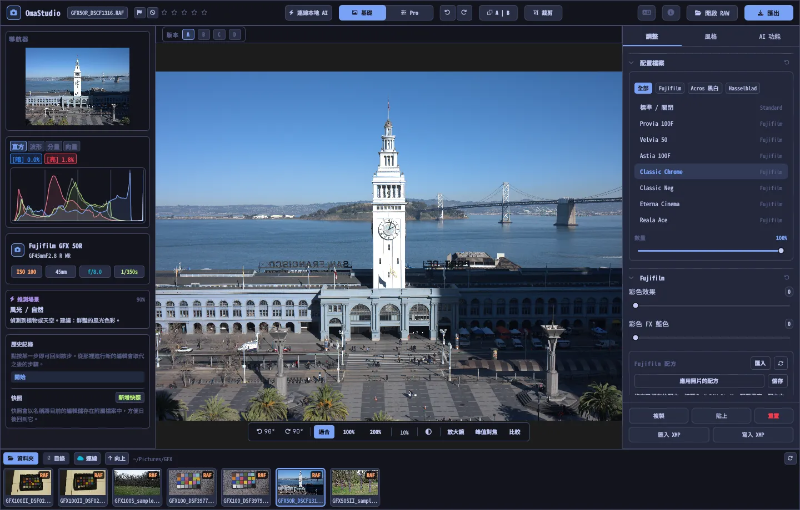

# OmaStudio 使用者指南

**OmaStudio: The Complete Medium Format RAW Editor for Omarchy**

[所有語言](../README.md) · [所用技術](../technology/zh_TW.md) · [README](../../README.md)

本指南適用於 OmaStudio 3.1，介紹如何安裝應用、視窗的佈局，以及每個面板和工具的用法。截圖使用的是 [raw.pixls.us](https://raw.pixls.us)（CC0）上的 Fujifilm GFX 50R 和 Hasselblad CFV-50c 示例檔案。



## 目錄

1. [安裝](#1-安裝)
2. [視窗](#2-視窗)
3. [開啟照片與相簿](#3-開啟照片與相簿)
4. [基礎與 Pro](#4-基礎與-pro)
5. [調整分頁](#5-調整分頁)
6. [蒙版分頁](#6-蒙版分頁)
7. [風格分頁](#7-風格分頁)
8. [AI 功能分頁與 AI 對話](#8-ai-功能分頁與-ai-對話)
9. [檢視輔助工具](#9-檢視輔助工具)
10. [歷史記錄、快照與版本](#10-歷史記錄快照與版本)
11. [Fujifilm](#11-fujifilm)
12. [中畫幅](#12-中畫幅)
13. [匯出](#13-匯出)
14. [雲端帳戶](#14-雲端帳戶)
15. [鍵盤與滑鼠](#15-鍵盤與滑鼠)
16. [命令列、控制通訊端與 MCP](#16-命令列控制通訊端與-mcp)
17. [檔案與資料夾](#17-檔案與資料夾)
18. [故障排除](#18-故障排除)

## 1. 安裝

OmaStudio 運行於 Omarchy（Arch Linux）的 Wayland 和 Hyprland 環境。

**透過軟體套件安裝。** 在倉庫的克隆目錄中執行：

```bash
makepkg -si
```

這會安裝 `omastudio`、`omastudio-app`、`omastudio-engine`、ICC 配置檔案、桌面項、圖示，以及用於 USB 連線 Fujifilm 相機的 udev 規則。

**透過發行套件安裝。** 從[發行頁面](https://github.com/ozdil/omarchy-omastudio/releases)下載 `omastudio-<版本>-x86_64-linux.tar.gz`，用 `checksums.txt` 校驗後解壓，將 `bin/*` 複製到 `~/.local/bin`，將 `share/omastudio` 複製到 `~/.local/share/omastudio`。

**必要的軟體套件：** `libraw` 0.22 或更高版本、`lcms2`、`qt6-base`、`qt6-declarative`、`qt6-wayland` 和 `qt6-svg` 6.12 或更高版本，以及用於檔案對話方塊的 `zenity`。

**選用的軟體套件：**

| 軟體套件 | 用途 |
| :--- | :--- |
| `vulkan-icd-loader` 和顯示卡的 Vulkan 驅動 | 在 GPU 上去馬賽克 |
| `perl-image-exiftool` | 在匯出檔案中保留 EXIF 後設資料 |
| `libwebp-utils`、`libheif`、`ffmpeg` | 有損 WebP、HEIF 以及 AVIF 的備用方案 |
| `onnxruntime` | 在 NPU、GPU 或 CPU 上執行本地 AI 蒙版 |
| `rclone`、`libsecret`、`gnome-keyring` | Google Drive、OneDrive、Dropbox、Box、pCloud 和 Yandex Disk |
| `github-cli` | GitHub 帳戶 |
| `ollama` | 供編輯助手使用的本地 AI 模型 |
| `quickshell` | Omarchy 狀態列中的 OmaStudio 按鈕 |

從 Omarchy 應用選單啟動 OmaStudio，或執行 `omastudio`（也可以附帶一張照片：`omastudio DSCF0001.RAF`）。如果已有視窗開啟，照片會在該視窗中開啟。

## 2. 視窗

| 區域 | 內容 |
| :--- | :--- |
| 頂欄 | 檔名、旗標和星級、**連線本地 AI**、**基礎** / **Pro** 切換、復原和重做、前後對比（**A \| B**）、**裁剪**、語言選單、關於、**開啟 RAW** 和 **匯出** |
| 左側面板 | 導航器、帶溢位指示的測量工具（直方圖、波形圖、RGB 分量圖、向量示波器）、相機與鏡頭資訊、推薦場景、歷史記錄和快照 |
| 中央 | 照片、上方的版本欄（A–D）以及下方的檢視欄：旋轉、**適合**、100%、200%、目前縮放、周圍顏色、**放大鏡**、**峰值對焦**、**比較** |
| 右側面板 | **調整**、**蒙版**（Pro）、**風格** 和 **AI 功能** 分頁，以及固定的一行：**複製**、**貼上**、**重置**、**匯入 XMP** 和 **寫入 XMP** |
| 膠片帶 | **資料夾**、**目錄**、每個雲端帳戶一個分頁、**連線**、**向上**，以及目前資料夾中的照片 |

**Tab** 鍵可同時隱藏或顯示兩側面板和膠片帶。面板中的每個分割槽都可以透過標題展開或摺疊；**Ctrl+點按** 標題只保留該分割槽展開。開啟的分頁、摺疊的分割槽和顯示的面板會在會話之間保留。

顏色、字型和圓角會即時跟隨目前的 Omarchy 主題。照片周圍預設為中性深灰色，避免主題影響對顏色的判斷；檢視欄中的周圍顏色按鈕可切換為中灰色或主題顏色。

| Tokyo Night | Catppuccin Latte | Gruvbox | Rosé Pine |
| :---: | :---: | :---: | :---: |
|  |  |  |  |

介面提供 30 種語言。預設跟隨系統語言；在頂欄的語言選單中選擇其他語言會立即生效。

## 3. 開啟照片與相簿

- **開啟 RAW**（Ctrl+O）會開啟檔案對話方塊，可按照片、RAW 或影像篩選。
- 可以從檔案管理器把照片或資料夾拖到視窗中。
- 在膠片帶中，**資料夾** 顯示目前資料夾；點按資料夾進入，點按 **向上** 返回。點按照片即可開啟。Ctrl+← 和 Ctrl+→ 切換到上一張和下一張照片。
- **目錄** 列出 OmaStudio 開啟過的所有照片及其星級、旗標和顏色標籤。

OmaStudio 可以開啟 LibRaw 0.22 支援的所有 RAW 格式（Fujifilm、Hasselblad、Phase One、Leica、Pentax、Mamiya/Leaf、Canon、Nikon、Sony、Panasonic、Olympus、Sigma、DNG 等），以及 JPEG、PNG、WebP、TIFF、HEIF/HEIC、AVIF、JPEG XL、OpenEXR、Radiance HDR 和 PNM。

**星級與旗標。** 1 到 5 設定星級，0 清除星級。P 標記為留用，X 標記為排除，U 清除旗標。星級和旗標會立即儲存到目錄和附屬檔案中。

**選擇。** 在膠片帶中按 Shift+點按 選擇一個範圍，按 Ctrl+點按 新增或移除照片。選取多張照片時，匯出視窗會全部匯出（**批次**）。

原始檔案永遠不會被修改。編輯內容會在工作時儲存到照片旁邊的附屬檔案 `<照片>.omastudio` 中（Ctrl+S 立即儲存）。

## 4. 基礎與 Pro

頂欄的切換開關決定顯示多少工具。

- **基礎：** 配置檔案、Fujifilm、白平衡、色調、鮮明度、預設和 3D LUT。
- **Pro** 增加色調曲線、混色器、調色、細節與光學、變換、顆粒、色彩管理和 **蒙版** 分頁。Pro 分割槽帶有 "Pro" 標籤。

切換回基礎後，Pro 分割槽會隱藏，但其設定仍然生效。


## 5. 調整分頁

按兩下滑塊即可重置。分割槽標題中的重置按鈕會重置整個分割槽。

### 配置檔案

基礎風格：**標準 / 關閉**、Fujifilm 底片模擬（Provia、Velvia、Astia、Classic Chrome、Classic Neg、Eterna、Eterna Bleach Bypass、Reala Ace、Nostalgic Neg、PRO Neg Std 和 Hi、帶黃色、紅色和綠色濾鏡的 Acros 與 Monochrome、Sepia），以及 Hasselblad 風格的自然色彩配置檔案。分頁用於篩選列表。**數量** 將配置檔案與中性渲染混合。

### Fujifilm

**彩色效果** 和 **彩色 FX 藍色**（弱 = 50，強 = 100）在保持色相的同時加深飽和的顏色，FX 藍色針對藍色。配方庫、USB 相機和畫素位移見 [Fujifilm](#11-fujifilm)。

### 白平衡

**色溫**（2000–12000 K）和 **色調**，以相機記錄的白平衡為基準。照片以拍攝時的設定開啟。

### 色調

**曝光**（−5 到 +5 EV，作用於線性光：+1 EV 使光量加倍）、**對比度**、**高光**、**陰影**、**白色** 和 **黑色**。

### 鮮明度

**紋理**、**清晰度**（中間調對比度）、**去朦朧**、**自然飽和度** 和 **飽和度**。

### 色調曲線（Pro）

顯示在直方圖上的點曲線，可調整 RGB，也可分別調整紅、綠、藍。點按新增點，拖動移動點，按兩下刪除點。曲線不會越過它的點。下方的四個區域滑塊（高光、亮部、暗部、陰影）按區域塑造麴線。

### 混色器（Pro）

調整八種顏色的色相、飽和度和明亮度：紅、橙、黃、綠、淺綠、藍、紫和洋紅。


### 調色（Pro）

用於陰影（提升）、中間調（伽馬）和高光（增益）的三向色輪，外加全域性偏移，可顯示為四個色輪或分頁。色輪下方是 **色彩增強**、**中間調細節** 和 **對比度支點**。再下方的通道混合器把紅、綠、藍混合到每個輸出通道，或混合為單色。


### 細節與光學（Pro）

**銳化**、**降噪**（明亮度和顏色）、**暗角**、**去邊**（色差）和 **鏡頭畸變校正**。Fujifilm 和 DNG 檔案中的鏡頭校正會自動應用，這些滑塊在其基礎上起作用。

### 變換（Pro）

**垂直** 校正匯聚的線條，例如從下方拍攝的建築；**水平** 在橫向上做同樣的校正；**縮放** 放大結果。之後再裁剪掉空白邊緣。

### 顆粒（Pro）

底片顆粒的 **數量**、**大小** 和 **粗糙度**。

### 色彩管理（Pro）

- **色域壓縮** 會把超出色域的顏色平滑地拉回，而不是直接裁切。
- **ACES 色調曲線** 是膠片式的高光滾降，是 ACES 輸出變換的擬合近似。
- **螢幕校樣**（S）顯示照片使用某個輸出配置檔案（例如印表機和紙張配置檔案）時的樣子。選擇配置檔案和渲染意圖。**色域警告** 會用洋紅色標出該配置檔案無法再現的顏色。編輯和匯出不會改變。

輸出色彩空間本身在匯出視窗中選擇。


## 6. 蒙版分頁

蒙版分頁在 Pro 模式下顯示。

### 修復與仿製

開啟 **編輯污點**，點按照片上的污點即可去除。污點會用旁邊的源區域替換。拖動實線圓可移動污點，拖動虛線圓可選擇其他源區域。**修復** 會讓複製的區域匹配污點周圍的亮度和顏色；**仿製** 則原樣複製。**尺寸**、**羽化** 和 **不透明度** 作用於所選污點和新的污點。


### 區域性調整

每個圖層透過一個蒙版，以設定的不透明度應用曝光、對比度、高光、陰影、白色、黑色和飽和度。

| 蒙版 | 建立方式 |
| :--- | :--- |
| **線性** | 照片上兩個控制點之間的漸變 |
| **放射狀** | 帶中心點、邊緣控制點和羽化的橢圓 |
| **明亮度** | 一個亮度範圍（最暗、最亮、過渡） |
| **顏色** | 與從照片中拾取的顏色相近的顏色（範圍和羽化） |
| **筆刷** | 在照片上繪製，可設定尺寸、羽化、流量和擦除模式；滑鼠中鍵用於平移 |
| **AI 主體**、**AI 天空** | 在你的電腦上執行的分割模型（見 [AI](#8-ai-功能分頁與-ai-對話)） |

在 **組合方式** 下，可以將其他部分與圖層蒙版相加、相減或相交，每個部分都可以反轉。


## 7. 風格分頁

- **預設：** **自動** 會分析照片並設定曝光、白平衡和色調。柔和、鮮豔、暖調人像、黑白和青橙色調這些風格會替換之前的風格，而不是疊加在上面；白平衡、曝光、裁剪和底片模擬保持不變。
- **LUT：** **載入 .cube 檔案…** 可應用你自己的 3D LUT，並設定數量。


## 8. AI 功能分頁與 AI 對話

頂欄中的 **連線本地 AI** 使用這臺電腦上配置的 AI：Omarchy 的預設代理（Claude Code 或 Codex，各自登入），沒有則用 Ollama，再沒有則用 LM Studio。連線後，該按鈕會在照片上方開啟 **AI 對話**：寫下你想修改的內容（"暖一些，救回天空"），AI 會設定相應的調整。Ctrl+Z 可逐步復原每次編輯。

**AI 功能** 分頁中的 **編輯助手** 在面板中完成同樣的操作，也可以改用雲端服務商：Anthropic Claude、OpenAI、OpenRouter 或 Google Gemini。它們的 API 金鑰儲存在系統金鑰環中，不會寫入磁碟，也不會出現在命令列上。使用雲端服務商或 Claude Code、Codex 時，照片預覽會發送到相應服務；使用 Ollama 或 LM Studio 時，預覽留在你的電腦上。


**AI 蒙版。** 蒙版分頁中的 **AI 主體** 和 **AI 天空** 在這臺電腦上執行 ONNX 分割模型：優先使用 NPU（透過 OpenVINO 的 Intel Core Ultra、透過 QNN 的 Snapdragon X、透過 Vitis AI 的 AMD Ryzen AI），然後是 GPU，最後是 CPU。軟體不附帶也不會下載模型。請將模型以 `subject.onnx` 或 `sky.onnx` 的名稱放到 `~/.local/share/omastudio/models`；`omastudio npu` 可顯示已安裝的內容。

## 9. 檢視輔助工具

| 工具 | 用法 |
| :--- | :--- |
| 縮放 | 在指標處滾動滑鼠滾輪；**適合**（Ctrl+0）、**100%**（Ctrl+1）、**200%**；按兩下在適合和 200% 之間切換。無論顯示縮放比例如何，100% 都以一個螢幕畫素顯示一個照片畫素。 |
| 平移 | 用滑鼠左鍵或中鍵拖動；Shift+滾輪橫向平移 |
| 旋轉 | 檢視欄中的旋轉按鈕；Alt+滾輪以 1.5° 為步長旋轉 |
| 裁剪（C） | 寬高比預設（原始、1:1、4:5、9:16、16:9、自由）和參考線（三分法、黃金比例、黃金螺旋） |
| 前後對比（Y 或 A \| B） | 照片分為原圖和編輯後兩部分 |
| 比較（Shift+C） | 將編輯結果與另一種狀態並排顯示：之前、某個版本或某個快照 |
| 放大鏡（L） | 指標下方的方框，以 1:1 顯示全解析度照片 |
| 峰值對焦（Shift+F） | 將最銳利的邊緣標為綠色；僅作檢視輔助 |
| 溢位 | 點按直方圖上方的 **[S]** 或 **[H]**，以藍色顯示溢位的陰影、以紅色顯示溢位的高光 |

| 峰值對焦 | 比較 |
| :---: | :---: |
|  |  |

| 裁剪 | 前後對比 |
| :---: | :---: |
|  |  |

當照片顯示得比預覽更大時，引擎會從全解析度檔案渲染可見區域，因此你看到的細節與匯出結果一致。

## 10. 歷史記錄、快照與版本

- 左側面板的 **歷史記錄** 按名稱列出編輯的每一步（"曝光 +0.70"、"色調曲線"）。點按某一步即可回到該處；從那裡進行新的編輯會替換之後的步驟，與 Ctrl+Z 後的行為相同。
- **快照** 以一個名稱儲存目前編輯。**還原** 會把它作為新的一步還原，可用 Ctrl+Z 復原。快照儲存在附屬檔案中。
- 照片上方的 **版本 A–D** 可為同一張照片儲存最多四個獨立的編輯。點按字母切換（Alt+1 到 Alt+4）；按右鍵會把目前編輯複製到該版本。
- **複製** 和 **貼上**（Ctrl+Shift+C、Ctrl+Shift+V）可把編輯應用到另一張照片。**重置**（Ctrl+R）還原預設值。
- **寫入 XMP** 會把編輯、星級和標籤儲存為 `.xmp` 附屬檔案，供 Lightroom、Capture One、darktable 和 digiKam 讀取；**匯入 XMP** 讀取這些程式寫入的檔案。

## 11. Fujifilm

- **相機的配方。** RAF 或 Fujifilm JPEG 會以拍攝時的設定開啟：底片模擬、色調、顏色、銳度、降噪、清晰度、顆粒、彩色效果、白平衡偏移和動態範圍（包括 D 範圍優先）。已儲存的附屬檔案優先。
- **亮度。** RAF 檔案以相機自身 JPEG 的亮度開啟。
- **鏡頭校正。** 相機記錄的畸變、橫向色差和暗角校正適用於 XF、XC 和 GF 鏡頭。
- **配方庫。** **匯入** 可接受 X RAW Studio 配置檔案（.FP1、.FP2、.FP3）、配方文字（"Film Simulation: Classic Chrome / Grain Effect: Strong, Small …"）或 Fujifilm 照片。**應用配方** 應用已儲存的配方；**應用照片的配方** 回到檔案中的配方；**儲存** 儲存目前配方。
- **USB 連線相機。** 將相機的 USB 模式設為 USB RAW CONV./BACKUP RESTORE 並連線。**讀取 C1–C7** 顯示其自訂設定，**將配方寫入 C…** 把配方儲存到某個槽位（替換原有內容），**在相機中轉換** 在相機內沖洗目前開啟的 RAF，可選擇使用所選配方。
- **畫素位移。** 在膠片帶中選擇一組 GFX 畫素位移拍攝的 RAF 幀，然後點按 **將幀合併為 DNG**。四幀可在每個畫素獲得完整色彩；十六幀可使解析度加倍。

## 12. 中畫幅

- **Fujifilm GFX**（GFX 50S、50R、50S II、100、100S、100 II 等）：從感測器到匯出的 16 位處理流程、底片模擬、鏡頭校正和畫素位移。
- **Hasselblad** 3FR 和 FFF 檔案按相機的預設裁剪進行裁切。
- **Phase One 和 Leaf** 的 IIQ 和 MOS 檔案使用該數碼後背自身的感測器校準。
- 支援 **Mamiya** MEF 和 **Pentax 645** PEF 檔案。
- **平場校正（LCC）：** `omastudio-engine medium-format lcc-create <raw>` 根據一張均勻照明的白色目標照片生成校正，並應用於該資料夾中的照片。
- **多重拍攝：** `medium-format multishot f1 f2 f3 f4 --out merged.tif` 合併一組四張的拍攝序列。


## 13. 匯出

**匯出**（E）開啟匯出視窗。Enter 開始匯出，Esc 關閉視窗。


| 設定 | 選項 |
| :--- | :--- |
| 檔案格式 | JPEG、PNG（8/16 位）、TIFF（8/16 位，無壓縮、LZW 或 ZIP）、WebP、AVIF（8/10/12 位）、HEIF（8/10/12 位）、JPEG XL（8/16 位）和 OpenEXR（半精度或全精度浮點，場景線性） |
| 品質 | 1–100；對 WebP、AVIF 和 JPEG XL 而言 100 為無損 |
| 尺寸 | **完整**、75%、50%，或長邊 3840 或 2048 px |
| 顏色配置檔案 | sRGB、Display P3、Adobe RGB、ProPhoto RGB、Rec. 2020、ACEScg，或你自己的 ICC 配置檔案 |
| 渲染意圖 | 可感知、相對（預設）、飽和度、絕對 |
| 後設資料 | **保留相機後設資料（EXIF）**、**移除位置（GPS）** |
| 準備用於 | 為 Instagram、Stories 和 Reels、X、Facebook、方形圖以及 YouTube 縮圖裁剪並進行輸出銳化 |
| 水印 | 使用 EXIF 標籤（{camera}、{lens}、{iso}、{aperture}、{shutter}、{focal}）的文字或 PNG 標誌，可設定位置、不透明度、大小和陰影 |
| 資料夾與檔名 | 預設為 `~/Pictures/OmaStudio_Exports`；可在檔名中新增標籤 |
| 上傳至 | 已連線的雲端帳戶 |

除 OpenEXR 外，所有格式都會嵌入其色彩空間的 ICC 配置檔案。批次匯出會依次匯出所選照片。

## 14. 雲端帳戶

膠片帶中的 **連線** 可新增 Google Drive、OneDrive、Dropbox、Box、pCloud、Yandex Disk 或 GitHub。你在瀏覽器中透過服務自己的頁面登入；OmaStudio 不會看到你的密碼。


- 每個帳戶在膠片帶中有一個分頁。瀏覽其資料夾，點按照片即可下載（僅一次）並開啟。
- 每個帳戶中都會建立一個名為 `OmaStudio` 的資料夾（在 GitHub 上為私有倉庫 `OmaStudio`），用於接收匯出視窗上傳的檔案。
- 儲存服務透過 rclone 連線，使用 OmaStudio 自己的配置，該配置由儲存在系統金鑰環中的金鑰加密。GitHub 透過 GitHub CLI 連線。
- 對於 Google Drive，可在 **自有 Google 用戶端 ID** 中填寫你從 Google Cloud Console 獲取的用戶端 ID。
- **中斷連線** 會從這臺電腦上刪除該帳戶的金鑰和已下載的副本；帳戶中的檔案保留不變。

## 15. 鍵盤與滑鼠

| 按鍵 | 操作 |
| :--- | :--- |
| Ctrl+O | 開啟照片 |
| Ctrl+S | 立即儲存編輯 |
| Ctrl+Z / Ctrl+Shift+Z 或 Ctrl+Y | 復原 / 重做 |
| Ctrl+Shift+C / Ctrl+Shift+V | 複製 / 貼上編輯 |
| Ctrl+R | 重置編輯 |
| Ctrl+← / Ctrl+→ | 上一張 / 下一張照片 |
| Ctrl+0 / Ctrl+1 | 適合 / 100% |
| 1–5、0 | 星級、清除星級 |
| P、X、U | 留用、排除、清除旗標 |
| C | 裁剪 |
| Y | 前後對比 |
| S | 螢幕校樣 |
| L | 放大鏡 |
| Shift+F | 峰值對焦 |
| Shift+C | 比較 |
| Alt+1 … Alt+4 | 版本 A–D |
| E | 匯出視窗 |
| Tab | 隱藏或顯示面板 |
| Esc | 關閉開啟的視窗 |

| 滑鼠 | 操作 |
| :--- | :--- |
| 滾輪 | 在指標處縮放 |
| Shift+滾輪 | 橫向平移 |
| Alt+滾輪 | 旋轉 |
| 拖動（左鍵或中鍵） | 平移 |
| 按兩下照片 | 適合或 200% |
| Ctrl+點按分割槽標題 | 只保留該分割槽展開 |
| 按右鍵版本字母 | 將目前編輯複製到該版本 |

## 16. 命令列、控制通訊端與 MCP

**引擎命令。** 每條命令都輸出一個 JSON 物件，便於指令碼和代理使用。

```bash
omastudio inspect DSCF0001.RAF                      # 相机、镜头、曝光、直方图、场景
omastudio export DSCF0001.RAF --recipe '{"exposure":0.5}' --options '{"format":"jpeg"}'
omastudio fuji-recipe DSCF0001.RAF                  # 相机的配方
omastudio fuji-pixel-shift DSCF*.RAF --out merged.dng
omastudio xmp export DSCF0001.RAF
omastudio cameras GFX                               # RAW 解码器支持的相机
omastudio gpu                                       # 用于去马赛克的 GPU
omastudio npu                                       # ONNX Runtime 与加速器
omastudio cloud status
omastudio --cli help                                # 所有命令
```

**控制通訊端。** `omastudio ipc <方法> [参数]` 與開啟的視窗通訊，例如 `openPhoto`、`openFolder`、`applyRecipe`、`applyPreset`、`setExposure`、`setWarmth`、`setMode essentials|pro`、`setRightTab`、`showSection`、`setView peaking|compare|softProof|split on|off`、`setZoom`、`showExport`、`showCloud`、`getStatus` 和 `screenshot <文件.png>`。通訊端只響應同一使用者。

**MCP。** `omastudio mcp` 是一個 Model Context Protocol 伺服器，AI 代理可以藉此檢查、渲染、篩選和匯出照片，讀取 Fujifilm 配方，並控制開啟的視窗。對於 Claude Code：`claude mcp add omastudio -- omastudio mcp`。`omastudio skill` 會把代理技能安裝到 `~/.claude/skills`。

## 17. 檔案與資料夾

| 路徑 | 內容 |
| :--- | :--- |
| `<照片>.omastudio` | 一張照片的編輯（附屬檔案） |
| `~/.local/share/omastudio/catalog.json` | 目錄：星級、旗標和顏色標籤 |
| `~/.local/share/omastudio/fuji-recipes/` | 已儲存的 Fujifilm 配方 |
| `~/.local/share/omastudio/icc/` | 你自己的 ICC 配置檔案 |
| `~/.local/share/omastudio/models/` | 本地 AI 模型 |
| `~/.local/share/omastudio/film-luts/` | 根據你的照片測得的底片模擬 LUT（`fuji-calibrate`） |
| `~/.config/omastudio/` | 設定、介面狀態、語言、雲端帳戶 |
| `~/.cache/omastudio/` | 縮圖、預覽和已下載的雲端照片 |

## 18. 故障排除

- **視窗打不開。** 在終端中執行 `omastudio` 並檢視提示資訊。`omastudio --version` 和 `omastudio status` 會顯示已安裝的內容。
- **沒有使用 GPU。** `omastudio gpu` 會顯示裝置。請安裝 `vulkan-icd-loader` 和顯示卡的 Vulkan 驅動。`OMASTUDIO_GPU=off` 強制使用 CPU。
- **透過 USB 找不到相機。** 將 USB 模式設為 USB RAW CONV./BACKUP RESTORE，重新連線，並確認已安裝軟體套件中的 udev 規則。
- **雲端服務提示需要某個程式。** 安裝對話方塊中提到的軟體套件，例如 `sudo pacman -S rclone libsecret`。
- 關於視窗中的 **複製系統資訊** 會複製版本、GPU 和 Omarchy 資訊，便於提交錯誤報告。請在 [github.com/ozdil/omarchy-omastudio/issues](https://github.com/ozdil/omarchy-omastudio/issues) 報告問題。
