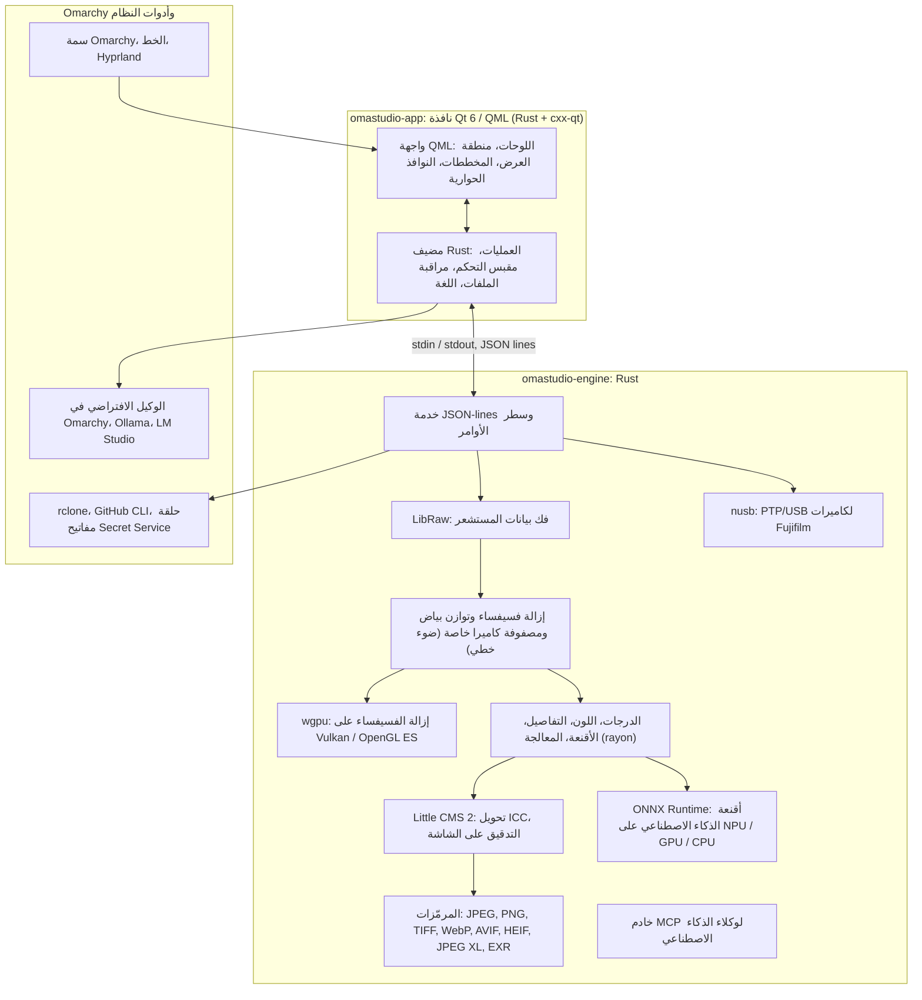

# التقنيات في OmaStudio

**OmaStudio: The Complete Medium Format RAW Editor for Omarchy**

[كل اللغات](../README.md) · [دليل الاستخدام](../guide/ar.md) · [README](../../README.md)

تصف هذه الصفحة التقنيات التي بُني عليها OmaStudio، وما تفعله كل منها في التطبيق، وسبب اختيارها، وترخيصها. يُنشر OmaStudio نفسه بترخيص MIT.

## البنية

النافذة والمحرك عمليتان منفصلتان. لا تفك النافذة ترميز أي صورة بنفسها: بل ترسل الأوامر إلى المحرك وتعرض الصور التي يكتبها. لذلك لا يُسقط تعطل أو توقف أثناء فك الترميز الواجهة معه، ويخدم المحرك نفسه سطر الأوامر والسكربتات ووكلاء الذكاء الاصطناعي.

## التطبيق

| التقنية | دورها في OmaStudio | السبب | الترخيص |
| :--- | :--- | :--- | :--- |
| **Rust** (1.99، إصدار 2024) | لغة المحرك ومضيف التطبيق | أمان الذاكرة لشيفرة تحلل ملفات غير موثوقة، وسرعة أصلية، ولغة واحدة للعمليتين | MIT / Apache-2.0 |
| **Qt 6** (6.12، Qt Quick / QML) | الواجهة: اللوحات، ومنطقة العرض، والمخططات، والنوافذ الحوارية | واجهة ترسمها GPU مع دعم أصلي لـ Wayland والتحجيم الكسري، وتخطيط من اليمين إلى اليسار، ونظام الترجمة Qt Linguist | LGPL-3.0 |
| **cxx-qt** (0.10) | يربط Rust بـ Qt: أنواع المضيف `Process` و`Host` ومقبس التحكم كائنات Rust تُستخدم من QML | روابط آمنة في الاتجاهين دون كتابة C++ يدويًا | MIT / Apache-2.0 |
| **Qt Wayland** | يشغّل النافذة كعميل Wayland أصلي (app id ‏`omastudio`) | يشغّل Omarchy ‏Hyprland على Wayland؛ ويمكن لقواعد نوافذ Hyprland مطابقة app id | LGPL-3.0 |
| **zenity** | نوافذ اختيار الملفات والمجلدات | صغير ومتاح في كل تثبيت لـ Omarchy | LGPL-2.1+ |

تُترجم ملفات QML إلى داخل الملف التنفيذي كموارد Qt، فلا تختلط النسخة المثبّتة بملفات واجهة شاردة.

## محرك RAW

| التقنية | دورها في OmaStudio | السبب | الترخيص |
| :--- | :--- | :--- | :--- |
| **LibRaw** (0.22) | يقرأ حاوية RAW ويفك بيانات المستشعر والبيانات الوصفية والمعاينات المضمّنة | أوسع دعم للكاميرات متاح كمكتبة، بما فيها Fujifilm GFX وHasselblad وPhase One وLeaf | LGPL-2.1 أو CDDL-1.0 (ربط ديناميكي) |
| **مسار تظهير خاص** | مستوى الأسود، وتوازن البياض، وإزالة فسيفساء X-Trans وBayer، ومصفوفة ألوان الكاميرا، وتصحيحات العدسة، كلها على الضوء الخطي | تحكم في اللون من المستشعر فصاعدًا ومسار 16 بت حتى التصدير؛ تختار إزالة الفسيفساء بين أربعة مرشحين اتجاهيين لكل بكسل | MIT (OmaStudio) |
| **rayon** (1.12) | معالجة متوازية على كل أنوية CPU | توازٍ في البيانات دون مجمّعات خيوط مكتوبة يدويًا | MIT / Apache-2.0 |
| **wgpu** (30) | إزالة الفسيفساء على GPU عبر Vulkan (NVIDIA وAMD وIntel وQualcomm Adreno) أو OpenGL ES، على شرائح تناسب حدود GPU | مسار شيفرة واحد لكل مصنّعي GPU، مكتوب بـ WGSL؛ تطابق النتيجة مسار CPU بفارق مستوى واحد من 65535 كحد أقصى | MIT / Apache-2.0 |
| **Little CMS 2** (عبر حزمة `lcms2`) | ملفات تعريف ICC، والتحويل إلى فضاء ألوان التصدير، وأهداف العرض، والتدقيق على الشاشة، وتحذير النطاق اللوني | المحرك المرجعي مفتوح المصدر لإدارة الألوان | MIT |
| **image-rs**، **tiff**، **exr** | قراءة وكتابة PNG وJPEG وTIFF وWebP وOpenEXR وRadiance HDR وPNM | مرمّزات Rust خالصة باستهلاك ذاكرة محدود | MIT / Apache-2.0؛ exr: BSD-3-Clause |
| **libjxl**، **libavif**، **libheif**، **libwebp** | تصدير JPEG XL وAVIF وHEIF وWebP المضغوط مع فقد | المرمّزات المرجعية لهذه الصيغ | BSD-3-Clause، BSD-2-Clause، LGPL-3.0، BSD-3-Clause |
| **ExifTool** (اختياري) | ينقل بيانات EXIF الوصفية للكاميرا إلى الملفات المصدّرة | يكتب البيانات الوصفية في كل صيغة يصدّرها OmaStudio | Artistic / GPL (برنامج منفصل) |
| **بيانات Lensfun** (اختيارية) | ملفات تعريف عدسات التنسيق المتوسط | قاعدة بيانات عدسات كبيرة ومُصانة، تُقرأ وقت التشغيل | البيانات CC BY-SA 3.0 |

يعمل مسار الألوان على الضوء الخطي: التعريض خطوة EV فوتوغرافية، ويعمل توازن البياض على الضوء كما تعمل مضاعِفات الكاميرا نفسها. تُرمَّز الصور للعرض مرة واحدة، قبل وحدات الدرجات والألوان الإبداعية، وتُحوَّل بـ Little CMS عند التصدير.

## الذكاء الاصطناعي

| التقنية | دورها في OmaStudio | السبب | الترخيص |
| :--- | :--- | :--- | :--- |
| **ONNX Runtime** (عبر حزمة `ort`، يُحمَّل وقت التشغيل) | يشغّل نماذج التجزئة لأقنعة **الموضوع (ذكاء اصطناعي)** و**السماء (ذكاء اصطناعي)** | بيئة تشغيل واحدة لـ NPU وGPU وCPU؛ اختياري، فيبدأ OmaStudio دونه | MIT |
| **مزوّدات التنفيذ** | OpenVINO (‏NPU في Intel Core Ultra)، وQNN (‏NPU في Snapdragon X)، وVitis AI (‏NPU في AMD Ryzen AI)، وCUDA، وMIGraphX، وWebGPU، وXNNPACK | يستخدم أسرع مسرّع في الحاسوب ويرجع إلى CPU | ترخيص كل مزوّد |
| **الوكيل الافتراضي في Omarchy** (Claude Code أو Codex) | يستخدم مساعد التحرير ومحادثة الذكاء الاصطناعي الوكيل المختار بـ `omarchy-default-agent`، بتسجيل دخوله الخاص | لا حساب ولا مفتاح إضافي في OmaStudio | شروط الوكيل |
| **Ollama**، **LM Studio** | نماذج رؤية محلية لمساعد التحرير | تبقى الصور على الحاسوب | MIT؛ LM Studio: مملوك |
| **المزوّدون السحابيون** (Anthropic وOpenAI وOpenRouter وGoogle Gemini) | مزوّدون اختياريون لمساعد التحرير، يُوصل إليهم عبر `curl` | تُخزَّن المفاتيح في حلقة المفاتيح وتُمرَّر عبر stdin، ولا تظهر أبدًا في سطر أوامر | شروط المزوّد |
| **Model Context Protocol** | يتيح `omastudio mcp` لوكلاء الذكاء الاصطناعي الفحص والعرض والتصدير والتحكم في النافذة | بروتوكول مفتوح يدعمه وكلاء كثيرون | مواصفة مفتوحة |

تُقيَّد إجابة المساعد بمخطط JSON وتُحصر في نطاق كل عنصر تحكم قبل تطبيقها، ويمكن التراجع عن كل تعديل.

## الكاميرات

| التقنية | دورها في OmaStudio | السبب | الترخيص |
| :--- | :--- | :--- | :--- |
| **nusb** (0.2) | الوصول إلى USB لطبقة PTP | Rust خالص، دون حاجة إلى libusb أو gphoto2 | MIT / Apache-2.0 |
| **بروتوكول PTP / Fujifilm** | الإعدادات المخصصة C1–C7، والوصفات المكتوبة في الكاميرا، وتحويل RAW داخل الكاميرا | موثّق بأسلوب الغرفة النظيفة من الملاحظة؛ دون شيفرة من المصنّع | MIT (OmaStudio) |
| **قاعدة udev** | تمنح المستخدم المسجّل دخوله الوصول إلى كاميرات Fujifilm في وضع PTP | لا حاجة إلى root لاستخدام الكاميرا | MIT (OmaStudio) |

## الحسابات السحابية

| التقنية | دورها في OmaStudio | السبب | الترخيص |
| :--- | :--- | :--- | :--- |
| **rclone** | Google Drive وOneDrive وDropbox وBox وpCloud وYandex Disk: تسجيل الدخول والتصفح والتنزيل والرفع | عميل واحد مختبَر لخدمات كثيرة، مع OAuth في المتصفح | MIT |
| **GitHub CLI** (`gh`) | تسجيل الدخول إلى GitHub (‏device flow) والمستودع الخاص `OmaStudio` | عميل GitHub نفسه؛ يحفظ رمزه في حلقة المفاتيح | MIT |
| **libsecret** / Secret Service (`secret-tool`، `gnome-keyring`) | يحفظ مفتاح إعدادات rclone المشفّرة الخاصة بـ OmaStudio ومفاتيح مزوّدي الذكاء الاصطناعي | لا تُخزَّن الأسرار نصًا صريحًا أبدًا | LGPL-2.1+ |

## التكامل مع Omarchy

- **السمة.** يأتي كل لون من سمة Omarchy النشطة (`~/.local/state/omarchy/current/theme/colors.toml`) ويتغير مباشرة عند تغيير السمة.
- **الخط.** تستخدم الواجهة خط Omarchy (`omarchy-font-set`، يُقرأ عبر fontconfig) وتحجّم النص انطلاقًا من الحجم الأساسي لصدفة Omarchy.
- **Hyprland.** تتبع الزوايا استدارة Hyprland؛ والنافذة عميل Wayland عادي بـ app id ‏`omastudio`.
- **الوكيل الافتراضي.** يتبع OmaStudio ‏`~/.config/omarchy/defaults/agent` مباشرة.
- **قائمة التطبيقات والشريط.** يستخدم مدخل سطح المكتب أيقونة أحادية اللون عالية التباين مثل تطبيقات Omarchy نفسها؛ و`Panel.qml` أداة Quickshell اختيارية لشريط Omarchy.
- **اللغة.** تتبع الواجهة لغة النظام (`LANGUAGE`، `LC_ALL`، `LC_MESSAGES`، `LANG`، `locale.conf`).

## اللغات

| التقنية | دورها في OmaStudio | الترخيص |
| :--- | :--- | :--- |
| **Qt Linguist** (ملفات `.ts`، `lrelease`) | ثلاثون لغة للواجهة، مترجمة إلى داخل الملف التنفيذي؛ وتخطيط من اليمين إلى اليسار للعربية والعبرية والفارسية | LGPL-3.0 / GPL-3.0 (أداة بناء) |
| **tools/i18n/check.py** | يُفشل البناء في CI عندما تكون ترجمة مفقودة، أو متروكة بالإنجليزية، أو بنظام كتابة خاطئ، أو بعناصر نائبة غير متطابقة | MIT (OmaStudio) |

## البناء والاختبار والإصدار

| التقنية | دورها في OmaStudio | الترخيص |
| :--- | :--- | :--- |
| **Cargo** مع سلسلة أدوات مثبّتة (`rust-toolchain.toml`) | يبني المحرك والتطبيق كمساحة عمل واحدة؛ و`Cargo.lock` مُودَع في المستودع | MIT / Apache-2.0 |
| **clang**، **pkgconf** | مترجم C ومشغّل الرابط لطبقة LibRaw الوسيطة، واكتشاف المكتبات | Apache-2.0 with LLVM exception، ISC |
| **GitHub Actions** في حاوية `archlinux` | البناء والاختبارات و`clippy -D warnings` وفحص الترجمة عند كل تغيير، بالحزم نفسها التي يستخدمها Omarchy | — |
| **CodeQL** | تحليل ثابت لشيفرة Rust ولسير العمل | — |
| **سير عمل الإصدار** | يبني الأرشيف عند وسم، وينشره مع مجاميع SHA-256 وشهادات مصدر البناء | — |
| **PKGBUILD** | حزمة Arch بالاعتماديات والاعتماديات الاختيارية وقاعدة udev | — |

## الأمان

- يعمل كل برنامج خارجي ببيئة مُفرغة، وفي مجموعة عمليات خاصة به، وبحد زمني وحد للمخرجات.
- لكل ملف يقرؤه المحرك حد للحجم؛ ويُكتب الكتالوج والإعدادات والملفات الجانبية كتابةً ذرّية بالوضع `0600`، وتُرفض الروابط الرمزية حيث يملك المحرك المجلد.
- يقع مقبس التحكم في `$XDG_RUNTIME_DIR/omastudio/` ولا يجيب إلا عمليات المستخدم نفسه (`SO_PEERCRED`).
- تبقى مفاتيح API ورموز السحابة في حلقة المفاتيح ولا تظهر أبدًا في سطر أوامر.
- تعرض الواجهة كل نص ديناميكي نصًا عاديًا.

التفاصيل في [SECURITY.md](../../SECURITY.md).

## العلامات التجارية

Fujifilm وGFX وX-Trans وHasselblad وPhase One وLeica وPentax وMamiya وأسماء الكاميرات الأخرى علامات تجارية لأصحابها، وتُستخدم فقط لوصف التوافق.
