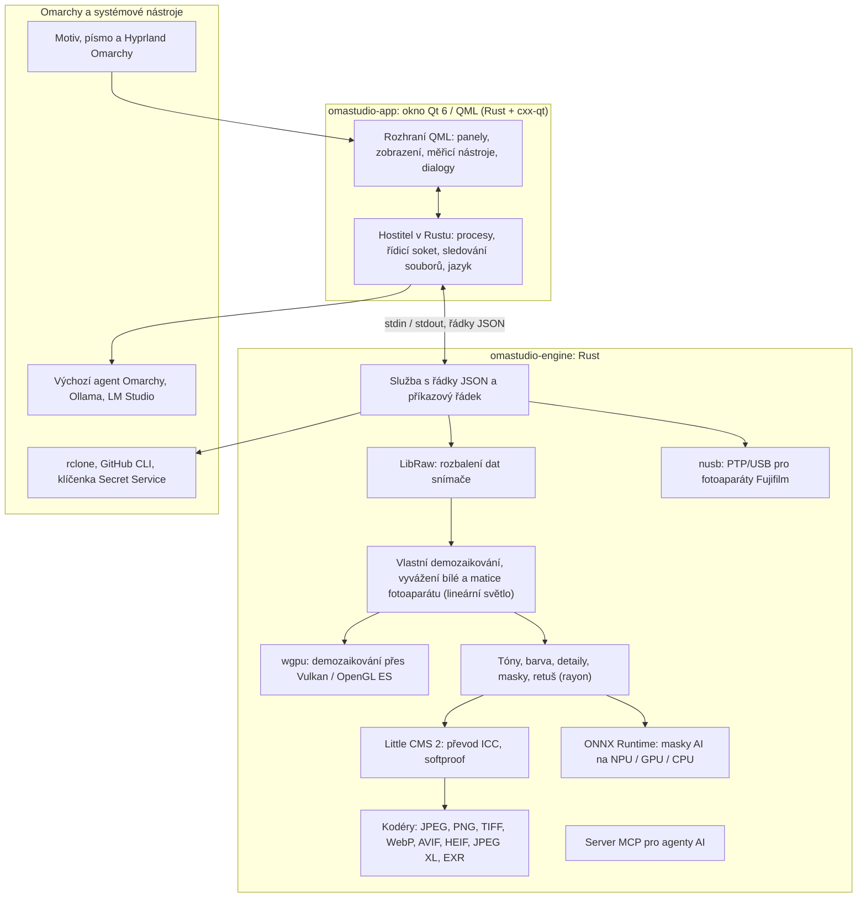

# Technologie v OmaStudio

**OmaStudio: The Complete Medium Format RAW Editor for Omarchy**

[Všechny jazyky](../README.md) · [Uživatelská příručka](../guide/cs.md) · [README](../../README.md)

Tato stránka popisuje technologie, na kterých je OmaStudio postavené: co každá z nich v aplikaci dělá, proč byla zvolena a pod jakou licencí je šířena. Samotné OmaStudio je vydáno pod licencí MIT.

## Architektura

Okno a jádro jsou samostatné procesy. Okno nikdy samo nedekóduje fotografii: posílá příkazy jádru a zobrazuje obrázky, které jádro zapisuje. Pád nebo zaseknutí při dekódování nemůže strhnout rozhraní a totéž jádro obsluhuje příkazový řádek, skripty i agenty AI.

## Aplikace

| Technologie | Úloha v OmaStudio | Proč | Licence |
| :--- | :--- | :--- | :--- |
| **Rust** (1.99, edice 2024) | Jazyk jádra a hostitele aplikace | Bezpečnost paměti pro kód, který čte nedůvěryhodné soubory, nativní rychlost a jeden jazyk pro oba procesy | MIT / Apache-2.0 |
| **Qt 6** (6.12, Qt Quick / QML) | Rozhraní: panely, zobrazení, měřicí nástroje, dialogy | Rozhraní kreslené na GPU s nativní podporou Waylandu a zlomkového škálování, rozvržením zprava doleva a překladovým systémem Qt Linguist | LGPL-3.0 |
| **cxx-qt** (0.10) | Propojuje Rust a Qt: typy `Process`, `Host` a řídicí soket jsou objekty Rustu používané z QML | Bezpečné vazby oběma směry bez ručně psaného C++ | MIT / Apache-2.0 |
| **Qt Wayland** | Spouští okno jako nativního klienta Waylandu (ID aplikace `omastudio`) | Omarchy používá Hyprland na Waylandu; pravidla oken Hyprlandu mohou vycházet z ID | LGPL-3.0 |
| **zenity** | Dialogy výběru souborů a složek | Malý a přítomný v každé instalaci Omarchy | LGPL-2.1+ |

Soubory QML se kompilují do spustitelného souboru jako prostředky Qt, takže se nainstalovaná verze nikdy nesmíchá s volně ležícími soubory rozhraní.

## Jádro RAW

| Technologie | Úloha v OmaStudio | Proč | Licence |
| :--- | :--- | :--- | :--- |
| **LibRaw** (0.22) | Čte kontejner RAW a rozbaluje data snímače, metadata a vložené náhledy | Nejširší podpora fotoaparátů dostupná jako knihovna, včetně Fujifilm GFX, Hasselblad, Phase One a Leaf | LGPL-2.1 nebo CDDL-1.0 (dynamicky linkováno) |
| **Vlastní vyvolávací řetězec** | Úroveň černé, vyvážení bílé, demozaikování X-Trans a Bayer, barevná matice fotoaparátu, korekce objektivu, vše na lineárním světle | Kontrola nad barvou od snímače a 16bitová cesta až po export; demozaikování volí pro každý pixel ze čtyř směrových kandidátů | MIT (OmaStudio) |
| **rayon** (1.12) | Paralelní zpracování na všech jádrech CPU | Datový paralelismus bez ručně psaných fondů vláken | MIT / Apache-2.0 |
| **wgpu** (30) | Demozaikování na GPU přes Vulkan (NVIDIA, AMD, Intel, Qualcomm Adreno) nebo OpenGL ES v pásech, které se vejdou do limitů GPU | Jedna cesta kódu pro všechny výrobce GPU, napsaná ve WGSL; výsledek odpovídá cestě CPU s přesností na jednu úroveň z 65535 | MIT / Apache-2.0 |
| **Little CMS 2** (přes crate `lcms2`) | Profily ICC, převod do barevného prostoru exportu, způsoby vykreslení, softproof a varování gamutu | Referenční open source jádro správy barev | MIT |
| **image-rs**, **tiff**, **exr** | Čtení a zápis PNG, JPEG, TIFF, WebP, OpenEXR, Radiance HDR a PNM | Kodeky v čistém Rustu s omezenou spotřebou paměti | MIT / Apache-2.0; exr: BSD-3-Clause |
| **libjxl**, **libavif**, **libheif**, **libwebp** | Export do JPEG XL, AVIF, HEIF a ztrátového WebP | Referenční kodéry těchto formátů | BSD-3-Clause, BSD-2-Clause, LGPL-3.0, BSD-3-Clause |
| **ExifTool** (volitelné) | Přenáší metadata EXIF fotoaparátu do exportovaných souborů | Zapisuje metadata do všech formátů, které OmaStudio exportuje | Artistic / GPL (samostatný program) |
| **Data Lensfun** (volitelné) | Profily objektivů pro střední formát | Velká udržovaná databáze objektivů, čtená za běhu | Data CC BY-SA 3.0 |

Barevný řetězec pracuje na lineárním světle: expozice je fotografický krok EV a vyvážení bílé působí na světlo stejně jako násobitele samotného fotoaparátu. Obraz se pro zobrazení kóduje jen jednou, před tvůrčími moduly tónů a barvy, a při exportu se převádí pomocí Little CMS.

## AI

| Technologie | Úloha v OmaStudio | Proč | Licence |
| :--- | :--- | :--- | :--- |
| **ONNX Runtime** (přes crate `ort`, načítán za běhu) | Spouští segmentační modely pro masky **Objekt (AI)** a **Obloha (AI)** | Jedno běhové prostředí pro NPU, GPU i CPU; volitelné, OmaStudio se spustí i bez něj | MIT |
| **Poskytovatelé výpočtu** | OpenVINO (NPU Intel Core Ultra), QNN (NPU Snapdragon X), Vitis AI (NPU AMD Ryzen AI), CUDA, MIGraphX, WebGPU, XNNPACK | Použije nejrychlejší akcelerátor v počítači a jinak CPU | Licence daného poskytovatele |
| **Výchozí agent Omarchy** (Claude Code nebo Codex) | Asistent úprav a konverzace s AI používají agenta zvoleného přes `omarchy-default-agent`, s jeho vlastním přihlášením | Žádný další účet ani klíč v OmaStudio | Podmínky agenta |
| **Ollama**, **LM Studio** | Místní obrazové modely pro asistenta úprav | Fotografie zůstanou v počítači | MIT; LM Studio: proprietární |
| **Poskytovatelé v cloudu** (Anthropic, OpenAI, OpenRouter, Google Gemini) | Volitelní poskytovatelé pro asistenta úprav, dostupní přes `curl` | Klíče jsou v klíčence a předávají se přes stdin, nikdy na příkazovém řádku | Podmínky poskytovatele |
| **Model Context Protocol** | `omastudio mcp` umožňuje agentům AI fotografie zkoumat, vykreslovat, exportovat a ovládat okno | Otevřený protokol podporovaný mnoha agenty | Otevřená specifikace |

Odpověď asistenta je omezena schématem JSON a před použitím oříznuta na rozsah každého ovládacího prvku; každou úpravu lze vrátit.

## Fotoaparáty

| Technologie | Úloha v OmaStudio | Proč | Licence |
| :--- | :--- | :--- | :--- |
| **nusb** (0.2) | Přístup k USB pro vrstvu PTP | Čistý Rust, bez libusb a gphoto2 | MIT / Apache-2.0 |
| **PTP / protokol Fujifilm** | Vlastní nastavení C1–C7, recepty zapsané do fotoaparátu, převod RAW ve fotoaparátu | Zdokumentováno metodou clean room z pozorování; bez kódu výrobce | MIT (OmaStudio) |
| **Pravidlo udev** | Dává přihlášenému uživateli přístup k fotoaparátům Fujifilm v režimu PTP | K práci s fotoaparátem není potřeba root | MIT (OmaStudio) |

## Cloudové účty

| Technologie | Úloha v OmaStudio | Proč | Licence |
| :--- | :--- | :--- | :--- |
| **rclone** | Google Drive, OneDrive, Dropbox, Box, pCloud a Yandex Disk: přihlášení, procházení, stahování, nahrávání | Jeden ověřený klient pro mnoho služeb, s OAuth v prohlížeči | MIT |
| **GitHub CLI** (`gh`) | Přihlášení ke GitHubu (device flow) a soukromý repozitář `OmaStudio` | Vlastní klient GitHubu; token uchovává v klíčence | MIT |
| **libsecret** / Secret Service (`secret-tool`, `gnome-keyring`) | Uchovává klíč šifrované konfigurace rclone OmaStudio a klíče poskytovatelů AI | Tajné údaje se nikdy neukládají jako prostý text | LGPL-2.1+ |

## Integrace s Omarchy

- **Motiv.** Každá barva pochází z aktivního motivu Omarchy (`~/.local/state/omarchy/current/theme/colors.toml`) a mění se okamžitě se změnou motivu.
- **Písmo.** Rozhraní používá písmo Omarchy (`omarchy-font-set`, čtené přes fontconfig) a škáluje text podle základní velikosti prostředí Omarchy.
- **Hyprland.** Rohy sledují zaoblení Hyprlandu; okno je běžný klient Waylandu s ID `omastudio`.
- **Výchozí agent.** OmaStudio průběžně sleduje `~/.config/omarchy/defaults/agent`.
- **Nabídka aplikací a lišta.** Položka nabídky používá kontrastní jednobarevnou ikonu jako vlastní aplikace Omarchy; `Panel.qml` je volitelný widget Quickshell pro lištu Omarchy.
- **Jazyk.** Rozhraní se řídí jazykem systému (`LANGUAGE`, `LC_ALL`, `LC_MESSAGES`, `LANG`, `locale.conf`).

## Jazyky

| Technologie | Úloha v OmaStudio | Licence |
| :--- | :--- | :--- |
| **Qt Linguist** (soubory `.ts`, `lrelease`) | 30 jazyků rozhraní zkompilovaných do spustitelného souboru; rozvržení zprava doleva pro arabštinu, hebrejštinu a perštinu | LGPL-3.0 / GPL-3.0 (nástroj sestavení) |
| **tools/i18n/check.py** | Zastaví sestavení v CI, když překlad chybí, zůstal anglicky, je v nesprávném písmu nebo nesedí zástupné symboly | MIT (OmaStudio) |

## Sestavení, testy a vydání

| Technologie | Úloha v OmaStudio | Licence |
| :--- | :--- | :--- |
| **Cargo** s připnutou sadou nástrojů (`rust-toolchain.toml`) | Sestavuje jádro a aplikaci jako jeden pracovní prostor; `Cargo.lock` je v repozitáři | MIT / Apache-2.0 |
| **clang**, **pkgconf** | Překladač C a ovladač linkeru pro vrstvu LibRaw, hledání knihoven | Apache-2.0 s výjimkou LLVM, ISC |
| **GitHub Actions** v kontejneru `archlinux` | Sestavení, testy, `clippy -D warnings` a kontrola překladů při každé změně, se stejnými balíčky, jaké používá Omarchy | — |
| **CodeQL** | Statická analýza kódu v Rustu a pracovních postupů | — |
| **Postup vydání** | Při vytvoření štítku sestaví archiv a zveřejní jej s kontrolními součty SHA-256 a atestacemi původu sestavení | — |
| **PKGBUILD** | Balíček pro Arch se závislostmi, volitelnými závislostmi a pravidlem udev | — |

## Zabezpečení

- Každý externí program běží s vyčištěným prostředím, ve vlastní skupině procesů, s časovým limitem a limitem výstupu.
- Každý soubor, který jádro čte, má omezenou velikost; katalog, nastavení a doprovodné soubory se zapisují atomicky s režimem `0600` a symbolické odkazy se odmítají tam, kde složka patří jádru.
- Řídicí soket je v `$XDG_RUNTIME_DIR/omastudio/` a odpovídá jen procesům téhož uživatele (`SO_PEERCRED`).
- Klíče API a cloudové tokeny zůstávají v klíčence a nikdy se neobjeví na příkazovém řádku.
- Rozhraní zobrazuje veškerý dynamický text jako prostý text.

Podrobnosti najdete v [SECURITY.md](../../SECURITY.md).

## Ochranné známky

Fujifilm, GFX, X-Trans, Hasselblad, Phase One, Leica, Pentax, Mamiya a další názvy fotoaparátů jsou ochranné známky svých vlastníků a používají se pouze k označení kompatibility.
