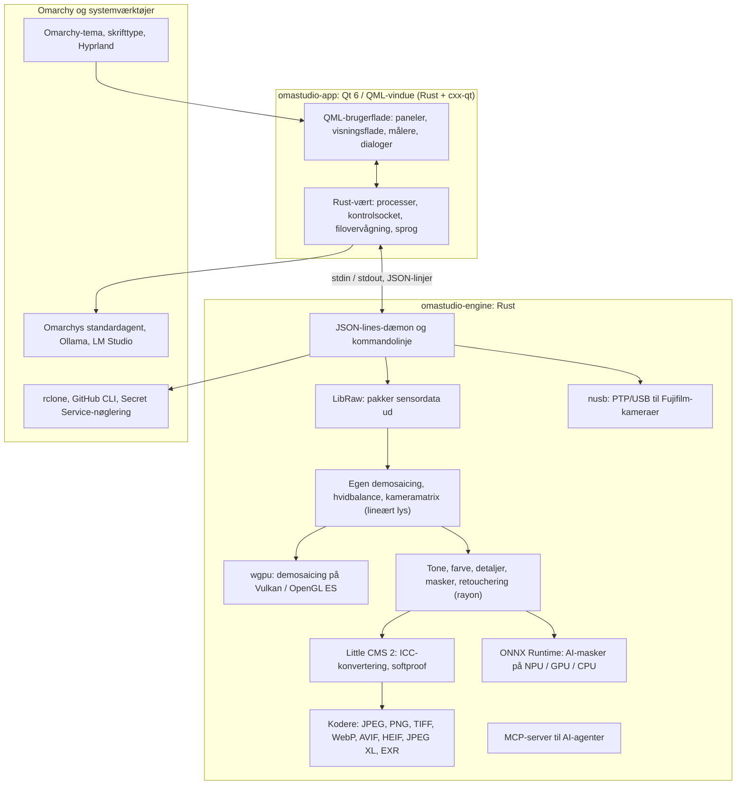

# Teknologier i OmaStudio

**OmaStudio: The Complete Medium Format RAW Editor for Omarchy**

[Alle sprog](../README.md) · [Brugervejledning](../guide/da.md) · [README](../../README.md)

Denne side beskriver de teknologier, OmaStudio er bygget på: hvad hver enkelt gør i programmet, hvorfor den blev valgt, og hvilken licens den har. OmaStudio selv udgives under MIT-licensen.

## Arkitektur

Vinduet og motoren er separate processer. Vinduet afkoder aldrig selv et foto: det sender kommandoer til motoren og viser de billeder, motoren skriver. Et nedbrud eller en hængning i afkodningen kan ikke tage brugerfladen med sig, og den samme motor betjener kommandolinjen, scripts og AI-agenter.

## Program

| Teknologi | Rolle i OmaStudio | Hvorfor | Licens |
| :--- | :--- | :--- | :--- |
| **Rust** (1.99, edition 2024) | Sproget for motoren og programværten | Hukommelsessikkerhed for kode, der fortolker filer, man ikke kan stole på, indbygget hastighed og ét sprog til begge processer | MIT / Apache-2.0 |
| **Qt 6** (6.12, Qt Quick / QML) | Brugerfladen: paneler, visningsfladen, målere, dialoger | GPU-tegnet brugerflade med indbygget Wayland-understøttelse og brøkskalering, højre-til-venstre-layout og oversættelsessystemet Qt Linguist | LGPL-3.0 |
| **cxx-qt** (0.10) | Forbinder Rust og Qt: værtstyperne `Process`, `Host` og kontrolsocketen er Rust-objekter, der bruges fra QML | Sikre bindinger i begge retninger uden håndskrevet C++ | MIT / Apache-2.0 |
| **Qt Wayland** | Kører vinduet som en indbygget Wayland-klient (app-id `omastudio`) | Omarchy kører Hyprland på Wayland; Hyprlands vinduesregler kan matche app-id'et | LGPL-3.0 |
| **zenity** | Fil- og mappedialoger | Lille og findes i alle Omarchy-installationer | LGPL-2.1+ |

QML-filerne kompileres ind i binærfilen som Qt-ressourcer, så en installeret version aldrig blandes med løse brugerfladefiler.

## RAW-motor

| Teknologi | Rolle i OmaStudio | Hvorfor | Licens |
| :--- | :--- | :--- | :--- |
| **LibRaw** (0.22) | Læser RAW-containeren og pakker sensordata, metadata og indlejrede forhåndsvisninger ud | Den bredeste kameraunderstøttelse, der findes som bibliotek, inklusive Fujifilm GFX, Hasselblad, Phase One og Leaf | LGPL-2.1 eller CDDL-1.0 (dynamisk linket) |
| **Egen fremkaldelseskæde** | Sortniveau, hvidbalance, X-Trans- og Bayer-demosaicing, kameraets farvematrix, objektivkorrektioner, alt på lineært lys | Kontrol over farven fra sensoren og frem og en 16-bit-vej til eksporten; demosaicingen vælger mellem fire retningskandidater pr. pixel | MIT (OmaStudio) |
| **rayon** (1.12) | Parallel behandling på alle CPU-kerner | Dataparallelisme uden håndskrevne trådpuljer | MIT / Apache-2.0 |
| **wgpu** (30) | Demosaicing på GPU'en via Vulkan (NVIDIA, AMD, Intel, Qualcomm Adreno) eller OpenGL ES, i bånd, der passer til GPU'ens grænser | Én kodevej for alle GPU-producenter, skrevet i WGSL; resultatet svarer til CPU-vejen inden for ét niveau ud af 65535 | MIT / Apache-2.0 |
| **Little CMS 2** (via craten `lcms2`) | ICC-profiler, konvertering til eksportens farverum, gengivelseshensigter, softproof og gamut-advarslen | Referencemotoren for farvestyring med åben kildekode | MIT |
| **image-rs**, **tiff**, **exr** | Læser og skriver PNG, JPEG, TIFF, WebP, OpenEXR, Radiance HDR og PNM | Codecs i ren Rust med begrænset hukommelsesforbrug | MIT / Apache-2.0; exr: BSD-3-Clause |
| **libjxl**, **libavif**, **libheif**, **libwebp** | Eksport til JPEG XL, AVIF, HEIF og WebP med tab | Referencekoderne for disse formater | BSD-3-Clause, BSD-2-Clause, LGPL-3.0, BSD-3-Clause |
| **ExifTool** (valgfrit) | Overfører kameraets EXIF-metadata til eksporterede filer | Skriver metadata til alle formater, OmaStudio eksporterer | Artistic / GPL (separat program) |
| **Lensfun-data** (valgfrit) | Objektivprofiler til mellemformatobjektiver | En stor, vedligeholdt objektivdatabase, der læses ved kørsel | Data CC BY-SA 3.0 |

Farvekæden arbejder på lineært lys: eksponering er et fotografisk EV-trin, og hvidbalance virker på lyset, som kameraets egne multiplikatorer gør. Billederne kodes til skærm én gang, før de kreative tone- og farvemoduler, og konverteres med Little CMS ved eksport.

## AI

| Teknologi | Rolle i OmaStudio | Hvorfor | Licens |
| :--- | :--- | :--- | :--- |
| **ONNX Runtime** (via craten `ort`, indlæses ved kørsel) | Kører segmenteringsmodeller til maskerne **AI-motiv** og **AI-himmel** | Ét kørselsmiljø til NPU'er, GPU'er og CPU'er; valgfrit, så OmaStudio starter uden det | MIT |
| **Execution providers** | OpenVINO (Intel Core Ultra NPU), QNN (Snapdragon X NPU), Vitis AI (AMD Ryzen AI NPU), CUDA, MIGraphX, WebGPU, XNNPACK | Bruger computerens hurtigste accelerator og falder tilbage på CPU'en | Hver providers egen licens |
| **Omarchys standardagent** (Claude Code eller Codex) | **Redigeringsassistent** og **AI-samtale** bruger den agent, der er valgt med `omarchy-default-agent`, med dens eget login | Ingen ekstra konto eller nøgle i OmaStudio | Agentens egne vilkår |
| **Ollama**, **LM Studio** | Lokale billedmodeller til redigeringsassistenten | Fotoene bliver på computeren | MIT; LM Studio: proprietær |
| **Skyudbydere** (Anthropic, OpenAI, OpenRouter, Google Gemini) | Valgfrie udbydere til redigeringsassistenten, kontaktes med `curl` | Nøglerne gemmes i nøgleringen og sendes via stdin, aldrig på en kommandolinje | Udbyderens egne vilkår |
| **Model Context Protocol** | `omastudio mcp` lader AI-agenter undersøge, gengive, eksportere og styre vinduet | En åben protokol, som mange agenter understøtter | Åben specifikation |

Assistentens svar begrænses til et JSON-skema og holdes inden for hver kontrols interval, før det anvendes, og hver ændring kan fortrydes.

## Kameraer

| Teknologi | Rolle i OmaStudio | Hvorfor | Licens |
| :--- | :--- | :--- | :--- |
| **nusb** (0.2) | USB-adgang til PTP-laget | Ren Rust, hverken libusb eller gphoto2 er nødvendigt | MIT / Apache-2.0 |
| **PTP / Fujifilm-protokol** | Brugerindstillinger C1–C7, opskrifter skrevet til kameraet, RAW-konvertering i kameraet | Dokumenteret clean-room ud fra observation; ingen producentkode | MIT (OmaStudio) |
| **udev-regel** | Giver den indloggede bruger adgang til Fujifilm-kameraer i PTP-tilstand | Ingen root nødvendig for at bruge et kamera | MIT (OmaStudio) |

## Skykonti

| Teknologi | Rolle i OmaStudio | Hvorfor | Licens |
| :--- | :--- | :--- | :--- |
| **rclone** | Google Drive, OneDrive, Dropbox, Box, pCloud og Yandex Disk: login, gennemsyn, download, upload | Én afprøvet klient til mange tjenester, med OAuth i browseren | MIT |
| **GitHub CLI** (`gh`) | GitHub-login (device flow) og det private repositorium `OmaStudio` | GitHubs egen klient; opbevarer sit token i nøgleringen | MIT |
| **libsecret** / Secret Service (`secret-tool`, `gnome-keyring`) | Opbevarer nøglen til OmaStudios krypterede rclone-konfiguration og AI-udbydernes nøgler | Hemmeligheder gemmes aldrig i klartekst | LGPL-2.1+ |

## Integration med Omarchy

- **Tema.** Alle farver kommer fra det aktive Omarchy-tema (`~/.local/state/omarchy/current/theme/colors.toml`) og ændres med det samme, når temaet skiftes.
- **Skrifttype.** Brugerfladen bruger Omarchys skrifttype (`omarchy-font-set`, læst via fontconfig) og skalerer teksten ud fra Omarchy-skallens grundstørrelse.
- **Hyprland.** Hjørnerne følger Hyprlands afrunding; vinduet er en almindelig Wayland-klient med app-id `omastudio`.
- **Standardagent.** OmaStudio følger `~/.config/omarchy/defaults/agent` løbende.
- **Programmenu og bjælke.** Skrivebordsposten bruger et monokromt ikon med høj kontrast som Omarchys egne programmer; `Panel.qml` er en valgfri Quickshell-widget til Omarchy-bjælken.
- **Sprog.** Brugerfladen følger systemets sprog (`LANGUAGE`, `LC_ALL`, `LC_MESSAGES`, `LANG`, `locale.conf`).

## Sprog

| Teknologi | Rolle i OmaStudio | Licens |
| :--- | :--- | :--- |
| **Qt Linguist** (`.ts`-filer, `lrelease`) | 30 brugerfladesprog, kompileret ind i binærfilen; højre-til-venstre-layout til arabisk, hebraisk og persisk | LGPL-3.0 / GPL-3.0 (byggeværktøj) |
| **tools/i18n/check.py** | Får bygget i CI til at fejle, når en oversættelse mangler, står tilbage på engelsk, har forkert skriftsystem eller forkerte pladsholdere | MIT (OmaStudio) |

## Byg, test og udgivelse

| Teknologi | Rolle i OmaStudio | Licens |
| :--- | :--- | :--- |
| **Cargo** med fastlåst værktøjskæde (`rust-toolchain.toml`) | Bygger motoren og programmet som ét workspace; `Cargo.lock` er tjekket ind | MIT / Apache-2.0 |
| **clang**, **pkgconf** | C-compiler og linker-driver til LibRaw-mellemlaget, finder biblioteker | Apache-2.0 med LLVM-undtagelse, ISC |
| **GitHub Actions** i en `archlinux`-container | Byg, test, `clippy -D warnings` og oversættelseskontrollen ved hver ændring, med de samme pakker som Omarchy bruger | — |
| **CodeQL** | Statisk analyse af Rust-koden og workflows | — |
| **Udgivelses-workflow** | Bygger arkivet ved et tag og udgiver det med SHA-256-kontrolsummer og attesteringer af byggets oprindelse | — |
| **PKGBUILD** | Arch-pakke med afhængigheder, valgfrie afhængigheder og udev-reglen | — |

## Sikkerhed

- Hvert eksternt program kører med et ryddet miljø, sin egen procesgruppe, en tidsgrænse og en grænse for output.
- Hver fil, motoren læser, har en størrelsesgrænse; katalog, indstillinger og sidecar-filer skrives atomisk med tilstanden `0600`, og symbolske links afvises, hvor motoren ejer mappen.
- Kontrolsocketen ligger i `$XDG_RUNTIME_DIR/omastudio/` og svarer kun processer fra samme bruger (`SO_PEERCRED`).
- API-nøgler og skytokens bliver i nøgleringen og vises aldrig på en kommandolinje.
- Brugerfladen viser al dynamisk tekst som almindelig tekst.

Detaljer findes i [SECURITY.md](../../SECURITY.md).

## Varemærker

Fujifilm, GFX, X-Trans, Hasselblad, Phase One, Leica, Pentax, Mamiya og andre kameranavne er varemærker tilhørende deres ejere og bruges kun til at beskrive kompatibilitet.
