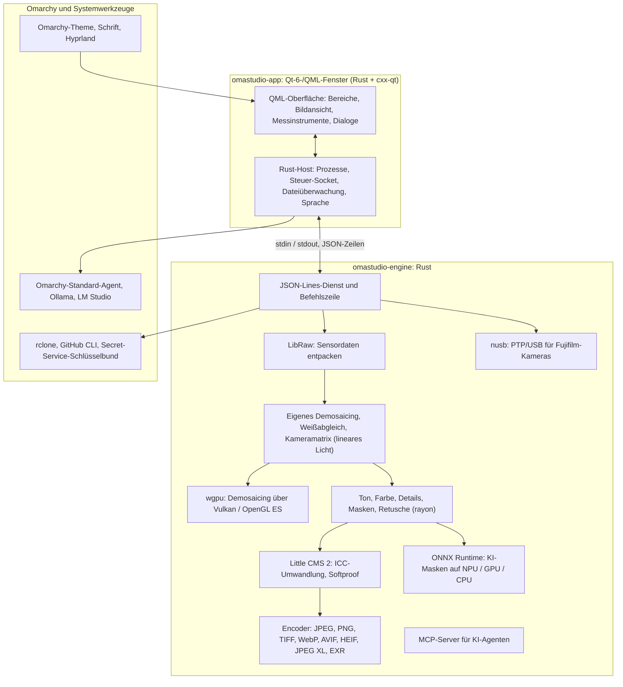

# Technologien in OmaStudio

**OmaStudio: The Complete Medium Format RAW Editor for Omarchy**

[Alle Sprachen](../README.md) · [Benutzerhandbuch](../guide/de.md) · [README](../../README.md)

Diese Seite beschreibt die Technologien, auf denen OmaStudio aufbaut: was jede in der Anwendung tut, warum sie gewählt wurde und unter welcher Lizenz sie steht. OmaStudio selbst steht unter der MIT-Lizenz.

## Architektur

Fenster und Engine sind getrennte Prozesse. Das Fenster dekodiert nie selbst ein Foto: Es sendet Befehle an die Engine und zeigt die Bilder, die die Engine schreibt. Ein Absturz oder Hänger beim Dekodieren kann die Oberfläche nicht mitreißen, und dieselbe Engine bedient Befehlszeile, Skripte und KI-Agenten.

## Anwendung

| Technologie | Rolle in OmaStudio | Warum | Lizenz |
| :--- | :--- | :--- | :--- |
| **Rust** (1.99, Edition 2024) | Sprache der Engine und des Anwendungs-Hosts | Speichersicherheit für Code, der nicht vertrauenswürdige Dateien liest, native Geschwindigkeit und eine Sprache für beide Prozesse | MIT / Apache-2.0 |
| **Qt 6** (6.12, Qt Quick / QML) | Die Oberfläche: Bereiche, Bildansicht, Messinstrumente, Dialoge | Auf der GPU gezeichnete Oberfläche mit nativer Wayland-Unterstützung und gebrochener Skalierung, Rechts-nach-links-Layout und dem Übersetzungssystem Qt Linguist | LGPL-3.0 |
| **cxx-qt** (0.10) | Verbindet Rust und Qt: die Host-Typen `Process`, `Host` und der Steuer-Socket sind Rust-Objekte, die QML verwendet | Sichere Bindungen in beide Richtungen ohne handgeschriebenes C++ | MIT / Apache-2.0 |
| **Qt Wayland** | Führt das Fenster als nativen Wayland-Client aus (App-ID `omastudio`) | Omarchy nutzt Hyprland auf Wayland; Hyprland-Fensterregeln können die App-ID treffen | LGPL-3.0 |
| **zenity** | Datei- und Ordnerdialoge | Klein und auf jeder Omarchy-Installation vorhanden | LGPL-2.1+ |

Die QML-Dateien werden als Qt-Ressourcen in die Binärdatei kompiliert, sodass eine installierte Version nie mit verstreuten Oberflächendateien vermischt wird.

## RAW-Engine

| Technologie | Rolle in OmaStudio | Warum | Lizenz |
| :--- | :--- | :--- | :--- |
| **LibRaw** (0.22) | Liest den RAW-Container und entpackt Sensordaten, Metadaten und eingebettete Vorschauen | Die breiteste als Bibliothek verfügbare Kameraunterstützung, einschließlich Fujifilm GFX, Hasselblad, Phase One und Leaf | LGPL-2.1 oder CDDL-1.0 (dynamisch gelinkt) |
| **Eigene Entwicklungs-Pipeline** | Schwarzwert, Weißabgleich, X-Trans- und Bayer-Demosaicing, Kamera-Farbmatrix, Objektivkorrekturen, alles auf linearem Licht | Kontrolle über die Farbe ab dem Sensor und ein 16-Bit-Weg bis zum Export; das Demosaicing wählt je Pixel zwischen vier richtungsabhängigen Kandidaten | MIT (OmaStudio) |
| **rayon** (1.12) | Parallele Verarbeitung auf allen CPU-Kernen | Datenparallelität ohne handgeschriebene Thread-Pools | MIT / Apache-2.0 |
| **wgpu** (30) | Demosaicing auf der GPU über Vulkan (NVIDIA, AMD, Intel, Qualcomm Adreno) oder OpenGL ES, in Streifen, die in die Grenzen der GPU passen | Ein Codepfad für jeden GPU-Hersteller, in WGSL geschrieben; das Ergebnis stimmt mit dem CPU-Pfad bis auf eine Stufe von 65535 überein | MIT / Apache-2.0 |
| **Little CMS 2** (über das Crate `lcms2`) | ICC-Profile, Umwandlung in den Exportfarbraum, Rendering-Intents, Softproof und Farbumfang-Warnung | Die maßgebliche quelloffene Farbmanagement-Engine | MIT |
| **image-rs**, **tiff**, **exr** | Lesen und Schreiben von PNG, JPEG, TIFF, WebP, OpenEXR, Radiance HDR und PNM | Reine Rust-Codecs mit begrenztem Speicherverbrauch | MIT / Apache-2.0; exr: BSD-3-Clause |
| **libjxl**, **libavif**, **libheif**, **libwebp** | Export von JPEG XL, AVIF, HEIF und verlustbehaftetem WebP | Die Referenz-Encoder dieser Formate | BSD-3-Clause, BSD-2-Clause, LGPL-3.0, BSD-3-Clause |
| **ExifTool** (optional) | Überträgt EXIF-Metadaten der Kamera in exportierte Dateien | Schreibt Metadaten in jedes Format, das OmaStudio exportiert | Artistic / GPL (eigenes Programm) |
| **Lensfun-Daten** (optional) | Objektivprofile für Mittelformatobjektive | Eine große, gepflegte Objektivdatenbank, zur Laufzeit gelesen | Daten CC BY-SA 3.0 |

Die Farb-Pipeline arbeitet auf linearem Licht: Belichtung ist ein fotografischer LW-Schritt, und der Weißabgleich wirkt auf das Licht wie die Multiplikatoren der Kamera. Die Bilder werden einmal vor den kreativen Ton- und Farbmodulen für die Anzeige kodiert und beim Export mit Little CMS umgewandelt.

## KI

| Technologie | Rolle in OmaStudio | Warum | Lizenz |
| :--- | :--- | :--- | :--- |
| **ONNX Runtime** (über das Crate `ort`, zur Laufzeit geladen) | Führt Segmentierungsmodelle für die Masken **KI-Motiv** und **KI-Himmel** aus | Eine Laufzeit für NPUs, GPUs und CPUs; optional, OmaStudio startet auch ohne | MIT |
| **Execution Provider** | OpenVINO (Intel-Core-Ultra-NPU), QNN (Snapdragon-X-NPU), Vitis AI (AMD-Ryzen-AI-NPU), CUDA, MIGraphX, WebGPU, XNNPACK | Nutzt den schnellsten Beschleuniger im Computer und fällt auf die CPU zurück | Lizenz des jeweiligen Providers |
| **Omarchy-Standard-Agent** (Claude Code oder Codex) | Bearbeitungsassistent und KI-Chat nutzen den mit `omarchy-default-agent` gewählten Agenten mit dessen eigener Anmeldung | Kein zusätzliches Konto oder Schlüssel in OmaStudio | Bedingungen des Agenten |
| **Ollama**, **LM Studio** | Lokale Bildmodelle für den Bearbeitungsassistenten | Fotos bleiben auf dem Computer | MIT; LM Studio: proprietär |
| **Cloud-Anbieter** (Anthropic, OpenAI, OpenRouter, Google Gemini) | Optionale Anbieter für den Bearbeitungsassistenten, über `curl` erreicht | Schlüssel liegen im Schlüsselbund und werden über stdin übergeben, nie auf einer Befehlszeile | Bedingungen des Anbieters |
| **Model Context Protocol** | `omastudio mcp` lässt KI-Agenten Fotos untersuchen, berechnen, exportieren und das Fenster steuern | Ein offenes, von vielen Agenten unterstütztes Protokoll | Offene Spezifikation |

Die Antwort des Assistenten ist an ein JSON-Schema gebunden und wird vor dem Anwenden auf den Bereich jedes Reglers begrenzt; jede Bearbeitung lässt sich rückgängig machen.

## Kameras

| Technologie | Rolle in OmaStudio | Warum | Lizenz |
| :--- | :--- | :--- | :--- |
| **nusb** (0.2) | USB-Zugriff für die PTP-Schicht | Reines Rust, kein libusb oder gphoto2 nötig | MIT / Apache-2.0 |
| **PTP / Fujifilm-Protokoll** | Benutzereinstellungen C1–C7, in die Kamera geschriebene Rezepte, RAW-Konvertierung in der Kamera | Clean-Room aus Beobachtung dokumentiert; kein Herstellercode | MIT (OmaStudio) |
| **udev-Regel** | Gibt dem angemeldeten Benutzer Zugriff auf Fujifilm-Kameras im PTP-Modus | Kein root für die Kamera nötig | MIT (OmaStudio) |

## Cloud-Konten

| Technologie | Rolle in OmaStudio | Warum | Lizenz |
| :--- | :--- | :--- | :--- |
| **rclone** | Google Drive, OneDrive, Dropbox, Box, pCloud und Yandex Disk: Anmeldung, Durchsuchen, Herunterladen, Hochladen | Ein erprobter Client für viele Dienste, mit OAuth im Browser | MIT |
| **GitHub CLI** (`gh`) | GitHub-Anmeldung (Device Flow) und das private Repository `OmaStudio` | GitHubs eigener Client; hält sein Token im Schlüsselbund | MIT |
| **libsecret** / Secret Service (`secret-tool`, `gnome-keyring`) | Hält den Schlüssel der verschlüsselten rclone-Konfiguration von OmaStudio und die Schlüssel der KI-Anbieter | Geheimnisse werden nie im Klartext gespeichert | LGPL-2.1+ |

## Omarchy-Integration

- **Theme.** Jede Farbe stammt aus dem aktiven Omarchy-Theme (`~/.local/state/omarchy/current/theme/colors.toml`) und ändert sich live, wenn das Theme wechselt.
- **Schrift.** Die Oberfläche verwendet die Omarchy-Schrift (`omarchy-font-set`, über fontconfig gelesen) und skaliert Text nach der Grundgröße der Omarchy-Shell.
- **Hyprland.** Die Ecken folgen der Rundung von Hyprland; das Fenster ist ein gewöhnlicher Wayland-Client mit der App-ID `omastudio`.
- **Standard-Agent.** OmaStudio folgt `~/.config/omarchy/defaults/agent` live.
- **App-Menü und Leiste.** Der Desktop-Eintrag verwendet ein kontrastreiches einfarbiges Symbol wie Omarchys eigene Anwendungen; `Panel.qml` ist ein optionales Quickshell-Widget für die Omarchy-Leiste.
- **Sprache.** Die Oberfläche folgt der Systemsprache (`LANGUAGE`, `LC_ALL`, `LC_MESSAGES`, `LANG`, `locale.conf`).

## Sprachen

| Technologie | Rolle in OmaStudio | Lizenz |
| :--- | :--- | :--- |
| **Qt Linguist** (`.ts`-Dateien, `lrelease`) | 30 Oberflächensprachen, in die Binärdatei kompiliert; Rechts-nach-links-Layout für Arabisch, Hebräisch und Persisch | LGPL-3.0 / GPL-3.0 (Build-Werkzeug) |
| **tools/i18n/check.py** | Lässt den Build in der CI fehlschlagen, wenn eine Übersetzung fehlt, englisch geblieben ist, in der falschen Schrift steht oder Platzhalter nicht passen | MIT (OmaStudio) |

## Build, Tests und Release

| Technologie | Rolle in OmaStudio | Lizenz |
| :--- | :--- | :--- |
| **Cargo** mit festgelegter Toolchain (`rust-toolchain.toml`) | Baut Engine und Anwendung als ein Workspace; `Cargo.lock` ist eingecheckt | MIT / Apache-2.0 |
| **clang**, **pkgconf** | C-Compiler und Linker-Treiber für die LibRaw-Brücke, Bibliothekssuche | Apache-2.0 mit LLVM-Ausnahme, ISC |
| **GitHub Actions** in einem `archlinux`-Container | Build, Tests, `clippy -D warnings` und Übersetzungsprüfung bei jeder Änderung, mit denselben Paketen wie Omarchy | — |
| **CodeQL** | Statische Analyse des Rust-Codes und der Workflows | — |
| **Release-Workflow** | Baut das Archiv bei einem Tag und veröffentlicht es mit SHA-256-Prüfsummen und Build-Provenance-Attestierungen | — |
| **PKGBUILD** | Arch-Paket mit Abhängigkeiten, optionalen Abhängigkeiten und der udev-Regel | — |

## Sicherheit

- Jedes externe Programm läuft mit geleerter Umgebung, in einer eigenen Prozessgruppe, mit Zeit- und Ausgabelimit.
- Jede Datei, die die Engine liest, hat eine Größengrenze; Katalog, Einstellungen und Begleitdateien werden atomar mit Modus `0600` geschrieben, und symbolische Links werden abgelehnt, wo die Engine den Ordner besitzt.
- Der Steuer-Socket liegt in `$XDG_RUNTIME_DIR/omastudio/` und antwortet nur Prozessen desselben Benutzers (`SO_PEERCRED`).
- API-Schlüssel und Cloud-Token bleiben im Schlüsselbund und erscheinen nie auf einer Befehlszeile.
- Die Oberfläche zeigt allen dynamischen Text als reinen Text.

Einzelheiten stehen in [SECURITY.md](../../SECURITY.md).

## Marken

Fujifilm, GFX, X-Trans, Hasselblad, Phase One, Leica, Pentax, Mamiya und andere Kameranamen sind Marken ihrer Inhaber und werden nur zur Beschreibung der Kompatibilität verwendet.
