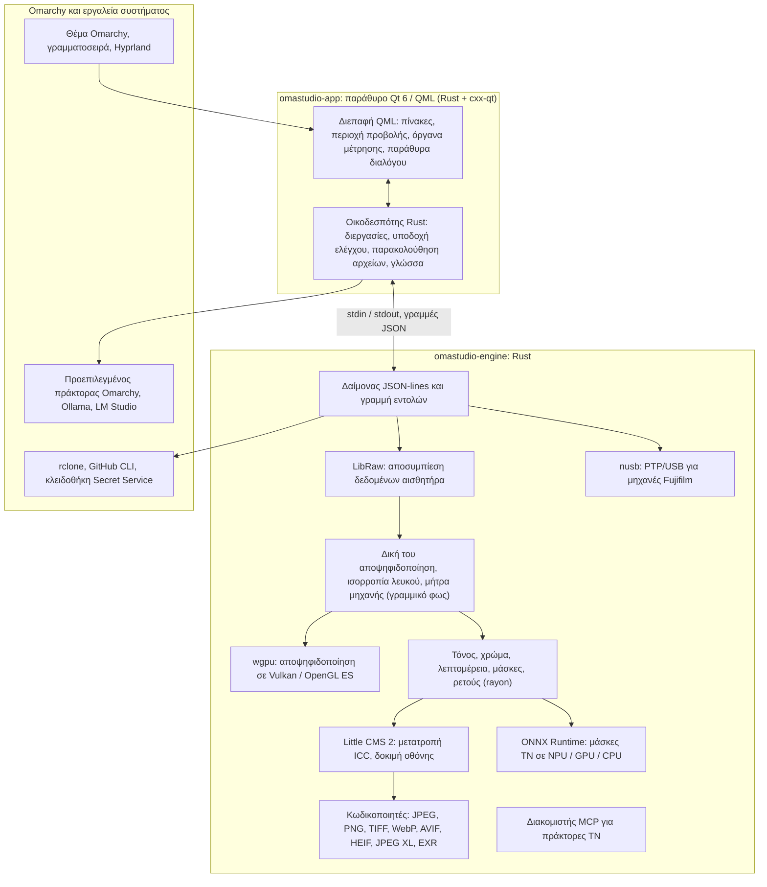

# Οι τεχνολογίες του OmaStudio

**OmaStudio: The Complete Medium Format RAW Editor for Omarchy**

[Όλες οι γλώσσες](../README.md) · [Οδηγός χρήσης](../guide/el.md) · [README](../../README.md)

Η σελίδα αυτή περιγράφει τις τεχνολογίες πάνω στις οποίες είναι χτισμένο το OmaStudio: τι κάνει η καθεμία στην εφαρμογή, γιατί επιλέχθηκε και ποια είναι η άδειά της. Το ίδιο το OmaStudio διατίθεται με την άδεια MIT.

## Αρχιτεκτονική

Το παράθυρο και η μηχανή επεξεργασίας είναι ξεχωριστές διεργασίες. Το παράθυρο δεν αποκωδικοποιεί ποτέ μόνο του μια φωτογραφία: στέλνει εντολές στη μηχανή και δείχνει τις εικόνες που γράφει η μηχανή. Μια κατάρρευση ή ένα κόλλημα στην αποκωδικοποίηση δεν μπορεί να παρασύρει τη διεπαφή, και η ίδια μηχανή εξυπηρετεί τη γραμμή εντολών, τα σενάρια και τους πράκτορες ΤΝ.

## Εφαρμογή

| Τεχνολογία | Ρόλος στο OmaStudio | Γιατί | Άδεια |
| :--- | :--- | :--- | :--- |
| **Rust** (1.99, έκδοση 2024) | Η γλώσσα της μηχανής και του οικοδεσπότη της εφαρμογής | Ασφάλεια μνήμης για κώδικα που αναλύει μη αξιόπιστα αρχεία, εγγενής ταχύτητα και μία γλώσσα και για τις δύο διεργασίες | MIT / Apache-2.0 |
| **Qt 6** (6.12, Qt Quick / QML) | Η διεπαφή: πίνακες, περιοχή προβολής, όργανα μέτρησης, παράθυρα διαλόγου | Διεπαφή σχεδιασμένη από τη GPU με εγγενή υποστήριξη Wayland και κλασματική κλιμάκωση, διάταξη από δεξιά προς αριστερά και το σύστημα μετάφρασης Qt Linguist | LGPL-3.0 |
| **cxx-qt** (0.10) | Συνδέει Rust και Qt: οι τύποι `Process`, `Host` και η υποδοχή ελέγχου είναι αντικείμενα Rust που χρησιμοποιούνται από το QML | Ασφαλείς συνδέσεις και προς τις δύο κατευθύνσεις χωρίς χειρόγραφο C++ | MIT / Apache-2.0 |
| **Qt Wayland** | Εκτελεί το παράθυρο ως εγγενή πελάτη Wayland (app id `omastudio`) | Το Omarchy τρέχει Hyprland σε Wayland· οι κανόνες παραθύρων του Hyprland μπορούν να στοχεύσουν το app id | LGPL-3.0 |
| **zenity** | Παράθυρα αρχείων και φακέλων | Μικρό και διαθέσιμο σε κάθε εγκατάσταση Omarchy | LGPL-2.1+ |

Τα αρχεία QML μεταγλωττίζονται μέσα στο εκτελέσιμο ως πόροι Qt, ώστε μια εγκατεστημένη έκδοση να μην αναμειγνύεται ποτέ με σκόρπια αρχεία διεπαφής.

## Μηχανή RAW

| Τεχνολογία | Ρόλος στο OmaStudio | Γιατί | Άδεια |
| :--- | :--- | :--- | :--- |
| **LibRaw** (0.22) | Διαβάζει το δοχείο RAW και αποσυμπιέζει τα δεδομένα αισθητήρα, τα μεταδεδομένα και τις ενσωματωμένες προεπισκοπήσεις | Η ευρύτερη υποστήριξη μηχανών που υπάρχει ως βιβλιοθήκη, μαζί με Fujifilm GFX, Hasselblad, Phase One και Leaf | LGPL-2.1 ή CDDL-1.0 (δυναμική σύνδεση) |
| **Δική του αλυσίδα εμφάνισης** | Επίπεδο μαύρου, ισορροπία λευκού, αποψηφιδοποίηση X-Trans και Bayer, χρωματική μήτρα της μηχανής, διορθώσεις φακού, όλα σε γραμμικό φως | Έλεγχος του χρώματος από τον αισθητήρα και μετά και διαδρομή 16 bit έως την εξαγωγή· η αποψηφιδοποίηση επιλέγει ανάμεσα σε τέσσερις κατευθυντικούς υποψηφίους ανά pixel | MIT (OmaStudio) |
| **rayon** (1.12) | Παράλληλη επεξεργασία σε όλους τους πυρήνες CPU | Παραλληλισμός δεδομένων χωρίς χειρόγραφες δεξαμενές νημάτων | MIT / Apache-2.0 |
| **wgpu** (30) | Αποψηφιδοποίηση στη GPU μέσω Vulkan (NVIDIA, AMD, Intel, Qualcomm Adreno) ή OpenGL ES, σε λωρίδες που χωρούν στα όρια της GPU | Μία διαδρομή κώδικα για κάθε κατασκευαστή GPU, γραμμένη σε WGSL· το αποτέλεσμα ταυτίζεται με τη διαδρομή CPU με απόκλιση έως ένα επίπεδο στα 65535 | MIT / Apache-2.0 |
| **Little CMS 2** (μέσω του crate `lcms2`) | Προφίλ ICC, μετατροπή στον χρωματικό χώρο εξαγωγής, προθέσεις απόδοσης, δοκιμή οθόνης και προειδοποίηση γκάμας | Η μηχανή αναφοράς ανοιχτού κώδικα για τη διαχείριση χρώματος | MIT |
| **image-rs**, **tiff**, **exr** | Ανάγνωση και εγγραφή PNG, JPEG, TIFF, WebP, OpenEXR, Radiance HDR και PNM | Κωδικοποιητές καθαρά σε Rust με περιορισμένη χρήση μνήμης | MIT / Apache-2.0· exr: BSD-3-Clause |
| **libjxl**, **libavif**, **libheif**, **libwebp** | Εξαγωγή JPEG XL, AVIF, HEIF και WebP με απώλειες | Οι κωδικοποιητές αναφοράς για αυτές τις μορφές | BSD-3-Clause, BSD-2-Clause, LGPL-3.0, BSD-3-Clause |
| **ExifTool** (προαιρετικό) | Μεταφέρει τα μεταδεδομένα EXIF της μηχανής στα εξαγόμενα αρχεία | Γράφει μεταδεδομένα σε κάθε μορφή που εξάγει το OmaStudio | Artistic / GPL (ξεχωριστό πρόγραμμα) |
| **Δεδομένα Lensfun** (προαιρετικά) | Προφίλ φακών μεσαίου φορμά | Μεγάλη, συντηρούμενη βάση δεδομένων φακών, που διαβάζεται κατά την εκτέλεση | Δεδομένα CC BY-SA 3.0 |

Η χρωματική αλυσίδα λειτουργεί σε γραμμικό φως: η έκθεση είναι φωτογραφικό βήμα EV και η ισορροπία λευκού δρα στο φως όπως οι πολλαπλασιαστές της ίδιας της μηχανής. Οι εικόνες κωδικοποιούνται για την οθόνη μία φορά, πριν από τις δημιουργικές μονάδες τόνου και χρώματος, και μετατρέπονται με το Little CMS κατά την εξαγωγή.

## ΤΝ

| Τεχνολογία | Ρόλος στο OmaStudio | Γιατί | Άδεια |
| :--- | :--- | :--- | :--- |
| **ONNX Runtime** (μέσω του crate `ort`, φορτώνεται κατά την εκτέλεση) | Εκτελεί μοντέλα τμηματοποίησης για τις μάσκες **Θέμα (ΤΝ)** και **Ουρανός (ΤΝ)** | Ένα περιβάλλον εκτέλεσης για NPU, GPU και CPU· προαιρετικό, οπότε το OmaStudio ξεκινά και χωρίς αυτό | MIT |
| **Execution providers** | OpenVINO (NPU Intel Core Ultra), QNN (NPU Snapdragon X), Vitis AI (NPU AMD Ryzen AI), CUDA, MIGraphX, WebGPU, XNNPACK | Χρησιμοποιεί τον ταχύτερο επιταχυντή του υπολογιστή και επιστρέφει στη CPU | Η άδεια κάθε provider |
| **Προεπιλεγμένος πράκτορας Omarchy** (Claude Code ή Codex) | Ο **Βοηθός επεξεργασίας** και η **Συνομιλία με ΤΝ** χρησιμοποιούν τον πράκτορα που επιλέχθηκε με το `omarchy-default-agent`, με τη δική του σύνδεση | Κανένας επιπλέον λογαριασμός ή κλειδί στο OmaStudio | Οι όροι του πράκτορα |
| **Ollama**, **LM Studio** | Τοπικά μοντέλα όρασης για τον βοηθό επεξεργασίας | Οι φωτογραφίες μένουν στον υπολογιστή | MIT· LM Studio: ιδιόκτητο |
| **Πάροχοι cloud** (Anthropic, OpenAI, OpenRouter, Google Gemini) | Προαιρετικοί πάροχοι για τον βοηθό επεξεργασίας, μέσω `curl` | Τα κλειδιά αποθηκεύονται στην κλειδοθήκη και περνούν μέσω stdin, ποτέ σε γραμμή εντολών | Οι όροι του παρόχου |
| **Model Context Protocol** | Το `omastudio mcp` επιτρέπει σε πράκτορες ΤΝ να επιθεωρούν, να αποδίδουν, να εξάγουν και να ελέγχουν το παράθυρο | Ανοιχτό πρωτόκολλο που υποστηρίζεται από πολλούς πράκτορες | Ανοιχτή προδιαγραφή |

Η απάντηση του βοηθού περιορίζεται σε σχήμα JSON και περιορίζεται στο εύρος κάθε στοιχείου ελέγχου πριν εφαρμοστεί, και κάθε αλλαγή μπορεί να αναιρεθεί.

## Φωτογραφικές μηχανές

| Τεχνολογία | Ρόλος στο OmaStudio | Γιατί | Άδεια |
| :--- | :--- | :--- | :--- |
| **nusb** (0.2) | Πρόσβαση USB για το επίπεδο PTP | Καθαρή Rust, δεν απαιτούνται libusb ή gphoto2 | MIT / Apache-2.0 |
| **Πρωτόκολλο PTP / Fujifilm** | Προσαρμοσμένες ρυθμίσεις C1–C7, συνταγές γραμμένες στη μηχανή, μετατροπή RAW μέσα στη μηχανή | Τεκμηριωμένο με μέθοδο clean room από παρατήρηση· χωρίς κώδικα του κατασκευαστή | MIT (OmaStudio) |
| **Κανόνας udev** | Δίνει στον συνδεδεμένο χρήστη πρόσβαση σε μηχανές Fujifilm σε λειτουργία PTP | Δεν χρειάζεται root για τη χρήση μηχανής | MIT (OmaStudio) |

## Λογαριασμοί cloud

| Τεχνολογία | Ρόλος στο OmaStudio | Γιατί | Άδεια |
| :--- | :--- | :--- | :--- |
| **rclone** | Google Drive, OneDrive, Dropbox, Box, pCloud και Yandex Disk: σύνδεση, περιήγηση, λήψη, μεταφόρτωση | Ένας δοκιμασμένος πελάτης για πολλές υπηρεσίες, με OAuth στο πρόγραμμα περιήγησης | MIT |
| **GitHub CLI** (`gh`) | Σύνδεση στο GitHub (device flow) και το ιδιωτικό αποθετήριο `OmaStudio` | Ο πελάτης του ίδιου του GitHub· κρατά το διακριτικό του στην κλειδοθήκη | MIT |
| **libsecret** / Secret Service (`secret-tool`, `gnome-keyring`) | Φυλάσσει το κλειδί της κρυπτογραφημένης διαμόρφωσης rclone του OmaStudio και τα κλειδιά των παρόχων ΤΝ | Τα μυστικά δεν αποθηκεύονται ποτέ ως απλό κείμενο | LGPL-2.1+ |

## Ενσωμάτωση στο Omarchy

- **Θέμα.** Κάθε χρώμα προέρχεται από το ενεργό θέμα Omarchy (`~/.local/state/omarchy/current/theme/colors.toml`) και αλλάζει αμέσως όταν αλλάζει το θέμα.
- **Γραμματοσειρά.** Η διεπαφή χρησιμοποιεί τη γραμματοσειρά του Omarchy (`omarchy-font-set`, μέσω fontconfig) και κλιμακώνει το κείμενο με βάση το βασικό μέγεθος του κελύφους Omarchy.
- **Hyprland.** Οι γωνίες ακολουθούν τη στρογγύλευση του Hyprland· το παράθυρο είναι κανονικός πελάτης Wayland με app id `omastudio`.
- **Προεπιλεγμένος πράκτορας.** Το OmaStudio παρακολουθεί το `~/.config/omarchy/defaults/agent` σε πραγματικό χρόνο.
- **Μενού εφαρμογών και γραμμή.** Η καταχώριση επιφάνειας εργασίας χρησιμοποιεί μονόχρωμο εικονίδιο υψηλής αντίθεσης όπως οι εφαρμογές του ίδιου του Omarchy· το `Panel.qml` είναι προαιρετικό widget Quickshell για τη γραμμή του Omarchy.
- **Γλώσσα.** Η διεπαφή ακολουθεί τη γλώσσα του συστήματος (`LANGUAGE`, `LC_ALL`, `LC_MESSAGES`, `LANG`, `locale.conf`).

## Γλώσσες

| Τεχνολογία | Ρόλος στο OmaStudio | Άδεια |
| :--- | :--- | :--- |
| **Qt Linguist** (αρχεία `.ts`, `lrelease`) | 30 γλώσσες διεπαφής, μεταγλωττισμένες στο εκτελέσιμο· διάταξη από δεξιά προς αριστερά για αραβικά, εβραϊκά και περσικά | LGPL-3.0 / GPL-3.0 (εργαλείο μεταγλώττισης) |
| **tools/i18n/check.py** | Αποτυγχάνει τη μεταγλώττιση στο CI όταν λείπει μια μετάφραση, έμεινε στα αγγλικά, είναι σε λάθος γραφή ή έχει αταίριαστα σύμβολα κράτησης θέσης | MIT (OmaStudio) |

## Μεταγλώττιση, δοκιμές και έκδοση

| Τεχνολογία | Ρόλος στο OmaStudio | Άδεια |
| :--- | :--- | :--- |
| **Cargo** με κλειδωμένη αλυσίδα εργαλείων (`rust-toolchain.toml`) | Μεταγλωττίζει τη μηχανή και την εφαρμογή ως ένα workspace· το `Cargo.lock` είναι στο αποθετήριο | MIT / Apache-2.0 |
| **clang**, **pkgconf** | Μεταγλωττιστής C και οδηγός συνδέτη για το ενδιάμεσο επίπεδο LibRaw, εντοπισμός βιβλιοθηκών | Apache-2.0 με εξαίρεση LLVM, ISC |
| **GitHub Actions** σε δοχείο `archlinux` | Μεταγλώττιση, δοκιμές, `clippy -D warnings` και έλεγχος μεταφράσεων σε κάθε αλλαγή, με τα ίδια πακέτα που χρησιμοποιεί το Omarchy | — |
| **CodeQL** | Στατική ανάλυση του κώδικα Rust και των ροών εργασίας | — |
| **Ροή έκδοσης** | Δημιουργεί το αρχείο σε κάθε ετικέτα και το δημοσιεύει με αθροίσματα ελέγχου SHA-256 και βεβαιώσεις προέλευσης της μεταγλώττισης | — |
| **PKGBUILD** | Πακέτο Arch με εξαρτήσεις, προαιρετικές εξαρτήσεις και τον κανόνα udev | — |

## Ασφάλεια

- Κάθε εξωτερικό πρόγραμμα εκτελείται με καθαρό περιβάλλον, στη δική του ομάδα διεργασιών, με όριο χρόνου και όριο εξόδου.
- Κάθε αρχείο που διαβάζει η μηχανή έχει όριο μεγέθους· ο κατάλογος, οι ρυθμίσεις και τα συνοδευτικά αρχεία γράφονται ατομικά με δικαιώματα `0600`, και οι συμβολικοί σύνδεσμοι απορρίπτονται όπου ο φάκελος ανήκει στη μηχανή.
- Η υποδοχή ελέγχου βρίσκεται στο `$XDG_RUNTIME_DIR/omastudio/` και απαντά μόνο σε διεργασίες του ίδιου χρήστη (`SO_PEERCRED`).
- Τα κλειδιά API και τα διακριτικά cloud μένουν στην κλειδοθήκη και δεν εμφανίζονται ποτέ σε γραμμή εντολών.
- Η διεπαφή εμφανίζει όλο το δυναμικό κείμενο ως απλό κείμενο.

Λεπτομέρειες υπάρχουν στο [SECURITY.md](../../SECURITY.md).

## Εμπορικά σήματα

Τα Fujifilm, GFX, X-Trans, Hasselblad, Phase One, Leica, Pentax, Mamiya και άλλα ονόματα μηχανών είναι εμπορικά σήματα των κατόχων τους και χρησιμοποιούνται μόνο για την περιγραφή της συμβατότητας.
