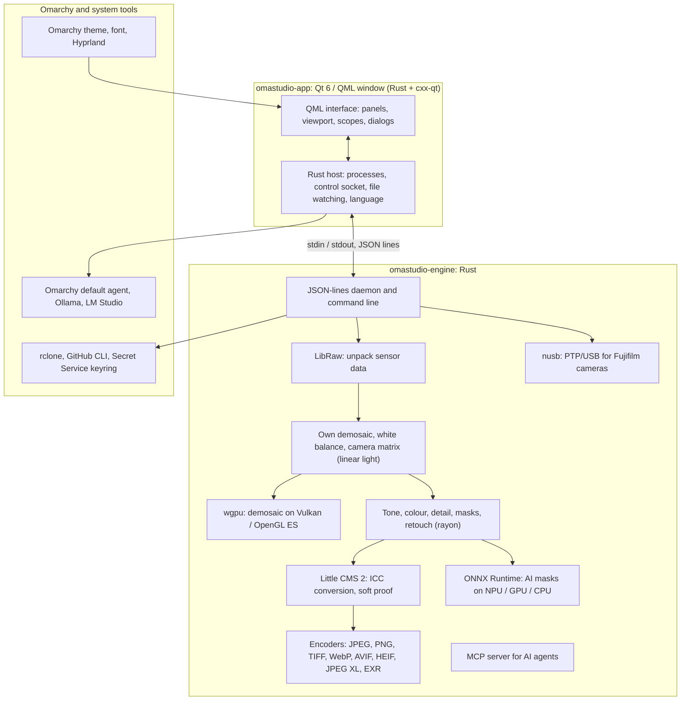

# Technologies in OmaStudio

**OmaStudio: The Complete Medium Format RAW Editor for Omarchy**

[All languages](../README.md) · [User guide](../guide/en.md) · [README](../../README.md)

This page describes the technologies OmaStudio is built on, what each one does in the application, why it was chosen, and its licence. OmaStudio itself is released under the MIT licence.

## Architecture

The window and the engine are separate processes. The window never decodes a photo itself: it sends commands to the engine and shows the images the engine writes. A crash or a hang in decoding cannot take the interface with it, and the same engine serves the command line, scripts and AI agents.

## Application

| Technology | Role in OmaStudio | Why | Licence |
| :--- | :--- | :--- | :--- |
| **Rust** (1.99, edition 2024) | Language of the engine and of the application host | Memory safety for code that parses untrusted files, native speed, and one language for both processes | MIT / Apache-2.0 |
| **Qt 6** (6.12, Qt Quick / QML) | The interface: panels, the viewport, scopes, dialogs | GPU-drawn interface with native Wayland support and fractional scaling, right-to-left layout and the Qt Linguist translation system | LGPL-3.0 |
| **cxx-qt** (0.10) | Connects Rust and Qt: the host types `Process`, `Host` and the control socket are Rust objects used from QML | Safe bindings in both directions without hand-written C++ | MIT / Apache-2.0 |
| **Qt Wayland** | Runs the window as a native Wayland client (app id `omastudio`) | Omarchy runs Hyprland on Wayland; Hyprland window rules can match the app id | LGPL-3.0 |
| **zenity** | File and folder dialogs | Small, available on every Omarchy install | LGPL-2.1+ |

The QML files are compiled into the binary as Qt resources, so an installed version never mixes with stray interface files.

## RAW engine

| Technology | Role in OmaStudio | Why | Licence |
| :--- | :--- | :--- | :--- |
| **LibRaw** (0.22) | Reads the RAW container and unpacks the sensor data, metadata and embedded previews | The widest camera support available as a library, including Fujifilm GFX, Hasselblad, Phase One and Leaf | LGPL-2.1 or CDDL-1.0 (linked dynamically) |
| **Own development pipeline** | Black level, white balance, X-Trans and Bayer demosaicing, camera colour matrix, lens corrections, all on linear light | Control over colour from the sensor onward and a 16-bit path to export; the demosaic chooses between four directional candidates per pixel | MIT (OmaStudio) |
| **rayon** (1.12) | Parallel processing on all CPU cores | Data parallelism without hand-written thread pools | MIT / Apache-2.0 |
| **wgpu** (30) | Demosaicing on the GPU through Vulkan (NVIDIA, AMD, Intel, Qualcomm Adreno) or OpenGL ES, in bands that fit the GPU's limits | One code path for every GPU vendor, written in WGSL; the result matches the CPU path to within one level in 65535 | MIT / Apache-2.0 |
| **Little CMS 2** (via the `lcms2` crate) | ICC profiles, conversion to the export colour space, rendering intents, soft proofing and the gamut warning | The reference open-source colour management engine | MIT |
| **image-rs**, **tiff**, **exr** | Reading and writing PNG, JPEG, TIFF, WebP, OpenEXR, Radiance HDR and PNM | Pure Rust codecs with bounded memory use | MIT / Apache-2.0; exr: BSD-3-Clause |
| **libjxl**, **libavif**, **libheif**, **libwebp** | JPEG XL, AVIF, HEIF and lossy WebP export | The reference encoders for these formats | BSD-3-Clause, BSD-2-Clause, LGPL-3.0, BSD-3-Clause |
| **ExifTool** (optional) | Carries camera EXIF metadata into exported files | Writes metadata to every format OmaStudio exports | Artistic / GPL (separate program) |
| **Lensfun data** (optional) | Lens profiles for medium format lenses | A large, maintained lens database, read at run time | Data CC BY-SA 3.0 |

The colour pipeline works in linear light: exposure is a photographic EV step and white balance acts on light as the camera's own multipliers do. Images are display-encoded once, before the creative tone and colour modules, and converted with Little CMS at export.

## AI

| Technology | Role in OmaStudio | Why | Licence |
| :--- | :--- | :--- | :--- |
| **ONNX Runtime** (through the `ort` crate, loaded at run time) | Runs segmentation models for **AI Subject** and **AI Sky** masks | One runtime for NPUs, GPUs and CPUs; optional, so OmaStudio starts without it | MIT |
| **Execution providers** | OpenVINO (Intel Core Ultra NPU), QNN (Snapdragon X NPU), Vitis AI (AMD Ryzen AI NPU), CUDA, MIGraphX, WebGPU, XNNPACK | Uses the fastest accelerator in the computer and falls back to the CPU | Each provider's own licence |
| **Omarchy default agent** (Claude Code or Codex) | The edit assistant and the AI chat use the agent picked with `omarchy-default-agent`, with its own sign-in | No extra account or key in OmaStudio | The agent's own terms |
| **Ollama**, **LM Studio** | Local vision models for the edit assistant | Photos stay on the computer | MIT; LM Studio: proprietary |
| **Cloud providers** (Anthropic, OpenAI, OpenRouter, Google Gemini) | Optional providers for the edit assistant, reached with `curl` | Keys are stored in the keyring and passed on stdin, never on a command line | The provider's own terms |
| **Model Context Protocol** | `omastudio mcp` lets AI agents inspect, render, export and control the window | An open protocol supported by many agents | Open specification |

The assistant's answer is constrained to a JSON schema and clamped to each control's range before it is applied, and each edit can be undone.

## Cameras

| Technology | Role in OmaStudio | Why | Licence |
| :--- | :--- | :--- | :--- |
| **nusb** (0.2) | USB access for the PTP layer | Pure Rust, no libusb or gphoto2 needed | MIT / Apache-2.0 |
| **PTP / Fujifilm protocol** | Custom settings C1–C7, recipes written to the camera, in-camera RAW conversion | Documented clean-room from observation; no vendor code | MIT (OmaStudio) |
| **udev rule** | Gives the logged-in user access to Fujifilm cameras in PTP mode | No root needed to use a camera | MIT (OmaStudio) |

## Cloud accounts

| Technology | Role in OmaStudio | Why | Licence |
| :--- | :--- | :--- | :--- |
| **rclone** | Google Drive, OneDrive, Dropbox, Box, pCloud and Yandex Disk: sign-in, browsing, download, upload | One tested client for many services, with OAuth in the browser | MIT |
| **GitHub CLI** (`gh`) | GitHub sign-in (device flow) and the private `OmaStudio` repository | GitHub's own client; keeps its token in the keyring | MIT |
| **libsecret** / Secret Service (`secret-tool`, `gnome-keyring`) | Holds the key of OmaStudio's encrypted rclone configuration and the AI provider keys | Secrets never stored in plain text | LGPL-2.1+ |

## Omarchy integration

- **Theme.** Every colour comes from the active Omarchy theme (`~/.local/state/omarchy/current/theme/colors.toml`) and changes live when the theme changes.
- **Font.** The interface uses Omarchy's font (`omarchy-font-set`, read through fontconfig) and scales text from the Omarchy shell's base size.
- **Hyprland.** Corners follow Hyprland's rounding; the window is a regular Wayland client with app id `omastudio`.
- **Default agent.** OmaStudio follows `~/.config/omarchy/defaults/agent` live.
- **App menu and bar.** The desktop entry uses a high-contrast monochrome icon like Omarchy's own apps; `Panel.qml` is an optional Quickshell widget for the Omarchy bar.
- **Language.** The interface follows the system language (`LANGUAGE`, `LC_ALL`, `LC_MESSAGES`, `LANG`, `locale.conf`).

## Languages

| Technology | Role in OmaStudio | Licence |
| :--- | :--- | :--- |
| **Qt Linguist** (`.ts` files, `lrelease`) | 30 interface languages, compiled into the binary; right-to-left layout for Arabic, Hebrew and Persian | LGPL-3.0 / GPL-3.0 (build tool) |
| **tools/i18n/check.py** | Fails the build in CI when a translation is missing, left in English, in the wrong script or has mismatched placeholders | MIT (OmaStudio) |

## Build, test and release

| Technology | Role in OmaStudio | Licence |
| :--- | :--- | :--- |
| **Cargo** with a pinned toolchain (`rust-toolchain.toml`) | Builds the engine and the application as one workspace; `Cargo.lock` is committed | MIT / Apache-2.0 |
| **clang**, **pkgconf** | C compiler and linker driver for the LibRaw shim, library discovery | Apache-2.0 with LLVM exception, ISC |
| **GitHub Actions** in an `archlinux` container | Build, tests, `clippy -D warnings` and the translation check on every change, with the same packages Omarchy uses | — |
| **CodeQL** | Static analysis of the Rust code and the workflows | — |
| **Release workflow** | Builds the archive on a tag, publishes it with SHA-256 checksums and build provenance attestations | — |
| **PKGBUILD** | Arch package with dependencies, optional dependencies and the udev rule | — |

## Security

- Every external program runs with a cleared environment, its own process group, a time limit and an output limit.
- Every file the engine reads has a size limit; catalog, settings and sidecars are written atomically with mode `0600`, and symbolic links are rejected where the engine owns the folder.
- The control socket lives in `$XDG_RUNTIME_DIR/omastudio/` and only answers processes of the same user (`SO_PEERCRED`).
- API keys and cloud tokens stay in the keyring and never appear on a command line.
- The interface shows all dynamic text as plain text.

Details are in [SECURITY.md](../../SECURITY.md).

## Trademarks

Fujifilm, GFX, X-Trans, Hasselblad, Phase One, Leica, Pentax, Mamiya and other camera names are trademarks of their owners and are used only to describe compatibility.
