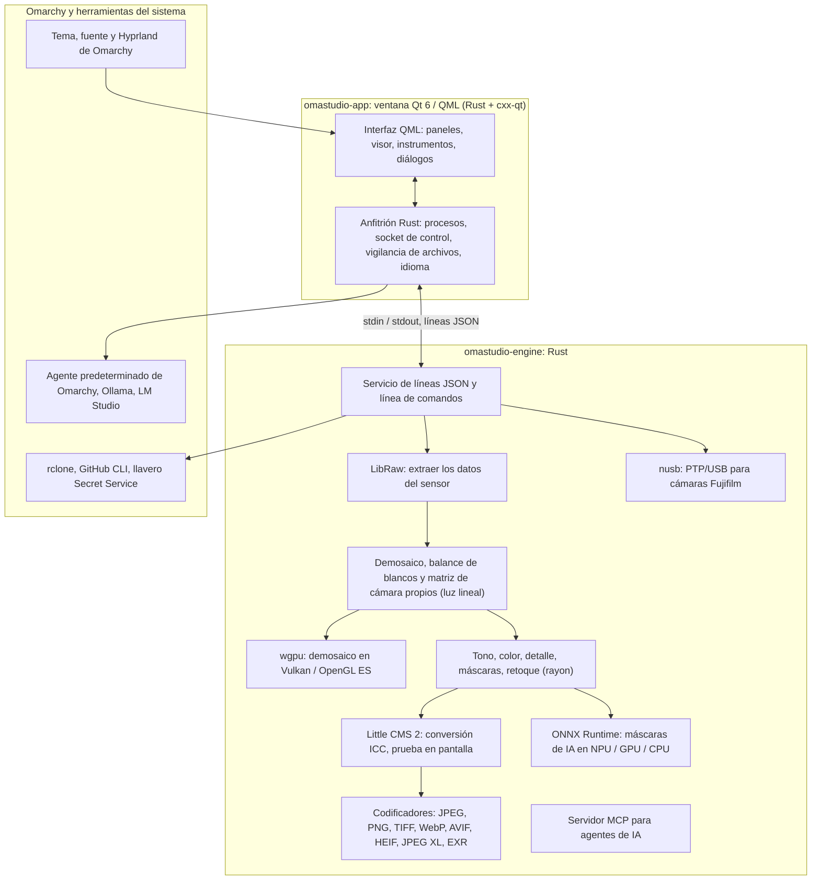

# Tecnologías de OmaStudio

**OmaStudio: The Complete Medium Format RAW Editor for Omarchy**

[Todos los idiomas](../README.md) · [Guía de uso](../guide/es.md) · [README](../../README.md)

Esta página describe las tecnologías en las que se basa OmaStudio: qué hace cada una en la aplicación, por qué se eligió y cuál es su licencia. OmaStudio se publica bajo la licencia MIT.

## Arquitectura

La ventana y el motor son procesos separados. La ventana nunca decodifica una foto por sí misma: envía órdenes al motor y muestra las imágenes que este escribe. Un fallo o un bloqueo al decodificar no puede arrastrar a la interfaz, y el mismo motor sirve a la línea de comandos, a los scripts y a los agentes de IA.

## Aplicación

| Tecnología | Función en OmaStudio | Por qué | Licencia |
| :--- | :--- | :--- | :--- |
| **Rust** (1.99, edición 2024) | Lenguaje del motor y del anfitrión de la aplicación | Seguridad de memoria para código que lee archivos no fiables, velocidad nativa y un solo lenguaje para ambos procesos | MIT / Apache-2.0 |
| **Qt 6** (6.12, Qt Quick / QML) | La interfaz: paneles, visor, instrumentos, diálogos | Interfaz dibujada por la GPU con soporte nativo de Wayland y escalado fraccionario, diseño de derecha a izquierda y el sistema de traducción Qt Linguist | LGPL-3.0 |
| **cxx-qt** (0.10) | Une Rust y Qt: los tipos `Process`, `Host` y el socket de control son objetos Rust usados desde QML | Enlaces seguros en ambos sentidos sin C++ escrito a mano | MIT / Apache-2.0 |
| **Qt Wayland** | Ejecuta la ventana como cliente Wayland nativo (identificador de aplicación `omastudio`) | Omarchy usa Hyprland sobre Wayland; las reglas de ventana de Hyprland pueden coincidir con el identificador | LGPL-3.0 |
| **zenity** | Diálogos de archivos y carpetas | Pequeño y presente en toda instalación de Omarchy | LGPL-2.1+ |

Los archivos QML se compilan dentro del binario como recursos de Qt, así que una versión instalada nunca se mezcla con archivos de interfaz sueltos.

## Motor RAW

| Tecnología | Función en OmaStudio | Por qué | Licencia |
| :--- | :--- | :--- | :--- |
| **LibRaw** (0.22) | Lee el contenedor RAW y extrae los datos del sensor, los metadatos y las vistas previas incrustadas | El soporte de cámaras más amplio disponible como biblioteca, incluidas Fujifilm GFX, Hasselblad, Phase One y Leaf | LGPL-2.1 o CDDL-1.0 (enlace dinámico) |
| **Proceso de revelado propio** | Nivel de negro, balance de blancos, demosaico X-Trans y Bayer, matriz de color de la cámara, correcciones de objetivo, todo sobre luz lineal | Control del color desde el sensor y una ruta de 16 bits hasta la exportación; el demosaico elige por píxel entre cuatro candidatos direccionales | MIT (OmaStudio) |
| **rayon** (1.12) | Procesado en paralelo en todos los núcleos de la CPU | Paralelismo de datos sin grupos de hilos escritos a mano | MIT / Apache-2.0 |
| **wgpu** (30) | Demosaico en la GPU mediante Vulkan (NVIDIA, AMD, Intel, Qualcomm Adreno) u OpenGL ES, en franjas que caben en los límites de la GPU | Una sola ruta de código para todos los fabricantes de GPU, escrita en WGSL; el resultado coincide con la ruta de CPU con un margen de un nivel entre 65535 | MIT / Apache-2.0 |
| **Little CMS 2** (mediante el crate `lcms2`) | Perfiles ICC, conversión al espacio de color de exportación, propósitos de interpretación, prueba en pantalla y aviso de gama | El motor de gestión del color de código abierto de referencia | MIT |
| **image-rs**, **tiff**, **exr** | Lectura y escritura de PNG, JPEG, TIFF, WebP, OpenEXR, Radiance HDR y PNM | Códecs en Rust puro con uso de memoria acotado | MIT / Apache-2.0; exr: BSD-3-Clause |
| **libjxl**, **libavif**, **libheif**, **libwebp** | Exportación a JPEG XL, AVIF, HEIF y WebP con pérdida | Los codificadores de referencia de estos formatos | BSD-3-Clause, BSD-2-Clause, LGPL-3.0, BSD-3-Clause |
| **ExifTool** (opcional) | Lleva los metadatos EXIF de la cámara a los archivos exportados | Escribe metadatos en todos los formatos que exporta OmaStudio | Artistic / GPL (programa aparte) |
| **Datos de Lensfun** (opcional) | Perfiles de objetivos de formato medio | Una base de datos de objetivos grande y mantenida, leída en tiempo de ejecución | Datos CC BY-SA 3.0 |

El proceso de color trabaja en luz lineal: la exposición es un paso fotográfico de EV y el balance de blancos actúa sobre la luz como los multiplicadores de la propia cámara. Las imágenes se codifican para pantalla una sola vez, antes de los módulos creativos de tono y color, y se convierten con Little CMS al exportar.

## IA

| Tecnología | Función en OmaStudio | Por qué | Licencia |
| :--- | :--- | :--- | :--- |
| **ONNX Runtime** (mediante el crate `ort`, cargado en tiempo de ejecución) | Ejecuta los modelos de segmentación de las máscaras **Sujeto (IA)** y **Cielo (IA)** | Un solo entorno para NPU, GPU y CPU; es opcional y OmaStudio arranca sin él | MIT |
| **Proveedores de ejecución** | OpenVINO (NPU Intel Core Ultra), QNN (NPU Snapdragon X), Vitis AI (NPU AMD Ryzen AI), CUDA, MIGraphX, WebGPU, XNNPACK | Usa el acelerador más rápido del ordenador y recurre a la CPU | Licencia de cada proveedor |
| **Agente predeterminado de Omarchy** (Claude Code o Codex) | El asistente de edición y el chat con IA usan el agente elegido con `omarchy-default-agent`, con su propio inicio de sesión | Sin cuentas ni claves adicionales en OmaStudio | Condiciones del agente |
| **Ollama**, **LM Studio** | Modelos de visión locales para el asistente de edición | Las fotos se quedan en el ordenador | MIT; LM Studio: propietario |
| **Proveedores en la nube** (Anthropic, OpenAI, OpenRouter, Google Gemini) | Proveedores opcionales para el asistente de edición, accesibles con `curl` | Las claves están en el llavero y se pasan por stdin, nunca en una línea de comandos | Condiciones del proveedor |
| **Model Context Protocol** | `omastudio mcp` permite a los agentes de IA inspeccionar, procesar, exportar y controlar la ventana | Un protocolo abierto compatible con muchos agentes | Especificación abierta |

La respuesta del asistente está limitada por un esquema JSON y se ajusta al intervalo de cada control antes de aplicarse; cada edición puede deshacerse.

## Cámaras

| Tecnología | Función en OmaStudio | Por qué | Licencia |
| :--- | :--- | :--- | :--- |
| **nusb** (0.2) | Acceso USB para la capa PTP | Rust puro, sin libusb ni gphoto2 | MIT / Apache-2.0 |
| **PTP / protocolo de Fujifilm** | Ajustes personalizados C1–C7, recetas escritas en la cámara, conversión RAW en la cámara | Documentado en sala limpia a partir de la observación; sin código del fabricante | MIT (OmaStudio) |
| **Regla udev** | Da al usuario que ha iniciado sesión acceso a las cámaras Fujifilm en modo PTP | No hace falta root para usar una cámara | MIT (OmaStudio) |

## Cuentas en la nube

| Tecnología | Función en OmaStudio | Por qué | Licencia |
| :--- | :--- | :--- | :--- |
| **rclone** | Google Drive, OneDrive, Dropbox, Box, pCloud y Yandex Disk: inicio de sesión, exploración, descarga y subida | Un cliente probado para muchos servicios, con OAuth en el navegador | MIT |
| **GitHub CLI** (`gh`) | Inicio de sesión en GitHub (device flow) y el repositorio privado `OmaStudio` | El cliente propio de GitHub; guarda su token en el llavero | MIT |
| **libsecret** / Secret Service (`secret-tool`, `gnome-keyring`) | Guarda la clave de la configuración cifrada de rclone de OmaStudio y las claves de los proveedores de IA | Los secretos nunca se guardan en texto plano | LGPL-2.1+ |

## Integración con Omarchy

- **Tema.** Cada color procede del tema activo de Omarchy (`~/.local/state/omarchy/current/theme/colors.toml`) y cambia en directo cuando cambia el tema.
- **Fuente.** La interfaz usa la fuente de Omarchy (`omarchy-font-set`, leída mediante fontconfig) y escala el texto según el tamaño base del shell de Omarchy.
- **Hyprland.** Las esquinas siguen el redondeo de Hyprland; la ventana es un cliente Wayland normal con el identificador `omastudio`.
- **Agente predeterminado.** OmaStudio sigue `~/.config/omarchy/defaults/agent` en directo.
- **Menú de aplicaciones y barra.** La entrada de escritorio usa un icono monocromo de alto contraste como las aplicaciones de Omarchy; `Panel.qml` es un widget opcional de Quickshell para la barra de Omarchy.
- **Idioma.** La interfaz sigue el idioma del sistema (`LANGUAGE`, `LC_ALL`, `LC_MESSAGES`, `LANG`, `locale.conf`).

## Idiomas

| Tecnología | Función en OmaStudio | Licencia |
| :--- | :--- | :--- |
| **Qt Linguist** (archivos `.ts`, `lrelease`) | 30 idiomas de interfaz compilados en el binario; diseño de derecha a izquierda para árabe, hebreo y persa | LGPL-3.0 / GPL-3.0 (herramienta de compilación) |
| **tools/i18n/check.py** | Hace fallar la compilación en CI cuando falta una traducción, se ha quedado en inglés, usa una escritura equivocada o sus marcadores no coinciden | MIT (OmaStudio) |

## Compilación, pruebas y publicación

| Tecnología | Función en OmaStudio | Licencia |
| :--- | :--- | :--- |
| **Cargo** con una cadena de herramientas fijada (`rust-toolchain.toml`) | Compila el motor y la aplicación como un solo espacio de trabajo; `Cargo.lock` está en el repositorio | MIT / Apache-2.0 |
| **clang**, **pkgconf** | Compilador de C y controlador del enlazador para el puente con LibRaw, búsqueda de bibliotecas | Apache-2.0 con excepción LLVM, ISC |
| **GitHub Actions** en un contenedor `archlinux` | Compilación, pruebas, `clippy -D warnings` y comprobación de traducciones en cada cambio, con los mismos paquetes que usa Omarchy | — |
| **CodeQL** | Análisis estático del código Rust y de los flujos de trabajo | — |
| **Flujo de publicación** | Construye el archivo al crear una etiqueta y lo publica con sumas de comprobación SHA-256 y certificaciones de procedencia | — |
| **PKGBUILD** | Paquete de Arch con dependencias, dependencias opcionales y la regla udev | — |

## Seguridad

- Cada programa externo se ejecuta con un entorno vacío, en su propio grupo de procesos, con límite de tiempo y de salida.
- Cada archivo que lee el motor tiene un límite de tamaño; el catálogo, los ajustes y los archivos auxiliares se escriben de forma atómica con modo `0600`, y se rechazan los enlaces simbólicos donde la carpeta pertenece al motor.
- El socket de control está en `$XDG_RUNTIME_DIR/omastudio/` y solo responde a procesos del mismo usuario (`SO_PEERCRED`).
- Las claves de API y los tokens de la nube se quedan en el llavero y nunca aparecen en una línea de comandos.
- La interfaz muestra todo el texto dinámico como texto sin formato.

Los detalles están en [SECURITY.md](../../SECURITY.md).

## Marcas comerciales

Fujifilm, GFX, X-Trans, Hasselblad, Phase One, Leica, Pentax, Mamiya y otros nombres de cámaras son marcas de sus propietarios y solo se usan para indicar compatibilidad.
