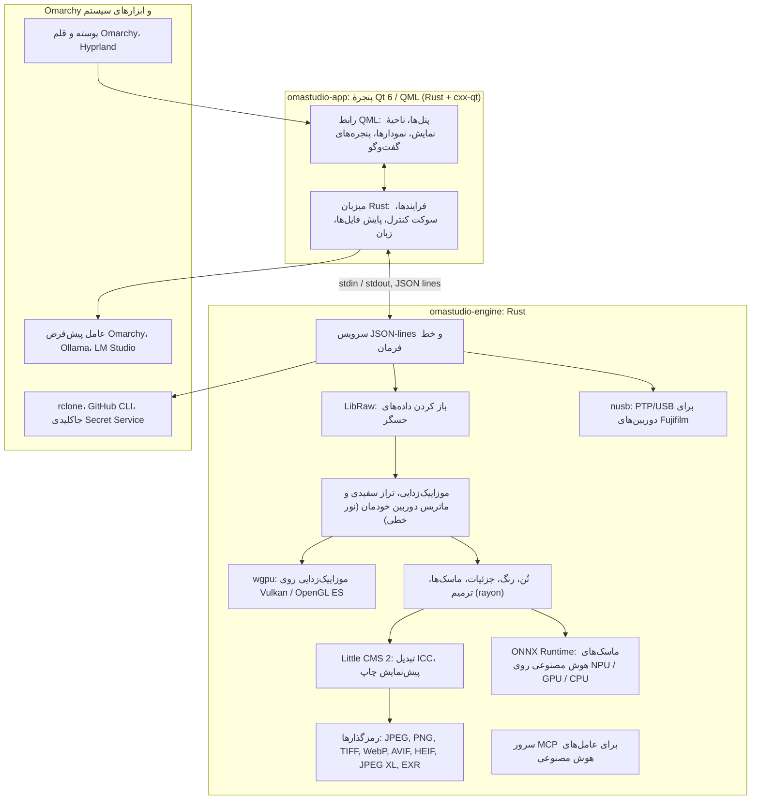

# فناوری‌های OmaStudio

**OmaStudio: The Complete Medium Format RAW Editor for Omarchy**

[همهٔ زبان‌ها](../README.md) · [راهنمای کاربری](../guide/fa.md) · [README](../../README.md)

این صفحه فناوری‌هایی را که OmaStudio بر پایهٔ آن‌ها ساخته شده، کاری که هر کدام در برنامه انجام می‌دهد، دلیل انتخابشان و مجوزشان را شرح می‌دهد. خود OmaStudio با مجوز MIT منتشر می‌شود.

## معماری

پنجره و موتور دو فرایند جدا هستند. پنجره هرگز خودش عکسی را رمزگشایی نمی‌کند: دستورها را به موتور می‌فرستد و تصویرهایی را که موتور می‌نویسد نشان می‌دهد. از این رو خرابی یا گیر کردن در رمزگشایی نمی‌تواند رابط را هم از کار بیندازد، و همان موتور به خط فرمان، اسکریپت‌ها و عامل‌های هوش مصنوعی خدمت می‌کند.

## برنامه

| فناوری | نقش در OmaStudio | چرا | مجوز |
| :--- | :--- | :--- | :--- |
| **Rust** (1.99، ویرایش 2024) | زبان موتور و میزبان برنامه | ایمنی حافظه برای کدی که فایل‌های نامطمئن را تجزیه می‌کند، سرعت بومی و یک زبان برای هر دو فرایند | MIT / Apache-2.0 |
| **Qt 6** (6.12، Qt Quick / QML) | رابط: پنل‌ها، ناحیهٔ نمایش، نمودارها، پنجره‌های گفت‌وگو | رابطی که با GPU کشیده می‌شود، با پشتیبانی بومی از Wayland و مقیاس کسری، چیدمان راست‌به‌چپ و سامانهٔ ترجمهٔ Qt Linguist | LGPL-3.0 |
| **cxx-qt** (0.10) | Rust و Qt را به هم وصل می‌کند: نوع‌های میزبان `Process`، `Host` و سوکت کنترل اشیای Rust هستند که از QML استفاده می‌شوند | پیوندهای امن در هر دو جهت بدون نوشتن C++ با دست | MIT / Apache-2.0 |
| **Qt Wayland** | پنجره را به‌صورت کلاینت بومی Wayland اجرا می‌کند (app id `omastudio`) | Omarchy، Hyprland را روی Wayland اجرا می‌کند؛ قاعده‌های پنجرهٔ Hyprland می‌توانند با app id تطبیق داده شوند | LGPL-3.0 |
| **zenity** | پنجره‌های انتخاب فایل و پوشه | کوچک است و در هر نصب Omarchy وجود دارد | LGPL-2.1+ |

فایل‌های QML به‌صورت منابع Qt درون فایل اجرایی کامپایل می‌شوند، بنابراین نسخهٔ نصب‌شده هرگز با فایل‌های رابط سرگردان قاطی نمی‌شود.

## موتور RAW

| فناوری | نقش در OmaStudio | چرا | مجوز |
| :--- | :--- | :--- | :--- |
| **LibRaw** (0.22) | ظرف RAW را می‌خواند و داده‌های حسگر، فراداده و پیش‌نمایش‌های جاسازی‌شده را باز می‌کند | گسترده‌ترین پشتیبانی دوربین که به‌صورت کتابخانه در دسترس است، از جمله Fujifilm GFX، Hasselblad، Phase One و Leaf | LGPL-2.1 یا CDDL-1.0 (پیوند پویا) |
| **مسیر ظهور خودمان** | سطح سیاهی، تراز سفیدی، موزاییک‌زدایی X-Trans و Bayer، ماتریس رنگ دوربین، اصلاحات لنز، همه روی نور خطی | کنترل رنگ از حسگر به بعد و مسیر 16 بیتی تا خروجی؛ موزاییک‌زدایی برای هر پیکسل از میان چهار نامزد جهت‌دار انتخاب می‌کند | MIT (OmaStudio) |
| **rayon** (1.12) | پردازش موازی روی همهٔ هسته‌های CPU | موازی‌سازی داده بدون مخزن رشته‌های دست‌نویس | MIT / Apache-2.0 |
| **wgpu** (30) | موزاییک‌زدایی روی GPU از راه Vulkan (NVIDIA، AMD، Intel، Qualcomm Adreno) یا OpenGL ES، در نوارهایی که در محدودیت‌های GPU جا می‌شوند | یک مسیر کد برای همهٔ سازندگان GPU، نوشته‌شده با WGSL؛ نتیجه با مسیر CPU حداکثر یک سطح از 65535 تفاوت دارد | MIT / Apache-2.0 |
| **Little CMS 2** (از راه crate `lcms2`) | نمایه‌های ICC، تبدیل به فضای رنگ خروجی، هدف‌های رندر، پیش‌نمایش چاپ و هشدار گستره رنگ | موتور مرجع متن‌باز مدیریت رنگ | MIT |
| **image-rs**، **tiff**، **exr** | خواندن و نوشتن PNG، JPEG، TIFF، WebP، OpenEXR، Radiance HDR و PNM | کدک‌های Rust خالص با مصرف حافظهٔ محدود | MIT / Apache-2.0؛ exr: BSD-3-Clause |
| **libjxl**، **libavif**، **libheif**، **libwebp** | خروجی JPEG XL، AVIF، HEIF و WebP با اتلاف | رمزگذارهای مرجع این قالب‌ها | BSD-3-Clause، BSD-2-Clause، LGPL-3.0، BSD-3-Clause |
| **ExifTool** (اختیاری) | فرادادهٔ EXIF دوربین را به فایل‌های خروجی می‌برد | فراداده را در هر قالبی که OmaStudio خروجی می‌گیرد می‌نویسد | Artistic / GPL (برنامهٔ جداگانه) |
| **داده‌های Lensfun** (اختیاری) | نمایه‌های لنز برای لنزهای مدیوم فرمت | پایگاه دادهٔ بزرگ و نگه‌داری‌شدهٔ لنز، در زمان اجرا خوانده می‌شود | داده‌ها CC BY-SA 3.0 |

مسیر رنگ روی نور خطی کار می‌کند: نوردهی یک گام EV عکاسی است و تراز سفیدی همان‌گونه روی نور اثر می‌گذارد که ضریب‌های خود دوربین. تصویرها یک بار، پیش از ماژول‌های خلاقانهٔ تُن و رنگ، برای نمایشگر رمزگذاری می‌شوند و هنگام خروجی با Little CMS تبدیل می‌شوند.

## هوش مصنوعی

| فناوری | نقش در OmaStudio | چرا | مجوز |
| :--- | :--- | :--- | :--- |
| **ONNX Runtime** (از راه crate `ort`، در زمان اجرا بارگذاری می‌شود) | مدل‌های بخش‌بندی را برای ماسک‌های **سوژه (هوش مصنوعی)** و **آسمان (هوش مصنوعی)** اجرا می‌کند | یک محیط اجرا برای NPU، GPU و CPU؛ اختیاری است، پس OmaStudio بدون آن هم اجرا می‌شود | MIT |
| **ارائه‌دهندگان اجرا** | OpenVINO (NPU در Intel Core Ultra)، QNN (NPU در Snapdragon X)، Vitis AI (NPU در AMD Ryzen AI)، CUDA، MIGraphX، WebGPU، XNNPACK | از سریع‌ترین شتاب‌دهندهٔ رایانه استفاده می‌کند و به CPU بازمی‌گردد | مجوز هر ارائه‌دهنده |
| **عامل پیش‌فرض Omarchy** (Claude Code یا Codex) | دستیار ویرایش و گفت‌وگو با هوش مصنوعی از عاملی استفاده می‌کنند که با `omarchy-default-agent` انتخاب شده، با ورود خودش | بدون حساب یا کلید اضافه در OmaStudio | شرایط آن عامل |
| **Ollama**، **LM Studio** | مدل‌های بینایی محلی برای دستیار ویرایش | عکس‌ها روی رایانه می‌مانند | MIT؛ LM Studio: انحصاری |
| **ارائه‌دهندگان ابری** (Anthropic، OpenAI، OpenRouter، Google Gemini) | ارائه‌دهندگان اختیاری برای دستیار ویرایش، که با `curl` به آن‌ها دسترسی می‌شود | کلیدها در جاکلیدی نگه داشته و از راه stdin فرستاده می‌شوند، هرگز در خط فرمان | شرایط ارائه‌دهنده |
| **Model Context Protocol** | `omastudio mcp` به عامل‌های هوش مصنوعی امکان بررسی، رندر، خروجی و کنترل پنجره را می‌دهد | پروتکلی باز که عامل‌های بسیاری از آن پشتیبانی می‌کنند | مشخصات باز |

پاسخ دستیار به یک طرح‌وارهٔ JSON محدود می‌شود و پیش از اعمال در بازهٔ هر کنترل نگه داشته می‌شود، و هر ویرایش واگردپذیر است.

## دوربین‌ها

| فناوری | نقش در OmaStudio | چرا | مجوز |
| :--- | :--- | :--- | :--- |
| **nusb** (0.2) | دسترسی USB برای لایهٔ PTP | Rust خالص، بدون نیاز به libusb یا gphoto2 | MIT / Apache-2.0 |
| **پروتکل PTP / Fujifilm** | تنظیمات سفارشی C1–C7، دستورهای نوشته‌شده در دوربین، تبدیل RAW درون دوربین | به روش اتاق تمیز و از راه مشاهده مستند شده؛ بدون کد سازنده | MIT (OmaStudio) |
| **قاعدهٔ udev** | به کاربر واردشده دسترسی به دوربین‌های Fujifilm در حالت PTP می‌دهد | برای استفاده از دوربین نیازی به root نیست | MIT (OmaStudio) |

## حساب‌های ابری

| فناوری | نقش در OmaStudio | چرا | مجوز |
| :--- | :--- | :--- | :--- |
| **rclone** | Google Drive، OneDrive، Dropbox، Box، pCloud و Yandex Disk: ورود، مرور، بارگیری، بارگذاری | یک کلاینت آزموده برای سرویس‌های بسیار، با OAuth در مرورگر | MIT |
| **GitHub CLI** (`gh`) | ورود به GitHub (device flow) و مخزن خصوصی `OmaStudio` | کلاینت خود GitHub؛ توکنش را در جاکلیدی نگه می‌دارد | MIT |
| **libsecret** / Secret Service (`secret-tool`، `gnome-keyring`) | کلید پیکربندی رمزگذاری‌شدهٔ rclone در OmaStudio و کلیدهای ارائه‌دهندگان هوش مصنوعی را نگه می‌دارد | رازها هرگز به‌صورت متن ساده ذخیره نمی‌شوند | LGPL-2.1+ |

## یکپارچگی با Omarchy

- **پوسته.** هر رنگ از پوستهٔ فعال Omarchy (`~/.local/state/omarchy/current/theme/colors.toml`) می‌آید و با تغییر پوسته به‌صورت زنده تغییر می‌کند.
- **قلم.** رابط از قلم Omarchy (`omarchy-font-set`، خوانده‌شده از راه fontconfig) استفاده می‌کند و اندازهٔ متن را از اندازهٔ پایهٔ پوستهٔ Omarchy می‌گیرد.
- **Hyprland.** گوشه‌ها از گردی Hyprland پیروی می‌کنند؛ پنجره یک کلاینت عادی Wayland با app id `omastudio` است.
- **عامل پیش‌فرض.** OmaStudio به‌صورت زنده از `~/.config/omarchy/defaults/agent` پیروی می‌کند.
- **منوی برنامه‌ها و نوار.** مدخل میزکار مانند برنامه‌های خود Omarchy از یک آیکون تک‌رنگ با کنتراست بالا استفاده می‌کند؛ `Panel.qml` ابزارک اختیاری Quickshell برای نوار Omarchy است.
- **زبان.** رابط از زبان سیستم پیروی می‌کند (`LANGUAGE`، `LC_ALL`، `LC_MESSAGES`، `LANG`، `locale.conf`).

## زبان‌ها

| فناوری | نقش در OmaStudio | مجوز |
| :--- | :--- | :--- |
| **Qt Linguist** (فایل‌های `.ts`، `lrelease`) | 30 زبان رابط، کامپایل‌شده درون فایل اجرایی؛ چیدمان راست‌به‌چپ برای عربی، عبری و فارسی | LGPL-3.0 / GPL-3.0 (ابزار ساخت) |
| **tools/i18n/check.py** | وقتی ترجمه‌ای جا افتاده، انگلیسی مانده، با خط نادرست نوشته شده یا جای‌نگهدارهایش ناهماهنگ است، ساخت را در CI ناموفق می‌کند | MIT (OmaStudio) |

## ساخت، آزمون و انتشار

| فناوری | نقش در OmaStudio | مجوز |
| :--- | :--- | :--- |
| **Cargo** با زنجیرهٔ ابزار تثبیت‌شده (`rust-toolchain.toml`) | موتور و برنامه را به‌صورت یک فضای کاری می‌سازد؛ `Cargo.lock` در مخزن ثبت شده است | MIT / Apache-2.0 |
| **clang**، **pkgconf** | کامپایلر C و راه‌انداز پیونددهنده برای لایهٔ میانی LibRaw، یافتن کتابخانه‌ها | Apache-2.0 with LLVM exception، ISC |
| **GitHub Actions** در کانتینر `archlinux` | ساخت، آزمون‌ها، `clippy -D warnings` و بررسی ترجمه در هر تغییر، با همان بسته‌هایی که Omarchy به کار می‌برد | — |
| **CodeQL** | تحلیل ایستای کد Rust و گردش‌کارها | — |
| **گردش‌کار انتشار** | با هر برچسب بایگانی را می‌سازد و آن را با چک‌سام‌های SHA-256 و گواهی‌های منشأ ساخت منتشر می‌کند | — |
| **PKGBUILD** | بستهٔ Arch با وابستگی‌ها، وابستگی‌های اختیاری و قاعدهٔ udev | — |

## امنیت

- هر برنامهٔ بیرونی با محیطی پاک‌شده، در گروه فرایند خودش، با محدودیت زمان و محدودیت خروجی اجرا می‌شود.
- هر فایلی که موتور می‌خواند محدودیت اندازه دارد؛ کاتالوگ، تنظیمات و فایل‌های جانبی به‌صورت اتمی با حالت `0600` نوشته می‌شوند، و پیوندهای نمادین در پوشه‌هایی که از آنِ موتور است رد می‌شوند.
- سوکت کنترل در `$XDG_RUNTIME_DIR/omastudio/` قرار دارد و فقط به فرایندهای همان کاربر پاسخ می‌دهد (`SO_PEERCRED`).
- کلیدهای API و توکن‌های ابری در جاکلیدی می‌مانند و هرگز در خط فرمان ظاهر نمی‌شوند.
- رابط همهٔ متن‌های پویا را به‌صورت متن ساده نمایش می‌دهد.

جزئیات در [SECURITY.md](../../SECURITY.md) آمده است.

## نشان‌های تجاری

Fujifilm، GFX، X-Trans، Hasselblad، Phase One، Leica، Pentax، Mamiya و نام‌های دیگر دوربین‌ها نشان‌های تجاری دارندگانشان هستند و فقط برای توصیف سازگاری به کار رفته‌اند.
