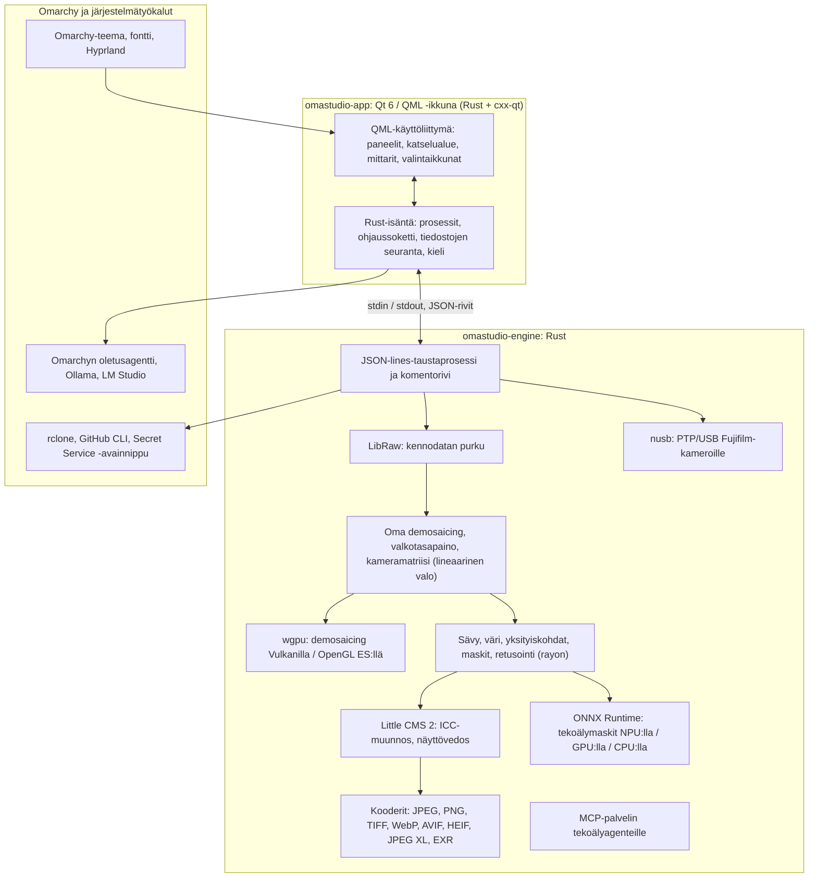

# OmaStudion teknologiat

**OmaStudio: The Complete Medium Format RAW Editor for Omarchy**

[Kaikki kielet](../README.md) · [Käyttöopas](../guide/fi.md) · [README](../../README.md)

Tällä sivulla kuvataan teknologiat, joiden varaan OmaStudio on rakennettu: mitä kukin tekee sovelluksessa, miksi se valittiin ja mikä sen lisenssi on. OmaStudio itse julkaistaan MIT-lisenssillä.

## Arkkitehtuuri

Ikkuna ja moottori ovat erillisiä prosesseja. Ikkuna ei koskaan pura kuvaa itse: se lähettää komentoja moottorille ja näyttää moottorin kirjoittamat kuvat. Purkamisen kaatuminen tai jumittuminen ei voi viedä käyttöliittymää mukanaan, ja sama moottori palvelee komentoriviä, skriptejä ja tekoälyagentteja.

## Sovellus

| Teknologia | Rooli OmaStudiossa | Miksi | Lisenssi |
| :--- | :--- | :--- | :--- |
| **Rust** (1.99, edition 2024) | Moottorin ja sovellusisännän kieli | Muistiturvallisuus koodille, joka jäsentää epäluotettavia tiedostoja, natiivi nopeus ja yksi kieli molemmille prosesseille | MIT / Apache-2.0 |
| **Qt 6** (6.12, Qt Quick / QML) | Käyttöliittymä: paneelit, katselualue, mittarit, valintaikkunat | GPU:lla piirretty käyttöliittymä natiivilla Wayland-tuella ja murtolukuskaalauksella, oikealta vasemmalle -asettelu ja Qt Linguist -käännösjärjestelmä | LGPL-3.0 |
| **cxx-qt** (0.10) | Yhdistää Rustin ja Qt:n: isäntätyypit `Process`, `Host` ja ohjaussoketti ovat Rust-olioita, joita käytetään QML:stä | Turvalliset sidokset molempiin suuntiin ilman käsin kirjoitettua C++:aa | MIT / Apache-2.0 |
| **Qt Wayland** | Ajaa ikkunan natiivina Wayland-asiakkaana (app id `omastudio`) | Omarchy ajaa Hyprlandia Waylandilla; Hyprlandin ikkunasäännöt voivat kohdistua app id:hen | LGPL-3.0 |
| **zenity** | Tiedosto- ja kansioikkunat | Pieni ja saatavilla jokaisessa Omarchy-asennuksessa | LGPL-2.1+ |

QML-tiedostot käännetään binääriin Qt-resursseina, joten asennettu versio ei koskaan sekoitu irrallisiin käyttöliittymätiedostoihin.

## RAW-moottori

| Teknologia | Rooli OmaStudiossa | Miksi | Lisenssi |
| :--- | :--- | :--- | :--- |
| **LibRaw** (0.22) | Lukee RAW-säiliön ja purkaa kennodatan, metatiedot ja upotetut esikatselut | Laajin kameratuki, joka on saatavilla kirjastona, mukaan lukien Fujifilm GFX, Hasselblad, Phase One ja Leaf | LGPL-2.1 tai CDDL-1.0 (dynaamisesti linkitetty) |
| **Oma kehitysketju** | Mustan taso, valkotasapaino, X-Trans- ja Bayer-demosaicing, kameran värimatriisi, objektiivikorjaukset, kaikki lineaarisessa valossa | Värien hallinta kennolta alkaen ja 16-bittinen polku vientiin; demosaicing valitsee neljästä suuntaehdokkaasta pikseleittäin | MIT (OmaStudio) |
| **rayon** (1.12) | Rinnakkainen käsittely kaikilla CPU-ytimillä | Datarinnakkaisuus ilman käsin kirjoitettuja säiepooleja | MIT / Apache-2.0 |
| **wgpu** (30) | Demosaicing GPU:lla Vulkanin (NVIDIA, AMD, Intel, Qualcomm Adreno) tai OpenGL ES:n kautta kaistoina, jotka mahtuvat GPU:n rajoihin | Yksi koodipolku kaikille GPU-valmistajille, kirjoitettu WGSL:llä; tulos vastaa CPU-polkua yhden tason tarkkuudella 65535:stä | MIT / Apache-2.0 |
| **Little CMS 2** (`lcms2`-cratella) | ICC-profiilit, muunnos viennin väriavaruuteen, toistotavat, näyttövedos ja väriavaruusvaroitus | Avoimen lähdekoodin värinhallinnan referenssimoottori | MIT |
| **image-rs**, **tiff**, **exr** | PNG-, JPEG-, TIFF-, WebP-, OpenEXR-, Radiance HDR- ja PNM-tiedostojen luku ja kirjoitus | Puhtaat Rust-koodekit rajatulla muistinkäytöllä | MIT / Apache-2.0; exr: BSD-3-Clause |
| **libjxl**, **libavif**, **libheif**, **libwebp** | JPEG XL-, AVIF-, HEIF- ja häviöllinen WebP-vienti | Näiden muotojen referenssikooderit | BSD-3-Clause, BSD-2-Clause, LGPL-3.0, BSD-3-Clause |
| **ExifTool** (valinnainen) | Siirtää kameran EXIF-metatiedot viedyille tiedostoille | Kirjoittaa metatiedot kaikkiin OmaStudion vientimuotoihin | Artistic / GPL (erillinen ohjelma) |
| **Lensfun-data** (valinnainen) | Objektiiviprofiilit keskikoon objektiiveille | Laaja, ylläpidetty objektiivitietokanta, luetaan ajon aikana | Data CC BY-SA 3.0 |

Väriketju toimii lineaarisessa valossa: valotus on valokuvauksellinen EV-askel, ja valkotasapaino vaikuttaa valoon kuten kameran omat kertoimet. Kuvat koodataan näytölle kerran ennen luovia sävy- ja värimoduuleja, ja ne muunnetaan Little CMS:llä viennissä.

## Tekoäly

| Teknologia | Rooli OmaStudiossa | Miksi | Lisenssi |
| :--- | :--- | :--- | :--- |
| **ONNX Runtime** (`ort`-cratella, ladataan ajon aikana) | Ajaa segmentointimalleja maskeille **Kohde (tekoäly)** ja **Taivas (tekoäly)** | Yksi ajoympäristö NPU:ille, GPU:ille ja CPU:ille; valinnainen, joten OmaStudio käynnistyy ilman sitä | MIT |
| **Execution providerit** | OpenVINO (Intel Core Ultra NPU), QNN (Snapdragon X NPU), Vitis AI (AMD Ryzen AI NPU), CUDA, MIGraphX, WebGPU, XNNPACK | Käyttää tietokoneen nopeinta kiihdytintä ja palaa CPU:hun | Kunkin providerin oma lisenssi |
| **Omarchyn oletusagentti** (Claude Code tai Codex) | **Muokkausavustaja** ja **Tekoälykeskustelu** käyttävät komennolla `omarchy-default-agent` valittua agenttia sen omalla kirjautumisella | Ei ylimääräistä tiliä tai avainta OmaStudiossa | Agentin omat ehdot |
| **Ollama**, **LM Studio** | Paikalliset näkömallit muokkausavustajalle | Kuvat pysyvät tietokoneella | MIT; LM Studio: suljettu |
| **Pilvipalvelut** (Anthropic, OpenAI, OpenRouter, Google Gemini) | Valinnaiset palveluntarjoajat muokkausavustajalle, `curl`-yhteydellä | Avaimet tallennetaan avainnippuun ja välitetään stdinin kautta, ei koskaan komentorivillä | Palveluntarjoajan omat ehdot |
| **Model Context Protocol** | `omastudio mcp` antaa tekoälyagenttien tutkia, renderöidä, viedä ja ohjata ikkunaa | Avoin protokolla, jota monet agentit tukevat | Avoin määrittely |

Avustajan vastaus rajataan JSON-skeemaan ja leikataan kunkin säätimen alueelle ennen käyttöönottoa, ja jokainen muokkaus voidaan kumota.

## Kamerat

| Teknologia | Rooli OmaStudiossa | Miksi | Lisenssi |
| :--- | :--- | :--- | :--- |
| **nusb** (0.2) | USB-yhteys PTP-kerrokselle | Puhdasta Rustia, ei tarvita libusbia eikä gphoto2:ta | MIT / Apache-2.0 |
| **PTP / Fujifilm-protokolla** | Mukautetut asetukset C1–C7, kameraan kirjoitetut reseptit, RAW-muunnos kamerassa | Dokumentoitu clean room -menetelmällä havainnoimalla; ei valmistajan koodia | MIT (OmaStudio) |
| **udev-sääntö** | Antaa kirjautuneelle käyttäjälle pääsyn PTP-tilassa oleviin Fujifilm-kameroihin | Kameran käyttö ei vaadi root-oikeuksia | MIT (OmaStudio) |

## Pilvitilit

| Teknologia | Rooli OmaStudiossa | Miksi | Lisenssi |
| :--- | :--- | :--- | :--- |
| **rclone** | Google Drive, OneDrive, Dropbox, Box, pCloud ja Yandex Disk: kirjautuminen, selaus, lataus, lähetys | Yksi testattu asiakasohjelma monille palveluille, OAuth selaimessa | MIT |
| **GitHub CLI** (`gh`) | GitHub-kirjautuminen (device flow) ja yksityinen tietovarasto `OmaStudio` | GitHubin oma asiakasohjelma; säilyttää tunnuksensa avainnipussa | MIT |
| **libsecret** / Secret Service (`secret-tool`, `gnome-keyring`) | Säilyttää OmaStudion salatun rclone-asetuksen avaimen ja tekoälypalvelujen avaimet | Salaisuuksia ei koskaan tallenneta selväkielisinä | LGPL-2.1+ |

## Omarchy-integraatio

- **Teema.** Jokainen väri tulee aktiivisesta Omarchy-teemasta (`~/.local/state/omarchy/current/theme/colors.toml`) ja vaihtuu heti, kun teema vaihtuu.
- **Fontti.** Käyttöliittymä käyttää Omarchyn fonttia (`omarchy-font-set`, luetaan fontconfigin kautta) ja skaalaa tekstin Omarchy-kuoren peruskoon mukaan.
- **Hyprland.** Kulmat seuraavat Hyprlandin pyöristystä; ikkuna on tavallinen Wayland-asiakas, jonka app id on `omastudio`.
- **Oletusagentti.** OmaStudio seuraa tiedostoa `~/.config/omarchy/defaults/agent` reaaliajassa.
- **Sovellusvalikko ja palkki.** Työpöytämerkintä käyttää suurikontrastista yksiväristä kuvaketta kuten Omarchyn omat sovellukset; `Panel.qml` on valinnainen Quickshell-pienoisohjelma Omarchyn palkkiin.
- **Kieli.** Käyttöliittymä seuraa järjestelmän kieltä (`LANGUAGE`, `LC_ALL`, `LC_MESSAGES`, `LANG`, `locale.conf`).

## Kielet

| Teknologia | Rooli OmaStudiossa | Lisenssi |
| :--- | :--- | :--- |
| **Qt Linguist** (`.ts`-tiedostot, `lrelease`) | 30 käyttöliittymäkieltä binääriin käännettyinä; oikealta vasemmalle -asettelu arabialle, heprealle ja persialle | LGPL-3.0 / GPL-3.0 (käännöstyökalu) |
| **tools/i18n/check.py** | Kaataa CI-käännöksen, kun käännös puuttuu, on jäänyt englanniksi, on väärällä kirjoitusjärjestelmällä tai sen paikkamerkit eivät täsmää | MIT (OmaStudio) |

## Käännös, testaus ja julkaisu

| Teknologia | Rooli OmaStudiossa | Lisenssi |
| :--- | :--- | :--- |
| **Cargo** lukitulla työkaluketjulla (`rust-toolchain.toml`) | Kääntää moottorin ja sovelluksen yhtenä työtilana; `Cargo.lock` on versionhallinnassa | MIT / Apache-2.0 |
| **clang**, **pkgconf** | C-kääntäjä ja linkkerin ohjain LibRaw-välikerrokselle, kirjastojen etsintä | Apache-2.0 LLVM-poikkeuksella, ISC |
| **GitHub Actions** `archlinux`-säiliössä | Käännös, testit, `clippy -D warnings` ja käännöstarkistus jokaisessa muutoksessa samoilla paketeilla kuin Omarchy | — |
| **CodeQL** | Rust-koodin ja työnkulkujen staattinen analyysi | — |
| **Julkaisutyönkulku** | Kääntää arkiston tagista ja julkaisee sen SHA-256-tarkistussummien ja käännöksen alkuperätodistusten kanssa | — |
| **PKGBUILD** | Arch-paketti riippuvuuksineen, valinnaisine riippuvuuksineen ja udev-sääntöineen | — |

## Tietoturva

- Jokainen ulkoinen ohjelma ajetaan tyhjennetyssä ympäristössä, omassa prosessiryhmässään, aikarajalla ja tulosterajalla.
- Jokaisella moottorin lukemalla tiedostolla on kokoraja; luettelo, asetukset ja sivutiedostot kirjoitetaan atomisesti tilalla `0600`, ja symboliset linkit hylätään kansioissa, jotka ovat moottorin omia.
- Ohjaussoketti sijaitsee kansiossa `$XDG_RUNTIME_DIR/omastudio/` ja vastaa vain saman käyttäjän prosesseille (`SO_PEERCRED`).
- API-avaimet ja pilvitunnukset pysyvät avainnipussa eivätkä koskaan näy komentorivillä.
- Käyttöliittymä näyttää kaiken dynaamisen tekstin pelkkänä tekstinä.

Lisätiedot ovat tiedostossa [SECURITY.md](../../SECURITY.md).

## Tavaramerkit

Fujifilm, GFX, X-Trans, Hasselblad, Phase One, Leica, Pentax, Mamiya ja muut kameranimet ovat omistajiensa tavaramerkkejä, ja niitä käytetään vain yhteensopivuuden kuvaamiseen.
