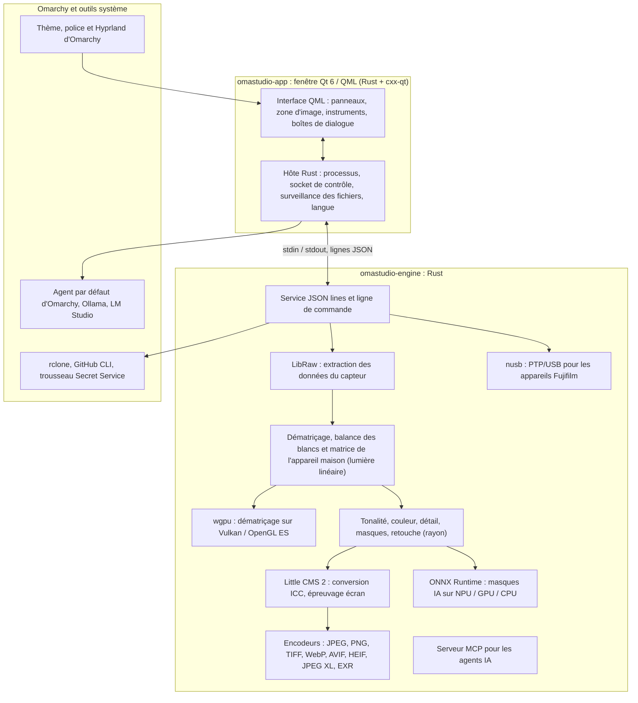

# Les technologies d'OmaStudio

**OmaStudio: The Complete Medium Format RAW Editor for Omarchy**

[Toutes les langues](../README.md) · [Guide d'utilisation](../guide/fr.md) · [README](../../README.md)

Cette page décrit les technologies sur lesquelles repose OmaStudio : ce que chacune fait dans l'application, pourquoi elle a été choisie et sa licence. OmaStudio est lui-même publié sous licence MIT.

## Architecture

La fenêtre et le moteur sont des processus distincts. La fenêtre ne décode jamais une photo elle-même : elle envoie des commandes au moteur et affiche les images qu'il écrit. Un plantage ou un blocage pendant le décodage ne peut pas entraîner l'interface, et le même moteur sert la ligne de commande, les scripts et les agents IA.

## Application

| Technologie | Rôle dans OmaStudio | Pourquoi | Licence |
| :--- | :--- | :--- | :--- |
| **Rust** (1.99, édition 2024) | Langage du moteur et de l'hôte de l'application | Sûreté mémoire pour un code qui lit des fichiers non fiables, vitesse native et un seul langage pour les deux processus | MIT / Apache-2.0 |
| **Qt 6** (6.12, Qt Quick / QML) | L'interface : panneaux, zone d'image, instruments, boîtes de dialogue | Interface dessinée par le GPU avec prise en charge native de Wayland et mise à l'échelle fractionnaire, mise en page de droite à gauche et système de traduction Qt Linguist | LGPL-3.0 |
| **cxx-qt** (0.10) | Relie Rust et Qt : les types hôtes `Process`, `Host` et le socket de contrôle sont des objets Rust utilisés depuis QML | Liaisons sûres dans les deux sens sans C++ écrit à la main | MIT / Apache-2.0 |
| **Qt Wayland** | Exécute la fenêtre comme client Wayland natif (identifiant d'application `omastudio`) | Omarchy utilise Hyprland sur Wayland ; les règles de fenêtre d'Hyprland peuvent cibler l'identifiant | LGPL-3.0 |
| **zenity** | Boîtes de dialogue de fichiers et de dossiers | Léger et présent sur toute installation d'Omarchy | LGPL-2.1+ |

Les fichiers QML sont compilés dans le binaire en tant que ressources Qt ; une version installée ne se mélange donc jamais avec des fichiers d'interface égarés.

## Moteur RAW

| Technologie | Rôle dans OmaStudio | Pourquoi | Licence |
| :--- | :--- | :--- | :--- |
| **LibRaw** (0.22) | Lit le conteneur RAW et extrait les données du capteur, les métadonnées et les aperçus intégrés | La plus large prise en charge d'appareils disponible sous forme de bibliothèque, y compris Fujifilm GFX, Hasselblad, Phase One et Leaf | LGPL-2.1 ou CDDL-1.0 (liaison dynamique) |
| **Chaîne de développement maison** | Niveau de noir, balance des blancs, dématriçage X-Trans et Bayer, matrice de couleur de l'appareil, corrections d'objectif, le tout en lumière linéaire | Maîtrise de la couleur dès le capteur et chemin 16 bits jusqu'à l'exportation ; le dématriçage choisit pour chaque pixel entre quatre candidats directionnels | MIT (OmaStudio) |
| **rayon** (1.12) | Traitement parallèle sur tous les cœurs du CPU | Parallélisme de données sans pools de threads écrits à la main | MIT / Apache-2.0 |
| **wgpu** (30) | Dématriçage sur le GPU via Vulkan (NVIDIA, AMD, Intel, Qualcomm Adreno) ou OpenGL ES, par bandes adaptées aux limites du GPU | Un seul chemin de code pour tous les fabricants de GPU, écrit en WGSL ; le résultat correspond au chemin CPU à un niveau près sur 65535 | MIT / Apache-2.0 |
| **Little CMS 2** (via la crate `lcms2`) | Profils ICC, conversion vers l'espace colorimétrique d'exportation, modes de rendu, épreuvage écran et alerte de gamut | Le moteur de gestion des couleurs open source de référence | MIT |
| **image-rs**, **tiff**, **exr** | Lecture et écriture de PNG, JPEG, TIFF, WebP, OpenEXR, Radiance HDR et PNM | Codecs en Rust pur à consommation mémoire bornée | MIT / Apache-2.0 ; exr : BSD-3-Clause |
| **libjxl**, **libavif**, **libheif**, **libwebp** | Exportation JPEG XL, AVIF, HEIF et WebP avec pertes | Les encodeurs de référence de ces formats | BSD-3-Clause, BSD-2-Clause, LGPL-3.0, BSD-3-Clause |
| **ExifTool** (facultatif) | Reporte les métadonnées EXIF de l'appareil dans les fichiers exportés | Écrit les métadonnées dans tous les formats qu'exporte OmaStudio | Artistic / GPL (programme séparé) |
| **Données Lensfun** (facultatif) | Profils d'objectifs moyen format | Une grande base de données d'objectifs maintenue, lue à l'exécution | Données CC BY-SA 3.0 |

La chaîne de couleur travaille en lumière linéaire : l'exposition est un pas d'IL photographique et la balance des blancs agit sur la lumière comme les multiplicateurs de l'appareil. Les images sont encodées pour l'affichage une seule fois, avant les modules créatifs de tonalité et de couleur, puis converties avec Little CMS à l'exportation.

## IA

| Technologie | Rôle dans OmaStudio | Pourquoi | Licence |
| :--- | :--- | :--- | :--- |
| **ONNX Runtime** (via la crate `ort`, chargé à l'exécution) | Exécute les modèles de segmentation des masques **Sujet IA** et **Ciel IA** | Un seul environnement d'exécution pour NPU, GPU et CPU ; facultatif, OmaStudio démarre sans lui | MIT |
| **Fournisseurs d'exécution** | OpenVINO (NPU Intel Core Ultra), QNN (NPU Snapdragon X), Vitis AI (NPU AMD Ryzen AI), CUDA, MIGraphX, WebGPU, XNNPACK | Utilise l'accélérateur le plus rapide de l'ordinateur et se replie sur le CPU | Licence propre à chaque fournisseur |
| **Agent par défaut d'Omarchy** (Claude Code ou Codex) | L'assistant de retouche et la discussion IA utilisent l'agent choisi avec `omarchy-default-agent`, avec sa propre connexion | Aucun compte ni clé supplémentaire dans OmaStudio | Conditions de l'agent |
| **Ollama**, **LM Studio** | Modèles de vision locaux pour l'assistant de retouche | Les photos restent sur l'ordinateur | MIT ; LM Studio : propriétaire |
| **Fournisseurs cloud** (Anthropic, OpenAI, OpenRouter, Google Gemini) | Fournisseurs facultatifs pour l'assistant de retouche, joints avec `curl` | Les clés sont dans le trousseau et transmises sur stdin, jamais sur une ligne de commande | Conditions du fournisseur |
| **Model Context Protocol** | `omastudio mcp` permet aux agents IA d'inspecter, calculer, exporter et piloter la fenêtre | Un protocole ouvert pris en charge par de nombreux agents | Spécification ouverte |

La réponse de l'assistant est contrainte par un schéma JSON et bornée à la plage de chaque réglage avant d'être appliquée, et chaque retouche peut être annulée.

## Appareils photo

| Technologie | Rôle dans OmaStudio | Pourquoi | Licence |
| :--- | :--- | :--- | :--- |
| **nusb** (0.2) | Accès USB pour la couche PTP | Rust pur, sans libusb ni gphoto2 | MIT / Apache-2.0 |
| **PTP / protocole Fujifilm** | Réglages personnalisés C1–C7, recettes écrites dans l'appareil, conversion RAW dans l'appareil | Documenté en salle blanche à partir d'observations ; aucun code du fabricant | MIT (OmaStudio) |
| **Règle udev** | Donne à l'utilisateur connecté l'accès aux appareils Fujifilm en mode PTP | Pas besoin de root pour utiliser un appareil | MIT (OmaStudio) |

## Comptes cloud

| Technologie | Rôle dans OmaStudio | Pourquoi | Licence |
| :--- | :--- | :--- | :--- |
| **rclone** | Google Drive, OneDrive, Dropbox, Box, pCloud et Yandex Disk : connexion, navigation, téléchargement, envoi | Un client éprouvé pour de nombreux services, avec OAuth dans le navigateur | MIT |
| **GitHub CLI** (`gh`) | Connexion GitHub (device flow) et le dépôt privé `OmaStudio` | Le client officiel de GitHub ; il conserve son jeton dans le trousseau | MIT |
| **libsecret** / Secret Service (`secret-tool`, `gnome-keyring`) | Conserve la clé de la configuration rclone chiffrée d'OmaStudio et les clés des fournisseurs d'IA | Les secrets ne sont jamais stockés en clair | LGPL-2.1+ |

## Intégration à Omarchy

- **Thème.** Chaque couleur provient du thème Omarchy actif (`~/.local/state/omarchy/current/theme/colors.toml`) et change en direct quand le thème change.
- **Police.** L'interface utilise la police d'Omarchy (`omarchy-font-set`, lue via fontconfig) et met le texte à l'échelle selon la taille de base du shell Omarchy.
- **Hyprland.** Les coins suivent l'arrondi d'Hyprland ; la fenêtre est un client Wayland ordinaire avec l'identifiant `omastudio`.
- **Agent par défaut.** OmaStudio suit `~/.config/omarchy/defaults/agent` en direct.
- **Menu des applications et barre.** L'entrée de bureau utilise une icône monochrome à fort contraste comme les applications d'Omarchy ; `Panel.qml` est un widget Quickshell facultatif pour la barre d'Omarchy.
- **Langue.** L'interface suit la langue du système (`LANGUAGE`, `LC_ALL`, `LC_MESSAGES`, `LANG`, `locale.conf`).

## Langues

| Technologie | Rôle dans OmaStudio | Licence |
| :--- | :--- | :--- |
| **Qt Linguist** (fichiers `.ts`, `lrelease`) | 30 langues d'interface compilées dans le binaire ; mise en page de droite à gauche pour l'arabe, l'hébreu et le persan | LGPL-3.0 / GPL-3.0 (outil de compilation) |
| **tools/i18n/check.py** | Fait échouer la compilation en CI lorsqu'une traduction manque, est restée en anglais, utilise la mauvaise écriture ou a des marqueurs non concordants | MIT (OmaStudio) |

## Compilation, tests et publication

| Technologie | Rôle dans OmaStudio | Licence |
| :--- | :--- | :--- |
| **Cargo** avec une chaîne d'outils fixée (`rust-toolchain.toml`) | Compile le moteur et l'application comme un seul espace de travail ; `Cargo.lock` est versionné | MIT / Apache-2.0 |
| **clang**, **pkgconf** | Compilateur C et pilote d'édition de liens pour la passerelle LibRaw, recherche des bibliothèques | Apache-2.0 avec exception LLVM, ISC |
| **GitHub Actions** dans un conteneur `archlinux` | Compilation, tests, `clippy -D warnings` et contrôle des traductions à chaque modification, avec les mêmes paquets qu'Omarchy | — |
| **CodeQL** | Analyse statique du code Rust et des workflows | — |
| **Workflow de publication** | Construit l'archive sur une étiquette et la publie avec des sommes de contrôle SHA-256 et des attestations de provenance | — |
| **PKGBUILD** | Paquet Arch avec dépendances, dépendances facultatives et règle udev | — |

## Sécurité

- Chaque programme externe s'exécute avec un environnement vidé, dans son propre groupe de processus, avec une limite de temps et une limite de sortie.
- Chaque fichier lu par le moteur a une taille limite ; catalogue, réglages et fichiers annexes sont écrits de façon atomique avec le mode `0600`, et les liens symboliques sont refusés là où le moteur possède le dossier.
- Le socket de contrôle se trouve dans `$XDG_RUNTIME_DIR/omastudio/` et ne répond qu'aux processus du même utilisateur (`SO_PEERCRED`).
- Les clés d'API et les jetons cloud restent dans le trousseau et n'apparaissent jamais sur une ligne de commande.
- L'interface affiche tout texte dynamique en texte brut.

Les détails figurent dans [SECURITY.md](../../SECURITY.md).

## Marques

Fujifilm, GFX, X-Trans, Hasselblad, Phase One, Leica, Pentax, Mamiya et les autres noms d'appareils sont des marques de leurs propriétaires et ne sont utilisés que pour indiquer la compatibilité.
