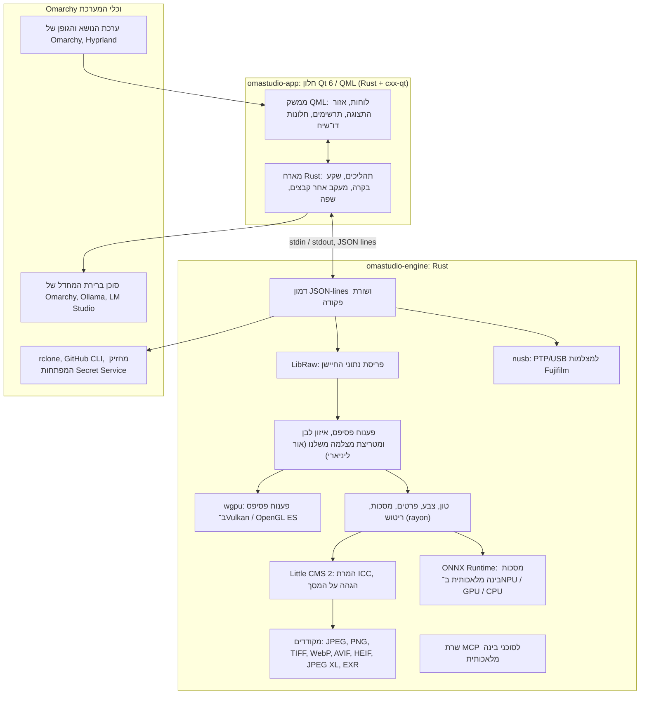

# הטכנולוגיות ב־OmaStudio

**OmaStudio: The Complete Medium Format RAW Editor for Omarchy**

[כל השפות](../README.md) · [מדריך למשתמש](../guide/he.md) · [README](../../README.md)

הדף מתאר את הטכנולוגיות ש־OmaStudio בנוי עליהן, מה כל אחת עושה ביישום, למה היא נבחרה ומה הרישיון שלה. OmaStudio עצמו מופץ ברישיון MIT.

## ארכיטקטורה

החלון והמנוע הם תהליכים נפרדים. החלון לעולם אינו מפענח תמונה בעצמו: הוא שולח פקודות למנוע ומציג את התמונות שהמנוע כותב. קריסה או תקיעה בפענוח אינן יכולות להפיל איתן את הממשק, ואותו מנוע משרת את שורת הפקודה, סקריפטים וסוכני בינה מלאכותית.

## היישום

| טכנולוגיה | התפקיד ב־OmaStudio | למה | רישיון |
| :--- | :--- | :--- | :--- |
| **Rust** (1.99, מהדורת 2024) | שפת המנוע ושל המארח של היישום | בטיחות זיכרון לקוד שמנתח קבצים לא מהימנים, מהירות טבעית ושפה אחת לשני התהליכים | MIT / Apache-2.0 |
| **Qt 6** (6.12, Qt Quick / QML) | הממשק: לוחות, אזור התצוגה, תרשימים, חלונות דו־שיח | ממשק שמצויר ב־GPU עם תמיכה טבעית ב־Wayland ובקנה מידה שברי, פריסה מימין לשמאל ומערכת התרגום Qt Linguist | LGPL-3.0 |
| **cxx-qt** (0.10) | מחבר בין Rust ל־Qt: טיפוסי המארח `Process`, `Host` ושקע הבקרה הם אובייקטים של Rust שמשמשים מתוך QML | קישורים בטוחים בשני הכיוונים בלי C++ שנכתב ביד | MIT / Apache-2.0 |
| **Qt Wayland** | מריץ את החלון כלקוח Wayland טבעי (app id ‏`omastudio`) | Omarchy מריץ Hyprland על Wayland; כללי החלונות של Hyprland יכולים להתאים לפי app id | LGPL-3.0 |
| **zenity** | חלונות בחירת קבצים ותיקיות | קטן, וזמין בכל התקנה של Omarchy | LGPL-2.1+ |

קובצי ה־QML מהודרים לתוך הקובץ הבינארי כמשאבי Qt, כך שגרסה מותקנת לעולם אינה מתערבבת עם קובצי ממשק תועים.

## מנוע ה־RAW

| טכנולוגיה | התפקיד ב־OmaStudio | למה | רישיון |
| :--- | :--- | :--- | :--- |
| **LibRaw** (0.22) | קורא את מכל ה־RAW ופורס את נתוני החיישן, המטא־נתונים והתצוגות המקדימות המוטמעות | התמיכה הרחבה ביותר במצלמות שקיימת כספרייה, כולל Fujifilm GFX, ‏Hasselblad, ‏Phase One ו־Leaf | LGPL-2.1 או CDDL-1.0 (קישור דינמי) |
| **צנרת פיתוח משלנו** | רמת שחור, איזון לבן, פענוח פסיפס X-Trans ו־Bayer, מטריצת הצבע של המצלמה, תיקוני עדשה, הכול על אור ליניארי | שליטה בצבע מהחיישן והלאה ומסלול של 16 סיביות עד הייצוא; פענוח הפסיפס בוחר בין ארבעה מועמדים כיווניים לכל פיקסל | MIT (OmaStudio) |
| **rayon** (1.12) | עיבוד מקבילי בכל ליבות המעבד | מקביליות נתונים בלי מאגרי תהליכונים שנכתבו ביד | MIT / Apache-2.0 |
| **wgpu** (30) | פענוח פסיפס ב־GPU דרך Vulkan ‏(NVIDIA, ‏AMD, ‏Intel, ‏Qualcomm Adreno) או OpenGL ES, ברצועות שמתאימות למגבלות ה־GPU | מסלול קוד אחד לכל יצרני ה־GPU, כתוב ב־WGSL; התוצאה תואמת למסלול המעבד בהפרש של עד רמה אחת מתוך 65535 | MIT / Apache-2.0 |
| **Little CMS 2** (דרך ה־crate ‏`lcms2`) | פרופילי ICC, המרה למרחב הצבע של הייצוא, כוונות עיבוד, הגהה על המסך ואזהרת טווח הצבעים | מנוע ניהול הצבע בקוד פתוח שמשמש כהפניה | MIT |
| **image-rs**, **tiff**, **exr** | קריאה וכתיבה של PNG, ‏JPEG, ‏TIFF, ‏WebP, ‏OpenEXR, ‏Radiance HDR ו־PNM | מקודדים ב־Rust טהור עם שימוש מוגבל בזיכרון | MIT / Apache-2.0; exr: BSD-3-Clause |
| **libjxl**, **libavif**, **libheif**, **libwebp** | ייצוא JPEG XL, ‏AVIF, ‏HEIF ו־WebP עם אובדן | המקודדים המשמשים כהפניה לתבניות האלה | BSD-3-Clause, BSD-2-Clause, LGPL-3.0, BSD-3-Clause |
| **ExifTool** (רשות) | מעביר את מטא־נתוני ה־EXIF של המצלמה לקבצים המיוצאים | כותב מטא־נתונים לכל תבנית ש־OmaStudio מייצא | Artistic / GPL (תוכנה נפרדת) |
| **הנתונים של Lensfun** (רשות) | פרופילי עדשות לעדשות פורמט בינוני | מסד נתוני עדשות גדול ומתוחזק, נקרא בזמן ריצה | הנתונים CC BY-SA 3.0 |

צנרת הצבע פועלת על אור ליניארי: החשיפה היא צעד EV צילומי, ואיזון הלבן פועל על האור כמו המכפילים של המצלמה עצמה. התמונות מקודדות לתצוגה פעם אחת, לפני מודולי הטון והצבע היצירתיים, ומומרות ב־Little CMS בזמן הייצוא.

## בינה מלאכותית

| טכנולוגיה | התפקיד ב־OmaStudio | למה | רישיון |
| :--- | :--- | :--- | :--- |
| **ONNX Runtime** (דרך ה־crate ‏`ort`, נטען בזמן ריצה) | מריץ מודלי פילוח למסכות **נושא (בינה מלאכותית)** ו־**שמיים (בינה מלאכותית)** | סביבת ריצה אחת ל־NPU, ‏GPU ומעבד; רשות, כך ש־OmaStudio עולה גם בלעדיה | MIT |
| **ספקי ביצוע** | OpenVINO ‏(NPU של Intel Core Ultra), ‏QNN ‏(NPU של Snapdragon X), ‏Vitis AI ‏(NPU של AMD Ryzen AI), ‏CUDA, ‏MIGraphX, ‏WebGPU, ‏XNNPACK | משתמש במאיץ המהיר ביותר שבמחשב וחוזר למעבד | הרישיון של כל ספק |
| **סוכן ברירת המחדל של Omarchy** ‏(Claude Code או Codex) | עוזר העריכה והשיחה עם הבינה המלאכותית משתמשים בסוכן שנבחר ב־`omarchy-default-agent`, עם הכניסה שלו | אין צורך בחשבון או במפתח נוסף ב־OmaStudio | התנאים של הסוכן |
| **Ollama**, **LM Studio** | מודלי ראייה מקומיים לעוזר העריכה | התמונות נשארות במחשב | MIT; LM Studio: קנייני |
| **ספקי ענן** ‏(Anthropic, ‏OpenAI, ‏OpenRouter, ‏Google Gemini) | ספקים אופציונליים לעוזר העריכה, נגישים דרך `curl` | המפתחות נשמרים במחזיק המפתחות ומועברים דרך stdin, לעולם לא בשורת פקודה | התנאים של הספק |
| **Model Context Protocol** | ‏`omastudio mcp` מאפשר לסוכני בינה מלאכותית לבחון, לעבד, לייצא ולשלוט בחלון | פרוטוקול פתוח שסוכנים רבים תומכים בו | מפרט פתוח |

התשובה של העוזר מוגבלת לסכמת JSON ונחסמת לטווח של כל פקד לפני שהיא מוחלת, וכל עריכה אפשר לבטל.

## מצלמות

| טכנולוגיה | התפקיד ב־OmaStudio | למה | רישיון |
| :--- | :--- | :--- | :--- |
| **nusb** (0.2) | גישת USB לשכבת ה־PTP | Rust טהור, בלי צורך ב־libusb או gphoto2 | MIT / Apache-2.0 |
| **פרוטוקול PTP / Fujifilm** | ההגדרות המותאמות C1–C7, מתכונים שנכתבים למצלמה, המרת RAW במצלמה | תועד בשיטת חדר נקי מתוך תצפית; בלי קוד של היצרן | MIT (OmaStudio) |
| **כלל udev** | נותן למשתמש המחובר גישה למצלמות Fujifilm במצב PTP | אין צורך ב־root כדי להשתמש במצלמה | MIT (OmaStudio) |

## חשבונות ענן

| טכנולוגיה | התפקיד ב־OmaStudio | למה | רישיון |
| :--- | :--- | :--- | :--- |
| **rclone** | Google Drive, ‏OneDrive, ‏Dropbox, ‏Box, ‏pCloud ו־Yandex Disk: התחברות, עיון, הורדה, העלאה | לקוח אחד ובדוק לשירותים רבים, עם OAuth בדפדפן | MIT |
| **GitHub CLI** (`gh`) | התחברות ל־GitHub ‏(device flow) והמאגר הפרטי `OmaStudio` | הלקוח של GitHub עצמה; שומר את האסימון במחזיק המפתחות | MIT |
| **libsecret** / Secret Service (`secret-tool`, `gnome-keyring`) | שומר את המפתח של תצורת ה־rclone המוצפנת של OmaStudio ואת מפתחות ספקי הבינה המלאכותית | סודות לעולם אינם נשמרים כטקסט גלוי | LGPL-2.1+ |

## שילוב עם Omarchy

- **ערכת נושא.** כל צבע מגיע מערכת הנושא הפעילה של Omarchy ‏(`~/.local/state/omarchy/current/theme/colors.toml`) ומשתנה בזמן אמת כשערכת הנושא משתנה.
- **גופן.** הממשק משתמש בגופן של Omarchy ‏(`omarchy-font-set`, נקרא דרך fontconfig) ומשנה את גודל הטקסט לפי גודל הבסיס של המעטפת של Omarchy.
- **Hyprland.** הפינות עוקבות אחרי העיגול של Hyprland; החלון הוא לקוח Wayland רגיל עם app id ‏`omastudio`.
- **סוכן ברירת מחדל.** OmaStudio עוקב בזמן אמת אחרי `~/.config/omarchy/defaults/agent`.
- **תפריט היישומים והסרגל.** רשומת שולחן העבודה משתמשת בסמל מונוכרומטי בניגודיות גבוהה כמו היישומים של Omarchy עצמה; `Panel.qml` הוא וידג'ט Quickshell אופציונלי לסרגל של Omarchy.
- **שפה.** הממשק עוקב אחרי שפת המערכת (`LANGUAGE`, `LC_ALL`, `LC_MESSAGES`, `LANG`, `locale.conf`).

## שפות

| טכנולוגיה | התפקיד ב־OmaStudio | רישיון |
| :--- | :--- | :--- |
| **Qt Linguist** (קובצי `.ts`, ‏`lrelease`) | 30 שפות ממשק, מהודרות לתוך הקובץ הבינארי; פריסה מימין לשמאל לערבית, לעברית ולפרסית | LGPL-3.0 / GPL-3.0 (כלי בנייה) |
| **tools/i18n/check.py** | מכשיל את הבנייה ב־CI כשתרגום חסר, נשאר באנגלית, כתוב בכתב הלא נכון או שמצייני המיקום שלו אינם תואמים | MIT (OmaStudio) |

## בנייה, בדיקות והפצה

| טכנולוגיה | התפקיד ב־OmaStudio | רישיון |
| :--- | :--- | :--- |
| **Cargo** עם שרשרת כלים מקובעת (`rust-toolchain.toml`) | בונה את המנוע ואת היישום כמרחב עבודה אחד; `Cargo.lock` נמצא במאגר | MIT / Apache-2.0 |
| **clang**, **pkgconf** | מהדר C ומפעיל המקשר עבור שכבת המעבר של LibRaw, איתור ספריות | Apache-2.0 with LLVM exception, ISC |
| **GitHub Actions** במכולת `archlinux` | בנייה, בדיקות, `clippy -D warnings` ובדיקת התרגום בכל שינוי, עם אותן חבילות ש־Omarchy משתמשת בהן | — |
| **CodeQL** | ניתוח סטטי של קוד ה־Rust ושל תהליכי העבודה | — |
| **תהליך ההפצה** | בונה את הארכיון בעת תיוג ומפרסם אותו עם סכומי ביקורת SHA-256 ואישורי מקור הבנייה | — |
| **PKGBUILD** | חבילת Arch עם תלויות, תלויות רשות וכלל ה־udev | — |

## אבטחה

- כל תוכנה חיצונית רצה עם סביבה מנוקה, בקבוצת תהליכים משלה, עם מגבלת זמן ומגבלת פלט.
- לכל קובץ שהמנוע קורא יש מגבלת גודל; הקטלוג, ההגדרות וקובצי הצד נכתבים באופן אטומי בהרשאות `0600`, וקישורים סמליים נדחים בתיקיות שבבעלות המנוע.
- שקע הבקרה נמצא ב־`$XDG_RUNTIME_DIR/omastudio/` ועונה רק לתהליכים של אותו משתמש (`SO_PEERCRED`).
- מפתחות API ואסימוני ענן נשארים במחזיק המפתחות ולעולם אינם מופיעים בשורת פקודה.
- הממשק מציג כל טקסט דינמי כטקסט רגיל.

הפרטים נמצאים ב־[SECURITY.md](../../SECURITY.md).

## סימנים מסחריים

Fujifilm, ‏GFX, ‏X-Trans, ‏Hasselblad, ‏Phase One, ‏Leica, ‏Pentax, ‏Mamiya ושמות מצלמות אחרים הם סימנים מסחריים של בעליהם, ומשמשים רק לתיאור תאימות.
