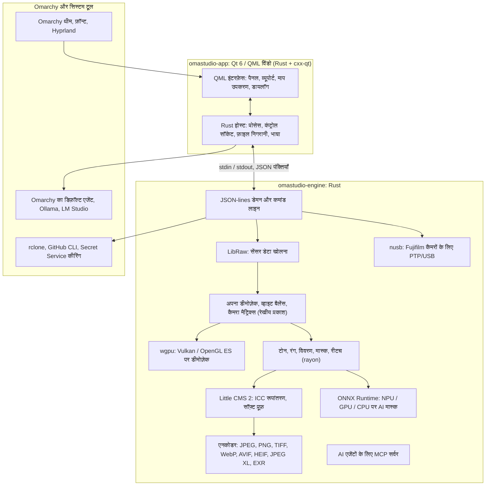

# OmaStudio की तकनीकें

**OmaStudio: The Complete Medium Format RAW Editor for Omarchy**

[सभी भाषाएँ](../README.md) · [उपयोगकर्ता गाइड](../guide/hi.md) · [README](../../README.md)

यह पेज उन तकनीकों के बारे में बताता है जिन पर OmaStudio बना है: ऐप्लिकेशन में हर एक क्या करती है, उसे क्यों चुना गया, और उसका लाइसेंस क्या है। OmaStudio स्वयं MIT लाइसेंस के तहत जारी किया गया है।

## आर्किटेक्चर

विंडो और इंजन अलग-अलग प्रोसेस हैं। विंडो कभी ख़ुद कोई फ़ोटो डिकोड नहीं करती: वह इंजन को कमांड भेजती है और इंजन द्वारा लिखी गई इमेज दिखाती है। डिकोडिंग में क्रैश या अटकने से इंटरफ़ेस साथ में नहीं गिरता, और वही इंजन कमांड लाइन, स्क्रिप्ट और AI एजेंटों को भी सेवा देता है।

## ऐप्लिकेशन

| तकनीक | OmaStudio में भूमिका | क्यों | लाइसेंस |
| :--- | :--- | :--- | :--- |
| **Rust** (1.99, edition 2024) | इंजन और ऐप्लिकेशन होस्ट की भाषा | अविश्वसनीय फ़ाइलें पार्स करने वाले कोड के लिए मेमोरी सुरक्षा, नेटिव गति और दोनों प्रोसेस के लिए एक भाषा | MIT / Apache-2.0 |
| **Qt 6** (6.12, Qt Quick / QML) | इंटरफ़ेस: पैनल, व्यूपोर्ट, माप उपकरण, डायलॉग | GPU से बना इंटरफ़ेस, नेटिव Wayland समर्थन और फ़्रैक्शनल स्केलिंग, दाएँ-से-बाएँ लेआउट और Qt Linguist अनुवाद प्रणाली | LGPL-3.0 |
| **cxx-qt** (0.10) | Rust और Qt को जोड़ता है: होस्ट टाइप `Process`, `Host` और कंट्रोल सॉकेट QML से उपयोग होने वाले Rust ऑब्जेक्ट हैं | हाथ से लिखे C++ के बिना दोनों दिशाओं में सुरक्षित बाइंडिंग | MIT / Apache-2.0 |
| **Qt Wayland** | विंडो को नेटिव Wayland क्लाइंट के रूप में चलाता है (app id `omastudio`) | Omarchy, Wayland पर Hyprland चलाता है; Hyprland के विंडो नियम app id से मेल खा सकते हैं | LGPL-3.0 |
| **zenity** | फ़ाइल और फ़ोल्डर डायलॉग | छोटा, और हर Omarchy इंस्टॉल में उपलब्ध | LGPL-2.1+ |

QML फ़ाइलें Qt रिसोर्स के रूप में बाइनरी में कंपाइल होती हैं, इसलिए इंस्टॉल किया गया संस्करण कभी भी बिखरी इंटरफ़ेस फ़ाइलों से नहीं मिलता।

## RAW इंजन

| तकनीक | OmaStudio में भूमिका | क्यों | लाइसेंस |
| :--- | :--- | :--- | :--- |
| **LibRaw** (0.22) | RAW कंटेनर पढ़ता है और सेंसर डेटा, मेटाडेटा व अंतर्निहित प्रीव्यू खोलता है | लाइब्रेरी के रूप में उपलब्ध सबसे व्यापक कैमरा समर्थन, जिसमें Fujifilm GFX, Hasselblad, Phase One और Leaf शामिल हैं | LGPL-2.1 या CDDL-1.0 (डायनेमिक लिंक) |
| **अपनी डेवलपमेंट पाइपलाइन** | ब्लैक लेवल, व्हाइट बैलेंस, X-Trans और Bayer डीमोज़ेकिंग, कैमरा कलर मैट्रिक्स, लेंस सुधार, सब कुछ रेखीय प्रकाश पर | सेंसर से आगे रंग पर नियंत्रण और निर्यात तक 16-बिट रास्ता; डीमोज़ेक हर पिक्सेल के लिए चार दिशात्मक विकल्पों में से चुनता है | MIT (OmaStudio) |
| **rayon** (1.12) | सभी CPU कोर पर समानांतर प्रोसेसिंग | हाथ से लिखे थ्रेड पूल के बिना डेटा समानांतरता | MIT / Apache-2.0 |
| **wgpu** (30) | Vulkan (NVIDIA, AMD, Intel, Qualcomm Adreno) या OpenGL ES के ज़रिए GPU पर डीमोज़ेकिंग, GPU की सीमाओं में आने वाली पट्टियों में | हर GPU निर्माता के लिए WGSL में लिखा एक ही कोड पथ; परिणाम CPU पथ से 65535 में एक स्तर के भीतर मेल खाता है | MIT / Apache-2.0 |
| **Little CMS 2** (`lcms2` crate के ज़रिए) | ICC प्रोफ़ाइलें, निर्यात कलर स्पेस में रूपांतरण, रेंडरिंग इंटेंट, सॉफ़्ट प्रूफ़ और गैमट चेतावनी | रंग प्रबंधन का संदर्भ ओपन-सोर्स इंजन | MIT |
| **image-rs**, **tiff**, **exr** | PNG, JPEG, TIFF, WebP, OpenEXR, Radiance HDR और PNM पढ़ना और लिखना | सीमित मेमोरी उपयोग वाले शुद्ध Rust कोडेक | MIT / Apache-2.0; exr: BSD-3-Clause |
| **libjxl**, **libavif**, **libheif**, **libwebp** | JPEG XL, AVIF, HEIF और लॉसी WebP निर्यात | इन फ़ॉर्मैट के संदर्भ एनकोडर | BSD-3-Clause, BSD-2-Clause, LGPL-3.0, BSD-3-Clause |
| **ExifTool** (वैकल्पिक) | कैमरे का EXIF मेटाडेटा निर्यात फ़ाइलों में ले जाता है | OmaStudio के हर निर्यात फ़ॉर्मैट में मेटाडेटा लिखता है | Artistic / GPL (अलग प्रोग्राम) |
| **Lensfun डेटा** (वैकल्पिक) | मीडियम फ़ॉर्मैट लेंसों की लेंस प्रोफ़ाइलें | एक बड़ा, अद्यतन रखा गया लेंस डेटाबेस, रनटाइम पर पढ़ा जाता है | डेटा CC BY-SA 3.0 |

रंग पाइपलाइन रेखीय प्रकाश पर काम करती है: एक्सपोज़र एक फ़ोटोग्राफ़िक EV चरण है और व्हाइट बैलेंस प्रकाश पर वैसे ही काम करता है जैसे कैमरे के अपने गुणक। इमेज रचनात्मक टोन और रंग मॉड्यूल से पहले एक बार डिस्प्ले के लिए एनकोड होती है, और निर्यात पर Little CMS से रूपांतरित होती है।

## AI

| तकनीक | OmaStudio में भूमिका | क्यों | लाइसेंस |
| :--- | :--- | :--- | :--- |
| **ONNX Runtime** (`ort` crate के ज़रिए, रनटाइम पर लोड) | **AI विषय** और **AI आसमान** मास्क के लिए सेगमेंटेशन मॉडल चलाता है | NPU, GPU और CPU के लिए एक रनटाइम; वैकल्पिक, इसलिए OmaStudio इसके बिना भी शुरू होता है | MIT |
| **एक्ज़िक्यूशन प्रोवाइडर** | OpenVINO (Intel Core Ultra NPU), QNN (Snapdragon X NPU), Vitis AI (AMD Ryzen AI NPU), CUDA, MIGraphX, WebGPU, XNNPACK | कंप्यूटर के सबसे तेज़ एक्सेलेरेटर का उपयोग करता है और CPU पर लौट आता है | हर प्रोवाइडर का अपना लाइसेंस |
| **Omarchy का डिफ़ॉल्ट एजेंट** (Claude Code या Codex) | **संपादन सहायक** और **AI चैट** `omarchy-default-agent` से चुने गए एजेंट का उसके अपने साइन-इन के साथ उपयोग करते हैं | OmaStudio में कोई अतिरिक्त खाता या कुंजी नहीं | एजेंट की अपनी शर्तें |
| **Ollama**, **LM Studio** | संपादन सहायक के लिए स्थानीय विज़न मॉडल | फ़ोटो कंप्यूटर पर ही रहती हैं | MIT; LM Studio: स्वामित्व वाला |
| **क्लाउड प्रदाता** (Anthropic, OpenAI, OpenRouter, Google Gemini) | संपादन सहायक के लिए वैकल्पिक प्रदाता, `curl` से जुड़ते हैं | कुंजियाँ कीरिंग में रहती हैं और stdin से भेजी जाती हैं, कभी कमांड लाइन पर नहीं | प्रदाता की अपनी शर्तें |
| **Model Context Protocol** | `omastudio mcp` AI एजेंटों को जाँचने, रेंडर करने, निर्यात करने और विंडो को नियंत्रित करने देता है | कई एजेंटों द्वारा समर्थित एक खुला प्रोटोकॉल | खुला विनिर्देश |

सहायक का जवाब एक JSON स्कीमा तक सीमित रहता है और लागू होने से पहले हर नियंत्रण की सीमा में बाँध दिया जाता है, और हर संपादन पूर्ववत किया जा सकता है।

## कैमरे

| तकनीक | OmaStudio में भूमिका | क्यों | लाइसेंस |
| :--- | :--- | :--- | :--- |
| **nusb** (0.2) | PTP परत के लिए USB पहुँच | शुद्ध Rust, libusb या gphoto2 की ज़रूरत नहीं | MIT / Apache-2.0 |
| **PTP / Fujifilm प्रोटोकॉल** | कस्टम सेटिंग C1–C7, कैमरे में लिखी गई रेसिपी, कैमरे में RAW रूपांतरण | अवलोकन से क्लीन-रूम तरीक़े से प्रलेखित; निर्माता का कोई कोड नहीं | MIT (OmaStudio) |
| **udev नियम** | लॉग-इन उपयोगकर्ता को PTP मोड में Fujifilm कैमरों तक पहुँच देता है | कैमरा उपयोग करने के लिए root की ज़रूरत नहीं | MIT (OmaStudio) |

## क्लाउड खाते

| तकनीक | OmaStudio में भूमिका | क्यों | लाइसेंस |
| :--- | :--- | :--- | :--- |
| **rclone** | Google Drive, OneDrive, Dropbox, Box, pCloud और Yandex Disk: साइन-इन, ब्राउज़िंग, डाउनलोड, अपलोड | कई सेवाओं के लिए एक परखा हुआ क्लाइंट, ब्राउज़र में OAuth के साथ | MIT |
| **GitHub CLI** (`gh`) | GitHub साइन-इन (डिवाइस फ़्लो) और निजी रिपॉज़िटरी `OmaStudio` | GitHub का अपना क्लाइंट; अपना टोकन कीरिंग में रखता है | MIT |
| **libsecret** / Secret Service (`secret-tool`, `gnome-keyring`) | OmaStudio के एन्क्रिप्टेड rclone कॉन्फ़िगरेशन की कुंजी और AI प्रदाताओं की कुंजियाँ रखता है | रहस्य कभी सादे टेक्स्ट में नहीं रखे जाते | LGPL-2.1+ |

## Omarchy एकीकरण

- **थीम।** हर रंग सक्रिय Omarchy थीम (`~/.local/state/omarchy/current/theme/colors.toml`) से आता है और थीम बदलते ही तुरंत बदल जाता है।
- **फ़ॉन्ट।** इंटरफ़ेस Omarchy का फ़ॉन्ट (`omarchy-font-set`, fontconfig से पढ़ा गया) उपयोग करता है और Omarchy शेल के आधार आकार से टेक्स्ट को स्केल करता है।
- **Hyprland।** कोने Hyprland की गोलाई का पालन करते हैं; विंडो app id `omastudio` वाला एक सामान्य Wayland क्लाइंट है।
- **डिफ़ॉल्ट एजेंट।** OmaStudio `~/.config/omarchy/defaults/agent` में बदलावों का तुरंत पालन करता है।
- **ऐप मेनू और बार।** डेस्कटॉप एंट्री Omarchy के अपने ऐप्स की तरह उच्च-कंट्रास्ट मोनोक्रोम आइकन उपयोग करती है; `Panel.qml` Omarchy बार के लिए एक वैकल्पिक Quickshell विजेट है।
- **भाषा।** इंटरफ़ेस सिस्टम की भाषा (`LANGUAGE`, `LC_ALL`, `LC_MESSAGES`, `LANG`, `locale.conf`) का पालन करता है।

## भाषाएँ

| तकनीक | OmaStudio में भूमिका | लाइसेंस |
| :--- | :--- | :--- |
| **Qt Linguist** (`.ts` फ़ाइलें, `lrelease`) | बाइनरी में कंपाइल की गई 30 इंटरफ़ेस भाषाएँ; अरबी, हिब्रू और फ़ारसी के लिए दाएँ-से-बाएँ लेआउट | LGPL-3.0 / GPL-3.0 (बिल्ड टूल) |
| **tools/i18n/check.py** | अनुवाद गायब हो, अंग्रेज़ी में रह गया हो, ग़लत लिपि में हो या प्लेसहोल्डर मेल न खाते हों तो CI बिल्ड को विफल करता है | MIT (OmaStudio) |

## बिल्ड, टेस्ट और रिलीज़

| तकनीक | OmaStudio में भूमिका | लाइसेंस |
| :--- | :--- | :--- |
| स्थिर टूलचेन (`rust-toolchain.toml`) के साथ **Cargo** | इंजन और ऐप्लिकेशन को एक वर्कस्पेस के रूप में बिल्ड करता है; `Cargo.lock` रिपॉज़िटरी में शामिल है | MIT / Apache-2.0 |
| **clang**, **pkgconf** | LibRaw मध्य परत के लिए C कंपाइलर और लिंकर ड्राइवर, लाइब्रेरी खोज | LLVM अपवाद के साथ Apache-2.0, ISC |
| `archlinux` कंटेनर में **GitHub Actions** | हर बदलाव पर बिल्ड, टेस्ट, `clippy -D warnings` और अनुवाद जाँच, उन्हीं पैकेजों के साथ जो Omarchy उपयोग करता है | — |
| **CodeQL** | Rust कोड और वर्कफ़्लो का स्टैटिक विश्लेषण | — |
| **रिलीज़ वर्कफ़्लो** | टैग पर आर्काइव बनाता है और उसे SHA-256 चेकसम और बिल्ड उत्पत्ति प्रमाणन के साथ प्रकाशित करता है | — |
| **PKGBUILD** | निर्भरताओं, वैकल्पिक निर्भरताओं और udev नियम के साथ Arch पैकेज | — |

## सुरक्षा

- हर बाहरी प्रोग्राम साफ़ किए गए वातावरण, अपने प्रोसेस समूह, समय सीमा और आउटपुट सीमा के साथ चलता है।
- इंजन जो भी फ़ाइल पढ़ता है उसकी आकार सीमा होती है; कैटलॉग, सेटिंग और साइडकार मोड `0600` के साथ परमाणु रूप से लिखे जाते हैं, और जहाँ फ़ोल्डर इंजन का है वहाँ सिंबॉलिक लिंक अस्वीकार किए जाते हैं।
- कंट्रोल सॉकेट `$XDG_RUNTIME_DIR/omastudio/` में रहता है और केवल उसी उपयोगकर्ता के प्रोसेस को जवाब देता है (`SO_PEERCRED`)।
- API कुंजियाँ और क्लाउड टोकन कीरिंग में रहते हैं और कभी कमांड लाइन पर नहीं दिखते।
- इंटरफ़ेस सारा गतिशील टेक्स्ट सादे टेक्स्ट के रूप में दिखाता है।

विवरण [SECURITY.md](../../SECURITY.md) में है।

## ट्रेडमार्क

Fujifilm, GFX, X-Trans, Hasselblad, Phase One, Leica, Pentax, Mamiya और अन्य कैमरा नाम उनके स्वामियों के ट्रेडमार्क हैं और केवल संगतता बताने के लिए उपयोग किए गए हैं।
