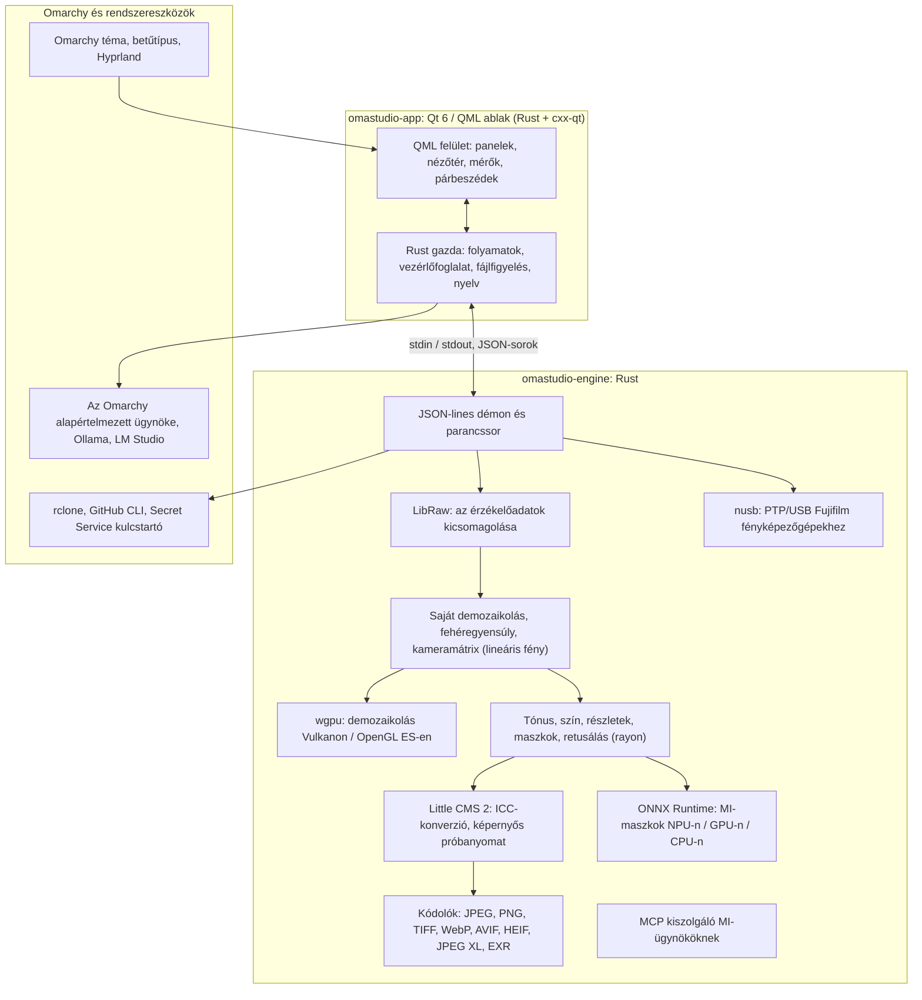

# Az OmaStudio technológiái

**OmaStudio: The Complete Medium Format RAW Editor for Omarchy**

[Minden nyelv](../README.md) · [Felhasználói útmutató](../guide/hu.md) · [README](../../README.md)

Ez az oldal bemutatja azokat a technológiákat, amelyekre az OmaStudio épül: mit végez mindegyik az alkalmazásban, miért esett rá a választás, és milyen licenc alatt áll. Maga az OmaStudio MIT-licenc alatt jelenik meg.

## Architektúra

Az ablak és a motor külön folyamat. Az ablak soha nem dekódol fotót: parancsokat küld a motornak, és a motor által írt képeket jeleníti meg. A dekódolás összeomlása vagy lefagyása nem rántja magával a felületet, és ugyanaz a motor szolgálja ki a parancssort, a szkripteket és az MI-ügynököket.

## Alkalmazás

| Technológia | Szerepe az OmaStudióban | Miért | Licenc |
| :--- | :--- | :--- | :--- |
| **Rust** (1.99, edition 2024) | A motor és az alkalmazásgazda nyelve | Memóriabiztonság a nem megbízható fájlokat feldolgozó kódhoz, natív sebesség és egy nyelv mindkét folyamathoz | MIT / Apache-2.0 |
| **Qt 6** (6.12, Qt Quick / QML) | A felület: panelek, nézőtér, mérők, párbeszédek | GPU-val rajzolt felület natív Wayland-támogatással és tört skálázással, jobbról balra írt elrendezés és a Qt Linguist fordítási rendszer | LGPL-3.0 |
| **cxx-qt** (0.10) | Összeköti a Rustot és a Qt-t: a `Process`, a `Host` gazdatípus és a vezérlőfoglalat QML-ből használt Rust-objektumok | Biztonságos kötések mindkét irányban, kézzel írt C++ nélkül | MIT / Apache-2.0 |
| **Qt Wayland** | Natív Wayland-kliensként futtatja az ablakot (alkalmazásazonosító: `omastudio`) | Az Omarchy Hyprlandot futtat Waylanden; a Hyprland ablakszabályai illeszkedhetnek az azonosítóhoz | LGPL-3.0 |
| **zenity** | Fájl- és mappapárbeszédek | Kicsi, és minden Omarchy-telepítésben megtalálható | LGPL-2.1+ |

A QML-fájlok Qt-erőforrásként a binárisba fordulnak, így egy telepített verzió soha nem keveredik kósza felületfájlokkal.

## RAW-motor

| Technológia | Szerepe az OmaStudióban | Miért | Licenc |
| :--- | :--- | :--- | :--- |
| **LibRaw** (0.22) | Beolvassa a RAW-tárolót, és kicsomagolja az érzékelőadatokat, a metaadatokat és a beágyazott előnézeteket | A könyvtárként elérhető legszélesebb fényképezőgép-támogatás, beleértve a Fujifilm GFX, a Hasselblad, a Phase One és a Leaf gépeket | LGPL-2.1 vagy CDDL-1.0 (dinamikusan linkelve) |
| **Saját előhívási lánc** | Feketeszint, fehéregyensúly, X-Trans és Bayer demozaikolás, a fényképezőgép színmátrixa, objektívkorrekciók, mind lineáris fényen | A szín kézben tartása az érzékelőtől kezdve és 16 bites út az exportig; a demozaikolás pixelenként négy irányjelölt közül választ | MIT (OmaStudio) |
| **rayon** (1.12) | Párhuzamos feldolgozás az összes CPU-magon | Adatpárhuzamosság kézzel írt szálkészletek nélkül | MIT / Apache-2.0 |
| **wgpu** (30) | Demozaikolás a GPU-n Vulkanon (NVIDIA, AMD, Intel, Qualcomm Adreno) vagy OpenGL ES-en keresztül, a GPU korlátain belül maradó sávokban | Egy kódút minden GPU-gyártóhoz, WGSL-ben írva; az eredmény 65535-ből egy szinten belül egyezik a CPU-úttal | MIT / Apache-2.0 |
| **Little CMS 2** (az `lcms2` crate-en keresztül) | ICC-profilok, átalakítás az export színterébe, megjelenítési módok, képernyős próbanyomat és a színtér-figyelmeztetés | A nyílt forrású színkezelés referenciamotorja | MIT |
| **image-rs**, **tiff**, **exr** | PNG, JPEG, TIFF, WebP, OpenEXR, Radiance HDR és PNM olvasása és írása | Tisztán Rust kodekek korlátozott memóriahasználattal | MIT / Apache-2.0; exr: BSD-3-Clause |
| **libjxl**, **libavif**, **libheif**, **libwebp** | JPEG XL, AVIF, HEIF és veszteséges WebP export | E formátumok referenciakódolói | BSD-3-Clause, BSD-2-Clause, LGPL-3.0, BSD-3-Clause |
| **ExifTool** (nem kötelező) | Átviszi a fényképezőgép EXIF-metaadatait az exportált fájlokba | Az OmaStudio minden exportformátumába ír metaadatokat | Artistic / GPL (különálló program) |
| **Lensfun-adatok** (nem kötelező) | Objektívprofilok középformátumú objektívekhez | Nagy, karbantartott objektív-adatbázis, futás közben beolvasva | Adatok: CC BY-SA 3.0 |

A színlánc lineáris fényen dolgozik: az expozíció fotográfiai EV-lépés, a fehéregyensúly pedig úgy hat a fényre, ahogy a fényképezőgép saját szorzói. A képek egyszer, a kreatív tónus- és színmodulok előtt kapják meg a kijelzőkódolást, és az exportnál a Little CMS alakítja át őket.

## MI

| Technológia | Szerepe az OmaStudióban | Miért | Licenc |
| :--- | :--- | :--- | :--- |
| **ONNX Runtime** (az `ort` crate-en keresztül, futás közben betöltve) | Szegmentációs modelleket futtat az **MI-téma** és az **MI-égbolt** maszkhoz | Egy futtatókörnyezet NPU-khoz, GPU-khoz és CPU-khoz; nem kötelező, így az OmaStudio nélküle is elindul | MIT |
| **Execution providerek** | OpenVINO (Intel Core Ultra NPU), QNN (Snapdragon X NPU), Vitis AI (AMD Ryzen AI NPU), CUDA, MIGraphX, WebGPU, XNNPACK | A számítógép leggyorsabb gyorsítóját használja, és visszalép a CPU-ra | Minden provider saját licence |
| **Az Omarchy alapértelmezett ügynöke** (Claude Code vagy Codex) | A **Szerkesztési asszisztens** és az **MI-csevegés** az `omarchy-default-agent` paranccsal kiválasztott ügynököt használja, annak saját bejelentkezésével | Nincs külön fiók vagy kulcs az OmaStudióban | Az ügynök saját feltételei |
| **Ollama**, **LM Studio** | Helyi látásmodellek a szerkesztési asszisztenshez | A fotók a számítógépen maradnak | MIT; LM Studio: zárt |
| **Felhőszolgáltatók** (Anthropic, OpenAI, OpenRouter, Google Gemini) | Nem kötelező szolgáltatók a szerkesztési asszisztenshez, `curl`-lel elérve | A kulcsok a kulcstartóban vannak, és stdin-en adódnak át, soha nem parancssorban | A szolgáltató saját feltételei |
| **Model Context Protocol** | Az `omastudio mcp` lehetővé teszi, hogy MI-ügynökök vizsgáljanak, megjelenítsenek, exportáljanak és vezéreljék az ablakot | Nyílt protokoll, amelyet sok ügynök támogat | Nyílt specifikáció |

Az asszisztens válasza JSON-sémára korlátozódik, és alkalmazás előtt minden vezérlő tartományán belülre szorul; minden módosítás visszavonható.

## Fényképezőgépek

| Technológia | Szerepe az OmaStudióban | Miért | Licenc |
| :--- | :--- | :--- | :--- |
| **nusb** (0.2) | USB-hozzáférés a PTP-réteghez | Tiszta Rust, nincs szükség libusbra vagy gphoto2-re | MIT / Apache-2.0 |
| **PTP / Fujifilm protokoll** | C1–C7 egyéni beállítások, a fényképezőgépre írt receptek, RAW-konverzió a fényképezőgépen | Megfigyelés alapján, clean room módszerrel dokumentálva; gyártói kód nélkül | MIT (OmaStudio) |
| **udev-szabály** | Hozzáférést ad a bejelentkezett felhasználónak a PTP módban lévő Fujifilm fényképezőgépekhez | A fényképezőgép használatához nem kell root | MIT (OmaStudio) |

## Felhőfiókok

| Technológia | Szerepe az OmaStudióban | Miért | Licenc |
| :--- | :--- | :--- | :--- |
| **rclone** | Google Drive, OneDrive, Dropbox, Box, pCloud és Yandex Disk: bejelentkezés, böngészés, letöltés, feltöltés | Egy kipróbált kliens sok szolgáltatáshoz, OAuth-tal a böngészőben | MIT |
| **GitHub CLI** (`gh`) | GitHub-bejelentkezés (device flow) és a privát `OmaStudio` tároló | A GitHub saját kliense; a tokenjét a kulcstartóban tartja | MIT |
| **libsecret** / Secret Service (`secret-tool`, `gnome-keyring`) | Őrzi az OmaStudio titkosított rclone-konfigurációjának kulcsát és az MI-szolgáltatók kulcsait | Titkok soha nem tárolódnak egyszerű szövegként | LGPL-2.1+ |

## Omarchy-integráció

- **Téma.** Minden szín az aktív Omarchy-témából (`~/.local/state/omarchy/current/theme/colors.toml`) származik, és a téma váltásakor azonnal változik.
- **Betűtípus.** A felület az Omarchy betűtípusát használja (`omarchy-font-set`, fontconfigon keresztül olvasva), és a szöveget az Omarchy-héj alapméretéhez skálázza.
- **Hyprland.** A sarkok a Hyprland kerekítését követik; az ablak szokásos Wayland-kliens `omastudio` alkalmazásazonosítóval.
- **Alapértelmezett ügynök.** Az OmaStudio valós időben követi a `~/.config/omarchy/defaults/agent` fájlt.
- **Alkalmazásmenü és sáv.** Az asztali bejegyzés nagy kontrasztú, egyszínű ikont használ, mint az Omarchy saját alkalmazásai; a `Panel.qml` egy nem kötelező Quickshell-widget az Omarchy sávhoz.
- **Nyelv.** A felület a rendszer nyelvét követi (`LANGUAGE`, `LC_ALL`, `LC_MESSAGES`, `LANG`, `locale.conf`).

## Nyelvek

| Technológia | Szerepe az OmaStudióban | Licenc |
| :--- | :--- | :--- |
| **Qt Linguist** (`.ts` fájlok, `lrelease`) | 30 felületi nyelv a binárisba fordítva; jobbról balra írt elrendezés arab, héber és perzsa nyelvhez | LGPL-3.0 / GPL-3.0 (fordítóeszköz) |
| **tools/i18n/check.py** | Megbuktatja a CI-buildet, ha egy fordítás hiányzik, angolul maradt, rossz írásrendszerű, vagy nem egyeznek a helyőrzői | MIT (OmaStudio) |

## Fordítás, tesztelés és kiadás

| Technológia | Szerepe az OmaStudióban | Licenc |
| :--- | :--- | :--- |
| **Cargo** rögzített eszközlánccal (`rust-toolchain.toml`) | A motort és az alkalmazást egy munkaterületként fordítja; a `Cargo.lock` verziókezelés alatt áll | MIT / Apache-2.0 |
| **clang**, **pkgconf** | C-fordító és linkermeghajtó a LibRaw köztes réteghez, könyvtárak felderítése | Apache-2.0 LLVM-kivétellel, ISC |
| **GitHub Actions** `archlinux` konténerben | Fordítás, tesztek, `clippy -D warnings` és fordításellenőrzés minden változtatásnál, ugyanazokkal a csomagokkal, mint az Omarchy | — |
| **CodeQL** | A Rust-kód és a munkafolyamatok statikus elemzése | — |
| **Kiadási munkafolyamat** | Címkére elkészíti az archívumot, és SHA-256 ellenőrzőösszegekkel és a build eredetét igazoló tanúsítványokkal teszi közzé | — |
| **PKGBUILD** | Arch-csomag függőségekkel, nem kötelező függőségekkel és az udev-szabállyal | — |

## Biztonság

- Minden külső program törölt környezettel, saját folyamatcsoportban, időkorláttal és kimeneti korláttal fut.
- A motor által olvasott minden fájlnak méretkorlátja van; a katalógus, a beállítások és a kísérőfájlok atomikusan, `0600` móddal íródnak, és a szimbolikus linkeket a motor saját mappáiban elutasítja.
- A vezérlőfoglalat a `$XDG_RUNTIME_DIR/omastudio/` mappában van, és csak ugyanannak a felhasználónak a folyamataira válaszol (`SO_PEERCRED`).
- Az API-kulcsok és a felhőtokenek a kulcstartóban maradnak, és soha nem jelennek meg parancssorban.
- A felület minden dinamikus szöveget egyszerű szövegként jelenít meg.

A részletek a [SECURITY.md](../../SECURITY.md) fájlban találhatók.

## Védjegyek

A Fujifilm, a GFX, az X-Trans, a Hasselblad, a Phase One, a Leica, a Pentax, a Mamiya és más fényképezőgépnevek tulajdonosaik védjegyei, és csak a kompatibilitás leírására szerepelnek.
