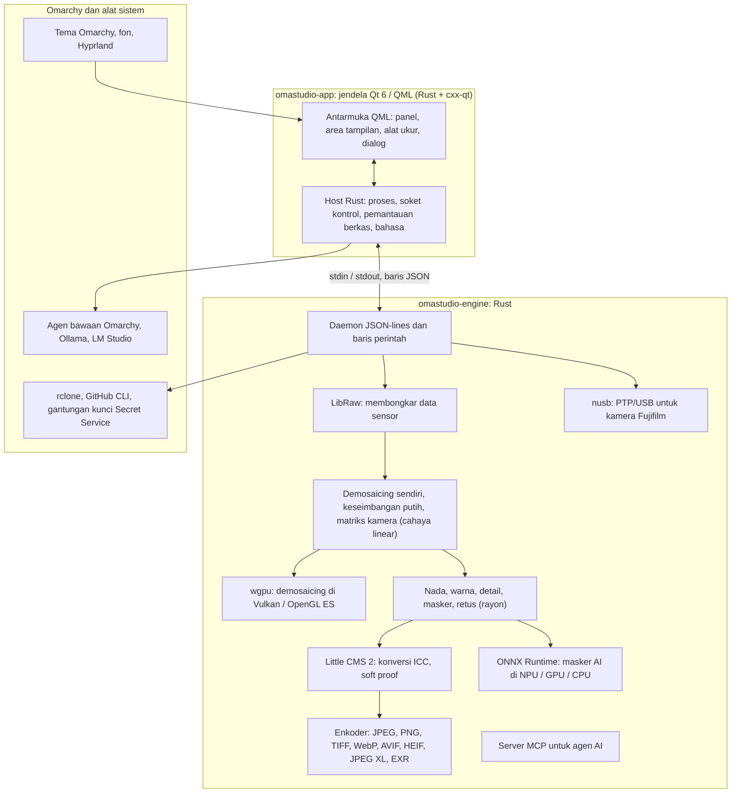

# Teknologi di OmaStudio

**OmaStudio: The Complete Medium Format RAW Editor for Omarchy**

[Semua bahasa](../README.md) · [Panduan pengguna](../guide/id.md) · [README](../../README.md)

Halaman ini menjelaskan teknologi yang menjadi dasar OmaStudio: apa fungsi masing-masing di aplikasi, mengapa dipilih, dan apa lisensinya. OmaStudio sendiri dirilis di bawah lisensi MIT.

## Arsitektur

Jendela dan mesin adalah proses yang terpisah. Jendela tidak pernah mendekode foto sendiri: jendela mengirim perintah ke mesin dan menampilkan gambar yang ditulis mesin. Crash atau macet saat dekode tidak dapat ikut menjatuhkan antarmuka, dan mesin yang sama melayani baris perintah, skrip, dan agen AI.

## Aplikasi

| Teknologi | Peran di OmaStudio | Alasan | Lisensi |
| :--- | :--- | :--- | :--- |
| **Rust** (1.99, edisi 2024) | Bahasa untuk mesin dan host aplikasi | Keamanan memori untuk kode yang mengurai berkas tak tepercaya, kecepatan native, dan satu bahasa untuk kedua proses | MIT / Apache-2.0 |
| **Qt 6** (6.12, Qt Quick / QML) | Antarmuka: panel, area tampilan, alat ukur, dialog | Antarmuka yang digambar GPU dengan dukungan Wayland native dan penskalaan pecahan, tata letak kanan-ke-kiri, dan sistem terjemahan Qt Linguist | LGPL-3.0 |
| **cxx-qt** (0.10) | Menghubungkan Rust dan Qt: tipe host `Process`, `Host`, dan soket kontrol adalah objek Rust yang dipakai dari QML | Binding yang aman ke dua arah tanpa C++ yang ditulis tangan | MIT / Apache-2.0 |
| **Qt Wayland** | Menjalankan jendela sebagai klien Wayland native (app id `omastudio`) | Omarchy menjalankan Hyprland di Wayland; aturan jendela Hyprland dapat mencocokkan app id | LGPL-3.0 |
| **zenity** | Dialog berkas dan folder | Kecil dan tersedia di setiap pemasangan Omarchy | LGPL-2.1+ |

Berkas QML dikompilasi ke dalam biner sebagai resource Qt, sehingga versi yang terpasang tidak pernah tercampur dengan berkas antarmuka yang tercecer.

## Mesin RAW

| Teknologi | Peran di OmaStudio | Alasan | Lisensi |
| :--- | :--- | :--- | :--- |
| **LibRaw** (0.22) | Membaca kontainer RAW dan membongkar data sensor, metadata, dan pratinjau tertanam | Dukungan kamera terluas yang tersedia sebagai pustaka, termasuk Fujifilm GFX, Hasselblad, Phase One, dan Leaf | LGPL-2.1 atau CDDL-1.0 (ditautkan dinamis) |
| **Alur pemrosesan sendiri** | Level hitam, keseimbangan putih, demosaicing X-Trans dan Bayer, matriks warna kamera, koreksi lensa, semuanya pada cahaya linear | Kendali atas warna sejak dari sensor dan jalur 16-bit sampai ekspor; demosaicing memilih di antara empat kandidat arah per piksel | MIT (OmaStudio) |
| **rayon** (1.12) | Pemrosesan paralel di semua inti CPU | Paralelisme data tanpa thread pool yang ditulis tangan | MIT / Apache-2.0 |
| **wgpu** (30) | Demosaicing di GPU melalui Vulkan (NVIDIA, AMD, Intel, Qualcomm Adreno) atau OpenGL ES, dalam pita yang muat dalam batas GPU | Satu jalur kode untuk semua vendor GPU, ditulis dalam WGSL; hasilnya sama dengan jalur CPU dalam selisih satu level dari 65535 | MIT / Apache-2.0 |
| **Little CMS 2** (melalui crate `lcms2`) | Profil ICC, konversi ke ruang warna ekspor, tujuan rendering, soft proof, dan peringatan gamut | Mesin referensi open-source untuk manajemen warna | MIT |
| **image-rs**, **tiff**, **exr** | Membaca dan menulis PNG, JPEG, TIFF, WebP, OpenEXR, Radiance HDR, dan PNM | Codec Rust murni dengan penggunaan memori terbatas | MIT / Apache-2.0; exr: BSD-3-Clause |
| **libjxl**, **libavif**, **libheif**, **libwebp** | Ekspor JPEG XL, AVIF, HEIF, dan WebP lossy | Enkoder referensi untuk format-format ini | BSD-3-Clause, BSD-2-Clause, LGPL-3.0, BSD-3-Clause |
| **ExifTool** (opsional) | Membawa metadata EXIF kamera ke berkas ekspor | Menulis metadata ke setiap format yang diekspor OmaStudio | Artistic / GPL (program terpisah) |
| **Data Lensfun** (opsional) | Profil lensa untuk lensa format medium | Basis data lensa yang besar dan terpelihara, dibaca saat runtime | Data CC BY-SA 3.0 |

Alur warna bekerja pada cahaya linear: eksposur adalah langkah EV fotografis dan keseimbangan putih bekerja pada cahaya seperti pengali milik kamera sendiri. Gambar dienkode untuk layar satu kali, sebelum modul nada dan warna kreatif, lalu dikonversi dengan Little CMS saat ekspor.

## AI

| Teknologi | Peran di OmaStudio | Alasan | Lisensi |
| :--- | :--- | :--- | :--- |
| **ONNX Runtime** (melalui crate `ort`, dimuat saat runtime) | Menjalankan model segmentasi untuk masker **Subjek AI** dan **Langit AI** | Satu runtime untuk NPU, GPU, dan CPU; opsional, sehingga OmaStudio tetap berjalan tanpanya | MIT |
| **Execution provider** | OpenVINO (NPU Intel Core Ultra), QNN (NPU Snapdragon X), Vitis AI (NPU AMD Ryzen AI), CUDA, MIGraphX, WebGPU, XNNPACK | Memakai akselerator tercepat di komputer dan kembali ke CPU | Lisensi masing-masing provider |
| **Agen bawaan Omarchy** (Claude Code atau Codex) | **Asisten penyuntingan** dan **Obrolan AI** memakai agen yang dipilih dengan `omarchy-default-agent`, dengan proses masuk miliknya sendiri | Tidak perlu akun atau kunci tambahan di OmaStudio | Ketentuan agen tersebut |
| **Ollama**, **LM Studio** | Model visi lokal untuk asisten penyuntingan | Foto tetap berada di komputer | MIT; LM Studio: proprietari |
| **Penyedia cloud** (Anthropic, OpenAI, OpenRouter, Google Gemini) | Penyedia opsional untuk asisten penyuntingan, dihubungi dengan `curl` | Kunci disimpan di gantungan kunci dan diteruskan lewat stdin, tidak pernah di baris perintah | Ketentuan penyedia tersebut |
| **Model Context Protocol** | `omastudio mcp` memungkinkan agen AI memeriksa, merender, mengekspor, dan mengendalikan jendela | Protokol terbuka yang didukung banyak agen | Spesifikasi terbuka |

Jawaban asisten dibatasi pada skema JSON dan dijepit ke rentang setiap kontrol sebelum diterapkan, dan setiap suntingan dapat diurungkan.

## Kamera

| Teknologi | Peran di OmaStudio | Alasan | Lisensi |
| :--- | :--- | :--- | :--- |
| **nusb** (0.2) | Akses USB untuk lapisan PTP | Rust murni, tidak butuh libusb atau gphoto2 | MIT / Apache-2.0 |
| **Protokol PTP / Fujifilm** | Pengaturan kustom C1–C7, resep yang ditulis ke kamera, konversi RAW di kamera | Didokumentasikan secara clean-room dari pengamatan; tanpa kode vendor | MIT (OmaStudio) |
| **Aturan udev** | Memberi pengguna yang masuk akses ke kamera Fujifilm dalam mode PTP | Tidak perlu root untuk memakai kamera | MIT (OmaStudio) |

## Akun cloud

| Teknologi | Peran di OmaStudio | Alasan | Lisensi |
| :--- | :--- | :--- | :--- |
| **rclone** | Google Drive, OneDrive, Dropbox, Box, pCloud, dan Yandex Disk: masuk, menelusuri, mengunduh, mengunggah | Satu klien teruji untuk banyak layanan, dengan OAuth di peramban | MIT |
| **GitHub CLI** (`gh`) | Masuk GitHub (device flow) dan repositori privat `OmaStudio` | Klien resmi GitHub; menyimpan tokennya di gantungan kunci | MIT |
| **libsecret** / Secret Service (`secret-tool`, `gnome-keyring`) | Menyimpan kunci konfigurasi rclone terenkripsi milik OmaStudio dan kunci penyedia AI | Rahasia tidak pernah disimpan sebagai teks biasa | LGPL-2.1+ |

## Integrasi Omarchy

- **Tema.** Setiap warna berasal dari tema Omarchy yang aktif (`~/.local/state/omarchy/current/theme/colors.toml`) dan langsung berubah saat tema berganti.
- **Fon.** Antarmuka memakai fon Omarchy (`omarchy-font-set`, dibaca melalui fontconfig) dan menskalakan teks dari ukuran dasar shell Omarchy.
- **Hyprland.** Sudut mengikuti kelengkungan Hyprland; jendela adalah klien Wayland biasa dengan app id `omastudio`.
- **Agen bawaan.** OmaStudio mengikuti `~/.config/omarchy/defaults/agent` secara langsung.
- **Menu aplikasi dan bilah.** Entri desktop memakai ikon monokrom berkontras tinggi seperti aplikasi bawaan Omarchy; `Panel.qml` adalah widget Quickshell opsional untuk bilah Omarchy.
- **Bahasa.** Antarmuka mengikuti bahasa sistem (`LANGUAGE`, `LC_ALL`, `LC_MESSAGES`, `LANG`, `locale.conf`).

## Bahasa

| Teknologi | Peran di OmaStudio | Lisensi |
| :--- | :--- | :--- |
| **Qt Linguist** (berkas `.ts`, `lrelease`) | 30 bahasa antarmuka, dikompilasi ke dalam biner; tata letak kanan-ke-kiri untuk bahasa Arab, Ibrani, dan Persia | LGPL-3.0 / GPL-3.0 (alat build) |
| **tools/i18n/check.py** | Menggagalkan build di CI jika terjemahan hilang, masih berbahasa Inggris, memakai aksara yang salah, atau placeholder-nya tidak cocok | MIT (OmaStudio) |

## Build, uji, dan rilis

| Teknologi | Peran di OmaStudio | Lisensi |
| :--- | :--- | :--- |
| **Cargo** dengan toolchain terkunci (`rust-toolchain.toml`) | Membangun mesin dan aplikasi sebagai satu workspace; `Cargo.lock` disertakan di repositori | MIT / Apache-2.0 |
| **clang**, **pkgconf** | Kompiler C dan driver linker untuk lapisan perantara LibRaw, penemuan pustaka | Apache-2.0 dengan pengecualian LLVM, ISC |
| **GitHub Actions** dalam kontainer `archlinux` | Build, pengujian, `clippy -D warnings`, dan pemeriksaan terjemahan pada setiap perubahan, dengan paket yang sama dengan yang dipakai Omarchy | — |
| **CodeQL** | Analisis statis kode Rust dan workflow | — |
| **Workflow rilis** | Membangun arsip saat ada tag dan menerbitkannya dengan checksum SHA-256 dan atestasi asal build | — |
| **PKGBUILD** | Paket Arch dengan dependensi, dependensi opsional, dan aturan udev | — |

## Keamanan

- Setiap program eksternal berjalan dengan lingkungan yang dibersihkan, grup prosesnya sendiri, batas waktu, dan batas keluaran.
- Setiap berkas yang dibaca mesin memiliki batas ukuran; katalog, pengaturan, dan berkas pendamping ditulis secara atomik dengan mode `0600`, dan tautan simbolik ditolak di folder milik mesin.
- Soket kontrol berada di `$XDG_RUNTIME_DIR/omastudio/` dan hanya menjawab proses milik pengguna yang sama (`SO_PEERCRED`).
- Kunci API dan token cloud tetap di gantungan kunci dan tidak pernah muncul di baris perintah.
- Antarmuka menampilkan semua teks dinamis sebagai teks biasa.

Rinciannya ada di [SECURITY.md](../../SECURITY.md).

## Merek dagang

Fujifilm, GFX, X-Trans, Hasselblad, Phase One, Leica, Pentax, Mamiya, dan nama kamera lainnya adalah merek dagang milik pemiliknya masing-masing dan hanya digunakan untuk menjelaskan kompatibilitas.
