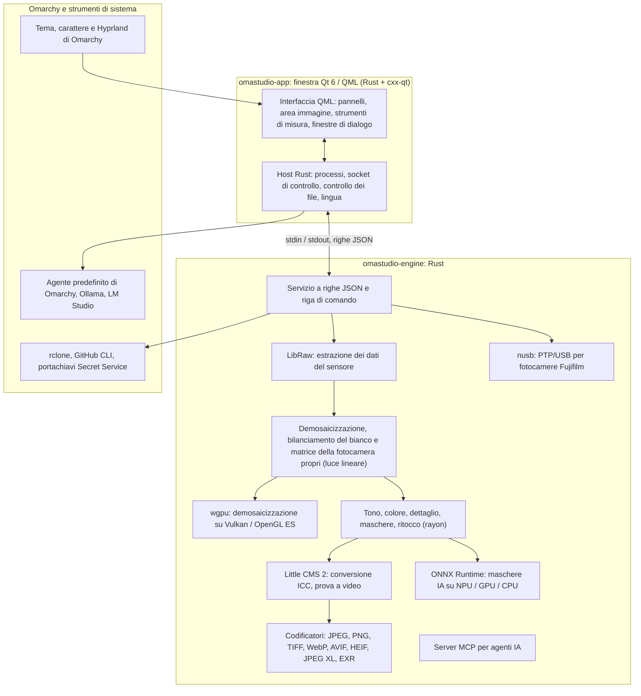

# Le tecnologie di OmaStudio

**OmaStudio: The Complete Medium Format RAW Editor for Omarchy**

[Tutte le lingue](../README.md) · [Guida all'uso](../guide/it.md) · [README](../../README.md)

Questa pagina descrive le tecnologie su cui si basa OmaStudio: cosa fa ciascuna nell'applicazione, perché è stata scelta e con quale licenza è distribuita. OmaStudio è rilasciato con licenza MIT.

## Architettura

Finestra e motore sono processi separati. La finestra non decodifica mai una foto da sé: invia comandi al motore e mostra le immagini che il motore scrive. Un arresto o un blocco durante la decodifica non può trascinare con sé l'interfaccia, e lo stesso motore serve la riga di comando, gli script e gli agenti IA.

## Applicazione

| Tecnologia | Ruolo in OmaStudio | Perché | Licenza |
| :--- | :--- | :--- | :--- |
| **Rust** (1.99, edizione 2024) | Linguaggio del motore e dell'host dell'applicazione | Sicurezza della memoria per codice che legge file non attendibili, velocità nativa e un solo linguaggio per entrambi i processi | MIT / Apache-2.0 |
| **Qt 6** (6.12, Qt Quick / QML) | L'interfaccia: pannelli, area immagine, strumenti di misura, finestre di dialogo | Interfaccia disegnata dalla GPU con supporto nativo a Wayland e scala frazionaria, layout da destra a sinistra e il sistema di traduzione Qt Linguist | LGPL-3.0 |
| **cxx-qt** (0.10) | Collega Rust e Qt: i tipi `Process`, `Host` e il socket di controllo sono oggetti Rust usati da QML | Collegamenti sicuri nei due sensi senza C++ scritto a mano | MIT / Apache-2.0 |
| **Qt Wayland** | Esegue la finestra come client Wayland nativo (ID applicazione `omastudio`) | Omarchy usa Hyprland su Wayland; le regole delle finestre di Hyprland possono riconoscere l'ID | LGPL-3.0 |
| **zenity** | Finestre di selezione di file e cartelle | Leggero e presente in ogni installazione di Omarchy | LGPL-2.1+ |

I file QML sono compilati nell'eseguibile come risorse Qt, così una versione installata non si mescola mai con file d'interfaccia sparsi.

## Motore RAW

| Tecnologia | Ruolo in OmaStudio | Perché | Licenza |
| :--- | :--- | :--- | :--- |
| **LibRaw** (0.22) | Legge il contenitore RAW ed estrae dati del sensore, metadati e anteprime incorporate | Il supporto per fotocamere più ampio disponibile come libreria, comprese Fujifilm GFX, Hasselblad, Phase One e Leaf | LGPL-2.1 o CDDL-1.0 (collegamento dinamico) |
| **Pipeline di sviluppo propria** | Livello del nero, bilanciamento del bianco, demosaicizzazione X-Trans e Bayer, matrice colore della fotocamera, correzioni dell'obiettivo, tutto su luce lineare | Controllo del colore dal sensore in poi e un percorso a 16 bit fino all'esportazione; la demosaicizzazione sceglie per ogni pixel tra quattro candidati direzionali | MIT (OmaStudio) |
| **rayon** (1.12) | Elaborazione parallela su tutti i core della CPU | Parallelismo dei dati senza pool di thread scritti a mano | MIT / Apache-2.0 |
| **wgpu** (30) | Demosaicizzazione sulla GPU tramite Vulkan (NVIDIA, AMD, Intel, Qualcomm Adreno) o OpenGL ES, a fasce che rientrano nei limiti della GPU | Un solo percorso di codice per tutti i produttori di GPU, scritto in WGSL; il risultato coincide con il percorso CPU entro un livello su 65535 | MIT / Apache-2.0 |
| **Little CMS 2** (tramite il crate `lcms2`) | Profili ICC, conversione nello spazio colore di esportazione, intenti di rendering, prova a video e avviso gamut | Il motore di gestione del colore open source di riferimento | MIT |
| **image-rs**, **tiff**, **exr** | Lettura e scrittura di PNG, JPEG, TIFF, WebP, OpenEXR, Radiance HDR e PNM | Codec in Rust puro con uso di memoria limitato | MIT / Apache-2.0; exr: BSD-3-Clause |
| **libjxl**, **libavif**, **libheif**, **libwebp** | Esportazione in JPEG XL, AVIF, HEIF e WebP con perdita | I codificatori di riferimento di questi formati | BSD-3-Clause, BSD-2-Clause, LGPL-3.0, BSD-3-Clause |
| **ExifTool** (facoltativo) | Riporta i metadati EXIF della fotocamera nei file esportati | Scrive i metadati in ogni formato esportato da OmaStudio | Artistic / GPL (programma separato) |
| **Dati Lensfun** (facoltativo) | Profili per obiettivi di medio formato | Un database di obiettivi ampio e aggiornato, letto durante l'esecuzione | Dati CC BY-SA 3.0 |

La pipeline del colore lavora su luce lineare: l'esposizione è un passo fotografico in EV e il bilanciamento del bianco agisce sulla luce come i moltiplicatori della fotocamera. Le immagini sono codificate per lo schermo una sola volta, prima dei moduli creativi di tono e colore, e convertite con Little CMS all'esportazione.

## IA

| Tecnologia | Ruolo in OmaStudio | Perché | Licenza |
| :--- | :--- | :--- | :--- |
| **ONNX Runtime** (tramite il crate `ort`, caricato durante l'esecuzione) | Esegue i modelli di segmentazione delle maschere **Soggetto (IA)** e **Cielo (IA)** | Un solo runtime per NPU, GPU e CPU; facoltativo, OmaStudio si avvia anche senza | MIT |
| **Provider di esecuzione** | OpenVINO (NPU Intel Core Ultra), QNN (NPU Snapdragon X), Vitis AI (NPU AMD Ryzen AI), CUDA, MIGraphX, WebGPU, XNNPACK | Usa l'acceleratore più veloce del computer e ripiega sulla CPU | Licenza di ciascun provider |
| **Agente predefinito di Omarchy** (Claude Code o Codex) | Assistente di modifica e conversazione IA usano l'agente scelto con `omarchy-default-agent`, con il suo accesso | Nessun account o chiave aggiuntivi in OmaStudio | Condizioni dell'agente |
| **Ollama**, **LM Studio** | Modelli di visione locali per l'assistente di modifica | Le foto restano sul computer | MIT; LM Studio: proprietario |
| **Fornitori cloud** (Anthropic, OpenAI, OpenRouter, Google Gemini) | Fornitori facoltativi per l'assistente di modifica, raggiunti con `curl` | Le chiavi sono nel portachiavi e passano su stdin, mai su una riga di comando | Condizioni del fornitore |
| **Model Context Protocol** | `omastudio mcp` permette agli agenti IA di esaminare, elaborare, esportare e controllare la finestra | Un protocollo aperto supportato da molti agenti | Specifica aperta |

La risposta dell'assistente è vincolata da uno schema JSON e limitata all'intervallo di ogni controllo prima di essere applicata, e ogni modifica può essere annullata.

## Fotocamere

| Tecnologia | Ruolo in OmaStudio | Perché | Licenza |
| :--- | :--- | :--- | :--- |
| **nusb** (0.2) | Accesso USB per il livello PTP | Rust puro, senza libusb né gphoto2 | MIT / Apache-2.0 |
| **PTP / protocollo Fujifilm** | Impostazioni personalizzate C1–C7, ricette scritte nella fotocamera, conversione RAW nella fotocamera | Documentato in clean room dall'osservazione; nessun codice del produttore | MIT (OmaStudio) |
| **Regola udev** | Dà all'utente connesso l'accesso alle fotocamere Fujifilm in modalità PTP | Non serve root per usare una fotocamera | MIT (OmaStudio) |

## Account cloud

| Tecnologia | Ruolo in OmaStudio | Perché | Licenza |
| :--- | :--- | :--- | :--- |
| **rclone** | Google Drive, OneDrive, Dropbox, Box, pCloud e Yandex Disk: accesso, navigazione, download, caricamento | Un client collaudato per molti servizi, con OAuth nel browser | MIT |
| **GitHub CLI** (`gh`) | Accesso a GitHub (device flow) e il repository privato `OmaStudio` | Il client ufficiale di GitHub; conserva il token nel portachiavi | MIT |
| **libsecret** / Secret Service (`secret-tool`, `gnome-keyring`) | Conserva la chiave della configurazione rclone cifrata di OmaStudio e le chiavi dei fornitori IA | I segreti non sono mai salvati in chiaro | LGPL-2.1+ |

## Integrazione con Omarchy

- **Tema.** Ogni colore proviene dal tema Omarchy attivo (`~/.local/state/omarchy/current/theme/colors.toml`) e cambia in tempo reale quando cambia il tema.
- **Carattere.** L'interfaccia usa il carattere di Omarchy (`omarchy-font-set`, letto tramite fontconfig) e ridimensiona il testo in base alla dimensione di base della shell di Omarchy.
- **Hyprland.** Gli angoli seguono l'arrotondamento di Hyprland; la finestra è un normale client Wayland con ID `omastudio`.
- **Agente predefinito.** OmaStudio segue `~/.config/omarchy/defaults/agent` in tempo reale.
- **Menu delle applicazioni e barra.** La voce del menu usa un'icona monocromatica ad alto contrasto come le applicazioni di Omarchy; `Panel.qml` è un widget Quickshell facoltativo per la barra di Omarchy.
- **Lingua.** L'interfaccia segue la lingua del sistema (`LANGUAGE`, `LC_ALL`, `LC_MESSAGES`, `LANG`, `locale.conf`).

## Lingue

| Tecnologia | Ruolo in OmaStudio | Licenza |
| :--- | :--- | :--- |
| **Qt Linguist** (file `.ts`, `lrelease`) | 30 lingue dell'interfaccia compilate nell'eseguibile; layout da destra a sinistra per arabo, ebraico e persiano | LGPL-3.0 / GPL-3.0 (strumento di compilazione) |
| **tools/i18n/check.py** | Fa fallire la compilazione in CI quando una traduzione manca, è rimasta in inglese, usa la scrittura sbagliata o ha segnaposto non corrispondenti | MIT (OmaStudio) |

## Compilazione, test e rilascio

| Tecnologia | Ruolo in OmaStudio | Licenza |
| :--- | :--- | :--- |
| **Cargo** con una toolchain fissata (`rust-toolchain.toml`) | Compila motore e applicazione come un unico workspace; `Cargo.lock` è nel repository | MIT / Apache-2.0 |
| **clang**, **pkgconf** | Compilatore C e driver del linker per il ponte con LibRaw, ricerca delle librerie | Apache-2.0 con eccezione LLVM, ISC |
| **GitHub Actions** in un container `archlinux` | Compilazione, test, `clippy -D warnings` e controllo delle traduzioni a ogni modifica, con gli stessi pacchetti di Omarchy | — |
| **CodeQL** | Analisi statica del codice Rust e dei workflow | — |
| **Workflow di rilascio** | Crea l'archivio su un tag e lo pubblica con checksum SHA-256 e attestazioni di provenienza della build | — |
| **PKGBUILD** | Pacchetto Arch con dipendenze, dipendenze facoltative e regola udev | — |

## Sicurezza

- Ogni programma esterno viene eseguito con un ambiente ripulito, nel proprio gruppo di processi, con un limite di tempo e un limite di output.
- Ogni file letto dal motore ha un limite di dimensione; catalogo, impostazioni e file collaterali sono scritti in modo atomico con modalità `0600`, e i collegamenti simbolici sono rifiutati dove la cartella appartiene al motore.
- Il socket di controllo si trova in `$XDG_RUNTIME_DIR/omastudio/` e risponde solo ai processi dello stesso utente (`SO_PEERCRED`).
- Chiavi API e token cloud restano nel portachiavi e non compaiono mai su una riga di comando.
- L'interfaccia mostra tutto il testo dinamico come testo semplice.

I dettagli sono in [SECURITY.md](../../SECURITY.md).

## Marchi

Fujifilm, GFX, X-Trans, Hasselblad, Phase One, Leica, Pentax, Mamiya e gli altri nomi di fotocamere sono marchi dei rispettivi proprietari e sono usati solo per indicare la compatibilità.
