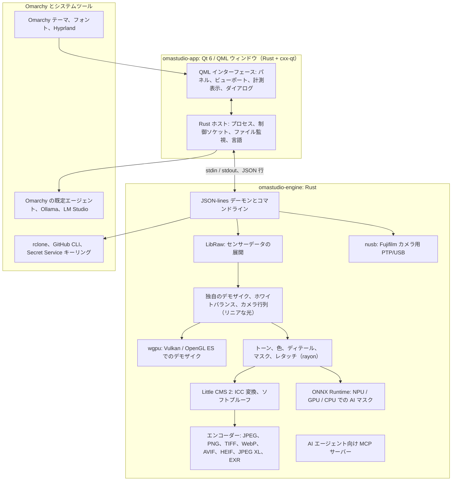

# OmaStudio の使用技術

**OmaStudio: The Complete Medium Format RAW Editor for Omarchy**

[すべての言語](../README.md) · [ユーザーガイド](../guide/ja.md) · [README](../../README.md)

このページでは、OmaStudio を構成する技術について、アプリケーション内での役割、採用した理由、ライセンスを説明します。OmaStudio 自体は MIT ライセンスで公開されています。

## アーキテクチャ

ウィンドウとエンジンは別々のプロセスです。ウィンドウ自身が写真をデコードすることはなく、エンジンにコマンドを送り、エンジンが書き出した画像を表示します。デコード中のクラッシュやハングがインターフェースを巻き込むことはなく、同じエンジンがコマンドライン、スクリプト、AI エージェントにも使われます。

## アプリケーション

| 技術 | OmaStudio での役割 | 理由 | ライセンス |
| :--- | :--- | :--- | :--- |
| **Rust**（1.99、edition 2024） | エンジンとアプリケーションホストの言語 | 信頼できないファイルを解析するコードのメモリ安全性、ネイティブの速度、両プロセスで共通の言語 | MIT / Apache-2.0 |
| **Qt 6**（6.12、Qt Quick / QML） | インターフェース: パネル、ビューポート、計測表示、ダイアログ | GPU 描画のインターフェース、ネイティブ Wayland 対応と分数スケーリング、右から左へのレイアウト、Qt Linguist 翻訳システム | LGPL-3.0 |
| **cxx-qt**（0.10） | Rust と Qt をつなぐ。ホストの型 `Process`、`Host` と制御ソケットは QML から使う Rust オブジェクト | 手書きの C++ なしで双方向に安全なバインディング | MIT / Apache-2.0 |
| **Qt Wayland** | ウィンドウをネイティブ Wayland クライアント（app id `omastudio`）として実行 | Omarchy は Wayland 上で Hyprland を動かしており、Hyprland のウィンドウルールで app id を指定できる | LGPL-3.0 |
| **zenity** | ファイルとフォルダーのダイアログ | 小さく、すべての Omarchy 環境に入っている | LGPL-2.1+ |

QML ファイルは Qt リソースとしてバイナリに組み込まれるため、インストール済みのバージョンに無関係なインターフェースファイルが混ざることはありません。

## RAW エンジン

| 技術 | OmaStudio での役割 | 理由 | ライセンス |
| :--- | :--- | :--- | :--- |
| **LibRaw**（0.22） | RAW コンテナを読み、センサーデータ、メタデータ、埋め込みプレビューを展開 | ライブラリとして利用できる中で最も幅広いカメラ対応。Fujifilm GFX、Hasselblad、Phase One、Leaf を含む | LGPL-2.1 または CDDL-1.0（動的リンク） |
| **独自の現像処理** | 黒レベル、ホワイトバランス、X-Trans と Bayer のデモザイク、カメラのカラー行列、レンズ補正。すべてリニアな光で処理 | センサー以降の色を制御し、書き出しまで 16 ビットの経路を保つ。デモザイクはピクセルごとに 4 方向の候補から選択 | MIT（OmaStudio） |
| **rayon**（1.12） | すべての CPU コアでの並列処理 | 手書きのスレッドプールなしでデータ並列化 | MIT / Apache-2.0 |
| **wgpu**（30） | Vulkan（NVIDIA、AMD、Intel、Qualcomm Adreno）または OpenGL ES による GPU でのデモザイク。GPU の制限に収まる帯状に分割 | WGSL で書かれた全 GPU ベンダー共通のコード経路。結果は CPU 経路と 65535 段階中 1 段階以内で一致 | MIT / Apache-2.0 |
| **Little CMS 2**（`lcms2` クレート経由） | ICC プロファイル、書き出し色空間への変換、レンダリングインテント、ソフトプルーフ、色域外警告 | オープンソースのカラーマネジメントの基準となるエンジン | MIT |
| **image-rs**、**tiff**、**exr** | PNG、JPEG、TIFF、WebP、OpenEXR、Radiance HDR、PNM の読み書き | メモリ使用量に上限のある純 Rust のコーデック | MIT / Apache-2.0、exr: BSD-3-Clause |
| **libjxl**、**libavif**、**libheif**、**libwebp** | JPEG XL、AVIF、HEIF、非可逆 WebP の書き出し | これらの形式のリファレンスエンコーダー | BSD-3-Clause、BSD-2-Clause、LGPL-3.0、BSD-3-Clause |
| **ExifTool**（任意） | カメラの EXIF メタデータを書き出したファイルに引き継ぐ | OmaStudio が書き出すすべての形式にメタデータを書き込める | Artistic / GPL（別プログラム） |
| **Lensfun データ**（任意） | 中判レンズのレンズプロファイル | 実行時に読み込む、大規模で保守されたレンズデータベース | データ CC BY-SA 3.0 |

色の処理はリニアな光で行われます。露光量は写真的な EV ステップで、ホワイトバランスはカメラ自身の係数と同じように光に作用します。画像は創作的なトーンと色のモジュールの前に一度だけ表示用にエンコードされ、書き出し時に Little CMS で変換されます。

## AI

| 技術 | OmaStudio での役割 | 理由 | ライセンス |
| :--- | :--- | :--- | :--- |
| **ONNX Runtime**（`ort` クレート経由、実行時に読み込み） | **AI 被写体** と **AI 空** マスクのセグメンテーションモデルを実行 | NPU、GPU、CPU 共通のランタイム。任意なので、なくても OmaStudio は起動する | MIT |
| **実行プロバイダー** | OpenVINO（Intel Core Ultra NPU）、QNN（Snapdragon X NPU）、Vitis AI（AMD Ryzen AI NPU）、CUDA、MIGraphX、WebGPU、XNNPACK | コンピューターで最も速いアクセラレーターを使い、CPU にフォールバック | 各プロバイダーのライセンス |
| **Omarchy の既定エージェント**（Claude Code または Codex） | **編集アシスタント** と **AI チャット** は `omarchy-default-agent` で選んだエージェントを、そのサインインで使用 | OmaStudio に追加のアカウントやキーが不要 | エージェント自身の規約 |
| **Ollama**、**LM Studio** | 編集アシスタント用のローカル画像認識モデル | 写真がコンピューターの外に出ない | MIT、LM Studio: プロプライエタリ |
| **クラウドプロバイダー**（Anthropic、OpenAI、OpenRouter、Google Gemini） | 編集アシスタント用の任意のプロバイダー。`curl` で接続 | キーはキーリングに保存され、コマンドラインではなく stdin で渡される | 各プロバイダーの規約 |
| **Model Context Protocol** | `omastudio mcp` により AI エージェントが写真の調査、レンダリング、書き出し、ウィンドウ操作を行える | 多くのエージェントが対応するオープンなプロトコル | オープンな仕様 |

アシスタントの回答は JSON スキーマに制約され、適用前に各コントロールの範囲内に収められます。どの編集も取り消せます。

## カメラ

| 技術 | OmaStudio での役割 | 理由 | ライセンス |
| :--- | :--- | :--- | :--- |
| **nusb**（0.2） | PTP レイヤーの USB アクセス | 純 Rust で、libusb も gphoto2 も不要 | MIT / Apache-2.0 |
| **PTP / Fujifilm プロトコル** | カスタム設定 C1–C7、カメラへのレシピ書き込み、カメラ内 RAW 変換 | 観察に基づきクリーンルーム方式で文書化。メーカーのコードは使っていない | MIT（OmaStudio） |
| **udev ルール** | ログイン中のユーザーに PTP モードの Fujifilm カメラへのアクセスを許可 | カメラの使用に root 権限が不要 | MIT（OmaStudio） |

## クラウドアカウント

| 技術 | OmaStudio での役割 | 理由 | ライセンス |
| :--- | :--- | :--- | :--- |
| **rclone** | Google Drive、OneDrive、Dropbox、Box、pCloud、Yandex Disk のサインイン、閲覧、ダウンロード、アップロード | 多くのサービスに対応した実績あるクライアントで、ブラウザーで OAuth を行う | MIT |
| **GitHub CLI**（`gh`） | GitHub のサインイン（デバイスフロー）と非公開リポジトリ `OmaStudio` | GitHub 公式のクライアント。トークンはキーリングに保管 | MIT |
| **libsecret** / Secret Service（`secret-tool`、`gnome-keyring`） | OmaStudio の暗号化された rclone 設定の鍵と AI プロバイダーのキーを保管 | 秘密情報を平文で保存しない | LGPL-2.1+ |

## Omarchy との統合

- **テーマ。** すべての色は有効な Omarchy テーマ（`~/.local/state/omarchy/current/theme/colors.toml`）から取得し、テーマを変えるとすぐに反映されます。
- **フォント。** インターフェースは Omarchy のフォント（`omarchy-font-set`、fontconfig 経由で取得）を使い、Omarchy シェルの基本サイズに合わせて文字を拡大・縮小します。
- **Hyprland。** 角の丸みは Hyprland の設定に従います。ウィンドウは app id `omastudio` を持つ通常の Wayland クライアントです。
- **既定のエージェント。** OmaStudio は `~/.config/omarchy/defaults/agent` の変更にリアルタイムで追従します。
- **アプリメニューとバー。** デスクトップエントリーには Omarchy 標準アプリと同様の高コントラストなモノクロアイコンを使います。`Panel.qml` は Omarchy バー用の任意の Quickshell ウィジェットです。
- **言語。** インターフェースはシステムの言語（`LANGUAGE`、`LC_ALL`、`LC_MESSAGES`、`LANG`、`locale.conf`）に従います。

## 言語

| 技術 | OmaStudio での役割 | ライセンス |
| :--- | :--- | :--- |
| **Qt Linguist**（`.ts` ファイル、`lrelease`） | バイナリに組み込まれた 30 のインターフェース言語。アラビア語、ヘブライ語、ペルシア語は右から左へのレイアウト | LGPL-3.0 / GPL-3.0（ビルドツール） |
| **tools/i18n/check.py** | 翻訳の欠落、英語のままの訳、誤った文字体系、プレースホルダーの不一致があると CI のビルドを失敗させる | MIT（OmaStudio） |

## ビルド・テスト・リリース

| 技術 | OmaStudio での役割 | ライセンス |
| :--- | :--- | :--- |
| **Cargo** と固定したツールチェーン（`rust-toolchain.toml`） | エンジンとアプリケーションを 1 つのワークスペースとしてビルド。`Cargo.lock` はリポジトリに含める | MIT / Apache-2.0 |
| **clang**、**pkgconf** | LibRaw 中間層の C コンパイラーとリンカードライバー、ライブラリの検出 | Apache-2.0（LLVM 例外付き）、ISC |
| `archlinux` コンテナ上の **GitHub Actions** | 変更のたびにビルド、テスト、`clippy -D warnings`、翻訳チェックを Omarchy と同じパッケージで実行 | — |
| **CodeQL** | Rust コードとワークフローの静的解析 | — |
| **リリースワークフロー** | タグでアーカイブをビルドし、SHA-256 チェックサムとビルド来歴の証明書付きで公開 | — |
| **PKGBUILD** | 依存関係、任意の依存関係、udev ルールを含む Arch パッケージ | — |

## セキュリティ

- 外部プログラムはすべて、環境変数を消去した状態で、専用のプロセスグループ、時間制限、出力量の制限付きで実行されます。
- エンジンが読むすべてのファイルにはサイズの上限があります。カタログ、設定、サイドカーはモード `0600` でアトミックに書き込まれ、エンジンが管理するフォルダーではシンボリックリンクを拒否します。
- 制御ソケットは `$XDG_RUNTIME_DIR/omastudio/` にあり、同じユーザーのプロセスにのみ応答します（`SO_PEERCRED`）。
- API キーとクラウドのトークンはキーリングに保管され、コマンドラインに現れることはありません。
- インターフェースは動的なテキストをすべてプレーンテキストとして表示します。

詳細は [SECURITY.md](../../SECURITY.md) にあります。

## 商標

Fujifilm、GFX、X-Trans、Hasselblad、Phase One、Leica、Pentax、Mamiya などのカメラ名は各社の商標であり、互換性を説明する目的でのみ使用しています。
