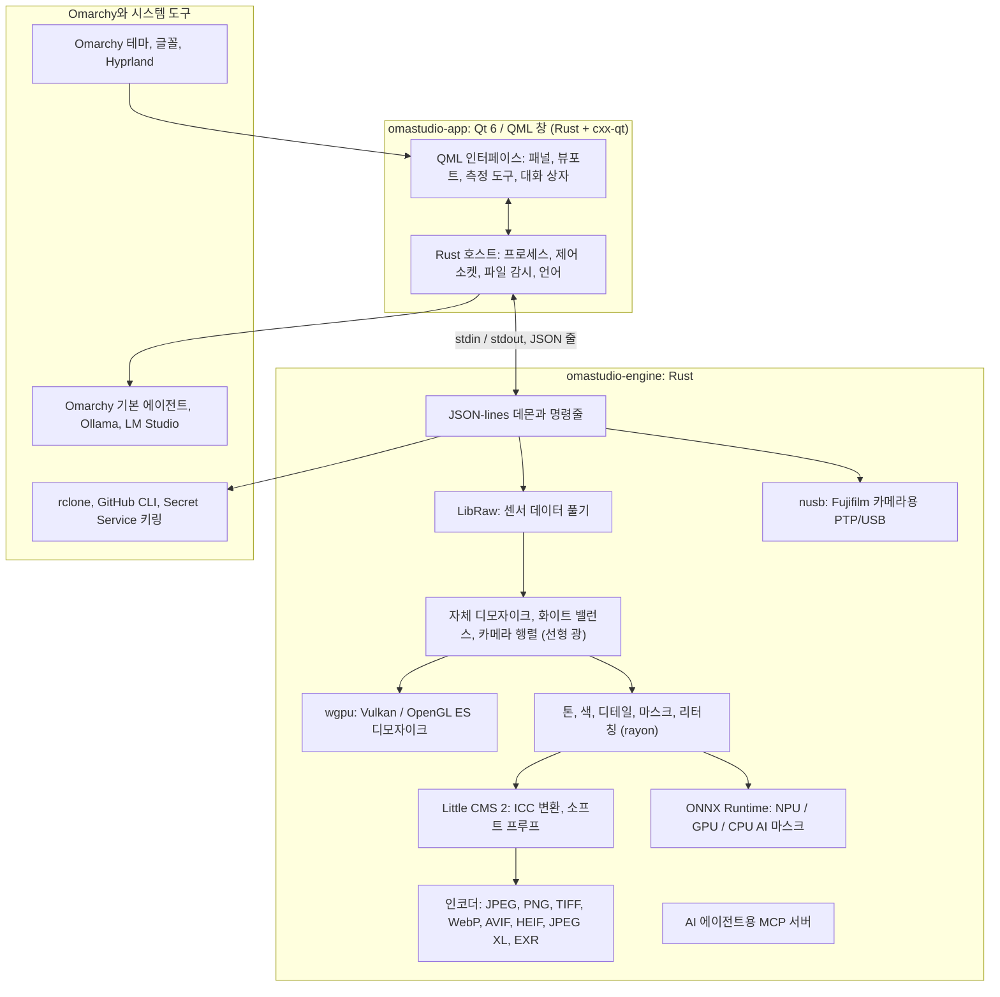

# OmaStudio의 사용 기술

**OmaStudio: The Complete Medium Format RAW Editor for Omarchy**

[모든 언어](../README.md) · [사용 설명서](../guide/ko.md) · [README](../../README.md)

이 페이지는 OmaStudio를 이루는 기술이 응용 프로그램에서 무슨 일을 하는지, 왜 선택했는지, 어떤 라이선스인지 설명합니다. OmaStudio 자체는 MIT 라이선스로 배포됩니다.

## 아키텍처

창과 엔진은 별도의 프로세스입니다. 창은 사진을 직접 디코딩하지 않고, 엔진에 명령을 보내 엔진이 써 낸 이미지를 표시합니다. 디코딩 중 충돌이나 멈춤이 생겨도 인터페이스까지 함께 멈추지 않으며, 같은 엔진이 명령줄, 스크립트, AI 에이전트에도 쓰입니다.

## 응용 프로그램

| 기술 | OmaStudio에서의 역할 | 이유 | 라이선스 |
| :--- | :--- | :--- | :--- |
| **Rust** (1.99, 2024 에디션) | 엔진과 응용 프로그램 호스트의 언어 | 신뢰할 수 없는 파일을 해석하는 코드의 메모리 안전성, 네이티브 속도, 두 프로세스에 하나의 언어 | MIT / Apache-2.0 |
| **Qt 6** (6.12, Qt Quick / QML) | 인터페이스: 패널, 뷰포트, 측정 도구, 대화 상자 | GPU로 그리는 인터페이스, 네이티브 Wayland 지원과 분수 배율, 오른쪽에서 왼쪽 레이아웃, Qt Linguist 번역 체계 | LGPL-3.0 |
| **cxx-qt** (0.10) | Rust와 Qt 연결: 호스트 타입 `Process`, `Host`와 제어 소켓은 QML에서 쓰는 Rust 객체 | 손으로 쓴 C++ 없이 양방향의 안전한 바인딩 | MIT / Apache-2.0 |
| **Qt Wayland** | 창을 네이티브 Wayland 클라이언트(app id `omastudio`)로 실행 | Omarchy는 Wayland 위에서 Hyprland를 쓰며, Hyprland 창 규칙으로 app id를 지정할 수 있음 | LGPL-3.0 |
| **zenity** | 파일 및 폴더 대화 상자 | 작고 모든 Omarchy 설치에 들어 있음 | LGPL-2.1+ |

QML 파일은 Qt 리소스로 바이너리에 포함되므로, 설치된 버전에 관계없는 인터페이스 파일이 섞이지 않습니다.

## RAW 엔진

| 기술 | OmaStudio에서의 역할 | 이유 | 라이선스 |
| :--- | :--- | :--- | :--- |
| **LibRaw** (0.22) | RAW 컨테이너를 읽고 센서 데이터, 메타데이터, 내장 미리 보기를 풀어냄 | 라이브러리로 쓸 수 있는 것 중 가장 넓은 카메라 지원. Fujifilm GFX, Hasselblad, Phase One, Leaf 포함 | LGPL-2.1 또는 CDDL-1.0 (동적 링크) |
| **자체 현상 처리** | 블랙 레벨, 화이트 밸런스, X-Trans 및 Bayer 디모자이크, 카메라 색 행렬, 렌즈 보정을 모두 선형 광에서 처리 | 센서부터 색을 직접 다루고 내보내기까지 16비트 경로 유지. 디모자이크는 픽셀마다 네 방향 후보 중에서 선택 | MIT (OmaStudio) |
| **rayon** (1.12) | 모든 CPU 코어에서 병렬 처리 | 직접 쓴 스레드 풀 없이 데이터 병렬화 | MIT / Apache-2.0 |
| **wgpu** (30) | Vulkan(NVIDIA, AMD, Intel, Qualcomm Adreno) 또는 OpenGL ES로 GPU에서 디모자이크, GPU 한도에 맞는 띠 단위로 처리 | WGSL로 쓴, 모든 GPU 제조사 공통의 코드 경로. 결과는 CPU 경로와 65535단계 중 1단계 이내로 일치 | MIT / Apache-2.0 |
| **Little CMS 2** (`lcms2` 크레이트 사용) | ICC 프로필, 내보내기 색 공간으로 변환, 렌더링 의도, 소프트 프루프, 색역 경고 | 오픈 소스 색상 관리의 기준 엔진 | MIT |
| **image-rs**, **tiff**, **exr** | PNG, JPEG, TIFF, WebP, OpenEXR, Radiance HDR, PNM 읽기와 쓰기 | 메모리 사용량에 한도가 있는 순수 Rust 코덱 | MIT / Apache-2.0, exr: BSD-3-Clause |
| **libjxl**, **libavif**, **libheif**, **libwebp** | JPEG XL, AVIF, HEIF, 손실 WebP 내보내기 | 이 형식들의 참조 인코더 | BSD-3-Clause, BSD-2-Clause, LGPL-3.0, BSD-3-Clause |
| **ExifTool** (선택) | 카메라 EXIF 메타데이터를 내보낸 파일로 옮김 | OmaStudio가 내보내는 모든 형식에 메타데이터를 씀 | Artistic / GPL (별도 프로그램) |
| **Lensfun 데이터** (선택) | 중형 포맷 렌즈의 렌즈 프로필 | 실행 시 읽는, 규모가 크고 관리되는 렌즈 데이터베이스 | 데이터 CC BY-SA 3.0 |

색 처리는 선형 광에서 이루어집니다. 노출은 사진에서 쓰는 EV 단계이고, 화이트 밸런스는 카메라 자체의 배수처럼 빛에 작용합니다. 이미지는 창작용 톤과 색 모듈 앞에서 한 번만 화면용으로 인코딩되며, 내보낼 때 Little CMS로 변환됩니다.

## AI

| 기술 | OmaStudio에서의 역할 | 이유 | 라이선스 |
| :--- | :--- | :--- | :--- |
| **ONNX Runtime** (`ort` 크레이트 사용, 실행 시 로드) | **AI 피사체**와 **AI 하늘** 마스크의 분할 모델 실행 | NPU, GPU, CPU에 공통인 하나의 런타임. 선택 사항이라 없어도 OmaStudio가 시작됨 | MIT |
| **실행 공급자** | OpenVINO(Intel Core Ultra NPU), QNN(Snapdragon X NPU), Vitis AI(AMD Ryzen AI NPU), CUDA, MIGraphX, WebGPU, XNNPACK | 컴퓨터에서 가장 빠른 가속기를 쓰고 CPU로 대체 | 각 공급자의 라이선스 |
| **Omarchy 기본 에이전트** (Claude Code 또는 Codex) | **편집 도우미**와 **AI 채팅**이 `omarchy-default-agent`로 고른 에이전트를 그 로그인으로 사용 | OmaStudio에 추가 계정이나 키가 필요 없음 | 에이전트 자체 약관 |
| **Ollama**, **LM Studio** | 편집 도우미용 로컬 비전 모델 | 사진이 컴퓨터 밖으로 나가지 않음 | MIT, LM Studio: 독점 |
| **클라우드 제공자** (Anthropic, OpenAI, OpenRouter, Google Gemini) | 편집 도우미용 선택 제공자, `curl`로 연결 | 키는 키링에 저장되고 명령줄이 아닌 stdin으로 전달 | 각 제공자의 약관 |
| **Model Context Protocol** | `omastudio mcp`로 AI 에이전트가 사진을 살펴보고, 렌더링하고, 내보내고, 창을 제어 | 많은 에이전트가 지원하는 개방형 프로토콜 | 공개 사양 |

도우미의 답변은 JSON 스키마로 제한되고 적용 전에 각 컨트롤의 범위 안으로 맞춰지며, 모든 편집은 취소할 수 있습니다.

## 카메라

| 기술 | OmaStudio에서의 역할 | 이유 | 라이선스 |
| :--- | :--- | :--- | :--- |
| **nusb** (0.2) | PTP 계층의 USB 접근 | 순수 Rust, libusb나 gphoto2가 필요 없음 | MIT / Apache-2.0 |
| **PTP / Fujifilm 프로토콜** | 사용자 설정 C1–C7, 카메라에 레시피 쓰기, 카메라 내 RAW 변환 | 관찰을 바탕으로 클린룸 방식으로 문서화. 제조사 코드 없음 | MIT (OmaStudio) |
| **udev 규칙** | 로그인한 사용자에게 PTP 모드의 Fujifilm 카메라 접근 권한 부여 | 카메라 사용에 root가 필요 없음 | MIT (OmaStudio) |

## 클라우드 계정

| 기술 | OmaStudio에서의 역할 | 이유 | 라이선스 |
| :--- | :--- | :--- | :--- |
| **rclone** | Google Drive, OneDrive, Dropbox, Box, pCloud, Yandex Disk의 로그인, 탐색, 다운로드, 업로드 | 여러 서비스를 지원하는 검증된 클라이언트, 브라우저에서 OAuth | MIT |
| **GitHub CLI** (`gh`) | GitHub 로그인(장치 흐름)과 비공개 저장소 `OmaStudio` | GitHub 공식 클라이언트. 토큰은 키링에 보관 | MIT |
| **libsecret** / Secret Service (`secret-tool`, `gnome-keyring`) | OmaStudio의 암호화된 rclone 설정 키와 AI 제공자 키를 보관 | 비밀 정보를 평문으로 저장하지 않음 | LGPL-2.1+ |

## Omarchy 통합

- **테마.** 모든 색은 활성 Omarchy 테마(`~/.local/state/omarchy/current/theme/colors.toml`)에서 가져오며, 테마를 바꾸면 바로 반영됩니다.
- **글꼴.** 인터페이스는 Omarchy 글꼴(`omarchy-font-set`, fontconfig로 읽음)을 쓰고, Omarchy 셸의 기본 크기에 맞춰 글자 크기를 조정합니다.
- **Hyprland.** 모서리는 Hyprland의 둥글기를 따릅니다. 창은 app id가 `omastudio`인 일반 Wayland 클라이언트입니다.
- **기본 에이전트.** OmaStudio는 `~/.config/omarchy/defaults/agent`의 변경을 실시간으로 따릅니다.
- **앱 메뉴와 막대.** 데스크톱 항목은 Omarchy 기본 앱처럼 고대비 흑백 아이콘을 씁니다. `Panel.qml`은 Omarchy 막대용 선택형 Quickshell 위젯입니다.
- **언어.** 인터페이스는 시스템 언어(`LANGUAGE`, `LC_ALL`, `LC_MESSAGES`, `LANG`, `locale.conf`)를 따릅니다.

## 언어

| 기술 | OmaStudio에서의 역할 | 라이선스 |
| :--- | :--- | :--- |
| **Qt Linguist** (`.ts` 파일, `lrelease`) | 바이너리에 포함된 30개 인터페이스 언어. 아랍어, 히브리어, 페르시아어는 오른쪽에서 왼쪽 레이아웃 | LGPL-3.0 / GPL-3.0 (빌드 도구) |
| **tools/i18n/check.py** | 번역이 빠졌거나, 영어로 남았거나, 문자 체계가 틀렸거나, 자리 표시자가 맞지 않으면 CI 빌드를 실패시킴 | MIT (OmaStudio) |

## 빌드, 테스트, 릴리스

| 기술 | OmaStudio에서의 역할 | 라이선스 |
| :--- | :--- | :--- |
| 고정된 툴체인(`rust-toolchain.toml`)의 **Cargo** | 엔진과 응용 프로그램을 하나의 워크스페이스로 빌드. `Cargo.lock`은 저장소에 포함 | MIT / Apache-2.0 |
| **clang**, **pkgconf** | LibRaw 중간 계층용 C 컴파일러와 링커 드라이버, 라이브러리 탐색 | Apache-2.0(LLVM 예외), ISC |
| `archlinux` 컨테이너의 **GitHub Actions** | 변경할 때마다 Omarchy와 같은 패키지로 빌드, 테스트, `clippy -D warnings`, 번역 검사 실행 | — |
| **CodeQL** | Rust 코드와 워크플로의 정적 분석 | — |
| **릴리스 워크플로** | 태그가 붙으면 압축 파일을 빌드하고 SHA-256 체크섬과 빌드 출처 증명과 함께 게시 | — |
| **PKGBUILD** | 의존성, 선택 의존성, udev 규칙을 포함한 Arch 패키지 | — |

## 보안

- 모든 외부 프로그램은 비운 환경, 전용 프로세스 그룹, 시간 제한, 출력 제한 아래에서 실행됩니다.
- 엔진이 읽는 모든 파일에는 크기 제한이 있습니다. 카탈로그, 설정, 사이드카는 모드 `0600`으로 원자적으로 쓰이며, 엔진이 관리하는 폴더에서는 심볼릭 링크를 거부합니다.
- 제어 소켓은 `$XDG_RUNTIME_DIR/omastudio/`에 있으며 같은 사용자의 프로세스에만 응답합니다(`SO_PEERCRED`).
- API 키와 클라우드 토큰은 키링에 남으며 명령줄에 나타나지 않습니다.
- 인터페이스는 모든 동적 텍스트를 일반 텍스트로 표시합니다.

자세한 내용은 [SECURITY.md](../../SECURITY.md)에 있습니다.

## 상표

Fujifilm, GFX, X-Trans, Hasselblad, Phase One, Leica, Pentax, Mamiya 및 기타 카메라 이름은 각 소유자의 상표이며, 호환성을 설명하는 목적으로만 사용합니다.
